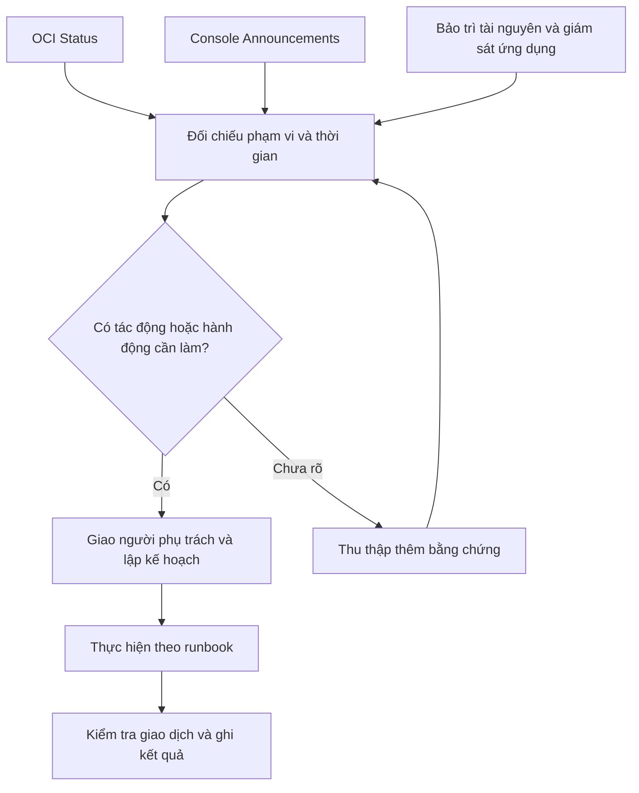
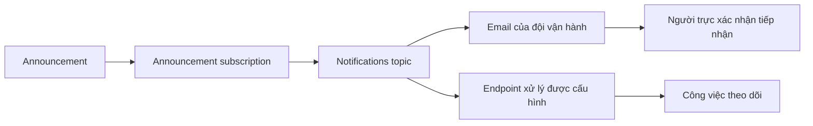

# Theo dõi Service Health và thông báo bảo trì

Trong vận hành Oracle Cloud Infrastructure (OCI), biết sớm một đợt bảo trì chỉ có giá trị khi thông tin đến đúng người, được đối chiếu với tài nguyên thực tế và dẫn đến hành động có thể kiểm chứng. Một email nằm trong hộp thư quản trị viên chưa tạo thành quy trình vận hành.

Bài học thuộc chương **Vận hành và xử lý sự cố** của module **CLOUD_PROVIDERS_ORACLE**. Nội dung kết nối tenancy, compartment và IAM với việc theo dõi các dịch vụ mạng VCN, Compute, lưu trữ và cơ sở dữ liệu Oracle. Mục tiêu là xây dựng cách tiếp nhận thông tin, đánh giá ảnh hưởng và chuẩn bị bảo trì phù hợp với yêu cầu tính sẵn sàng, tự động hóa và chi phí.

## 1. Kết quả cần đạt

Sau bài học, bạn có thể:

- Phân biệt trạng thái dịch vụ công khai, thông báo liên quan đến tenancy và sức khỏe thực tế của ứng dụng.
- Đọc một announcement để xác định phạm vi ảnh hưởng, thời gian, người chịu trách nhiệm và hành động cần thực hiện.
- Thiết kế luồng Announcements → Notifications topic → người nhận, kèm quyền IAM phù hợp.
- Chuẩn bị và theo dõi bảo trì Compute hoặc cơ sở dữ liệu mà vẫn kiểm tra được khả năng phục vụ người dùng.
- Chẩn đoán tình huống không nhận được thông báo và lưu bằng chứng để bàn giao hoặc làm việc với Oracle Support.

Các thao tác minh họa sử dụng OCI Console và OCI CLI. Các câu lệnh là ví dụ để người học thực hiện trong môi trường được phép; hãy thay toàn bộ giá trị giữ chỗ trước khi chạy.

## 2. Theo dõi nhiều nguồn tín hiệu

Một ứng dụng có thể lỗi trong khi dashboard công khai vẫn bình thường. Ngược lại, một sự cố dịch vụ trong cùng region có thể chưa ảnh hưởng đến ứng dụng của bạn.

| Nguồn tín hiệu | Phạm vi quan sát | Câu hỏi vận hành |
| --- | --- | --- |
| OCI Status, thường được truy cập khi kiểm tra Service Health | Trạng thái dịch vụ theo region | Oracle đã công bố vấn đề nào có thể liên quan? |
| Console Announcements | Thông báo gửi đến phạm vi tài khoản | Có thay đổi, bảo trì hoặc hành động nào cần xem xét? |
| Trang bảo trì của tài nguyên | Sự kiện gắn với tài nguyên cụ thể | Tài nguyên nào có lịch hoặc trạng thái bảo trì cần xử lý? |
| Metrics, logs và phép thử ứng dụng | Hành vi hệ thống do bạn vận hành | Người dùng còn hoàn thành được giao dịch hay không? |

Oracle phân biệt dashboard trạng thái ở cấp dịch vụ/region với sự cố riêng của khách hàng được truyền qua Console Announcements. Vì vậy, luôn đối chiếu hai kênh này khi khoanh vùng. [Nguồn: System Status](https://docs.oracle.com/en-us/iaas/Content/General/Concepts/status-service.htm)

Ví dụ, API tạo đơn hàng trả nhiều lỗi kết nối cơ sở dữ liệu. Người trực nên kiểm tra cả tình trạng dịch vụ cơ sở dữ liệu, thông báo của tenancy, lịch bảo trì database và số kết nối trong ứng dụng. Chỉ nhìn biểu đồ CPU của máy chạy Java sẽ bỏ sót nhiều khả năng.

Luồng làm việc có thể tổ chức như sau:



## 3. Đọc Service Health có mục tiêu

Với các region thương mại, mở [OCI Status](https://ocistatus.oraclecloud.com/), chọn đúng region và dịch vụ. Dashboard dùng các trạng thái như **Normal Performance**, **Informational**, **Service Disruption** và **Service Down**. Mục History cung cấp diễn biến sự kiện; trang trạng thái cũng có RSS và các báo cáo JSON cho việc tích hợp. [Nguồn: System Status](https://docs.oracle.com/en-us/iaas/Content/General/Concepts/status-service.htm)

Thay vì chỉ ghi “Oracle đang lỗi”, hãy đối chiếu ba yếu tố:

1. **Dịch vụ:** lỗi tạo Compute instance khác với lỗi truy cập API nghiệp vụ trên một instance đang chạy.
2. **Địa điểm:** sự cố ở region khác chỉ liên quan nếu ứng dụng có phụ thuộc tại đó.
3. **Thời gian:** đối chiếu mốc phát hiện của bạn với diễn biến được công bố, ghi rõ múi giờ.

Đối với hệ thống có nhiều phụ thuộc, duy trì một danh sách ngắn như sau:

| Thành phần nghiệp vụ | Phụ thuộc cần kiểm tra |
| --- | --- |
| API bán hàng | Load Balancer, Compute, mạng VCN, DNS và database thực tế đang dùng |
| Upload chứng từ | API ứng dụng, Object Storage, đường đi mạng và quyền truy cập |
| Xử lý batch | Compute, nơi lưu dữ liệu đầu vào, database và bộ lập lịch |
| Đăng nhập quản trị | Kênh truy cập Console/API và hệ thống định danh liên quan |

Danh sách này phải phản ánh kiến trúc thật. Đăng ký theo dõi mọi dịch vụ rồi đẩy toàn bộ vào kênh khẩn cấp sẽ làm người trực khó nhận ra tín hiệu cần xử lý.

Khi tự động lấy báo cáo công khai, cần ghi nhận cả lỗi của bộ thu thập. Không truy cập được trang trạng thái chỉ chứng minh phép kiểm tra đó thất bại; nó chưa đủ để kết luận toàn bộ OCI gặp sự cố. Cũng cần lưu thời điểm lấy dữ liệu để tránh hiển thị một bản báo cáo cũ như trạng thái hiện tại.

## 4. Đọc Announcements theo trách nhiệm vận hành

### 4.1. Nhận diện loại thông báo

Announcements bao gồm các loại như **Required action**, **Recommended action**, **Scheduled maintenance**, **Planned change**, **Emergency change**, cùng thông báo cập nhật, dời lịch hoặc hoàn tất tương ứng. Loại thông báo giúp xác định cách xử lý ban đầu; mức độ ưu tiên nội bộ còn phụ thuộc tác động nghiệp vụ. [Nguồn: Console Announcements](https://docs.oracle.com/en-us/iaas/Content/General/Concepts/announcements.htm)

| Nhóm thông tin | Cách tiếp nhận đề xuất |
| --- | --- |
| Bắt buộc hành động | Giao chủ sở hữu, ghi hạn chót và bằng chứng hoàn thành |
| Bảo trì hoặc thay đổi đã lên kế hoạch | Đánh giá gián đoạn, phụ thuộc và cửa sổ thao tác |
| Thay đổi khẩn cấp | Đưa vào quy trình trực, kiểm tra ảnh hưởng ngay |
| Đề nghị hành động | Đánh giá rủi ro nếu trì hoãn, đưa vào kế hoạch có người phụ trách |
| Dời lịch hoặc kéo dài | Cập nhật kế hoạch hiện có và thông tin cho đội liên quan |
| Hoàn tất | Xác nhận lại hệ thống trước khi đóng công việc |

Đừng áp dụng một số ngày báo trước cho mọi dịch vụ. Ngày thực hiện, hạn hành động và khả năng thay đổi lịch phải được xác nhận từ thông báo và tài nguyên cụ thể. Một kế hoạch nội bộ dựa trên thói quen của lần bảo trì trước rất dễ bỏ lỡ hạn mới.

### 4.2. Mở thông báo đầy đủ

Trong Console, mở **Announcements**, chọn thông báo liên quan và đọc nội dung chi tiết. Những dữ liệu cần chú ý gồm mã tham chiếu, dịch vụ, region, thời điểm, hạn hành động, tài nguyên ảnh hưởng và lịch sử cập nhật. [Nguồn: Viewing the Details of an Announcement](https://docs.oracle.com/en-us/iaas/Content/General/Concepts/announcements_topic-To_view_the_details_of_an_announcement.htm)

Chuyển thông tin đó thành một bản ghi có thể xử lý:

```text
Nguồn: Console Announcements
Mã announcement / mã tham chiếu:
Thời điểm đội vận hành tiếp nhận:
Dịch vụ và region:
OCID tài nguyên được nêu:
Ứng dụng và môi trường liên quan:
Tác động dự kiến:
Bắt đầu / kết thúc dự kiến / hạn hành động:
Múi giờ gốc và thời gian Việt Nam:
Người phụ trách chính / người thay thế:
Hành động đã thống nhất:
Bằng chứng kiểm tra sau thực hiện:
Thời điểm cần xem lại thông tin:
```

Phân biệt thời điểm **nhận thông báo**, **bắt đầu sự kiện** và **hạn hoàn thành hành động**. Ba mốc này phục vụ ba việc khác nhau: đo tốc độ tiếp nhận, đối chiếu ảnh hưởng và kiểm soát tiến độ.

Ví dụ giả định: cửa sổ bắt đầu lúc `2026-12-10T18:00:00Z` tương ứng **01:00 ngày 11/12/2026 tại Việt Nam**. Việc cộng bảy giờ còn có thể làm thay đổi ngày. Trong ticket, nên lưu cả chuỗi UTC gốc và thời gian địa phương.

### 4.3. “Đã đọc” chưa phải “đã xử lý”

Đánh dấu đã đọc chỉ phục vụ quản lý việc xem thông báo. Nhóm vận hành vẫn cần một công việc có chủ sở hữu, hạn hoàn thành và tiêu chí đóng riêng.

Oracle nêu thời gian lưu Announcements là 90 ngày. Nếu cần điều tra dài hạn, hãy lưu mã tham chiếu, nội dung quan trọng và kết quả xử lý vào nơi lưu hồ sơ vận hành của tổ chức. [Nguồn: Viewing a List of All Announcements](https://docs.oracle.com/en-us/iaas/Content/General/Concepts/announcements_topic-To_view_a_list_of_all_announcements.htm)

Khi tiếp nhận bản cập nhật, mở lại công việc đã có trước khi tạo bản mới. Một thay đổi giờ bảo trì thường cần cập nhật lịch trực, thời điểm dừng batch và lịch thông tin cho chủ ứng dụng cùng lúc.

## 5. Chuẩn bị IAM cho người xem và người cấu hình

Người trực cần đọc được nội dung đầy đủ. Quyền `inspect announcements` cho phép xem bản tóm tắt; quyền `read announcements` cho phép đọc chi tiết. Chính sách đọc announcements được đặt ở phạm vi tenancy. [Nguồn: Common Policies — Announcements](https://docs.oracle.com/en-us/iaas/Content/Identity/Concepts/commonpolicies.htm)

Ví dụ dành cho nhóm chỉ đọc:

```text
Allow group 'Default'/'OciOpsReaders' to read announcements in tenancy
```

Trong ví dụ, `Default` là tên identity domain, `OciOpsReaders` là nhóm và `Operations` bên dưới là compartment đã tồn tại. Hãy thay bằng tên thực tế.

Nhóm cấu hình subscription có thể cần những quyền sau, tùy nhiệm vụ được giao:

```text
Allow group 'Default'/'OciNoticeAdmins' to read announcements in tenancy
Allow group 'Default'/'OciNoticeAdmins' to manage announcement-subscriptions in compartment Operations
Allow group 'Default'/'OciNoticeAdmins' to manage ons-topics in compartment Operations
Allow group 'Default'/'OciNoticeAdmins' to inspect ons-subscriptions in compartment Operations
```

`announcement-subscriptions` kiểm soát tài nguyên cấu hình nhận announcement; nó là loại tài nguyên riêng với `announcements`. [Nguồn: Details for the Announcements Service](https://docs.oracle.com/en-us/iaas/Content/Identity/policyreference/announcementspolicyreference.htm)

Với Notifications, quyền quản lý `ons-topics` bao gồm các thao tác topic, gửi thông điệp và đăng ký endpoint; quyền liệt kê subscription cần được xét theo `ons-subscriptions`. [Nguồn: Details for Notifications](https://docs.oracle.com/en-us/iaas/Content/Identity/Reference/notificationpolicyreference.htm)

Đây là ví dụ phân chia vai trò để xây dựng chính sách, không phải yêu cầu mọi người trực đều có quyền quản trị. Nếu chỉ gắn endpoint vào topic có sẵn, hãy thu hẹp quyền theo nhiệm vụ thay vì sao chép toàn bộ ví dụ.

Quyền đọc announcement cũng không tự cấp quyền xem metrics, thay đổi instance, điều chỉnh database hay tạo Events rule. Khi một người thấy thông báo nhưng không mở được tài nguyên, cần xác định quyền còn thiếu ở bước đó. Tránh xử lý bằng cách cấp quyền quản trị toàn tenancy.

## 6. Thiết kế luồng nhận thông báo

### 6.1. Hiểu hai loại subscription

Có hai khái niệm dễ nhầm:

- **Announcement subscription:** quyết định announcement nào được chuyển đến một Notifications topic.
- **Notifications subscription:** xác định endpoint nhận thông điệp từ topic đó, chẳng hạn email của đội vận hành.

Cơ chế lọc và chuyển announcement đến topic được mô tả trong [Subscribing to Announcements](https://docs.oracle.com/en-us/iaas/Content/General/Concepts/announcements_topic-Subscribing.htm).



Tên topic nên diễn đạt trách nhiệm, ví dụ `oci-ops-notices`. Chủ sở hữu topic và chủ sở hữu ứng dụng cần biết ai sẽ thay đổi danh sách người nhận khi thành viên đổi vai trò.

### 6.2. Thiết lập theo thứ tự

1. Chọn region và compartment dành cho cấu hình Notifications.
2. Tạo topic phục vụ nhóm vận hành.
3. Tạo email subscription cho địa chỉ đã thống nhất.
4. Người quản lý hộp thư xác nhận đăng ký và kiểm tra trạng thái subscription.
5. Trong Announcements → Subscriptions, tạo announcement subscription và chọn topic đích.
6. Ghi lại OCID, người sở hữu và mục đích của từng cấu hình trong hồ sơ vận hành.

Notifications gửi URL xác nhận khi tạo email subscription. Subscription ở trạng thái chờ cho đến khi xác nhận; URL có hiệu lực ba ngày. Email có thể là địa chỉ nhóm phân phối. [Nguồn: Creating an Email Subscription](https://docs.oracle.com/en-us/iaas/Content/Notification/Tasks/create-subscription-email.htm)

Khi tạo announcement subscription, có thể chọn **All announcements** hoặc **Selected announcements only**. [Nguồn: Creating an Announcement Subscription](https://docs.oracle.com/en-us/iaas/Content/General/Concepts/announcements_topic-To_create_a_subscription.htm)

Một thiết kế khởi đầu hợp lý là có hộp thư tổng hợp để người có trách nhiệm rà soát phạm vi rộng. Các kênh chuyên trách có thể lọc hẹp hơn theo nhu cầu của đội Compute, mạng hoặc database. Khi hệ thống lớn dần, cần xem lại mức nhiễu dựa trên thông báo thực tế đã nhận.

### 6.3. Kiểm soát bộ lọc để tránh bỏ sót

Trong một filter group, các điều kiện lọc phải cùng khớp; nhiều giá trị của một điều kiện cho phép khớp với một trong các giá trị. Bộ lọc compartment khớp chính xác, không tự bao gồm compartment con. Bộ lọc Resource OCID không được kết hợp với loại lọc khác trong cùng group. [Nguồn: Adding a Filter Group to an Existing Subscription](https://docs.oracle.com/en-us/iaas/Content/General/Concepts/announcements_topic-To_add_filters_to_a_subscription.htm)

Ví dụ giả định: bạn muốn đội Compute theo dõi tất cả region đang dùng. Nếu bộ lọc vừa giới hạn dịch vụ Compute vừa giới hạn một region duy nhất, nhóm sẽ cần kiểm tra xem phạm vi đó còn đáp ứng mục tiêu hay không khi triển khai thêm region.

Các bước rà soát hữu ích:

- Liệt kê những loại thông tin đội cần biết, bao gồm cập nhật và dời lịch.
- Viết ra ví dụ thông báo dự kiến phải đi qua từng cấu hình.
- So sánh phạm vi lọc với danh sách ứng dụng và tài nguyên đang vận hành.
- Xem lại bộ lọc sau khi thêm region, di chuyển tài nguyên hoặc thay đổi người phụ trách.

Việc chọn compartment để **lưu tài nguyên subscription** và việc đặt **điều kiện lọc compartment của announcement** là hai quyết định khác nhau. Đặt tên và mô tả rõ giúp người tiếp quản không nhầm phạm vi cấu hình với phạm vi thông tin được nhận.

Đừng suy region ảnh hưởng từ địa chỉ email người gửi: Oracle lưu ý region của địa chỉ gửi Notifications không nhất thiết là region bị tác động. [Nguồn: Subscribing to Announcements](https://docs.oracle.com/en-us/iaas/Content/General/Concepts/announcements_topic-Subscribing.htm)

## 7. Đọc bằng CLI và kiểm tra đường gửi

Các ví dụ sau dùng **PowerShell** với OCI CLI đã được cấu hình xác thực. Không đặt khóa riêng, mật khẩu hoặc token trong nội dung thông báo.

### 7.1. Liệt kê và mở announcement

```powershell
$tenancyId = '<TENANCY_OCID>'
$cliRegion = '<REGION_IDENTIFIER>'

oci announce announcements list --compartment-id $tenancyId --region $cliRegion --all
```

Lệnh liệt kê và các tùy chọn lọc của Announcements được Oracle mô tả tại [Filtering Announcements](https://docs.oracle.com/en-us/iaas/Content/General/Concepts/announcements_topic-To_filter_a_list_of_announcements.htm).

Lấy OCID từ kết quả rồi đọc bản đầy đủ:

```powershell
$announcementId = '<ANNOUNCEMENT_OCID>'

oci announce announcements get --announcement-id $announcementId --region $cliRegion
```

Cú pháp truy vấn chi tiết dùng `--announcement-id`. [Nguồn: OCI CLI — announcements get](https://docs.oracle.com/en-us/iaas/tools/oci-cli/latest/oci_cli_docs/cmdref/announce/announcements/get.html)

Nếu kết quả rỗng, hãy kiểm tra tenancy, quyền, phạm vi truy vấn và bộ lọc trước khi kết luận không có thông báo. Kết quả của một lần liệt kê cũng chưa nói rằng mọi thông báo trước đây đã được xử lý.

### 7.2. Gửi một thông điệp thử đến topic

Dùng topic thử nghiệm với những người nhận đã biết về buổi kiểm tra. Nếu topic đang nối tới hệ thống gọi trực hoặc tạo công việc tự động, cần thống nhất cách xử lý thông điệp thử trước khi gửi.

```powershell
$topicId = '<NOTIFICATIONS_TOPIC_OCID>'
$topicRegion = '<REGION_CUA_TOPIC>'

oci ons message publish --topic-id $topicId --region $topicRegion --title '[TEST] OCI notice delivery' --body 'Test only. Verify receipt and record the delivery time.'
```

Notifications hỗ trợ gửi trực tiếp thông điệp đến topic; với email, title được dùng làm tiêu đề thư. [Nguồn: Publishing a Message to a Topic](https://docs.oracle.com/en-us/iaas/Content/Notification/Tasks/publishingmessages.htm)

Người kiểm tra cần ghi:

| Bằng chứng | Điều được xác nhận |
| --- | --- |
| Lệnh publish thành công | Yêu cầu gửi được dịch vụ chấp nhận |
| Endpoint nhận đúng thông điệp | Đường từ topic tới endpoint hoạt động trong lần thử |
| Người trực xác nhận tiếp nhận | Quy trình con người có người thực hiện |
| Announcement thật đi qua cấu hình | Bộ lọc và nguồn phát được kiểm chứng cho tình huống đó |

**Publish thử vào topic chỉ kiểm tra phần sau của luồng.** Nó không chứng minh announcement subscription chọn đúng thông báo. Nếu chưa có announcement thật phù hợp, ghi rõ phần này chưa được kiểm chứng bằng sự kiện thực.

Không cần tạo sự cố hoặc khởi động lại tài nguyên để thử đường gửi thông báo.

## 8. Liên hệ bảo trì Compute với ứng dụng

### 8.1. Đọc đúng hành động của tài nguyên

Bảo trì Compute có thể sử dụng live migration, reboot migration, rebuild in place hoặc yêu cầu di chuyển thủ công tùy tài nguyên. Mức gián đoạn và cách bảo toàn dữ liệu cục bộ khác nhau; live migration cũng không phải lựa chọn áp dụng cho mọi instance. [Nguồn: Instance Maintenance](https://docs.oracle.com/en-us/iaas/Content/Compute/References/infrastructure-maintenance.htm)

Trong Console, mở **Compute → Instance Maintenance**, kiểm tra đúng compartment rồi mở sự kiện liên quan. Trang chi tiết cung cấp thông tin như loại, dịch vụ ảnh hưởng và thời điểm hành động. [Nguồn: Managing Maintenance Events](https://docs.oracle.com/en-us/iaas/Content/Compute/Tasks/managing-maintenance-events.htm)

Trước khi lên lịch thao tác, cần trả lời:

- Instance chứa thành phần nào: frontend, worker, thành viên cụm hay một dịch vụ đơn lẻ?
- Có thể rút traffic và chờ request đang chạy hoàn thành không?
- Những job nào cần checkpoint hoặc tạm dừng?
- Dữ liệu nào nằm trên boot volume, block volume và ổ cục bộ?
- Thành phần dự phòng đã được kiểm tra với tải đủ lớn chưa?
- Quy trình khôi phục có phụ thuộc IP, VNIC, cấu hình hệ điều hành hoặc trạng thái ứng dụng không?

Một lệnh reboot bên trong hệ điều hành không nên được coi là bằng chứng đã hoàn thành yêu cầu migration. Phải thực hiện đúng hành động được chỉ dẫn và kiểm tra lại sự kiện bảo trì.

Nếu cân nhắc đổi lịch, hãy xem khả năng được cung cấp trên tài nguyên và nội dung thông báo. Không đưa một ngày mới vào kế hoạch nội bộ khi lịch phía OCI chưa được xác nhận.

### 8.2. Bổ sung metric bảo trì

Namespace `oci_compute_infrastructure_health` có metric `maintenance_status`: giá trị `1` biểu thị có lịch bảo trì hạ tầng, `0` biểu thị không có lịch. Các dimension liên quan có thể cung cấp hạn bảo trì và hành động. Metric `instance_status` phản ánh khả năng sẵn sàng của VM ở lớp hạ tầng; nó không thay thế phép thử ứng dụng. [Nguồn: Infrastructure Health Metrics](https://docs.oracle.com/en-us/iaas/Content/Compute/References/infrastructurehealthmetrics.htm)

Ví dụ truy vấn MQL cho một instance:

```text
maintenance_status[5m]{resourceId = "<INSTANCE_OCID>"}.max() > 0
```

Chọn namespace và compartment tương ứng trong Monitoring. Khi tạo alarm, xác định thời gian chờ, mức ưu tiên và đích nhận theo nhịp vận hành của đội.

Metric này phù hợp để nhắc kiểm tra lịch hoặc tạo công việc chuẩn bị. Nếu gửi lặp liên tục như một sự cố khẩn cấp suốt nhiều ngày, người trực sẽ khó phân biệt lịch bảo trì tương lai với mất khả năng phục vụ hiện tại.

Truy vấn không trả dữ liệu phải được điều tra riêng: kiểm tra time range, region, compartment, dimension và quyền. Không diễn giải thiếu dữ liệu thành giá trị `0`.

## 9. Bảo trì cơ sở dữ liệu Oracle cần kênh theo dõi riêng

Không suy lịch bảo trì database từ lịch của VM chạy ứng dụng Java. Nhóm phụ trách phải xác định đúng loại dịch vụ database và cấu hình đang sử dụng.

Ví dụ, Autonomous AI Database Serverless phát Information events về bảo trì thông qua OCI Events, có thể lọc theo category maintenance. Đây là nguồn bổ sung để theo dõi lịch, lúc bắt đầu và lúc kết thúc. [Nguồn: Manage Patch Levels and Maintenance Window](https://docs.oracle.com/en-us/iaas/autonomous-database-serverless/doc/maintenance-windows-patching.html)

Với Exadata Database Service trên Dedicated Infrastructure, tài liệu mô tả cả thông báo tới infrastructure maintenance contacts và cách nhận cập nhật qua maintenance events. [Nguồn: Configure Oracle-Managed Infrastructure Maintenance](https://docs.oracle.com/en-us/iaas/exadatacloud/doc/exa-conf-oracle-man-infra.html)

Khi áp dụng Events, phải chọn event type và cấu trúc điều kiện theo tài liệu đúng dịch vụ. Không dùng tên event hoặc một category phỏng đoán cho tất cả cơ sở dữ liệu.

Đối với ứng dụng Java, kế hoạch trước bảo trì nên có:

- Phép thử lấy connection mới từ connection pool và thực hiện một truy vấn đơn giản.
- Cách nhận biết connection cũ không còn dùng được.
- Chính sách timeout và retry phù hợp với loại thao tác.
- Cách xử lý batch hoặc giao dịch kéo dài.
- Phép thử ghi rồi đọc lại dữ liệu bằng tài khoản kiểm thử có phạm vi phù hợp.

Retry một thao tác thanh toán hoặc tạo đơn hàng có thể tạo tác dụng phụ nếu chưa kiểm soát tính lặp an toàn. Vì vậy, khả năng ứng dụng kết nối lại sau bảo trì cần được kiểm thử ở mức giao dịch, không chỉ bằng việc ping database.

## 10. Runbook trước, trong và sau bảo trì

Các mốc dưới đây là cách tổ chức công việc nội bộ. Chúng không phải cam kết thời gian thông báo hay SLA của Oracle.

### 10.1. Khi tiếp nhận

1. Xác thực thông tin bằng cách mở Console hoặc nguồn chính thức.
2. Gắn mã tham chiếu vào công việc theo dõi.
3. Xác định tài nguyên, môi trường và ứng dụng liên quan.
4. Giao người phụ trách chính và người thay thế.
5. Phân biệt hạn Oracle yêu cầu với hạn chuẩn bị nội bộ.
6. Kiểm tra xem có cập nhật mới hơn cùng sự kiện không.

Nếu chưa rõ ảnh hưởng, công việc phải thể hiện trạng thái đang đánh giá. Tránh đóng thông báo chỉ vì chưa nhìn thấy lỗi.

### 10.2. Trước cửa sổ

- Kiểm tra bản sao lưu phù hợp và bằng chứng khôi phục gần nhất.
- Xác nhận thành phần dự phòng, khả năng chịu tải và cách chuyển traffic.
- Chọn thời điểm tạm dừng batch hoặc thay đổi triển khai có liên quan.
- Chuẩn bị các phép thử trước và sau với cùng tiêu chí đánh giá.
- Thống nhất điều kiện dừng thao tác, chuyển sang phương án khác hoặc mở Support request.
- Kiểm tra lại lịch bảo trì ngay trước khi thực hiện.

Phải phân biệt **rollback thay đổi do đội mình thực hiện** với **quay lại trạng thái hạ tầng trước bảo trì của nhà cung cấp**. Khả năng rollback của ứng dụng không tự tạo quyền đảo ngược một hoạt động bảo trì hạ tầng.

### 10.3. Trong cửa sổ

Theo dõi song song tiến trình tài nguyên và trải nghiệm ứng dụng:

| Lớp kiểm tra | Ví dụ bằng chứng |
| --- | --- |
| Tài nguyên | Trạng thái sự kiện, instance hoặc database |
| Mạng | Khả năng kết nối theo đường truy cập thực tế |
| Ứng dụng | Tỷ lệ lỗi, độ trễ, endpoint readiness |
| Giao dịch | Tạo và đọc lại một bản ghi thử có kiểm soát |
| Xử lý nền | Độ dài hàng đợi, tiến độ job và checkpoint |

Nếu ứng dụng gặp lỗi, ghi mốc thời gian trước khi can thiệp tiếp. Khởi động lại hàng loạt thành phần trong lúc đang điều tra có thể làm mất bằng chứng và tạo thêm nguyên nhân.

### 10.4. Sau cửa sổ

1. Đọc cập nhật mới nhất của sự kiện.
2. Chạy lại các phép thử ứng dụng đã chọn.
3. Kiểm tra backlog, job dở dang và kết nối sau chuyển đổi.
4. Khôi phục traffic hoặc lịch batch theo thứ tự đã thống nhất.
5. Theo dõi thêm khoảng thời gian do đội xác định theo workload.
6. Ghi kết quả, sai lệch và chi phí tài nguyên tạm thời trước khi đóng.

Thông báo “completed” từ nhà cung cấp và kết quả phục vụ nghiệp vụ là hai bằng chứng cần được đối chiếu. Nếu hệ thống vẫn lỗi, tiếp tục xử lý theo ảnh hưởng thực tế.

## 11. Chọn phản ứng theo tình huống

| Tình huống | Phản ứng ban đầu phù hợp |
| --- | --- |
| Dịch vụ công khai có sự cố, giao dịch nội bộ vẫn tốt | Theo dõi phụ thuộc và chuẩn bị phương án; tiếp tục đo trải nghiệm |
| Ứng dụng lỗi, chưa có sự cố công khai | Điều tra ngay, đồng thời kiểm tra announcements và thay đổi gần đây |
| Bảo trì tương lai có hành động bắt buộc | Tạo công việc có deadline và xác nhận nguồn lực xử lý |
| Cửa sổ bảo trì bị kéo dài | Đánh giá lại người trực, batch, ảnh hưởng và nhu cầu thông tin |
| Oracle báo đã hoàn tất, ứng dụng còn lỗi | Giữ công việc mở, thu thập bằng chứng và tiếp tục khôi phục |
| Chưa rõ tài nguyên bị ảnh hưởng | Đối chiếu OCID và phụ thuộc; giữ trạng thái đang đánh giá |

Mức ưu tiên nên dựa trên tác động hiện tại, phạm vi người dùng và thời gian còn lại trước deadline. Một thông báo thông tin chung không cần đánh thức toàn bộ đội; một thông báo bắt buộc cho tài nguyên quan trọng cần có người chịu trách nhiệm dù hệ thống chưa lỗi.

Khi làm việc với Oracle Support, chuẩn bị mã tham chiếu, region, OCID liên quan, thời gian UTC, biểu hiện lỗi, request ID nếu có và các bước đã thử. Tách điều **đã quan sát** khỏi điều **đang nghi ngờ**; ví dụ “kết nối thất bại từ 01:05” là bằng chứng, còn “do bảo trì” có thể mới là giả thuyết.

## 12. Xử lý khi không nhận hoặc nhận sai thông báo

| Biểu hiện | Hướng kiểm tra |
| --- | --- |
| Không thấy announcement trong Console | Tenancy đăng nhập, quyền IAM và phạm vi đang xem |
| Xem danh sách nhưng không mở chi tiết | Quyền đọc chi tiết của người dùng |
| Email subscription còn chờ xác nhận | Hộp thư xác nhận, thời hạn URL và quy trình gửi lại |
| Publish thử thành công nhưng không có thư | Trạng thái endpoint, địa chỉ, spam/quarantine và quy tắc của hộp thư nhóm |
| Nhận thông điệp thử nhưng bỏ lỡ announcement | Announcement subscription, topic đích và điều kiện lọc |
| Nhận nhiều thông báo ngoài phạm vi | Phạm vi đăng ký, cấu hình trùng và nơi chuyển tiếp trong nội bộ |
| Thông tin giờ không thống nhất | Múi giờ gốc, ngày sau chuyển đổi và bản cập nhật mới nhất |
| Có thông báo nhưng không ai xử lý | Lịch trực, chủ sở hữu, người thay thế và bước xác nhận tiếp nhận |

Cách điều tra hiệu quả là đi theo từng chặng: **nguồn có thông báo → cấu hình có chọn thông báo → topic đích → endpoint → người nhận → công việc xử lý**. Ở mỗi chặng, ghi một bằng chứng cụ thể.

Đừng chỉnh đồng thời tất cả bộ lọc, endpoint và quyền rồi thử lại. Thay đổi từng yếu tố giúp xác định nguyên nhân và tránh vô tình tạo subscription trùng.

## 13. Thực hành: thiết lập và chứng minh khả năng tiếp nhận

Bài thực hành tập trung vào kênh thông báo. Bạn cần một tenancy được phép thao tác, compartment dùng cho cấu hình, OCI CLI hoặc Console và hộp thư thử có người quản lý.

### Bước 1: Lập phạm vi

Chọn một ứng dụng giả định hoặc ứng dụng thử đã có. Ghi region, các dịch vụ phụ thuộc, người trực và chủ ứng dụng. Nếu chưa có tài nguyên chạy, vẫn có thể thực hành thiết lập đường nhận thông báo mà không tạo thêm VM hoặc database.

### Bước 2: Kiểm tra quyền

Đăng nhập bằng tài khoản vận hành, thử mở Announcements và một thông báo chi tiết nếu có. Ghi quyền cần bổ sung theo đúng thao tác còn thiếu. Dùng nhóm quản trị cấu hình cho bước tạo topic và subscription.

### Bước 3: Tạo đường nhận

Tạo topic thử, email subscription và hoàn thành xác nhận. Tạo announcement subscription trỏ tới topic. Ghi mục tiêu của lựa chọn All announcements hoặc bộ lọc được dùng.

### Bước 4: Gửi thông điệp thử

Publish thông điệp có tiền tố `[TEST]`, ghi thời gian gửi và thời gian nhận. Kiểm tra người thay thế có tiếp cận được hộp thư hoặc quy trình tiếp nhận hay không.

### Bước 5: Diễn tập xử lý một lịch bảo trì

Dùng dữ liệu giả định sau, ghi rõ đây là diễn tập và không phải lịch Oracle đang áp dụng:

```text
Ứng dụng: API đơn hàng thử nghiệm
Tài nguyên: một Compute instance trong môi trường thử
Cửa sổ giả định: 2026-12-10 18:00–20:00 UTC
Yêu cầu diễn tập: chuẩn bị kế hoạch xử lý gián đoạn
Dữ liệu cần bảo vệ: bản ghi đơn hàng và tiến độ job nền
```

Chuyển đổi giờ Việt Nam, giao người phụ trách và chọn phép thử trước/sau. Mô tả thứ tự rút traffic, xử lý job, kiểm tra dữ liệu và đưa dịch vụ trở lại. Không thực hiện migration hay reboot chỉ để hoàn thành diễn tập thông báo.

### Bước 6: Ghi giới hạn kiểm chứng

Kết quả thực hành cần phân biệt:

- Đã xác nhận cấu hình được tạo.
- Đã nhận thông điệp thử từ topic.
- Đã diễn tập việc giao người xử lý.
- Đã hoặc chưa quan sát announcement thật đi hết luồng.
- Đã hoặc chưa kiểm chứng hành động bảo trì trên tài nguyên thực tế.

Nếu chưa có announcement phù hợp, giữ nguyên ghi nhận đó. Một bằng chứng trung thực về phạm vi đã kiểm tra hữu ích hơn kết luận “hoàn tất” cho cả luồng chưa được quan sát.

### Bước 7: Kiểm soát cấu hình và chi phí

Sau thực hành, xóa cấu hình thử không còn dùng hoặc bàn giao rõ người sở hữu nếu giữ lại. Kiểm tra topic có đang phục vụ alarm hay nguồn khác trước khi xóa. Nếu đã tạo tài nguyên dự phòng để thử quy trình ứng dụng, ghi hạn sử dụng và người chịu trách nhiệm thu hồi.

Trong vận hành thật, nên quản lý cấu hình có thể tự động hóa bằng quy trình triển khai của đội, kèm cơ chế tránh tạo trùng. Bắt đầu bằng tự động tạo công việc và nhắc deadline; chỉ tự động can thiệp tài nguyên khi điều kiện, quyền và cách kiểm chứng đã được thử nghiệm.

## 14. Tiêu chí hoàn thành một quy trình theo dõi

Một quy trình có thể bàn giao khi người tiếp nhận tìm được nguồn trạng thái, đọc được announcement đầy đủ, nhận được thông điệp qua kênh đã cấu hình và biết ai chịu trách nhiệm cho từng loại tác động.

Bằng chứng cần lưu gồm phạm vi đăng ký, OCID cấu hình, kết quả thử đường gửi, lịch trực và một bản ghi xử lý mẫu. Với mỗi lịch bảo trì thực tế, bổ sung kết quả kiểm tra giao dịch, trạng thái job và cách xử lý tài nguyên tạm thời. Những bằng chứng này giúp đội vận hành tiếp tục công việc qua các ca trực và cải thiện lần bảo trì tiếp theo.
