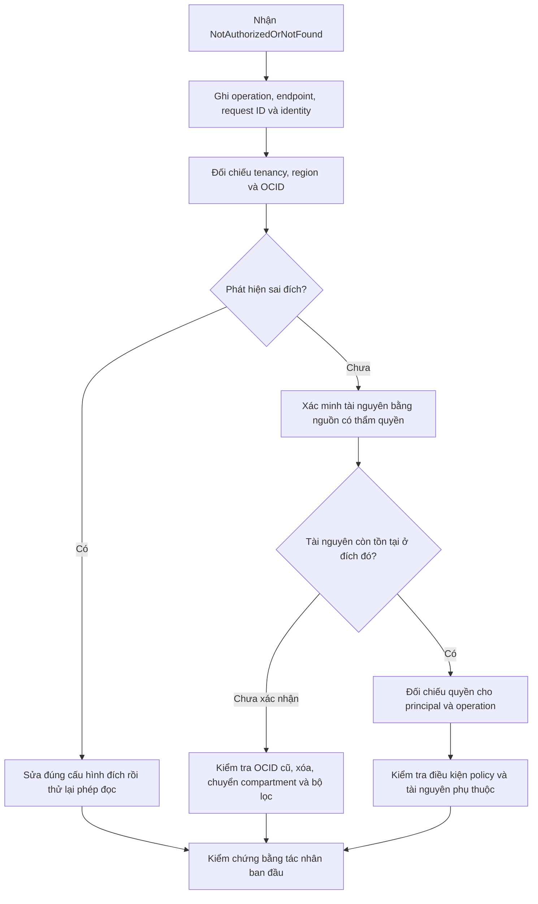

# Điều tra lỗi NotAuthorizedOrNotFound và sai phạm vi region

Trong chương **Vận hành và xử lý sự cố** của Oracle Cloud Infrastructure (OCI), một tình huống thường gặp là tài nguyên vẫn xuất hiện trên Console nhưng CLI, SDK hoặc pipeline lại báo `NotAuthorizedOrNotFound`. Một nguyên nhân khác có biểu hiện tương tự là ứng dụng gửi yêu cầu đến sai region. Nếu vội thêm quyền hoặc tạo lại tài nguyên, người vận hành có thể mở rộng quyền truy cập, phát sinh chi phí và kéo dài thời gian khôi phục.

Bài học này xây dựng quy trình điều tra từ bằng chứng của request, phạm vi tài nguyên đến chính sách IAM. Compute được dùng làm ví dụ chính; cách lập luận cũng áp dụng khi thao tác với VCN, lưu trữ và các dịch vụ cơ sở dữ liệu Oracle, với điều kiện đối chiếu API và quyền của từng dịch vụ.

Sau bài học, bạn có thể:

- Phân biệt lỗi xác thực, lỗi phân quyền và trường hợp chưa tìm thấy tài nguyên trong phạm vi đang truy vấn.
- Xác định identity, tenancy, region, compartment và OCID mà một request thực sự sử dụng.
- Thực hiện các phép kiểm tra chỉ đọc để tách lỗi endpoint khỏi lỗi IAM.
- Ghi nhận cách sửa và kiểm chứng bằng chính tác nhân đã gặp lỗi.

## 1. Hiểu đúng thông điệp trước khi sửa

`NotAuthorizedOrNotFound` thường đi kèm HTTP `404`. OCI sử dụng mã này khi tài nguyên được chỉ định không tìm thấy hoặc người gọi không được phép truy cập tài nguyên đó. Vì vậy, **chỉ từ mã lỗi này không thể xác định duy nhất nguyên nhân**. Cần kiểm tra cả địa chỉ tài nguyên lẫn quyền truy cập. [Tham khảo mô tả lỗi API của Oracle](https://docs.oracle.com/en-us/iaas/Content/API/References/apierrors.htm).

Ví dụ lỗi dưới đây được rút gọn để minh họa cấu trúc bằng chứng; giá trị thực tế phụ thuộc công cụ và API:

```json
{
  "status": 404,
  "code": "NotAuthorizedOrNotFound",
  "message": "Authorization failed or requested resource not found.",
  "operation_name": "get_instance",
  "request_endpoint": "GET https://iaas.us-phoenix-1.oraclecloud.com/20160918/instances/<instance_ocid>",
  "opc-request-id": "<request_id>"
}
```

Từ ví dụ này, bạn biết client đang gọi Compute ở `us-phoenix-1`. Bạn chưa biết instance có tồn tại ở đó hay identity có quyền đọc nó.

Một số dấu hiệu cần phân biệt:

| Dấu hiệu | Hướng điều tra đầu tiên |
| --- | --- |
| `401 NotAuthenticated` | Thông tin xác thực, chữ ký, token, cặp khóa và thời gian hệ thống |
| `404 NotAuthorizedOrNotFound` | Đích tài nguyên, phạm vi region/tenancy và quyền của người gọi |
| `403 NotAllowed` với thông báo yêu cầu home region | Endpoint dành cho thao tác IAM tương ứng |
| Timeout, lỗi DNS hoặc TLS | Đường đi từ client đến API, proxy và chứng chỉ |
| Lỗi SSH tới VM hoặc kết nối SQL tới database | Đường dữ liệu, cấu hình mạng và xác thực của hệ điều hành/database |

Không áp dụng một ý nghĩa HTTP chung cho mọi dịch vụ. Hãy đọc đồng thời `status`, `code`, thông điệp và tên operation; các mã cụ thể được liệt kê trong [API Errors](https://docs.oracle.com/en-us/iaas/Content/API/References/apierrors.htm).

## 2. Xác định đầy đủ ngữ cảnh của request

Một phép gọi OCI cần được mô tả bằng bộ thông tin:

```text
Ai gọi + tenancy nào + endpoint/region nào
       + API nào + tài nguyên nào + phạm vi compartment nào
```

| Thành phần | Câu hỏi phải trả lời | Sai lệch hay gặp |
| --- | --- | --- |
| Principal, tức tác nhân gọi | User, instance principal, resource principal hay phiên đăng nhập nào? | Console dùng user cá nhân, pipeline dùng một identity khác |
| Tenancy | Credentials và tài nguyên thuộc tenancy nào? | Profile trỏ sang môi trường thử nghiệm |
| Region và endpoint | Request đi đến hostname nào? Có endpoint bị ghi đè không? | Biến môi trường giữ region hoặc endpoint cũ |
| Compartment | Tài nguyên hiện thuộc compartment nào? | List ở compartment cha trong khi tài nguyên nằm ở compartment con |
| Resource identifier | Đang dùng OCID của đúng loại tài nguyên và đúng môi trường không? | Sao chép OCID từ deployment cũ |
| Operation | API nào bị từ chối, có tham chiếu tài nguyên khác không? | Đọc instance thành công nhưng thao tác tạo mới thất bại ở subnet |

### 2.1. Compartment không thay thế region

Compartment là phạm vi tổ chức và phân quyền. Phần lớn tài nguyên như instance, VCN và bucket thuộc một region cụ thể. Chọn cùng compartment ở region khác không làm các tài nguyên đó xuất hiện. Các tài nguyên IAM như compartment và policy có phạm vi khác với Compute; không suy ra vị trí instance từ việc vẫn nhìn thấy compartment. [Oracle: Managing Regions](https://docs.oracle.com/en-us/iaas/Content/Identity/Tasks/managingregions.htm).

Ví dụ minh họa:

```text
Tenancy A
└── Compartment AppProd
    ├── Region ap-singapore-1: instance order-api
    └── Region us-phoenix-1: không có instance order-api đó
```

Đây là cách biểu diễn vị trí để điều tra, không phải hai compartment `AppProd` riêng biệt. Chuyển region chỉ thay đổi nơi gửi request, không di chuyển hoặc sao chép instance.

### 2.2. Region của workload và home region có vai trò khác nhau

Home region quản lý các định nghĩa IAM liên quan của tenancy. Các thao tác IAM yêu cầu home region phải dùng endpoint tương ứng; workload Compute vẫn được gọi ở region nơi nó tồn tại. Thay đổi IAM còn cần thời gian lan truyền. Không dùng home region làm giá trị mặc định cho mọi API chỉ vì tài nguyên IAM được quản lý ở đó. [Oracle: The Home Region](https://docs.oracle.com/en-us/iaas/Content/Identity/Tasks/managingregions.htm).

Với identity domain và các API chuyên biệt khác, kiểm tra quy tắc endpoint của chính dịch vụ đó; không giả định tất cả endpoint định danh đều giống API Compute.

## 3. Thu thập bằng chứng tối thiểu

Trước khi thay cấu hình hoặc yêu cầu cấp quyền, lập bản ghi sau. Việc ghi cả giá trị dự kiến và giá trị thực tế giúp phát hiện trường hợp pipeline nhận cấu hình khác máy cá nhân.

| Bằng chứng | Nội dung cần lưu |
| --- | --- |
| Thời điểm | Thời gian kèm múi giờ, ưu tiên UTC để đối chiếu log |
| Request | Operation, HTTP method, endpoint thực tế và mã lỗi đầy đủ |
| Định danh request | `opc-request-id` nếu phản hồi có trả về |
| Identity | Loại xác thực, profile/config đang dùng, principal và tenancy đã xác minh |
| Tài nguyên | OCID, region được xác nhận, compartment hiện tại |
| Môi trường | Máy cá nhân, runner CI, VM hay Function; phiên bản CLI/SDK |
| Thay đổi gần nhất | Đổi group, policy, dynamic group, chuyển compartment hoặc đổi biến triển khai |

Không đính kèm private key, token, mật khẩu hoặc toàn bộ header `Authorization`. Nếu cần dùng `--debug` để thấy endpoint thực tế, chỉ thu thập trong môi trường được phép và lọc dữ liệu nhạy cảm trước khi chia sẻ. Bản ghi phục vụ điều tra nên chứa đủ bằng chứng tái hiện, không cần chứa credentials.

Trong ứng dụng hoặc pipeline, ưu tiên ghi các trường đã chọn thay vì in toàn bộ environment hay toàn bộ config. Một trường `profile=OPS` không đủ chứng minh principal: cùng tên profile ở hai máy có thể chứa thông tin khác nhau.

## 4. Quy trình khoanh vùng



### Bước 1: Xác nhận tác nhân đang gọi

Ghi rõ cơ chế xác thực thực tế:

- **API key:** đối chiếu `tenancy`, `user`, fingerprint và file cấu hình được chọn. Không in nội dung private key.
- **Security token:** kiểm tra phiên và profile token đang được sử dụng, không suy từ phiên Console.
- **Instance principal:** kiểm tra instance nào đang chạy lệnh và dynamic group nào áp dụng.
- **Resource principal:** kiểm tra đúng resource đang thực thi, chẳng hạn Function, cùng chính sách dành cho resource đó.

CLI có thể nhận cấu hình từ tham số, biến môi trường và config. Với cùng một tùy chọn, giá trị trên dòng lệnh được ưu tiên trước biến môi trường, rồi đến config. Vì vậy, đọc mỗi file config chưa đủ xác định cấu hình hiệu lực. [Oracle: CLI Environment Variables](https://docs.oracle.com/en-us/iaas/Content/API/SDKDocs/clienvironmentvariables.htm).

Nếu user trên Console đọc được tài nguyên nhưng pipeline không đọc được, đó là hai request cần so sánh. Chưa thể kết luận OCI cấp quyền không nhất quán.

### Bước 2: Xác nhận endpoint thực tế

So sánh region dự kiến với hostname trong lỗi, cấu hình client hoặc log request. Kiểm tra cả `--endpoint`, `OCI_CLI_ENDPOINT`, alias/wrapper và cấu hình endpoint trong công cụ đang dùng.

**Đổi `--region` chưa chắc đổi đích nếu client còn được cấu hình endpoint tường minh.** Endpoint là cấu hình địa chỉ riêng, không phải một cách viết khác của tùy chọn region. Chỉ chạy phép thử theo region sau khi đã xử lý các override endpoint liên quan. Oracle khuyến nghị dùng `--region` khi chọn region cho CLI. [Oracle: CLI Environment Variables](https://docs.oracle.com/en-us/iaas/Content/API/SDKDocs/clienvironmentvariables.htm).

Với SDK hoặc công cụ tự động hóa, kiểm tra client/provider thực sự thực hiện request; một cấu hình cấp ngoài không chứng minh mọi client con đều dùng cùng region.

### Bước 3: Xác minh tài nguyên bằng OCID

Dùng một nguồn đủ thẩm quyền như trang chi tiết tài nguyên do người có quyền mở, inventory được quản lý hoặc API đọc thành công để xác nhận:

1. Đây là đúng OCID và đúng loại tài nguyên.
2. Tài nguyên thuộc tenancy và region dự kiến.
3. Compartment hiện tại có khớp với phạm vi truy vấn và policy không.
4. Tài nguyên có bị xóa, thay thế hoặc được tạo lại bằng OCID khác không.

Tên hiển thị giống nhau không chứng minh cùng tài nguyên. Một deployment mới có thể giữ tên nhưng có OCID mới; sửa dấu chấm hoặc tự ghép OCID từ tên không phải cách khôi phục tham chiếu.

OCID của một số loại tài nguyên có phần gợi ý vị trí, nhưng không lấy việc tách chuỗi OCID làm nguồn xác nhận duy nhất. Hãy dùng metadata tài nguyên và endpoint đã xác minh.

### Bước 4: Đối chiếu quyền theo operation

Đánh giá policy dựa trên principal thực tế, loại tài nguyên, quyền API yêu cầu, compartment đích và các điều kiện đi kèm. Kiểm tra cả policy ở compartment cha vì quyền có thể được kế thừa xuống dưới. Không chỉ tìm policy nằm ngay trong compartment chứa instance. [Oracle: Policy Inheritance](https://docs.oracle.com/en-us/iaas/Content/Identity/policieshow/Policy_Inheritance.htm).

Không suy quyền từ tên verb một cách máy móc. Ví dụ, thao tác liệt kê instance cần `read instances`; một policy chỉ có `inspect all-resources` không đủ cho phép liệt kê instance như nhiều người kỳ vọng. [Oracle: Common Policies, quyền cho auditors](https://docs.oracle.com/en-us/iaas/Content/Identity/Concepts/commonpolicies.htm).

Khi dùng identity domain, xác minh đúng group và domain được policy tham chiếu. Với dynamic group, kiểm tra matching rule có thực sự khớp OCID, compartment hoặc tag hiện tại của resource không. [Oracle: Writing Matching Rules](https://docs.oracle.com/en-us/iaas/Content/Identity/dynamicgroups/Writing_Matching_Rules_to_Define_Dynamic_Groups.htm).

### Bước 5: Kiểm tra tài nguyên phụ thuộc

Một request có thể sử dụng nhiều tài nguyên thuộc các compartment khác nhau. Nếu thao tác tạo instance thất bại, việc đọc được các instance đang có chưa chứng minh đủ quyền trên image, subnet, VNIC, volume hoặc khóa mã hóa được tham chiếu.

Tách request thành danh sách tham chiếu rồi đối chiếu từng quyền theo tài liệu của operation. Có API cần đồng thời nhiều permission trên các loại tài nguyên khác nhau; quyền đối với tài nguyên chính không tự bao phủ mọi tài nguyên liên quan. [Oracle: Permissions](https://docs.oracle.com/iaas/Content/Identity/policies/permissions.htm).

Trong vận hành database cũng cần phân biệt quyền gọi API quản lý OCI với quyền đăng nhập database. Đọc được metadata database không chứng minh tài khoản SQL hợp lệ, và lỗi SQL không tự chứng minh thiếu IAM.

## 5. Thực hành bằng OCI CLI trên PowerShell

Các ví dụ sau chỉ đọc tài nguyên. Bạn cần OCI CLI đã được cấu hình và một identity có quyền phù hợp. Thay toàn bộ giá trị trong dấu `<...>` trước khi chạy. Bài này dùng API key để giữ ngữ cảnh ví dụ nhất quán; không sao chép `--auth api_key` sang workload đang cần instance principal hoặc resource principal.

### 5.1. Cố định ngữ cảnh kiểm tra

```powershell
$ociConfigPath = Join-Path $env:USERPROFILE '.oci\config'
$ociProfile = 'OPS'
$targetRegion = 'ap-singapore-1'
$tenancyOcid = '<tenancy_ocid>'
$compartmentOcid = '<compartment_ocid>'
$instanceOcid = '<instance_ocid>'

# Chỉ xem các biến có liên quan đến việc chọn cấu hình và endpoint.
Get-Item Env:OCI_CLI_REGION, Env:OCI_CLI_ENDPOINT, Env:OCI_CLI_PROFILE, Env:OCI_CLI_CONFIG_FILE, Env:OCI_CLI_AUTH -ErrorAction SilentlyContinue |
    Select-Object Name, Value

$ociContext = @(
    '--config-file', $ociConfigPath,
    '--profile', $ociProfile,
    '--auth', 'api_key',
    '--region', $targetRegion
)
```

Mảng `$ociContext` được truyền cho lệnh bằng cú pháp splatting `@ociContext` của PowerShell. Kiểm tra trước rằng profile được chọn thuộc đúng tenancy, user và không còn endpoint override trái với phép thử. Việc in các biến ở trên không phát hiện được mọi alias, wrapper hay defaults file; endpoint thực tế của request vẫn là bằng chứng quyết định. Xem thêm [cách cấu hình OCI CLI](https://docs.oracle.com/en-us/iaas/Content/API/SDKDocs/cliconfigure.htm).

### 5.2. Kiểm tra region subscription

```powershell
oci @ociContext iam region-subscription list --tenancy-id $tenancyOcid --all --output json
```

Trong phản hồi thành công, đối chiếu `region-name`, `status` và `is-home-region`. Xác nhận region dự kiến đã ở trạng thái sẵn sàng. `oci iam region list` liệt kê region được cung cấp, không thay thế phép kiểm tra subscription của tenancy. [Tham khảo `region-subscription list`](https://docs.oracle.com/en-us/iaas/tools/oci-cli/latest/oci_cli_docs/cmdref/iam/region-subscription/list.html).

Nếu lệnh bị từ chối, nhờ người có quyền xác nhận subscription; không diễn giải lỗi đó thành kết luận tenancy chưa đăng ký region. Việc đăng ký region mới là quyết định thay đổi hạ tầng riêng, không phải bước thử để tìm một instance thất lạc.

### 5.3. Đọc trực tiếp instance bằng OCID

```powershell
oci @ociContext compute instance get --instance-id $instanceOcid --output json
```

Nếu thành công, đối chiếu `id`, `compartment-id`, `availability-domain` và `lifecycle-state`. Kết quả này xác nhận principal vừa dùng đọc được **instance cụ thể tại endpoint vừa gọi**. Nó không chứng minh quyền tạo, cập nhật, dừng hoặc xóa instance. [Tham khảo `compute instance get`](https://docs.oracle.com/en-us/iaas/tools/oci-cli/latest/oci_cli_docs/cmdref/compute/instance/get.html).

Lệnh `get` này không nhận `--compartment-id`: API xác định instance theo OCID. Vì vậy, thay biến compartment chỉ dùng cho lệnh `list` sẽ không tự sửa được một request `get` đang đi sai region.

### 5.4. Liệt kê đúng phạm vi khi cần tìm tham chiếu sai

```powershell
oci @ociContext compute instance list --compartment-id $compartmentOcid --all --output json
```

`--all` lấy các trang kết quả. Lần kiểm tra đầu nên tránh bộ lọc tên, trạng thái hoặc availability domain để giảm khả năng tự loại tài nguyên cần tìm. Lệnh này liệt kê trong compartment đã chỉ định; không tự duyệt toàn bộ cây compartment. [Tham khảo `compute instance list`](https://docs.oracle.com/en-us/iaas/tools/oci-cli/latest/oci_cli_docs/cmdref/compute/instance/list.html).

Một danh sách rỗng chỉ nói rằng phép liệt kê hiện tại không trả về tài nguyên trong phạm vi và điều kiện đó. Trước khi kết luận tài nguyên bị xóa, hãy đối chiếu region, compartment con, quyền và các bộ lọc có thể đến từ wrapper/defaults.

### 5.5. Thử lại region đã được xác nhận

Giả sử lỗi ban đầu đi đến Phoenix, còn nguồn có thẩm quyền xác nhận instance ở Singapore. Giữ nguyên profile, cơ chế xác thực và OCID; chỉ thay region, sau khi loại trừ endpoint override:

```powershell
oci --config-file $ociConfigPath --profile $ociProfile --auth api_key --region ap-singapore-1 compute instance get --instance-id $instanceOcid --output json
```

Nếu request thành công, bạn đã có bằng chứng mạnh cho sai đích region trong request ban đầu. Sửa nguồn cấu hình gây sai ở ứng dụng hoặc pipeline, rồi chạy lại chính đường gọi đã lỗi. Thành công của lệnh thử trên máy cá nhân chưa đủ chứng minh runner CI đã được sửa.

Không quét hàng loạt region khi đã có inventory đáng tin cậy. Phép thử có mục tiêu dễ đối chiếu hơn và giảm số request không cần thiết.

## 6. Khi bằng chứng chỉ về IAM

Giả sử người có quyền đã xác nhận instance còn tồn tại ở đúng tenancy, region và compartment; principal vận hành vẫn không gọi được `GetInstance`. Lúc này cần kiểm tra policy và membership thay vì tiếp tục đổi region.

Ví dụ một policy cho nhóm vận hành đọc instance trong đúng compartment, dùng OCID để tránh nhầm tên:

```text
Allow group id <group_ocid> to read instances in compartment id <compartment_ocid>
```

Đây là mẫu minh họa cho nhu cầu đọc. Người quản trị cần đặt policy tại vị trí có phạm vi phù hợp, thay OCID thật và xét các điều kiện truy cập áp dụng trong môi trường. `read instances` bao phủ các API đọc tương ứng; không cấp toàn bộ quyền quản lý Compute. Luôn đối chiếu operation và permission trong [Details for the Core Services](https://docs.oracle.com/en-us/iaas/Content/Identity/Reference/corepolicyreference.htm).

Các điểm cần đối chiếu trong quá trình sửa:

- Group được policy tham chiếu có đúng membership của user đang ký request không?
- Với instance/resource principal, matching rule và policy dành cho dynamic group có khớp resource thực thi không?
- Policy nhắm đúng compartment hiện tại, kể cả sau khi tài nguyên được chuyển compartment chưa?
- Điều kiện về region, thời gian, nguồn request, tag hoặc tài nguyên cụ thể có được thỏa mãn không?
- Operation cần quyền trên tài nguyên phụ thuộc ở compartment khác hay không?

Sau khi đổi IAM, lưu thời điểm thay đổi và thử lại có khoảng nghỉ hợp lý để xét thời gian lan truyền. Nếu vẫn lỗi, quay lại bằng chứng; không liên tục thêm các policy rộng hơn. Nếu quy trình xác thực yêu cầu làm mới phiên hoặc token, thực hiện theo đúng cơ chế đang dùng.

Cấp `manage all-resources in tenancy` để xem lỗi có hết hay không tạo ra quá nhiều thay đổi cùng lúc. Kể cả khi request thành công, phép thử đó không chỉ ra quyền tối thiểu còn thiếu và có thể làm lộ thông tin không cần thiết.

## 7. Ba tình huống vận hành điển hình

### 7.1. Cùng profile nhưng sai region trên runner

Một pipeline đọc instance gặp `404`, trong khi thao tác từ máy người vận hành thành công. Hai nơi dùng cùng user và cùng OCID. Endpoint lỗi chứa `us-phoenix-1`; inventory xác nhận instance ở `ap-singapore-1`.

Cách xử lý là tìm nơi runner nhận region: biến CI, tham số lệnh, config hoặc wrapper. Cố định đúng region ở đường gọi thực tế, kiểm tra endpoint rồi chạy lại phép đọc từ runner. Không cần đổi policy nếu bằng chứng cho thấy quyền đọc đã đủ khi gọi đúng đích.

### 7.2. Console hoạt động nhưng Function bị từ chối

Người phát triển nhìn thấy tài nguyên bằng user cá nhân, còn Function sử dụng resource principal. Sự thành công trên Console chỉ xác nhận quyền của user đó.

Cần xác minh resource thực thi của Function, dynamic group matching rule, policy cho resource principal và compartment đích. Không đưa API key cá nhân vào Function chỉ để làm cho hành vi giống phiên Console.

### 7.3. Đọc được instance nhưng không tạo được instance mới

Nhóm vận hành có quyền đọc hoặc quản lý instance trong `AppProd`, nhưng request tạo mới tham chiếu subnet ở `SharedNetwork` và image do nhóm khác quản lý. Một tham chiếu phụ thuộc có thể không tồn tại ở region đã chọn hoặc chưa được cấp quyền cần thiết.

Tách các OCID trong request, xác minh vị trí từng tài nguyên và đối chiếu quyền của operation. Nếu bài toán nằm ở subnet dùng chung, mở rộng quyền Compute trong `AppProd` không tự giải quyết quyền truy cập subnet đó.

Các tình huống trên là ví dụ lập luận; không phải mọi dịch vụ đều trả cùng mã lỗi cho cùng kiểu sai lệch. Mã lỗi thực tế của API và bằng chứng request vẫn là cơ sở quyết định.

## 8. Đối chiếu Audit và chuẩn bị chuyển tuyến

Audit ghi nhận hoạt động trên các API OCI được hỗ trợ. Khi có quyền truy cập, dùng khoảng thời gian, identity, operation, tài nguyên và thông tin request để đối chiếu lần gọi lỗi. Kiểm tra region và compartment khi tìm sự kiện, đồng thời tính đến độ trễ xuất hiện của log. [Oracle: Overview of Audit](https://docs.oracle.com/en-us/iaas/Content/Audit/Concepts/auditoverview.htm).

Không coi việc chưa tìm được sự kiện Audit là bằng chứng tài nguyên không tồn tại. Có thể bạn đang tìm sai phạm vi, không đủ quyền xem log hoặc request chưa đến điểm được ghi nhận. Audit cũng có phạm vi hỗ trợ riêng: ví dụ, tài liệu nêu Object Storage ghi sự kiện liên quan bucket, không bao phủ các sự kiện object trong Audit. Khi cần điều tra truy cập object, dùng nguồn log phù hợp của dịch vụ. [Oracle: Overview of Audit](https://docs.oracle.com/en-us/iaas/Content/Audit/Concepts/auditoverview.htm).

Nếu cần nhờ quản trị viên hoặc Oracle Support điều tra tiếp, chuẩn bị gói thông tin đã lọc dữ liệu nhạy cảm:

```text
Thời điểm UTC:
Môi trường và phiên bản CLI/SDK:
Loại xác thực và principal đã xác minh:
Tenancy / region / compartment / resource OCID:
Operation và endpoint thực tế:
HTTP status / error code / thông điệp:
opc-request-id:
Nguồn xác nhận tài nguyên còn tồn tại:
Kết quả phép đọc với ngữ cảnh tường minh:
Thay đổi gần nhất và thời điểm thực hiện:
```

Không yêu cầu một thành viên gửi private key để người khác tái hiện. Chia sẻ lệnh đã thay credentials bằng tham chiếu và để mỗi người dùng identity được phép của mình.

## 9. Tiêu chí khép lại điều tra và phòng tái diễn

Có thể khép lại sự cố khi đã có đủ ba bằng chứng:

1. **Nguyên nhân có căn cứ:** xác định được sai lệch cụ thể, chẳng hạn endpoint Phoenix trong khi instance ở Singapore, hoặc thiếu quyền của dynamic group trên compartment đích.
2. **Đường gọi ban đầu đã hoạt động:** chính ứng dụng, runner hoặc resource principal gặp lỗi đã thực hiện thành công operation cần thiết ở đúng tài nguyên.
3. **Cấu hình và phạm vi quyền được xác nhận:** không còn override gây sai đích hoặc quyền thử nghiệm quá rộng; thay đổi được lưu trong nguồn cấu hình quản lý.

Biện pháp phòng tái diễn nên gắn với nguyên nhân đã chứng minh:

| Nguyên nhân | Biện pháp phù hợp |
| --- | --- |
| Region mặc định thay đổi giữa các máy | Khai báo region trong cấu hình triển khai và ghi region hiệu lực khi khởi động |
| Endpoint override bị bỏ quên | Quản lý endpoint tập trung, kiểm tra endpoint của client sau khi cấu hình |
| Nhầm profile hoặc tenancy | Tách cấu hình theo môi trường và kiểm tra identity trước thao tác triển khai |
| OCID cũ sau khi tạo lại tài nguyên | Truyền định danh từ output triển khai hoặc inventory có quản lý |
| Thay compartment làm mất phạm vi quyền | Đánh giá tác động IAM và tham chiếu trước khi di chuyển |
| Policy thiếu quyền ở tài nguyên phụ thuộc | Mô tả rõ các phụ thuộc và kiểm chứng operation với identity vận hành |
| Phát hiện lỗi quá muộn | Thêm phép đọc kiểm tra mục tiêu ở đầu pipeline, với quyền phù hợp |

Lỗi này thường nằm ở bước gọi API quản lý. Khi đã chứng minh request đến đúng OCI API và nhận mã lỗi về tài nguyên hoặc quyền, hãy ưu tiên điều tra ngữ cảnh và IAM của request. Khởi động lại VM, mở cổng database hoặc tạo lại hạ tầng không cung cấp bằng chứng cho hai nhóm nguyên nhân đó, đồng thời có thể tăng thời gian gián đoạn và chi phí.
