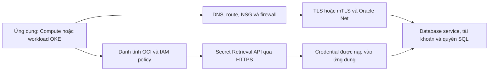

# Điều tra lỗi kết nối database, TLS và secrets hết hạn

## 1. Mục tiêu và phạm vi vận hành

Một ứng dụng trên Oracle Cloud Infrastructure (OCI) có thể báo “không kết nối được database” khi DNS sai, gói tin bị chặn, listener không biết service, chứng thư không được tin cậy hoặc credential đã thay đổi. Cùng một thông báo ở tầng HTTP có thể che nhiều nguyên nhân. Điều tra hiệu quả bắt đầu bằng việc xác định **bước đầu tiên thất bại**, sau đó kiểm chứng một giả thuyết bằng một phép thử nhỏ.

Bài thuộc chương **Vận hành và xử lý sự cố** trong phạm vi Oracle Cloud Infrastructure. Sau bài học, người học có thể:

- Phân biệt lỗi đường mạng, Oracle Net, TLS/mTLS, tài khoản database và truy xuất secret.
- Thu thập bằng chứng từ đúng Compute instance, container hoặc workload đang lỗi.
- Khôi phục kết nối bằng thay đổi có phạm vi rõ ràng, duy trì phân quyền và xác minh danh tính máy chủ.
- Kiểm tra việc ứng dụng thực sự sử dụng wallet hoặc secret mới, kể cả khi connection pool còn các session cũ.
- Thiết kế theo dõi hạn sử dụng, quy trình rotation và bằng chứng phục hồi.

Tình huống xuyên suốt là một dịch vụ đặt hàng chạy trên Compute hoặc OKE, truy cập Oracle Database qua endpoint riêng và lấy mật khẩu từ OCI Secret Management, thường được thao tác qua Vault. Database có thể là Autonomous Database, Base Database Service hoặc Oracle Database tự quản trên Compute.

Ranh giới trách nhiệm khác nhau:

| Kiểu triển khai | Phạm vi người vận hành thường kiểm tra |
| --- | --- |
| Autonomous Database | Trạng thái dịch vụ, endpoint, ACL/NSG khi áp dụng, connect descriptor, chế độ TLS/mTLS, wallet, tài khoản và quyền SQL |
| Base Database Service | Các phần trên và những thành phần hệ điều hành, listener, database mà dịch vụ cho phép khách hàng quản trị |
| Oracle Database tự quản trên Compute | Toàn bộ stack trong phạm vi hệ thống, bao gồm firewall của máy, listener và cấu hình TLS phía server |

Các lệnh dưới đây là ví dụ để chạy trong môi trường được phép chẩn đoán. Cần có công cụ tương ứng và thay tên minh họa bằng cấu hình thật. Bài không yêu cầu tạo database mới, mở endpoint ra Internet hoặc chạy lệnh quản trị listener trên Autonomous Database.

## 2. Mô hình điều tra: hai đường kết nối và ba lớp danh tính

### 2.1. Hai đường phụ thuộc độc lập

Ứng dụng dùng secret có ít nhất hai đường phụ thuộc:



Mũi tên thể hiện quan hệ phụ thuộc, không phải thứ tự giao thức chính xác cho mọi loại client.

Đường tới database và đường tới Secret Retrieval API có hostname, cổng, route, quy tắc truy cập và cơ chế xác thực riêng. Nếu database reachable nhưng ứng dụng không lấy được secret khi khởi động, lỗi có thể xảy ra trước khi mở một socket database. Ngược lại, đọc secret thành công chưa chứng minh endpoint database reachable.

### 2.2. Ba câu hỏi về danh tính

| Lớp | Câu hỏi cần trả lời | Bằng chứng hữu ích |
| --- | --- | --- |
| OCI IAM | Workload nào được phép gọi API và đọc secret nào? | Principal, dynamic group hoặc workload identity, policy, compartment, request ID |
| TLS/mTLS | Client có xác minh đúng server và có trình đúng chứng thư client khi cần không? | Trust store, tên server, chuỗi CA, thời hạn chứng thư, wallet đang được nạp |
| Database | Credential hoặc token có được database chấp nhận và có quyền cần thiết không? | Mã lỗi Oracle, user/PDB/service đích, trạng thái tài khoản, kết quả SQL tối thiểu |

Trong mô hình username/password thông thường, quyền đọc secret trong OCI không tạo tài khoản database. Wallet dùng cho mTLS cũng không tự cấp mọi quyền SQL. Nếu hệ thống dùng IAM database authentication hoặc cơ chế federation khác, bổ sung việc kiểm tra token, thời hạn và ánh xạ database user theo đúng cơ chế đã cấu hình.

Đừng dùng tài khoản quản trị tenancy để kết luận workload đã đủ quyền. Người vận hành và ứng dụng thường sử dụng các principal khác nhau.

## 3. Thu thập bằng chứng và phân loại lỗi ban đầu

### 3.1. Hồ sơ tối thiểu trước khi thay đổi

Ghi lại:

1. Mốc lỗi đầu tiên, lần thành công gần nhất và timezone; quy đổi về UTC khi ghép log.
2. Region, compartment, database OCID, endpoint, cổng, service/PDB và chế độ TLS/mTLS.
3. Compute instance hoặc pod cụ thể; image, phiên bản ứng dụng, JDK, Oracle client/JDBC driver.
4. Mã lỗi gốc trong chuỗi exception; request ID của API hoặc `CONNECTION_ID` của Oracle Net khi có.
5. Tất cả replica bị lỗi hay chỉ một nhóm; lỗi lúc tạo kết nối mới hay khi dùng kết nối đã tồn tại.
6. Thay đổi gần nhất: rollout, DNS, NSG, ACL, IAM policy, rotate password, thay wallet hoặc trust store.
7. Secret OCID, version/stage ứng dụng dùng, thời điểm refresh cuối; wallet/certificate fingerprint và ngày hết hạn nếu đã có.

Chỉ ghi metadata cần thiết. Không đưa password, private key, token, toàn bộ secret bundle hoặc wallet ZIP vào log và ticket. Che phần nhạy cảm trong chuỗi kết nối trước khi chia sẻ. Khi cần trace chi tiết, giới hạn thời gian, quyền đọc và dung lượng.

Với Java, thông báo như `SQLTransientConnectionException` hoặc “pool timeout” là điểm bắt đầu. Đọc tiếp `cause`, `SQLException.getErrorCode()`, `getSQLState()` và exception tiếp theo khi có. Pool có thể hết kết nối vì giữ connection quá lâu, trong khi database vẫn nhận kết nối bình thường.

### 3.2. Bảng định hướng

| Dấu hiệu | Giả thuyết ưu tiên | Kiểm tra kế tiếp |
| --- | --- | --- |
| Không resolve được hostname | DNS hoặc phạm vi private DNS | Resolve tại chính workload và đối chiếu endpoint |
| `ORA-12154` | Không phân giải được connect identifier/alias | Alias, naming method, `tnsnames.ora`, cấu hình thư mục client |
| TCP timeout hoặc `ORA-12170` | Thiết lập/giao tiếp không hoàn tất trong thời hạn | Loại timeout, đường mạng hai chiều, firewall, tải hệ thống |
| Connection refused hoặc `ORA-12541` | Sai đích/cổng hoặc không có listener tại đích | Connect descriptor và listener theo quyền quản trị |
| `ORA-12514` | Listener không biết database service được yêu cầu | Service name, PDB, trạng thái đăng ký service |
| `ORA-28759` | Không mở được file cần thiết, thường liên quan wallet | Đường dẫn, mount và quyền đọc thực tế |
| `ORA-29024`, `PKIX path building failed` | Không xác minh được chứng thư/chuỗi tin cậy | CA, hạn chứng thư, trust store và endpoint |
| Hostname/DN mismatch hoặc handshake failure | Sai danh tính server hoặc cấu hình giao thức | Hostname/DN, TLS version, cipher và client hỗ trợ |
| `ORA-01017` | Credential không hợp lệ hoặc không được phép đăng nhập | User, database đích, secret version và cơ chế authentication |
| `ORA-28000` | Tài khoản bị khóa | Trạng thái account và các client đang thử sai liên tục |
| `ORA-28001` | Mật khẩu/tài khoản hết hạn, cần đổi mật khẩu | Profile, expiry và quy trình đổi credential |
| Lỗi khi gọi Secret Retrieval API | IAM, endpoint, mạng, vòng đời hoặc expiry rule của secret | HTTP/service error, request ID, principal và secret metadata |

Mã lỗi giúp chọn nhánh điều tra, không đủ để khẳng định duy nhất một nguyên nhân. `ORA-12154` là lỗi phân giải connect identifier, có thể xảy ra trước bước DNS hostname; `ORA-12170` có thể liên quan nhiều loại timeout. Xem giải thích chính thức cho [ORA-12154](https://docs.oracle.com/en/error-help/db/ora-12154/) và [ORA-12170](https://docs.oracle.com/en/error-help/db/ora-12170/).

Với lỗi listener và đăng nhập, đối chiếu [ORA-12541](https://docs.oracle.com/en/error-help/db/ora-12541/), [ORA-12514](https://docs.oracle.com/en/error-help/db/ora-12514/), [ORA-01017](https://docs.oracle.com/en/error-help/db/ora-01017/), [ORA-28000](https://docs.oracle.com/en/error-help/db/ora-28000/) và [ORA-28001](https://docs.oracle.com/en/error-help/db/ora-28001/) theo phiên bản đang sử dụng.

## 4. Kiểm tra DNS và đường mạng từ đúng nơi phát sinh lỗi

### 4.1. Đúng hostname, đúng cổng, đúng nguồn

Lấy hostname, cổng, protocol và service name từ connect descriptor hiện hành của database. Không mặc định mọi Oracle Database đều nghe cùng một cổng, cũng không suy chế độ TLS từ số cổng.

Nếu ứng dụng chạy trong pod, kiểm tra từ pod hoặc công cụ chẩn đoán được đặt trong cùng bối cảnh mạng phù hợp. Kết quả trên laptop, Cloud Shell hoặc bastion chỉ mô tả đường đi của nơi đó. Cùng subnet cũng chưa chắc tương đương nếu khác NSG, proxy, network policy hoặc DNS.

Ví dụ PowerShell trên một máy Windows có cùng đường truy cập cần kiểm tra:

```powershell
$dbHostName = 'db-private.example.internal'
$dbListenerPort = 1522 # Minh hoa; thay bang PORT trong connect descriptor

Get-Date -AsUTC
Resolve-DnsName -Name $dbHostName
Test-NetConnection -ComputerName $dbHostName -Port $dbListenerPort -InformationLevel Detailed
```

`Get-Date -AsUTC` dùng trong PowerShell 7; với Windows PowerShell 5.1 có thể dùng `[DateTime]::UtcNow.ToString('o')`.

Ví dụ Bash trên Linux, nếu đã có `getent` và `nc`:

```bash
db_host='db-private.example.internal'
db_port='1522' # Minh hoa; thay bang PORT trong connect descriptor

date -u
getent ahosts "$db_host"
nc -vz -w 5 "$db_host" "$db_port"
```

Giới hạn năm giây chỉ là thời hạn cho phép thử TCP minh họa. Kiểm tra cú pháp `nc` của bản cài đặt vì các biến thể có thể khác nhau.

Diễn giải theo thứ tự:

- Không resolve được: kiểm tra private DNS zone/view, resolver, DNS forwarding và khả năng phân giải từ on-premises nếu liên quan.
- Resolve được nhưng sai IP/phạm vi: đối chiếu endpoint public/private và cache DNS. Với nhiều địa chỉ hợp lệ, xác định địa chỉ mà client thực sự chọn.
- TCP không hoàn tất: tiếp tục kiểm tra route và kiểm soát truy cập.
- TCP thành công: chỉ chứng minh có thể thiết lập TCP tới đích đó; chưa chứng minh TLS, service name, credential hoặc SQL hợp lệ.

Không dùng kết quả `ping` để thay thế phép thử cổng database. ICMP và TCP có thể chịu các quy tắc khác nhau. Không cố định IP vào ứng dụng để né DNS, vì có thể làm sai xác minh danh tính TLS và gây lỗi khi endpoint đổi địa chỉ.

### 4.2. Đường kiểm tra trong OCI

Đối chiếu đường đi thực tế:

1. VNIC/subnet nguồn và các NSG đang gắn với workload.
2. Route nguồn, đích và đường về; DRG, peering, VPN hoặc FastConnect nếu lưu lượng đi qua.
3. Egress phía nguồn, ingress phía đích và firewall trung gian.
4. ACL của Autonomous Database public endpoint nếu cấu hình sử dụng ACL.
5. Firewall hệ điều hành hoặc thiết bị mạng thuộc phạm vi khách hàng quản lý.
6. ZPR policy nếu endpoint có security attribute của Zero Trust Packet Routing.

Security list áp dụng theo subnet; NSG áp dụng cho nhóm VNIC/resource được gắn vào. Các allow rule của security list và NSG áp dụng được xét kết hợp, không phải mặc định phải có một rule giống nhau trong cả hai nơi. Nếu endpoint chịu ZPR, cần đáp ứng thêm ZPR policy phù hợp. Với stateful rule, traffic trả lời của kết nối được theo dõi; với stateless rule phải cho phép rõ cả chiều về và cổng nguồn tạm thời tương ứng. Xem [Security Rules](https://docs.oracle.com/en-us/iaas/Content/Network/Concepts/securityrules.htm).

Một sửa đổi có mục tiêu có thể là cho phép TCP từ NSG ứng dụng tới NSG database trong cùng VCN trên đúng cổng listener. Nếu dùng CIDR, xác định đúng địa chỉ nguồn mà phía đích nhìn thấy sau NAT hoặc proxy. Không mở cổng database cho toàn bộ Internet để thử.

Với đường truy xuất secret, kiểm tra riêng HTTPS tới endpoint Secret Retrieval của region/realm đang dùng. Private subnet cần đường truy cập tới endpoint dịch vụ tương ứng, chẳng hạn Service Gateway cho dịch vụ được hỗ trợ trong Oracle Services Network hoặc một đường egress đã được thiết kế. Có Service Gateway không tự tạo đường tới private IP database.

### 4.3. Dùng công cụ quan sát đúng giới hạn

- **Network Path Analyzer:** kiểm tra mô hình cấu hình route và security từ nguồn tới đích. Công cụ không phát traffic thật, nên kết quả reachable không xác minh DNS, tiến trình listener, TLS hoặc mật khẩu. Đối chiếu các giới hạn hỗ trợ của loại đường đang kiểm tra. Xem [Network Path Analyzer](https://docs.oracle.com/en-us/iaas/Content/Network/Concepts/path_analyzer.htm).
- **VCN Flow Logs:** nếu đã bật ở phạm vi phù hợp, lọc đúng thời gian, IP nguồn/đích, protocol và cổng để tìm accept/reject. Một flow được accept chưa chứng minh database login thành công; không thấy flow cũng chưa đủ kết luận nếu log chưa bật hoặc chưa được thu thập.
- **Log của ứng dụng và client:** xác định chính xác socket/endpoint bị lỗi, loại timeout và thời gian mở kết nối.

Hướng dẫn [Troubleshoot Basic Network Issues in OCI](https://docs.oracle.com/en/learn/oci-ntw-troubleshoot-1/index.html) minh họa việc phối hợp kiểm tra mạng và Flow Logs. Khi bật log phục vụ sự cố, đặt phạm vi thu thập, thời gian lưu và quyền truy cập phù hợp để kiểm soát chi phí và dữ liệu vận hành.

## 5. Kiểm tra connect descriptor, listener và database service

Một connect descriptor có nhiều giá trị không thể thay thế cho nhau:

| Thành phần | Ý nghĩa |
| --- | --- |
| Alias, ví dụ `orders_tp` | Tên phía client dùng để tra connect descriptor |
| `HOST`, `PORT`, `PROTOCOL` | Đích mạng và giao thức kết nối |
| `SERVICE_NAME` | Database service mà listener cần định tuyến tới |
| PDB | Container database đích của tài khoản và dữ liệu |
| Wallet/trust configuration | Vật liệu và cấu hình dùng cho TLS/mTLS |

Tên hiển thị của tài nguyên OCI, tên schema, SID và service name không mặc nhiên giống nhau. Sau clone, restore hoặc chuyển endpoint, descriptor cũ có thể vẫn resolve và mở TCP được nhưng chỉ tới service không đúng.

### 5.1. Kiểm tra bằng client phù hợp

Với Oracle client đã cấu hình đúng alias, TLS và wallet nếu cần:

```bash
export TNS_ADMIN='/opt/app/oracle-net'
tnsping orders_tp
sqlplus -L app_user@orders_tp
```

`sqlplus` sẽ yêu cầu nhập mật khẩu; không đặt mật khẩu vào command line. `tnsping` chỉ có ích nếu công cụ được cài và dùng cùng cấu hình naming cần kiểm tra. Nó không xác thực tài khoản hoặc chứng minh thực thi SQL. JDBC Thin có thể đọc cấu hình khác với SQL*Plus, nên phép thử bằng SQL*Plus chỉ là đối chứng; vẫn phải kiểm tra bằng driver của ứng dụng.

Sau khi đăng nhập, chạy:

```sql
SELECT 1 AS connection_ok FROM dual;

SELECT
    SYS_CONTEXT('USERENV', 'SESSION_USER') AS session_user,
    SYS_CONTEXT('USERENV', 'SERVICE_NAME') AS service_name,
    SYS_CONTEXT('USERENV', 'CON_NAME') AS container_name
FROM dual;
```

Kết quả phải trùng user, service và container dự kiến. Sau đó kiểm tra một thao tác nghiệp vụ chỉ đọc, có phạm vi nhỏ và cần đúng quyền ứng dụng. `SELECT 1 FROM dual` thành công chưa chứng minh ứng dụng truy cập được bảng cần dùng.

### 5.2. Nếu listener nhận kết nối nhưng không biết service

Với `ORA-12514`, kiểm tra descriptor và trạng thái database/PDB trước. Trên hệ thống được phép quản trị listener, DBA có thể chạy:

```bash
lsnrctl status
lsnrctl services
```

Dùng đúng tên listener và môi trường Oracle Home/Grid Home theo runbook của hệ thống. Đối chiếu service mà listener công bố, database/PDB tương ứng và log quanh thời điểm lỗi. Với Autonomous Database, đối chiếu trạng thái dịch vụ và thông tin connection do OCI cung cấp; không tìm cách SSH để sửa listener của dịch vụ quản lý.

Không sửa `listener.ora`, khởi động lại listener hoặc mở PDB chỉ vì nhìn thấy mã lỗi. Trước hết phải xác định service mong muốn, người sở hữu thành phần và tác động của thay đổi.

## 6. Điều tra TLS, mTLS và wallet

### 6.1. Xác định mô hình TLS đang dùng

Trong TLS xác thực server, client phải xác minh chứng thư server và danh tính endpoint. Trong mTLS, client còn cần trình chứng thư cùng private key để server xác thực phía client.

Với Autonomous Database, khả năng kết nối TLS không dùng wallet phụ thuộc loại client, phiên bản và cấu hình dịch vụ; kết nối mTLS thường dùng client credentials wallet. Dùng connect string đúng chế độ và kiểm tra ma trận hỗ trợ của client trong [Connect to Autonomous Database](https://docs.oracle.com/en-us/iaas/autonomous-database-serverless/doc/connect-autonomous-database.html). Không áp dụng cấu hình của một loại client cho mọi runtime.

Wallet có thể chứa private key và chứng thư client; trust store chứa các chứng thư được tin cậy. Mật khẩu mở wallet, mật khẩu database và private key password là những đối tượng khác nhau. Đổi một loại không tự sửa lỗi ở loại khác.

### 6.2. Kiểm tra file và cấu hình thực tế trong runtime

Kiểm tra từ user và filesystem mà tiến trình đang dùng:

- Đường dẫn wallet/trust store có tồn tại trong container sau rollout không?
- UID/GID hoặc tài khoản dịch vụ có quyền đọc file và đi qua thư mục cha không?
- Mount có trỏ tới phiên bản dự kiến, có bị một mount khác che mất không?
- Client đang lấy cấu hình từ biến môi trường, URL, system property hay cấu hình riêng của driver?
- Tiến trình đã nạp lại cấu hình chưa, hay chỉ file trên đĩa được thay?
- Client có nhận đúng tập file được cung cấp cùng wallet và đúng cấu hình TLS tương ứng không?

Với Java, xác định rõ JDK/JRE và JDBC driver thực sự được image dùng. Kiểm tra trust store được chọn, cấu hình Oracle wallet và tham số TNS của driver. Không giả định chỉ cần đặt `TNS_ADMIN` là mọi thư viện Java đều tự nạp toàn bộ vật liệu TLS.

Ví dụ kiểm tra danh mục wallet và chứng thư công khai, nếu có công cụ tương ứng:

```bash
orapki wallet display -wallet /run/secrets/adb-wallet -summary

openssl x509 -in /opt/diagnostics/server-cert.pem -noout -subject -issuer -dates -fingerprint -sha256

keytool -list -v -keystore /opt/app/security/truststore.p12 -storetype PKCS12
```

File `server-cert.pem` trong ví dụ là chứng thư công khai đã thu thập theo quy trình chẩn đoán, không phải private key. `openssl x509` chỉ đọc file cục bộ; kết quả không chứng minh listener đang trình đúng chứng thư đó. `keytool` có thể yêu cầu mật khẩu keystore qua prompt. Không truyền password bằng tham số lộ trên command line.

Ngày hết hạn trên một chứng thư không mô tả toàn bộ chuỗi CA. Cần kiểm tra cả leaf, intermediate và root áp dụng. Đồng thời kiểm tra đồng hồ hệ thống, `notBefore`, `notAfter` và việc máy dùng UTC hay giờ địa phương khi hiển thị.

### 6.3. Diễn giải các nhóm lỗi

| Nhóm lỗi | Điểm kiểm tra chính | Hướng khắc phục theo bằng chứng |
| --- | --- | --- |
| Không mở được wallet, như `ORA-28759` | Path, tên file, quyền đọc, mount và cách client chọn wallet | Sửa đường dẫn/quyền hoặc triển khai lại đúng file |
| Certificate validation failure, như `ORA-29024` | Chuỗi CA, hạn chứng thư, trust store thật đang dùng | Bổ sung chuỗi tin cậy hợp lệ hoặc thay chứng thư/wallet đúng nguồn |
| Hostname hoặc server DN mismatch | Endpoint trong descriptor và danh tính chứng thư mong đợi | Sửa endpoint/cấu hình đối chiếu theo tài liệu client |
| TLS protocol/cipher mismatch | Giao thức và thuật toán chung giữa client/server | Cập nhật client hoặc cấu hình trong phạm vi được hỗ trợ |
| Client certificate bị từ chối | Có yêu cầu mTLS không, wallet đúng database không, chứng thư còn hợp lệ không | Cấp/triển khai đúng client credentials |
| Chỉ pod mới lỗi | Wallet mount, image/JDK, trust store hoặc cấu hình mới khác pod cũ | So sánh phiên bản và cấu hình đang nạp trên từng pod |

Oracle mô tả lỗi file wallet, lỗi giao thức và lỗi xác minh chứng thư trong [Troubleshooting the Transport Layer Security Configuration](https://docs.oracle.com/en/database/oracle/oracle-database/26/dbseg/troubleshooting-transport-layer-security-configuration.html). Dùng hướng dẫn phù hợp phiên bản client/server đang chạy.

Không tắt kiểm tra hostname/server DN hoặc cài trust manager chấp nhận mọi chứng thư để “chữa” lỗi. Cách đó loại bỏ bằng chứng xác minh server và che nguyên nhân. Cũng không đổi từ TCPS sang TCP làm phương án phục hồi mặc định.

Một phép thử TLS chung như `openssl s_client`, khi phù hợp với endpoint, có thể giúp thu thập chứng thư và thông tin handshake. Nó không thay cho phép thử bằng Oracle client: listener có thể yêu cầu mTLS, SNI hoặc cách thiết lập phiên riêng. Handshake lỗi từ công cụ chung chưa đủ kết luận database bị hỏng.

### 6.4. Wallet hết hạn và wallet rotation

Đối với Autonomous Database, khi wallet sắp hết hạn hoặc đã hết hạn, cần tải/cấp wallet mới từ nguồn quản trị được phép và triển khai tới consumer. Xem [Download Database Connection Information](https://docs.oracle.com/en-us/iaas/autonomous-database-serverless/doc/connect-download-wallet.html).

Phân biệt hai thao tác:

- **Tải wallet mới:** lấy bộ client credentials để sử dụng; không mặc nhiên thu hồi mọi wallet cũ.
- **Rotate wallet:** thay đổi hiệu lực client certification key theo phạm vi và chế độ rotation đã chọn.

Quy trình thay wallet nên dùng thư mục có phiên bản, triển khai đầy đủ file, thử trên một replica rồi chuyển dần. Tránh ghi đè từng file trong thư mục đang được tiến trình đọc vì có thể tạo một bộ wallet/cấu hình không đồng nhất.

Autonomous Database có rotation tức thời hoặc có grace period trong các cấu hình được hỗ trợ; phạm vi instance và regional khác nhau. Hành vi session hiện hữu cũng khác giữa các chế độ. Phải đọc tác động trước khi thao tác, đặc biệt với regional wallet có thể liên quan nhiều database. Xem [Rotate Wallets for Autonomous Database](https://docs.oracle.com/en-us/iaas/autonomous-database-serverless/doc/wallet-rotate.html). Không dùng rotation diện rộng như phép thử đầu tiên cho lỗi của một pod.

## 7. Phân biệt các loại “hết hạn”

Cụm từ “secret hết hạn” cần được chuyển thành tên đối tượng, thời điểm và cơ chế thực thi cụ thể.

| Đối tượng | Ai quyết định hiệu lực? | Biểu hiện có thể thấy | Hành động đúng lớp |
| --- | --- | --- | --- |
| Secret hoặc secret version trong OCI | Expiry rule của Secret Management | Cảnh báo hoặc bị chặn truy xuất nội dung, tùy cấu hình | Kiểm tra rule và thực hiện rotation đúng quy trình |
| Password database | Profile/trạng thái user trong database | `ORA-28001`, hoặc cảnh báo sắp hết hạn như `ORA-28002` | Đổi password tại database và đồng bộ consumer |
| Chứng thư client trong wallet | Thời hạn chứng thư và trạng thái key phía dịch vụ | mTLS không tạo được phiên mới | Cấp và triển khai wallet còn hợp lệ |
| Chứng thư server/CA | Chuỗi chứng thư được trình và trust store phía client | Certificate validation failure | Thay chứng thư/chuỗi CA hoặc cập nhật trust đúng nguồn |
| Token authentication | Cơ chế phát hành và xác thực token tương ứng | Lỗi khi refresh token hoặc đăng nhập | Làm mới bằng đúng principal và cơ chế hỗ trợ |
| Credential đang cache trong tiến trình | Logic cache/refresh của ứng dụng | Vault đã có bản mới nhưng replica vẫn dùng bản cũ | Refresh cấu hình và tái tạo kết nối có kiểm soát |

OCI Secret Expiry Rule có thể cấu hình hạn cho version, hạn tuyệt đối cho secret và việc có chặn retrieval sau expiry hay không. Vì vậy **hết hạn không luôn đồng nghĩa không đọc được nội dung**. Ngược lại, một rule chặn retrieval có thể làm pod mới không khởi động dù các pod đang giữ credential cũ vẫn chạy. Xem [Secret Rules](https://docs.oracle.com/en-us/iaas/Content/secret-management/Concepts/secret-rules.htm) và [Updating a Secret’s Rules](https://docs.oracle.com/en-us/iaas/Content/secret-management/Tasks/update-secret_rules.htm).

Expiry rule tự nó không đổi password trong database. Secret auto generation và auto rotation là những khả năng cấu hình riêng. Nếu dùng automatic rotation, kiểm tra target system, lịch rotation và lần chạy thành công gần nhất; không suy từ việc “đã bật” rằng database và mọi consumer đã đồng bộ. Xem [Creating a Secret](https://docs.oracle.com/en-us/iaas/Content/secret-management/Tasks/create-secret.htm).

Cần theo dõi ít nhất bốn mốc khác nhau: hạn secret/version, hạn password database, hạn chứng thư và thời điểm ứng dụng refresh thành công cuối. Dùng cùng một timestamp để thay cho cả bốn sẽ bỏ sót các cửa sổ lỗi.

## 8. Điều tra truy xuất secret và sai lệch phiên bản

### 8.1. Kiểm tra đúng principal và đúng tài nguyên

Nếu ứng dụng lỗi ngay khi lấy secret, lần lượt kiểm tra:

1. Đúng OCID của **secret**, đúng region/realm và đúng endpoint retrieval.
2. Principal thực tế của workload; với Compute có thể là instance principal, với OKE tùy cơ chế workload identity hoặc danh tính đã cấu hình.
3. Dynamic group/mapping và IAM policy trong đúng compartment.
4. Trạng thái vòng đời của secret và những tài nguyên liên quan được dịch vụ báo lỗi.
5. Expiry rule, thời điểm hết hạn và tùy chọn chặn retrieval.
6. Version/stage mà lời gọi yêu cầu và version mà tiến trình đang cache.
7. DNS, proxy, HTTPS và route tới Secret Retrieval API nếu request không tới được dịch vụ.

Một lỗi “not authorized or not found” cần kiểm tra cả quyền lẫn OCID/region; không kết luận secret đã bị xóa chỉ dựa trên thông báo đó. Lỗi xác thực API cũng không phải `ORA-01017`: hai lỗi xảy ra ở hai hệ thống khác nhau.

Ví dụ policy giới hạn một secret cho dynamic group của ứng dụng:

```text
Allow dynamic-group dg-orders-runtime to read secret-bundles in compartment app-secrets where target.secret.id = '<secret_ocid>'
```

Thay toàn bộ placeholder, dùng tên dynamic group/identity domain và phạm vi policy đúng môi trường. Đây là mẫu quyền đọc nội dung, không phải quyền quản trị secret. Mẫu giới hạn `target.secret.id` được minh họa trong tài liệu [IAM policy cho truy cập secret bundle](https://docs.oracle.com/en-us/iaas/Content/APIGateway/Tasks/apigatewaytroubleshooting_topic-gateway_create_or_update_fails.htm).

Không cấp `manage all-resources` để thử sửa lỗi đọc secret. Nếu thay đổi compartment hoặc principal, đối chiếu policy và quan hệ sở hữu mới thay vì liên tục thay password database.

### 8.2. Phân biệt stage và version

| Giá trị | Ý nghĩa vận hành |
| --- | --- |
| `CURRENT` | Phiên bản được chỉ định dùng hiện hành |
| `LATEST` | Phiên bản được tạo/tải lên gần nhất, có thể chưa sẵn sàng dùng |
| `PENDING` | Phiên bản đang chuẩn bị hoặc kiểm chứng |
| `PREVIOUS` | Phiên bản từng là current, có thể hữu ích cho quy trình khôi phục |
| `DEPRECATED` | Phiên bản không còn được đánh dấu current, pending hay previous |

Một version có thể mang nhiều stage; version duy nhất ban đầu có thể vừa current vừa latest. Ứng dụng đọc `LATEST` có thể lấy credential mới trước khi database được đổi. Ứng dụng pin version số cụ thể sẽ không tự chuyển chỉ vì `CURRENT` thay đổi. Các trạng thái được mô tả trong [Managing Vault Secrets](https://docs.cloud.oracle.com/en-us/Content/KeyManagement/Tasks/managingsecrets.htm).

Ví dụ sau dành cho Compute instance dùng instance principal đã được cấp quyền, chạy trong Bash với OCI CLI đã cài:

```bash
oci_region='ap-singapore-1' # Minh hoa; thay bang region cua secret
secret_id='<secret_ocid>'

oci secrets secret-bundle get --auth instance_principal --region "$oci_region" --secret-id "$secret_id" --stage CURRENT --query 'data.{version:"version-number",stages:stages,expires:"time-of-expiry"}' --output json
```

Lệnh chọn chỉ các trường version, stage và thời điểm hết hạn để hiển thị. **API vẫn truy xuất secret bundle vào tiến trình CLI**; bộ lọc không biến lời gọi thành API chỉ đọc metadata. Không bật debug, không bỏ bộ lọc để in toàn bộ response và không ghi response thô vào log. Nếu retrieval đang bị chặn, lấy rule/metadata qua Console hoặc API quản trị với quyền thích hợp; quyền đọc metadata quản trị và quyền đọc bundle là hai phạm vi cần phân biệt.

`GetSecretBundle` mặc định trả version current nếu không chỉ định selector; ví dụ ghi rõ `--stage CURRENT` để dễ đối chiếu. Xem [OCI CLI: secret-bundle get](https://docs.oracle.com/en-us/iaas/tools/oci-cli/latest/oci_cli_docs/cmdref/secrets/secret-bundle/get.html). Các trường version/stage/expiry của bundle được mô tả trong [Secrets SDK models](https://docs.oracle.com/en-us/iaas/tools/go/latest/secrets/index.html).

### 8.3. Secret đọc được nhưng database vẫn từ chối

Kiểm tra chuỗi xử lý của ứng dụng:

- Đọc đúng version chưa, hay vẫn dùng cache từ lúc khởi động?
- Nội dung là chuỗi password hay JSON chứa `username`/`password`?
- Ứng dụng có xử lý Base64 đúng một lần theo contract của API/SDK không?
- Có ký tự xuống dòng bị thêm khi tạo secret, hoặc parser làm mất ký tự đặc biệt không?
- Username và password có thuộc cùng database/PDB/service đang kết nối không?
- Tất cả replica có nạp cùng credential version không?

Không tự động `trim()` password để “sửa” dữ liệu; khoảng trắng có thể là một phần hợp lệ của credential. Không dùng hash của password làm nhãn log để so sánh. Theo dõi secret OCID/version, thời điểm nạp và trạng thái validation là đủ cho phần lớn điều tra.

Một bằng chứng mạnh là: một kết nối mới tới đúng service thành công với credential version mới, nhưng một replica vẫn báo version cũ và `ORA-01017`. Khi đó ưu tiên điều tra refresh/cache của replica đó.

## 9. Khôi phục password, secret và connection pool

### 9.1. Xác minh trạng thái tài khoản database

DBA có quyền đọc dictionary phù hợp, trong đúng PDB/container, có thể kiểm tra:

```sql
SELECT username, account_status, lock_date, expiry_date, profile
FROM dba_users
WHERE username = 'APP_USER';
```

`APP_USER` là ví dụ tài khoản không dùng quoted identifier; thay đúng tên thực tế. Không cấp quyền dictionary rộng cho ứng dụng chỉ để chạy phép kiểm tra này.

`EXPIRED`, `EXPIRED(GRACE)`, `LOCKED` và `LOCKED(TIMED)` cần được xử lý theo trạng thái cụ thể. `EXPIRY_DATE` có thể không có giá trị trong một số trường hợp; không dùng riêng trường đó để kết luận mọi phương thức authentication còn hiệu lực. Xem [DBA_USERS](https://docs.oracle.com/en/database/oracle/oracle-database/19/refrn/DBA_USERS.html).

Nếu account bị khóa do client thử sai liên tục, trước hết xác định và giảm/dừng nguồn thử sai. Unlock trong khi các replica vẫn dùng password cũ có thể làm account bị khóa trở lại. Với password hết hạn, thực hiện đổi theo profile và cơ chế quản trị được phép rồi đồng bộ secret/consumer. Không vô hiệu hóa chính sách mật khẩu của toàn hệ thống để xử lý một tài khoản.

### 9.2. Quy trình rotation có điểm kiểm chứng

Rotation cần đồng bộ **database đích → secret version được chọn → cấu hình trong tiến trình → kết nối vật lý mới**. Chỉ nhìn thấy version mới trong Vault chưa đủ.

Trình tự dưới đây là mẫu cho rotation thủ công. Phải điều chỉnh theo loại database và khả năng hỗ trợ password rollover/dual credential. Nếu chỉ có một password hợp lệ tại một thời điểm, sẽ có cửa sổ mà client cũ và database chưa đồng bộ; cần dự trù gián đoạn hoặc cơ chế chuyển đổi phù hợp.

1. **Lập danh sách consumer.** Bao gồm API, job nền, batch, công cụ migration và replica đang tạm dừng. Ghi version/wallet hiện dùng và người chịu trách nhiệm.
2. **Chuẩn bị credential mới.** Tạo version ở trạng thái pending qua kênh quản trị bảo mật; không promote ngay. Với auto rotation, theo workflow của dịch vụ, không đồng thời chạy thêm quy trình thủ công.
3. **Đổi credential tại database.** Thực hiện theo cơ chế được hỗ trợ. Nếu có rollover hợp lệ, ghi rõ thời gian overlap; nếu không có, phối hợp điểm chuyển và nguồn retry cũ.
4. **Kiểm chứng bản pending.** Dùng một consumer thử nghiệm được cấp quyền, đúng network và đúng driver, mở phiên mới với credential mới rồi chạy SQL tối thiểu. Không giả định chỉ tạo secret là password đích đã đổi.
5. **Chuyển current và refresh ứng dụng.** Sau khi phép thử đạt, promote version đúng và kích hoạt cơ chế nạp lại; tránh để ứng dụng tiếp tục pin version cũ ngoài chủ đích.
6. **Chuyển từng nhóm consumer.** Quan sát lỗi mở kết nối, lỗi đăng nhập, pool wait và tác động nghiệp vụ trước khi mở rộng rollout.
7. **Kết thúc giai đoạn chuyển.** Xác nhận mọi consumer đã dùng credential mới trước khi kết thúc overlap hoặc xử lý bản cũ theo chính sách lưu giữ.

Đây không phải một giao dịch nguyên tử giữa Vault và database. Runbook phải mô tả trạng thái dở dang, chẳng hạn “database đã đổi, pending đã kiểm chứng, current chưa promote”, cùng hành động phục hồi cụ thể.

### 9.3. Pool cũ có thể che lỗi hoặc kéo dài sự cố

Session database đã xác thực thường không đăng nhập lại ở mỗi câu SQL. Vì vậy việc `SELECT 1` qua một connection cũ thành công không chứng minh credential mới hoạt động.

Cần phân biệt:

- Timeout chờ mượn connection trong pool.
- Timeout mở TCP hoặc thiết lập phiên.
- Thất bại TLS/authentication khi tạo connection vật lý.
- Timeout hoặc lỗi khi chạy SQL trên session đã tạo.

Sau refresh, tùy khả năng của pool, cập nhật datasource/credential và drain hoặc thay pool có kiểm soát. Không giả định sửa biến môi trường hay file secret sẽ tự cập nhật object datasource đã được tạo. Tránh đóng toàn bộ connection trên tất cả replica cùng lúc; một đợt tái kết nối đồng loạt có thể gây quá tải và làm gián đoạn transaction.

Theo dõi ít nhất số connection mới thành công/thất bại, thời gian lấy connection, active/idle/pending, credential version đã nạp và lỗi gốc. Nếu TLS hoặc credential sai có tính xác định, retry liên tục chỉ tăng tải hoặc khóa tài khoản. Dùng retry có giới hạn, backoff và jitter cho lỗi tạm thời phù hợp; không tự phát lại giao dịch ghi khi chưa biết kết quả commit.

### 9.4. Rollback phải xét cả hai phía

Chỉ đổi secret current về previous sẽ không khôi phục nếu database không còn chấp nhận password trước đó. Ngược lại, đổi database về password cũ nhưng consumer vẫn dùng bản mới cũng tạo lỗi.

Trước rollback, xác nhận credential nào còn hợp lệ tại database, có được phép tái sử dụng hay không và các consumer có thể chuyển về đâu. Các ràng buộc password reuse, compromise hoặc wallet key đã bị thu hồi có thể khiến rollback không khả thi. Khi đó cần hoàn tất chuyển sang credential mới thay vì cố dùng bản cũ.

## 10. Ví dụ điều tra theo dòng thời gian

Các tình huống dưới đây là ví dụ giả định để luyện cách suy luận, không phải bản ghi sự cố thực tế.

### 10.1. Chỉ replica mới lỗi sau khi secret hết hạn

Bối cảnh: API có bốn replica, dùng password database từ secret version 12. Ứng dụng nạp credential khi khởi động và chưa có refresh định kỳ.

| Mốc UTC | Quan sát |
| --- | --- |
| 08:00 | Secret/version đạt hạn; expiry rule cấu hình chặn retrieval |
| 08:05 | Một replica được thay khi rollout |
| 08:06 | Replica mới lỗi ở bước lấy secret; ba replica cũ vẫn trả request |
| 08:10 | DNS và TCP database từ replica mới đều thành công |

Lập luận:

1. Lỗi gốc nằm ở bước gọi retrieval API, trước login database.
2. Replica cũ vẫn chạy không loại trừ lỗi expiry vì chúng đã cache credential.
3. Database reachable làm giảm ưu tiên giả thuyết NSG chặn cổng database; vẫn cần xem riêng đường API.
4. Metadata/rule xác nhận hạn và cơ chế chặn; không cần in password để chứng minh.

Hướng phục hồi là xử lý vòng đời secret theo runbook: cấp/rotate nội dung hợp lệ, đồng bộ với database nếu thay credential, xác nhận retrieval rồi mở một phiên database mới từ replica thử nghiệm. Không tắt rule chặn expiry như giải pháp lâu dài. Nếu kế hoạch khẩn cấp cho phép sửa rule tạm thời, phải ghi rõ phạm vi, thời hạn và công việc rotation tiếp theo.

Phòng ngừa: theo dõi hạn trước khi rollout, kiểm tra khả năng retrieval của đúng principal và có cơ chế refresh được quan sát. Cache có thể giúp duy trì hoạt động trong một số sự cố, nhưng cần thiết kế rõ tuổi cache và cách xử lý khi credential bị thu hồi.

### 10.2. Secret mới được promote nhưng database chưa đổi password

Bối cảnh: version 23 mang password mới được đánh dấu current lúc 09:00, trong khi database vẫn chấp nhận password cũ.

Dấu hiệu: replica khởi động mới báo `ORA-01017`; replica giữ pool cũ vẫn phục vụ. TCP và TLS đều qua; không có bằng chứng account hết hạn.

Kiểm chứng bằng cách đối chiếu timeline thay đổi secret với thao tác database và version ứng dụng đã nạp. Dùng consumer thử nghiệm để kiểm tra đúng version qua kênh bảo mật; không thử hàng loạt password từ lịch sử version.

Nếu password cũ vẫn hợp lệ, không bị compromise và chính sách cho phép, có thể trả current về version tương ứng trong lúc hoàn thiện rotation. Nếu database đã đổi ở giữa quá trình điều tra, phải xác minh lại trước khi chọn hướng khôi phục. Sau sửa, mở connection mới và kiểm tra mọi replica thay vì chỉ nhìn traffic trên pool cũ.

### 10.3. JDBC lỗi PKIX sau khi thay image

Bối cảnh: endpoint database không đổi, nhưng image mới sử dụng JRE/trust store khác. Replica cũ kết nối được, replica mới lỗi xây dựng chuỗi tin cậy.

Khoanh vùng: DNS và TCP từ cả hai nhóm giống nhau; lỗi phát sinh khi TLS handshake. So sánh JRE thực tế, trust store được chọn, CA cần thiết và cấu hình datasource giữa hai image.

Khắc phục bằng trust store đúng nguồn hoặc image đã cấu hình đầy đủ chuỗi CA, giữ kiểm tra danh tính server. Nếu cần giảm tác động, rollback image theo quy trình phát hành đã có. Đổi password database hoặc rotate tất cả wallet không xử lý nguyên nhân trust store của image.

## 11. Thực hành có kiểm soát

### 11.1. Chuẩn bị

Dùng môi trường sandbox, một database có sẵn, user ứng dụng riêng và secret riêng trong compartment thử nghiệm. User chỉ có quyền đăng nhập và quyền đọc cần thiết. Không cần nâng cấu hình database hoặc bật log toàn tenancy.

Chuẩn bị trước:

- Connect descriptor hiện hành và chế độ TLS/mTLS.
- Một workload thử nghiệm có cùng cách lấy credential như ứng dụng.
- Quyền xem cấu hình mạng, đọc secret cần dùng và sự phối hợp của DBA khi kiểm tra account.
- Cách phục hồi cấu hình ban đầu; một kết nối quản trị độc lập nếu có thay password.
- Nơi ghi kết quả chỉ chứa metadata, lỗi và timestamp.

### 11.2. Thiết lập baseline

1. Resolve hostname và kiểm tra cổng từ workload.
2. Xác nhận workload đọc đúng secret version bằng principal dự kiến.
3. Mở một kết nối vật lý mới và chạy hai câu SQL kiểm tra ở phần 5.
4. Ghi service, container, credential version, wallet fingerprint nếu có, driver version và thời gian tạo phiên.
5. Ghi trạng thái pool để biết phép thử có tái sử dụng connection cũ hay không.

Baseline phải thành công trước khi tạo lỗi. Nếu chưa thành công, điều tra cấu hình nền trước.

### 11.3. Bài tập A: sai service name

Tạo một bản cấu hình kết nối riêng cho consumer thử nghiệm, chỉ đổi service name sang một giá trị không tồn tại. Giữ nguyên host, port và cấu hình TLS.

Quan sát lỗi gốc và đối chiếu với kết quả TCP. Kỳ vọng thường gặp là listener reachable nhưng không biết service, chẳng hạn `ORA-12514`; thông báo cụ thể phụ thuộc stack và cấu hình. Nếu thấy lỗi khác, ghi bằng chứng thay vì ép kết luận theo kỳ vọng.

Khôi phục service name đúng, mở phiên mới và xác nhận user/service/container. Không sửa listener để phục vụ một service name do bài tập gõ sai.

### 11.4. Bài tập B: lệch secret version

1. Ghi lại version current hợp lệ và baseline.
2. Trong secret sandbox, tạo một version pending chứa password thử nghiệm không khớp database.
3. Chỉ cấu hình consumer thử nghiệm đọc version pending theo selector riêng; không đổi consumer khác.
4. Thực hiện một lần mở connection mới và thu mã lỗi; dừng thử nếu gặp khóa tài khoản.
5. Trả consumer về version hợp lệ và kiểm tra phiên mới.

Bài tập này mô phỏng **credential không đồng bộ**, không mô phỏng secret hết hạn. Muốn xác nhận hành vi expiry, dùng tài nguyên thử nghiệm riêng với rule và lịch hết hạn có chủ đích, quan sát cả khi cho phép và khi chặn retrieval. Không thay đồng hồ máy để ép hết hạn, vì sẽ làm nhiễu TLS và authentication.

Không để consumer tự động retry password sai. Sau bài tập, xử lý version thử nghiệm theo chính sách lưu giữ và trả cấu hình về baseline; không xóa secret đang dùng chung.

### 11.5. Bài tập C: wallet path sai hoặc trust store thiếu

Với mTLS, cho riêng consumer thử nghiệm trỏ tới một đường dẫn wallet không tồn tại. Quan sát lỗi file/path và phân biệt với lỗi chứng thư hết hạn.

Với TLS, có thể dùng một trust store thử nghiệm không chứa CA cần thiết, theo hướng dẫn client. Quan sát lỗi chain validation rồi phục hồi trust store đúng. Không sửa trust store của hệ thống hoặc tắt kiểm tra chứng thư.

Cả hai phép thử đều cần mở phiên vật lý mới. Ghi rõ rằng bài tập mô phỏng file không truy cập được hoặc thiếu trust, không phải bằng chứng về wallet đã hết hạn.

### 11.6. Bằng chứng hoàn thành thực hành

| Bằng chứng | Điều cần thể hiện |
| --- | --- |
| Lỗi được tạo có chủ đích | Một thay đổi riêng trên consumer sandbox và timestamp |
| Kết quả theo tầng | DNS, TCP, TLS/Oracle Net, authentication hoặc retrieval |
| Nhận định nguyên nhân | Giải thích vì sao bằng chứng chỉ tới tầng đó |
| Phục hồi | Trả cấu hình đúng và mở connection mới thành công |
| Metadata sau phục hồi | User/service/container, version/wallet dự kiến |
| Dọn phạm vi thử nghiệm | Không còn cấu hình lỗi, nguồn retry sai hoặc version pending bỏ quên ngoài chính sách |

## 12. Xác nhận phục hồi và phòng ngừa tái diễn

### 12.1. Tiêu chí đóng sự cố

Chỉ xác nhận phục hồi khi đã có bằng chứng:

- Workload tại các đường truy cập liên quan resolve và kết nối đúng endpoint.
- Có các kết nối vật lý mới thành công bằng credential/wallet dự kiến.
- Truy vấn xác nhận đúng database service, container và tài khoản.
- Thao tác nghiệp vụ đại diện thành công với đúng quyền ứng dụng.
- Các replica và job nền đã nạp version mới; nguồn thử sai đã được xử lý.
- Lỗi authentication/TLS và thời gian chờ pool trở về mức chấp nhận trong khoảng quan sát phù hợp.
- Thay đổi khẩn cấp, cấu hình thử và logging tạm đã được xử lý theo kế hoạch.

Không suy tính sẵn sàng cao từ một lần login thành công. Nếu hệ thống có failover hoặc nhiều đường kết nối, cần xác minh đường dự phòng theo quy trình của hệ thống và xác nhận consumer ở đó nhận được cấu hình mới.

### 12.2. Theo dõi hạn, refresh và khả năng mở phiên

Thiết lập lịch kiểm tra có chủ sở hữu cho từng loại vật liệu:

| Điều theo dõi | Tín hiệu và hành động |
| --- | --- |
| Hạn secret/version | Cảnh báo trước hạn theo rule; tạo việc rotation và kiểm tra retrieval |
| Password database | Theo dõi trạng thái/hạn qua kênh quản trị được phép; phối hợp cửa sổ đổi |
| Chứng thư/wallet | Kiểm tra hạn và phạm vi ảnh hưởng; cấp mới trước khi cần rollout khẩn cấp |
| Lần rotation gần nhất | Phát hiện workflow thất bại, pending tồn đọng hoặc target chưa cập nhật |
| Refresh của ứng dụng | Version nạp thực tế, tuổi cache và lần refresh thành công cuối |
| Khả năng tạo phiên mới | Probe tần suất thấp từ đường mạng thật, cùng driver và identity phù hợp |
| Connection pool | Lỗi tạo connection, số pending và thời gian chờ tăng bất thường |

Một lịch minh họa có thể cảnh báo ở 30, 14 và 7 ngày trước hạn chứng thư; hệ thống dùng credential ngắn hạn phải đặt ngưỡng phù hợp hơn. Đây là ví dụ tổ chức vận hành, không phải thời hạn mặc định OCI.

Probe định kỳ nên mở phiên mới với tần suất giới hạn, chạy truy vấn nhẹ và đóng phiên. Không mở connection mới cho mỗi HTTP request chỉ để kiểm tra sức khỏe. Phân biệt liveness của tiến trình và readiness phục vụ nghiệp vụ để tránh các đợt restart hàng loạt khi dependency gặp sự cố.

### 12.3. Tự động hóa và kiểm soát chi phí

Workflow rotation nên ghi trạng thái từng bước: tạo pending, cập nhật target, kiểm chứng, promote, refresh consumer và kiểm tra sau chuyển đổi. Gắn request ID hoặc rotation ID vào log metadata để có thể ghép dòng thời gian. Khi một bước thất bại, dừng tại trạng thái xác định và thông báo cho chủ sở hữu theo kênh vận hành đã cấu hình.

Không thực hiện rotation tự động chỉ vì một probe timeout. Timeout có thể do mạng hoặc tải, trong khi rotation thêm sẽ tạo một thay đổi credential không cần thiết. Tương tự, scale database hoặc tăng số connection không sửa lỗi CA, account khóa hay IAM.

Giữ chi phí điều tra tương xứng bằng cách tái sử dụng môi trường sandbox, giới hạn tần suất probe, bật trace có thời hạn và thu log đúng phạm vi. Đặt retention phù hợp cho Flow Logs và trace; loại bỏ password/private key khỏi dữ liệu thu thập.

### 12.4. Mẫu bàn giao sự cố

```text
Thoi gian va pham vi anh huong:
Workload / region / compartment:
Database endpoint / port / service / container:
Buoc dau tien that bai:
Ma loi goc / request ID / connection ID:
Bang chung DNS / TCP / TLS / authentication / secret retrieval:
Secret version va wallet/certificate metadata:
Thay doi gan nhat va quan he thoi gian:
Nguyen nhan da kiem chung:
Thay doi phuc hoi va moc thuc hien:
Ket qua ket noi vat ly moi va kiem tra nghiep vu:
Consumer da chuyen / consumer con lai:
Rui ro con lai, nguoi phu trach va han xu ly:
```

Mẫu bàn giao không chứa credential. Nhận định nguyên nhân phải gắn với bằng chứng: chẳng hạn “pod mới không lấy được bundle do expiry rule chặn retrieval, trong khi pod cũ đang dùng cache”, thay vì chỉ ghi “lỗi Vault” hoặc “database mất kết nối”.
