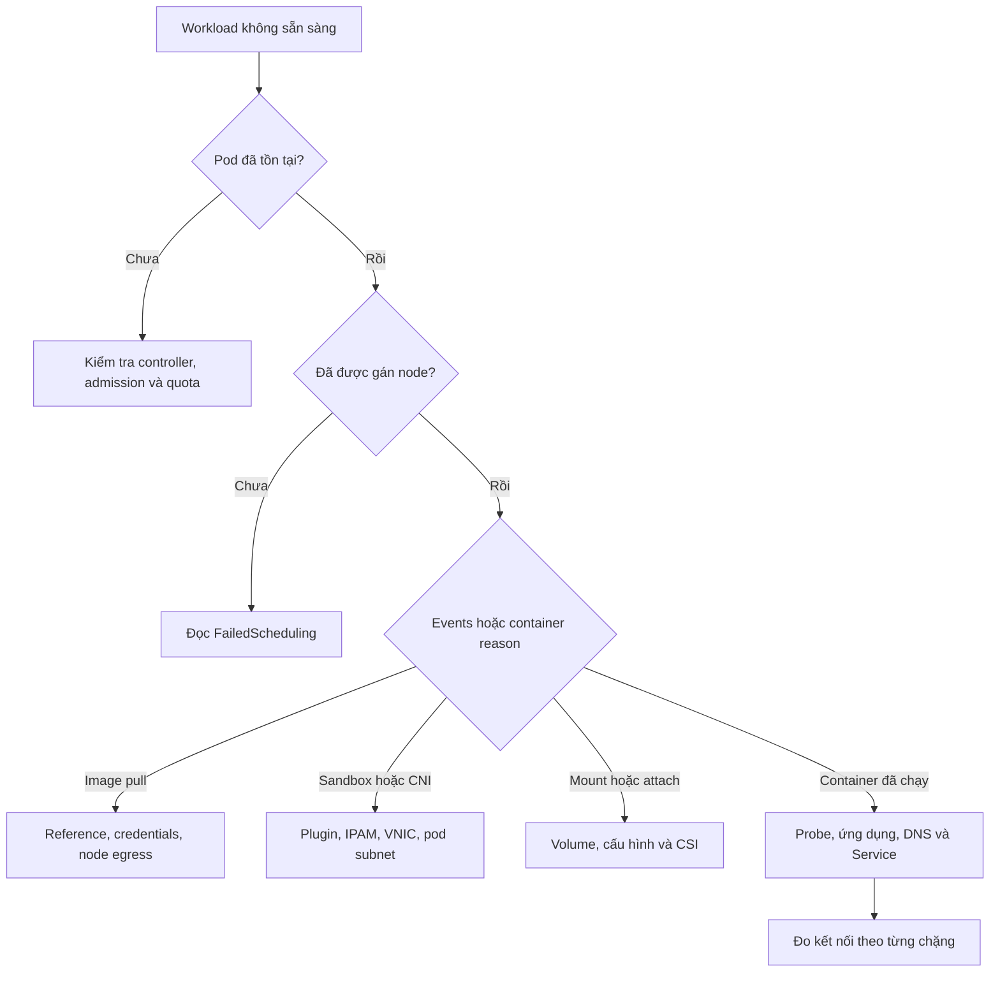

# Chẩn đoán pod Pending, image pull và lỗi OKE networking

Trong chương **Vận hành và xử lý sự cố** của module **CLOUD_PROVIDERS_ORACLE**, bài học này xây dựng quy trình chẩn đoán workload trên Oracle Kubernetes Engine (OKE). Trọng tâm là nối bằng chứng Kubernetes với hạ tầng Oracle Cloud Infrastructure (OCI): worker node chạy trên Compute, địa chỉ trong VCN, quyền IAM đối với registry và tài nguyên mạng, cùng các phụ thuộc lưu trữ của ứng dụng.

Một Deployment không có replica sẵn sàng có thể do thiếu CPU, sai image tag, cạn IP của pod subnet hoặc Service trỏ sai cổng. Những lỗi này cần cách sửa khác nhau. Người vận hành phải xác định bước đầu tiên bị lỗi, thu bằng chứng tại bước đó, thay đổi đúng thành phần rồi kiểm tra lại đường đi của request.

Sau bài học, người học có thể:

- Phân biệt pod chưa được gán node với pod đã có node nhưng chưa khởi động container.
- Đọc Events để khoanh vùng scheduler, image registry, volume và CNI.
- Xử lý image pull từ OCI Container Registry (OCIR) theo ba lớp: tên image, quyền truy cập và kết nối từ worker node.
- Phân biệt sự cố VCN-native pod networking, Flannel, DNS, Service và NetworkPolicy.
- Xác nhận phục hồi bằng trạng thái workload và kết nối thực tế, đồng thời kiểm soát tác động của việc mở rộng node hoặc đổi cấu hình mạng.

## 1. Hiểu đúng Pending và điểm dừng của pod

### 1.1. Phase của pod khác với cột STATUS

`Pending` trong `.status.phase` bao gồm thời gian pod chờ được lập lịch và thời gian chuẩn bị container, chẳng hạn tải image. Cột `STATUS` của `kubectl get pods` là thông tin hiển thị tổng hợp; nó có thể hiện `ContainerCreating`, `ErrImagePull`, `ImagePullBackOff` hoặc trạng thái của init container. Vì vậy, không thể kết luận mọi pod có phase `Pending` đều thiếu tài nguyên scheduler. Xem định nghĩa trong [Kubernetes Pod Lifecycle](https://kubernetes.io/docs/concepts/workloads/pods/pod-lifecycle/).

Ba câu hỏi cần trả lời trước tiên:

1. `.spec.nodeName` đã có giá trị chưa và condition `PodScheduled` là gì?
2. Container thường hoặc init container đang chờ vì reason nào?
3. Events gần nhất báo lỗi tại thao tác nào?

| Bằng chứng | Nhánh cần kiểm tra trước | Chưa thể kết luận |
| --- | --- | --- |
| Chưa có node, `PodScheduled=False`, `FailedScheduling` | Tài nguyên, taint, affinity, topology, volume binding | Không mặc định là lỗi image hoặc DNS |
| Đã có node, `FailedCreatePodSandBox`, message chỉ rõ CNI/IPAM | Tạo mạng cho pod, cấp IP, CNI trên node | Không mặc định mọi sandbox error đều do mạng |
| `ErrImagePull` hoặc `ImagePullBackOff` | Image reference, credentials, kết nối node tới registry | Không mặc định là thiếu auth token |
| `FailedMount` hoặc `FailedAttachVolume` | Volume, Secret/ConfigMap được mount, CSI, topology | Không tự quy lỗi cho VCN |
| Container chạy nhưng `Ready=False` | Readiness probe, ứng dụng, kết nối phụ thuộc | `Running` chưa chứng minh phục vụ được request |
| Không tìm thấy pod mong đợi | Deployment/ReplicaSet, admission, quota, policy | Chưa có pod để chẩn đoán Pending |

`ImagePullBackOff` là trạng thái chờ trước lần thử tải image tiếp theo. Khoảng chờ là hệ quả của lần pull thất bại; lỗi gốc trong Events mới chỉ ra nguyên nhân.

### 1.2. Cây quyết định ban đầu



Đây là cây phân luồng, không phải cam kết về thứ tự tuyệt đối giữa mọi thao tác của kubelet. Luôn dùng Events và condition thực tế để chọn nhánh.

## 2. Chuẩn bị phạm vi điều tra

Các ví dụ lệnh dùng **Bash**, `kubectl` đã cấu hình kubeconfig và namespace thực hành `demo-oke`. Những tên pod, node, registry và IP phải được thay bằng tài nguyên của môi trường. Các lệnh `create`, `apply`, `rollout` hoặc sửa cấu hình làm thay đổi hệ thống; chỉ thực hiện sau khi chọn đúng đối tượng và phương án phục hồi.

```bash
NS=demo-oke
POD=orders-api-7c8f5c9f6b-abcde

kubectl config current-context
kubectl get namespace "$NS"
kubectl auth can-i get pods -n "$NS"
kubectl auth can-i list events -n "$NS"
kubectl get pods -n "$NS" -o wide
```

Namespace Kubernetes và compartment OCI là hai phạm vi quản trị khác nhau. Người có quyền xem pod chưa chắc được đọc subnet hay sửa node pool. Quyền IAM quản lý cluster cũng chưa chứng minh tài khoản có đủ Kubernetes RBAC để đọc tài nguyên trong mọi namespace.

Ghi lại cluster, region, compartment liên quan, namespace, thời điểm bắt đầu theo UTC và thay đổi gần nhất. Nếu cluster, network và registry nằm ở các compartment khác nhau, ghi riêng từng phạm vi. Điều này giúp phân biệt thiếu quyền quan sát với lỗi thật của workload.

Với managed node pool, có thể liên hệ node Kubernetes với Compute instance qua `providerID` rồi đối chiếu trong Console:

```bash
kubectl get nodes -o custom-columns='NAME:.metadata.name,PROVIDER_ID:.spec.providerID'
```

Bài học ưu tiên managed node pool cho phần chẩn đoán trực tiếp hệ điều hành. Virtual node pool có giới hạn và công cụ vận hành khác; không áp dụng máy móc SSH, `journalctl` hay Node Doctor cho virtual node.

## 3. Thu bằng chứng trước khi đổi cấu hình

### 3.1. Bộ lệnh cho một pod

```bash
kubectl get pod "$POD" -n "$NS" -o wide
kubectl describe pod "$POD" -n "$NS"

kubectl get pod "$POD" -n "$NS" \
  -o jsonpath='{.status.phase}{"\n"}{.spec.nodeName}{"\n"}'

kubectl get pod "$POD" -n "$NS" \
  -o jsonpath='{range .status.conditions[*]}{.type}{"="}{.status}{" reason="}{.reason}{" message="}{.message}{"\n"}{end}'

kubectl get pod "$POD" -n "$NS" \
  -o jsonpath='{range .status.initContainerStatuses[*]}init/{.name}{": "}{.state}{"\n"}{end}{range .status.containerStatuses[*]}container/{.name}{": "}{.state}{"\n"}{end}'

POD_UID="$(kubectl get pod "$POD" -n "$NS" -o jsonpath='{.metadata.uid}')"
kubectl get events -n "$NS" \
  --field-selector "involvedObject.uid=$POD_UID" \
  --sort-by=.metadata.creationTimestamp
```

Lọc theo UID tránh trộn Events của pod cũ với pod mới có cùng tên. Events có thời gian lưu hữu hạn và có thể được gộp thành nhiều lần lặp; đối chiếu cả thời điểm xuất hiện gần nhất, số lần lặp và thời điểm rollout. Danh sách rỗng không chứng minh trước đó không có lỗi.

Nếu container chưa chạy, `kubectl logs` có thể chưa có log. Khi đó đọc Events, trạng thái init container và log node/plugin phù hợp. Với container đã từng chạy rồi kết thúc:

```bash
kubectl logs "$POD" -n "$NS" -c orders-api --tail=100
kubectl logs "$POD" -n "$NS" -c orders-api --previous --tail=100
```

Thay `orders-api` bằng tên container thật. `--previous` chỉ hữu ích khi còn log của lần chạy trước trong cùng pod; nó không khôi phục log của pod đã bị xóa.

### 3.2. Nhận diện phạm vi ảnh hưởng

```bash
kubectl get nodes -o wide
kubectl get deployment,replicaset -n "$NS"
kubectl get events -n "$NS" --sort-by=.metadata.creationTimestamp
kubectl get pods -n kube-system -o wide
```

| Phạm vi quan sát | Giả thuyết nên ưu tiên |
| --- | --- |
| Một pod mới lỗi, pod cũ vẫn khỏe | Manifest, image mới, credentials, volume hoặc khác biệt node |
| Mọi pod mới của một node lỗi | Kubelet/runtime, CNI trên node, disk, VNIC/IPAM |
| Một node pool lỗi, pool khác khỏe | Shape, kiến trúc CPU, subnet, NSG, node image hoặc cấu hình pool |
| Pod mới của nhiều namespace cùng lỗi | DNS, egress, CNI, registry hoặc capacity dùng chung |
| Chỉ luồng qua Service lỗi | Selector, readiness, EndpointSlice, cổng hoặc chuyển tiếp Service |

Lưu bằng chứng đã loại bỏ dữ liệu nhạy cảm. `describe`, log ứng dụng và manifest có thể chứa thông tin nội bộ hoặc biến môi trường dạng rõ; không gửi nguyên Secret hay auth token vào ticket.

## 4. Nhánh A: pod chưa được lập lịch

### 4.1. Đọc từng lý do FailedScheduling

```bash
kubectl get pod "$POD" -n "$NS" -o yaml
kubectl get nodes --show-labels
```

Nếu pod chưa có node, chọn node ứng viên từ danh sách để đọc:

```bash
NODE=ten-node-ung-vien
kubectl describe node "$NODE"
kubectl get node "$NODE" \
  -o jsonpath='{.status.allocatable}{"\n"}{.spec.taints}{"\n"}{.spec.unschedulable}{"\n"}'
```

| Dấu hiệu trong Events hoặc cấu hình | Cách xác minh | Hướng xử lý có căn cứ |
| --- | --- | --- |
| `Insufficient cpu` / `Insufficient memory` | So requests với allocatable và requests đã đặt trên từng node | Điều chỉnh requests theo số liệu hoặc bổ sung node phù hợp |
| `Too many pods` | Kiểm tra `allocatable.pods`, số pod và cấu hình pool | Bổ sung capacity pod; kiểm tra đồng thời ngân sách IP |
| Không khớp node selector/affinity | So label thật với ràng buộc bắt buộc trong pod spec | Sửa label hoặc ràng buộc đúng thiết kế |
| Untolerated taint | So taint của node với tolerations của pod | Thêm toleration khi workload được phép chạy trên pool đó |
| Node không sẵn sàng hoặc bị cordon | Conditions, `SchedulingDisabled`, `spec.unschedulable` | Khôi phục node hoặc dùng node khỏe theo kế hoạch |
| Anti-affinity/topology không thỏa mãn | Đếm node/zone đủ điều kiện sau mọi bộ lọc | Bổ sung failure domain hoặc sửa ràng buộc quá chặt |
| PVC chưa bind / volume node affinity conflict | Events của pod, PVC và topology PV/StorageClass | Sửa provisioning, topology hoặc cấu hình lưu trữ |

Ràng buộc bắt buộc có thể loại hết node dù cluster còn tài nguyên. Ràng buộc ưu tiên hướng scheduler chọn node khi có lựa chọn phù hợp. Tham khảo [Assigning Pods to Nodes](https://kubernetes.io/docs/concepts/scheduling-eviction/assign-pod-node/).

### 4.2. Requests, allocatable và độ phân mảnh tài nguyên

Scheduler xét tài nguyên được yêu cầu, không chỉ CPU/memory đang dùng tại thời điểm xem dashboard. `kubectl top nodes` hỗ trợ điều tra nếu có Metrics Server nhưng không thay thế việc đọc requests và allocatable. Xem [Resource Management for Pods and Containers](https://kubernetes.io/docs/concepts/configuration/manage-resources-containers/).

Ví dụ tự tính: ba node đều còn 600 millicpu theo ngân sách requests, trong khi một pod cần 1000 millicpu. Tổng phần còn lại là 1800 millicpu nhưng không node nào đủ chỗ cho pod đó. Cộng tổng toàn cluster che khuất độ phân mảnh này.

Khi tính nhu cầu, kiểm tra container ứng dụng, sidecar, init container và Pod overhead nếu được sử dụng. Đừng chỉ nhìn container chính. Với Java, giảm memory request/limit cần đi cùng đánh giá heap, native memory, thread stack và lưu lượng; hạ con số để pod vào được node có thể chuyển lỗi thành OOM khi chạy.

Nếu autoscaler đã bật mà pod vẫn chờ, xem vì sao pool không tăng: giới hạn min/max, quota/service limit OCI, capacity shape tại vị trí chọn, subnet thiếu IP hoặc ràng buộc mà node mới vẫn không đáp ứng. Một pool lớn hơn không giải quyết được selector trỏ tới label không tồn tại.

### 4.3. PVC và lỗi tạo pod cần được tách riêng

```bash
kubectl get pvc -n "$NS"
kubectl describe pvc ten-pvc -n "$NS"
kubectl get storageclass
```

`WaitForFirstConsumer` có thể trì hoãn binding cho tới khi chọn được vị trí phù hợp; PVC `Pending` ở giai đoạn đó chưa đủ để kết luận storage hỏng. Nếu có lỗi provisioning hay attach thật, tiếp tục theo CSI, OCI Block Volume và availability domain/topology liên quan. Không xóa PVC/PV để thử khởi động lại pod vì thao tác đó có thể ảnh hưởng dữ liệu.

Nếu Deployment mong muốn ba replica nhưng chỉ tạo được hai pod và ReplicaSet báo `FailedCreate`, kiểm tra quota, LimitRange và admission. Đây là nhánh tạo đối tượng; không ghi nhận một pod chưa tồn tại là pod bị scheduler giữ lại.

## 5. Nhánh B: ErrImagePull và ImagePullBackOff

### 5.1. Đọc lỗi gốc của thao tác pull

```bash
kubectl get pod "$POD" -n "$NS" \
  -o jsonpath='{range .spec.initContainers[*]}init/{.name}{" -> "}{.image}{"\n"}{end}{range .spec.containers[*]}{.name}{" -> "}{.image}{"\n"}{end}'

kubectl describe pod "$POD" -n "$NS"
```

| Thông báo điển hình | Giả thuyết ban đầu | Kiểm tra kế tiếp |
| --- | --- | --- |
| `manifest unknown`, `not found` | Sai registry, namespace, repository, tag hoặc digest | Đối chiếu image đã push đúng region; registry có thể che lỗi quyền thành not found |
| `unauthorized`, `authentication required` | Credentials không hợp lệ hoặc chưa được dùng | Secret, registry host, username và auth token |
| `denied`, `pull access denied` | Repository riêng tư, sai reference hoặc thiếu quyền | Quyền pull đúng repository/compartment của danh tính trong Secret |
| `FailedToRetrieveImagePullSecret` | Secret thiếu hoặc không lấy được | Tên Secret, namespace, type và tham chiếu trên pod |
| `no such host` | Node không phân giải được tên registry | Resolver của node và đường tới DNS |
| `i/o timeout`, `context deadline exceeded` | Đường ra, DNS, proxy, firewall hoặc upstream chậm | Phân tách DNS, TCP, TLS và HTTP từ node lỗi |
| `x509: certificate signed by unknown authority` | Trust store, TLS interception hoặc chuỗi chứng chỉ sai | CA và proxy của node/runtime; không bỏ xác minh TLS |
| `no matching manifest` | Image không hỗ trợ OS/kiến trúc node | Manifest nhiều kiến trúc và label kiến trúc node |
| `429`, `toomanyrequests` | Registry giới hạn lượt truy cập | Chính sách registry, xác thực và mức pull đồng thời |
| `no space left on device` khi giải nén | Disk/inode của node không đủ | DiskPressure, filesystem chứa image và image garbage collection |

Đây là ánh xạ giả thuyết, không phải kết luận chỉ từ một chuỗi lỗi. Registry có thể trả cùng mã lỗi cho repository không tồn tại và repository không được phép đọc.

### 5.2. Xác minh image reference OCIR

Ví dụ minh họa:

```text
sin.ocir.io/<tenancy-namespace>/platform/orders-api:1.4.2
```

Đối chiếu hostname registry, tenancy namespace, tên repository đầy đủ và tag/digest với image đã push. Tenancy namespace trong đường dẫn registry không phải tên compartment. Nếu registry ở region khác, đánh giá đường kết nối đến endpoint đó thay vì mặc định route nội vùng sẽ đáp ứng.

Với OCIR riêng tư, mô hình phổ biến là Docker registry Secret chứa username theo định dạng OCIR và **OCI auth token** làm mật khẩu. Tài khoản dùng identity domain có thể cần cả tên domain trong username; lấy định dạng đúng theo danh tính của tenancy. Không thay auth token bằng mật khẩu Console. Xem [Pulling Images from Registry during Deployment](https://docs.oracle.com/en-us/iaas/Content/ContEng/Tasks/contengpullingimagesfromocir.htm).

```bash
kubectl get nodes -L kubernetes.io/arch,kubernetes.io/os
```

Nếu chuyển từ node x86 sang Arm, image ứng dụng và mọi init container/sidecar đều cần biến thể tương thích. Image nhiều nền tảng nhưng thiếu đúng tổ hợp OS/architecture vẫn không chạy được trên node đó.

### 5.3. Kiểm tra imagePullSecrets mà không in credentials

```bash
kubectl get pod "$POD" -n "$NS" \
  -o jsonpath='{.spec.serviceAccountName}{"\n"}{.spec.imagePullSecrets}{"\n"}'

kubectl get secret ocir-pull -n "$NS" \
  -o custom-columns='NAME:.metadata.name,TYPE:.type'

kubectl get serviceaccount default -n "$NS" \
  -o jsonpath='{.imagePullSecrets}{"\n"}'
```

Thay ServiceAccount `default` bằng tên pod thực sự sử dụng. Secret phải cùng namespace với pod; tham chiếu cùng tên ở namespace khác không hợp lệ. Sau khi sửa `imagePullSecrets` trên ServiceAccount, kiểm tra pod mới được tạo vì pod hiện có không tự nhận mọi thay đổi từ ServiceAccount. Xem [Kubernetes Secrets — Using imagePullSecrets](https://kubernetes.io/docs/concepts/configuration/secret/#using-imagepullsecrets).

Trong quy trình cấp credentials được bảo vệ, có thể tạo Secret từ Docker config file đã chuẩn bị:

```bash
kubectl create secret generic ocir-pull -n "$NS" \
  --type=kubernetes.io/dockerconfigjson \
  --from-file=.dockerconfigjson=/duong-dan-bao-mat/config.json
```

Lệnh dùng khi Secret chưa tồn tại. File phải chứa credentials hợp lệ cho đúng registry host; file chỉ trỏ tới credential helper trên laptop không đủ để kubelet dùng helper đó. Bảo vệ file nguồn và đưa việc xoay vòng Secret hiện có vào công cụ quản lý bí mật. Không đặt token thật trong tài liệu, manifest được commit, tham số lệnh được ghi lại hoặc log CI.

Ví dụ phần cấu hình trong pod template:

```yaml
spec:
  template:
    spec:
      imagePullSecrets:
        - name: ocir-pull
      containers:
        - name: orders-api
          image: sin.ocir.io/tenancy_namespace/platform/orders-api:1.4.2
          imagePullPolicy: IfNotPresent
```

Đây là **đoạn trích** Deployment, không phải manifest hoàn chỉnh. Thay `tenancy_namespace` và image bằng giá trị thực.

`IfNotPresent` có thể khiến pod cũ dùng image cache trong khi node mới phải pull và bộc lộ lỗi credentials. Kiểm chứng trên node chưa có image bằng rollout có kiểm soát hoặc pod thử được xác định rõ; không xóa cache toàn bộ node để thử. Khi cần tính tái lập, quản lý phiên bản image hoặc digest rõ ràng.

### 5.4. Đường pull bắt đầu từ worker node

Trong mô hình managed node thông thường, kubelet/container runtime trên node thực hiện pull. `docker pull` thành công trên laptop chỉ kiểm chứng laptop và credentials đó; chưa xác minh node lỗi đi được tới registry.

Từ worker node đang gặp lỗi, trong phiên truy cập được quản lý:

```bash
REGISTRY=sin.ocir.io
getent hosts "$REGISTRY"
curl -sS -D - -o /dev/null --connect-timeout 5 --max-time 15 \
  "https://$REGISTRY/v2/"
```

Nếu registry trả `401` với authentication challenge, phép thử chưa xác thực có thể đã chứng minh DNS, TCP, TLS và HTTP đến endpoint hoạt động. Nó chưa chứng minh quyền pull repository. Nếu timeout, kiểm tra route và security; nếu lỗi chứng chỉ, kiểm tra TLS và thời gian hệ thống. Không gửi auth token vào phép thử kết nối này.

Resolver trên node và CoreDNS của pod phục vụ các ngữ cảnh khác nhau. Pod phân giải được tên nội bộ không đảm bảo node phân giải được registry; lỗi pull image không tự động là lỗi CoreDNS.

IAM cho ứng dụng gọi OCI, quyền đọc repository của danh tính trong Secret và RBAC tạo Secret là các kiểm tra riêng. Việc ứng dụng có workload identity không tự thay thế cơ chế registry credentials đang cấu hình cho pod.

## 6. Xác định mô hình mạng OKE trước khi kiểm tra route

| Đặc điểm | OCI VCN-native pod networking | Flannel overlay |
| --- | --- | --- |
| Địa chỉ pod | Dùng không gian địa chỉ VCN | Dùng CIDR overlay riêng |
| Chặng hạ tầng cần đối chiếu | Pod subnet, VNIC/IPAM, NSG/security list và route liên quan | Mạng giữa node và cấu hình overlay |
| Kết nối trực tiếp từ ngoài cluster | Có thể định tuyến tới pod khi route/security cho phép | Không mặc định truy cập trực tiếp được IP overlay |
| Áp lực capacity cần chú ý | IP subnet, cấu hình cấp IP, giới hạn VNIC/shape và pod trên node | Pod CIDR/overlay và capacity node |

Hai mô hình có điểm kiểm tra khác nhau. Oracle mô tả địa chỉ từ VCN và vai trò VNIC tại [OCI VCN-Native Pod Networking CNI plugin](https://docs.oracle.com/en-us/iaas/Content/ContEng/Concepts/contengpodnetworking_topic-OCI_CNI_plugin.htm); phạm vi overlay được mô tả tại [Using the flannel CNI plugin](https://docs.oracle.com/en-us/iaas/Content/ContEng/Concepts/contengpodnetworking_topic-flannel_CNI_plugin.htm).

Lấy loại mạng từ cấu hình cluster trong Console/API rồi đối chiếu add-on triển khai thực tế. Không suy loại CNI chỉ từ việc pod nhận IP dạng private.

```bash
kubectl get daemonsets -n kube-system -o wide
kubectl get pods -n kube-system -o wide
```

Tên, nhãn và container add-on có thể khác theo phiên bản/cấu hình. Xác định đối tượng thật từ kết quả trước khi chọn tên đọc log. Nếu có Multus hoặc nhiều giao diện mạng, phân biệt lỗi mạng chính với lỗi attachment bổ sung.

## 7. Nhánh C: sandbox, CNI và cấp IP

### 7.1. Bắt đầu ở node đã nhận pod

```bash
NODE="$(kubectl get pod "$POD" -n "$NS" -o jsonpath='{.spec.nodeName}')"

# Chỉ chạy phần dưới khi NODE có giá trị.
kubectl describe node "$NODE"
kubectl get pods -n kube-system \
  --field-selector "spec.nodeName=$NODE" -o wide
```

Đọc toàn bộ message `FailedCreatePodSandBox`. Nếu message nói rõ network setup/CNI/IPAM thất bại, xác minh:

1. Pod add-on mạng tương ứng trên node có chạy và sẵn sàng không?
2. Lỗi xuất hiện khi gọi plugin, cấp IP, cấu hình interface hay liên hệ dịch vụ OCI?
3. Pod subnet còn địa chỉ khả dụng và node còn capacity theo cấu hình thật không?
4. IAM, VNIC, route, NSG, hệ điều hành hoặc add-on có đổi gần thời điểm lỗi không?
5. Node khỏe cùng pool khác gì so với node lỗi?

Đọc log sau khi tìm được tên thật:

```bash
CNI_POD=ten-pod-cni-da-xac-dinh
CNI_CONTAINER=ten-container-cni-da-xac-dinh

kubectl logs "$CNI_POD" -n kube-system -c "$CNI_CONTAINER" \
  --since=15m --tail=200
```

Nếu container CNI restart, xem thêm `--previous` khi log còn khả dụng. Không xóa DaemonSet hoặc restart mọi pod mạng chỉ dựa trên một lỗi pod ứng dụng; tác động có thể lan sang workload đang khỏe.

### 7.2. Cạn IP khác với thiếu CPU

Node có thể còn CPU/memory nhưng không tạo thêm pod network được. Với VCN-native, kiểm tra IP khả dụng của pod subnet, địa chỉ đã cấp/phân bổ trước, giới hạn pod trên node, shape/VNIC và cấu hình node pool. Không dùng một hằng số pod tối đa cho mọi shape và phiên bản.

Ví dụ suy luận: pod đã có `nodeName`, Events báo không cấp được IP, nhiều pod mới cùng pool cùng lỗi. Cần điều tra IPAM/subnet trước khi tăng CPU request hoặc đổi image. Khi subnet đã cạn, thêm node vào chính subnet đó có thể làm tình hình nặng hơn vì node mới cũng cần địa chỉ.

Để phục hồi, chọn cấu hình đủ ngân sách IP, bổ sung pool/subnet phù hợp theo khả năng OKE hỗ trợ hoặc giảm phân bổ dư theo kế hoạch thay đổi. Sau đó tạo pod mới có kiểm soát để chứng minh cấp IP hoạt động. Không thu hồi private IP hay tháo VNIC thủ công khi chưa xác minh tài nguyên nào đang dùng chúng.

### 7.3. Kiểm tra node khi có quyền hệ điều hành

Trên managed worker node:

```bash
sudo journalctl -u kubelet --since '15 minutes ago' --no-pager
sudo journalctl -u containerd --since '15 minutes ago' --no-pager
ip -brief address
ip route
sudo /usr/local/bin/node-doctor.sh --check
```

Tên service runtime phụ thuộc node image; dùng `containerd` khi đó là runtime thực tế. Node Doctor có thể nằm ở `/usr/bin` trên một số node. Công cụ dành cho managed node pool, không áp dụng virtual node pool. Xem [Troubleshooting Node Issues Using the Node Doctor Script](https://docs.oracle.com/en-us/iaas/Content/ContEng/Tasks/contengtroubleshooting_topic-node_troubleshooting.htm).

Log `forbidden` hoặc `not authorized` trong thao tác OCI cần được đối chiếu đúng principal, action và compartment của tài nguyên bị truy cập. Không thay mọi lỗi cấp IP bằng policy `manage all-resources` trên tenancy.

Nếu cần cập nhật CNI, đọc quy trình đúng phiên bản add-on và lập kế hoạch rollout. Không giả định cập nhật metadata add-on hoặc reboot node luôn đủ áp dụng mọi phiên bản plugin.

## 8. Nhánh D: pod đã chạy nhưng không kết nối được

### 8.1. Chọn điểm phát phép thử phù hợp

Bắt đầu từ workload lỗi hoặc pod chẩn đoán có cùng điều kiện mạng cần kiểm chứng: namespace, policy được chọn bởi label, node/pool và cấu hình DNS. Pod debug khác label có thể không chịu cùng NetworkPolicy; kết quả thành công của nó chưa bác bỏ lỗi policy của ứng dụng.

Ví dụ sau giả sử đã có pod `netcheck` chứa `sh`, `curl`, `nslookup`, `nc` và đang Running trong namespace thực hành:

```bash
CLIENT=netcheck
kubectl exec "$CLIENT" -n "$NS" -- cat /etc/resolv.conf
```

Nếu ứng dụng dùng image tối giản, chọn pod công cụ được phê duyệt hoặc ephemeral container phù hợp với quyền và Pod Security. Tạo pod công cụ cũng cần tải image; khi đang hỏng registry, ưu tiên công cụ sẵn có để tránh thêm phụ thuộc pull.

### 8.2. Đi từ ứng dụng tới Service và DNS

Giả sử API nghe HTTP cổng `8080`, có `/healthz`, và Service `orders-api` công bố cổng `80`. Thay bằng cổng và giao thức thật.

| Phép thử | Thông tin muốn tách |
| --- | --- |
| Ứng dụng gọi chính `127.0.0.1:8080` | Process có lắng nghe/phục vụ được không |
| Client gọi từng PodIP:8080 | Đường tới backend và cổng đích |
| Cùng node so với khác node | Khác biệt đường liên node |
| Client gọi ClusterIP:80 | Lớp chuyển tiếp Service |
| Client gọi tên Service:80 | DNS cộng với đường Service |
| Gọi dependency ngoài cluster | Egress, route, TLS và dependency |

```bash
kubectl get pods -n "$NS" -o wide --show-labels
kubectl get service orders-api -n "$NS" -o yaml
kubectl get endpointslices -n "$NS" \
  -l kubernetes.io/service-name=orders-api -o yaml

BACKEND_IP=10.20.1.25
SERVICE_IP="$(kubectl get svc orders-api -n "$NS" -o jsonpath='{.spec.clusterIP}')"

kubectl exec "$CLIENT" -n "$NS" -- \
  curl -sS --connect-timeout 3 --max-time 8 \
  "http://$BACKEND_IP:8080/healthz"

kubectl exec "$CLIENT" -n "$NS" -- \
  curl -sS --connect-timeout 3 --max-time 8 \
  "http://$SERVICE_IP:80/healthz"

kubectl exec "$CLIENT" -n "$NS" -- \
  curl -sS --connect-timeout 3 --max-time 8 \
  http://orders-api.demo-oke.svc.cluster.local/healthz
```

`BACKEND_IP` phải lấy từ pod hiện tại, không sao chép IP ví dụ. Tên đầy đủ giả sử cluster domain là `cluster.local`; kiểm tra domain thật trong cấu hình DNS của pod. Với headless Service (`clusterIP: None`), kiểm tra các địa chỉ backend do DNS trả về thay vì chạy phép thử ClusterIP như Service thường.

Nếu endpoint trực tiếp hoạt động nhưng ClusterIP thất bại, kiểm tra Service port/targetPort và cơ chế chuyển tiếp Service đang dùng, thường là kube-proxy. Nếu chỉ tên thất bại còn ClusterIP thành công, ưu tiên DNS. Xem quy trình selector, endpoint và cổng tại [Kubernetes Debug Services](https://kubernetes.io/docs/tasks/debug/debug-application/debug-service/).

### 8.3. Diễn giải timeout, refused và HTTP error

- **Timeout:** chưa có phản hồi đúng hạn; có thể do lọc gói, route, đường về, upstream quá tải hoặc process treo. Cần thêm bằng chứng xác định vị trí.
- **Connection refused:** có phản hồi từ chối ở lớp TCP; xem listener, cổng và cách Service xử lý khi thiếu backend.
- **HTTP 404/503:** có thành phần HTTP trả lời; xác định ứng dụng, ingress hay proxy trước khi kết luận backend nào khỏe.
- **Lỗi TLS:** kiểm tra hostname/SNI, CA, thời gian và chuỗi chứng chỉ. Gọi HTTPS bằng IP thay hostname có thể gây lỗi chứng chỉ mới làm phép thử sai lệch.

Ứng dụng chỉ nghe `127.0.0.1` có thể gọi localhost thành công nhưng không nhận kết nối qua PodIP. Cần sửa listener theo thiết kế container, không mở rộng NSG để chữa bind address.

## 9. DNS: tách tên nội bộ, tên bên ngoài và đường tới resolver

```bash
kubectl exec "$CLIENT" -n "$NS" -- nslookup kubernetes.default.svc.cluster.local
kubectl exec "$CLIENT" -n "$NS" -- nslookup orders-api.demo-oke.svc.cluster.local
kubectl exec "$CLIENT" -n "$NS" -- nslookup sin.ocir.io

kubectl get pods -n kube-system -l k8s-app=kube-dns -o wide
kubectl get service kube-dns -n kube-system
kubectl get endpointslices -n kube-system \
  -l kubernetes.io/service-name=kube-dns
kubectl logs -n kube-system -l k8s-app=kube-dns --since=10m --tail=100
```

Nhãn `k8s-app=kube-dns` thường được CoreDNS dùng để tương thích; nếu cluster cấu hình khác, xác định lại đối tượng. Không tự cài thêm DNS deployment chỉ vì truy vấn bằng một nhãn không trả kết quả. Xem [Debugging DNS Resolution](https://kubernetes.io/docs/tasks/administer-cluster/dns-debugging-resolution/).

| Kết quả | Hướng điều tra |
| --- | --- |
| Tên nội bộ và bên ngoài cùng timeout | Đường pod tới DNS Service/backend, CoreDNS và policy |
| Nội bộ thành công, bên ngoài thất bại | Upstream resolver, forwarding, DNS VCN và đường tới upstream |
| Chỉ một tên Service trả NXDOMAIN | Tên, namespace, Service tồn tại và cluster domain |
| Chỉ một node lỗi | CNI, chuyển tiếp Service, resolver/cấu hình hoặc policy liên quan node |
| DNS trả IP đúng nhưng ứng dụng không kết nối | Tiếp tục TCP/TLS/HTTP; DNS khỏe chưa đủ |

Kiểm tra `dnsPolicy`, `dnsConfig`, search domain và `/etc/resolv.conf`. DNS cần xét cả UDP và TCP cổng 53 theo đường thực tế; chỉ mở UDP có thể làm truy vấn cần TCP thất bại. Nếu có NodeLocal DNSCache, bổ sung chặng pod tới cache và cache tới CoreDNS/upstream.

## 10. OCI routing, security và NetworkPolicy

### 10.1. Vẽ đường đi theo nguồn thực tế

Một đường kết nối cần ghi rõ:

```text
nguồn thực tế -> subnet/VNIC -> route -> thiết bị hoặc gateway
              -> đích:port -> đường phản hồi về nguồn
```

Không dùng một sơ đồ cho cả pull image và request ứng dụng. Pull image thường xuất phát từ node; request ứng dụng xuất phát từ pod và có thể chịu SNAT tùy đường đi. Với VCN-native, pod subnet có thể khác worker subnet, nên sửa route của node chưa chứng minh đã sửa egress của pod.

| Đích kết nối | Thành phần cần đối chiếu |
| --- | --- |
| Registry/dịch vụ công cộng từ private subnet | DNS, route tới NAT gateway hoặc egress được thiết kế, security và proxy |
| Dịch vụ OCI hỗ trợ qua Oracle Services Network | Service gateway, service CIDR/region tương ứng, route table và security |
| Pod ở subnet khác trong VCN | VNIC/IP thực tế, bảo mật và định tuyến đang áp dụng |
| Database Oracle qua private endpoint | Tên endpoint, cổng thật, NSG hai phía, peering/DRG nếu khác mạng |
| API endpoint của cluster | Nguồn được phép, cổng API và đường từ client/node/pod tương ứng |

NAT gateway cung cấp một hướng egress từ private subnet tới Internet theo cấu hình; service gateway dành cho dịch vụ Oracle được hỗ trợ. Service gateway không phải đường ra chung tới mọi registry. Đối chiếu [OKE Network Resource Configuration](https://docs.oracle.com/en-us/iaas/Content/ContEng/Concepts/contengnetworkconfig.htm) và [Access to Oracle Services: Service Gateway](https://docs.oracle.com/en-us/iaas/Content/Network/Tasks/servicegateway.htm).

### 10.2. Kiểm tra từng lớp kiểm soát

**NSG và security list:** đối chiếu source/destination thực sau NAT, giao thức, port và VNIC/subnet đang gắn rule. Allow rule từ NSG và security list được xét kết hợp; thiếu rule ở một NSG chưa chứng minh lưu lượng bị chặn nếu rule khác đã cho phép. Với rule stateless, xem cả chiều đi và về; không mặc định phản hồi được theo dõi như stateful.

**NetworkPolicy:** xem pod được chọn, namespace selector, pod selector, ingress và egress. Allow policy có tính cộng dồn; khi hai pod đã bị cô lập ở các chiều tương ứng, cần cho phép cả egress nguồn và ingress đích. Cluster phải có thành phần thực thi NetworkPolicy tương thích thì đối tượng policy mới có hiệu lực lọc. Xem [Kubernetes Network Policies](https://kubernetes.io/docs/concepts/services-networking/network-policies/).

```bash
kubectl get networkpolicy -n "$NS"
kubectl describe networkpolicy -n "$NS"
kubectl get namespace --show-labels
kubectl get pods -n "$NS" --show-labels
```

Default-deny egress có thể làm mất DNS trước khi lộ lỗi gọi API bên ngoài. Bổ sung đúng luồng DNS và dependency cần thiết; không xóa mọi NetworkPolicy để thử.

**Hệ điều hành, proxy và lớp bổ sung:** kiểm tra host firewall, service mesh hoặc ZPR nếu có. Chỉ xem NSG không bao quát các lớp này. Với Flannel, kiểm tra overlay giữa node theo backend và cấu hình thật; không áp dụng quy tắc pod subnet VCN-native vào overlay.

### 10.3. Kết hợp phân tích cấu hình và quan sát lưu lượng

OKE có Network Path Analysis để kiểm tra route/security theo topology OCI. Công cụ phân tích cấu hình, không gửi lưu lượng thật; kết quả reachable chưa chứng minh process lắng nghe hay ứng dụng trả HTTP thành công. Xem [Troubleshooting Network Configuration Using Network Path Analysis Tests](https://docs.oracle.com/en-us/iaas/Content/ContEng/Tasks/contengtroubleshooting_topic-network_troubleshooting.htm).

Kết hợp kết quả với VCN Flow Logs đã bật đúng nguồn và phép thử có timestamp. Đối chiếu source, destination, protocol, port và khoảng thời gian; chưa thấy log không đủ kết luận nếu chưa kiểm tra nơi bật log, bộ lọc và độ trễ thu thập.

Nếu TCP bắt tay được nhưng request lớn hoặc truyền dữ liệu TLS hay treo, bổ sung giả thuyết MTU/Path MTU Discovery, nhất là khi có overlay, VPN hoặc FastConnect. Thu bằng chứng trước khi chỉnh MTU; mở thêm cổng ứng dụng không sửa được mọi lỗi phân mảnh.

## 11. Service, readiness và đường vào từ bên ngoài

Service không có backend sẵn sàng thường bắt đầu từ selector không khớp hoặc pod chưa Ready. Đọc EndpointSlice và readiness thay vì chỉ xác nhận pod Running.

```bash
kubectl describe service orders-api -n "$NS"
kubectl get deployment orders-api -n "$NS"
kubectl describe pod "$POD" -n "$NS"
```

Đối chiếu `Service.spec.ports[].port`, `targetPort` và cổng process thật sự nghe. `containerPort` trong YAML không tự làm ứng dụng mở cổng. Probe sai path/port có thể loại backend dù tiến trình chạy; dependency thật bị hỏng cũng có thể khiến readiness thất bại đúng thiết kế.

Nếu lỗi chỉ xảy ra từ ngoài cluster, kiểm tra ingress/controller, OCI Load Balancer hoặc Network Load Balancer, backend health, listener, NSG và đường tới backend. Phân biệt:

- **Pod Pending:** pod chờ tại một bước vòng đời.
- **Service LoadBalancer có địa chỉ còn pending:** cấp load balancer/cập nhật Service chưa xong; đọc Events của Service/controller, IAM và tiến trình OCI liên quan.

Không sửa scheduler để xử lý Service chưa được cấp địa chỉ. Khi chỉ Load Balancer báo backend không khỏe, so cổng/path health check với listener ứng dụng trước khi thay CNI.

## 12. Ví dụ diễn giải bằng chứng và chọn cách sửa

### 12.1. Node mới không pull được trong khi replica cũ vẫn phục vụ

Quan sát: sau mở rộng node pool, pod mới có node, Events báo OCIR `unauthorized`. Hai replica cũ vẫn Ready và đã chạy từ trước.

Lập luận:

1. Có `nodeName` nên lỗi đang quan sát không ở bước chọn node.
2. Registry trả lỗi xác thực; ưu tiên credentials và quyền repository trước khi mở route.
3. Replica cũ có thể dùng cache; trạng thái khỏe chưa chứng minh credentials hiện tại hợp lệ.
4. Pod mới tham chiếu `ocir-pull`, nhưng Secret đã đổi sang token của người không có quyền đọc repository cần thiết.

Khôi phục credentials được phép pull đúng repository hoặc sửa quyền đúng danh tính theo thiết kế, rồi thử một pod mới có kiểm soát. Xác nhận Events chuyển qua pull thành công, container khởi động, probe đạt và số replica Available phục hồi. Giữ replica đang phục vụ trong khi điều tra để hạn chế gián đoạn.

### 12.2. Pod có node nhưng lỗi sandbox sau khi tăng replica

Quan sát: node Ready, image reference không đổi, pod có `nodeName`, Events nói CNI không cấp được địa chỉ. Số IP khả dụng và cấu hình xác nhận pod subnet đã hết ngân sách địa chỉ.

Lập luận:

1. `Pending` ở đây không đồng nghĩa `FailedScheduling`.
2. CPU thấp không phản bác giả thuyết cạn IP.
3. Tăng node cùng subnet có thể tiêu thụ thêm IP mà chưa xử lý nguyên nhân.
4. Cần kiểm tra IP phân bổ trước và cấu hình pool, không chỉ đếm pod Running.

Có thể dùng capacity mạng đã chuẩn bị ở pool/subnet khác hoặc điều chỉnh thiết kế cấp IP theo kế hoạch. Sau thay đổi, chứng minh pod mới nhận IP, chạy và giao tiếp được cả cùng node lẫn khác node. Giữ số liệu trước/sau để điều chỉnh ngưỡng cảnh báo.

## 13. Phục hồi, giám sát và ngăn tái diễn

### 13.1. Thay đổi nhỏ, có điều kiện kiểm chứng

Mỗi thay đổi cần có giả thuyết, bằng chứng, đối tượng tác động, kết quả mong đợi và cách quay lại. Sửa template qua manifest/GitOps đang quản lý workload để cấu hình mong muốn không ghi đè bản sửa thủ công sau đó.

| Thay đổi | Điều kiện xác nhận |
| --- | --- |
| Sửa requests hoặc thêm node | PodScheduled thành công trên node đáp ứng ràng buộc, không tạo thiếu tài nguyên mới |
| Sửa image reference/Secret | Pod mới pull image cần dùng và chạy thành công |
| Sửa cấp IP/CNI | Pod mới nhận IP; không còn sandbox error mới trong phạm vi đã sửa |
| Sửa selector/targetPort/readiness | EndpointSlice có backend phù hợp, request qua Service thành công |
| Sửa route/NSG/NetworkPolicy | Phép thử đúng nguồn tới đúng đích/port thành công theo chính sách |

Theo dõi sau khi sửa Deployment:

```bash
kubectl rollout status deployment/orders-api -n "$NS" --timeout=180s
kubectl get deployment orders-api -n "$NS"
kubectl get pods -n "$NS" -o wide
kubectl get endpointslices -n "$NS" \
  -l kubernetes.io/service-name=orders-api
kubectl get events -n "$NS" --sort-by=.metadata.creationTimestamp
```

Events cũ có thể còn sau phục hồi. Đối chiếu timestamp và số lần lỗi mới thay vì yêu cầu toàn bộ lịch sử phải sạch. `rollout status` thành công vẫn cần request thực tế qua đường phục vụ người dùng và kiểm tra dependency quan trọng.

Nếu cô lập node bằng `cordon`, pod đang chạy vẫn ở node đó; cordon không tự di chuyển chúng. Trước khi drain/thay node, đánh giá PodDisruptionBudget, replica khỏe, local/ephemeral data và capacity đích. Rollback template không sửa được lỗi toàn cục như subnet cạn IP hoặc credentials dùng chung bị thu hồi.

### 13.2. Theo dõi tín hiệu có thể hành động

Cảnh báo nên xét thời lượng/phạm vi: pod chờ quá ngưỡng của ứng dụng, pull error tăng sau rollout, node NotReady, CNI restart bất thường, thiếu backend Ready hoặc IP subnet gần mức dự phòng. Thu lịch sử Events tập trung nếu cần điều tra vượt thời gian lưu mặc định.

Kết hợp số liệu Kubernetes với OCI Monitoring/Logging, Audit và thay đổi hạ tầng. Audit giúp tìm thao tác quản trị tài nguyên OCI, không thay flow log hay log kết nối ứng dụng. Với database Oracle, phân biệt timeout mạng với lỗi xác thực, TLS hoặc giới hạn kết nối phía database trước khi đổi security rule.

Tự động hóa nên thu bằng chứng và phát hiện sai cấu hình: xác nhận image tồn tại/có kiến trúc phù hợp trước rollout, kiểm tra tham chiếu Secret, kiểm tra manifest theo policy, theo dõi tuổi Pending và IP dự phòng. Không tự động restart toàn CNI hoặc nới quyền tenancy mỗi khi thấy pod Pending.

Mở rộng Compute, cấp load balancer, tăng thời gian giữ log hoặc đổi egress đều cần theo dõi trong ngân sách vận hành. Đặt min/max autoscaler có chủ đích, gắn tag và dọn tài nguyên chẩn đoán đã tạo sau khi xong. Không ghi nhận giải quyết xong chỉ vì tăng tài nguyên làm triệu chứng tạm biến mất.

### 13.3. Hồ sơ bàn giao sự cố

Kết quả điều tra có thể kiểm chứng cần ghi:

- Cluster/region, namespace, pod UID, node/pool và tài nguyên OCI liên quan.
- Thời điểm bắt đầu, phạm vi ảnh hưởng và thay đổi gần nhất.
- Events/log tiêu biểu đã che dữ liệu nhạy cảm, giả thuyết được bằng chứng hỗ trợ.
- Cấu hình đã đổi, cách phục hồi dự phòng và bằng chứng phục vụ trở lại.
- Việc ngăn tái diễn, người phụ trách và tín hiệu phát hiện sớm.

Tiêu chí kết thúc là workload phục hồi trên đường phục vụ thật, nguyên nhân gắn với bằng chứng và thay đổi được lưu vào cấu hình quản lý. Pod chuyển sang Running chỉ là một mốc trong quá trình xác minh đó.
