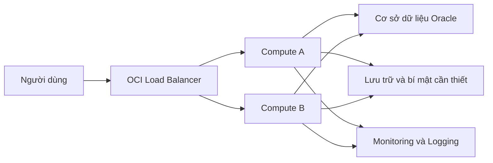

# Quản lý thay đổi, lịch bảo trì và rollback hạ tầng

## 1. Mục tiêu và bối cảnh vận hành OCI

Một thay đổi hạ tầng chỉ hoàn tất khi dịch vụ hoạt động đúng, dữ liệu được bảo toàn và đội vận hành còn kiểm soát được trạng thái hệ thống. Việc API trả về thành công hoặc Terraform báo apply thành công mới xác nhận một phần công việc.

Trong phạm vi Oracle Cloud Infrastructure (OCI), bài học này nối quản trị tenancy, compartment và IAM với vận hành VCN, Compute, lưu trữ và cơ sở dữ liệu Oracle. Trọng tâm là tổ chức một thay đổi có thể theo dõi, giới hạn ảnh hưởng và phục hồi trong thời gian cho phép.

Sau bài học, người học có thể:

- Lập hồ sơ thay đổi với phạm vi tài nguyên, người chịu trách nhiệm, thời gian và tiêu chí quyết định.
- Phối hợp lịch bảo trì của Oracle với lịch bảo trì ứng dụng.
- Chọn cách triển khai tại chỗ, rolling, canary hoặc blue/green theo khả năng chịu lỗi.
- Phân biệt rollback cấu hình, chuyển lưu lượng, khôi phục dữ liệu và sửa tiếp.
- Vận hành một runbook có điểm dừng, bằng chứng và bước đối soát sau thay đổi.
- Kiểm soát quyền IAM, chi phí tài nguyên tạm và những sai lệch giữa mã hạ tầng với tài nguyên thực tế.

### Tình huống xuyên suốt

Một dịch vụ đặt hàng chạy trong compartment sản xuất. Lưu lượng đi qua OCI Load Balancer tới hai máy Compute nằm trong các fault domain khác nhau của cùng một availability domain. Cả hai kết nối tới một cơ sở dữ liệu Oracle được quản lý bằng quy trình riêng.

Đội vận hành cần cập nhật image hệ điều hành và cấu hình ứng dụng. Cùng thời điểm, một máy nhận thông báo bảo trì hạ tầng từ OCI.

Các giả định dùng trong ví dụ:

| Thành phần | Giả định của bài học |
| --- | --- |
| Ứng dụng | Stateless; phiên làm việc được lưu ngoài máy ứng dụng |
| Compute | Mỗi máy còn lại đủ phục vụ tải dự kiến khi một máy rút khỏi pool |
| Cơ sở dữ liệu | Không thay đổi schema trong đợt cập nhật image |
| Quan sát | Có health check, log ứng dụng, số liệu độ trễ và tỷ lệ lỗi |
| Mục tiêu | Giữ dịch vụ sẵn sàng; có đường quay lại image cũ |
| Giới hạn | Hai máy cùng một AD không tạo khả năng chịu sự cố mất cả AD |

Đây là giả định thiết kế cho bài thực hành, không phải thuộc tính tự có của mọi hệ thống OCI.

## 2. Xác định đúng loại thay đổi và trách nhiệm

### 2.1. Phân biệt thay đổi của khách hàng với bảo trì của nhà cung cấp

| Nhóm công việc | Ví dụ | Trách nhiệm điều phối chính |
| --- | --- | --- |
| Thay đổi ứng dụng | Image mới, biến cấu hình, chứng chỉ, connection pool | Đội ứng dụng và vận hành |
| Thay đổi hạ tầng do khách hàng quản lý | Shape Compute, NSG, route table, backend Load Balancer | Đội nền tảng hoặc chủ tài nguyên |
| Bảo trì hạ tầng vật lý OCI | Di chuyển VM do bảo trì host | Oracle thông báo hoặc thực hiện theo cơ chế dịch vụ; khách hàng chuẩn bị ứng dụng |
| Bảo trì dịch vụ dữ liệu | Cập nhật DB system, DB home hoặc lịch bảo trì dịch vụ | Phối hợp theo đúng sản phẩm, phiên bản và mô hình dịch vụ |

Một VM được OCI di chuyển thành công chưa đủ chứng minh ứng dụng kết nối lại được với database. Một bản vá cơ sở dữ liệu cũng có thể đòi hỏi ứng dụng kiểm tra lại driver, retry và giao dịch đang mở. Mỗi lớp cần người xác nhận riêng.

### 2.2. Phân loại thay đổi theo rủi ro

Có thể dùng ba loại trong quy trình nội bộ:

- **Thay đổi chuẩn:** lặp lại, phạm vi nhỏ, đã diễn tập và có quy trình được phê duyệt trước, chẳng hạn thay chứng chỉ trên môi trường thử nghiệm theo runbook.
- **Thay đổi thông thường:** cần đánh giá và phê duyệt theo mức ảnh hưởng, chẳng hạn cập nhật image của nhóm máy sản xuất.
- **Thay đổi khẩn cấp:** cần xử lý ngay để khôi phục dịch vụ hoặc giảm rủi ro đang xảy ra; ghi nhận quyết định tại thời điểm thực hiện và hoàn thiện đánh giá sau đó.

Tên phân loại là quy ước quản trị của tổ chức. Chúng không tương ứng với một cờ bật tắt chung trong OCI.

Đánh giá rủi ro dựa trên phạm vi ảnh hưởng, độ phức tạp, khả năng đảo ngược và khả năng phát hiện lỗi. Việc sửa một policy dùng chung toàn tenancy có thể rủi ro cao hơn cập nhật một VM thử nghiệm, dù số dòng thay đổi ít hơn.

### 2.3. Quyền thực thi và quyền quyết định

Một thay đổi nên xác định ít nhất bốn vai trò, dù một người có thể kiêm nhiệm trong môi trường học tập:

| Vai trò | Trách nhiệm |
| --- | --- |
| Chủ thay đổi | Chuẩn bị phạm vi, phụ thuộc, lịch và hồ sơ |
| Người thực hiện | Thao tác theo runbook, ghi thời điểm và kết quả |
| Người ra quyết định | Cho phép tiếp tục, dừng hoặc rollback tại các mốc |
| Người xác nhận nghiệp vụ | Kiểm tra luồng sử dụng và dữ liệu sau thay đổi |

Cấp quyền IAM theo compartment và loại tài nguyên cần thao tác. Xác minh cả quyền triển khai lẫn quyền phục hồi: người đổi backend có quyền đưa backend cũ trở lại hay không, người khôi phục volume có dùng được khóa mã hóa liên quan hay không.

Với tự động hóa, dùng danh tính thực thi phù hợp như instance principal hoặc resource principal nếu công cụ và môi trường hỗ trợ. Quản lý quyền của danh tính đó riêng với quyền đọc dashboard của người quan sát. Không đưa khóa API hoặc mật khẩu database vào hồ sơ thay đổi.

Giữ một đường truy cập quản trị đã kiểm tra trước khi đổi IAM, NSG hoặc route. Nếu chính thay đổi có thể cắt kênh SSH, cần biết đường phục hồi qua OCI Console, Bastion hoặc cơ chế console connection phù hợp với tài nguyên và quyền đã cấp.

## 3. Hồ sơ thay đổi: từ danh sách tài nguyên đến điều kiện dừng

### 3.1. Ghi danh tính tài nguyên một cách tường minh

Tên hiển thị có thể trùng hoặc thay đổi. Hồ sơ cần liên kết OCID với tenancy, region, compartment và vai trò của từng tài nguyên. Chỉ ra tài nguyên dùng chung như subnet, route table, NSG, backend set và khóa mã hóa.

Ví dụ: sửa security list của subnet có thể tác động tới nhiều VNIC trong subnet; sửa một NSG dùng cho nhiều nhóm ứng dụng cũng có thể vượt xa máy đang bảo trì. Compartment giúp tổ chức quản trị nhưng không tự loại bỏ phụ thuộc mạng hay dữ liệu giữa các ứng dụng.

Sơ đồ phụ thuộc cho tình huống mẫu:



Nếu cả A và B đều cần cùng một NSG để tới database, thay NSG đó là thay đổi đối với đường phục vụ của cả hai máy. Rolling từng VM không giảm được rủi ro của một thay đổi dùng chung thực hiện đồng thời.

### 3.2. Mẫu hồ sơ thay đổi

Đoạn YAML dưới đây chỉ là mẫu hồ sơ nội bộ, không phải cấu hình OCI có thể nạp trực tiếp:

```yaml
change_id: CHG-OCI-042
title: "Cập nhật image nhóm máy ứng dụng đặt hàng"
environment: production
scope:
  region: "ap-singapore-1"
  compartment_ocid: "<ocid-compartment-san-xuat>"
  compute_ocids:
    - "<ocid-compute-a>"
    - "<ocid-compute-b>"
  shared_resources:
    - "<ocid-load-balancer>"
  excluded_changes:
    - "Không đổi schema cơ sở dữ liệu trong đợt này"
schedule:
  start: "2026-12-05T15:00:00Z"
  finish_by: "2026-12-05T16:00:00Z"
  decision_deadline: "2026-12-05T15:25:00Z"
strategy: rolling
baseline:
  image_release: "orders-os-r17"
  application_release: "orders-3.8.2"
  infrastructure_revision: "<commit-truoc-thay-doi>"
rollback:
  method: "Đưa máy chạy image cũ đã kiểm tra trở lại backend pool"
  estimated_minutes: 20
  verification_minutes: 10
  reserve_minutes: 5
owners:
  executor: "platform-oncall"
  decision_maker: "change-owner"
  verifier: "orders-owner"
```

Trong hệ thống thật, thay các giá trị minh họa bằng thông tin đã kiểm tra, bổ sung liên kết runbook, dashboard, bản sao lưu và bản ghi phê duyệt. Không ghi dữ liệu khách hàng vào mô tả hoặc tag.

### 3.3. Đặt tiêu chí trước khi triển khai

Một tiêu chí tốt có số đo, khoảng quan sát và hành động đi kèm:

| Tín hiệu | Điều kiện ví dụ cho bài thực hành | Quyết định |
| --- | --- | --- |
| Lỗi HTTP 5xx | Trên 1% trong hai khoảng một phút liên tiếp, mỗi khoảng đủ mẫu | Dừng mở rộng; đánh giá rollback |
| Độ trễ p95 | Trên 800 ms trong năm phút dưới tải tương đương baseline | Dừng và kiểm tra nút mới |
| Backend còn phục vụ | Không còn backend khỏe | Khôi phục đường phục vụ ngay theo runbook |
| Toàn vẹn dữ liệu | Phát hiện đơn hàng trùng hoặc xác nhận ghi sai | Dừng thay đổi và luồng ghi liên quan; chuyển xử lý sự cố dữ liệu |
| Thời gian | Chạm mốc quyết định cuối cùng mà chưa đạt điều kiện tiếp tục | Bắt đầu phương án phục hồi đã chọn |

Các ngưỡng này là ví dụ để diễn tập, không phải ngưỡng khuyến nghị chung của Oracle. Lưu lượng ít cần bổ sung kiểm thử tổng hợp và số mẫu tối thiểu; tỷ lệ lỗi bằng không trên vài request chưa tạo bằng chứng đáng tin cậy.

## 4. Xây dựng lịch bảo trì có thể thực hiện

### 4.1. Thu nhận thông báo và chuyển thành công việc

Đội vận hành cần tiếp nhận thông báo của OCI qua kênh có người chịu trách nhiệm. Announcement subscription có thể lọc thông báo rồi chuyển tới một Notifications topic và các endpoint đã cấu hình. Cần kiểm tra bộ lọc và xác nhận subscription ở endpoint để bảo đảm đội trực nhận được tin. Tham khảo [Subscribing to Announcements](https://docs.oracle.com/en-us/iaas/Content/General/Concepts/announcements_topic-Subscribing.htm).

Một thực hành phù hợp là tạo đầu việc nội bộ với:

1. Nguồn thông báo và mã sự kiện nếu có.
2. Tài nguyên, region và dịch vụ bị ảnh hưởng.
3. Thời điểm dự kiến, hạn cần hành động và múi giờ.
4. Hình thức gián đoạn dự kiến theo thông báo.
5. Người chịu trách nhiệm xác minh ứng dụng sau bảo trì.
6. Hành động chuẩn bị và đường liên hệ hỗ trợ khi cần.

Không mặc định mọi bảo trì đều được báo trước qua cùng một kênh. Kết hợp thông báo với thông tin bảo trì trên tài nguyên và tín hiệu sức khỏe thực tế.

### 4.2. Hiểu hành vi bảo trì Compute

OCI có các cách xử lý như live migration, reboot migration, rebuild in place hoặc manual migration tùy tài nguyên và điều kiện hỗ trợ. Live migration giảm gián đoạn nhưng ứng dụng vẫn cần chịu được một khoảng tạm dừng. Reboot migration có dừng và khởi động lại; rebuild in place có thể lâu hơn. Kiểm tra đúng Maintenance event của instance thay vì suy từ hình thức triển khai của máy khác. Xem [Instance Maintenance](https://docs.oracle.com/en-us/iaas/Content/Compute/References/infrastructure-maintenance.htm).

Đối với VM cần reboot migration, việc reboot từ bên trong hệ điều hành không thay thế thao tác migration qua giao diện hoặc API của OCI. Khả năng gia hạn thời điểm bảo trì và các giới hạn liên quan phụ thuộc loại sự kiện, tài nguyên và khả năng được dịch vụ hỗ trợ. DenseIO cần xem xét riêng dữ liệu NVMe cục bộ khi di chuyển. Xem [Moving a Compute Instance to a New Host](https://docs.oracle.com/en-us/iaas/Content/Compute/Tasks/movinganinstance.htm).

Trong runbook, tách hai mục tiêu:

- **Hoàn thành hành động OCI yêu cầu:** chẳng hạn thực hiện migration phù hợp trước hạn.
- **Khôi phục sức khỏe dịch vụ:** tiến trình chạy, kết nối database phục hồi, request nghiệp vụ thành công.

Rollback ứng dụng không đưa host vật lý quay về trạng thái trước bảo trì của Oracle. Nếu hạ tầng nhà cung cấp vẫn lỗi, cần dùng tài nguyên khỏe khác hoặc phương án phục hồi dịch vụ đã chuẩn bị.

### 4.3. Phối hợp các lịch khác nhau

Lập một lịch chung bao gồm:

- Bảo trì do Oracle thông báo cho Compute và các dịch vụ liên quan.
- Cập nhật hệ điều hành do đội vận hành thực hiện.
- Lịch bảo trì và sao lưu của database.
- Chốt sổ, batch, đồng bộ dữ liệu, chiến dịch có tải cao.
- Khoảng đóng băng thay đổi và lịch trực của người có quyền phục hồi.

Hạn chế ghép cập nhật image, đổi route và nâng cấp database vào cùng một đợt chỉ để tận dụng thời gian trực. Nếu cần ghép, phải mô hình hóa thứ tự, điểm kiểm chứng và khả năng quay lại của từng phần.

Bảo trì database cần runbook riêng theo Base Database Service, Exadata Database Service hay Autonomous Database và cấu hình đang dùng. Đừng suy rằng mọi bản vá đều rolling, mọi dịch vụ đều cho đổi lịch, hoặc mọi phiên bản đều cho hạ cấp trực tiếp. Đội database phải xác nhận phương án được hỗ trợ trước khi chốt lịch.

### 4.4. Chuẩn hóa múi giờ và tính mốc quay lại

Ghi timestamp theo ISO 8601 kèm offset; giữ thêm UTC khi phối hợp nhiều nhóm.

Ví dụ:

- Cửa sổ tại Việt Nam: 22:00–23:00 ngày 05/12/2026, UTC+07:00.
- Tương ứng UTC: 15:00–16:00 ngày 05/12/2026.

Mốc quyết định cuối cùng phải trừ cả thời gian phục hồi, kiểm chứng và dự phòng:

```text
Mốc quyết định cuối = Hạn kết thúc
                     - Thời gian rollback
                     - Thời gian kiểm chứng
                     - Khoảng dự phòng

Ví dụ: 23:00 - 20 phút - 10 phút - 5 phút = 22:25
```

Nếu đến 22:25 chưa chứng minh được điều kiện tiếp tục, đội vận hành cần chuyển sang phương án đã định. Chờ đến 22:55 mới bắt đầu rollback kéo dài 20 phút sẽ làm vỡ lịch dù thao tác rollback đúng kỹ thuật.

Thời lượng phải dựa trên diễn tập hoặc dữ liệu lịch sử. Tính cả việc khởi động máy, gắn volume, phục hồi kết nối, health check hội tụ, cập nhật DNS nếu có và đối soát dữ liệu.

## 5. Chọn chiến lược triển khai và bảo toàn năng lực phục vụ

| Chiến lược | Cách thực hiện | Điều kiện thuận lợi | Hạn chế cần tính |
| --- | --- | --- | --- |
| Tại chỗ | Cập nhật chính tài nguyên đang dùng | Môi trường nhỏ, chấp nhận dừng, có cách khôi phục đã thử | Khó quay lại nếu bản vá đổi nhiều trạng thái trên máy |
| Rolling | Rút một phần máy, cập nhật rồi trả lại pool | Các máy còn lại đủ tải, phiên và dữ liệu không buộc vào một máy | Có giai đoạn chạy lẫn phiên bản |
| Canary | Cho một phần lưu lượng thử phiên bản mới | Có cơ chế phân luồng và quan sát theo phiên bản | Mẫu nhỏ có thể bỏ sót lỗi hiếm |
| Blue/green | Giữ hai môi trường, chuyển đường phục vụ | Có quota, capacity và ngân sách chạy song song | Hai môi trường có thể tranh chấp dữ liệu hoặc cùng chạy job nền |

### 5.1. Rolling phải kiểm tra công suất còn lại

Giả sử tải đỉnh dự kiến là 700 request/giây và một máy đã được thử nghiệm ổn định ở 900 request/giây trong cấu hình tương đương. Việc rút một trong hai máy có thể khả thi nếu còn đủ dư địa cho dao động và phụ thuộc.

Nếu mỗi máy chỉ chịu được 450 request/giây, hai máy đang khỏe không có nghĩa là có thể rút một máy dưới tải 700 request/giây. Cần thêm năng lực, giảm tải hoặc chọn cửa sổ khác.

Dùng công suất đã đo với cùng loại request, kích thước dữ liệu và giới hạn database. CPU thấp không chứng minh còn đủ connection pool hay đủ IOPS.

### 5.2. Drain lưu lượng trước khi dừng máy

Đối với OCI Load Balancer, trạng thái drain ngừng đưa kết nối TCP mới và request HTTP không thuộc phiên dính mới tới backend; phiên đã được duy trì vẫn có thể tiếp tục đi tới backend đó. Offline chặn lưu lượng tới backend theo cơ chế riêng. Vì vậy, drain cần đi kèm quan sát kết nối và một giới hạn chờ rõ ràng. Xem [Monitor OCI Load Balancer backend operations](https://docs.oracle.com/en/learn/oci-load-balancer/).

Runbook nên thực hiện:

1. Xác nhận backend khác khỏe và đủ tải.
2. Đặt backend cần bảo trì vào trạng thái drain phù hợp.
3. Theo dõi request đang chạy, kết nối dài và job nền.
4. Chờ giao dịch hoàn tất hoặc đạt giới hạn chờ đã thống nhất.
5. Nếu cần cô lập hoàn toàn, thực hiện bước offline hoặc tách khỏi đường phục vụ theo thiết kế.
6. Dừng hoặc thay máy sau khi đã biết tác động tới kết nối còn lại.

WebSocket, request dài và session persistence cần thử riêng. Một health endpoint trả HTTP 200 không chứng minh tất cả giao dịch đang xử lý đã kết thúc.

### 5.3. Blue/green cần kiểm soát cả tác vụ không đi qua Load Balancer

Hai môi trường cùng kết nối database có thể đồng thời chạy scheduler, gửi email hoặc xử lý hàng đợi. Trước khi tạo green, xác định môi trường nào được quyền thực hiện tác vụ nền, cơ chế leader election và tính idempotent của consumer.

Đường quay lại blue chỉ có giá trị khi blue còn chạy được với schema và dữ liệu hiện tại. Giữ VM cũ nhưng để credential hết hiệu lực hoặc xóa đường mạng cần thiết sẽ làm mất phương án rollback.

Với canary, giảm weight backend không phải cam kết một tỷ lệ request chính xác trong mọi điều kiện. Thuật toán phân phối, kết nối giữ lâu và session persistence có thể làm kết quả khác dự kiến. Đo lưu lượng thực tới phiên bản mới và chọn cơ chế phân luồng phù hợp.

### 5.4. Dự trù quota, capacity và chi phí

Trước khi bắt đầu, kiểm tra service limit, compartment quota và khả năng tạo tài nguyên trong region/AD đã chọn. Có hạn mức chưa đủ bảo đảm luôn có capacity vào đúng thời điểm.

Dự toán chi phí của hai môi trường chạy song song, boot/block volume, bản sao lưu, Load Balancer, log tăng thêm và truyền dữ liệu. Gắn nhãn chủ sở hữu và hạn dọn dẹp theo quy ước nội bộ.

Chỉ dọn tài nguyên cũ sau thời gian theo dõi đã định và sau khi chủ dịch vụ đồng ý đóng đường rollback. Với tài nguyên không dùng nữa, kiểm tra volume, backup, IP và thành phần phụ thuộc còn phát sinh chi phí. Cảnh báo ngân sách là tín hiệu theo dõi; quy trình dọn dẹp vẫn cần được thực hiện.

## 6. Thực hiện thay đổi bằng mã hạ tầng

### 6.1. Tách cấu hình mong muốn, state và dữ liệu nghiệp vụ

Ba thành phần này phục vụ ba mục đích khác nhau:

| Thành phần | Nội dung | Vai trò khi phục hồi |
| --- | --- | --- |
| Mã Terraform và biến đầu vào | Mô tả tài nguyên mong muốn | Xác định cấu hình đích |
| Terraform state | Ánh xạ cấu hình với tài nguyên được quản lý | Giúp công cụ theo dõi và tính toán thay đổi |
| Backup dữ liệu | Nội dung database, volume hoặc đối tượng được sao lưu | Phục hồi dữ liệu theo cơ chế của từng dịch vụ |

Khôi phục một file state cũ không tự khôi phục VM hay dữ liệu trong database. Sửa state sai có thể làm công cụ mất liên hệ với tài nguyên đang tồn tại; thao tác phục hồi state cần quy trình riêng. Tham khảo [Update Terraform state manually](https://developer.hashicorp.com/terraform/cli/state).

Baseline của một thay đổi nên ghi commit mã hạ tầng, bộ biến theo môi trường, phiên bản Terraform/provider đã dùng, image hoặc artifact ứng dụng, trạng thái sao lưu và các thay đổi Console chưa đồng bộ.

### 6.2. Luồng plan rồi apply

Ví dụ sau dùng Bash trong Cloud Shell hoặc máy quản trị đã cài Terraform. Giả định đang ở đúng thư mục cấu hình OCI, backend state đã thiết lập, đầu vào đã có và quyền thực thi đã được cấp. Các lệnh là tài liệu hướng dẫn; không cần chạy để đọc bài.

```bash
set -euo pipefail

terraform init -input=false
terraform validate
terraform plan -input=false -lock-timeout=60s -out=change.tfplan
terraform show -no-color change.tfplan
```

Plan cho phép xem thay đổi trước khi thực thi. Khi đọc, tập trung vào tài nguyên bị thay thế, bị xóa, thay đổi mạng dùng chung và tài nguyên lưu dữ liệu. Plan đã lưu có thể chứa bí mật ở dạng rõ; bảo vệ như artifact nhạy cảm. Xem [terraform plan](https://developer.hashicorp.com/terraform/cli/commands/plan).

Sau khi plan cuối đã được kiểm tra và cửa sổ cho phép đã mở:

```bash
terraform apply -input=false -lock-timeout=60s change.tfplan
```

Apply với saved plan thực thi kế hoạch đó và không hỏi xác nhận tương tác thêm. Đặt bước phê duyệt của pipeline trước lệnh này; liên kết phê duyệt với đúng artifact đã xem. Xem [terraform apply](https://developer.hashicorp.com/terraform/cli/commands/apply).

Mỗi stack hoặc bộ state cần một đầu mối ghi trong thời gian thay đổi. Nếu backend hỗ trợ khóa, giữ cơ chế khóa hoạt động; đồng thời tránh cho người khác sửa Console hoặc chạy job triển khai cạnh tranh.

Nếu môi trường hoặc đầu vào đã đổi đáng kể từ lúc lập plan, tạo plan mới và kiểm tra lại. Một plan từng được xem là hợp lệ không bảo đảm phản ánh mọi thay đổi ngoài quy trình xảy ra sau đó. Tham khảo [Create a Terraform plan](https://developer.hashicorp.com/terraform/tutorials/cli/plan).

### 6.3. Quay lại cấu hình trước bằng một plan mới

Một quy trình quay lại có kiểm soát:

1. Dừng job triển khai mới và xác minh không còn tiến trình cạnh tranh.
2. Xác định commit, image và giá trị biến cần quay lại.
3. Ghi nhận những thay đổi đã thực sự hoàn thành.
4. Tạo một commit hoàn tác có chủ đích hoặc chọn cấu hình đích trong luồng quản lý phiên bản.
5. Sinh plan mới từ trạng thái hiện tại với cùng backend/state đang quản lý tài nguyên.
6. Kiểm tra các thao tác thay thế, xóa và phụ thuộc trước khi áp dụng.
7. Kiểm chứng đường phục vụ, dữ liệu và đồng bộ trạng thái sau khi thực thi.

Ví dụ phần lập kế hoạch, sau khi mã và biến đã được đưa về đích mong muốn:

```bash
terraform plan -input=false -lock-timeout=60s -out=rollback.tfplan
terraform show -no-color rollback.tfplan
```

Bước áp dụng chỉ thực hiện sau khi plan rollback đã được xem:

```bash
terraform apply -input=false -lock-timeout=60s rollback.tfplan
```

Revert mã có thể tạo tài nguyên mới thay cho tài nguyên đã xóa; nó không cam kết lấy lại OCID, địa chỉ IP, nội dung volume hoặc dữ liệu đã mất. Chọn chuyển lưu lượng về máy cũ khỏe trước nếu cách đó phục hồi nhanh và vẫn tương thích.

### 6.4. Sử dụng rollback job của OCI Resource Manager

Nếu stack được quản lý bằng OCI Resource Manager, dùng lịch sử job để chọn **successful apply job đại diện cho cấu hình muốn quay về**. Không chọn nhầm job có lỗi đang muốn hủy.

Luồng thực hiện:

1. Chọn target job.
2. Tạo plan rollback job cho target đó.
3. Xác nhận plan job thành công và đọc execution plan.
4. Đánh giá phạm vi thay đổi so với tình trạng hiện tại.

Đây là luồng được Oracle mô tả trong [Creating a Plan Rollback Job](https://docs.oracle.com/en-us/iaas/Content/ResourceManager/Tasks/create-job-plan-rollback.htm).

Tiếp theo, tạo apply rollback job sử dụng execution plan đã kiểm tra, theo dõi kết quả job, log và tài nguyên thực. Xem [Creating an Apply Rollback Job](https://docs.oracle.com/en-us/iaas/Content/ResourceManager/Tasks/create-job-apply-rollback.htm).

Về mặt thiết kế phục hồi, rollback job cần được xem như một đợt thay đổi tài nguyên có thể thất bại giữa chừng. Đội vận hành vẫn phải xác nhận ứng dụng hoạt động và dữ liệu đúng; không dùng kết quả job để thay cho bài kiểm tra nghiệp vụ.

## 7. Thiết kế rollback theo từng lớp

### 7.1. Chọn đúng cơ chế phục hồi

| Đối tượng bị thay đổi | Đường quay lại có thể chuẩn bị | Điều kiện cần kiểm tra |
| --- | --- | --- |
| Backend hoặc phiên bản ứng dụng | Chuyển lưu lượng về nhóm máy cũ | Máy cũ khỏe, đủ tải, tương thích dữ liệu hiện tại |
| Cấu hình NSG, route hoặc listener | Khôi phục cấu hình trước bằng thay đổi được kiểm soát | Đúng phạm vi dùng chung, còn đường quản trị |
| VM hoặc image | Dựng lại từ image cũ, boot volume backup hoặc máy dự phòng | Đủ capacity, cấu hình mạng và dữ liệu đã tách khỏi VM |
| Block/boot volume | Restore từ backup theo quy trình dịch vụ | Mốc dữ liệu, gắn volume, mount, quyền và tính nhất quán |
| Object Storage | Khôi phục theo version/backup đã cấu hình từ trước | Có phiên bản cần thiết, quyền truy cập và chính sách lưu giữ phù hợp |
| Database | Khôi phục hoặc chuyển đổi theo phương án database đã được hỗ trợ và diễn tập | RPO, RTO, tương thích ứng dụng, xử lý giao dịch mới |
| IAM hoặc thông tin xác thực | Khôi phục policy/quyền hoặc chuyển sang credential hợp lệ | Không vô hiệu hóa kênh phục hồi đang cần dùng |

Bảng này là khung lập kế hoạch. Mỗi phương án phải được cụ thể hóa cho tài nguyên đang dùng; không có một nút rollback chung cho mọi dịch vụ OCI.

### 7.2. Điểm khó nhất là dữ liệu phát sinh sau thay đổi

Giả sử backup database chụp lúc 21:50, phiên bản mới nhận đơn hàng từ 22:00 đến 22:10 rồi phát hiện lỗi. Restore về 21:50 có thể loại bỏ cả những đơn hàng hợp lệ trong khoảng sau đó.

Trước khi chọn restore, cần xác định:

- Mốc phục hồi và lượng dữ liệu có thể mất.
- Giao dịch nào đã được xác nhận với người dùng.
- Có thể tiếp tục dùng database hiện tại với ứng dụng cũ hay không.
- Cần ngừng ghi, phát lại sự kiện hay đối soát thủ công ở đâu.
- Người nào chịu trách nhiệm chấp nhận tác động dữ liệu.

**RPO** biểu thị giới hạn mất dữ liệu theo thời gian mà dịch vụ chấp nhận. **RTO** biểu thị thời gian mục tiêu để khôi phục hoạt động. Hai mục tiêu này phải được thể hiện trong runbook và kiểm chứng bằng diễn tập.

Backup volume của máy có database đang ghi không tự chứng minh tính nhất quán ở mức giao dịch. Phương pháp sao lưu và phục hồi cần phối hợp với cơ chế database, trạng thái ứng dụng và công cụ được hỗ trợ.

### 7.3. Giữ tương thích để có thể quay lại

Với thay đổi schema, một cách tổ chức thường dùng là mở rộng rồi thu gọn:

1. Thêm cấu trúc mới nhưng giữ cấu trúc cũ còn dùng được.
2. Triển khai ứng dụng tương thích với giai đoạn chuyển tiếp.
3. Chuyển hoặc bổ sung dữ liệu, theo dõi và đối soát.
4. Xác nhận các phiên bản cũ không còn cần đường cũ.
5. Xóa cấu trúc cũ trong một đợt thay đổi riêng.

Nếu xóa cột ngay khi ứng dụng mới bắt đầu chạy, chuyển lưu lượng về image cũ có thể tiếp tục gây lỗi. Khi đã vượt điểm không thể quay lại, lựa chọn thực tế có thể là sửa tiếp theo phương án đã chuẩn bị hoặc phục hồi dữ liệu trong một sự cố được điều phối.

Đối với IAM và secret, giữ cơ chế chuyển tiếp có thời hạn khi phù hợp với chính sách của tổ chức. Việc vô hiệu hóa credential cũ quá sớm có thể làm môi trường dự phòng mất khả năng phục vụ.

## 8. Runbook bảo trì theo từng mốc

Runbook phải dùng được khi người thao tác đang chịu áp lực. Mỗi bước cần hành động, kết quả mong đợi và cách xử lý khi không đạt.

### 8.1. Trước cửa sổ bảo trì

| Bước | Việc cần làm | Bằng chứng hoặc điều kiện đạt |
| --- | --- | --- |
| 1 | Xác minh tenancy, region, compartment, OCID và phạm vi | Danh sách tài nguyên khớp hồ sơ |
| 2 | Chốt người thao tác, người quyết định và kênh liên lạc | Các vai trò sẵn sàng trong cửa sổ |
| 3 | Kiểm tra lịch OCI và công việc phụ thuộc | Không xung đột chưa xử lý |
| 4 | Ghi baseline dưới tải đại diện | Có số liệu lỗi, độ trễ, throughput và tài nguyên |
| 5 | Xác minh backup và đường phục hồi | Có mốc backup cùng bằng chứng diễn tập gần đây phù hợp |
| 6 | Kiểm tra quota, capacity, quyền và khóa mã hóa liên quan | Có thể thực hiện cả thay đổi lẫn phục hồi |
| 7 | Đọc plan cuối và chuẩn bị artifact cũ | Phạm vi đúng; image và cấu hình cũ truy cập được |
| 8 | Chốt ngưỡng dừng và mốc quyết định cuối | Người quyết định hiểu và đồng ý |

Nếu một điều kiện bắt buộc không đạt, hoãn thay đổi thông thường. Với tình huống khẩn cấp, ghi rõ điều kiện thiếu, rủi ro đang chấp nhận và người ra quyết định.

### 8.2. Trong cửa sổ bảo trì

Với cửa sổ 22:00–23:00 và mốc quyết định cuối 22:25:

| Mốc minh họa | Hành động |
| --- | --- |
| 22:00 | Xác nhận mở cửa sổ, ghi baseline cuối, kiểm tra không có job cạnh tranh |
| 22:03 | Rút A khỏi lưu lượng theo quy trình drain |
| 22:08 | Thay hoặc bảo trì A theo runbook; B tiếp tục phục vụ |
| 22:15 | Kiểm tra A độc lập, đưa lại pool theo từng bước nếu đạt |
| 22:20 | Đánh giá lỗi, độ trễ, tải trên B và kiểm tra nghiệp vụ |
| Trước 22:25 | Quyết định có đủ thời gian làm B và còn ngân sách phục hồi hay không |
| Từ 22:25 | Nếu chưa đạt điều kiện, thực hiện phương án phục hồi đã định |

Các mốc chỉ minh họa. Nếu thao tác A thực tế cần 40 phút, phải thiết kế lại cửa sổ thay vì ép quy trình vào bảng.

Không bắt đầu máy B chỉ vì A vừa lên trạng thái RUNNING. Cần thấy backend khỏe, ứng dụng sẵn sàng, kết nối phụ thuộc ổn và kiểm thử nghiệp vụ đạt. Trước mỗi đợt, tính lại thời gian còn lại, thời gian hoàn thành và thời gian phục hồi.

### 8.3. Khi kích hoạt rollback

1. Thông báo quyết định và ghi thời điểm kích hoạt.
2. Dừng mở rộng thay đổi, chặn job mới, xác định thao tác đang chạy.
3. Nếu có nghi ngờ ghi sai dữ liệu, cô lập nguồn gây lỗi và điều phối với chủ dữ liệu.
4. Khôi phục đường phục vụ theo runbook đã chọn.
5. Xác minh sức khỏe từ phía người dùng và đối soát dữ liệu cần thiết.
6. Ghi trạng thái thực tế của từng tài nguyên, kể cả tài nguyên chưa phục hồi.
7. Cập nhật mã hạ tầng hoặc lập kế hoạch xử lý sai lệch có người chịu trách nhiệm.

Một thao tác đang chạy có thể không hủy được ngay hoặc đã tạo tác động một phần. Trước khi gửi lệnh đảo chiều, kiểm tra trạng thái tài nguyên và work request/job tương ứng để tránh tạo hai thay đổi đối nghịch cùng lúc.

### 8.4. Sau cửa sổ bảo trì

Theo dõi đủ lâu để thấy tải đại diện và các luồng nền quan trọng. Xác nhận lại việc gửi log, alarm, backup, kết nối quản trị và tác vụ định kỳ.

Chỉ đóng thay đổi khi ghi được:

- Kết quả so với tiêu chí thành công.
- Phiên bản ứng dụng, image và cấu hình thực tế.
- Đợt nào thành công, đợt nào hoàn tác và tài nguyên nào còn tồn tại.
- Sự cố dữ liệu hoặc phần việc đối soát còn mở.
- Thời điểm kết thúc đường rollback và kế hoạch dọn tài nguyên.
- Người xác nhận kỹ thuật cùng người xác nhận nghiệp vụ.

## 9. Bài thực hành: cập nhật từng backend và diễn tập quay lại

### 9.1. Điều kiện chuẩn bị

Dùng compartment học tập tách khỏi sản xuất, với ngân sách phù hợp cho các tài nguyên có thể phát sinh:

- Một OCI Load Balancer và hai backend A/B đã phục vụ được qua cùng listener.
- Một ứng dụng thử nghiệm có endpoint readiness và endpoint cho biết phiên bản hoặc tên máy.
- Mạng, IAM và công cụ quản trị đã hoạt động.
- Một artifact/image cũ cùng một phiên bản mới có thể triển khai lặp lại.
- Tải thử đủ nhỏ, không dùng dữ liệu thật và không chạy job gây tác động bên ngoài.
- Dashboard hoặc log thể hiện được request, lỗi và thời gian đáp ứng theo backend.

Dùng endpoint nghiệp vụ thử nghiệm không làm phát sinh thanh toán, email thật hoặc thao tác khó đảo ngược. Nếu bài tập có ghi dữ liệu, dùng bản ghi có mã riêng để đối soát và dọn dẹp.

### 9.2. Xác minh đúng máy và đúng region

Ví dụ Bash dưới đây chỉ đọc thông tin Compute. Thay profile, region và OCID bằng giá trị của môi trường học tập:

```bash
set -euo pipefail

OCI_PROFILE="LEARNING"
OCI_REGION="ap-singapore-1"
INSTANCE_OCID="<ocid-cua-backend-a>"

oci compute instance get --instance-id "$INSTANCE_OCID" --profile "$OCI_PROFILE" --region "$OCI_REGION" --query 'data.{id:id,state:"lifecycle-state",shape:shape}' --output json
```

Đối chiếu kết quả với hồ sơ trước khi thay đổi. Cú pháp lấy thông tin instance được mô tả tại [OCI CLI: compute instance get](https://docs.oracle.com/en-us/iaas/tools/oci-cli/latest/oci_cli_docs/cmdref/compute/instance/get.html).

RUNNING chỉ là trạng thái của tài nguyên Compute. Tiếp tục kiểm tra readiness, backend health và request qua Load Balancer.

### 9.3. Thực hiện đợt A

1. Ghi nhận trạng thái ban đầu của A/B và thực hiện một tập request qua listener.
2. Kiểm tra B có thể phục vụ riêng dưới tải thử.
3. Trong backend set, drain A theo cách phù hợp; theo dõi kết nối còn lại.
4. Cô lập A hoàn toàn khỏi lưu lượng khi đến bước cần dừng hoặc thay máy.
5. Triển khai image/artifact mới lên A theo cơ chế của môi trường thực hành.
6. Kiểm tra A qua đường nội bộ được cấp phép: readiness, phiên bản, log và phụ thuộc.
7. Đưa A trở lại pool sau khi đủ điều kiện; theo dõi lưu lượng thực tới A.
8. Chạy kiểm thử qua listener, xác nhận cả luồng đọc và luồng ghi thử nghiệm nếu có.

Ví dụ kiểm tra HTTP, sau khi thay domain và đường dẫn bằng endpoint thật của lab:

```bash
curl --fail --silent --show-error --max-time 10 "https://orders.example.com/health"
curl --fail --silent --show-error --max-time 10 "https://orders.example.com/version"
```

Một lần gọi thành công chưa chứng minh đợt cập nhật đạt. Lặp lại với số mẫu và thời gian đã chọn, kết hợp số liệu phía ứng dụng và Load Balancer. Endpoint phiên bản trong lab nên cho biết backend để nhận diện request; với sản xuất cần cân nhắc thông tin được phép công khai.

### 9.4. Diễn tập một lỗi được kiểm soát

Trong môi trường lab, làm phiên bản mới của A không đạt readiness bằng một cấu hình thử nghiệm có thể hoàn tác. Giữ B khỏe, giới hạn tải và dừng bài tập nếu đường phục vụ của B bị ảnh hưởng.

Thực hiện runbook:

1. Quan sát tín hiệu nào phát hiện lỗi đầu tiên.
2. Ghi thời gian từ khi gây lỗi tới khi người trực nhận biết.
3. Rút A lỗi khỏi đường phục vụ.
4. Đưa artifact cũ trở lại A hoặc chuyển sang máy cũ khỏe đã chuẩn bị.
5. Kiểm tra readiness và request nghiệp vụ thử nghiệm.
6. Đưa A trở lại pool nếu đạt, rồi xác nhận toàn bộ pool.
7. Cập nhật cấu hình quản lý để phản ánh trạng thái cuối.

Đo riêng thời gian phát hiện, thời gian quyết định, thời gian phục hồi và thời gian kiểm chứng. Nếu thời gian thực tế vượt ngân sách đã đặt, sửa thiết kế hoặc lịch trước khi áp dụng quy trình cho sản xuất.

### 9.5. Kết quả cần lưu từ bài thực hành

Một lần diễn tập đạt cần có hồ sơ trước/sau, log thao tác theo thời gian, số liệu dịch vụ trong khoảng lỗi, bằng chứng chuyển về phiên bản cũ và danh sách tài nguyên còn lại.

Không ghi kết quả giả định là đã đo. Nếu chưa diễn tập database restore, ghi rõ phạm vi chỉ xác minh rollback lớp ứng dụng. Dọn tài nguyên của lab sau khi hoàn tất, theo danh sách sở hữu và phụ thuộc đã ghi.

## 10. Xử lý những tình huống thường gặp

| Hiện tượng | Điều cần kiểm tra trước | Hướng xử lý |
| --- | --- | --- |
| Compute RUNNING nhưng backend không khỏe | Tiến trình, cổng nghe, đường health check, NSG và firewall hệ điều hành | Giữ máy ngoài pool; sửa hoặc quay lại artifact cũ theo mốc quyết định |
| Drain lâu không hết request | Kết nối dài, session persistence, tác vụ nền | Áp dụng giới hạn chờ và chính sách kết thúc kết nối đã thống nhất |
| Máy còn lại quá tải | Công suất thực, connection pool, hàng đợi và database | Dừng mở rộng; khôi phục capacity hoặc giảm tải theo phương án |
| Không tạo được máy thay thế | Quota, limit, capacity, image và quyền | Giữ máy cũ nếu còn an toàn; dùng lựa chọn dự phòng đã kiểm tra |
| Terraform apply lỗi giữa chừng | Log lỗi, job/work request, tài nguyên đã tạo hoặc đã sửa | Ghi trạng thái thực, tạo plan mới cho hướng phục hồi đã chọn |
| Rollback về image cũ vẫn lỗi | Schema, secret, certificate, route và phụ thuộc đã đổi | Khôi phục khả năng tương thích hoặc chuyển sang phương án dữ liệu/sửa tiếp |
| Không nhận được thông báo | Bộ lọc, endpoint, xác nhận subscription, quyền xem | Sửa kênh tiếp nhận và kiểm tra lại việc chuyển tin |
| Sau bảo trì vẫn có lỗi rải rác | Pool kết nối cũ, DNS cache, retry, máy chưa được rút hết | Quan sát theo backend/phiên bản và phục hồi từng thành phần |
| Mất quyền quản trị | Policy vừa đổi, nhóm/danh tính, đường mạng quản trị | Dùng đường phục hồi đã kiểm tra; không tiếp tục đổi quyền theo phỏng đoán |

Nếu rollback cũng thất bại, chuyển sang điều phối sự cố: ưu tiên đường phục vụ còn khỏe, bảo toàn bằng chứng và dữ liệu, phân công người kiểm tra từng lớp, đặt mốc cập nhật và gọi hỗ trợ theo tác động thực tế.

Tránh cho nhiều người đồng thời sửa một tài nguyên chỉ vì thời gian gấp. Một đầu mối ghi lại thao tác và kết quả giúp đội vận hành biết hệ thống đang ở trạng thái nào.

## 11. Đánh giá hiệu quả và cải thiện quy trình

Theo dõi một số chỉ số với định nghĩa thống nhất:

| Chỉ số | Cách dùng |
| --- | --- |
| Tỷ lệ thay đổi gây lỗi | Nhận diện nhóm thay đổi thường dẫn tới gián đoạn, rollback hoặc sửa nóng |
| Thời gian khôi phục dịch vụ | Đánh giá runbook có đáp ứng mục tiêu vận hành hay không |
| Thời gian phát hiện lỗi | Kiểm tra độ bao phủ của giám sát và kiểm thử sau triển khai |
| Tỷ lệ diễn tập phục hồi đạt | Đánh giá phương án có hoạt động khi thực hiện thật |
| Chi phí tài nguyên giữ để rollback | Cân đối thời gian an toàn với ngân sách |
| Thời gian tồn tại sai lệch cấu hình | Kiểm tra việc đưa thay đổi khẩn cấp trở lại luồng quản lý |

Sau mỗi thay đổi có sự cố, rà soát tín hiệu nào đến muộn, bước nào mất thời gian hơn dự tính, phụ thuộc nào chưa được ghi và quyền nào còn thiếu. Cập nhật runbook bằng bằng chứng từ lần thực hiện đó.

Một quy trình tốt kết nối được bốn việc: biết chính xác mình đang thay đổi gì, giữ đủ năng lực phục vụ trong khi làm, phát hiện sớm khi kết quả sai và thực hiện được phương án phục hồi trong thời gian cho phép.
