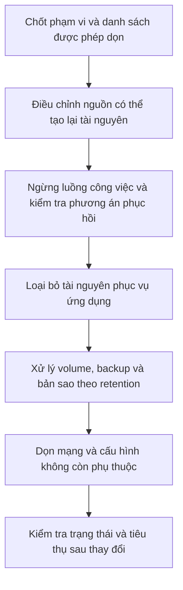

# Dọn tài nguyên mồ côi và kiểm tra tài nguyên còn tính phí

Trong chương **Vận hành và xử lý sự cố** của module **Oracle Cloud Infrastructure (OCI)**, dọn tài nguyên là một công việc vận hành xuyên suốt tenancy, compartment, IAM, mạng, Compute, lưu trữ và cơ sở dữ liệu. Một môi trường đã ngừng phục vụ người dùng vẫn có thể còn tài nguyên lưu dữ liệu, giữ công suất hoặc tạo lưu lượng.

Mục tiêu của bài là giúp bạn tìm được tài nguyên bị bỏ quên, quyết định tài nguyên nào được phép loại bỏ và chứng minh các khoản tiêu thụ liên quan đã dừng. Quy trình cần đồng thời bảo vệ dữ liệu, tính sẵn sàng và khả năng khôi phục.

## 1. Phân biệt tài nguyên mồ côi, nhàn rỗi và còn tính phí

**Tài nguyên mồ côi** là tài nguyên không còn quan hệ sử dụng hợp lệ với workload hoặc chủ sở hữu dự kiến. Ví dụ: một boot volume được giữ lại sau khi máy thử nghiệm đã bị terminate, nhưng không còn kế hoạch phục hồi hay người chịu trách nhiệm.

**Tài nguyên nhàn rỗi** vẫn thuộc một thiết kế hợp lệ nhưng ít hoặc chưa được sử dụng. Máy dự phòng thảm họa, database chờ chuyển đổi và volume dành cho đợt di chuyển dữ liệu có thể nằm trong nhóm này.

**Tài nguyên còn tính phí** là tài nguyên hoặc mức tiêu thụ vẫn tạo khoản phí theo SKU, cấu hình và điều kiện dịch vụ đang áp dụng. Nhóm này giao nhau với hai nhóm trên, nhưng không đồng nhất với chúng.

| Dấu hiệu quan sát | Kết luận có thể đưa ra | Việc cần làm tiếp |
| --- | --- | --- |
| Volume không thấy attachment trong phạm vi đang xem | Có thể là ứng viên cần rà soát | Kiểm tra đầy đủ attachment, chủ dữ liệu và mục đích giữ lại |
| Instance có CPU thấp | Workload ít hoạt động trong khoảng đo | Xem lịch chạy, vai trò dự phòng và độ đầy đủ của metric |
| Load balancer không có backend hoạt động | Backend đang trống hoặc gặp sự cố | Phân biệt môi trường đã bỏ với sự cố production |
| Tài nguyên không có tag Owner | Thiếu thông tin quản trị | Tìm chủ qua IaC, Audit và hồ sơ triển khai |
| Cost Analysis vẫn có dòng của OCID đã xóa | Có tiêu thụ được ghi nhận trong khoảng truy vấn | So sánh thời điểm sử dụng với thời điểm xóa |
| Không tìm thấy tài nguyên | Chưa quan sát được tài nguyên trong phạm vi hiện tại | Kiểm tra region, compartment, quyền và loại tài nguyên được hỗ trợ |

Một tài nguyên chỉ nên đi vào danh sách xóa khi có đủ bằng chứng về **nhu cầu sử dụng, phụ thuộc, dữ liệu và thẩm quyền xử lý**. Không biến một dấu hiệu đơn lẻ thành điều kiện xóa tự động.

## 2. Vì sao xóa máy rồi vẫn còn chi phí?

Hãy hình dung một môi trường lab có cấu trúc sau:

```text
Ứng dụng thử nghiệm
├── Compute instance
│   ├── Boot volume
│   └── Block volume dữ liệu
├── Load balancer
├── Database
├── Bucket lưu bản xuất dữ liệu
└── Backup, replica, log và các bản sao ở region khác
```

Các thành phần có vòng đời riêng. Loại bỏ một thành phần không phải là thao tác thu gom toàn bộ cây tài nguyên.

### 2.1. Stop, shutdown và terminate có ý nghĩa khác nhau

Đối với Compute, quy tắc tính phí khi stop phụ thuộc shape. Standard thường tạm dừng phí Compute khi stop; Dense I/O, HPC và nhiều GPU shape vẫn tiếp tục tính phí. Có ngoại lệ theo dòng VM hoặc bare metal, nên phải tra đúng shape. Shutdown từ trong hệ điều hành cũng không thay thế thao tác stop bằng OCI Console hoặc API. Xem [Resource Billing for Stopped Instances](https://docs.oracle.com/en-us/iaas/Content/Compute/Tasks/resource-billing-stopped-instances.htm).

Khi terminate instance, hãy đọc rõ lựa chọn xử lý boot volume. OCI cho phép giữ boot volume để phục hồi; tài liệu hiện hành mô tả mặc định giữ lại volume này. Đừng suy luận ổ đĩa đã bị xóa chỉ vì instance đã terminate. Xem [Terminating an Instance](https://docs.oracle.com/en-us/iaas/Content/Compute/Tasks/terminatinginstance.htm).

Đối với Autonomous Database, stop dừng tính phí CPU, nhưng cần kiểm tra riêng storage và các tính năng được sử dụng. Không áp dụng kết luận đó cho mọi loại DB System hoặc toàn bộ hạ tầng Exadata. Tham khảo [Stop Autonomous AI Database](https://docs.oracle.com/en-us/iaas/autonomous-database-serverless/doc/autonomous-stop.html) và [Autonomous AI Database Billing Summary](https://docs.oracle.com/en-us/iaas/autonomous-database-serverless/doc/autonomous-database-billing-overview.html).

### 2.2. Các nhóm cần kiểm kê độc lập

Bảng sau là danh mục kiểm tra, không phải khẳng định mọi dòng đều phát sinh phí trong mọi tenancy.

| Nhóm | Những thứ dễ bị bỏ sót | Cách xác định khoản tiêu thụ |
| --- | --- | --- |
| Compute | Instance STOPPED, máy dành riêng, công suất được giữ cho nhu cầu đã kết thúc | Đối chiếu shape, loại tài nguyên, trạng thái và SKU |
| Boot/Block Volume | Volume tách khỏi máy, clone thử nghiệm, volume còn tồn tại sau di chuyển | Xem dung lượng được cấp, cấu hình hiệu năng và các bản sao |
| Backup và replica | Boot volume backup, block volume backup, volume group backup, bản sao ở region khác | Kiểm kê riêng từng loại và kiểm tra dung lượng, thời hạn giữ |
| Object Storage | Phiên bản cũ, dữ liệu Archive, multipart upload chưa hoàn tất | Kiểm tra phiên bản, lớp lưu trữ, thao tác và truyền dữ liệu |
| File Storage | File system của môi trường cũ và snapshot cần rà soát | Xác định dung lượng, chính sách và workload còn mount |
| Mạng | Load balancer, IP giữ riêng, gateway, kết nối chuyên dụng, cấu hình gây lưu lượng | Kiểm tra đúng loại dịch vụ, SKU và lưu lượng thực tế |
| Database | Database đã stop, clone, standby, backup và hạ tầng nền | Tách Compute, storage, backup và tính năng bổ sung |
| Quan sát và dữ liệu phụ trợ | Log, dữ liệu lưu trữ cho phân tích, bucket nhận log, pipeline còn chạy | Kiểm tra nơi phát sinh dữ liệu, mức nạp và retention |
| Kubernetes và tự động hóa | Worker node, volume, load balancer do controller quản lý | Truy ngược controller hoặc cấu hình có thể tạo lại tài nguyên |

Không sao chép giả định giá của nhà cung cấp khác sang OCI. Chẳng hạn, việc một NAT gateway hoặc reserved public IP còn tồn tại là lý do để kiểm tra quản trị và phụ thuộc, chưa đủ để khẳng định có phí cố định. Với dịch vụ có nhiều biến thể, cần dùng đúng tên sản phẩm và SKU. Đơn vị tính cũng khác nhau: phí Compute theo thời gian, storage theo dung lượng và load balancer theo thành phần dịch vụ được công bố trong [OCI Price List](https://www.oracle.com/cloud/price-list/).

## 3. Chuẩn bị phạm vi và quyền trước khi rà soát

### 3.1. Chốt phạm vi bằng định danh

Lập một phạm vi kiểm kê gồm:

- Tenancy OCID và tài khoản hoặc CLI profile được sử dụng.
- Tất cả region có tài nguyên liên quan, kể cả region DR và region nhận bản sao.
- Compartment đích, compartment con và compartment chứa thành phần dùng chung.
- Availability domain khi loại tài nguyên hoặc lệnh yêu cầu.
- Khoảng thời gian quan sát workload và khoảng thời gian đối chiếu chi phí.
- Những tài nguyên được miễn dọn, cùng người chịu trách nhiệm và ngày xem xét lại.

Tên hiển thị giúp con người đọc, còn **OCID là khóa đối chiếu**. Hai tài nguyên có thể cùng tên; tên cũng có thể thay đổi sau một đợt di chuyển hoặc bàn giao.

Không chỉ kiểm kê compartment của instance. Volume và instance sử dụng volume có thể nằm ở các compartment khác nhau; nơi chứa backup và nơi chứa nguồn dữ liệu cũng cần được xác minh.

### 3.2. Phân biệt quyền xem tài nguyên và quyền xem chi phí

Tài khoản đọc được instance không đương nhiên đọc được thông tin chi phí của tenancy. Có thể cần một nhóm xem chi phí riêng. Ví dụ policy mà quản trị viên có thể cấp cho nhóm đã tồn tại:

```text
Allow group CostReviewers to read usage-report in tenancy
```

Policy trên phục vụ việc đọc báo cáo; nó không cấp quyền xóa tài nguyên. Nguồn cú pháp: [Cost Analysis — Required IAM Policy](https://docs.oracle.com/en-us/iaas/Content/Billing/Concepts/costanalysisoverview.htm#Required).

Đối với việc dọn thực tế, dùng quyền theo loại dịch vụ và compartment được giao. Tài khoản kiểm kê có thể chỉ cần quyền đọc; người thực hiện xóa phải có quyền phù hợp với từng loại tài nguyên. Nếu bị từ chối quyền, ghi nhận phần kiểm kê chưa hoàn tất, thay vì coi kết quả rỗng là bằng chứng không còn tài nguyên.

### 3.3. Chuẩn bị bằng chứng trước khi thay đổi

Một sổ kiểm kê tối thiểu có thể dùng các cột sau:

| Trường | Mục đích |
| --- | --- |
| Resource OCID, loại, tên | Nhận diện chính xác đối tượng |
| Region, compartment, AD nếu có | Ghi rõ phạm vi đã quan sát |
| Owner, ứng dụng, môi trường, mã thay đổi | Xác nhận trách nhiệm và thẩm quyền |
| Trạng thái, thời điểm tạo, thời điểm kiểm tra UTC | Hiểu vòng đời và tuổi của bằng chứng |
| Attachment, controller, phụ thuộc | Phát hiện quan hệ sử dụng còn hiệu lực |
| Dung lượng, cấu hình, SKU liên quan | Giải thích nguồn tiêu thụ |
| Retention, backup, yêu cầu phục hồi | Bảo vệ dữ liệu cần giữ |
| Quyết định, lý do, người xác nhận | Phân biệt ứng viên với tài nguyên được phép xóa |
| Thời điểm xóa hoàn tất, kết quả kiểm tra sau xóa | Đối chiếu với chi phí về sau |

Không chép mật khẩu, private key, wallet hoặc nội dung dữ liệu nghiệp vụ vào sổ kiểm kê.

## 4. Kết hợp kiểm kê tài nguyên với truy vết chi phí

Có hai hướng đi bổ sung cho nhau:

1. **Từ tài nguyên đến chi phí:** tìm volume bỏ quên, xác định SKU và mức tiêu thụ liên quan.
2. **Từ chi phí đến tài nguyên:** bắt đầu từ dịch vụ đang phát sinh phí, tìm OCID hoặc cấu hình tạo ra khoản đó.

Chỉ đi theo hướng thứ nhất có thể bỏ sót dịch vụ chưa biết đang tồn tại. Chỉ đi theo hướng thứ hai có thể bỏ sót tài nguyên đang nằm trong ưu đãi, chưa có dữ liệu chi phí hoặc chưa phát sinh tiêu thụ trong khoảng chọn.

### 4.1. Dùng Search và Tenancy Explorer để định vị

Trong Search, có thể dùng truy vấn cho đúng compartment:

```text
query all resources where compartmentId = 'ocid1.compartment.oc1..REPLACE_ME'
```

Điều kiện bằng một compartment OCID không tự diễn đạt toàn bộ cây compartment con. Hãy lập danh sách compartment con hoặc dùng khả năng hiển thị subcompartment của công cụ phù hợp.

Search phụ thuộc loại tài nguyên được hỗ trợ, dữ liệu được lập chỉ mục, region và quyền người dùng. Vì vậy, cần đối chiếu danh sách chuyên biệt của dịch vụ. Tenancy Explorer hỗ trợ quan sát qua nhiều region nhưng vẫn có giới hạn phạm vi và hỗ trợ tài nguyên. Xem [Overview of Search](https://docs.oracle.com/en-us/iaas/Content/Search/Concepts/queryoverview.htm) và [Finding Resources](https://docs.oracle.com/en-us/iaas/Content/GSG/Concepts/finding-resources.htm).

### 4.2. Bóc tách một khoản tiêu thụ đáng nghi

Một cách điều tra thực tế:

1. Chọn khoảng ngày bao phủ thời gian workload hoạt động và thời gian sau khi ngừng.
2. Xem dịch vụ nào còn tạo tiêu thụ, rồi tách theo sản phẩm hoặc SKU.
3. Khi dữ liệu có Resource OCID, dùng OCID đó để nối với kiểm kê.
4. Với dòng không có OCID, giữ nguyên dữ kiện về dịch vụ, region, đơn vị đo và kỳ sử dụng để điều tra tiếp.
5. Đối chiếu cấu hình thực tế của tài nguyên với loại phí đang thấy.

Cost Analysis hỗ trợ nhóm theo Resource OCID hoặc theo Service/SKU để xác định thành phần tạo phí; dữ liệu có thể mất tới 48 giờ mới xuất hiện. Xem [Cost Analysis](https://docs.oracle.com/en-us/iaas/Content/Billing/Concepts/costanalysisoverview.htm).

Một workload có thể tạo nhiều dòng chi phí. Ví dụ, thấy dòng dung lượng storage giảm chưa chứng minh backup hoặc cấu hình hiệu năng liên quan đã được xử lý. Hãy theo dõi từng thành phần có ý nghĩa trong hồ sơ thay đổi.

## 5. Ví dụ kiểm kê chỉ đọc bằng OCI CLI trên PowerShell

Các lệnh dưới đây dành cho người học chạy trong môi trường đã cấu hình OCI CLI. Chúng chỉ đọc metadata, không stop hoặc xóa tài nguyên. Thay toàn bộ giá trị mẫu bằng thông tin của môi trường lab.

Ví dụ giới hạn ở **một region, một compartment và một AD được chọn**. Muốn kết luận cho cả môi trường, phải lặp lại trên mọi phạm vi liên quan.

```powershell
$ProfileName = 'DEFAULT'
$RegionId = 'ap-singapore-1'
$CompartmentId = 'ocid1.compartment.oc1..REPLACE_ME'
$AdName = 'REPLACE_WITH_EXACT_AD_NAME'

function Invoke-OciRead {
    param(
        [Parameter(Mandatory = $true)]
        [string[]]$CliArguments
    )

    $jsonText = & oci @CliArguments
    if ($LASTEXITCODE -ne 0) {
        throw 'Lệnh OCI thất bại. Không được coi kết quả này là danh sách rỗng.'
    }

    ($jsonText -join [Environment]::NewLine) | ConvertFrom-Json
}

$scopeArguments = @(
    '--profile', $ProfileName,
    '--region', $RegionId,
    '--compartment-id', $CompartmentId,
    '--all',
    '--output', 'json'
)

$volumeArguments = @('bv', 'volume', 'list') + $scopeArguments
$volumes = Invoke-OciRead -CliArguments $volumeArguments

$attachmentArguments = @('compute', 'volume-attachment', 'list') + $scopeArguments
$attachments = Invoke-OciRead -CliArguments $attachmentArguments

$bootArguments = @('bv', 'boot-volume', 'list') + $scopeArguments +
    @('--availability-domain', $AdName)
$bootVolumes = Invoke-OciRead -CliArguments $bootArguments

$bootAttachmentArguments = @(
    'compute', 'boot-volume-attachment', 'list'
) + $scopeArguments + @('--availability-domain', $AdName)
$bootAttachments = Invoke-OciRead -CliArguments $bootAttachmentArguments

$volumes.data |
    Select-Object id, 'display-name', 'lifecycle-state', 'size-in-gbs'

$attachments.data |
    Select-Object 'volume-id', 'instance-id', 'lifecycle-state'

$bootVolumes.data |
    Select-Object id, 'display-name', 'lifecycle-state', 'size-in-gbs'

$bootAttachments.data |
    Select-Object 'boot-volume-id', 'instance-id', 'lifecycle-state'
```

Tên AD phải lấy nguyên văn từ tenancy trong region tương ứng. Tên mẫu của tenancy khác có thể không dùng được.

Ở đây, `--all` lấy đủ trang của **từng lệnh list có hỗ trợ tham số đó**; nó không mở rộng sang region hay compartment khác. Không tự thêm `--all` vào mọi lệnh OCI CLI. Nếu viết công cụ dựa trên API có phân trang, phải xử lý tiếp page token cho đến hết.

Các lệnh và tham số tham khảo trong [Volume List](https://docs.oracle.com/en-us/iaas/tools/oci-cli/latest/oci_cli_docs/cmdref/bv/volume/list.html), [Volume Attachment List](https://docs.oracle.com/en-us/iaas/tools/oci-cli/latest/oci_cli_docs/cmdref/compute/volume-attachment/list.html), [Boot Volume List](https://docs.oracle.com/en-us/iaas/tools/oci-cli/latest/oci_cli_docs/cmdref/bv/boot-volume/list.html) và [Boot Volume Attachment List](https://docs.oracle.com/en-us/iaas/tools/oci-cli/latest/oci_cli_docs/cmdref/compute/boot-volume-attachment/list.html).

### 5.1. Đọc kết quả mà không kết luận quá sớm

Đối với block volume, nối `volume.id` với `attachment.volume-id`. Đối với boot volume, nối `bootVolume.id` với `bootAttachment.boot-volume-id`.

Cần lưu ý:

- `AVAILABLE` là trạng thái vòng đời của volume, không phải chứng nhận volume đang mồ côi.
- Không chỉ tìm attachment `ATTACHED`; quan hệ đang attach hoặc detach cũng cần được điều tra.
- Attachment đã `DETACHED` là dữ kiện lịch sử, không tự chứng minh volume không còn mục đích sử dụng.
- Nếu instance và volume khác compartment, phải kiểm tra cả phạm vi chứa instance và attachment.
- Thiếu quyền, lỗi CLI hoặc thiếu trang dữ liệu làm kết quả **chưa xác định**, không làm nó trở thành “không có phụ thuộc”.

Một quy tắc tạo ứng viên có thể mô tả bằng mã giả:

```text
Với mỗi volume trong tập phạm vi đã kiểm kê:
    Nếu còn lỗi quyền hoặc dữ liệu kiểm kê chưa đủ:
        Đánh dấu UNKNOWN, không đề xuất xóa
    Nếu không thấy attachment còn hiệu lực trong mọi phạm vi liên quan:
        Đưa vào CANDIDATE_REVIEW
    Nếu có attachment đang chuyển trạng thái:
        Chờ và kiểm tra lại
    Chỉ chuyển sang APPROVED khi:
        Chủ tài nguyên xác nhận hết nhu cầu
        Không còn phụ thuộc vận hành
        Dữ liệu và retention đã được xử lý
        Thẩm quyền thay đổi đã rõ
```

`CANDIDATE_REVIEW`, `UNKNOWN` và `APPROVED` là nhãn quy trình do đội vận hành đặt, không phải lifecycle state của OCI.

### 5.2. Mở rộng kiểm kê theo loại tài nguyên

Sau volume, kiểm tra danh sách chuyên biệt trong Console cho:

- Compute instance, boot volume backup, block volume backup và volume group backup.
- Load balancer, network load balancer nếu có, reserved public IP và kết nối liên quan.
- Object Storage bucket, object version, multipart upload chưa hoàn tất và replication.
- File Storage, database, clone, standby và backup của dịch vụ database đang dùng.
- Các bản sao hoặc tài nguyên phụ trợ trong region khác.

Không dùng một kết quả Search chung làm bằng chứng thay thế cho các danh sách này. Cũng không trộn các sản phẩm có tên gần nhau vào cùng một giả định giá hoặc cùng một lệnh xóa.

## 6. Xác nhận quyền sở hữu, dữ liệu và phụ thuộc

Trước mỗi quyết định xóa, cần trả lời được các câu sau.

| Câu hỏi | Bằng chứng phù hợp |
| --- | --- |
| Tài nguyên phục vụ ai? | Owner, hồ sơ triển khai, mã thay đổi, repository hoặc người phụ trách |
| Còn workload nào dùng không? | Attachment, endpoint, mount, cấu hình ứng dụng, lịch batch |
| Có vai trò dự phòng không? | Thiết kế HA/DR, lịch kiểm thử chuyển đổi, xác nhận của chủ dịch vụ |
| Dữ liệu còn phải giữ không? | Retention, yêu cầu nghiệp vụ, yêu cầu kiểm toán và legal hold nếu có |
| Phương án phục hồi là gì? | Backup hoặc bản xuất phù hợp, thời hạn giữ và kiểm tra khôi phục |
| Có hệ thống tự tạo lại không? | Terraform state, Resource Manager stack, instance pool, controller, pipeline |
| Ai có thẩm quyền loại bỏ? | Chủ tài nguyên và quy trình thay đổi của môi trường |

Một backup được tạo thành công chưa chứng minh ứng dụng khôi phục được. Với dữ liệu có giá trị, phương án phục hồi cần bao gồm khóa giải mã, cấu hình, phiên bản phần mềm và quyền truy cập cần thiết.

Không xóa khóa mã hóa chỉ vì muốn dọn môi trường cũ. Nếu volume, bucket hoặc backup được giữ lại còn phụ thuộc khóa, việc làm mất khả năng giải mã có thể phá hỏng toàn bộ phương án phục hồi.

Nếu chưa xác định được owner, đánh dấu chờ xử lý và chuyển thông tin cho đầu mối quản trị. Không tự diễn giải “không ai trả lời” thành “không ai cần dữ liệu”.

## 7. Dọn theo phụ thuộc và kiểm soát nguồn tạo lại

Một trình tự tham khảo:



Thứ tự cụ thể phải theo sơ đồ phụ thuộc của workload. Một hệ thống dùng chung load balancer, VCN hoặc database sẽ cần ranh giới dọn khác với một lab độc lập.

### 7.1. Điều chỉnh IaC và controller trước

Nếu tài nguyên do Terraform hoặc OCI Resource Manager quản lý, hãy xác định đúng stack, state và cấu hình nguồn. Đọc kế hoạch thay đổi để biết tài nguyên nào sẽ bị xóa và thành phần nào được giữ lại.

Không chạy destroy toàn bộ một stack chỉ để xóa một volume nghi vấn. Không xóa state nhằm làm cho tài nguyên “biến mất” khỏi quản lý; thao tác đó không xóa tài nguyên trong OCI.

Đối với Kubernetes, instance pool hoặc pipeline triển khai, tìm cấu hình điều khiển tương ứng. Xóa tay một load balancer hoặc worker node có thể khiến bộ điều khiển tạo lại nó. Chỉ điều chỉnh nguồn tạo tài nguyên khi chủ workload đã xác nhận phạm vi ngừng sử dụng.

### 7.2. Compute và ổ đĩa

Một quy trình phù hợp cho instance hết nhu cầu:

1. Xác nhận đúng OCID, region và compartment.
2. Dừng nhận công việc mới và hoàn tất xử lý dữ liệu đang ghi.
3. Xác minh phương án phục hồi nếu có dữ liệu cần giữ.
4. Terminate instance với lựa chọn boot volume đã được quyết định rõ.
5. Chờ thao tác hoàn tất, kiểm tra lại boot volume và block volume thực tế.
6. Giữ hoặc xóa từng volume theo danh sách đã xác nhận.
7. Kiểm kê backup, clone và replica bằng danh sách riêng.

Không coi detach là delete. Với volume vẫn còn đang sử dụng, không ép detach để đạt mục tiêu giảm phí; cần hoàn tất quy trình ngừng sử dụng ở ứng dụng và hệ điều hành trước.

Ví dụ sau **thực sự xóa dữ liệu**, chỉ dành cho boot volume đã được xác nhận trong lab. Điền OCID riêng và kiểm tra lại mục tiêu ngay trước khi chạy:

```powershell
$ApprovedBootVolumeId = 'ocid1.bootvolume.oc1..REPLACE_WITH_APPROVED_OCID'

oci bv boot-volume get --boot-volume-id $ApprovedBootVolumeId --profile $ProfileName --region $RegionId
# Đối chiếu thông tin vừa đọc với hồ sơ đã xác nhận trước khi chạy dòng tiếp theo.
oci bv boot-volume delete --boot-volume-id $ApprovedBootVolumeId --profile $ProfileName --region $RegionId
```

Lệnh giữ cơ chế xác nhận của CLI; không cần thêm `--force` cho thao tác thủ công. Sau khi gửi lệnh, theo dõi kết quả cho đến khi hoàn tất và kiểm tra lại danh sách volume. Tham khảo [Boot Volume Delete](https://docs.oracle.com/en-us/iaas/tools/oci-cli/latest/oci_cli_docs/cmdref/bv/boot-volume/delete.html).

Đối với block volume, xóa là thao tác không thể hoàn tác trực tiếp. Backup có vòng đời riêng và cần được quyết định riêng, không suy luận từ trạng thái volume nguồn. Xem [Deleting a Block Volume](https://docs.oracle.com/en-us/iaas/Content/Block/Tasks/deletingavolume.htm) và [Block Volume Backups](https://docs.oracle.com/en-us/iaas/Content/Block/Concepts/blockvolumebackups.htm).

### 7.3. Backup, clone và replica

Với mỗi bản sao, ghi rõ nó phục vụ phục hồi vận hành, DR, kiểm thử hay lưu giữ theo yêu cầu. Chỉ loại bỏ bản hết mục đích và không còn ràng buộc giữ lại.

Kiểm tra thêm:

- Có backup policy hoặc lịch tự động nào còn tạo bản mới không?
- Có bản sao ở region hoặc compartment khác không?
- Có volume group backup phải quản lý theo nhóm không?
- Có deletion protection, retention lock hoặc hold đang có hiệu lực không?
- Việc xóa có làm mất điểm phục hồi cuối cùng cần giữ không?

Không tìm cách vượt khóa retention để giảm phí. Các cơ chế giữ backup có thể chặn xóa hợp lệ; cần đưa tài nguyên vào danh sách giữ lại cùng chi phí dự kiến và thời điểm xét lại. Tài liệu [Creating a Block Volume Backup](https://docs.oracle.com/en-us/iaas/Content/Block/Tasks/create-bv-backup.htm) mô tả các tùy chọn bảo vệ backup cần kiểm tra.

### 7.4. Object Storage

Đừng chỉ nhìn danh sách object hiện tại. Với bucket có versioning, thao tác xóa object thông thường có thể tạo delete marker trong khi phiên bản dữ liệu cũ vẫn được giữ. Cần kiểm tra cả object version và chính sách lifecycle. Xem [Object Storage Versioning](https://docs.oracle.com/en-us/iaas/Content/Object/Tasks/usingversioning.htm).

Kiểm kê riêng multipart upload chưa hoàn tất. Đây có thể là phần dữ liệu của lần tải lên thất bại hoặc ứng dụng ngừng giữa chừng. Xác nhận không có upload hợp lệ đang chạy trước khi hủy. OCI cung cấp thao tác abort và cơ chế lifecycle cho đối tượng này trong [Deleting a Multipart Upload](https://docs.oracle.com/en-us/iaas/Content/Object/Tasks/To_delete_uncommitted_multipart_uploads.htm).

Nếu chưa xóa được bucket, xem thông báo lỗi và kiểm tra object/version, pre-authenticated request, replication policy cùng multipart upload. Retention đang có hiệu lực cũng cần được tôn trọng. Tham khảo [Troubleshooting Object Storage Versioning](https://docs.oracle.com/en-us/iaas/Content/Object/Troubleshooting/usingversioning_topic-Troubleshooting_Versioning.htm) và [Object Storage Data Retention Rules](https://docs.oracle.com/en-us/iaas/Content/Object/Tasks/usingretentionrules.htm).

Việc chuyển lớp lưu trữ, truy xuất hoặc xóa sớm có thể có điều kiện tính phí riêng. Trước một đợt dọn dữ liệu lớn, đối chiếu lớp lưu trữ và hợp đồng hiện hành; đừng chỉ ước tính phần dung lượng sẽ giảm.

### 7.5. Database và hạ tầng dùng chung

Với database, phải xác định đúng sản phẩm trước khi lập kế hoạch ngừng sử dụng: Autonomous Database, Base Database Service, hệ thống Exadata hoặc database tự quản trên Compute có vòng đời và thành phần chi phí khác nhau.

Quy trình rà soát nên đi từ ứng dụng đến database, rồi đến backup và hạ tầng nền:

1. Xác nhận không còn ứng dụng, batch, tài khoản tích hợp hoặc replication cần kết nối.
2. Quyết định dữ liệu phải xuất hoặc giữ cho phục hồi.
3. Kiểm tra clone, standby, DR peer và backup theo dịch vụ cụ thể.
4. Thực hiện stop hoặc terminate đúng với mục tiêu đã chọn.
5. Kiểm tra tài nguyên nào còn tồn tại và khoản tiêu thụ nào được giữ có chủ đích.

Không mặc định rằng terminate xóa ngay mọi backup hoặc mọi sản phẩm đều có thể undelete. Chẳng hạn, Autonomous Database Serverless có khả năng undelete trong một số điều kiện; khi undelete, quy tắc tính phí cho khoảng đã terminate cũng cần được xét. Đây không phải phương án thay thế cho kế hoạch backup. Xem [Terminate an Autonomous AI Database Instance](https://docs.oracle.com/en-us/iaas/autonomous-database-serverless/doc/autonomous-terminate.html) và [Undelete a Terminated Autonomous AI Database Instance](https://docs.oracle.com/en-us/iaas/autonomous-database-serverless/doc/autonomous-undelete.html).

Không xóa database dự phòng chỉ vì không có kết nối ứng dụng trực tiếp. Chi phí của thành phần HA/DR cần được đánh giá cùng mục tiêu RTO, RPO và mức sẵn sàng của dịch vụ.

### 7.6. Load balancer, mạng và compartment

Trước khi xóa load balancer, kiểm tra listener, backend set, DNS, certificate, health check và các workload đang tham chiếu. Một backend hỏng cần được sửa nếu dịch vụ còn hoạt động; không đưa vào danh sách dọn chỉ vì health check báo lỗi.

Với IP giữ riêng và thành phần mạng, kiểm tra quan hệ với endpoint, allowlist của đối tác, route, subnet và kết nối dùng chung. Chi phí thấp hoặc bằng không không làm một endpoint bỏ quên trở nên vô hại về mặt quản trị, nhưng việc dọn vẫn phải theo đúng phụ thuộc.

Chỉ xóa subnet, gateway hoặc VCN khi xác nhận không còn tài nguyên và tuyến kết nối hợp lệ phụ thuộc vào chúng. Để lại chính sách IAM, khóa và thông tin phục hồi còn cần thiết cho tới khi các bước liên quan hoàn tất.

Xóa compartment không phải thao tác xóa dây chuyền toàn bộ tài nguyên. Nếu việc xóa thất bại, kiểm tra tài nguyên còn tồn tại ở các region, policy trong compartment và giới hạn quyền đang có. Xem [Managing Compartments](https://docs.oracle.com/en-us/iaas/Content/Identity/Tasks/managingcompartments.htm).

## 8. Kiểm chứng sau khi dọn: trạng thái và chi phí

### 8.1. Kiểm chứng vận hành ngay sau thay đổi

Đối với mỗi OCID đã xử lý:

- Ghi nhận thời điểm thao tác hoàn tất theo UTC, không chỉ thời điểm bấm nút.
- Kiểm tra lifecycle state hoặc kết quả work request của dịch vụ.
- Làm mới danh sách và kiểm tra lại bằng API chuyên biệt khi cần.
- Xác nhận controller hoặc pipeline không tạo tài nguyên thay thế.
- Kiểm tra tài nguyên phụ thuộc được giữ lại có đúng danh sách dự kiến.
- Nếu môi trường có thành phần dùng chung, xác nhận dịch vụ còn lại hoạt động bình thường.

Yêu cầu xóa được tiếp nhận chưa đồng nghĩa thao tác đã hoàn tất. Nếu work request thất bại, giữ mục đó ở trạng thái chưa xử lý xong và lưu mã lỗi.

Trường hợp API không trả về tài nguyên cũng cần phân tích: tài nguyên đã bị xóa, đã được chuyển phạm vi hay tài khoản mất quyền? Kết hợp bằng chứng thao tác thành công, Audit và phạm vi truy vấn để kết luận.

### 8.2. Tách chi phí lịch sử khỏi tiêu thụ mới

Giả sử thời điểm dọn hoàn tất là:

```text
t0 = 2026-11-21T03:00:00Z
   = 2026-11-21 10:00:00 tại Việt Nam (UTC+7)
```

Một dòng được hiển thị sau `t0` nhưng ghi nhận sử dụng trước `t0` không chứng minh tài nguyên tiếp tục chạy. Cũng không mong tổng chi phí từ đầu tháng giảm về 0 sau khi xóa: phần tiêu thụ đã xảy ra vẫn thuộc kỳ đó.

Hãy phân biệt ba mốc:

| Mốc thời gian | Ý nghĩa |
| --- | --- |
| Thời gian sử dụng | Tài nguyên thực sự phát sinh tiêu thụ khi nào |
| Thời gian thao tác hoàn tất | Hệ thống đã thực hiện thay đổi khi nào |
| Thời gian dữ liệu xuất hiện trên báo cáo | Bạn quan sát được khoản ghi nhận khi nào |

Nếu báo cáo theo ngày, ngày chứa `t0` bao gồm cả trước và sau khi dọn. Nên chọn thêm những khoảng đo đã đóng hoàn toàn sau `t0`, tránh kết luận từ một ngày mới có một phần dữ liệu.

### 8.3. Cách đối chiếu có thể lặp lại

Một hồ sơ đối chiếu hữu ích gồm:

1. Ảnh chụp hoặc bản xuất dữ liệu trước thay đổi, có khoảng ngày và bộ lọc.
2. Danh sách OCID đã xử lý, kết quả thao tác và `t0` tương ứng.
3. Danh sách tài nguyên được giữ lại cùng lý do và mức tiêu thụ dự kiến.
4. Dữ liệu sau thay đổi đã đủ thời gian ghi nhận.
5. Kết luận theo từng thành phần, thay vì chỉ một con số tổng.

Khi so sánh, giữ cùng phạm vi, loại tiền, đơn vị và cách tính chi phí. Nếu có credit hoặc mức miễn phí, xem cả lượng sử dụng: số tiền bằng 0 không chứng minh tài nguyên đã được loại bỏ.

Không dùng phần dự báo làm bằng chứng đã phát sinh tiêu thụ. Không cộng các lượng có đơn vị khác nhau, chẳng hạn OCPU-hour với GB-month, để tạo ra một “tổng usage”.

Nếu vẫn thấy tiêu thụ mới, kiểm tra lần lượt:

- Có đang đọc đúng kỳ sử dụng sau `t0` không?
- Khoản đó có thuộc tài nguyên được giữ lại hoặc một SKU khác không?
- Có bản sao, replica hoặc backup ở region khác không?
- Có tài nguyên mới mang cùng tên nhưng OCID khác không?
- Có pipeline, lịch hoặc controller đã tạo lại môi trường không?
- Khoản phí có thuộc dịch vụ dùng chung hoặc điều kiện hợp đồng cần xem riêng không?

Khi chưa giải thích được, chuẩn bị thông tin cho đầu mối quản trị chi phí hoặc Oracle Support: tenancy, region, service/SKU, OCID nếu có, khoảng sử dụng UTC, thời điểm xóa, kết quả work request và dữ liệu đối chiếu. Không gửi khóa truy cập hoặc dữ liệu nhạy cảm không cần thiết.

### 8.4. Đánh giá mức tiết kiệm mà không cộng trùng

Có thể ước tính phần giảm chi phí cho một khoảng tương lai:

```text
Mức giảm ước tính
    = Tổng chi phí của từng thành phần thực sự được loại bỏ trong khoảng đó
      - Chi phí mới phát sinh để thay thế, lưu giữ hoặc thực hiện phương án phục hồi
```

Đây là phép ước tính, không phải số hoàn tiền. Cần ghi rõ đơn giá, đơn vị, thời gian quy đổi và giả định sử dụng. Không nhân tổng chi phí tháng đang chạy dở với một hệ số rồi coi đó là tiết kiệm đã được xác nhận.

Ví dụ, giữ một backup cần thiết sau khi xóa volume có thể vẫn là quyết định tiết kiệm đúng. Kết quả mong muốn khi đó là dừng tiêu thụ của volume và tiếp tục tiêu thụ backup trong thời hạn đã thống nhất.

## 9. Xử lý các tình huống thường gặp

| Hiện tượng | Nguyên nhân cần kiểm tra | Hướng xử lý |
| --- | --- | --- |
| Instance đã stop nhưng phí Compute còn xuất hiện | Shape vẫn tính phí khi stop; shutdown chỉ diễn ra trong OS; dữ liệu thuộc kỳ trước | Xác minh shape, thao tác OCI và thời gian sử dụng |
| Không còn instance nhưng vẫn thấy storage | Boot volume được giữ, block volume, backup, clone hoặc bản sao | Liệt kê riêng từng nhóm và đối chiếu OCID |
| Volume AVAILABLE nhưng xóa không được | Attachment còn hiệu lực, trạng thái đang chuyển, backup đang chạy hoặc thiếu quyền | Đọc lỗi, kiểm tra quan hệ và chờ thao tác liên quan hoàn tất |
| Search không có kết quả nhưng báo cáo còn khoản phí | Sai phạm vi, thiếu quyền, loại tài nguyên không được Search hỗ trợ hoặc tiêu thụ lịch sử | Dùng danh sách dịch vụ và kiểm tra kỳ sử dụng |
| Xóa xong lại xuất hiện tài nguyên tương tự | IaC, instance pool, controller hoặc pipeline tạo lại | Điều chỉnh nguồn điều khiển được giao và theo dõi OCID mới |
| Bucket tưởng đã rỗng nhưng không xóa được | Phiên bản cũ, multipart upload, replication, pre-authenticated request hoặc retention | Kiểm tra từng điều kiện và tôn trọng chính sách giữ dữ liệu |
| Backup không cho xóa | Quyền, lock, hold hoặc retention | Giữ lại có ghi nhận; xử lý theo chính sách và thẩm quyền |
| Compartment không xóa được | Còn tài nguyên, policy hoặc phần kiểm kê bị giới hạn quyền | Rà các region và cây compartment, kiểm tra lỗi cụ thể |
| Tiền phí bằng 0 nhưng tài nguyên vẫn tồn tại | Ưu đãi, credit hoặc chưa ghi nhận dữ liệu | Đối chiếu cả usage và trạng thái tài nguyên |
| Không còn tiêu thụ ở lab nhưng tổng tenancy vẫn tăng | Các môi trường khác, dịch vụ dùng chung hoặc khoản hợp đồng | Thu hẹp đúng phạm vi; giải thích phần còn lại riêng |

Với lỗi thao tác, lưu request ID hoặc work request ID để điều tra. Tránh lặp lệnh xóa hàng loạt khi chưa hiểu nguyên nhân của lần thất bại đầu tiên.

## 10. Phòng ngừa tài nguyên mồ côi

### 10.1. Đưa thông tin vòng đời vào lúc tạo tài nguyên

Đội vận hành có thể thống nhất metadata như:

```text
Owner       = platform-team
Environment = sandbox
Application = oci-learning
ExpiresAt   = 2026-12-01T00:00:00Z
ManagedBy   = terraform
ChangeId    = LAB-123
```

Đây là ví dụ quy ước do tổ chức đặt. Tag ngày hết hạn không tự làm tài nguyên biến mất; phải có quy trình hoặc công cụ đọc và xử lý giá trị đó.

Ưu tiên gắn thông tin chủ sở hữu từ lúc tạo. Khi phân tích chi phí lịch sử, không giả định việc bổ sung tag hôm nay sẽ tự gán lại toàn bộ tiêu thụ trước đây.

### 10.2. Tách phát hiện tự động khỏi quyết định xóa

Một quy trình tự động nên có các giai đoạn:

```text
Thu thập metadata và usage
    -> Phát hiện ứng viên
    -> Loại trừ tài nguyên cần giữ và dữ liệu chưa đủ
    -> Tạo danh sách để chủ tài nguyên xác nhận
    -> Đọc lại trạng thái ngay trước thay đổi
    -> Dọn đúng danh sách đã xác nhận
    -> Kiểm tra kết quả và đối chiếu chi phí
```

Khoảng chờ giữa phát hiện và xóa giúp phát hiện tài nguyên ít hoạt động nhưng vẫn cần thiết. Thời gian chờ do đội vận hành đặt theo loại workload; không có một ngưỡng “không dùng 7 ngày thì xóa” phù hợp cho mọi dịch vụ.

Nếu tự động hóa được phép xóa, cần giới hạn compartment và loại tài nguyên, có danh sách loại trừ, giới hạn số lượng mỗi đợt, ghi log và dừng khi xuất hiện lỗi quyền hoặc phụ thuộc ngoài dự kiến. Cơ chế thử trước chỉ có giá trị khi không phát lệnh thay đổi thật.

### 10.3. Gắn dọn tài nguyên với vòng đời môi trường

Khi đóng một lab hoặc dự án, đưa các việc sau vào tiêu chí hoàn tất:

- Hủy hoặc điều chỉnh lịch tạo tài nguyên.
- Đọc kế hoạch thay đổi IaC và xác nhận tài nguyên giữ lại.
- Dọn Compute, database, storage và mạng theo đúng phụ thuộc.
- Kiểm tra backup, replica, bucket và dữ liệu quan sát được lưu riêng.
- Chỉ định owner cho mọi ngoại lệ.
- Đối chiếu tiêu thụ sau thay đổi và lưu kết quả.

Dùng Budget và cảnh báo chi phí để phát hiện bất thường sớm; quy trình xử lý cảnh báo vẫn phải chỉ rõ ai kiểm tra và hành động nào được thực hiện. Đừng xem việc có cấu hình cảnh báo là bằng chứng tài nguyên thừa đã được dọn.

## 11. Thực hành trong compartment lab

Bài thực hành có thể dùng tài nguyên lab đã có; không cần tạo thêm dịch vụ trả phí chỉ để thử quy trình.

**Đầu vào:** một compartment lab được giao, danh sách region liên quan, quyền đọc tài nguyên và dữ liệu chi phí phù hợp. Nếu lab có dữ liệu cần giữ, phải có người chịu trách nhiệm xác nhận trước thao tác xóa.

1. Ghi lại tenancy, compartment, region và thời điểm bắt đầu UTC.
2. Dùng Console và ví dụ CLI để lập danh sách instance, volume và attachment.
3. Kiểm kê riêng backup, load balancer, bucket và database có trong lab.
4. Chọn một ứng viên, giải thích vì sao tài nguyên đó cần được rà soát.
5. Tìm owner, phụ thuộc, ràng buộc dữ liệu và nguồn có thể tạo lại tài nguyên.
6. Đề xuất một trong ba quyết định: giữ, chờ xác minh hoặc xóa.
7. Chỉ thực hiện xóa khi tài nguyên nằm trong phạm vi đã được xác nhận.
8. Ghi kết quả thao tác và kiểm tra trạng thái sau thay đổi.
9. Đối chiếu tiêu thụ ở khoảng thời gian phù hợp sau khi dữ liệu báo cáo được ghi nhận.
10. Hoàn tất biên bản, kể cả khi kết luận đúng là giữ tài nguyên để phục hồi.

Nếu không có ứng viên hợp lệ hoặc không được cấp quyền xóa, vẫn hoàn thành phần kiểm kê và đề xuất. Không tạo một lý do xóa giả để đạt yêu cầu thực hành.

Một mẫu biên bản tối thiểu:

```text
Phạm vi: tenancy / region / compartment / AD nếu có
Tài nguyên: loại, OCID, tên
Lý do rà soát:
Owner và căn cứ xác nhận:
Phụ thuộc đã kiểm tra:
Dữ liệu, retention và phương án phục hồi:
Quyết định: GIỮ / CHỜ XÁC MINH / XÓA
Thao tác và thời điểm hoàn tất UTC:
Kết quả trạng thái hoặc work request:
Tài nguyên còn giữ và lý do:
Khoảng sử dụng dùng để đối chiếu chi phí:
Kết luận: ĐÃ XÁC MINH / CHỜ DỮ LIỆU CHI PHÍ / CẦN ĐIỀU TRA
```

## 12. Tiêu chí hoàn tất công việc dọn tài nguyên

Công việc chỉ được coi là hoàn tất trong phạm vi đã giao khi đáp ứng đủ các điều kiện sau:

- Phạm vi kiểm kê không còn phần chưa biết do thiếu quyền, thiếu region hoặc thiếu trang dữ liệu.
- Mỗi ứng viên đã có quyết định và người chịu trách nhiệm.
- Các thao tác được phép thực hiện đã hoàn tất, không còn lỗi chưa xử lý.
- Tài nguyên được giữ lại có mục đích, retention và owner rõ ràng.
- Không có bộ điều khiển ngoài dự kiến tạo lại tài nguyên đã dọn.
- Bằng chứng vận hành khớp với tiêu thụ ở những khoảng đo sau thay đổi.
- Phần chi phí chưa xác minh được được ghi rõ để tiếp tục điều tra.

Kết quả tốt không nhất thiết là không còn tài nguyên hay chi phí bằng 0. Kết quả cần đạt là mỗi tài nguyên còn tồn tại đều có lý do sử dụng, mỗi khoản tiêu thụ còn lại đều được giải thích, và việc tiết kiệm không làm mất dữ liệu hoặc giảm tính sẵn sàng ngoài dự kiến.
