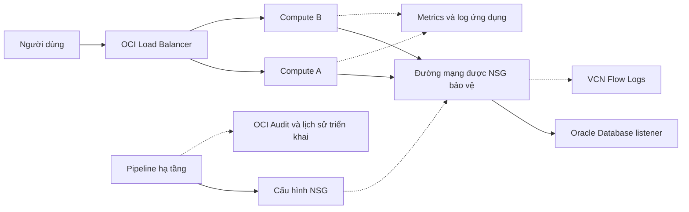
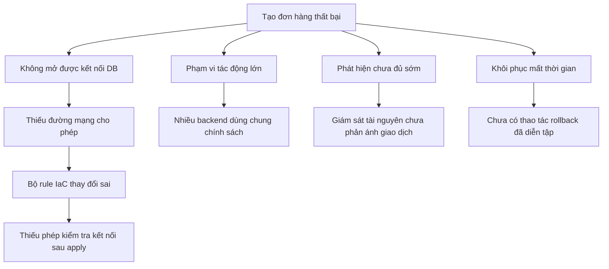

# Phân tích nguyên nhân gốc và cải tiến sau sự cố

## 1. Mục tiêu của phân tích sau sự cố

Trong vận hành Oracle Cloud Infrastructure (OCI), khôi phục được dịch vụ mới giải quyết phần gián đoạn trước mắt. Nhóm vận hành còn cần hiểu cơ chế gây lỗi, vì sao lỗi lan rộng, vì sao các lớp bảo vệ chưa ngăn được và cần thay đổi điều gì để giảm rủi ro trong lần tiếp theo.

Phân tích nguyên nhân gốc, thường gọi là Root Cause Analysis (RCA), là quá trình xây dựng và kiểm chứng lời giải thích dựa trên bằng chứng. Báo cáo sau sự cố, hay postmortem, ghi lại tác động, diễn biến, quyết định ứng phó, kết luận RCA và các hành động cải tiến có thể theo dõi đến khi hoàn tất.

Trong chương **Vận hành và xử lý sự cố** của phạm vi **CLOUD_PROVIDERS_ORACLE**, bài học kết nối RCA với tenancy, compartment, IAM, VCN, Compute, lưu trữ và dịch vụ cơ sở dữ liệu Oracle. Mục đích là biến dữ liệu vận hành thành thay đổi cụ thể về phân quyền, giám sát, tự động hóa, chi phí và tính sẵn sàng.

Sau bài học, người học có thể:

- Tách triệu chứng, tác nhân khởi phát, cơ chế gây lỗi và các điều kiện góp phần.
- Dựng timeline nhất quán từ dữ liệu ứng dụng, OCI Audit, Monitoring, Logging và lịch sử triển khai.
- Kiểm chứng các giả thuyết cạnh tranh thay vì chọn thay đổi gần nhất làm nguyên nhân.
- Viết kết luận phản ánh mức độ chắc chắn và giới hạn bằng chứng.
- Chuyển kết luận thành hành động có người phụ trách, thời hạn, phép thử và chỉ số đánh giá.

## 2. Những khái niệm cần tách rõ

### 2.1. Triệu chứng không phải lời giải thích

Người dùng có thể thấy HTTP 5xx, thanh toán chậm hoặc không đăng nhập được. Đội vận hành có thể thấy backend không khỏe, connection pool cạn hoặc CPU tăng. Những hiện tượng này mô tả sự cố đang biểu hiện như thế nào; chúng chưa giải thích được tại sao sự cố xảy ra.

| Khái niệm | Câu hỏi cần trả lời | Ví dụ trong OCI |
| --- | --- | --- |
| Triệu chứng | Điều gì đang bất thường? | API tạo đơn hàng có nhiều lỗi 5xx |
| Tác động | Ai bị ảnh hưởng, ở mức nào? | Một phần yêu cầu tạo đơn hàng thất bại trong 19 phút |
| Tác nhân khởi phát | Sự kiện nào bắt đầu chuỗi lỗi? | Pipeline áp dụng thay đổi NSG |
| Cơ chế gây lỗi | Thay đổi đó tạo lỗi bằng cách nào? | Kết nối mới từ ứng dụng tới listener cơ sở dữ liệu bị chặn |
| Điều kiện góp phần | Điều gì làm lỗi dễ xảy ra hoặc nghiêm trọng hơn? | Toàn bộ backend dùng chung cấu hình mạng lỗi |
| Khoảng trống bảo vệ | Vì sao lỗi đi qua các lớp kiểm soát? | Pipeline chỉ kiểm tra cú pháp và kết quả apply |
| Hành động cải tiến | Thay đổi nào giảm được rủi ro đã nhận diện? | Kiểm tra kết nối thực sau triển khai và chuẩn bị rollback |

“CPU cao” có thể là nguyên nhân trực tiếp của độ trễ trong một tình huống, nhưng cũng có thể là hậu quả của retry hàng loạt trong tình huống khác. Vị trí của một hiện tượng trong chuỗi nhân quả phải được xác định bằng bằng chứng.

### 2.2. Không ép sự cố phức tạp thành một nguyên nhân duy nhất

Một sự cố thường cần nhiều điều kiện cùng tồn tại:

```text
Thay đổi mạng sai
  + kiểm tra triển khai thiếu đường đi ứng dụng → cơ sở dữ liệu
  + nhiều backend dùng chung điểm lỗi
  + cảnh báo chỉ theo dõi tài nguyên
  → gián đoạn kéo dài và phạm vi ảnh hưởng lớn
```

Có thể xác định một cơ chế gây lỗi chính, đồng thời ghi nhận nhiều điều kiện góp phần. Không cần tiếp tục hỏi “vì sao” cho đến khi tìm được một câu rất chung như “quy trình chưa tốt”.

Điểm dừng hữu ích là khi nhóm đã có lời giải thích kiểm chứng được và các điểm can thiệp rõ ràng. Những câu như “do con người”, “do OCI” hoặc “do cấu hình” còn quá rộng để dẫn tới hành động hiệu quả.

### 2.3. Không đổ lỗi vẫn có trách nhiệm

Postmortem không đổ lỗi tập trung vào điều kiện khiến một quyết định có vẻ hợp lý tại thời điểm đó. Nhóm vẫn phải xác định người phụ trách hành động và thời hạn thực hiện.

Thay câu:

> Kỹ sư quên mở cổng cơ sở dữ liệu.

Bằng mô tả cụ thể hơn:

> Bộ rule sau triển khai thiếu đường cho phép kết nối từ nhóm ứng dụng đến listener cơ sở dữ liệu. Pipeline chưa có phép thử đường kết nối này, nên thay đổi được đánh dấu thành công trước khi kiểm tra giao dịch thực.

Audit có thể giúp truy vết principal đã thực hiện thao tác. Nếu principal là tài khoản pipeline, cần nối tiếp tới lần chạy và thay đổi đã được phê duyệt; không suy ra trực tiếp ý định của một cá nhân từ tên principal.

## 3. Khôi phục dịch vụ và điều tra nguyên nhân

### 3.1. Ưu tiên giảm tác động đang diễn ra

Trong lúc dịch vụ còn lỗi, ưu tiên là khôi phục chức năng quan trọng bằng biện pháp có rủi ro phù hợp: rollback thay đổi, giảm lưu lượng, tắt tính năng, khôi phục một đường kết nối hoặc chuyển sang phương án dự phòng đã được kiểm thử.

Không trì hoãn khôi phục chỉ để thu thập bằng chứng hoàn hảo. Khi có thể thực hiện nhanh, hãy giữ lại dữ liệu dễ mất trước khi thay đổi trạng thái:

- OCID, region, compartment và topology liên quan.
- Mốc thời gian, lỗi tiêu biểu và request ID.
- Phiên bản cấu hình trước và sau thay đổi.
- Log ứng dụng, trạng thái tiến trình và số liệu ngắn hạn.
- Kết quả kiểm tra kết nối hoặc thông báo lỗi của thao tác.

Một thao tác khởi động lại có thể làm dịch vụ hoạt động trở lại, nhưng đồng thời xóa trạng thái tiến trình đang cần điều tra. Người điều phối cần cân bằng giá trị bằng chứng với tác động đang tiếp diễn và ghi lại quyết định đó.

### 3.2. Phân biệt các mốc trạng thái

| Mốc | Ý nghĩa | Điều kiện minh họa |
| --- | --- | --- |
| Đang ứng phó | Tác động vẫn diễn ra | Lỗi giao dịch còn vượt mức chấp nhận |
| Đã giảm tác động | Biện pháp tạm thời đã cải thiện tình hình | Tắt tính năng phụ để chức năng chính hoạt động |
| Đã khôi phục | Chỉ số dịch vụ trở về mức đã thống nhất | Tỷ lệ thành công và độ trễ đạt ngưỡng trong một khoảng theo dõi |
| Đã hoàn tất RCA | Kết luận và phần chưa rõ đã được ghi nhận | Có timeline, bằng chứng, cơ chế lỗi và người phụ trách hành động |
| Đã xác nhận cải tiến | Hành động đã được thực thi và thử hiệu quả | Tình huống tái hiện bị ngăn chặn hoặc được phát hiện đúng hạn |

Một sự cố có thể đã khôi phục trong hôm nay nhưng còn các hành động cải tiến kéo dài nhiều ngày. Đóng phiên ứng phó không đồng nghĩa đóng toàn bộ công việc sau sự cố.

Nếu có dấu hiệu xâm nhập, rò rỉ dữ liệu hoặc hành vi phá hoại, cần phối hợp quy trình ứng phó an ninh và bảo toàn chứng cứ. Việc sửa cấu hình để khôi phục không tự nó chứng minh hệ thống đã sạch hoặc dữ liệu chưa bị ảnh hưởng.

## 4. Định nghĩa phạm vi và chuẩn bị bằng chứng trên OCI

### 4.1. Xác định đúng tài nguyên và ranh giới ảnh hưởng

Tên hiển thị không đủ để nhận diện tài nguyên trong một tenancy có nhiều môi trường. Hồ sơ điều tra nên ghi ít nhất:

| Nhóm thông tin | Nội dung cần ghi |
| --- | --- |
| Vị trí | Tenancy, region, compartment của từng tài nguyên |
| Định danh | OCID của load balancer, instance, VNIC, NSG, volume hoặc cơ sở dữ liệu liên quan |
| Kiến trúc | Đường đi yêu cầu và các phụ thuộc dùng chung |
| Phạm vi người dùng | Chức năng, nhóm khách hàng hoặc địa điểm bị ảnh hưởng |
| Phạm vi thời gian | Bắt đầu ảnh hưởng, phát hiện, khôi phục và kết thúc theo dõi |
| Thay đổi | Commit, phiên bản ứng dụng, lần chạy pipeline hoặc job Resource Manager liên quan |
| Độ chắc chắn | Điều đã xác nhận, điều suy luận và điều chưa biết |

Trong hệ thống trải qua nhiều compartment, dữ liệu điều tra cũng có thể nằm ở nhiều nơi. Compartment chứa ứng dụng không nhất thiết chứa NSG, log group hoặc cơ sở dữ liệu. Không thấy log trong một compartment chưa đủ để kết luận thao tác không tồn tại.

### 4.2. Chọn nguồn theo câu hỏi điều tra

| Nguồn bằng chứng | Dùng để trả lời | Giới hạn cần nhớ |
| --- | --- | --- |
| OCI Audit | Thao tác API nào đã diễn ra, principal và tài nguyên nào liên quan? | Không thay thế log của mọi thao tác trong hệ điều hành hoặc bên trong ứng dụng |
| OCI Monitoring | Hành vi và tải thay đổi khi nào, trên dimension nào? | Giá trị trung bình hoặc phép gộp có thể che khuất nhóm bị lỗi |
| OCI Logging | Các lỗi và sự kiện cụ thể có mẫu chung nào? | Cần đúng nguồn log, phạm vi tìm kiếm và khoảng lưu giữ |
| VCN Flow Logs | Luồng mạng được quan sát có được chấp nhận hay từ chối? | Cần kiểm tra điểm bật log và capture filter |
| APM hoặc trace ứng dụng | Thời gian bị tiêu tốn ở đoạn gọi nào? | Phụ thuộc instrumentation và tỷ lệ lấy mẫu |
| Log hệ điều hành và ứng dụng | Tiến trình, pool, disk, DNS hoặc cấu hình có biểu hiện gì? | Log có thể mất khi instance bị thay thế hoặc file bị xoay vòng |
| Dữ liệu cơ sở dữ liệu | Session, wait, kết nối hoặc truy vấn có bất thường không? | Khả năng quan sát và quyền truy cập khác nhau theo sản phẩm, gói dịch vụ |
| Lịch sử triển khai và IaC | Mong muốn cấu hình nào đã được đưa vào hệ thống? | Cần đối chiếu trạng thái thực và thay đổi thủ công |
| OCI Status, Announcements, Support | Có thông tin nào từ phía nhà cung cấp phù hợp phạm vi sự cố? | Trạng thái công khai không thay thế điều tra trong tenancy |

VCN Flow Logs ghi thông tin luồng được chấp nhận hoặc từ chối theo security list và NSG; dữ liệu thu được còn phụ thuộc bộ lọc và tỷ lệ lấy mẫu. Vì vậy, không có bản ghi phù hợp không tự động có nghĩa là không có lưu lượng. Xem [tổng quan VCN Flow Logs của Oracle](https://docs.oracle.com/en-us/iaas/Content/Network/Concepts/vcn-flow-logs.htm).

### 4.3. Thu thập đủ quyền và giữ đúng phạm vi

Người điều tra cần được cấp quyền phù hợp cho Audit, metrics, log và các tài nguyên cần xem. Quyền xem Compute không mặc nhiên bao gồm mọi log hay dữ liệu cơ sở dữ liệu.

Chuẩn bị vai trò điều tra trước sự cố giúp tránh phải xin quyền rộng trong lúc khẩn cấp. Với công cụ hoặc thao tác đòi hỏi quyền bổ sung, ghi rõ mục đích, phạm vi và người chịu trách nhiệm. Không dùng việc cấp quyền quản trị toàn tenancy làm cách sửa mặc định cho mọi lỗi truy cập dữ liệu điều tra.

Nếu một màn hình không hiển thị tài nguyên, hãy kiểm tra cả quyền, region và compartment trước khi suy luận tài nguyên đã bị xóa.

### 4.4. Lập danh mục bằng chứng

Mỗi bằng chứng nên có mã riêng và thông tin giúp người khác tìm lại được:

```text
Mã: E-04
Loại: Log ứng dụng
Nguồn: app-instance-A / dịch vụ order-api
Khoảng dữ liệu: 2026-10-14T02:55:00Z đến 2026-10-14T03:35:00Z
Phạm vi: Các request tạo đơn hàng, gồm cả thành công và thất bại
Cách lấy: Truy vấn theo service, thời gian và request ID
Thời điểm thu thập: 2026-10-14T04:10:00Z
Người thu thập: Điều tra viên được phân công
Giới hạn: Một phần request không có trace do lấy mẫu
Liên kết bản gốc: Kho bằng chứng được kiểm soát truy cập
```

Giữ bản gốc và bản đã che dữ liệu nhạy cảm khi cần chia sẻ. Ghi lại bộ lọc và phép gộp đã dùng; ảnh chụp một biểu đồ thiếu region, dimension hoặc múi giờ rất khó tái kiểm chứng.

OCI Audit hiện có thời hạn lưu giữ 365 ngày theo tài liệu Oracle. Không áp dụng thời hạn này cho mọi loại log khác. Nếu cần lưu phục vụ điều tra lâu hơn, phải chuẩn bị cơ chế lưu trữ và quyền truy cập phù hợp trước khi dữ liệu hết hạn. Xem [Audit Log Retention Period](https://docs.oracle.com/en-us/iaas/Content/Audit/Tasks/settingretentionperiod.htm).

## 5. Dựng timeline có thể đối chiếu

### 5.1. Chuẩn hóa thời gian

Dùng UTC trong timeline chính, với định dạng như `2026-10-14T03:07:00Z`. Có thể ghi thêm giờ Việt Nam để thuận tiện trao đổi; UTC+7 tương ứng 10:07 cùng ngày trong ví dụ này.

Cần phân biệt:

1. Thời điểm hoạt động thực sự diễn ra.
2. Thời điểm nguồn phát ghi sự kiện.
3. Thời điểm dữ liệu được xử lý hoặc đưa vào hệ thống tìm kiếm.
4. Thời điểm người ứng phó nhìn thấy và hành động.

Audit có thể xuất hiện chậm so với thao tác API, nên tìm kiếm ngay sau thay đổi rồi thấy rỗng chưa đủ để loại trừ thay đổi đó. Oracle mô tả độ trễ thường gặp khoảng 15 phút và thời gian xử lý có thể thay đổi. Khi cần, mở rộng cửa sổ truy vấn và đối chiếu các trường thời gian của bản ghi. Xem [Viewing Audit Log Events](https://docs.oracle.com/en-us/iaas/Content/Audit/Tasks/viewinglogevents.htm).

Đối với log từ máy khách hoặc hệ điều hành, kiểm tra đồng bộ đồng hồ. Khi chưa xác minh được độ lệch, đánh dấu thời gian là ước lượng; không sắp xếp các sự kiện cách nhau vài giây rồi khẳng định quan hệ nhân quả chắc chắn.

### 5.2. Ghi sự kiện, nhận định và quyết định riêng biệt

Một dòng timeline tốt trả lời được: lúc nào, có điều gì, biết từ đâu và mức chắc chắn đến đâu.

| Thời gian UTC | Sự kiện quan sát | Nguồn | Ghi chú |
| --- | --- | --- | --- |
| 03:02 | Pipeline áp dụng bộ rule mạng mới | E-01: nhật ký pipeline; E-02: Audit | Thời điểm thay đổi |
| 03:03 | Xuất hiện timeout kết nối mới tới cơ sở dữ liệu | E-03: log ứng dụng | Mốc ảnh hưởng đầu tiên quan sát được |
| 03:07 | Cảnh báo tỷ lệ lỗi ứng dụng phát thông báo | E-04: lịch sử alarm | Mốc phát hiện theo định nghĩa nhóm |
| 03:09 | Người trực xác nhận và bắt đầu xử lý | E-05: nhật ký ứng phó | Mốc tiếp nhận |
| 03:15 | Nhóm truy xuất được sự kiện Audit của thay đổi lúc 03:02 | E-02; E-05 | Thời điểm thấy bằng chứng, không phải thời điểm thay đổi |
| 03:18 | Áp dụng lại rule cho phép đã được đối chiếu | E-01; E-02 | Bắt đầu biện pháp khôi phục |
| 03:22 | Giao dịch trở về ngưỡng hoạt động bình thường | E-03; E-04 | Mốc khôi phục được xác nhận sau theo dõi |
| 03:32 | Đủ 10 phút ổn định theo tiêu chí ứng phó | E-04; E-05 | Kết thúc theo dõi tăng cường |

Đây là dữ liệu giả lập cho bài học. Khoảng 03:03–03:22 là cửa sổ ảnh hưởng quan sát được; không gọi toàn bộ thời gian đó là mất dịch vụ hoàn toàn nếu vẫn có yêu cầu thành công.

“Nhóm nghi ngờ NSG lúc 03:12” là một nhận định hoặc quyết định điều tra. Nó không thay thế sự kiện “rule NSG thay đổi lúc 03:02”.

## 6. Kiểm chứng giả thuyết thay vì chỉ tìm tương quan

### 6.1. Bắt đầu từ điều cần giải thích

Một phát biểu sự cố đủ cụ thể có thể là:

> Trong khoảng 03:03–03:22 UTC, chức năng tạo đơn hàng phát sinh timeout khi mở kết nối cơ sở dữ liệu. Các trang tĩnh vẫn truy cập được. Lỗi xuất hiện trên nhiều backend cùng sử dụng một đường kết nối mạng.

Từ phát biểu đó, đặt ra các giả thuyết có thể phân biệt bằng bằng chứng:

| Giả thuyết | Dấu hiệu mong đợi nếu đúng | Phép kiểm tra có ích |
| --- | --- | --- |
| Lỗi DNS phía ứng dụng | Phân giải sai hoặc thất bại trên backend bị ảnh hưởng | Đối chiếu kết quả DNS, cache và thời điểm thay đổi |
| Mạng chặn kết nối mới | TCP không thiết lập được trên đường ứng dụng tới DB | Đối chiếu flow logs, rule thực và phép thử kết nối |
| Listener hoặc dịch vụ DB có vấn đề | Đường mạng có thể thông nhưng kết nối DB vẫn lỗi | Kiểm tra trạng thái listener, service và log phía DB |
| Cơ sở dữ liệu bão hòa | Kết nối hoặc truy vấn chậm cùng với wait, session hoặc tải bất thường | Đối chiếu dữ liệu hiệu năng DB trong đúng cửa sổ |
| Ứng dụng làm cạn pool | Pool active chạm trần, pending tăng hoặc kết nối không được trả | Xem pool metrics, thread dump và log ứng dụng |
| Thay đổi thông tin xác thực | Có lỗi xác thực phù hợp, khác với timeout TCP thuần túy | Đối chiếu lỗi DB, lịch xoay bí mật và cấu hình client |

Các giả thuyết có thể cùng đúng. Ví dụ, lỗi mạng làm retry tăng, sau đó pool cạn; khi ấy pool cạn là mắt xích khuếch đại, chưa chắc là tác nhân đầu tiên.

### 6.2. Áp dụng bốn phép kiểm tra nhân quả

**Trình tự thời gian.** Nguyên nhân được đề xuất phải xuất hiện trước tác động mà nó giải thích, có xét độ trễ ghi nhận.

**Cơ chế kỹ thuật.** Phải mô tả được từng bước từ thay đổi đến biểu hiện lỗi. “Hai biểu đồ tăng cùng lúc” chưa đủ.

**Phạm vi phù hợp.** Cơ chế phải giải thích được cả phần bị ảnh hưởng và phần vẫn hoạt động. Nếu chỉ một subnet lỗi, cần làm rõ điều gì khác biệt với subnet đối chứng.

**Bằng chứng can thiệp.** Việc khôi phục một điều kiện và quan sát hệ thống hồi phục hỗ trợ giả thuyết. Tuy nhiên, nếu đồng thời restart ứng dụng, thay mạng và xoay mật khẩu, rất khó biết thay đổi nào tạo hiệu quả.

Không cố giữ nguyên dịch vụ đang lỗi chỉ để thử từng biến. Trong ứng phó, có thể cần nhiều hành động song song; sau đó báo cáo phải phản ánh giới hạn suy luận và dùng môi trường kiểm thử để bổ sung bằng chứng.

### 6.3. Ghi cả điều có thể bác bỏ giả thuyết

Với giả thuyết “thiếu rule NSG làm chặn kết nối”, các quan sát sau cần được giải thích:

- Tại sao vẫn có kết nối mới thành công trên cùng đường mạng?
- Có security list hoặc NSG khác cho phép luồng đó không?
- IP nguồn thực tế có đi qua proxy hoặc thiết bị NAT không?
- Lưu lượng đi qua cổng, listener hoặc dịch vụ nào?
- Lỗi có tồn tại trước thay đổi mạng không?
- Các backend không dùng rule này có bị lỗi tương tự không?

Một giả thuyết mạnh phải chịu được việc tìm bằng chứng phản bác, không chỉ tập hợp các dữ liệu ủng hộ.

### 6.4. Gán mức độ chắc chắn

| Nhãn | Cách dùng |
| --- | --- |
| Đã xác nhận | Có bằng chứng trực tiếp và các đối chiếu quan trọng phù hợp |
| Có khả năng cao | Nhiều bằng chứng hỗ trợ nhưng còn thiếu phép kiểm chứng quyết định |
| Chưa xác định | Dữ liệu chưa đủ hoặc vẫn có giải thích cạnh tranh hợp lý |
| Đã loại trừ trong phạm vi kiểm tra | Kết quả kiểm tra mâu thuẫn với giả thuyết, kèm phạm vi và giới hạn |

Nếu log đã hết hạn, có thể không thể kết luận đầy đủ. Kết quả RCA khi đó vẫn có ích nếu nêu rõ phần chưa biết và sửa khoảng trống quan sát; không cần tạo ra một nguyên nhân chắc chắn để đóng báo cáo.

## 7. Ví dụ xuyên suốt: thay đổi NSG và kết nối Oracle Database

### 7.1. Bối cảnh kiến trúc

Giả sử hệ thống trong một region gồm:

- OCI Load Balancer nhận yêu cầu HTTPS.
- Hai Compute instance chạy API tạo đơn hàng, đặt ở các fault domain khác nhau.
- Một Oracle Base Database Service DB System trong subnet riêng, listener của bài thực hành dùng TCP 1521.
- NSG ứng dụng và NSG cơ sở dữ liệu kiểm soát đường truy cập.
- Monitoring, log ứng dụng và VCN Flow Logs đã được cấu hình từ trước.

Cổng 1521 chỉ là giả định của ví dụ. Khi áp dụng vào hệ thống khác, dùng endpoint, giao thức và cổng thực tế của dịch vụ cơ sở dữ liệu, gồm cả cấu hình TLS nếu có.



Các fault domain khác nhau giúp giảm một số rủi ro hạ tầng dùng chung. Chúng không ngăn được một thay đổi sai áp dụng vào NSG mà cả hai backend đều phụ thuộc.

### 7.2. Thay đổi và biểu hiện

Một lần sửa module IaC vô tình làm mất rule ingress cho phép nguồn từ NSG ứng dụng đến cổng DB. Trong giả định này, không có security list hay NSG khác cho phép bù lại đường truy cập đó.

Kết nối mới từ ứng dụng tới DB bắt đầu timeout. Một số yêu cầu sử dụng kết nối còn hoạt động có thể chưa lỗi ngay; tỷ lệ lỗi tăng theo quá trình ứng dụng cần mở hoặc tạo lại kết nối. Hành vi cụ thể phải đối chiếu với loại rule, trạng thái kết nối và dữ liệu thực tế.

Trong ví dụ, các lớp bảo vệ còn lại không ngăn được lỗi:

- Pipeline xác nhận apply thành công nhưng chưa thực hiện giao dịch kiểm tra sau triển khai.
- Health check của backend chỉ gọi endpoint trả lời rằng tiến trình HTTP còn hoạt động.
- Cảnh báo CPU vẫn bình thường, còn cảnh báo tỷ lệ lỗi ứng dụng chỉ phát sau một khoảng đánh giá.
- Hai backend cùng phụ thuộc đường truy cập DB vừa bị thay đổi.

Không vội chuyển health check sang một truy vấn DB nặng cho mọi lần kiểm tra. Cần thiết kế riêng kiểm tra tiến trình, khả năng phục vụ và giao dịch tổng hợp; tránh tạo tải lớn hoặc khiến toàn bộ backend bị loại đồng thời vì một phụ thuộc chung.

### 7.3. Chuỗi bằng chứng cần có

| Mã | Bằng chứng giả lập | Kết luận được hỗ trợ |
| --- | --- | --- |
| E-01 | Diff và lần chạy IaC thể hiện rule cho phép bị loại khỏi cấu hình | Xác định thay đổi mong muốn đã được đưa vào pipeline |
| E-02 | Audit ghi thao tác trên đúng NSG bởi principal của pipeline trong cửa sổ thay đổi | Gắn hoạt động API với tài nguyên và thời điểm |
| E-03 | Log ứng dụng cho thấy timeout mở kết nối DB sau thay đổi | Liên kết biểu hiện với phụ thuộc DB |
| E-04 | Metrics thể hiện tỷ lệ lỗi tăng nhưng CPU không bão hòa | Giải thích vì sao chỉ cảnh báo CPU là chưa đủ |
| E-06 | Flow logs có bản ghi REJECT phù hợp nguồn, đích, giao thức và cổng | Hỗ trợ kết luận đường mạng từ chối lưu lượng được quan sát |
| E-07 | Khôi phục đúng rule đi kèm kết nối mới và giao dịch kiểm tra thành công | Hỗ trợ hiệu quả của biện pháp khôi phục |
| E-08 | Môi trường thử nghiệm tái hiện lỗi khi bỏ rule và hết lỗi khi khôi phục | Bổ sung bằng chứng về cơ chế |

Một bản ghi REJECT không tự chỉ ra chính xác rule nào là nguyên nhân. Cần đối chiếu toàn bộ cấu hình cho phép liên quan, vị trí VNIC và đường đi lưu lượng.

Tương tự, một sự kiện API thành công không đảm bảo giao dịch nghiệp vụ thành công. Nó chỉ phản ánh kết quả thao tác API trong phạm vi của dịch vụ đó.

### 7.4. Kết luận RCA mẫu

> Bộ rule NSG sau lần triển khai lúc 03:02 UTC thiếu đường ingress từ nhóm ứng dụng tới listener DB. Trên đường kết nối được điều tra, không có rule khác cho phép lưu lượng tương ứng, khiến các kết nối mới bị chặn và yêu cầu tạo đơn hàng timeout. Kết luận dựa trên diff hạ tầng, Audit, log ứng dụng, flow logs và kết quả khôi phục; môi trường thử nghiệm tái hiện được cùng cơ chế.
>
> Lỗi ảnh hưởng nhiều backend vì chúng dùng chung chính sách mạng. Pipeline chưa kiểm tra đường kết nối nghiệp vụ sau apply, còn health check chỉ xác nhận tiến trình HTTP. Những khoảng trống này cho phép thay đổi lỗi đi vào vận hành và kéo dài thời gian phát hiện.

Kết luận này chỉ phù hợp khi các bằng chứng nêu trên thực sự tồn tại. Nếu không có E-08 hoặc không xác minh được các đường cho phép khác, cần hạ mức chắc chắn hoặc ghi rõ giới hạn tương ứng.

## 8. Thao tác thu thập và đối chiếu trên OCI

Các lệnh dưới đây là ví dụ để người học chạy trong phạm vi được cấp quyền; chúng không phải lệnh sửa hạ tầng. Cần chuẩn bị OCI CLI, profile xác thực và đúng region. Không đặt khóa riêng, token hoặc mật khẩu trong báo cáo.

### 8.1. Truy xuất Audit trong cửa sổ điều tra

Ví dụ PowerShell:

```powershell
$incidentRegion = 'ap-singapore-1'
$incidentCompartmentId = '<COMPARTMENT_OCID>'
$incidentStartUtc = '2026-10-14T02:55:00Z'
$incidentEndUtc = '2026-10-14T03:35:00Z'

oci audit event list --region $incidentRegion --compartment-id $incidentCompartmentId --start-time $incidentStartUtc --end-time $incidentEndUtc --all --output json
```

Thay placeholder bằng compartment của tài nguyên cần kiểm tra. Nếu đường đi chứa tài nguyên ở nhiều compartment, truy vấn từng phạm vi liên quan và ghi lại nguồn; không giả định một lệnh trên compartment ứng dụng tự trả về mọi sự kiện trong tenancy.

Lệnh lấy toàn bộ trang kết quả bằng `--all`. Với API này, mốc bắt đầu được tính vào cửa sổ, mốc kết thúc không được tính; giá trị giây và phần nhỏ của giây phải bằng 0. Dùng cửa sổ vừa đủ cho điều tra, có khoảng đệm trước và sau sự cố. Tham khảo [OCI CLI: audit event list](https://docs.oracle.com/en-us/iaas/tools/oci-cli/latest/oci_cli_docs/cmdref/audit/event/list.html).

Khi tìm được bản ghi phù hợp, đối chiếu:

| Thành phần | Cần tìm hiểu |
| --- | --- |
| `eventTime` | Sự kiện được ghi nhận vào lúc nào? |
| `data.eventName` | Thao tác API cụ thể là gì? |
| `data.resourceId`, `data.compartmentId` | Đúng tài nguyên và phạm vi chưa? |
| `data.identity` | Principal hoặc caller nào liên quan? |
| `data.request`, `data.response` | Request nào, phản hồi và mã trạng thái ra sao? |
| `data.stateChange` | Có dữ liệu trạng thái trước và sau để so sánh không? |

Payload phụ thuộc dịch vụ và loại sự kiện; không yêu cầu mọi bản ghi phải chứa đầy đủ cấu hình trước và sau. Cần bổ sung diff IaC hoặc dữ liệu cấu hình đã lưu khi trường trạng thái không đủ. Xem [cấu trúc Audit log event](https://docs.oracle.com/en-us/iaas/Content/Audit/Reference/logeventreference.htm).

### 8.2. Dùng Monitoring và Logging đúng mức chi tiết

Với metrics:

1. Xác định chỉ số phản ánh trải nghiệm người dùng: tỷ lệ thành công, độ trễ hoặc tuổi của hàng đợi.
2. Xem đúng namespace, dimension, interval và phép thống kê.
3. So sánh nhóm bị ảnh hưởng với nhóm đối chứng cùng thời gian.
4. Đối chiếu thời điểm thay đổi, phát hiện và khôi phục.
5. Kiểm tra dữ liệu thiếu trước khi diễn giải một đường biểu đồ phẳng hoặc về 0.

P95 độ trễ của các yêu cầu thành công có thể vẫn đẹp trong khi nhiều yêu cầu khác bị từ chối sớm. Vì vậy, luôn đọc độ trễ cùng tỷ lệ lỗi và lưu lượng.

Với log, bắt đầu bằng thời gian và tài nguyên, sau đó thu hẹp theo loại lỗi hoặc request ID. Giữ một mẫu yêu cầu thành công để so sánh. Nếu chỉ tìm từ khóa “error”, có thể bỏ sót timeout được ghi ở mức cảnh báo hoặc lỗi chỉ xuất hiện trong trường có cấu trúc.

Alarm cần được điều chỉnh theo mức quan trọng của tài nguyên và nhiễu thông báo. Khoảng đánh giá và điều kiện kích hoạt cũng ảnh hưởng thời gian phát hiện; giảm ngưỡng máy móc có thể tạo thêm báo động không hữu ích. Tham khảo [Best Practices for Your Alarms](https://docs.oracle.com/en-us/iaas/Content/Monitoring/Concepts/alarmsbestpractices.htm).

### 8.3. Kiểm tra đường mạng và giới hạn của công cụ

Network Path Analyzer hỗ trợ phân tích khả năng đi qua của đường mạng dựa trên cấu hình. Công cụ này không gửi lưu lượng thử thực tế; kết quả cần được kết hợp với phép thử ứng dụng và bằng chứng lưu lượng. Kiểm tra giới hạn và quyền cần thiết cho topology đang dùng. Xem [Network Path Analyzer](https://docs.oracle.com/en-us/iaas/Content/Network/Concepts/path_analyzer.htm).

Nếu chạy sau khi rollback, công cụ phản ánh cấu hình tại lúc phân tích. Nó không tự tái dựng đường đi của thời điểm sự cố. Muốn kết luận về trạng thái quá khứ, cần diff, bản lưu cấu hình và timeline tương ứng.

Đối với đường ứng dụng tới DB, nên phân biệt:

- Phân giải được tên không đồng nghĩa thiết lập được TCP.
- Thiết lập được TCP không đồng nghĩa xác thực DB thành công.
- Xác thực thành công không đồng nghĩa truy vấn hoàn tất đúng hạn.
- Một truy vấn đơn giản thành công không đồng nghĩa giao dịch nghiệp vụ hoàn chỉnh thành công.

Nhờ tách các lớp này, nhóm có thể chọn phép thử chính xác thay vì gọi mọi lỗi là “mất kết nối DB”.

### 8.4. Đối chiếu thông tin từ Oracle

Khi nghi ngờ dịch vụ OCI, kiểm tra đúng region, dịch vụ và cửa sổ thời gian. Dashboard OCI Status thể hiện tình trạng ở cấp dịch vụ hoặc region; sự cố riêng của khách hàng có thể được thông báo qua Console Announcements. Vì vậy, trạng thái công khai bình thường không loại trừ sự cố chỉ ảnh hưởng tenancy của bạn. Xem [OCI System Status](https://docs.oracle.com/en-us/iaas/Content/General/Concepts/status-service.htm).

Hồ sơ gửi Support nên có tác động, thời gian UTC, region, OCID liên quan, lỗi tiêu biểu, các bước đã kiểm tra và request ID. Oracle hướng dẫn lấy `opc-request-id` và giá trị `date` của phản hồi để hỗ trợ truy vết. Xem [Locating Oracle Cloud Infrastructure IDs](https://docs.oracle.com/en-us/iaas/Content/GSG/Tasks/contactingsupport_topic-Locating_Oracle_Cloud_Infrastructure_IDs.htm).

Không đồng nhất request ID của giao dịch nghiệp vụ, trace ID ứng dụng và `opc-request-id` của một lời gọi API OCI. Hãy ghi quan hệ giữa chúng khi hệ thống có khả năng liên kết.

Nếu Oracle đang điều tra, để kết luận phía nhà cung cấp ở trạng thái chờ xác nhận. Nhóm vẫn có thể hoàn tất phần phân tích thuộc phạm vi mình kiểm soát: phát hiện, retry, timeout, chuyển dự phòng và khả năng khôi phục.

## 9. Dùng Five Whys và sơ đồ nguyên nhân

### 9.1. Five Whys là khung đặt câu hỏi

Với ví dụ NSG:

| Câu hỏi | Câu trả lời cần chứng minh |
| --- | --- |
| Vì sao yêu cầu tạo đơn hàng timeout? | Ứng dụng không mở được kết nối DB trong thời gian cho phép |
| Vì sao không mở được kết nối? | Đường mạng không còn rule cho phép lưu lượng tương ứng |
| Vì sao đường cho phép bị mất? | Bộ rule do lần thay đổi IaC sinh ra thiếu quyền truy cập cần thiết |
| Vì sao triển khai vẫn được coi là thành công? | Pipeline kiểm tra apply và tiến trình, chưa kiểm tra giao dịch phụ thuộc DB |
| Vì sao tác động xuất hiện trên nhiều backend? | Chúng dùng chung chính sách mạng bị thay đổi trong một lần triển khai |

Không bắt buộc dừng ở đúng năm câu. Câu cuối cũng không nhất thiết là nguyên nhân duy nhất. Khi xuất hiện hai nhánh như “phát hiện chậm” và “khôi phục chậm”, cần phân tích riêng.

### 9.2. Mở rộng thành các nhánh nguyên nhân



Sơ đồ giúp tìm điểm can thiệp. Mỗi quan hệ trên sơ đồ phải được đối chiếu với bằng chứng hoặc được đánh dấu là giả thuyết; hình vẽ đẹp không thay cho kiểm chứng.

Một câu hỏi hữu ích khi đánh giá hành động là: “Nếu cơ chế kích hoạt tương tự xuất hiện lần nữa, thay đổi này sẽ ngăn lỗi, phát hiện sớm hay chỉ giúp sửa nhanh hơn?”

## 10. Viết postmortem đủ để người khác hành động

Một báo cáo tốt cho phép người không trực tiếp tham gia hiểu được tác động, cơ chế lỗi và công việc tiếp theo. Không cần chép toàn bộ hội thoại ứng phó vào báo cáo chính.

### 10.1. Mẫu cấu trúc có thể áp dụng

```markdown
# Postmortem: <Tên sự cố>

## Thông tin
- Mã sự cố:
- Dịch vụ và môi trường:
- Tenancy / region / compartment liên quan:
- Người phụ trách báo cáo:
- Mức độ ảnh hưởng theo quy ước nội bộ:
- Trạng thái kết luận: sơ bộ / đã xác nhận / còn phần chưa xác định

## Tác động
- Chức năng và nhóm người dùng:
- Cửa sổ ảnh hưởng UTC:
- Số yêu cầu đủ điều kiện, số thất bại, độ trễ:
- Dữ liệu có nguy cơ bị mất, trùng hoặc chưa đối soát:
- Cách đo và giới hạn:

## Diễn biến
| UTC | Sự kiện hoặc quyết định | Mã bằng chứng |
| --- | --- | --- |

## Phân tích
- Triệu chứng:
- Tác nhân khởi phát:
- Cơ chế gây lỗi:
- Điều kiện góp phần:
- Khoảng trống phát hiện và khôi phục:
- Giả thuyết đã loại trừ, phạm vi kiểm tra:
- Điều chưa biết và người tiếp tục xác minh:

## Ứng phó
- Biện pháp giảm tác động và rollback:
- Điều làm tốt:
- Điều gây chậm hoặc tăng rủi ro:
- Tiêu chí xác nhận khôi phục:
- Kết quả đối soát dữ liệu:

## Hành động
| Mã | Cơ chế cần xử lý | Thay đổi | Người phụ trách | Hạn | Tiêu chí nghiệm thu |
| --- | --- | --- | --- | --- | --- |

## Bằng chứng và rà soát
- Liên kết bằng chứng gốc:
- Người rà soát và ngày:
- Những thay đổi đối với kết luận:
```

Mức độ ảnh hưởng phải dựa trên quy ước nội bộ; không tự mặc định mọi tổ chức dùng cùng một định nghĩa SEV1 hoặc SEV2.

### 10.2. Đo tác động đúng đơn vị

Trong ví dụ, giả sử có 12.000 yêu cầu tạo đơn hàng đủ điều kiện trong cửa sổ ảnh hưởng, trong đó 1.800 yêu cầu thất bại:

```text
Tỷ lệ thất bại trong cửa sổ = 1.800 / 12.000 = 15%
Tỷ lệ thành công trong cửa sổ = 85%
```

Đây là tỷ lệ trên yêu cầu đã định nghĩa, không tự chuyển thành tỷ lệ người dùng hoặc số đơn hàng thất bại duy nhất. Retry có thể tạo nhiều request cho cùng một giao dịch. Muốn đo tác động nghiệp vụ, cần đối soát mã giao dịch và trạng thái cuối cùng.

Với hệ thống tạo đơn hàng hoặc thanh toán, xác nhận ứng dụng đã đáp ứng trở lại chưa đủ. Cần kiểm tra yêu cầu timeout có được commit trước khi phản hồi bị mất hay không, có giao dịch trùng và có backlog cần xử lý không. Chỉ khẳng định không mất dữ liệu khi đã có bằng chứng phù hợp.

### 10.3. Định nghĩa rõ các khoảng thời gian

Từ timeline giả lập:

| Đại lượng của sự cố này | Cách tính | Kết quả |
| --- | --- | --- |
| Thời gian đến phát hiện | 03:07 trừ 03:03 | 4 phút |
| Thời gian đến tiếp nhận | 03:09 trừ 03:07 | 2 phút |
| Thời gian khôi phục từ lúc bắt đầu ảnh hưởng | 03:22 trừ 03:03 | 19 phút |
| Thời gian theo dõi ổn định bổ sung | 03:32 trừ 03:22 | 10 phút |

Các chữ viết tắt như MTTR có thể được dùng với nhiều nghĩa khác nhau. Hãy ghi rõ mốc bắt đầu, kết thúc và ý nghĩa. Một sự cố chỉ cung cấp một khoảng thời gian quan sát; chữ “mean” chỉ phù hợp khi đang tính trung bình trên một tập sự cố được định nghĩa.

Nếu dùng SLO 99,9% theo **số yêu cầu** và cửa sổ đánh giá có 1.000.000 yêu cầu đủ điều kiện:

```text
Ngân sách lỗi = 1.000.000 × (1 - 0,999) = 1.000 yêu cầu
Riêng sự cố có 1.800 yêu cầu lỗi → dùng 180% ngân sách đó
```

Ví dụ giả định 1.800 lỗi đều thuộc cùng tập yêu cầu và cửa sổ SLO. Không lấy 19 phút chia trực tiếp cho một ngân sách dựa trên số request. SLO theo thời gian cần một cách định nghĩa và tính toán tương ứng.

## 11. Chuyển RCA thành cải tiến có thể nghiệm thu

### 11.1. Mỗi hành động phải nối với cơ chế hoặc khoảng trống

“Cẩn thận hơn”, “tăng monitoring” hoặc “đào tạo thêm” không mô tả đủ kết quả cần đạt. Hành động cần chỉ ra điều gì sẽ thay đổi và cách biết thay đổi đó hữu ích.

Bảng dưới dùng ngày hạn minh họa tương ứng sự cố giả lập ngày 14/10/2026:

| Mã | Mục tiêu | Hành động | Người phụ trách | Hạn | Tiêu chí nghiệm thu |
| --- | --- | --- | --- | --- | --- |
| A-01 | Ngăn lỗi cấu hình lặp lại | Thêm kiểm tra bộ rule sinh ra từ module IaC | Chủ sở hữu module mạng | 16/10/2026 | Bộ cấu hình thiếu đường app tới DB bị chặn trước khi triển khai |
| A-02 | Phát hiện triển khai lỗi | Thêm giao dịch tổng hợp sau thay đổi mạng | Chủ sở hữu pipeline | 19/10/2026 | Trong môi trường thử, thiếu rule làm bước xác minh thất bại và dừng bước tiếp theo |
| A-03 | Rút ngắn phát hiện khi vận hành | Cảnh báo theo tỷ lệ lỗi và thất bại giao dịch tổng hợp | Nhóm trực dịch vụ | 20/10/2026 | Tái hiện lỗi tạo thông báo đến đúng người trong mục tiêu đã thống nhất |
| A-04 | Rút ngắn khôi phục | Chuẩn bị và diễn tập rollback cấu hình mạng | Chủ sở hữu vận hành | 21/10/2026 | Khôi phục trong thời gian mục tiêu và xác nhận lại giao dịch, quyền truy cập |
| A-05 | Giảm thay đổi ngoài luồng | Điều chỉnh quyền sửa NSG, giữ cơ chế truy cập khẩn cấp có ghi nhận | Chủ sở hữu IAM | 23/10/2026 | Pipeline thực hiện được công việc cần thiết; tài khoản thông thường không sửa ngoài phạm vi |
| A-06 | Bảo đảm kết luận nghiệp vụ | Tự động đối soát giao dịch timeout theo mã nghiệp vụ | Chủ sở hữu ứng dụng | 26/10/2026 | Bộ dữ liệu thử có timeout sau commit được phát hiện, không tạo xử lý trùng |

Một vai trò trong bài học giúp mô tả trách nhiệm. Trong hệ thống theo dõi thực tế, mỗi hành động cần một người hoặc đầu mối chịu trách nhiệm rõ ràng, không để một danh sách nhóm mà không ai nhận việc.

Không nhất thiết triển khai đồng thời mọi hành động. Nhóm cần cân đối rủi ro còn lại, thời gian thực hiện và khả năng kiểm chứng.

### 11.2. Phân biệt hoàn thành triển khai với hoàn thành hiệu quả

Có thể theo dõi hành động qua bốn trạng thái:

```text
Đã lên kế hoạch
  → Đang thực hiện
  → Đã triển khai
  → Đã xác nhận hiệu quả
```

Ví dụ, “đã tạo alarm” mới xác nhận một cấu hình tồn tại. Để xác nhận hiệu quả, cần chứng minh điều kiện lỗi làm alarm phát đúng, thông báo tới đúng nơi và người trực biết hành động tiếp theo.

Tương tự, tài liệu rollback chỉ có ích khi người trực thực hiện được với quyền và điều kiện thực tế. Một cuộc diễn tập nên kiểm tra cả giới hạn quyền, thời gian lấy cấu hình cũ, bước xác minh và cách xử lý nếu rollback không thành công.

### 11.3. Chọn phép thử phù hợp

- **Phòng ngừa:** Đưa cấu hình lỗi vào pipeline thử và xác nhận nó bị phát hiện trước khi áp dụng.
- **Phát hiện:** Tạo lỗi có kiểm soát trong môi trường riêng, đo từ lúc tác động đến lúc người trực nhận được thông báo.
- **Khôi phục:** Thực hiện runbook bằng đầu mối có quyền tương tự người trực, ghi thời gian và kết quả.
- **Giảm phạm vi:** Xác nhận thay đổi thử trên một nhóm tài nguyên không tác động ngoài ranh giới dự kiến.
- **Toàn vẹn dữ liệu:** Đối soát các giao dịch ở trạng thái không rõ, kiểm tra cơ chế chống xử lý trùng.
- **Kiểm soát quyền:** Thử thao tác hợp lệ và thao tác vượt phạm vi để xác nhận quyền vừa đủ.

Thực hiện phép thử có ranh giới và điều kiện dừng rõ ràng. Không tái tạo sự cố trên production chỉ để hoàn thiện tài liệu RCA.

## 12. Ưu tiên độ tin cậy cùng chi phí và tính sẵn sàng

### 12.1. Tránh hành động lớn không xử lý đúng cơ chế

Thêm instance chưa chắc giúp khi mọi instance dùng chung cấu hình NSG lỗi. Chuyển nhiều region có thể tăng khả năng chịu một số sự cố khu vực, nhưng cũng tăng yêu cầu về dữ liệu, mạng, vận hành và thử chuyển đổi.

Ưu tiên theo ba câu hỏi:

1. Hành động giảm được cơ chế rủi ro nào đã có bằng chứng?
2. Mức giảm tác động hoặc thời gian khôi phục dự kiến là bao nhiêu?
3. Chi phí triển khai, vận hành và rủi ro thay đổi mới là gì?

Với ví dụ NSG, kiểm tra cấu hình và giao dịch sau triển khai thường là điểm can thiệp trực tiếp. Nhân bản kiến trúc mà vẫn đồng loạt áp dụng cùng một thay đổi lỗi có thể giữ nguyên cơ chế hỏng.

### 12.2. Tính cả chi phí của khả năng quan sát

Log chi tiết và flow logs có thể tăng lượng dữ liệu thu thập. Thiết kế cải tiến nên ghi rõ phạm vi, thời hạn lưu, bộ lọc, lấy mẫu và yêu cầu điều tra.

| Lựa chọn | Giá trị | Điều cần cân đối |
| --- | --- | --- |
| Giữ log cần thiết cho đường giao dịch chính | Tăng khả năng tái dựng sự cố | Dung lượng, quyền truy cập, dữ liệu nhạy cảm |
| Giao dịch tổng hợp định kỳ | Phát hiện chức năng không hoạt động dù tài nguyên còn khỏe | Tần suất, chi phí gọi, dữ liệu kiểm tra và dọn dữ liệu |
| Thêm dự phòng | Giảm một số điểm lỗi | Đồng bộ dữ liệu, năng lực dự phòng và kiểm thử failover |
| Tăng tài nguyên tạm thời | Giảm bão hòa đã được xác nhận | Hạn thu hồi, chi phí và nguy cơ che khuất lỗi phần mềm |

Mỗi tài nguyên tăng tạm thời trong ứng phó nên có người phụ trách và điều kiện thu hồi. Sau khôi phục, rà soát instance, volume, snapshot, bản sao log và dung lượng dự phòng được tạo thêm.

### 12.3. Khi cần cân nhắc thay đổi kiến trúc

Các kết luận sau có thể dẫn đến thay đổi kiến trúc thay vì chỉ sửa runbook:

- Một phụ thuộc dùng chung gây tác động vượt mục tiêu chấp nhận.
- Phương án dự phòng cùng chịu cơ chế lỗi với hệ thống chính.
- Khôi phục vượt mục tiêu do giới hạn kỹ thuật không thể giải quyết bằng tự động hóa nhỏ.
- Hệ thống không có cách đối soát hoặc khôi phục dữ liệu phù hợp yêu cầu nghiệp vụ.

Nếu đề xuất Data Guard, sao lưu, phục hồi hoặc chuyển vùng, cần nối đề xuất với RTO, RPO và đặc tính của dịch vụ DB đang dùng. Phương án dự phòng chỉ có ý nghĩa khi kiểm thử được cả chuyển đổi, kết nối ứng dụng và tính nhất quán dữ liệu.

## 13. Tổ chức buổi rà soát và theo dõi sau đó

### 13.1. Chuẩn bị trước buổi họp

Người phụ trách gửi trước bản dự thảo có timeline, bằng chứng, mức chắc chắn và đề xuất hành động. Thành phần phù hợp có thể gồm chủ sở hữu ứng dụng, mạng, cơ sở dữ liệu, IAM và người điều phối ứng phó.

Không chờ đủ mọi kết luận phía nhà cung cấp mới bắt đầu rà soát. Có thể ghi phần đó là đang chờ và ấn định người cập nhật khi có thông tin.

### 13.2. Nội dung nên thảo luận

- Tác động đã được đo từ trải nghiệm và giao dịch thực chưa?
- Các mốc timeline có cùng múi giờ và phân biệt thời điểm thấy dữ liệu không?
- Kết luận có giải thích được cả nhóm lỗi và nhóm hoạt động bình thường không?
- Những quyết định nào hợp lý với thông tin có tại thời điểm ứng phó?
- Điều gì giúp khôi phục nhanh và nên giữ lại?
- Hành động nào trực tiếp giảm nguy cơ, hành động nào còn cần chứng minh?
- Phần chưa biết có người tiếp tục xác minh và thời hạn cập nhật chưa?

Người điều phối ngăn thảo luận biến thành đánh giá phẩm chất cá nhân. Câu hỏi hữu ích là “hệ thống đã cung cấp thông tin và rào chắn nào?” thay vì “vì sao người đó không biết điều mà bây giờ chúng ta đã biết?”.

### 13.3. Theo dõi hiệu quả qua nhiều sự cố

Ngoài thời gian khôi phục, có thể theo dõi:

- Tỷ lệ hành động đã đến hạn nhưng chưa được xác nhận hiệu quả.
- Số lần tái diễn cùng cơ chế lỗi.
- Tỷ lệ sự cố được phát hiện bởi giám sát trước phản ánh người dùng.
- Tỷ lệ rollback hoặc phương án phục hồi thành công trong diễn tập.
- Tác động lên SLO và khối lượng công việc thủ công sau sự cố.
- Chi phí vận hành tăng thêm do các cải tiến đã triển khai.

Đọc số liệu cùng bối cảnh và mức độ nghiêm trọng. Một sự cố nhỏ được xử lý nhanh không chứng minh khả năng phục hồi thảm họa đã tốt; giảm số alarm cũng không tự chứng minh hệ thống đáng tin cậy hơn.

## 14. Thực hành xây dựng một hồ sơ RCA

Bài thực hành dùng môi trường riêng, dữ liệu giả và tài nguyên có thể thu hồi. Nếu chưa có quyền tạo hạ tầng, có thể thực hiện bằng bộ bằng chứng giả lập được mô tả trong bài.

1. **Mô tả đường giao dịch.** Ghi ứng dụng, DB, NSG, subnet và các compartment liên quan. Nêu rõ cổng và giao thức giả định.
2. **Ghi baseline.** Thu một khoảng yêu cầu thành công cùng metrics, log và cấu hình mạng trước thay đổi.
3. **Tạo lỗi có kiểm soát.** Trong môi trường riêng, bỏ đường cho phép đã xác định sau khi chuẩn bị cách khôi phục. Ghi thời gian UTC và lần thay đổi.
4. **Quan sát theo lớp.** Phân biệt lỗi DNS, TCP, xác thực DB và thực thi giao dịch; tìm log phù hợp.
5. **Dựng timeline.** Ghi riêng thời điểm thay đổi, bắt đầu ảnh hưởng, thấy Audit, phát hiện, tiếp nhận và khôi phục.
6. **Kiểm chứng giả thuyết.** So sánh ít nhất hai lời giải thích cạnh tranh; nêu dữ liệu có thể bác bỏ kết luận chính.
7. **Khôi phục và đối soát.** Khôi phục rule, kiểm tra giao dịch mới và các yêu cầu có kết quả không rõ.
8. **Viết postmortem.** Dùng mẫu trong bài, gắn mỗi kết luận chính với mã bằng chứng.
9. **Đề xuất cải tiến.** Chọn một hành động ngăn lỗi, một hành động phát hiện và một hành động rút ngắn khôi phục; đặt người phụ trách, hạn và tiêu chí nghiệm thu.
10. **Xác nhận một cải tiến.** Tái chạy trong môi trường thử để chứng minh pipeline, alarm hoặc rollback đáp ứng mục tiêu.
11. **Thu hồi tài nguyên thực hành.** Kiểm tra các tài nguyên phát sinh và dữ liệu log cần giữ để tránh chi phí ngoài dự kiến.

Sản phẩm thực hành là một lời giải thích có thể kiểm chứng và danh sách thay đổi có thể nghiệm thu. Chất lượng của RCA thể hiện ở khả năng giúp nhóm đưa ra quyết định tốt hơn trong lần vận hành tiếp theo.
