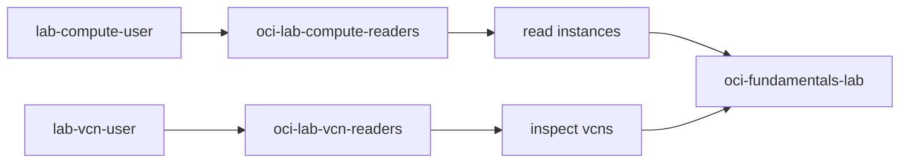

# Bài thực hành tạo compartment, groups và IAM policies tối thiểu

## 1. Mục tiêu và sản phẩm thực hành

Bài thực hành thuộc chương **Thực hành nền tảng OCI** của module `CLOUD_PROVIDERS_ORACLE`. Bạn sẽ dựng một phạm vi tài nguyên riêng trong Oracle Cloud Infrastructure, tạo hai nhóm người dùng và viết policy chỉ cho phép mỗi nhóm xem đúng loại tài nguyên được giao. Đây là nền tảng phân quyền trước khi triển khai VCN, Compute, lưu trữ hoặc cơ sở dữ liệu Oracle.

Tình huống của bài: một người phụ trách kiểm kê máy chủ cần xem Compute instances; một người phụ trách kiểm kê mạng cần xem VCN. Cả hai chỉ làm việc trong compartment học tập và không cần tạo, sửa, khởi động hay xóa tài nguyên.

Sau khi hoàn thành, bạn cần có:

- Một compartment `oci-fundamentals-lab` nằm trực tiếp dưới tenancy root.
- Hai group trong identity domain đang sử dụng: `oci-lab-compute-readers` và `oci-lab-vcn-readers`.
- Hai tài khoản kiểm thử riêng, mỗi tài khoản thuộc một group tương ứng.
- Một policy `oci-lab-minimal-readers` có đúng hai statement cốt lõi.
- Kết quả kiểm tra quyền được cấp, quyền bị từ chối và việc thu hồi quyền khi bỏ membership.

Bài chính chỉ tạo cấu trúc IAM, không yêu cầu cấp phát máy ảo, ổ đĩa, database hay tài nguyên mạng. Bạn có thể hoàn thành phép thử liệt kê ngay cả khi compartment chưa chứa instance hoặc VCN. Thiết kế này giúp thực hành phân quyền mà chưa cần sử dụng các tài nguyên hạ tầng có tính phí.

## 2. Các khái niệm cần dùng đúng

### 2.1. Tenancy, compartment và identity domain

| Thành phần | Vai trò trong bài | Điều cần phân biệt |
| --- | --- | --- |
| Tenancy | Phạm vi tài khoản OCI chứa cấu trúc bài thực hành | Root compartment là gốc của cây compartment |
| Compartment | Gom tài nguyên học tập và làm phạm vi áp dụng quyền | Không phải region, subnet hoặc cơ chế tự tạo kết nối mạng |
| Identity domain | Nơi quản lý danh tính và các group | Bài dùng domain có sẵn, không yêu cầu tạo domain mới |
| User | Danh tính dùng để đăng nhập hoặc xác thực CLI | Phải tách tài khoản kiểm thử khỏi tài khoản quản trị |
| Group | Tập người dùng cùng nhu cầu truy cập | Tạo group hoặc thêm thành viên chưa tự cấp quyền tài nguyên |
| IAM policy | Các statement cho phép một chủ thể thực hiện thao tác trong phạm vi cụ thể | Phải xác định đúng group, verb, resource-type và location |

Tenancy có identity domain `Default` ở root, chứa danh tính và nhóm quản trị ban đầu. Một domain khác cũng có thể được tổ chức sử dụng; khi đó phải dùng đúng tên domain thực tế trong policy. Tham khảo [The Default Identity Domain](https://docs.oracle.com/en-us/iaas/Content/Identity/domains/the_default_domain.htm) và [Managing Identity Domains](https://docs.oracle.com/en-us/iaas/Content/Identity/domains/overview.htm).

Trong thiết kế này, groups thuộc identity domain `Default`; chúng không nằm bên trong compartment `oci-fundamentals-lab`. Compartment là nơi giới hạn phạm vi tài nguyên mà groups được phép truy cập.

### 2.2. Authentication và authorization

**Authentication** trả lời “đây là tài khoản nào?”. **Authorization** trả lời “tài khoản này được làm gì với tài nguyên nào?”. Đăng nhập OCI thành công chỉ chứng minh bước đầu; một trang dịch vụ báo thiếu quyền sau khi đăng nhập có thể là kết quả đúng của lab.

Cú pháp policy cơ bản:

```text
Allow <subject> to <verb> <resource-type> in <location>
```

Ví dụ người đọc instance sẽ có subject là một group, verb là `read`, resource-type là `instances`, location là compartment học tập. OCI IAM policy thông thường dùng statement `Allow`; bạn không thêm một dòng `Deny` vào policy này để phủ định quyền đã được cấp ở nơi khác. Xem [IAM Policies Overview](https://docs.oracle.com/en-us/iaas/Content/Identity/policieshow/Policy_Basics.htm).

### 2.3. Quyền tối thiểu phải xét theo API thực tế

Các verb thường được sắp theo mức khả năng tăng dần: `inspect`, `read`, `use`, `manage`. Ý nghĩa chính xác phụ thuộc resource-type, nên không thể mặc định mọi API liệt kê đều chỉ cần `inspect`.

Trong bài này:

| Nhu cầu kiểm tra | API | Quyền chọn cho lab |
| --- | --- | --- |
| Liệt kê và xem instance | `ListInstances`, `GetInstance` | `read instances` |
| Liệt kê và xem VCN | `ListVcns`, `GetVcn` | `inspect vcns` |

`ListInstances` cần `INSTANCE_READ`; riêng `inspect instances` không đủ. Với `vcns`, mức `inspect` đã có `VCN_READ`, bao gồm cả liệt kê và xem VCN. Quyền đọc instance cũng có thể làm lộ metadata do người dùng đặt; không lưu bí mật trong metadata. Đây là lý do phải tra resource-type cụ thể khi thiết kế quyền. Xem [Details for the Core Services](https://docs.oracle.com/en-us/iaas/Content/Identity/Reference/corepolicyreference.htm).

“Tối thiểu” trong bài nghĩa là chỉ hai loại tài nguyên và phạm vi compartment cần thiết cho các thao tác đọc trên. Nó không có nghĩa là mọi trang chi tiết trong Console sẽ tải được đầy đủ: các phần mạng, volume hoặc dịch vụ liên quan có thể cần quyền riêng.

## 3. Thiết kế trước khi thao tác

### 3.1. Danh sách đối tượng

| Loại | Tên dùng trong bài | Nơi tạo hoặc phạm vi |
| --- | --- | --- |
| Compartment | `oci-fundamentals-lab` | Con trực tiếp của tenancy root |
| Group Compute | `oci-lab-compute-readers` | Domain `Default` |
| Group VCN | `oci-lab-vcn-readers` | Domain `Default` |
| User Compute | `lab-compute-user` | Chỉ thuộc group Compute trong thiết kế lab |
| User VCN | `lab-vcn-user` | Chỉ thuộc group VCN trong thiết kế lab |
| Policy | `oci-lab-minimal-readers` | Gắn tại root; statement giới hạn tài nguyên trong compartment lab |

Tên user là tên minh họa. Nếu domain dùng địa chỉ email làm username, dùng hai danh tính thử nghiệm hợp lệ theo quy định tổ chức và ghi lại ánh xạ tương ứng. Nếu tên đối tượng đã tồn tại, chọn một hậu tố riêng cho toàn bộ bài và sửa nhất quán các statement; không dùng lại đối tượng chưa rõ chủ sở hữu.



Hai group có hai chức năng độc lập. Để kiểm tra việc tách quyền, không đưa cùng một tài khoản thử nghiệm vào cả hai group ngay từ đầu.

### 3.2. Ma trận kết quả dự kiến

Ma trận sau giả định tài khoản thử nghiệm không được cấp thêm quyền liên quan từ các group, role hoặc policy có sẵn.

| Danh tính | Liệt kê instance trong lab | Liệt kê VCN trong lab | Đọc cùng loại tài nguyên tại root | Quản lý IAM của tenancy |
| --- | --- | --- | --- | --- |
| Tài khoản quản trị chuẩn bị lab | Có | Có | Theo quyền quản trị hiện có | Theo quyền quản trị hiện có |
| `lab-compute-user` | Có | Bị từ chối | Bị từ chối | Không được hai statement của lab cấp |
| `lab-vcn-user` | Bị từ chối | Có | Bị từ chối | Không được hai statement của lab cấp |

Quyền trong compartment cha áp dụng xuống các compartment con. Vì vậy, nếu sau này tạo compartment con dưới lab, cần xét lại phạm vi các quyền này. Chúng không tự mở rộng sang compartment ngang hàng hoặc ngược lên root. Xem [Policy Inheritance](https://docs.oracle.com/en-us/iaas/Content/Identity/policieshow/Policy_Inheritance.htm).

## 4. Chuẩn bị tài khoản và môi trường

Chuẩn bị một tenancy học tập hoặc một phạm vi được tổ chức giao để làm lab. Tài khoản thực hiện bước tạo đối tượng cần có quyền tạo compartment, quản lý group và membership trong domain đã chọn, tạo hoặc chuẩn bị user thử nghiệm và tạo policy tại root. Dùng tài khoản quản trị hiện có hoặc nhờ quản trị viên làm phần chuẩn bị; không tìm cách tự cấp các quyền đó bằng tài khoản người học.

Bạn cần ghi lại các giá trị sau trong ghi chép thực hành của mình:

| Giá trị | Nguồn lấy | Cách sử dụng |
| --- | --- | --- |
| Tenancy OCID | Thông tin tenancy do quản trị viên cung cấp | Phép thử truy cập tài nguyên ở root |
| Tên identity domain | Trang Domains | Subject trong policy và trang đăng nhập |
| Home region | Thông tin tenancy | Thực hiện quản trị IAM và xử lý độ trễ đồng bộ |
| Region kiểm thử | Một region tenancy đã đăng ký | Dùng thống nhất ở cả hai profile |
| Lab compartment OCID | Trang chi tiết compartment sau khi tạo | Tham số CLI và kiểm tra đúng đích |
| User OCID của từng tài khoản | Thông tin user trong domain | Đối chiếu profile CLI |

Compartment tổ chức tài nguyên của tenancy qua các region; còn instance và VCN là tài nguyên có vị trí region cụ thể. Console hiển thị tài nguyên theo compartment và region đang chọn. Danh sách rỗng có thể chỉ do bạn đang xem một region khác. Xem [Working with Compartments](https://docs.oracle.com/en-us/iaas/Content/Identity/compartments/Working_with_Compartments.htm).

Dùng các phiên trình duyệt tách biệt cho quản trị viên, user Compute và user VCN, chẳng hạn các browser profile khác nhau. Sau mỗi lần chuyển tài khoản, kiểm tra tên user và domain trên Console. Tài khoản thử nghiệm cần hoàn thành kích hoạt và yêu cầu xác thực của domain trước khi đánh giá quyền.

## 5. Tạo compartment học tập

Thực hiện bằng tài khoản quản trị chuẩn bị lab:

1. Mở **Identity & Security → Compartments**.
2. Chọn tạo compartment trực tiếp dưới tenancy root.
3. Nhập tên `oci-fundamentals-lab`.
4. Nhập mô tả, ví dụ: `Compartment cho bai thuc hanh IAM OCI nen tang`.
5. Kiểm tra **Parent compartment** đúng là root. Bài này dùng tên compartment con trực tiếp trong policy để tránh nhầm đường dẫn lồng nhau.
6. Tạo compartment, mở trang chi tiết và sao chép OCID.
7. Ghi nhận tên, parent và trạng thái hoạt động của compartment.

Tên compartment phải hợp lệ và duy nhất trong compartment cha; mô tả là trường cần cung cấp. OCI cấp một OCID riêng cho compartment. Các bước tương ứng được mô tả trong [Creating a Compartment](https://docs.oracle.com/en-us/iaas/Content/Identity/compartments/To_create_a_compartment.htm).

Điểm kiểm tra sau bước này: bạn có đúng một compartment lab mới, biết chính xác parent và OCID của nó. Việc tạo compartment chưa tự cho hai user thử nghiệm quyền làm việc với Compute hay VCN bên trong.

## 6. Tạo hai group và gán tài khoản thử nghiệm

### 6.1. Tạo groups trong domain có sẵn

1. Mở **Identity & Security → Domains**.
2. Chọn compartment chứa domain, sau đó mở domain `Default` đang dùng cho bài.
3. Mở **Groups**, tạo group `oci-lab-compute-readers`.
4. Nhập mô tả, ví dụ: `Doc thong tin Compute instances trong compartment lab`.
5. Tạo group `oci-lab-vcn-readers` với mô tả: `Xem VCN trong compartment lab`.

Ở bước này bạn đang quản lý danh tính trong domain. Không chuyển sang tạo identity domain mới bên trong compartment lab.

### 6.2. Chuẩn bị users và membership

Trong **Users** của chính domain đó, tạo hai tài khoản thử nghiệm hoặc dùng hai tài khoản học tập đã được chuẩn bị riêng. Điền thông tin và email hợp lệ theo yêu cầu domain, hoàn thành kích hoạt, rồi gán membership:

| User minh họa | Group cần có | Group không được thêm cho mục đích lab |
| --- | --- | --- |
| `lab-compute-user` | `oci-lab-compute-readers` | `Administrators`, group quản trị khác, group VCN |
| `lab-vcn-user` | `oci-lab-vcn-readers` | `Administrators`, group quản trị khác, group Compute |

Bạn có thể gán group trong lúc tạo user hoặc thêm user từ trang thành viên của group. Sau khi lưu, mở lại danh sách thành viên của từng group để xác minh. Luồng Console tạo group, tạo user và gán group được Oracle minh họa trong [Adding Users — Create a Compartment and Add a User with Access to It](https://docs.oracle.com/en-us/iaas/Content/GSG/Tasks/addingusers.htm).

Trong tenancy doanh nghiệp có federation hoặc provisioning tự động, cần kiểm tra cả mapping group từ nhà cung cấp danh tính. Nếu một tài khoản đã có quyền rộng từ nguồn khác, dùng tài khoản thử nghiệm khác để phép thử có ý nghĩa.

**Điểm kiểm tra:** ghi lại domain, hai tên group, hai user và membership thực tế. Chưa tạo policy thì không kết luận rằng membership đã cấp quyền đọc tài nguyên.

## 7. Tạo policy tối thiểu

### 7.1. Chọn nơi gắn policy

Mở **Identity & Security → Policies**, đặt bộ lọc compartment về tenancy root, rồi tạo policy:

| Trường | Giá trị |
| --- | --- |
| Name | `oci-lab-minimal-readers` |
| Description | `Cap quyen doc Compute va xem VCN trong compartment lab` |
| Compartment gắn policy | Tenancy root |
| Cách nhập | Manual editor hoặc trình soạn statement tương đương |

Nơi gắn policy quyết định phạm vi quản trị policy, bao gồm ai có thể sửa hoặc xóa nó. Trong thiết kế bài này, policy được quản trị ở root; phạm vi tài nguyên được cấp cho người học vẫn được ghi rõ ở từng statement. Xem [Working with Policies](https://docs.oracle.com/en-us/iaas/Content/Identity/policymgmt/managingpolicies_topic-Working_with_Policies.htm).

### 7.2. Nhập đúng hai statement

Nếu dùng domain `Default` và các tên mặc định của bài, nhập:

```text
Allow group 'Default'/'oci-lab-compute-readers' to read instances in compartment oci-fundamentals-lab
Allow group 'Default'/'oci-lab-vcn-readers' to inspect vcns in compartment oci-fundamentals-lab
```

Sau đó tạo policy và mở lại để đối chiếu cả hai dòng. Các group và compartment phải tồn tại trước khi statement tham chiếu đến chúng.

Cách đọc dòng thứ nhất:

| Thành phần | Giá trị | Ý nghĩa |
| --- | --- | --- |
| Subject | `group 'Default'/'oci-lab-compute-readers'` | Thành viên group Compute trong domain chỉ định |
| Verb | `read` | Mức quyền cần để đọc instance |
| Resource-type | `instances` | Chỉ loại tài nguyên instance được nêu |
| Location | `compartment oci-fundamentals-lab` | Phạm vi compartment lab theo mô hình đã dựng |

Dòng thứ hai cấp quyền xem VCN cho group VCN. Hai dòng không cấp quyền thay đổi policy, tự thêm membership, tạo instance hoặc tạo VCN.

Trong tenancy dùng identity domains, cú pháp subject có thể chỉ rõ `'tên-domain'/'tên-group'`. Nếu domain thực tế khác `Default`, thay tên đó ở cả hai dòng. Đừng chỉ nhìn tên group rồi bỏ qua domain. Xem [Subjects](https://docs.oracle.com/en-us/iaas/Content/Identity/policysyntax/subject.htm).

### 7.3. Biến thể dùng OCID của compartment

Nếu muốn cố định location theo định danh, có thể thay phần location của hai statement bằng:

```text
in compartment id <LAB_COMPARTMENT_OCID>
```

Ví dụ khuôn mẫu cho dòng Compute:

```text
Allow group 'Default'/'oci-lab-compute-readers' to read instances in compartment id <LAB_COMPARTMENT_OCID>
```

Thay toàn bộ `<LAB_COMPARTMENT_OCID>` bằng OCID thật, không giữ dấu ngoặc nhọn. Đây là cách viết thay thế cho location theo tên, không phải statement thứ ba bắt buộc. Nếu lab được đặt sâu hơn dưới một compartment khác, cần dùng đường dẫn compartment hợp lệ hoặc OCID thay vì sao chép nguyên giả định con trực tiếp của root. Xem [Locations](https://docs.oracle.com/en-us/iaas/Content/Identity/policysyntax/location.htm).

### 7.4. Chờ đồng bộ rồi mới kiểm thử

Thay đổi user, group và policy có thể cần thời gian để có hiệu lực ở các region. Khi vừa thêm membership hoặc cập nhật statement, chờ vài phút trước khi kết luận cấu hình sai; nếu cần, đăng nhập lại phiên Console và kiểm tra lại cùng region. Oracle mô tả việc đồng bộ IAM từ home region trong [Managing Policies — Updates Are Not Immediate Across All Regions](https://docs.oracle.com/en-us/iaas/Content/Identity/Tasks/managingpolicies.htm).

## 8. Kiểm tra quyền bằng Console và CLI

### 8.1. Kiểm tra ban đầu bằng Console

Đăng nhập bằng `lab-compute-user`, chọn region kiểm thử và vào **Compute → Instances**. Chọn compartment lab và thử tải danh sách. Sau đó mở danh sách **Networking → Virtual Cloud Networks** trong cùng compartment để kiểm tra trường hợp chưa được cấp quyền.

Lặp lại bằng `lab-vcn-user`: trang danh sách VCN là phép thử được cấp quyền; trang danh sách instance là phép thử ngược lại.

Console có thể gọi thêm API để tải bộ chọn, vùng thông tin hoặc tài nguyên liên quan. Một thông báo thiếu quyền ở phần phụ không đủ để kết luận statement đọc tài nguyên chính sai. Ngược lại, nút tạo tài nguyên xuất hiện cũng không chứng minh thao tác tạo sẽ được cho phép. Dùng CLI để kiểm tra trực tiếp các API trong ma trận khi cần kết quả rõ ràng.

Nếu bộ chọn compartment không hiển thị như mong đợi, xác minh đúng user, domain, membership và thời gian đồng bộ. Dùng OCID mà quản trị viên đã cung cấp cho phép thử CLI trước khi cân nhắc bổ sung bất kỳ quyền hiển thị nào.

### 8.2. Chuẩn bị hai profile CLI tách biệt

Các lệnh bên dưới dùng **PowerShell** và OCI CLI trên máy thực hành. Cần cài CLI theo [OCI CLI Quickstart](https://docs.oracle.com/en-us/iaas/Content/API/SDKDocs/cliinstall.htm), rồi chuẩn bị hai profile xác thực bằng API signing key tương ứng với hai user thử nghiệm:

- `LAB_COMPUTE`: danh tính của `lab-compute-user`.
- `LAB_VCN`: danh tính của `lab-vcn-user`.

Trong phần thông tin user trên Console, có thể tạo API signing key và lấy đoạn cấu hình tương ứng. Đặt từng đoạn dưới đúng tên profile trong file cấu hình OCI CLI của máy cá nhân, sử dụng đúng đường dẫn private key. Mỗi profile cần chỉ rõ `user`, `fingerprint`, `key_file`, `tenancy` và `region` của nó; không để một profile kiểm thử vô tình dùng thông tin quản trị kế thừa từ profile khác. Xem [SDK and CLI Configuration File](https://docs.oracle.com/en-us/iaas/Content/API/Concepts/sdkconfig.htm).

Hai profile phải có **User OCID khác nhau**, đúng với hai tài khoản vừa chuẩn bị, nhưng cùng tenancy. Không sao chép khóa quản trị vào profile người học; không đưa private key, mật khẩu hoặc token vào nội dung báo cáo thực hành.

Khởi tạo các biến sau bằng giá trị thật. Chọn một region tenancy đã đăng ký; `ap-singapore-1` chỉ là ví dụ:

```powershell
$LabCompartmentOcid = '<LAB_COMPARTMENT_OCID>'
$LabTenancyOcid = '<TENANCY_OCID>'
$LabRegion = 'ap-singapore-1'

oci --version
```

Thay hai placeholder trước khi chạy lệnh. Mỗi ví dụ dùng `--limit 10` để kiểm tra một trang kết quả; mục đích là xác minh quyền, không phải kiểm kê toàn bộ tài nguyên.

### 8.3. Hai phép thử phải thành công

Với user Compute:

```powershell
oci compute instance list --compartment-id $LabCompartmentOcid --limit 10 --profile LAB_COMPUTE --region $LabRegion
$ComputeReadExitCode = $LASTEXITCODE
"Compute read exit code: $ComputeReadExitCode"
```

Với user VCN:

```powershell
oci network vcn list --compartment-id $LabCompartmentOcid --limit 10 --profile LAB_VCN --region $LabRegion
$VcnReadExitCode = $LASTEXITCODE
"VCN read exit code: $VcnReadExitCode"
```

Kỳ vọng mỗi lệnh thành công với exit code `0`. Nếu compartment chưa có tài nguyên, phản hồi có thể là:

```json
{
  "data": []
}
```

Danh sách rỗng trong một lời gọi thành công là kết quả hợp lệ cho bước kiểm tra quyền liệt kê. Nó không chứng minh tài khoản đã bị giới hạn đúng phạm vi; cần làm tiếp các phép thử bị từ chối. Tham số và thao tác của hai lệnh được mô tả tại [compute instance list](https://docs.oracle.com/en-us/iaas/tools/oci-cli/latest/oci_cli_docs/cmdref/compute/instance/list.html) và [network vcn list](https://docs.oracle.com/en-us/iaas/tools/oci-cli/latest/oci_cli_docs/cmdref/network/vcn/list.html).

### 8.4. Hai phép thử chéo phải bị từ chối

User Compute thử liệt kê VCN trong lab:

```powershell
oci network vcn list --compartment-id $LabCompartmentOcid --limit 10 --profile LAB_COMPUTE --region $LabRegion
$ComputeToVcnExitCode = $LASTEXITCODE
"Compute user reading VCN exit code: $ComputeToVcnExitCode"
```

User VCN thử liệt kê instance trong lab:

```powershell
oci compute instance list --compartment-id $LabCompartmentOcid --limit 10 --profile LAB_VCN --region $LabRegion
$VcnToComputeExitCode = $LASTEXITCODE
"VCN user reading Compute exit code: $VcnToComputeExitCode"
```

Kỳ vọng lỗi phân quyền và exit code khác `0`. Phải đọc nội dung lỗi: lỗi cài đặt CLI, kết nối, cấu hình khóa hoặc sai tham số không phải bằng chứng policy đã chặn đúng.

OCI có thể trả `NotAuthorizedOrNotFound` với HTTP `404` khi không có quyền hoặc khi đích không tồn tại. Vì vậy, xác minh compartment OCID hợp lệ và dùng cùng region với phép thử thành công. Một `404` với OCID bịa hoặc gõ sai không chứng minh giới hạn quyền. Xem [API Errors](https://docs.oracle.com/en-us/iaas/Content/API/References/apierrors.htm).

### 8.5. Kiểm tra không mở rộng ngược lên root

Dùng Tenancy OCID như compartment ID để yêu cầu tài nguyên **trực tiếp tại root**:

```powershell
oci compute instance list --compartment-id $LabTenancyOcid --limit 10 --profile LAB_COMPUTE --region $LabRegion
$ComputeRootExitCode = $LASTEXITCODE
"Compute user reading root exit code: $ComputeRootExitCode"

oci network vcn list --compartment-id $LabTenancyOcid --limit 10 --profile LAB_VCN --region $LabRegion
$VcnRootExitCode = $LASTEXITCODE
"VCN user reading root exit code: $VcnRootExitCode"
```

Theo thiết kế, cả hai yêu cầu này phải bị từ chối. Chúng truy vấn tài nguyên ở root, không phải truy vấn đệ quy tất cả compartment con.

Nếu một phép thử chéo hoặc phép thử ở root thành công, ghi lại kết quả ngoài dự kiến và kiểm tra các nguồn quyền khác. Không đánh dấu bài đạt chỉ vì compartment rỗng. Nếu phản hồi của một đường gọi chỉ cho danh sách rỗng và chưa phân biệt được khả năng lọc kết quả, bổ sung phép đọc một tài nguyên có thật đã được quản trị viên xác nhận, đúng region và compartment; không dùng OCID giả làm đối chứng.

## 9. Kiểm chứng quyền cộng dồn và thu hồi membership

Thực hiện phần này sau khi đã lưu đủ kết quả ma trận ban đầu.

1. Quản trị viên thêm `lab-compute-user` vào `oci-lab-vcn-readers`.
2. Chờ thay đổi đồng bộ, rồi dùng đúng profile `LAB_COMPUTE` chạy lại lệnh liệt kê VCN trong lab.
3. Kỳ vọng lệnh thành công: user này hiện nhận quyền từ cả hai group.
4. Quản trị viên gỡ **membership vừa thêm** khỏi group VCN, giữ membership Compute ban đầu.
5. Sau khi đồng bộ, chạy lại lệnh liệt kê VCN bằng `LAB_COMPUTE`; kỳ vọng bị từ chối. Lệnh đọc instance trong lab vẫn phải thành công.

Đây là phép thử quyền có hiệu lực theo tổng các cấp quyền áp dụng cho danh tính. Một statement chỉ đọc không làm mất quyền rộng hơn được cấp bởi group khác; muốn thu hồi phải xử lý nguồn đang cấp quyền. Cơ chế tổng hợp quyền được giải thích trong [How Policies Work](https://docs.oracle.com/en-us/iaas/Content/Identity/Concepts/policies.htm).

Nếu sau khi gỡ membership user vẫn đọc được VCN, kiểm tra thời gian đồng bộ, danh tính thật của profile, membership còn lại và các policy cha. Không thêm một statement `Deny` vào policy lab để thử ghi đè quyền đó.

## 10. Xử lý lỗi thường gặp

| Hiện tượng | Hướng kiểm tra | Cách xử lý trong phạm vi bài |
| --- | --- | --- |
| Không tạo được compartment hoặc policy | Tài khoản chuẩn bị có đủ quyền quản trị ở đúng cấp không? | Nhờ quản trị viên hoàn tất phần chuẩn bị hoặc dùng tài khoản chuẩn bị đã được giao |
| Policy báo không nhận diện group | Tên domain, tên group và việc group đã tồn tại | Sửa subject theo đối tượng có thật, không tạo thêm group tùy tiện |
| Policy không nhận diện compartment | Tên, parent hoặc OCID của lab | Dùng đúng tên con trực tiếp theo thiết kế hoặc thay location bằng OCID |
| `inspect instances` không liệt kê được máy ảo | Verb không bao phủ API muốn gọi | Khôi phục đúng `read instances` của bài |
| Vừa cấp quyền nhưng chưa truy cập được | Thời gian đồng bộ và region đang kiểm thử | Chờ vài phút, kiểm tra lại cùng danh tính và cùng region |
| CLI báo `NotAuthenticated` | User OCID, fingerprint, khóa, cấu hình xác thực | Sửa xác thực trước khi đánh giá IAM policy |
| CLI báo `NotAuthorizedOrNotFound` | Đích có tồn tại, region và quyền có đúng không? | Đối chiếu OCID với thông tin quản trị viên cung cấp và phép thử thành công |
| Console có danh sách nhưng một phần chi tiết báo lỗi | Trang đó có đang đọc thêm mạng hoặc volume không? | Kiểm tra API chính bằng CLI; chỉ bổ sung quyền nếu có nhu cầu học tập riêng được xác định |
| Tài khoản kiểm thử làm được nhiều hơn ma trận | Group khác, policy kế thừa, mapping danh tính hoặc nhầm khóa CLI | Xác định nguồn cấp quyền và dùng danh tính thử nghiệm phù hợp |
| Đã gỡ membership nhưng vẫn đọc được | Đồng bộ chưa xong hoặc còn nguồn quyền khác | Kiểm tra lại danh tính và toàn bộ nguồn cấp quyền liên quan |

Hai statement của lab dùng `instances` và `vcns` thay vì các resource family rộng hơn. Khi gặp lỗi của một API khác, xác định chính API đó và nhu cầu truy cập trước khi thay policy. Cấp `manage all-resources in tenancy` sẽ làm mất ý nghĩa phép thử quyền tối thiểu.

## 11. Dọn dẹp hoặc giữ lại có chủ đích

Nếu cần giữ compartment cho bài hạ tầng tiếp theo, ghi lại chủ sở hữu, mục đích và thời điểm xem xét lại membership. Chỉ các quyền xem trong bài chưa đủ để triển khai VCN, Compute hay database; bài triển khai sau phải xác định quyền bổ sung theo thao tác thực tế.

Nếu kết thúc lab, dùng tài khoản quản trị chuẩn bị lab để dọn theo thứ tự:

1. Kiểm tra các đối tượng đúng là của lần thực hành này và không có người khác đang dùng.
2. Xóa policy `oci-lab-minimal-readers` tại **root**, hoặc bỏ riêng hai statement lab nếu quản trị viên đã ghép chúng vào policy dùng chung.
3. Gỡ membership lab khỏi hai user. Xóa hai group nếu không còn được dùng hoặc được policy khác tham chiếu.
4. Nếu đã tạo API signing key riêng cho lần thực hành, thu hồi các key đó và xử lý private key/profile cục bộ theo quy định của môi trường.
5. Xóa hoặc vô hiệu hóa tài khoản chỉ được tạo cho lab theo quy trình tổ chức; giữ tài khoản dùng chung theo phân công.
6. Kiểm tra compartment lab không còn tài nguyên hoặc compartment con cần giữ, bao gồm tài nguyên ở các region đã sử dụng và policy gắn trong compartment nếu có.
7. Gửi yêu cầu xóa compartment lab nếu không giữ lại, theo dõi work request đến kết quả cuối cùng.

OCI yêu cầu compartment phải rỗng trước khi xóa; việc xóa chạy bất đồng bộ và có thể thất bại nếu còn tài nguyên. Policy của bài gắn tại root nên phải được xử lý tại root, không trông chờ việc xóa compartment tự dọn policy. Xem [Deleting a Compartment](https://docs.oracle.com/en-us/iaas/Content/Identity/compartments/To_delete_a_compartment.htm).

## 12. Minh chứng hoàn thành

Lưu kết quả thực hành theo biểu mẫu sau, che thông tin nhận diện khi chia sẻ ra ngoài môi trường học tập:

| Hạng mục | Minh chứng cần có |
| --- | --- |
| Compartment | Tên, parent và OCID đã đối chiếu |
| Groups | Tên domain, hai group và membership cuối cùng |
| Policy | Nơi gắn tại root và nguyên văn hai statement đang dùng |
| Danh tính CLI | Profile nào thuộc user nào; hai User OCID đã được đối chiếu |
| Quyền được cấp | Compute user liệt kê instance thành công; VCN user liệt kê VCN thành công |
| Quyền bị từ chối | Hai phép thử chéo và hai phép thử ở root, kèm loại lỗi thực tế |
| Cộng dồn và thu hồi | Compute user đọc được VCN khi thêm group; bị từ chối sau khi bỏ membership đó |
| Kết thúc | Trạng thái giữ lại hoặc dọn dẹp các đối tượng lab |

Với mỗi phép thử, ghi thời điểm, region, profile, compartment đích, exit code và phần phản hồi cần thiết. Ghi kết quả thực tế; nếu chưa chạy được một bước thì ghi rõ chưa thực hiện, không thay bằng kết quả kỳ vọng.

Bài đạt khi các đối tượng được tạo đúng thiết kế, hai quyền xem hoạt động, các phép thử vượt quyền bị từ chối bằng lỗi phân quyền đã đối chiếu đích hợp lệ, và quyền VCN được thu hồi sau khi bỏ membership tạm thời. Một policy tạo thành công chỉ là bước cấu hình; kết quả truy cập bằng đúng danh tính mới cho thấy quyền đang có hiệu lực.
