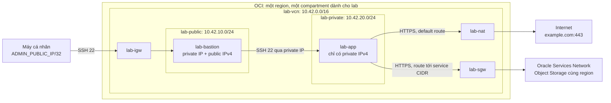

# Bài thực hành dựng VCN public-private với NAT và Service Gateway

## 1. Mục tiêu và tình huống thực hành

Trong chương **Thực hành nền tảng OCI** của module **CLOUD_PROVIDERS_ORACLE**, bài này xây dựng một mạng nhỏ cho ứng dụng chạy trên Oracle Cloud Infrastructure:

- Máy quản trị nằm trong public subnet, chỉ nhận SSH từ địa chỉ được cho phép.
- Máy ứng dụng nằm trong private subnet và không có public IPv4.
- Máy ứng dụng chủ động truy cập Internet qua NAT Gateway.
- Máy ứng dụng truy cập endpoint Object Storage cùng region qua Service Gateway.

Bạn sẽ cấu hình tài nguyên trong một compartment, kiểm tra sự khác nhau giữa quyền IAM và quyền truyền gói tin, rồi thực hiện hai thay đổi có thể khôi phục để chứng minh vai trò của từng gateway. Các bước cuối hướng dẫn lưu bằng chứng, kiểm soát chi phí và xóa tài nguyên.

**Sản phẩm cần đạt:** hai subnet gắn đúng route table, ba gateway hoạt động đúng mục đích, SSH qua máy trung gian thành công và bộ kiểm tra phân biệt được đường Internet với đường Oracle Services Network.

Bài sử dụng IPv4, Oracle Linux và OCI Console để tạo hạ tầng. Các lệnh Bash chạy trên máy ảo được ghi rõ; cấu hình OpenSSH được đặt trên máy cá nhân. Không cần triển khai cơ sở dữ liệu, tạo bucket hoặc cài OCI CLI trên máy ứng dụng để hoàn thành phần bắt buộc.

## 2. Kiến trúc đích và đường đi của lưu lượng



Các mũi tên mô tả kết nối được khởi tạo và đường đi chính; lưu lượng phản hồi được xử lý tương ứng. NAT Gateway và Service Gateway là tài nguyên của VCN, không phải máy ảo phải đặt trong public subnet.

| Nhu cầu | Đường đi dự kiến | Điều kiện chính |
| --- | --- | --- |
| Máy cá nhân SSH vào bastion | Internet → Internet Gateway → bastion | Bastion có public IPv4; route và security rule phù hợp |
| Bastion SSH vào app | Private IP → định tuyến nội bộ VCN → private IP | Security rule cho TCP/22 ở hai phía |
| App gọi HTTPS tới Internet | App → NAT Gateway → Internet | Default route tới NAT; egress TCP/443 được cho phép |
| App gọi Object Storage cùng region | App → Service Gateway → endpoint Object Storage | Service CIDR đúng region; gateway, route và egress phù hợp |

Public subnet cho phép tài nguyên có public IPv4 nhưng không tự làm mọi VNIC trở nên công khai. Private subnet cấm cấp public IPv4 cho VNIC. Khả năng truy cập thực tế còn phụ thuộc route, security rule, firewall của hệ điều hành và dịch vụ đang lắng nghe.

NAT Gateway cho phép máy không có public IPv4 khởi tạo kết nối ra Internet và nhận phản hồi; nó không cung cấp đường SSH từ Internet vào máy đó. Xem [NAT Gateway](https://docs.oracle.com/en-us/iaas/Content/Network/Tasks/NATgateway.htm).

Service Gateway cung cấp đường riêng tới các dịch vụ được hỗ trợ trong Oracle Services Network của cùng region. Endpoint dịch vụ vẫn có thể phân giải ra public IP; điều quyết định đường đi là route tới service CIDR. Gateway này không tự cấp quyền đọc dữ liệu và không đại diện cho mọi website thuộc Oracle. Xem [Service Gateway](https://docs.oracle.com/en-us/iaas/Content/Network/Tasks/servicegateway.htm).

## 3. Chuẩn bị tenancy, compartment và quyền thực hiện

### 3.1. Chọn môi trường riêng cho bài thực hành

Chuẩn bị:

1. Một OCI tenancy và quyền đăng nhập Console.
2. Một region đã được tenancy đăng ký sử dụng.
3. Một compartment dành riêng cho lab, ví dụ `OCI-Network-Lab`.
4. Quyền tạo VCN, subnet, route table, gateway, security list, NSG và hai Compute instance trong compartment đó.
5. Quota, service limit và capacity đủ cho hai máy ảo cùng boot volume.
6. Máy cá nhân có OpenSSH client và kết nối Internet.

Chọn image Oracle Linux và shape nhỏ phù hợp kiến trúc của image. Không mặc định tài khoản còn hạn mức miễn phí hoặc một shape luôn có capacity.

Giữ nguyên region và compartment khi đi qua các màn hình tạo tài nguyên. Nếu Console không hiển thị một tài nguyên vừa tạo, kiểm tra hai lựa chọn này trước khi tạo lại.

### 3.2. Phân biệt IAM và security rule

IAM quyết định **ai được tạo, sửa, xóa hoặc gọi API của tài nguyên**. NSG và security list quyết định **lưu lượng nào được phép đi tới hoặc rời VNIC**. Có quyền quản lý instance không đồng nghĩa SSH được vào instance; mở TCP/443 cũng không cấp quyền đọc Object Storage.

Quản trị viên cần bảo đảm nhóm thực hành có các quyền tương ứng:

| Phạm vi | Quyền cần có cho phần thực hành |
| --- | --- |
| Networking trong compartment lab | Quản lý các tài nguyên mạng được tạo trong bài |
| Compute trong compartment lab | Tạo, xem và terminate hai instance |
| Volume trong compartment lab | Tạo và dọn boot volume của hai instance |
| Image và thông tin vị trí triển khai | Xem image, availability domain và các lựa chọn cần thiết để launch |
| Logging, nếu làm phần quan sát tùy chọn | Tạo hoặc sử dụng log group, bật và đọc flow log |

Ví dụ câu policy cho **phần Networking**, khi nhóm nằm trong một identity domain:

```text
Allow group '<identity-domain>'/'OCI-Lab-NetworkBuilders' to manage virtual-network-family in compartment OCI-Network-Lab
```

Thay placeholder bằng tên thực tế. Đây là quyền quản lý mạng khá rộng trong compartment lab, không phải policy đầy đủ cho việc launch Compute và cũng không phải mẫu quyền tối thiểu cho production. Người học không cần quyền quản trị toàn tenancy để làm bài nếu quản trị viên đã cấp đủ quyền theo nhiệm vụ.

### 3.3. Xác định địa chỉ quản trị và khóa SSH

Ghi lại public IPv4 mà kết nối từ máy cá nhân thực sự đi ra Internet, bao gồm ảnh hưởng của VPN hoặc NAT công ty. Biểu diễn nó thành `ADMIN_PUBLIC_CIDR=<địa-chỉ>/32`.

Ví dụ `203.0.113.25/32` chỉ là địa chỉ tài liệu; phải thay bằng địa chỉ thật. Nếu nhà mạng thay đổi IP trong lúc thực hành, cập nhật đúng nguồn SSH.

Tạo một cặp khóa riêng cho lab nếu chưa có:

```bash
ssh-keygen -t ed25519 -f ~/.ssh/oci-vcn-lab -C "oci-vcn-lab"
```

Chạy trên máy cá nhân, chọn tên khác nếu đường dẫn đã tồn tại. Khi tạo Compute, chỉ cung cấp nội dung file `oci-vcn-lab.pub`. Giữ private key ở máy cá nhân và dùng quyền truy cập file phù hợp.

## 4. Kế hoạch địa chỉ và danh sách tài nguyên

Kiểm tra CIDR không trùng mạng hiện có mà bạn dự định kết nối về sau. Với một VCN lab độc lập, dùng kế hoạch sau:

| Tài nguyên | Tên trong bài | Cấu hình |
| --- | --- | --- |
| VCN | `lab-vcn` | `10.42.0.0/16`, chỉ IPv4 |
| Public subnet | `lab-public` | Regional, `10.42.10.0/24` |
| Private subnet | `lab-private` | Regional, `10.42.20.0/24`, cấm public IPv4 |
| Internet Gateway | `lab-igw` | Enabled |
| NAT Gateway | `lab-nat` | Cho phép traffic |
| Service Gateway | `lab-sgw` | Cho phép traffic, bật service label cùng region |
| Public route table | `rt-public` | Default route tới `lab-igw` |
| Private route table | `rt-private` | Default route tới NAT, service route tới SGW |
| Security list dùng chung | `sl-lab-empty` | Không có ingress/egress rule |
| NSG quản trị | `nsg-bastion` | Gắn VNIC chính của bastion |
| NSG ứng dụng | `nsg-app` | Gắn VNIC chính của app |
| Compute quản trị | `lab-bastion` | Public subnet, có public IPv4 |
| Compute ứng dụng | `lab-app` | Private subnet, không có public IPv4 |

OCI dành riêng một số địa chỉ trong subnet; để hệ thống tự cấp private IP cho hai máy. Ghi lại địa chỉ thực tế, không giả định chúng là một địa chỉ cụ thể trong bảng CIDR.

Dùng free-form tag như `purpose=oci-vcn-lab` và một giá trị `owner` phù hợp quy định của tổ chức. Ghi tên, OCID, region và compartment của tài nguyên vào biên bản thực hành của bạn.

## 5. Tạo VCN và ba gateway

### 5.1. Tạo VCN thủ công

Trong OCI Console, mở **Networking → Virtual cloud networks**, chọn compartment lab rồi tạo VCN:

- Name: `lab-vcn`.
- IPv4 CIDR: `10.42.0.0/16`.
- Bật sử dụng DNS hostname; đặt DNS label hợp lệ, ví dụ `labvcn`.
- Không bật IPv6 cho bài này.

Chọn cách tạo VCN thủ công để tự kiểm soát từng thành phần. Nếu giao diện cung cấp wizard tạo sẵn Internet connectivity, không dùng wizard cho luồng hướng dẫn này.

VCN có thể xuất hiện cùng default route table, default security list và DHCP options mặc định. Chưa gắn default security list vào các subnet sẽ tạo ở phần sau.

### 5.2. Tạo Internet Gateway

Trong VCN, tạo Internet Gateway:

- Name: `lab-igw`.
- Compartment: compartment lab.
- Trạng thái: Enabled.

Gateway tồn tại chưa đủ để public subnet truy cập Internet. Bạn sẽ thêm route và cấp public IPv4 cho bastion ở các bước tiếp theo.

### 5.3. Tạo NAT Gateway

Tạo NAT Gateway trong chính VCN:

- Name: `lab-nat`.
- Dùng public IP do dịch vụ cấp cho lab; không tạo thêm reserved public IP nếu không cần.
- Không bật **Block traffic**.

Ghi lại public IP của NAT nếu Console hiển thị. Đây là địa chỉ nguồn mà đích Internet có thể nhìn thấy đối với lưu lượng đã được NAT, khác với public IP của bastion.

Không tạo NAT instance, không bật IP forwarding trên bastion và không thêm một hop qua public subnet.

### 5.4. Tạo Service Gateway

Tạo Service Gateway:

- Name: `lab-sgw`.
- VCN: `lab-vcn`.
- Services: chọn **All <region> Services in Oracle Services Network** của region đang dùng.
- Để traffic được cho phép.

Giữ nguyên service label do OCI cung cấp để dùng lại trong route table. Không tự chuyển label thành CIDR số và không lấy label từ region khác.

Bài chỉ cần một service label **All ... Services**. Không thêm đồng thời hai route chồng lấn cho label này và label **Object Storage** vào cùng route table.

**Điểm kiểm tra:** danh sách gateway của `lab-vcn` có đủ IGW, NAT Gateway và Service Gateway; NAT và SGW không bị block traffic.

## 6. Tạo hai route table

### 6.1. Public route table

Tạo `rt-public` với một rule:

| Destination type | Destination | Target type | Target |
| --- | --- | --- | --- |
| CIDR Block | `0.0.0.0/0` | Internet Gateway | `lab-igw` |

Không thêm route All Services tới Service Gateway vào public route table của bài.

### 6.2. Private route table

Tạo `rt-private` với hai rule:

| Destination type | Destination | Target type | Target |
| --- | --- | --- | --- |
| CIDR Block | `0.0.0.0/0` | NAT Gateway | `lab-nat` |
| Service | All <region> Services in Oracle Services Network | Service Gateway | `lab-sgw` |

Trong Console, đích của rule thứ hai được chọn từ danh sách service, không nhập vào ô CIDR thông thường.

OCI chọn route phù hợp cụ thể hơn; thứ tự hiển thị trong bảng không phải thứ tự ưu tiên kiểu firewall. Với cấu hình này, traffic khớp tập địa chỉ dịch vụ dùng SGW, còn traffic Internet khác dùng NAT. Định tuyến nội bộ VCN đã có sẵn cho kết nối giữa hai subnet khi không tạo custom intra-VCN route. Xem [VCN Route Tables](https://docs.oracle.com/en-us/iaas/Content/Network/Tasks/managingroutetables.htm).

Trong lab, không gắn route table riêng lên VNIC, private IP hoặc gateway. Điều này giúp mọi phép thử dựa vào đúng route table của subnet.

**Điểm kiểm tra:** có hai route table khác nhau; public table có một rule, private table có hai rule; các target đều thuộc VCN và compartment dự kiến.

## 7. Tạo security list và NSG

### 7.1. Dùng security list rỗng để kiểm soát bằng NSG

Tạo `sl-lab-empty` với cả ingress rules và egress rules đều rỗng. Nếu Console điền sẵn rule, xóa các rule trong **security list lab mới tạo** trước khi lưu.

Khi tạo mỗi subnet ở phần tiếp theo, chỉ chọn security list này. Không chọn thêm default security list.

Các allow rule từ security list và NSG được hợp lại; một security list rỗng không phủ định rule cho phép trong NSG. Ngược lại, một security list khác còn mở SSH từ mọi nơi sẽ làm phạm vi truy cập rộng hơn dự kiến. Dùng toàn bộ rule **stateful** trong bài để phản hồi của kết nối được cho phép theo connection tracking. Xem [Security Rules](https://docs.oracle.com/en-us/iaas/Content/Network/Concepts/securityrules.htm).

### 7.2. Tạo hai NSG trước, thêm rule sau

Tạo `nsg-bastion` và `nsg-app` trong `lab-vcn`. Sau đó cấu hình các bảng dưới đây. Việc tạo cả hai trước giúp chọn NSG còn lại làm nguồn hoặc đích.

Khi dùng NSG làm nguồn/đích, chọn **Network Security Group** và đúng NSG trong cùng VCN. Đây là quan hệ giữa các VNIC được gắn NSG, không phải nhập tên NSG vào ô CIDR. Xem [Network Security Groups](https://docs.oracle.com/en-us/iaas/Content/Network/Concepts/networksecuritygroups.htm).

### 7.3. Rule cho nsg-bastion

| Hướng | Nguồn hoặc đích | Giao thức | Destination port / loại ICMP | Mục đích |
| --- | --- | --- | --- | --- |
| Ingress | CIDR: `ADMIN_PUBLIC_CIDR` | TCP | `22` | SSH từ máy cá nhân |
| Ingress | CIDR: `0.0.0.0/0` | ICMP | Type `3`, code `4` | Hỗ trợ Path MTU Discovery |
| Egress | NSG: `nsg-app` | TCP | `22` | Kết nối SSH tới app |
| Egress | CIDR: `0.0.0.0/0` | TCP | `443` | Kiểm tra HTTPS và các nhu cầu lab qua HTTPS |
| Egress | CIDR: `169.254.169.254/32` | UDP | `53` | Khai báo rõ đích DNS resolver dùng trong lab |
| Egress | CIDR: `169.254.169.254/32` | TCP | `53` | DNS qua TCP khi cần |

### 7.4. Rule cho nsg-app

| Hướng | Nguồn hoặc đích | Giao thức | Destination port / loại ICMP | Mục đích |
| --- | --- | --- | --- | --- |
| Ingress | NSG: `nsg-bastion` | TCP | `22` | Chỉ nhận SSH từ VNIC thuộc nhóm quản trị |
| Ingress | CIDR: `0.0.0.0/0` | ICMP | Type `3`, code `4` | Hỗ trợ Path MTU Discovery |
| Egress | CIDR: `0.0.0.0/0` | TCP | `443` | HTTPS ra Internet và tới dịch vụ OCI |
| Egress | CIDR: `169.254.169.254/32` | UDP | `53` | Đích DNS resolver của lab |
| Egress | CIDR: `169.254.169.254/32` | TCP | `53` | DNS qua TCP khi cần |

Với các rule TCP/UDP trên, để **Source port = All** và đặt cổng nêu trong bảng ở **Destination port**. Không chọn Stateless.

Hai rule HTTPS tới `0.0.0.0/0` cho phép cả Internet và tập IP dịch vụ; chính route table quyết định gateway. Ở production, cần xem lại yêu cầu egress; NAT tự nó không giới hạn website được truy cập.

Các rule ICMP này không cho phép mọi loại ping. Bài dùng SSH, DNS và HTTPS để kiểm tra thay vì lấy ping làm tiêu chí bắt buộc.

## 8. Tạo public subnet và private subnet

### 8.1. Public subnet

Tạo subnet với:

- Name: `lab-public`.
- Subnet type: Regional.
- IPv4 CIDR: `10.42.10.0/24`.
- Subnet access: Public.
- Route table: `rt-public`.
- Security lists: chỉ `sl-lab-empty`.
- DHCP options: dùng cấu hình **Internet and VCN Resolver**.
- DNS label: ví dụ `public`.

### 8.2. Private subnet

Tạo subnet thứ hai với:

- Name: `lab-private`.
- Subnet type: Regional.
- IPv4 CIDR: `10.42.20.0/24`.
- Subnet access: Private; bật lựa chọn cấm public IPv4 cho VNIC nếu giao diện thể hiện dưới dạng checkbox.
- Route table: `rt-private`.
- Security lists: chỉ `sl-lab-empty`.
- DHCP options: dùng **Internet and VCN Resolver**.
- DNS label: ví dụ `private`.

Dùng resolver mặc định để việc phân giải tên không phụ thuộc một public DNS server đi qua NAT. Resolver mặc định phục vụ truy vấn tại `169.254.169.254`; không cần tạo DNS listening endpoint riêng cho các máy trong bài. Xem [DNS in Your Virtual Cloud Network](https://docs.oracle.com/en-us/iaas/Content/Network/Concepts/dns.htm) và [Resolver Endpoints](https://docs.oracle.com/en-us/iaas/Content/Network/Concepts/dns-topic-resolver_endpoints.htm).

Đây là cấu hình resolver mặc định của lab. Nếu môi trường tổ chức dùng DNS tùy chỉnh hoặc forwarding về on-premises, cần kiểm tra riêng đường tới DNS trước khi dùng các phép thử ở phần sau.

**Điểm kiểm tra:** mở chi tiết từng subnet và xác minh lại access type, route table, security list và DHCP options. Tên subnet có chữ “private” không thay thế cho kiểm tra cấu hình.

## 9. Tạo hai Compute instance và truy cập qua ProxyJump

### 9.1. Launch lab-bastion

Tạo instance Oracle Linux:

- Name: `lab-bastion`.
- Compartment: compartment lab.
- Chọn shape nhỏ phù hợp image.
- VCN/subnet: `lab-vcn` / `lab-public`.
- Cho phép cấp public IPv4 cho VNIC chính.
- NSG của VNIC chính: chỉ `nsg-bastion`.
- SSH key: public key đã chuẩn bị.

Sau khi instance ở trạng thái Running, ghi lại:

- `BASTION_PUBLIC_IP`.
- `BASTION_PRIVATE_IP`.
- Instance OCID và VNIC OCID.

### 9.2. Launch lab-app

Tạo instance Oracle Linux tương tự, nhưng:

- Name: `lab-app`.
- VCN/subnet: `lab-vcn` / `lab-private`.
- Không có public IPv4.
- NSG của VNIC chính: chỉ `nsg-app`.
- Dùng public key tương ứng với private key trên máy cá nhân.

Ghi lại `APP_PRIVATE_IP`, instance OCID và VNIC OCID. Mở mục địa chỉ của VNIC và xác nhận không có public IPv4 association. Chỉ nhìn `ip addr` bên trong hệ điều hành không đủ xác minh điều này, vì public IPv4 OCI được ánh xạ ở lớp mạng.

### 9.3. Cấu hình SSH trên máy cá nhân

Thêm vào file cấu hình OpenSSH của người dùng, thường là `~/.ssh/config`; thay toàn bộ placeholder:

```sshconfig
Host oci-lab-bastion
    HostName <BASTION_PUBLIC_IP>
    User opc
    IdentityFile ~/.ssh/oci-vcn-lab
    IdentitiesOnly yes

Host oci-lab-app
    HostName <APP_PRIVATE_IP>
    User opc
    IdentityFile ~/.ssh/oci-vcn-lab
    IdentitiesOnly yes
    ProxyJump oci-lab-bastion
```

Kết nối từ máy cá nhân:

```bash
ssh oci-lab-bastion
```

Kiểm tra hostname rồi thoát phiên bastion:

```bash
hostname
exit
```

Tiếp tục từ máy cá nhân:

```bash
ssh oci-lab-app
```

Trong phiên app:

```bash
hostname
ip -4 addr
ip -4 route
command -v curl
command -v getent
```

ProxyJump dùng bastion mở kết nối TCP tới private IP của app, còn SSH client trên máy cá nhân xử lý xác thực tới app. Không cần chép private key lên bastion hoặc bật agent forwarding.

Với image khác Oracle Linux, thay `opc` bằng tài khoản đúng của image. Giữ firewall hệ điều hành hoạt động; kiểm tra SSH service và rule cụ thể nếu kết nối không thành công.

## 10. Kiểm tra trạng thái hoạt động bình thường

Tất cả lệnh trong phần này chạy **bên trong lab-app**, qua phiên SSH vừa mở. Kết quả trên máy cá nhân hoặc Cloud Shell không chứng minh đường đi của app.

### 10.1. Chuẩn bị endpoint và kiểm tra DNS

Ví dụ dưới đây dành cho commercial realm OC1. Thay region bằng region thực tế chứa VCN. Nếu dùng realm khác, dùng endpoint Object Storage do OCI công bố cho realm/region đó.

```bash
REGION='ap-singapore-1'
OSN_HOST="objectstorage.$REGION.oraclecloud.com"

date -u
getent ahostsv4 example.com
getent ahostsv4 "$OSN_HOST"
```

Cả hai tên cần phân giải được thành địa chỉ IPv4. Kết quả public IP của Object Storage không có nghĩa traffic bắt buộc đi qua Internet Gateway hoặc NAT.

Kiểm tra HTTP sử dụng `--noproxy '*'` để tránh proxy môi trường làm sai kết luận về đường mạng. Tùy chọn `-4` giữ các phép thử nằm trong phạm vi IPv4 của bài.

### 10.2. Kiểm tra HTTPS ra Internet

```bash
curl -4 --noproxy '*' --connect-timeout 5 --max-time 15 \
  --silent --show-error --fail --output /dev/null \
  --write-out 'internet_http=%{http_code} remote_ip=%{remote_ip}\n' \
  https://example.com/
printf 'curl_exit=%s\n' "$?"
```

Kỳ vọng endpoint trả HTTP thành công và `curl_exit=0`. Đây là đích Internet ngoài Oracle Services Network, nên theo route table của bài, kết nối dùng NAT Gateway.

Nếu endpoint bên ngoài tạm thời không phục vụ, dùng một endpoint HTTPS công khai khác đã được tổ chức cho phép và chắc chắn không thuộc service CIDR của OCI. Ghi rõ endpoint thay thế để so sánh cùng một đích trước và sau thay đổi.

### 10.3. Kiểm tra kết nối tới Object Storage

Gửi một yêu cầu chưa ký tới API namespace của Object Storage:

```bash
curl -4 --noproxy '*' --connect-timeout 5 --max-time 15 \
  --silent --show-error \
  --dump-header /tmp/oci-osn-headers.txt \
  --output /tmp/oci-osn-body.json \
  --write-out 'osn_http=%{http_code} remote_ip=%{remote_ip}\n' \
  "https://$OSN_HOST/n/"
printf 'curl_exit=%s\n' "$?"

head -n 20 /tmp/oci-osn-headers.txt
head -c 500 /tmp/oci-osn-body.json
printf '\n'
```

Lệnh này cố ý không dùng `--fail`: một phản hồi HTTP lỗi xác thực hoặc quyền truy cập, chẳng hạn `401` hay `404`, vẫn là bằng chứng đã đi qua DNS, TCP và TLS để nhận phản hồi API. Không yêu cầu một mã lỗi cố định vì phản hồi phụ thuộc API và cách xử lý yêu cầu.

Để kết luận kết nối mạng thành công, cần đồng thời thấy:

- `curl_exit=0`, mã HTTP khác `000`.
- TLS được xác minh bình thường, không thêm `-k`.
- Header hoặc nội dung phù hợp phản hồi của Object Storage, thường có request ID để truy vết.

Nếu thấy HTTP `301` hoặc `302`, kiểm tra lại endpoint cùng region thay vì tự thêm `-L` rồi vô tình thử một đích khác. Nếu gặp lỗi chứng chỉ hoặc TLS, chưa đánh dấu đạt.

**Giới hạn của phép thử:** nhận phản hồi API không có nghĩa đã đọc được một object. Đọc dữ liệu cần thêm danh tính, policy và quyền trên dữ liệu. Các quyền này độc lập với Service Gateway; xem [Object Storage Objects — Required IAM Policy](https://docs.oracle.com/en-us/iaas/Content/Object/Tasks/managingobjects.htm).

Giữ lại kết quả baseline. Chưa kết luận SGW hoạt động chỉ từ bước này, vì một cấu hình sai có thể vẫn truy cập endpoint qua NAT.

## 11. Cô lập NAT để chứng minh đường Service Gateway

Chỉ thực hiện trên `rt-private` dành riêng cho lab. Giữ Console mở ở một cửa sổ khác để có thể khôi phục cấu hình.

### 11.1. Ghi lại cấu hình và thay đổi một rule

Trước khi đổi:

1. Xác nhận `lab-private` đang dùng `rt-private`.
2. Ghi lại rule `0.0.0.0/0 → lab-nat`, gồm đúng OCID của target.
3. Xác nhận service route vẫn trỏ tới `lab-sgw`.
4. Giữ nguyên NSG, security list, resolver và `rt-public`.

Trong `rt-private`, xóa **chỉ** rule `0.0.0.0/0 → lab-nat`. Không xóa NAT Gateway và không xóa service route.

Lưu thay đổi và đợi cấu hình được áp dụng. Phiên SSH tới app vẫn dùng đường nội bộ qua bastion, không phụ thuộc default route ra NAT trong kiến trúc này.

### 11.2. Tạo các kết nối kiểm tra mới

Trong phiên `lab-app`, chạy lại các lệnh ở phần 10:

1. `getent ahostsv4` cho cả hai hostname.
2. Yêu cầu HTTPS tới `example.com`.
3. Yêu cầu tới `https://$OSN_HOST/n/`.

Mỗi lần chạy `curl` là một tiến trình mới, tránh dựa vào kết nối đang được giữ từ trước thay đổi.

Kỳ vọng:

| Phép thử khi bỏ default route tới NAT | Kết quả |
| --- | --- |
| SSH qua bastion | Vẫn truy cập được app |
| DNS bằng VCN resolver mặc định | Vẫn phân giải được |
| HTTPS tới đích Internet đã chọn | Không kết nối thành công |
| Object Storage cùng region | Vẫn nhận được phản hồi API qua TLS |

Internet có thể timeout và hiển thị HTTP `000`; không lấy riêng mã lỗi hệ điều hành làm tiêu chí vì thời gian và dạng lỗi có thể khác nhau.

Nếu cả Internet và Object Storage vẫn thành công, kiểm tra bạn đã xóa rule ở đúng route table, đang chạy trên đúng VM và không đi qua proxy, VPN hoặc một custom route khác. Nếu cả hai đều thất bại, kiểm tra service label, service route, trạng thái SGW và DNS trước khi chỉnh IAM.

**Kết luận từ phép thử:** trong cấu hình lab đã loại bỏ đường NAT và các đường thay thế, Object Storage còn phản hồi trong khi đích Internet mất kết nối là bằng chứng cho đường qua Service Gateway.

### 11.3. Khôi phục ngay sau phép thử

Thêm lại đúng rule đã ghi:

```text
Destination type: CIDR Block
Destination:      0.0.0.0/0
Target type:      NAT Gateway
Target:           lab-nat
```

Kiểm tra lại từ app: cả Internet và Object Storage đều nhận phản hồi như baseline. Xác nhận `rt-private` lại có đúng hai rule trước khi sang phần tiếp theo.

## 12. Chặn SGW để kiểm tra không tự chuyển sang NAT

Phần này kiểm chứng một tình huống khác: **service route còn tồn tại nhưng gateway đích bị block**.

1. Xác nhận default route tới NAT đã khôi phục và Internet từ app đang hoạt động.
2. Trong `lab-sgw`, bật **Block traffic**.
3. Giữ nguyên hai rule của `rt-private`.
4. Tạo yêu cầu `curl` mới tới Internet và Object Storage.
5. Ghi lại kết quả rồi tắt **Block traffic** ngay sau phép thử.
6. Kiểm tra lại cả hai endpoint sau khi mở SGW.

Kỳ vọng: Internet qua NAT vẫn hoạt động; Object Storage không nhận được phản hồi API khi SGW bị chặn. Service route vẫn được chọn cho đích khớp service CIDR, nên không có cơ chế tự thử lại bằng default route tới NAT chỉ vì SGW bị block.

Xóa hẳn service route là một cấu hình khác: với default route còn tồn tại, traffic tới endpoint công khai có thể đi qua NAT. Vì vậy không dùng thao tác xóa service route để thay cho phép thử block gateway.

Bảng kết quả toàn bài:

| Trạng thái | Internet ngoài OSN | Object Storage cùng region | SSH qua bastion |
| --- | --- | --- | --- |
| Baseline: đủ hai route, hai gateway cho phép traffic | Thành công | Có phản hồi API | Thành công |
| Bỏ default route NAT, giữ service route | Thất bại | Có phản hồi API | Thành công |
| Khôi phục NAT, block SGW nhưng giữ service route | Thành công | Thất bại | Thành công |
| Mở lại SGW, trở về baseline | Thành công | Có phản hồi API | Thành công |

Không thực hiện hai thay đổi lỗi đồng thời; mỗi lần chỉ thay một yếu tố để kết quả có thể giải thích được.

## 13. Quan sát và chẩn đoán có căn cứ

### 13.1. Dùng VCN Flow Logs khi có quyền

Có thể bật flow log cho VNIC của `lab-app` hoặc subnet `lab-private`:

1. Chọn tài nguyên đúng compartment và tạo hoặc chọn log group lab.
2. Cấu hình capture filter có chứa traffic kiểm tra; thu cả accepted và rejected traffic nếu cần.
3. Bật log và tạo lại một kết nối HTTPS.
4. Tìm bản ghi theo thời gian UTC, private IP nguồn của app, IP đích và TCP/443.

Flow log giúp xem địa chỉ, port và kết quả `ACCEPT`/`REJECT` theo security rule. `ACCEPT` không tự chứng minh request đến ứng dụng thành công hoặc xác định chính xác NAT/SGW đã đi qua. Log có độ trễ, bộ lọc và giới hạn capture; không có bản ghi chưa đủ kết luận không có gói tin. Một số traffic link-local như DNS mặc định không xuất hiện trong flow log. Xem [Details for VCN Flow Logs](https://docs.oracle.com/en-us/iaas/Content/Logging/Reference/details_for_vcn_flow_logs.htm).

Dùng kết quả flow log cùng route table và thí nghiệm cô lập ở phần 11–12 để giải thích đường đi.

### 13.2. Hiểu giới hạn của công cụ kiểm tra

- `ip route` trong VM chủ yếu cho thấy đường đi của hệ điều hành tới virtual router. Nó không hiển thị service route của OCI thành một interface SGW riêng.
- `traceroute` hoặc ping không bảo đảm thể hiện đầy đủ hop của các gateway được quản lý; không có phản hồi không đồng nghĩa HTTPS bị hỏng.
- Network Path Analyzer phân tích cấu hình để suy ra khả năng kết nối, không phát traffic thực. Nó không thay thế thử DNS, TLS và phản hồi ứng dụng. Xem [Network Path Analyzer](https://docs.oracle.com/en-us/iaas/Content/Network/Concepts/path_analyzer.htm).

Khi ghi kết quả, tách rõ bằng chứng cấu hình, bằng chứng lưu lượng và kết quả phản hồi API.

## 14. Xử lý lỗi thường gặp

| Hiện tượng | Khả năng cần kiểm tra | Hành động cụ thể |
| --- | --- | --- |
| Không thấy subnet hoặc gateway khi chọn | Đang ở region/compartment khác | Đối chiếu region, compartment và OCID |
| SSH vào bastion timeout | Public IPv4, IGW, route hoặc nguồn SSH sai | Kiểm tra VNIC public IP, `rt-public`, trạng thái IGW và `ADMIN_PUBLIC_CIDR` |
| SSH báo `Permission denied (publickey)` | Sai user hoặc sai khóa | Dùng `opc` cho Oracle Linux, xác minh public key đã gắn và `IdentityFile` trên máy cá nhân |
| Bastion vào được nhưng app timeout | NSG chưa gắn hoặc thiếu rule TCP/22 | Kiểm tra membership VNIC, ingress của app và egress của bastion |
| Bastion báo không được mở kết nối chuyển tiếp | SSH forwarding bị hạn chế trên bastion | Xem cấu hình `sshd` và log xác thực theo chính sách image |
| App không phân giải được cả hai hostname | DHCP options hoặc resolver trong VM sai | Kiểm tra `getent`, cấu hình DNS thực tế và resolver được subnet sử dụng |
| DNS tốt nhưng Internet từ app thất bại | Default route/NAT/egress sai | Kiểm tra `rt-private`, target NAT, Block traffic và TCP/443 |
| Object Storage hoạt động khi có NAT, mất khi bỏ NAT | SGW chưa phục vụ đúng đường | Kiểm tra label cùng region, service route, gateway và endpoint đang gọi |
| Object Storage có HTTP lỗi quyền | Mạng đã tới API, nhưng request chưa được cấp quyền | Với thử mạng: ghi đúng mức kết luận; với đọc dữ liệu: bổ sung xác thực/IAM phù hợp |
| SGW đã block nhưng Object Storage vẫn phản hồi | Route không áp dụng hoặc traffic đi đường khác | Kiểm tra đúng VM, đúng subnet/route table, proxy và per-resource routing |
| Rule NSG rất hẹp nhưng SSH vẫn mở rộng | Có allow rule từ nguồn khác | Kiểm tra mọi security list và mọi NSG gắn với VNIC |
| HTTPS lỗi chứng chỉ | Đồng hồ, CA trust, endpoint hoặc proxy TLS | Xác minh từng nguyên nhân; giữ kiểm tra TLS, không sửa bằng `-k` |
| Công cụ cập nhật hệ điều hành không hoạt động | Repository dùng port/endpoint khác cấu hình lab | Kiểm tra URL và port thực tế, chỉ thêm quyền egress cần thiết |
| Rule đúng nhưng traffic vẫn bị chặn | Firewall OS hoặc chính sách bổ sung của tổ chức | Kiểm tra service, firewall, Security Zone/ZPR nếu môi trường áp dụng |

Ưu tiên tìm lỗi theo thứ tự: **đúng VM và địa chỉ → DNS → route → trạng thái gateway → security rule → firewall OS → TLS → xác thực và IAM**. Nếu Console không cho tạo tài nguyên do policy hoặc service limit, xử lý nguyên nhân đó trước khi thử thay đổi route.

## 15. Chi phí, tính sẵn sàng và khả năng tái tạo

### 15.1. Giữ phạm vi chi phí nhỏ

Dùng hai VM cấu hình nhỏ, boot volume vừa đủ và chỉ chạy trong thời gian thực hành. Nếu bật flow log, chọn phạm vi VNIC/subnet cần thiết và thời gian lưu phù hợp.

Trước khi tạo tài nguyên, kiểm tra các hạng mục Compute, storage, network, public IPv4 và Logging theo tài khoản, region và bảng giá đang áp dụng. Không suy ra toàn bộ lab miễn phí chỉ vì một gateway hoặc một hạn mức có giá bằng không. Dùng [OCI Price List](https://www.oracle.com/cloud/price-list/) để đối chiếu.

Có thể đặt budget và cảnh báo cho compartment lab. Cảnh báo budget giúp theo dõi chi tiêu, không thay thế việc xóa tài nguyên và không nên được xem là cơ chế tự động dừng mọi tài nguyên.

Chỉ stop instance có thể vẫn giữ lại tài nguyên lưu trữ hoặc tài nguyên khác. Kết thúc lab cần kiểm kê và dọn theo phần 16.

### 15.2. Phân biệt gateway được quản lý với ứng dụng có HA

NAT Gateway là dịch vụ được OCI quản lý với tính sẵn sàng cao, nhưng một app instance duy nhất vẫn là điểm lỗi đơn của ứng dụng. Regional subnet giúp bố trí tài nguyên trong các availability domain sẵn có của region, không tự nhân bản máy ảo.

Nếu mở rộng kiến trúc cho production, cần thiết kế riêng việc phân bố instance theo availability/fault domain, cân bằng tải, bảo vệ đường quản trị và chiến lược sao lưu. Bài không triển khai các thành phần đó.

Service Gateway phục vụ các dịch vụ được hỗ trợ cùng region; không xem nó là giải pháp dự phòng liên vùng hoặc đường kết nối tới mọi private endpoint của cơ sở dữ liệu Oracle.

### 15.3. Ghi cấu hình để tự động hóa sau lab

Để có thể dựng lại bằng Terraform hoặc OCI Resource Manager, ghi lại:

- Compartment và region.
- CIDR, access type và DHCP options của từng subnet.
- Liên kết subnet với route table và security list.
- Destination type, service label và target của từng route.
- Rule NSG, trạng thái stateful và membership của VNIC.
- Image, shape, public IP setting và public SSH key.
- Tag, cấu hình log và thứ tự cleanup.

Khi chuyển thành mã, biểu diễn dependency giữa các tài nguyên và dùng đầu ra tài nguyên thay cho hard-code OCID. Không đưa private key hoặc thông tin xác thực vào mã nguồn.

## 16. Dọn tài nguyên theo quan hệ phụ thuộc

Lưu kết quả kiểm tra trước khi xóa. Chỉ thao tác trên tài nguyên đã tạo riêng cho bài.

1. Xác nhận phép thử đã kết thúc, SGW đã mở lại và `rt-private` đã khôi phục baseline nếu còn cần bàn giao.
2. Terminate `lab-app` và `lab-bastion`. Xác nhận lựa chọn xóa boot volume lab khi không cần giữ dữ liệu; kiểm tra thêm volume hoặc backup phát sinh nếu có.
3. Tắt và xóa flow log/log group được tạo riêng cho lab khi không cần lưu bằng chứng.
4. Xóa các route rule tham chiếu `lab-igw`, `lab-nat` và `lab-sgw`. Gateway còn là target trong route table sẽ gây vướng khi xóa.
5. Xóa ba gateway; kiểm tra public IP reservation nếu bạn đã tự tạo ngoài luồng hướng dẫn.
6. Sau khi VNIC đã được giải phóng, xóa hai subnet.
7. Xóa hai NSG, custom route table và `sl-lab-empty` khi chúng không còn liên kết.
8. Xóa VCN; để OCI xử lý tài nguyên mặc định đi kèm theo quy trình xóa VCN.
9. Kiểm tra lại compartment, boot volume, log và các tài nguyên gắn tag của lab để phát hiện phần còn sót.
10. Nếu compartment chỉ dành cho buổi lab, nhờ người có quyền xử lý policy và compartment theo quy trình của tổ chức.

Không xóa shared policy, default resource của VCN khác hoặc tài nguyên có cùng tên nhưng OCID khác. Không để route đã cố ý làm hỏng trong một môi trường còn được sử dụng.

## 17. Tiêu chí hoàn thành và bằng chứng cần lưu

Bài thực hành đạt khi có đủ các bằng chứng sau:

- Hai subnet có CIDR không chồng lấn, đúng access type và đúng route table.
- `lab-bastion` có public IPv4; `lab-app` không có public IPv4 association.
- SSH vào app qua ProxyJump thành công với private key giữ ở máy cá nhân.
- Baseline: app truy cập được Internet và nhận phản hồi từ API Object Storage cùng region.
- Khi bỏ default route NAT: Internet thất bại nhưng API Object Storage vẫn phản hồi.
- Khi khôi phục NAT rồi block SGW: Internet hoạt động, API Object Storage thất bại; sau khi mở lại SGW, cả hai trở về baseline.
- NSG và security list không vô tình mở SSH cho nguồn ngoài phạm vi đã chọn.
- Có thời gian UTC, mã HTTP, exit code và IP đích cho các phép thử; phân biệt rõ kết nối mạng với quyền đọc dữ liệu.
- Tài nguyên đã được dọn hoặc có người chịu trách nhiệm tiếp nhận và thời điểm dọn cụ thể.

Bộ bằng chứng tối thiểu gồm cấu hình hai route table, liên kết subnet, thông tin VNIC của hai VM và bảng kết quả bốn trạng thái ở phần 12. Che thông tin định danh theo quy định khi chia sẻ; tuyệt đối không đưa private key hoặc thông tin xác thực vào báo cáo.
