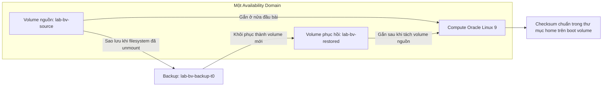

# Bài thực hành gắn Block Volume và phục hồi từ backup

Trong chương **Thực hành nền tảng OCI** của module Oracle Cloud Infrastructure, bài này đưa người học qua một vòng đời lưu trữ hoàn chỉnh: tạo Block Volume, gắn vào Compute, sử dụng trên Linux, tạo backup và phục hồi dữ liệu sang volume mới. Compartment và IAM giới hạn phạm vi thao tác; bằng chứng từ hệ điều hành và OCI giúp xác nhận kết quả.

Tình huống thực hành: một ứng dụng lưu danh sách đơn hàng và cấu hình trên đĩa dữ liệu riêng. Sau khi có backup, người vận hành vô tình xóa đơn hàng và sửa sai cấu hình. Bạn phải đưa dữ liệu về trạng thái đã sao lưu, đồng thời chứng minh rằng dữ liệu phục hồi đúng bằng checksum.

Bài sử dụng OCI Console cho thao tác hạ tầng và Bash trên một VM Oracle Linux 9 cho thao tác đĩa. Phần CLI cuối bài là cách thay thế thao tác backup và restore, dành cho người muốn tự động hóa. Các đầu ra được ghi là **minh họa hoặc kỳ vọng**, không phải kết quả đã chạy trên tenancy của bạn.

## 1. Kết quả cần đạt

Sau bài thực hành, bạn có thể:

- Phân biệt volume, attachment, thiết bị Linux, filesystem và mount point.
- Tạo volume trong đúng compartment và Availability Domain (AD), rồi gắn vào VM.
- Nhận diện đĩa dữ liệu trước khi định dạng, tạo ext4 và cấu hình mount bằng UUID.
- Tạo backup sau khi dừng ghi dữ liệu, theo dõi đến trạng thái sử dụng được.
- Phục hồi backup thành volume mới và xác minh cả nội dung lẫn mốc thời gian dữ liệu.
- Gỡ tài nguyên theo đúng thứ tự và nhận diện các thành phần tiếp tục phát sinh chi phí.

Điều kiện hoàn thành quan trọng nhất là checksum của các tệp phục hồi khớp bản chuẩn trước backup. Trạng thái attachment thành công chỉ chứng minh kết nối hạ tầng, chưa chứng minh dữ liệu đã phục hồi.

## 2. Mô hình thực hành và các khái niệm



| Thành phần | Vai trò trong bài |
| --- | --- |
| Boot volume | Chứa hệ điều hành và thư mục bằng chứng; không định dạng hoặc tách đĩa này. |
| Block Volume | Đĩa dữ liệu có vòng đời riêng với VM. |
| Volume attachment | Quan hệ gắn một volume với một instance; có OCID riêng. |
| Thiết bị Linux | Đường dẫn hệ điều hành dùng để truy cập đĩa, chẳng hạn một consistent device path. |
| Filesystem ext4 | Cấu trúc quản lý tệp được tạo trên đĩa dữ liệu mới. |
| Mount point | Thư mục `/mnt/labdata` để truy cập filesystem. |
| Volume backup | Bản sao dữ liệu theo một thời điểm, được dịch vụ quản lý độc lập với volume nguồn. |
| Volume phục hồi | Volume mới có OCID riêng, chứa dữ liệu lấy từ backup. |

**Attach**, **connect** và **mount** là các bước khác nhau. Với attachment kiểu **Paravirtualized**, hệ điều hành nhận kết nối thiết bị tự động; bạn vẫn cần tạo filesystem trên đĩa mới và mount để sử dụng. Với **iSCSI**, còn có bước thiết lập phiên kết nối trong guest hoặc dùng plugin phù hợp của Oracle Cloud Agent. Quy trình chính của bài chọn Paravirtualized trên VM hỗ trợ kiểu này. Tham khảo [Connecting to a Block Volume](https://docs.oracle.com/en-us/iaas/Content/Block/Tasks/connectingtoavolume.htm).

**OCID của volume và UUID của filesystem không giống nhau.** OCID định danh tài nguyên OCI. UUID nằm trong filesystem. Khi phục hồi bản sao filesystem sang đĩa mới, UUID có thể được giữ nguyên dù OCID đã khác. Vì vậy, bài tách volume nguồn trước khi gắn volume phục hồi vào cùng VM; không để hai filesystem có cùng UUID cùng hiện diện trong guest. Xem [Using Disk Partitions trên Oracle Linux](https://docs.oracle.com/en/operating-systems/oracle-linux/9/stordev/stordev-UsingDiskPartitions.html).

## 3. Chuẩn bị môi trường

### 3.1. Tài nguyên và quyền truy cập

Chuẩn bị trước:

1. Một compartment lab riêng, ví dụ `OciFundamentalsLab`.
2. Một VM Oracle Linux 9 đang chạy, hỗ trợ Paravirtualized attachment và đã SSH được bằng tài khoản có `sudo`.
3. Quyền tạo, gắn, tách, backup, phục hồi và xóa các volume dữ liệu của bài trong compartment lab.
4. Hạn mức còn đủ cho **hai volume dữ liệu** trong giai đoạn phục hồi và một backup.
5. Máy có trình duyệt để dùng Console; terminal Bash trên VM để chạy lệnh Linux.

Bài sử dụng VM, VCN và đường SSH đã có. Không cần thêm cổng inbound để mount volume Paravirtualized. Giữ nguyên giới hạn SSH của môi trường lab.

Người quản trị có thể cấp bộ quyền minh họa sau cho nhóm lab đã tồn tại:

```text
Allow group Default/OciLabOperators to manage volumes in compartment OciFundamentalsLab
Allow group Default/OciLabOperators to manage volume-attachments in compartment OciFundamentalsLab
Allow group Default/OciLabOperators to manage volume-backups in compartment OciFundamentalsLab
Allow group Default/OciLabOperators to use instances in compartment OciFundamentalsLab
```

Thay tên identity domain, group và compartment bằng giá trị thực. Đặt policy tại vị trí có thể cấp quyền cho compartment đích. Bộ quyền này phục vụ đầy đủ thao tác trong lab và bao gồm quyền xóa; `use instances` cũng có phạm vi rộng hơn riêng việc gắn đĩa, nên cần giới hạn vào compartment lab. Quyền IAM không tự cấp tài khoản Linux hay quyền `sudo`.

Nếu volume và instance thuộc các compartment khác nhau, quyền phải bao phủ đúng tài nguyên ở cả hai nơi. Bài giữ chúng trong cùng compartment để dễ kiểm soát. Các phụ thuộc quyền của thao tác attach/detach và restore được mô tả trong [Details for the Core Services](https://docs.oracle.com/en-us/iaas/Content/Identity/Reference/corepolicyreference.htm).

### 3.2. Thống nhất tên và phạm vi

| Giá trị | Lựa chọn trong bài |
| --- | --- |
| Region | Region đang chứa VM; giữ nguyên trong toàn bộ quy trình. |
| Availability Domain | AD chính xác của VM, lấy từ trang chi tiết instance. |
| Volume nguồn | `lab-bv-source` |
| Backup | `lab-bv-backup-t0` |
| Volume phục hồi | `lab-bv-restored` |
| Dung lượng | Chọn rõ `50 GB` cho mỗi volume dữ liệu trong lab. |
| Mức hiệu năng | `Balanced` cho khối lượng dữ liệu thử nghiệm nhỏ. |
| Attachment | `Paravirtualized`, truy cập đọc/ghi, không chia sẻ nhiều instance. |
| Filesystem | `ext4` trên toàn bộ đĩa dữ liệu, không tạo partition hay LVM. |
| Mount point | `/mnt/labdata` |
| Bằng chứng | `$HOME/oci-block-lab-evidence` trên boot volume của VM. |

Thêm free-form tag như `purpose=oci-block-lab` và `owner=<ten-cua-ban>` để nhận diện tài nguyên. Tên hiển thị có thể trùng, nên lưu thêm OCID.

Tại thời điểm tạo tài nguyên, xem lại ước tính chi phí trong Console và quyền lợi áp dụng cho tenancy. Dung lượng volume, mức hiệu năng, backup và thời gian giữ tài nguyên đều cần được tính đến; bài không giả định lab miễn phí. Volume đã detach vẫn là tài nguyên đang tồn tại.

### 3.3. Phân biệt terminal

Các khối `bash` trong quy trình chính chạy **trên VM Oracle Linux**, không chạy trực tiếp trong PowerShell của máy cá nhân. Các khối `text` thể hiện cấu hình, policy hoặc kết quả minh họa.

Chạy các bước theo thứ tự. Nếu một checkpoint không đạt, dừng tại bước đó. Đặc biệt, không tiếp tục định dạng khi chưa xác định đúng đĩa và không tiếp tục ghi dữ liệu khi mount chưa thành công.

## 4. Bước 1 — Ghi nhận trạng thái đĩa trước khi gắn

SSH vào VM và chạy:

```bash
lsblk -o NAME,PATH,SIZE,TYPE,FSTYPE,UUID,MOUNTPOINTS
findmnt -no SOURCE /
df -hT
```

Ghi nhận cấu trúc boot volume, các partition và LVM nếu có. Đĩa chứa `/` có thể được trình bày qua một logical volume; cần nhìn toàn bộ cây `lsblk` để biết đĩa vật lý phía dưới.

Chuẩn bị thư mục bằng chứng:

```bash
EVIDENCE_DIR="$HOME/oci-block-lab-evidence"
install -d -m 700 "$EVIDENCE_DIR"
lsblk -o NAME,PATH,SIZE,TYPE,FSTYPE,UUID,MOUNTPOINTS \
  > "$EVIDENCE_DIR/lsblk-before.txt"
findmnt -T "$EVIDENCE_DIR"
```

Xác nhận thư mục bằng chứng đang nằm trên filesystem của boot volume, không nằm trên đĩa dữ liệu sẽ gắn. Trong bài, boot volume được giữ nguyên để chứa checksum chuẩn ngay cả khi dữ liệu trên Block Volume bị thay đổi.

**Checkpoint:** đã biết đĩa hệ điều hành và có ảnh chụp trạng thái thiết bị trước attach.

## 5. Bước 2 — Tạo và gắn Block Volume nguồn

### 5.1. Tạo volume

Trong OCI Console, mở dịch vụ **Block Storage**, vào danh sách **Block Volumes**, chọn compartment lab rồi tạo volume:

1. Đặt tên `lab-bv-source`.
2. Chọn AD trùng với AD của VM.
3. Chọn cấu hình dung lượng tùy chỉnh và nhập `50 GB`; không chấp nhận dung lượng mặc định mà chưa kiểm tra.
4. Chọn `Balanced`.
5. Với lab này, dùng khóa mã hóa do Oracle quản lý.
6. Để trống backup policy tự động và các tùy chọn replication không dùng trong bài.
7. Gắn tag lab rồi tạo.

Chờ volume chuyển sang **Available**. Lưu OCID volume nguồn, compartment, AD và dung lượng. Một volume chỉ attach trực tiếp được với instance trong cùng AD; backup có thể được dùng để phục hồi sang AD khác trong cùng region. Xem [Overview of Block Volume](https://docs.oracle.com/en-us/iaas/Content/Block/Concepts/overview.htm).

Tên tab và bố cục Console có thể thay đổi. Dùng tên dịch vụ và tài nguyên để tìm đúng màn hình. Các trường tạo volume được mô tả tại [Creating a Block Volume](https://docs.oracle.com/en-us/iaas/Content/Block/Tasks/creatingavolume.htm).

### 5.2. Gắn vào VM

Tại trang chi tiết VM, tìm **Attached block volumes** hoặc mục tương ứng trong tab **Storage**, rồi chọn **Attach block volume**:

1. Chọn chính xác `lab-bv-source` bằng tên và đối chiếu OCID.
2. Chọn attachment type **Paravirtualized**.
3. Chọn quyền truy cập đọc/ghi cho một instance; không bật chia sẻ.
4. Nếu instance hỗ trợ consistent device paths, chọn đường dẫn còn trống và ghi lại, ví dụ `/dev/oracleoci/oraclevdb`.
5. Bật mã hóa dữ liệu truyền nếu tùy chọn này khả dụng và phù hợp cấu hình VM.
6. Attach và chờ attachment chuyển sang **Attached**.

Đường dẫn ví dụ chỉ có ý nghĩa khi đó là giá trị bạn đã chọn cho attachment. Không suy ra đường dẫn thiết bị từ tên volume. Tham khảo [Attaching a Block Volume to an Instance](https://docs.oracle.com/en-us/iaas/Content/Block/Tasks/attach-compute-volume-attachment.htm).

Trên VM, kiểm tra lại:

```bash
lsblk -o NAME,PATH,SIZE,TYPE,FSTYPE,UUID,MOUNTPOINTS
ls -l /dev/oracleoci/
```

Đối chiếu với `lsblk-before.txt`. Phải xuất hiện một đĩa dữ liệu mới có dung lượng phù hợp và chưa có filesystem.

**Checkpoint:** attachment có trạng thái Attached và guest nhìn thấy đúng thiết bị mới. Hai điều này cần được kiểm tra riêng.

## 6. Bước 3 — Nhận diện đĩa và tạo filesystem

### 6.1. Xác minh trước khi định dạng

Đặt biến bằng **đường dẫn thực tế** vừa ghi nhận. Dòng dưới chỉ là ví dụ cho attachment đã chọn consistent device path đó:

```bash
DATA_DEV='/dev/oracleoci/oraclevdb'
readlink -f -- "$DATA_DEV"
lsblk -o NAME,PATH,SIZE,TYPE,FSTYPE,UUID,MOUNTPOINTS "$DATA_DEV"
sudo wipefs --no-act "$DATA_DEV"
```

`wipefs --no-act` chỉ kiểm tra signature, không xóa. Trước khi chạy `mkfs`, cả bốn điều kiện sau phải đúng:

- Thiết bị khớp attachment và đĩa mới xuất hiện sau bước 2.
- Thiết bị không phải boot volume và không chứa `/`, `/boot`, swap hoặc dữ liệu có sẵn.
- Thiết bị chưa được mount, không có partition con và không có filesystem/signature ngoài dự kiến.
- Đây là volume nguồn **mới tạo trống**, chưa phải volume phục hồi.

Nếu thấy filesystem, partition hoặc dữ liệu không mong đợi, dừng để kiểm tra lại. Không dùng tùy chọn ép định dạng để vượt qua dấu hiệu này.

### 6.2. Tạo ext4 và mount

Chỉ sau khi xác minh, tạo ext4 trực tiếp trên toàn bộ đĩa mới:

```bash
sudo mkfs.ext4 -L oci-lab-data "$DATA_DEV"
sudo mkdir -p /mnt/labdata
sudo mount "$DATA_DEV" /mnt/labdata
findmnt -M /mnt/labdata
df -hT /mnt/labdata
```

Không thêm `-F`. Không chạy lại `mkfs.ext4` trên volume đã có dữ liệu hoặc trên volume được restore.

Trong bài không có partition trung gian, nên filesystem nằm trực tiếp trên `DATA_DEV`. Đây là lựa chọn đơn giản cho lab một đĩa; môi trường dùng partition hoặc LVM cần thay thiết bị đích tương ứng. Cách tạo và mount ext4 được mô tả trong [Creating and Mounting an Ext File System](https://docs.oracle.com/en/operating-systems/oracle-linux/9/ext/ext-CreatingandMountinganExtFileSystem.html).

Lưu UUID filesystem:

```bash
SOURCE_UUID=$(sudo blkid -s UUID -o value "$DATA_DEV")
printf '%s\n' "$SOURCE_UUID" | tee "$EVIDENCE_DIR/source-fs-uuid.txt"
```

**Checkpoint:** `findmnt -M /mnt/labdata` phải chỉ ra mount point chính xác, nguồn là đĩa dữ liệu và loại filesystem là ext4.

## 7. Bước 4 — Cấu hình mount bền vững

Sao lưu cấu hình hiện tại:

```bash
FSTAB_BACKUP="/etc/fstab.before-oci-block-lab.$(date +%Y%m%d%H%M%S)"
sudo cp --preserve=all /etc/fstab "$FSTAB_BACKUP"
printf 'UUID=%s /mnt/labdata ext4 defaults,_netdev,nofail 0 2 # oci-block-lab\n' \
  "$SOURCE_UUID"
```

Mở `sudoedit /etc/fstab` và thêm **một dòng** giống dòng vừa in, với UUID thực. Không thêm lặp nếu đã có cấu hình cho `/mnt/labdata`.

Ý nghĩa các thành phần chính:

| Thành phần | Ý nghĩa |
| --- | --- |
| `UUID=...` | Chọn filesystem bằng UUID thay vì phụ thuộc thứ tự `/dev/sdX`. |
| `/mnt/labdata` | Mount point của bài. |
| `ext4` | Loại filesystem đã tạo. |
| `_netdev` | Khai báo thiết bị cần phụ thuộc mạng trong quá trình mount. |
| `nofail` | Cho phép hệ thống tiếp tục boot nếu đĩa dữ liệu không mount được. |
| `0 2` | Không dùng dump; kiểm tra filesystem này sau filesystem gốc khi áp dụng. |
| `# oci-block-lab` | Chú thích để nhận diện đúng dòng cấu hình của bài. |

Oracle hướng dẫn cấu hình `_netdev` và `nofail` cho các Block Volume mount tự động; xem [Traditional fstab Options](https://docs.oracle.com/en-us/iaas/Content/Block/References/fstaboptions.htm). Quy trình cập nhật cấu hình và nạp lại systemd được minh họa trong [Work with File Systems on Oracle Linux](https://docs.oracle.com/en/learn/ol-file-systems/index.html).

Kiểm tra rồi thử mount từ cấu hình:

```bash
sudo findmnt --verify --verbose
sudo systemctl daemon-reload
cd "$HOME"
sudo umount /mnt/labdata
sudo mount /mnt/labdata
findmnt -M /mnt/labdata
```

Nếu cấu hình có lỗi liên quan dòng vừa thêm, sửa trước khi tiếp tục. Có thể reboot VM lab, SSH trở lại và kiểm tra mount để xác nhận hành vi khi khởi động. Sau khi mở phiên SSH mới, đặt lại `EVIDENCE_DIR="$HOME/oci-block-lab-evidence"`; các biến Bash không tồn tại xuyên phiên.

`nofail` giúp quá trình boot nhưng không bảo đảm đĩa dữ liệu đã sẵn sàng cho ứng dụng. Nếu mount thất bại mà ứng dụng vẫn ghi vào `/mnt/labdata`, dữ liệu có thể đi vào thư mục nằm trên boot volume. Vì vậy, các bước ghi dữ liệu bên dưới đều kiểm tra mount trước.

## 8. Bước 5 — Tạo dữ liệu và checksum chuẩn

Tạo thư mục dữ liệu thuộc tài khoản đang SSH, không đổi quyền toàn bộ filesystem:

```bash
mountpoint /mnt/labdata
sudo install -d -o "$(id -un)" -g "$(id -gn)" /mnt/labdata/demo
```

Chỉ tiếp tục nếu mount point đang hoạt động. Tạo hai tệp mẫu:

```bash
(
  set -eu
  mountpoint -q /mnt/labdata

  cat > /mnt/labdata/demo/orders.csv <<'EOF'
order_id,customer,total_vnd
1001,An,150000
1002,Binh,275000
1003,Chi,99000
EOF

  cat > /mnt/labdata/demo/app.conf <<'EOF'
environment=lab
schema_version=1
recovery_marker=before-backup
EOF

  cd /mnt/labdata/demo
  sha256sum orders.csv app.conf \
    | tee "$HOME/oci-block-lab-evidence/baseline.sha256"
)
```

Trong khối trên, `set -eu` nằm trong subshell: nếu mount không tồn tại, khối dừng trước khi ghi. Tệp checksum nằm ngoài volume dữ liệu, giúp so sánh độc lập sau restore.

Kiểm tra bản chuẩn:

```bash
(
  set -eu
  mountpoint -q /mnt/labdata
  cd /mnt/labdata/demo
  sha256sum -c "$HOME/oci-block-lab-evidence/baseline.sha256"
)
```

Kết quả kỳ vọng:

```text
orders.csv: OK
app.conf: OK
```

Lưu nội dung hoặc ảnh chụp kết quả này làm bằng chứng ban đầu. Không sửa `baseline.sha256` để khớp dữ liệu hỏng ở các bước sau.

## 9. Bước 6 — Dừng ghi và tạo backup

### 9.1. Đưa dữ liệu về trạng thái nhất quán

Bài chỉ có các tệp thử nghiệm, không có tiến trình ứng dụng chạy nền. Nếu bạn đã khởi chạy chương trình ghi vào thư mục này, dừng chương trình trước.

```bash
cd "$HOME"
sync
sudo umount /mnt/labdata
mountpoint /mnt/labdata
date -u '+%Y-%m-%dT%H:%M:%SZ' \
  | tee "$EVIDENCE_DIR/data-quiesced-at.txt"
```

Sau unmount, `mountpoint` phải báo thư mục không phải mount point; mã trả về khác 0 ở lệnh kiểm tra này là kết quả mong đợi. Không ghi vào thư mục `/mnt/labdata` khi filesystem đã unmount.

Nếu gặp `target is busy`, kiểm tra terminal hoặc tiến trình còn dùng đĩa bằng `sudo fuser -vm /mnt/labdata`. Chuyển các terminal ra ngoài mount point và dừng đúng tiến trình ghi dữ liệu, rồi unmount lại. Không dùng force hoặc lazy unmount để bỏ qua bước nhất quán trong bài.

Việc `sync` chỉ đẩy dữ liệu đang đệm ở tầng hệ điều hành. Nó không tự hoàn tất giao dịch của ứng dụng hay thay thế cơ chế backup của Oracle Database. Với cơ sở dữ liệu thật, cần quy trình ứng dụng phù hợp như RMAN và phối hợp các volume liên quan. Hướng dẫn chuẩn bị backup của Oracle nằm trong [Block Volume Backups](https://docs.oracle.com/en-us/iaas/Content/Block/Concepts/blockvolumebackups.htm).

### 9.2. Tạo backup trong Console

Tại volume `lab-bv-source`, mở **Backups**, chọn tạo backup:

1. Đặt tên `lab-bv-backup-t0`.
2. Chọn loại **Full** để quy trình đầu tiên dễ theo dõi.
3. Với backup lab sẽ xóa cuối bài, chọn giữ đến khi xóa thủ công nếu giao diện cho phép; ghi nhận thời hạn thực tế đang áp dụng.
4. Không bật retention lock, prevent deletion hoặc indefinite hold cho bài lab dùng một lần.
5. Tạo backup, lưu OCID và chờ **Available**.

Giữ filesystem unmount trong suốt bước này để dữ liệu chuẩn không thay đổi. Backup có thể đi qua `REQUEST_RECEIVED` và `CREATING`; chỉ chuyển sang bước mô phỏng sự cố khi backup đã `AVAILABLE`. Nếu lỗi hoặc timeout, kiểm tra trạng thái thật của backup trước khi tạo yêu cầu mới.

Ghi lại thời điểm backup trong Console, loại backup, volume nguồn và trạng thái hoàn tất. Quy trình giao diện và các tùy chọn retention được mô tả tại [Creating a Block Volume Backup](https://docs.oracle.com/en-us/iaas/Content/Block/Tasks/create-bv-backup.htm).

**Checkpoint:** có backup đúng volume nguồn, trạng thái Available và checksum chuẩn vẫn nằm trong thư mục bằng chứng.

## 10. Bước 7 — Mô phỏng sự cố sau backup

Mount lại volume nguồn và xác nhận bản chuẩn chưa đổi:

```bash
sudo mount /mnt/labdata
findmnt -M /mnt/labdata
(
  set -eu
  mountpoint -q /mnt/labdata
  cd /mnt/labdata/demo
  sha256sum -c "$HOME/oci-block-lab-evidence/baseline.sha256"
)
```

Khi hai tệp vẫn báo `OK`, mô phỏng sự cố **chỉ trên dữ liệu mẫu**:

```bash
(
  set -eu
  mountpoint -q /mnt/labdata
  date -u '+%Y-%m-%dT%H:%M:%SZ' \
    > "$HOME/oci-block-lab-evidence/incident-at.txt"

  rm -- /mnt/labdata/demo/orders.csv
  printf 'recovery_marker=changed-after-backup\n' \
    >> /mnt/labdata/demo/app.conf
  printf 'This file was created after the backup.\n' \
    > /mnt/labdata/demo/after-backup.txt
  sync
)
```

Kiểm tra tác động:

```bash
(
  mountpoint -q /mnt/labdata || exit 1
  cd /mnt/labdata/demo || exit 1
  sha256sum -c "$HOME/oci-block-lab-evidence/baseline.sha256"
  ls -l
)
```

Kết quả mong đợi là `orders.csv` bị thiếu, `app.conf` không khớp checksum và `after-backup.txt` tồn tại. Đây là bằng chứng volume nguồn đã khác mốc backup. Không tạo backup mới tại thời điểm này để thay thế backup chuẩn.

## 11. Bước 8 — Tách volume nguồn

Chuẩn bị tách ở tầng guest:

```bash
cd "$HOME"
sync
sudo umount /mnt/labdata
mountpoint /mnt/labdata
```

Khi chắc chắn đã unmount, mở `sudoedit /etc/fstab` và **comment đúng dòng có chú thích `oci-block-lab`** bằng cách thêm `#` ở đầu dòng. Việc này tránh cấu hình mount còn hoạt động trong khoảng chưa có đĩa dữ liệu.

```bash
sudo systemctl daemon-reload
sudo findmnt --verify --verbose
```

Trong trang attachment của VM, chọn volume nguồn đúng OCID, thực hiện **Detach**, chờ trạng thái tách hoàn tất. Trên VM, dùng `lsblk` để xác nhận đĩa nguồn không còn xuất hiện.

Không xóa volume nguồn ở bước này. Giữ nó ở trạng thái đã tách để đối chiếu nếu cần. Vì quy trình dùng Paravirtualized, không có bước logout phiên iSCSI. Nếu đã chọn iSCSI từ đầu, bạn cần áp dụng đúng thủ tục disconnect iSCSI trước khi detach thay vì sao chép nguyên bước này.

**Checkpoint:** volume nguồn vẫn tồn tại trong OCI, nhưng không còn attachment đang hoạt động với VM và không hiện diện trong guest.

## 12. Bước 9 — Restore thành volume mới

Trong danh sách **Block Volume Backups**, chọn `lab-bv-backup-t0` và đối chiếu OCID. Chọn **Restore block volume**:

1. Đặt tên `lab-bv-restored`.
2. Chọn compartment lab.
3. Chọn AD của VM hiện có.
4. Giữ dung lượng bằng volume nguồn; không tăng dung lượng trong lần thực hành đầu tiên.
5. Xem lại mức hiệu năng và tag.
6. Tạo và chờ volume mới ở trạng thái **Available**.

Ghi lại OCID mới. Không nhầm OCID volume phục hồi với OCID backup hoặc volume nguồn.

Trong luồng restore đang thực hành, OCI tạo một volume mới từ backup. Bạn cần attach và mount volume đó để truy cập dữ liệu. Restore sang dung lượng lớn hơn là tình huống khác, còn cần xử lý mở rộng filesystem phù hợp; không thể chọn dung lượng nhỏ hơn backup nguồn trong luồng này. Xem [Restoring a Backup to a New Volume](https://docs.oracle.com/en-us/iaas/Content/Block/Tasks/create-restore-to-new-volume-bv-volume-backup.htm).

Gắn `lab-bv-restored` vào VM theo cách ở bước 2, dùng Paravirtualized và đọc/ghi cho một instance. Có thể dùng lại consistent device path cũ nếu nó đã được giải phóng. Sau attach, xác định lại thiết bị từ thông tin attachment và `lsblk`; không giả định biến `DATA_DEV` cũ vẫn trỏ đúng.

Ví dụ sau khi đã đối chiếu đường dẫn thực:

```bash
RESTORED_DEV='/dev/oracleoci/oraclevdb'
readlink -f -- "$RESTORED_DEV"
lsblk -o NAME,PATH,SIZE,TYPE,FSTYPE,UUID,MOUNTPOINTS "$RESTORED_DEV"
sudo blkid "$RESTORED_DEV"
cat "$EVIDENCE_DIR/source-fs-uuid.txt"
```

Volume này phải **đã có ext4**. UUID filesystem thường trùng với giá trị đã lưu vì đó là bản sao từ backup. Nếu thấy thiết bị trống hoặc cấu trúc khác dự kiến, kiểm tra lại backup, OCID và attachment. **Không chạy `mkfs` để “sửa” volume phục hồi.**

## 13. Bước 10 — Kiểm chứng dữ liệu phục hồi

### 13.1. Mount để kiểm tra trước

Dòng fstab của lab vẫn đang được comment. Mount thiết bị phục hồi ở chế độ đọc:

```bash
sudo mount -o ro "$RESTORED_DEV" /mnt/labdata
findmnt -M /mnt/labdata
```

Đối chiếu nguồn mount với thiết bị phục hồi. Sau đó chạy kiểm tra:

```bash
(
  set -eu
  mountpoint -q /mnt/labdata
  cd /mnt/labdata/demo
  sha256sum -c "$HOME/oci-block-lab-evidence/baseline.sha256"
  test ! -e after-backup.txt
  printf 'AFTER_BACKUP_FILE_ABSENT=PASS\n'
  cat orders.csv
  cat app.conf
)
```

Kết quả kỳ vọng:

```text
orders.csv: OK
app.conf: OK
AFTER_BACKUP_FILE_ABSENT=PASS
```

Ngoài checksum, nội dung phải cho thấy:

- `orders.csv` có ba đơn hàng ban đầu.
- `app.conf` chứa `recovery_marker=before-backup`.
- Không có dòng cấu hình `changed-after-backup`.
- Tệp `after-backup.txt` không tồn tại.

Ba bằng chứng hỗ trợ các kết luận khác nhau: OCID mới chứng minh đang dùng tài nguyên phục hồi; checksum chứng minh nội dung các tệp chuẩn trùng nhau; tệp sau backup không xuất hiện chứng minh dữ liệu quay về mốc sao lưu thay vì lấy trạng thái nguồn đã hỏng.

Lưu kết quả xác minh ra boot volume:

```bash
(
  set -eu
  mountpoint -q /mnt/labdata
  cd /mnt/labdata/demo
  sha256sum -c "$HOME/oci-block-lab-evidence/baseline.sha256" \
    > "$HOME/oci-block-lab-evidence/restore-check.txt" 2>&1
  test ! -e after-backup.txt
  printf 'AFTER_BACKUP_FILE_ABSENT=PASS\n' \
    >> "$HOME/oci-block-lab-evidence/restore-check.txt"
  date -u '+%Y-%m-%dT%H:%M:%SZ' \
    > "$HOME/oci-block-lab-evidence/recovery-verified-at.txt"
)
```

Nếu checksum không khớp, khối lệnh dừng trước khi ghi mốc xác minh thành công. Không đánh dấu đạt chỉ vì có tệp `restore-check.txt`; phải đọc nội dung và kiểm tra tất cả điều kiện.

### 13.2. Đưa volume phục hồi vào sử dụng

Sau khi kiểm chứng đạt:

1. Unmount filesystem đang đọc.
2. Kiểm tra UUID của volume phục hồi.
3. Mở fstab, bỏ comment ở dòng lab nếu UUID vẫn đúng. Nếu UUID khác, xác định nguyên nhân và sửa đúng UUID trước khi sử dụng.
4. Nạp lại systemd, mount từ fstab và kiểm tra quyền đọc/ghi.

```bash
cd "$HOME"
sudo umount /mnt/labdata
sudo blkid "$RESTORED_DEV"
sudoedit /etc/fstab
sudo findmnt --verify --verbose
sudo systemctl daemon-reload
sudo mount /mnt/labdata
findmnt -M /mnt/labdata
```

Xác nhận tùy chọn mount có `rw`, rồi thử ghi một tệp mới:

```bash
(
  set -eu
  mountpoint -q /mnt/labdata
  printf 'Recovery write check\n' \
    > /mnt/labdata/demo/recovery-write-check.txt
  sync
  cat /mnt/labdata/demo/recovery-write-check.txt
)
```

Volume nguồn vẫn phải ở trạng thái detach. Nếu cần giữ đồng thời cả hai bản để điều tra, hãy thiết kế quy trình xử lý định danh filesystem riêng hoặc dùng một VM kiểm tra khác. Không gắn lại volume nguồn vào cùng VM khi vẫn dùng UUID trùng nhau.

## 14. Đọc kết quả theo RPO, RTO và giới hạn bài thực hành

**RPO** thể hiện mức mất dữ liệu có thể chấp nhận tính theo thời gian. Trong bài, dữ liệu tạo sau mốc backup không có trong bản phục hồi là hành vi đúng. Không được coi backup cũ là bản sao liên tục của volume đang chạy.

**RTO** thể hiện thời gian mục tiêu để khôi phục hoạt động. Khi đo thực tế, cần quy định điểm bắt đầu và kết thúc. Với bài lab, có thể đo từ `incident-at.txt` đến `recovery-verified-at.txt`, tức là đến lúc dữ liệu đã được kiểm chứng. Nếu mục tiêu là ứng dụng phục vụ trở lại, còn phải cộng thời gian gắn quyền ghi, khởi động ứng dụng và kiểm tra nghiệp vụ.

Ví dụ giả định: mốc dữ liệu được backup là 09:00, sự cố xảy ra lúc 09:17, dữ liệu được xác minh phục hồi lúc 09:28. Khi đó khoảng dữ liệu chưa được bảo vệ là 17 phút và thời gian phục hồi quan sát được là 11 phút. Đây là ví dụ cách tính, không phải cam kết thời gian phục hồi của OCI.

Bài chứng minh phục hồi volume dữ liệu trên cùng VM và AD. Nó chưa chứng minh khả năng phục hồi toàn bộ ứng dụng khi VM, boot volume, VCN hoặc cả region không sẵn sàng. Muốn đánh giá các tình huống đó, cần kiểm thử thêm những thành phần phụ thuộc tương ứng.

Đối với backup OCI, Full và Incremental đều có thể dùng để khôi phục toàn bộ nội dung tại mốc backup đã chọn; người vận hành không phải tự ghép chuỗi tệp full/incremental như một số công cụ backup truyền thống. Tuy vậy, backup thành công vẫn cần được kiểm tra bằng restore. Tham khảo [Block Volume Backups](https://docs.oracle.com/en-us/iaas/Content/Block/Concepts/blockvolumebackups.htm).

## 15. Theo dõi và xử lý lỗi thường gặp

Theo dõi trạng thái volume, backup và attachment trong Console. Trên guest, dùng `lsblk`, `findmnt` và `df -hT` để xác nhận trạng thái thực tế. Hai lớp quan sát này bổ sung cho nhau: OCI quản lý tài nguyên, còn guest cho biết filesystem có đang được sử dụng đúng hay không.

| Triệu chứng | Kiểm tra và hướng xử lý |
| --- | --- |
| Không thấy volume trong danh sách attach | Kiểm tra region, compartment, AD và IAM; dùng OCID để tránh nhầm tên. |
| Attached nhưng không thấy đĩa | Xác nhận đúng instance và loại attachment; nếu là iSCSI thì kiểm tra bước connect. Với Paravirtualized, xem sự kiện hệ điều hành và thông tin attachment. |
| `mkfs` báo thiết bị có filesystem hoặc đang bận | Dừng định dạng. Đối chiếu lại đĩa nguồn, mount và partition; không dùng force. |
| Không ghi được thư mục `demo` | Kiểm tra mount thực tế, tùy chọn `ro/rw` và chủ sở hữu thư mục; không xử lý bằng `chmod 777` toàn đĩa. |
| Unmount báo busy | Kiểm tra thư mục hiện tại của terminal và tiến trình bằng `fuser`, dừng đúng tiến trình đang dùng filesystem. |
| Backup còn Creating hoặc báo Faulty | Chờ hoặc kiểm tra chi tiết lỗi, quyền và hạn mức; chưa chuyển sang mô phỏng sự cố. |
| Restore xong nhưng checksum không khớp | Kiểm tra backup OCID, mốc backup, nguồn mount và checksum chuẩn; không sửa manifest để làm kết quả khớp. |
| Sau reboot không mount | Kiểm tra fstab, UUID, attachment và phụ thuộc mạng; dùng serial console nếu hệ thống không khởi động bình thường. |
| Có thư mục mount nhưng thiếu dữ liệu | Dùng `findmnt -M /mnt/labdata`. Thư mục tồn tại chưa có nghĩa volume đã mount; kiểm tra trước khi ghi tiếp. |
| CLI timeout khi tạo backup hoặc volume | Kiểm tra danh sách tài nguyên và trạng thái bằng OCID; timeout chờ không đồng nghĩa thao tác tạo đã bị hủy. |
| Xóa backup bị từ chối | Kiểm tra IAM và các cấu hình retention/hold đang áp dụng; không tạo bản lab với khóa retention nếu cần xóa ngay. |

Nếu có quyền quan sát OCI Monitoring, xem biểu đồ đọc/ghi và độ trễ của volume trong lúc tạo dữ liệu hoặc xác minh. Khối lượng dữ liệu bài rất nhỏ nên không dùng kết quả này để suy ra hiệu năng ứng dụng sản xuất. Khả năng theo dõi tài nguyên được giới thiệu trong [Working with Block Volumes](https://docs.oracle.com/en-us/iaas/Content/Block/blockvolumes.htm).

## 16. Tùy chọn — Thay thao tác backup và restore bằng OCI CLI

Phần này chạy trong **Bash tại nơi đã cài OCI CLI và cấu hình xác thực hợp lệ**, có thể là môi trường quản trị riêng. Nó thay thế thao tác Console ở bước 6 và bước 9; không chạy thêm để tạo tài nguyên trùng nếu đã hoàn tất bằng Console. Các thao tác dừng ghi, unmount, detach nguồn và kiểm chứng trong guest vẫn phải thực hiện như trên.

Điền giá trị thật. `AD_NAME` là tên AD đầy đủ lấy từ OCI, có thể có tiền tố theo tenancy.

```bash
REGION='<region-cua-vm>'
COMPARTMENT_ID='<ocid-compartment-lab>'
AD_NAME='<ten-availability-domain-day-du>'
SOURCE_VOLUME_ID='<ocid-volume-nguon>'
```

Sau khi đã unmount filesystem nguồn ở bước 6, tạo backup và chờ Available:

```bash
BACKUP_ID=$(oci --region "$REGION" bv backup create \
  --volume-id "$SOURCE_VOLUME_ID" \
  --display-name lab-bv-backup-t0 \
  --type FULL \
  --wait-for-state AVAILABLE \
  --max-wait-seconds 3600 \
  --query 'data.id' \
  --raw-output)
BACKUP_RC=$?
printf 'BACKUP_RC=%s\nBACKUP_ID=%s\n' "$BACKUP_RC" "$BACKUP_ID"
```

Chỉ sử dụng `BACKUP_ID` khi mã trả về bằng 0 và ID có giá trị hợp lệ. Nếu lệnh lỗi hoặc timeout, kiểm tra tài nguyên đã tạo trước khi chạy lại. Các trạng thái chờ và loại backup được mô tả trong [OCI CLI: bv backup create](https://docs.oracle.com/en-us/iaas/tools/oci-cli/latest/oci_cli_docs/cmdref/bv/backup/create.html).

Đến bước 9, sau khi đã mô phỏng sự cố và tách volume nguồn, tạo volume phục hồi:

```bash
RESTORED_VOLUME_ID=$(oci --region "$REGION" bv volume create \
  --compartment-id "$COMPARTMENT_ID" \
  --availability-domain "$AD_NAME" \
  --display-name lab-bv-restored \
  --volume-backup-id "$BACKUP_ID" \
  --vpus-per-gb 10 \
  --wait-for-state AVAILABLE \
  --max-wait-seconds 3600 \
  --query 'data.id' \
  --raw-output)
RESTORE_RC=$?
printf 'RESTORE_RC=%s\nRESTORED_VOLUME_ID=%s\n' \
  "$RESTORE_RC" "$RESTORED_VOLUME_ID"
```

`--vpus-per-gb 10` chọn Balanced trong ví dụ. Không truyền đồng thời các nguồn clone/replica khác với `--volume-backup-id`. Sau khi lệnh thành công, attach volume đúng OCID và tiếp tục bước kiểm chứng trong guest. Tham khảo [OCI CLI: bv volume create](https://docs.oracle.com/en-us/iaas/tools/oci-cli/latest/oci_cli_docs/cmdref/bv/volume/create.html).

Khi chuyển thành tự động hóa thường xuyên, cần lưu OCID từ phản hồi API, kiểm tra mã trả về và trạng thái tài nguyên trước khi chạy bước kế tiếp. Dùng lịch backup cùng retention rõ ràng thay cho việc tạo backup thủ công không giới hạn. OCI hỗ trợ backup policy định sẵn và tùy chỉnh; xem [Backup Policies](https://docs.oracle.com/en-us/iaas/Content/Block/Tasks/schedulingvolumebackups.htm).

## 17. Bằng chứng hoàn thành

Điền thông tin của lần thực hành thực tế vào bảng sau. Không dùng tên hiển thị thay OCID khi cần xác định tài nguyên.

| Bằng chứng | Giá trị cần ghi |
| --- | --- |
| Phạm vi | Region, compartment và AD của VM. |
| Volume nguồn | OCID, dung lượng, loại attachment và thiết bị guest. |
| UUID filesystem | UUID trước backup và UUID trên volume phục hồi. |
| Backup | OCID, loại, mốc thời gian và trạng thái Available. |
| Dữ liệu sau sự cố | Tệp đơn hàng bị thiếu, checksum cấu hình sai, tệp mới tồn tại. |
| Volume phục hồi | OCID mới và attachment vào đúng VM. |
| Đối chiếu dữ liệu | Hai dòng checksum OK và xác nhận tệp sau backup không tồn tại. |
| Khả năng dùng tiếp | Mount ở chế độ đọc/ghi và ghi thử thành công. |
| Thời gian | Thời điểm sự cố, thời điểm xác minh và cách định nghĩa RTO của bài. |
| Dọn tài nguyên | Các OCID đã xóa và tài nguyên được giữ lại có chủ đích. |

Bài đạt khi bạn giải thích được vì sao dữ liệu sau backup không xuất hiện trong bản phục hồi, chứng minh được đang mount volume mới và đưa ra kết quả kiểm tra đúng cho cả hai tệp chuẩn.

## 18. Dọn tài nguyên và kiểm soát chi phí

Sau khi lưu bằng chứng cần thiết, thực hiện theo thứ tự:

1. Đóng tiến trình và chuyển terminal ra ngoài `/mnt/labdata`.
2. Chạy `sync`, unmount volume phục hồi, xác nhận mount point không còn hoạt động.
3. Mở fstab, xóa đúng dòng của bài có chú thích `oci-block-lab`; không thay những dòng khác.
4. Chạy `sudo systemctl daemon-reload` và kiểm tra lại `sudo findmnt --verify --verbose`.
5. Trong Console, detach volume phục hồi và xác nhận tách hoàn tất.
6. Xóa `lab-bv-restored` và `lab-bv-source` đúng OCID sau khi chắc chắn không còn cần dữ liệu.
7. Xóa `lab-bv-backup-t0` nếu không có yêu cầu giữ lại và chính sách retention cho phép.
8. Kiểm tra lại danh sách Block Volumes và Block Volume Backups trong đúng compartment, region và theo tag lab.
9. Chỉ xóa VM hoặc tài nguyên mạng nếu chúng được tạo riêng cho lần lab này và không còn được sử dụng.

Backup có vòng đời độc lập với volume nguồn, nên xóa volume không có nghĩa backup cũng đã được dọn. Cần kiểm tra riêng backup, các bản sao và lịch tự động nếu bạn đã tạo chúng. Mối quan hệ vòng đời này được mô tả trong [Creating a Block Volume Backup](https://docs.oracle.com/en-us/iaas/Content/Block/Tasks/create-bv-backup.htm).

Nếu giữ lại tài nguyên để học tiếp, ghi rõ chủ sở hữu, mục đích và ngày dự kiến xóa. Volume nguồn đã detach, volume phục hồi và backup vẫn phải nằm trong phạm vi theo dõi chi phí của lab.
