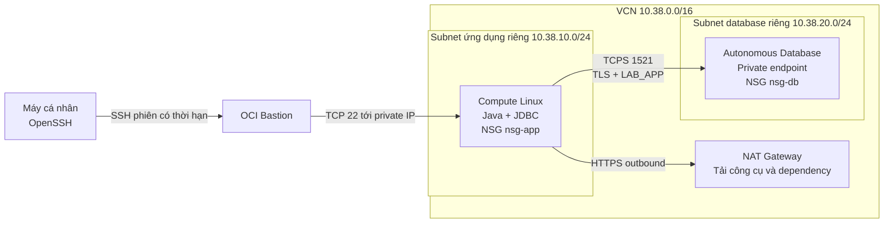

# Bài thực hành triển khai private database và kết nối JDBC

## 1. Mục tiêu và phạm vi

Trong chương **Thực hành nền tảng OCI** của module **CLOUD_PROVIDERS_ORACLE**, bài này hướng dẫn triển khai một cơ sở dữ liệu Oracle chỉ có đường truy cập riêng, sau đó chạy ứng dụng Java kết nối qua JDBC. Người học kết hợp compartment, IAM, VCN, Compute và dịch vụ cơ sở dữ liệu với kiểm soát truy cập, quan sát vận hành và dọn tài nguyên.

Tình huống: một ứng dụng quản lý ghi chú cần lưu dữ liệu trên Oracle Database. Máy ứng dụng được truy cập cơ sở dữ liệu, nhưng máy cá nhân ngoài Internet không được kết nối trực tiếp tới database. Người quản trị vẫn cần một đường SSH có thời hạn để vận hành máy ứng dụng.

Bài sử dụng **Oracle Autonomous Database Serverless, workload Transaction Processing**, với **private endpoint**, một Compute Linux trong cùng VCN và **OCI Bastion**. Console và tài liệu mới có thể hiển thị tên **Autonomous AI Database**. Đây là một cách triển khai cụ thể của private database trên OCI; các bước cấu hình endpoint và cổng không được áp dụng nguyên xi cho Base Database Service, Exadata hoặc MySQL HeatWave.

Sau khi hoàn thành, bạn cần chứng minh được:

- Database dùng private endpoint và không bật thêm public access.
- Java chạy trên Compute không có public IP, kết nối tới hostname riêng bằng TCPS.
- Tài khoản ứng dụng chỉ có quyền đăng nhập và thao tác bảng được cấp.
- Một giao dịch đã commit được thấy từ kết nối mới; một giao dịch rollback không để lại dòng dữ liệu.
- Máy không được phép không thiết lập được kết nối database mới.
- Tài nguyên, chi phí và giới hạn sẵn sàng của mô hình được ghi nhận rõ.

Thời gian thao tác phụ thuộc thời gian cấp phát tài nguyên và mức độ quen thuộc với OCI. Đây là bài lab có thể phát sinh chi phí; không giả định private endpoint hay cấu hình được chọn thuộc diện miễn phí.

## 2. Kiến trúc và ba lớp kiểm soát



Bastion là dịch vụ quản trị; Java vẫn chạy trên Compute và kết nối trực tiếp tới private endpoint bên trong VCN. Tunnel SSH tới Compute không tự tạo đường JDBC từ laptop tới database. NAT phục vụ kết nối ra ngoài do Compute khởi tạo để tải gói và Maven dependency; đường JDBC giữa hai subnet không đi qua NAT.

Ba lớp kiểm soát giải quyết các câu hỏi khác nhau:

| Lớp | Câu hỏi cần trả lời | Cấu hình trong bài |
| --- | --- | --- |
| OCI IAM | Ai được tạo, sửa, xóa tài nguyên hoặc tạo phiên Bastion? | Nhóm triển khai được cấp quyền trong compartment lab |
| Mạng | Máy nào tới được listener của database? | Private endpoint, NSG, security list, DNS và route |
| Oracle Database | Sau khi kết nối, tài khoản được chạy câu SQL nào? | User `LAB_APP`, quyền đối tượng trên bảng của `LAB_OWNER` |

Quyền quản lý database trên OCI không tự biến một user thành database user có quyền đọc bảng. Ngược lại, có mật khẩu database không tạo được đường mạng tới private endpoint.

Trong lab, dùng **TLS không cần wallet** cho JDBC Thin và chủ động cho phép TLS trong cấu hình database. Kết nối vẫn mã hóa và kiểm tra chứng chỉ máy chủ. Nếu tổ chức bắt buộc client certificate, thực hiện nhánh mTLS ở cuối bài. Oracle mô tả riêng điều kiện của kết nối [JDBC Thin qua TLS không cần wallet](https://docs.oracle.com/en/cloud/paas/autonomous-database/serverless/adbsb/connect-jdbc-thin-tls.html).

## 3. Chuẩn bị trước khi cấp phát

### 3.1. Quyền và công cụ

Chuẩn bị một tenancy có region hỗ trợ dịch vụ, quota/capacity phù hợp và một compartment riêng, ví dụ `OciPrivateDbLab`. Người quản trị tạo trước compartment và nhóm người học; không dùng compartment chứa dữ liệu sản xuất.

Nhóm triển khai cần các quyền tương ứng với tài nguyên thực sự được tạo:

| Công việc | Phạm vi quyền cần chuẩn bị |
| --- | --- |
| Tạo, cấu hình và xóa Autonomous Database | Quyền quản lý Autonomous Database trong compartment lab |
| Tạo VCN, subnet, NSG, route và gateway | Quyền quản lý mạng trong compartment lab |
| Tạo Compute và boot volume | Quyền tạo/quản lý instance, sử dụng/quản lý volume và đọc image phù hợp |
| Tạo Bastion và phiên port forwarding | Quyền Bastion, quyền đọc instance/mạng và quyền phụ thuộc của thao tác |
| Xem Audit, metric và tạo cảnh báo | Quyền đọc log/metric hoặc quyền giám sát tương ứng nếu triển khai phần này |

Ví dụ dưới đây chỉ thể hiện phần policy cho database, mạng và Bastion. Thay identity domain, group và compartment bằng giá trị thực; quản trị viên bổ sung policy Compute, image, volume và quyền quan sát theo cách tổ chức đã chọn.

```text
Allow group 'Default'/'OciPrivateDbLabOperators' to manage autonomous-database-family in compartment OciPrivateDbLab
Allow group 'Default'/'OciPrivateDbLabOperators' to manage virtual-network-family in compartment OciPrivateDbLab
Allow group 'Default'/'OciPrivateDbLabOperators' to manage bastion-family in compartment OciPrivateDbLab
Allow group 'Default'/'OciPrivateDbLabOperators' to read instance-family in compartment OciPrivateDbLab
Allow group 'Default'/'OciPrivateDbLabOperators' to inspect work-requests in compartment OciPrivateDbLab
```

Đây là quyền của người dựng lab, không phải quyền của chương trình JDBC. Với phương thức đăng nhập database bằng user/password trong bài, chương trình không cần OCI API key. Tra cứu quyền theo thao tác trong [IAM Policies for Autonomous Database](https://docs.oracle.com/en/cloud/paas/autonomous-database/serverless/adbsb/autonomous-database-iam-policies.html) và [Bastion IAM Policies](https://docs.oracle.com/en-us/iaas/Content/Bastion/Reference/bastionpolicyreference.htm).

Máy cá nhân cần OpenSSH và một cặp khóa cho Bastion. Compute cần một cặp khóa đăng nhập hệ điều hành; có thể dùng cặp riêng để dễ thu hồi quyền. Chỉ đưa public key lên OCI.

Trên Compute chuẩn bị:

- Linux, ví dụ Oracle Linux; tài khoản mẫu là `opc`.
- JDK 21, Maven 3.9 hoặc phiên bản tương thích với dự án.
- Oracle SQLcl tương thích với JDK đang dùng, có lệnh `sql` trong `PATH`.
- `getent`, `nc` và `openssl` để kiểm tra từng lớp kết nối.

Có thể cài công cụ qua kho phần mềm được tổ chức cho phép, hoặc chuyển bộ cài từ máy cá nhân qua SSH. Kiểm tra trước khi tiếp tục:

```bash
java -version
mvn -version
sql -version
```

### 3.2. Quy ước tài nguyên

| Thành phần | Giá trị minh họa |
| --- | --- |
| Compartment | `OciPrivateDbLab` |
| VCN | `vcn-private-db-lab`, CIDR `10.38.0.0/16` |
| Subnet ứng dụng | `subnet-app-private`, CIDR `10.38.10.0/24` |
| Subnet database | `subnet-db-private`, CIDR `10.38.20.0/24` |
| Compute | `vm-jdbc-lab`, private IP lấy từ Console |
| Autonomous Database | Display name `adb-private-jdbc-lab`, database name `OCILABDB` nếu hợp lệ và còn khả dụng |
| NSG | `nsg-app`, `nsg-db` |
| Schema sở hữu bảng | `LAB_OWNER` |
| User ứng dụng | `LAB_APP` |
| Nhãn theo dõi | `purpose=private-db-jdbc-lab`, `owner`, `expires-on` |

CIDR chỉ là ví dụ. Chọn dải không trùng với mạng hiện có nếu VCN có peering, VPN hoặc FastConnect. Không tự điền private IP, hostname hoặc service name theo ví dụ trong bài; lấy các giá trị đó từ tài nguyên vừa được OCI tạo.

Trước khi nhấn tạo, xem ước tính chi phí theo region, model compute, license, storage và backup. Chọn cấu hình nhỏ nhất đáp ứng lab, không bật autoscaling khi không có nhu cầu thử nghiệm. Ghi lại thời điểm phải dọn tài nguyên và đặt budget alert phù hợp; budget alert là cơ chế thông báo, không phải công tắc tự dừng mọi dịch vụ.

## 4. Tạo mạng riêng và quy tắc truy cập

### 4.1. VCN, subnet, route và DNS

Trong Networking của đúng compartment và region:

1. Tạo VCN với CIDR đã chọn, bật khả năng phân giải DNS của VCN.
2. Tạo hai regional subnet và chọn loại **private**, cấm cấp public IP cho VNIC trong subnet.
3. Dùng DHCP options có DNS resolver của VCN cho Compute. Nếu dùng DNS riêng của tổ chức, phải cấu hình forwarding phù hợp tới vùng tên của database.
4. Gán route table riêng cho subnet ứng dụng. Nếu Compute cần tải công cụ trực tiếp từ Internet, tạo NAT Gateway và thêm route `0.0.0.0/0` tới NAT Gateway.
5. Không cần Internet Gateway cho luồng ứng dụng tới database. Trong VCN đơn giản này, giao tiếp giữa hai subnet dùng định tuyến nội bộ của VCN.
6. Subnet database không cần default route ra Internet chỉ để nhận JDBC từ subnet ứng dụng. Nếu bổ sung các tính năng cần kết nối ra ngoài, cấu hình riêng theo yêu cầu dịch vụ.

Service Gateway phục vụ các dịch vụ Oracle được hỗ trợ, không thay thế đường ra Internet tới mọi kho Maven. Nếu đã có proxy hoặc kho artifact nội bộ, dùng đường kết nối do tổ chức cung cấp. Xem [NAT Gateway](https://docs.oracle.com/en-us/iaas/Content/Network/Tasks/nat-create.htm) và [hướng dẫn bảo mật mạng OCI](https://docs.oracle.com/en-us/iaas/Content/Security/Reference/networking_security.htm).

### 4.2. NSG và security list

Tạo `nsg-app` cho VNIC chính của Compute và `nsg-db` cho private endpoint của database. Các rule dưới đây là **stateful**, source port để `All`; con số trong bảng là **destination port**.

| Nơi cấu hình | Hướng | Nguồn hoặc đích | Giao thức/cổng | Mục đích |
| --- | --- | --- | --- | --- |
| `nsg-app` | Ingress | Private IP của Bastion endpoint, `/32` | TCP 22 | SSH quản trị Compute |
| `nsg-app` | Egress | NSG `nsg-db` | TCP 1521 | JDBC TLS tới database |
| `nsg-db` | Ingress | NSG `nsg-app` | TCP 1521 | Chỉ nhận kết nối từ máy ứng dụng |
| `nsg-app` | Egress | Đích Internet qua NAT theo chính sách lab | TCP 443 | Tải artifact và bộ cài qua HTTPS |

Private IP của Bastion endpoint xuất hiện sau khi tạo Bastion; bổ sung rule SSH lúc đó. Không lấy public IP của laptop làm nguồn cho rule SSH trên VNIC Compute, vì chặng tới Compute xuất phát từ private endpoint của Bastion.

Bổ sung hoặc giữ các rule nền cần thiết cho DNS, đồng bộ thời gian, metadata và hoạt động của image theo thiết kế mạng. Với DNS resolver tùy chỉnh, bảo đảm cả UDP/TCP 53 tới resolver được phép. Không thay toàn bộ tập rule hệ thống bằng bốn dòng trong bảng.

Rule stateful theo dõi phiên và cho phép lưu lượng trả lời tương ứng; không cần mở dải ephemeral port chiều ngược chỉ cho kết nối đó. Nếu dùng stateless, phải thiết kế rõ cả hai chiều.

**Kiểm tra cả security list của subnet lẫn mọi NSG gắn vào endpoint.** Các rule cho phép được cộng hợp: security list cho phép toàn VCN vào cổng database sẽ làm mất tác dụng giới hạn nguồn mà bạn muốn chứng minh bằng `nsg-db`. Xóa hoặc thu hẹp rule quá rộng trong các tài nguyên lab, chẳng hạn ingress mọi cổng từ toàn VCN. Chỉ thêm một NSG hẹp không tạo ra rule từ chối để ghi đè rule rộng. Đây là cơ chế được mô tả trong [OCI Security Rules](https://docs.oracle.com/en-us/iaas/Content/Network/Concepts/securityrules.htm).

Không mở database tới `0.0.0.0/0`. Private endpoint vẫn cần kiểm soát nguồn bên trong mạng riêng: một máy bị xâm nhập trong VCN không nên tự có quyền truy cập listener.

## 5. Tạo database với private endpoint

Trong dịch vụ Autonomous Database của Console:

1. Chọn compartment lab và tạo cơ sở dữ liệu Serverless với workload **Transaction Processing**.
2. Đặt tên, chọn cấu hình compute/storage phù hợp lab và ghi lại lựa chọn license. Không chọn cấu hình chuyên dụng chỉ vì tên có chữ private.
3. Đặt mật khẩu `ADMIN` đáp ứng chính sách Oracle. Lưu trong nơi quản lý bí mật được phép; không đưa vào Git hoặc lệnh shell.
4. Trong Network access, chọn tùy chọn tương đương **Private endpoint access only**.
5. Chọn VCN, subnet database và `nsg-db`.
6. Nếu có tùy chọn **Allow public access**, để tắt. Một số cấu hình hỗ trợ đồng thời endpoint riêng và public access có kiểm soát; bài này chỉ sử dụng đường riêng.
7. Trong thiết lập TLS/mTLS, cho phép TLS, thường bằng cách bỏ yêu cầu bắt buộc mutual TLS hoặc đặt **Require mutual TLS authentication = Not required**. Việc này cho phép dùng TLS một chiều và không xóa khả năng mTLS của dịch vụ.
8. Tạo database và chờ trạng thái sẵn sàng, thường là **Available**.

Tên nhãn và vị trí các tùy chọn có thể thay đổi. Kết quả bắt buộc là: có private endpoint trong subnet đã chọn, public access bị tắt và có connection string dành cho TLS. Oracle hướng dẫn các lựa chọn này tại [Configure Network Access with Private Endpoints](https://docs.oracle.com/en-us/iaas/autonomous-database-serverless/doc/private-endpoints-autonomous.html).

Mở phần Database connection và chọn:

- **TLS**, không lấy descriptor của mTLS cho nhánh chính.
- Connection string của **private endpoint**.
- Service mức `low` để thực hiện các câu lệnh JDBC nhẹ trong lab; lấy nguyên service name do Console cung cấp.

Lưu riêng ba giá trị không phải mật khẩu: private endpoint IP, hostname riêng và service name. Nếu Console hiển thị nhiều endpoint hoặc connection type, đối chiếu chúng với phần Network trước khi sao chép.

Một descriptor minh họa có dạng:

```text
(description=
  (retry_count=0)
  (address=(protocol=tcps)(host=PRIVATE_HOST_FROM_CONSOLE)(port=1521))
  (connect_data=(service_name=SERVICE_NAME_FROM_CONSOLE))
  (security=(ssl_server_dn_match=yes))
)
```

Đây là khuôn để hiểu các thành phần, không phải thông số của database thật. Giữ các thuộc tính xác thực chứng chỉ do Console sinh, kể cả server certificate DN nếu có. Có thể đặt `retry_count=0` khi chẩn đoán để không chờ nhiều vòng retry; không thay hostname bằng IP hoặc tắt kiểm tra chứng chỉ để vượt qua lỗi.

Cổng `1521` ở đây đi cùng `protocol=tcps`, tức vẫn dùng TLS. Không suy ra rằng mọi kết nối cổng 1521 đều mã hóa. Autonomous Database hỗ trợ các lựa chọn TLS/mTLS được nêu trong [About Connecting to an Autonomous Database Instance](https://docs.oracle.com/en-us/iaas/autonomous-database-serverless/doc/connect-introduction.html).

## 6. Tạo Compute và truy cập qua Bastion

### 6.1. Compute trong subnet ứng dụng

Tạo Compute Linux với cấu hình nhỏ phù hợp, đặt trong subnet ứng dụng và gắn `nsg-app` vào VNIC chính. Bảo đảm không có public IP. Cung cấp public key SSH của tài khoản hệ điều hành và lưu private IP của máy.

Trên hệ điều hành, giữ SSH hoạt động và bảo đảm firewall máy cho phép chặng quản trị đã thiết kế. Nếu có chính sách lọc outbound, cho phép DNS, HTTPS tải công cụ và kết nối database tương ứng. NSG cho phép lưu lượng không đồng nghĩa firewall trong máy cũng cho phép.

### 6.2. Phiên SSH port forwarding

Tạo OCI Bastion gắn với VCN/subnet lab phù hợp. Đặt client CIDR allowlist thành public IP hiện tại của máy cá nhân, ví dụ một địa chỉ `/32`; nếu đi qua VPN/proxy, dùng địa chỉ ra ngoài thực tế được tổ chức cho phép. Lấy **private endpoint IP** của Bastion và thêm rule SSH vào `nsg-app` như bảng mạng.

Tạo phiên **SSH port forwarding** với đích là private IP của Compute, cổng **22**, public key của cặp khóa Bastion và thời hạn đủ cho lab. Loại phiên này chuyển tiếp một cổng cụ thể; nó không cần plugin Managed SSH của Oracle Cloud Agent. Tuy nhiên, SSH server của Compute vẫn phải chạy để nhận kết nối SSH vào cổng 22. Xem [Creating a Port Forwarding Session](https://docs.oracle.com/en-us/iaas/Content/Bastion/Tasks/create-session-port-forwarding.htm).

Dùng **Copy SSH command** của phiên trong Console để lấy đúng session OCID và hostname dịch vụ. Thay đường dẫn private key, chọn local port `2222` nếu còn trống và bind cổng local vào `127.0.0.1`. Lệnh có cấu trúc tương tự:

```bash
ssh -i /path/to/bastion_private_key \
  -N -L 127.0.0.1:2222:COMPUTE_PRIVATE_IP:22 \
  -p 22 SESSION_OCID@BASTION_SERVICE_HOST
```

Giữ cửa sổ này mở. Ở cửa sổ khác, đăng nhập máy ứng dụng bằng khóa của Compute:

```bash
ssh -i /path/to/compute_private_key -p 2222 opc@127.0.0.1
```

Xác minh host key theo thông tin tin cậy của máy; không tắt kiểm tra host key. Phiên port forwarding đứng chờ sau khi kết nối là hành vi bình thường. Oracle mô tả hai chặng kết nối này trong [Connecting to a Port Forwarding Session](https://docs.oracle.com/en-us/iaas/Content/Bastion/Tasks/connect-port-forwarding.htm).

Từ bước tiếp theo, các lệnh Bash được chạy **bên trong Compute**, trừ khi ghi rõ máy cá nhân. Cloud Shell hoặc laptop mặc định không được coi là đã có kết nối riêng tới VCN.

## 7. Kiểm tra DNS, TCP và TLS trước khi chạy SQL

Lấy hostname từ private connection string và đặt biến:

```bash
export DB_HOST='hostname-rieng-thuc-te-tu-console'
export DB_PORT='1521'

getent ahostsv4 "$DB_HOST"
nc -vz -w 5 "$DB_HOST" "$DB_PORT"
```

Kết quả DNS cần phù hợp private endpoint IP trong Console, thuộc dải mạng riêng đã cấp. `nc` thành công chỉ chứng minh mở được TCP; nó chưa chứng minh đăng nhập, TLS hoặc quyền SQL đúng.

Kiểm tra bắt tay TLS và tên máy chủ:

```bash
openssl s_client \
  -connect "${DB_HOST}:${DB_PORT}" \
  -servername "$DB_HOST" \
  -verify_hostname "$DB_HOST" \
  -verify_return_error </dev/null
```

Đối chiếu chuỗi chứng chỉ và kết quả xác thực. `openssl` dùng trust store của hệ điều hành, còn JDBC dùng trust store của Java; một phép thử thành công không thay thế phép thử còn lại. Một cảnh báo đóng kết nối sau khi đã bắt tay cũng cần phân biệt với lỗi xác thực chứng chỉ, vì `openssl` không thực hiện đầy đủ phiên Oracle SQL.

Nếu DNS trả sai địa chỉ, sửa DNS trước. Nếu TCP timeout, kiểm tra attachment của NSG, security list, egress phía ứng dụng và firewall máy. Nếu TLS lỗi, kiểm tra đúng hostname, đúng chế độ TLS và trust store; không đổi sang public endpoint để tiếp tục lab.

## 8. Khởi tạo schema và tài khoản ứng dụng

### 8.1. Khai báo connection descriptor

Trên Compute, sao chép **nguyên descriptor TLS riêng** từ Console thành một chuỗi trên một dòng. Dùng dấu nháy đơn bên ngoài để shell không diễn giải các ký tự trong descriptor.

```bash
export DB_CONNECT='DAN_NGUYEN_DESCRIPTOR_TLS_PRIVATE_TU_CONSOLE_VAO_DAY'
export JDBC_URL="jdbc:oracle:thin:@${DB_CONNECT}"
```

`DB_CONNECT` phải bắt đầu bằng `(description=...` theo descriptor đã sao chép, không chứa tiền tố `jdbc:oracle:thin:@`. `JDBC_URL` mới có tiền tố JDBC. Không đưa username hoặc password vào hai biến này.

Kết nối SQLcl bằng `ADMIN`; để công cụ hỏi mật khẩu:

```bash
sql -L "ADMIN@${DB_CONNECT}"
```

Chạy SQLcl ở chế độ JDBC Thin của công cụ, không chuyển sang chế độ OCI native client cho nhánh này. Cách kết nối SQLcl không cần wallet được mô tả trong [Connect Oracle SQLcl Cloud Without a Wallet](https://docs.oracle.com/en/cloud/paas/autonomous-database/serverless/adbsb/connect-sqlcl-tls.html).

### 8.2. Tạo hai user bằng ADMIN

Dùng mật khẩu khác nhau, đáp ứng chính sách password của Autonomous Database. Đoạn SQL dùng `ACCEPT ... HIDE` để tránh ghi mật khẩu trực tiếp trong câu lệnh nhập và tắt hiển thị thay thế biến. Không bật spool hoặc chụp màn hình chứa bí mật. Với cơ chế thay thế biến trong ví dụ này, chọn password không chứa dấu nháy kép hoặc ký tự `&`; không dùng lại mật khẩu cho môi trường khác.

```sql
SET ECHO OFF
SET VERIFY OFF
SET DEFINE ON

ACCEPT owner_password CHAR PROMPT 'Mat khau LAB_OWNER: ' HIDE
CREATE USER lab_owner IDENTIFIED BY "&owner_password";
UNDEFINE owner_password

GRANT CREATE SESSION, CREATE TABLE TO lab_owner;
ALTER USER lab_owner QUOTA 20M ON DATA;

ACCEPT app_password CHAR PROMPT 'Mat khau LAB_APP: ' HIDE
CREATE USER lab_app IDENTIFIED BY "&app_password";
UNDEFINE app_password

GRANT CREATE SESSION TO lab_app;
EXIT
```

`LAB_OWNER` sở hữu đối tượng và có quota hữu hạn để tạo bảng. `LAB_APP` không có quyền tạo bảng hoặc quản lý user. Không dùng quyền `DBA`, `ADMIN` hay `UNLIMITED TABLESPACE` cho ứng dụng. Các thao tác tạo user và quota dựa trên [Create and Manage Users on Autonomous Database](https://docs.oracle.com/en/cloud/paas/autonomous-database/serverless/adbsb/manage-users-create.html).

Chạy script một lần trên database mới của lab. Nếu user đã tồn tại, kiểm tra ai đang sử dụng và trạng thái khởi tạo; không mặc định drop user để chạy lại.

### 8.3. Tạo bảng bằng LAB_OWNER

Kết nối lại bằng owner:

```bash
sql -L "LAB_OWNER@${DB_CONNECT}"
```

Tạo bảng và cấp đúng quyền cần cho chương trình:

```sql
CREATE TABLE lab_notes (
    note_id     VARCHAR2(36 CHAR) PRIMARY KEY,
    note_text   VARCHAR2(200 CHAR) NOT NULL,
    created_at  TIMESTAMP DEFAULT SYSTIMESTAMP NOT NULL
);

GRANT SELECT, INSERT ON lab_notes TO lab_app;

SELECT table_name
FROM user_tables
WHERE table_name = 'LAB_NOTES';

EXIT
```

Java sẽ truy cập tên đầy đủ `LAB_OWNER.LAB_NOTES`. Cấp quyền trực tiếp giúp thấy rõ ứng dụng được dùng đối tượng nào; không cần đổi `CURRENT_SCHEMA` hoặc tạo synonym chỉ để chạy ví dụ.

`created_at` do database điền. `note_id` dùng UUID do Java sinh, nên lab không cần thêm sequence hay quyền trên sequence. DDL của Oracle có thể gây implicit commit; phần kiểm tra giao dịch ở bước sau chỉ dùng DML.

## 9. Tạo chương trình Java JDBC

### 9.1. Dự án Maven

Trên Compute, tạo thư mục lab ở tài khoản người dùng:

```bash
mkdir -p "$HOME/oci-private-db-jdbc/src/main/java/lab"
cd "$HOME/oci-private-db-jdbc"
```

Tạo `pom.xml` như sau:

```xml
<project xmlns="http://maven.apache.org/POM/4.0.0"
         xmlns:xsi="http://www.w3.org/2001/XMLSchema-instance"
         xsi:schemaLocation="http://maven.apache.org/POM/4.0.0 https://maven.apache.org/xsd/maven-4.0.0.xsd">
    <modelVersion>4.0.0</modelVersion>
    <groupId>vn.learning.oci</groupId>
    <artifactId>private-db-jdbc-lab</artifactId>
    <version>1.0.0</version>

    <properties>
        <maven.compiler.release>21</maven.compiler.release>
        <project.build.sourceEncoding>UTF-8</project.build.sourceEncoding>
        <oracle.jdbc.version>23.26.4.0.0</oracle.jdbc.version>
    </properties>

    <dependencies>
        <dependency>
            <groupId>com.oracle.database.jdbc</groupId>
            <artifactId>ojdbc11</artifactId>
            <version>${oracle.jdbc.version}</version>
        </dependency>
    </dependencies>

    <build>
        <plugins>
            <plugin>
                <groupId>org.apache.maven.plugins</groupId>
                <artifactId>maven-compiler-plugin</artifactId>
                <version>3.13.0</version>
            </plugin>
            <plugin>
                <groupId>org.apache.maven.plugins</groupId>
                <artifactId>maven-dependency-plugin</artifactId>
                <version>3.8.1</version>
            </plugin>
        </plugins>
    </build>
</project>
```

`ojdbc11` là tên dòng artifact, không có nghĩa ứng dụng bắt buộc chạy Java 11. Cấu hình này dùng JDK 21 và ghim một phiên bản JDBC cụ thể để tái lập dependency. Đối chiếu khả năng hỗ trợ khi đổi JDK/driver tại [Oracle JDBC and UCP Downloads](https://www.oracle.com/database/technologies/appdev/jdbc-downloads.html); Oracle cũng sử dụng version này trong [hướng dẫn cấu hình Java](https://docs.oracle.com/en/database/oracle/oracle-database/26/ddscg/configure-java-applications.html).

Nhánh TLS một chiều không dùng Oracle wallet, nên ví dụ chỉ khai báo driver. Không cần cài Oracle Instant Client cho JDBC Thin này.

### 9.2. Mã nguồn đầy đủ

Tạo `src/main/java/lab/PrivateDatabaseLab.java`:

```java
package lab;

import java.io.Console;
import java.sql.Connection;
import java.sql.DriverManager;
import java.sql.PreparedStatement;
import java.sql.ResultSet;
import java.sql.SQLException;
import java.util.Arrays;
import java.util.Properties;
import java.util.UUID;

public final class PrivateDatabaseLab {
    private static final String INSERT_SQL = """
            INSERT INTO lab_owner.lab_notes (note_id, note_text)
            VALUES (?, ?)
            """;

    private static final String COUNT_SQL = """
            SELECT COUNT(*)
            FROM lab_owner.lab_notes
            WHERE note_id = ?
            """;

    public static void main(String[] args) throws Exception {
        String url = requiredEnv("JDBC_URL");
        String user = requiredEnv("DB_USER");
        Console console = System.console();
        if (console == null) {
            throw new IllegalStateException(
                    "Run java directly in an interactive SSH terminal.");
        }

        char[] secret = console.readPassword("Database password for %s: ", user);
        if (secret == null || secret.length == 0) {
            throw new IllegalArgumentException("A database password is required.");
        }
        String password = new String(secret);
        Arrays.fill(secret, '\0');

        try {
            runLab(url, user, password);
        } catch (SQLException e) {
            System.err.printf("JDBC failed: SQLState=%s, vendorCode=%d%n",
                    e.getSQLState(), e.getErrorCode());
            throw new IllegalStateException("Database lab failed.");
        }
    }

    private static void runLab(String url, String user, String password)
            throws SQLException {
        String committedId = UUID.randomUUID().toString();
        String rolledBackId = UUID.randomUUID().toString();

        try (Connection connection = open(url, user, password)) {
            printSession(connection);
            connection.setAutoCommit(false);
            try {
                insert(connection, committedId, "Committed from a private OCI app");
                connection.commit();
            } catch (SQLException e) {
                rollbackPreservingError(connection, e);
                throw e;
            }
        }

        // A fresh connection must see the committed row.
        try (Connection connection = open(url, user, password)) {
            requireCount(connection, committedId, 1);
            System.out.println("COMMIT_VISIBLE_FROM_NEW_CONNECTION=PASS");
        }

        try (Connection connection = open(url, user, password)) {
            connection.setAutoCommit(false);
            try {
                insert(connection, rolledBackId, "This row must be rolled back");
                connection.rollback();
            } catch (SQLException e) {
                rollbackPreservingError(connection, e);
                throw e;
            }
        }

        // A fresh connection must not see the rolled-back row.
        try (Connection connection = open(url, user, password)) {
            requireCount(connection, rolledBackId, 0);
            System.out.println("ROLLBACK_LEAVES_NO_ROW=PASS");
        }

        System.out.println("PRIVATE_DATABASE_JDBC_LAB=PASS");
    }

    private static Connection open(String url, String user, String password)
            throws SQLException {
        Properties properties = new Properties();
        properties.setProperty("user", user);
        properties.setProperty("password", password);
        properties.setProperty("oracle.net.CONNECT_TIMEOUT", "5000");
        properties.setProperty("oracle.jdbc.ReadTimeout", "15000");
        properties.setProperty("oracle.net.ssl_server_dn_match", "true");
        return DriverManager.getConnection(url, properties);
    }

    private static void printSession(Connection connection) throws SQLException {
        String query = """
                SELECT SYS_CONTEXT('USERENV', 'SESSION_USER') AS session_user_name,
                       SYS_CONTEXT('USERENV', 'NETWORK_PROTOCOL') AS protocol_name
                FROM dual
                """;
        try (PreparedStatement statement = connection.prepareStatement(query)) {
            statement.setQueryTimeout(10);
            try (ResultSet rows = statement.executeQuery()) {
                if (!rows.next()) {
                    throw new SQLException("Session information was not returned.");
                }
                String sessionUser = rows.getString("session_user_name");
                String protocol = rows.getString("protocol_name");
                if (!"LAB_APP".equalsIgnoreCase(sessionUser)
                        || !"tcps".equalsIgnoreCase(protocol)) {
                    throw new SQLException("Unexpected database user or protocol.");
                }
                System.out.printf("SESSION_USER=%s; NETWORK_PROTOCOL=%s%n",
                        sessionUser, protocol);
            }
        }
    }

    private static void insert(Connection connection, String id, String text)
            throws SQLException {
        try (PreparedStatement statement = connection.prepareStatement(INSERT_SQL)) {
            statement.setQueryTimeout(10);
            statement.setString(1, id);
            statement.setString(2, text);
            if (statement.executeUpdate() != 1) {
                throw new SQLException("Insert did not affect exactly one row.");
            }
        }
    }

    private static void requireCount(Connection connection, String id, int expected)
            throws SQLException {
        try (PreparedStatement statement = connection.prepareStatement(COUNT_SQL)) {
            statement.setQueryTimeout(10);
            statement.setString(1, id);
            try (ResultSet rows = statement.executeQuery()) {
                if (!rows.next() || rows.getInt(1) != expected) {
                    throw new SQLException("Transaction visibility check failed.");
                }
            }
        }
    }

    private static void rollbackPreservingError(Connection connection,
                                                SQLException original) {
        try {
            connection.rollback();
        } catch (SQLException rollbackError) {
            original.addSuppressed(rollbackError);
        }
    }

    private static String requiredEnv(String name) {
        String value = System.getenv(name);
        if (value == null || value.isBlank()) {
            throw new IllegalArgumentException("Missing environment variable: " + name);
        }
        return value;
    }
}
```

Các lựa chọn trong mã có mục đích cụ thể:

- `PreparedStatement` truyền dữ liệu bằng bind parameter, không ghép chuỗi SQL từ nội dung ghi chú.
- `setAutoCommit(false)` và lệnh commit/rollback làm rõ ranh giới giao dịch.
- Mỗi phép xác minh sau giao dịch mở kết nối mới để kiểm tra trạng thái đã lưu của database.
- `try-with-resources` đóng connection, statement và result set, kể cả khi có lỗi.
- Connect timeout, read timeout và query timeout kiểm soát các giai đoạn khác nhau. Retry trong descriptor có thể kéo dài tổng thời gian; không xem một timeout là deadline chính xác cho mọi thao tác.
- Log chỉ in user, giao thức và mã lỗi tổng quát; không in mật khẩu, nội dung bảng hoặc toàn bộ URL.

Mật khẩu nhập trực tiếp không nằm trong shell history hoặc command line. Việc xóa mảng `char[]` chỉ giảm thời gian lưu bản sao đó; chuỗi password mà JDBC nhận vẫn tồn tại trong bộ nhớ tiến trình. Với ứng dụng dịch vụ, lấy bí mật qua cơ chế quản lý secret được phép và giới hạn quyền đọc, thay vì dùng prompt tương tác.

### 9.3. Build và chạy

Trong thư mục dự án:

```bash
mvn -q package dependency:copy-dependencies
export DB_USER='LAB_APP'
java -cp 'target/classes:target/dependency/*' lab.PrivateDatabaseLab
```

Dấu `:` là ký tự phân cách classpath trên Linux. Lệnh chạy Java cần terminal tương tác để hiện prompt mật khẩu. Nếu thực hiện trên Windows bằng một đường kết nối riêng đã được thiết lập, dùng dấu `;` cho classpath; không tự chuyển sang chạy trên laptop chưa có đường mạng riêng.

Kết quả mong đợi có dạng:

```text
Database password for LAB_APP:
SESSION_USER=LAB_APP; NETWORK_PROTOCOL=tcps
COMMIT_VISIBLE_FROM_NEW_CONNECTION=PASS
ROLLBACK_LEAVES_NO_ROW=PASS
PRIVATE_DATABASE_JDBC_LAB=PASS
```

Đây là kết quả kỳ vọng để người học đối chiếu, không phải bằng chứng rằng tài nguyên đã được cấp phát hoặc chương trình đã được chạy sẵn. Mỗi lần chạy thành công giữ lại một dòng đã commit; UUID giúp chạy lại mà không trùng khóa. Owner có thể dọn dữ liệu sau bài thực hành.

## 10. Chứng minh giới hạn quyền và đường mạng

### 10.1. Kiểm thử quyền SQL

Mở một phiên SQLcl riêng bằng `LAB_APP`:

```bash
sql -L "LAB_APP@${DB_CONNECT}"
```

Đọc bảng được cấp quyền:

```sql
SELECT COUNT(*) FROM lab_owner.lab_notes;
```

Sau đó thử tạo bảng và cập nhật bảng owner:

```sql
CREATE TABLE should_not_exist (id NUMBER);

UPDATE lab_owner.lab_notes
SET note_text = 'unauthorized update'
WHERE note_id = 'not-a-real-note';
```

Hai thao tác phải bị từ chối do thiếu quyền, thường trả `ORA-01031`. Câu `UPDATE` không được phép ngay cả khi điều kiện không khớp dòng nào, vì user không được cấp quyền UPDATE. Nếu thao tác lại thành công, dừng kiểm chứng và kiểm tra system privilege, role, quyền trực tiếp và quyền cấp qua `PUBLIC`; không ghi nhận lab đạt yêu cầu.

Dùng phiên riêng tránh đưa DDL kiểm thử vào giữa giao dịch của Java. Tài khoản `LAB_APP` trong bài chỉ có `SELECT` và `INSERT` trên bảng đích.

### 10.2. Kiểm thử nguồn mạng không được phép

Nếu ngân sách cho phép, tạo một Compute kiểm thử tạm trong cùng VCN, không gắn `nsg-app`, không có public IP và truy cập nó qua phiên Bastion riêng. Máy này cần egress để thực hiện phép thử; không cấp ingress database cho nó.

Từ máy đó:

```bash
nc -vz -w 5 "$DB_HOST" 1521
```

Kết nối mới phải thất bại. Trong một SSH session mới, cần khai báo lại `DB_HOST` bằng hostname thật; biến của máy ứng dụng không tự xuất hiện trên máy kiểm thử. Đối chiếu rằng DNS vẫn phân giải đúng, máy kiểm thử có egress và chỉ quyền ingress database là khác biệt liên quan.

Nếu không dựng máy kiểm thử, có thể tạm gỡ VNIC ứng dụng khỏi `nsg-app` trong lab có kiểm soát, sau khi chuẩn bị đường khôi phục quản trị, rồi thử kết nối JDBC mới. Cách này có thể ảnh hưởng SSH nếu rule SSH cũng nằm trong NSG vừa gỡ; chuẩn bị rule quản trị riêng trước khi làm. Không thao tác trên NSG dùng chung với tài nguyên khác.

Với rule stateful, một phiên TCP đang tồn tại có thể chưa phản ánh thay đổi rule ngay. Đóng kết nối cũ và khởi tạo kết nối mới khi kiểm chứng. Nếu nguồn không được phép vẫn kết nối được, tìm rule rộng ở security list hoặc NSG khác trước khi kết luận về private endpoint.

### 10.3. Máy cá nhân ngoài Internet

Giữ Java trên Compute chạy thành công. Trên máy cá nhân không có VPN/FastConnect/peering hay tunnel tới database, thử kết nối trực tiếp tới private endpoint phải không thành công.

Một lỗi phân giải DNS trên laptop chưa đủ chứng minh NSG đúng, vì phép thử dừng trước tầng mạng. Bằng chứng mạnh hơn là tổng hợp: Console xác nhận chỉ private endpoint, DNS phía Compute trỏ đúng private IP, kết nối được từ nguồn được phép và kết nối mới bị chặn từ nguồn không được phép trong VCN.

## 11. Nhánh mở rộng: mTLS với wallet

Nếu yêu cầu kết nối cần xác thực bằng client certificate, chuyển sang **mTLS** có chủ đích thay vì chỉ đổi số cổng trong URL:

1. Trong Database connection, lấy connection string mTLS của private endpoint và tải **instance wallet** của đúng database.
2. Chuyển wallet tới Compute bằng kênh quản trị đã bảo vệ, giải nén vào thư mục riêng, giới hạn quyền đọc cho tài khoản chạy Java.
3. Dùng NSG cho mTLS với TCP **1522**, đồng bộ egress ứng dụng và ingress database. Chỉ giữ cổng 1521 nếu vẫn có nhu cầu TLS riêng.
4. Bổ sung các thư viện bảo mật cần cho wallet theo phiên bản driver. Oracle cung cấp artifact tổng hợp `ojdbc11-production` kiểu `pom` để kéo driver và companion JAR tương thích; không tự trộn version của các JAR.
5. Dùng TNS alias có trong `tnsnames.ora`, truyền thư mục wallet qua `TNS_ADMIN` trong JDBC URL. Giữ các file cấu hình wallet đi cùng nhau và các thiết lập kiểm tra chứng chỉ.
6. Chạy lại chương trình bằng `LAB_APP`, kiểm chứng lại cả truy cập được phép và bị chặn trước khi chuyển database sang bắt buộc mTLS nếu đó là mục tiêu.

Ví dụ bố trí trên Compute:

```bash
mkdir -p "$HOME/.oci-wallets/ocilabdb"
chmod 700 "$HOME/.oci-wallets" "$HOME/.oci-wallets/ocilabdb"
# Giai nen wallet cua dung database vao thu muc tren bang cong cu duoc phep.
chmod 600 "$HOME/.oci-wallets/ocilabdb/"*

export JDBC_URL="jdbc:oracle:thin:@ALIAS_MTLS_THUC_TE?TNS_ADMIN=${HOME}/.oci-wallets/ocilabdb"
```

Mật khẩu bảo vệ gói wallet khác mật khẩu `LAB_APP`. Với mô hình user/password trong bài, wallet cung cấp vật liệu xác thực và cấu hình kết nối mTLS; chương trình vẫn dùng thông tin đăng nhập database của `LAB_APP`. Không đưa wallet vào source code, container image công khai hoặc bản nộp bài.

Tham khảo [Download Database Connection Information](https://docs.oracle.com/en-us/iaas/autonomous-database-serverless/doc/connect-download-wallet.html), [JDBC Thin Connections with a Wallet](https://docs.oracle.com/en/cloud/paas/autonomous-database/serverless/adbsb/connect-jdbc-thin-wallet.html) và [Maven Central Developers Guide của Oracle](https://www.oracle.com/database/technologies/maven-central-guide.html) khi thực hiện nhánh này.

## 12. Chẩn đoán theo thứ tự phụ thuộc

Đi từ DNS tới TCP, TLS, đăng nhập, service và SQL. Không mở toàn bộ firewall để bỏ qua các tầng chưa rõ.

| Biểu hiện | Điều cần kiểm tra trước | Cách xử lý đúng hướng |
| --- | --- | --- |
| Không tìm thấy hostname hoặc phân giải sai IP | DNS của Compute, DHCP options, hostname đã sao chép | Khôi phục phân giải tới private endpoint thật |
| `nc` timeout | NSG attachment, security list, egress, route và firewall OS | Đối chiếu đúng nguồn/đích/cổng, thử TCP mới |
| `Connection refused` | IP/cổng và trạng thái listener/dịch vụ | Xác nhận database Available và descriptor đúng |
| `PKIX path building failed` | JDK trust store, chuỗi CA, proxy can thiệp TLS | Cập nhật trust theo nguồn tin cậy; không tắt xác thực |
| Lỗi khớp hostname/chứng chỉ | Hostname riêng và security section của descriptor | Dùng đúng descriptor, không thay bằng private IP |
| `ORA-12154` | Alias, `TNS_ADMIN`, `tnsnames.ora` nếu dùng alias | Kiểm tra file và alias; nhánh chính có thể dùng descriptor đầy đủ |
| `ORA-12514` hoặc lỗi service tương tự | `service_name` của database và endpoint | Sao chép lại đúng service từ Console |
| `ORA-01017` | Username/password thực nhập | Kiểm tra thông tin đăng nhập; phân biệt password DB và wallet |
| `ORA-28000` | Trạng thái khóa user | Nhờ quản trị kiểm tra và mở khóa theo quy trình |
| `ORA-01031`, `ORA-00942` | Quyền và tên owner/table | Kiểm tra cấp quyền trực tiếp và schema đích |
| Owner không tạo được segment, lỗi quota | Quota trên tablespace DATA | Cấp quota hữu hạn cho owner; không cấp thêm cho runtime tùy tiện |
| `No suitable driver` | Dependency có trong runtime classpath | Kiểm tra `target/dependency` và cú pháp classpath |
| Wallet không đọc được hoặc thiếu lớp bảo mật | Quyền file, thư mục wallet, companion JAR | Đồng bộ wallet và dependency đúng version |
| SSH `Permission denied` | Khóa Bastion, khóa Compute, username, thời hạn session | Phân biệt hai chặng xác thực và tạo lại phiên nếu hết hạn |

Đừng kết luận cứng chỉ từ một mã lỗi: lỗi giống nhau có thể có nhiều nguyên nhân. Khi cần gửi bằng chứng, ghi thời điểm, loại phép thử, mã lỗi và tài nguyên liên quan đã che thông tin nhạy cảm; không gửi password hoặc wallet.

Nếu kết nối bị đứt đúng lúc commit, ứng dụng có thể chưa biết giao dịch đã thành công hay chưa. Không retry thao tác ghi một cách mù quáng. Trong ứng dụng thật, dùng khóa nghiệp vụ hoặc idempotency key và truy vấn trạng thái để quyết định xử lý lại.

## 13. Quan sát vận hành, chi phí và tính sẵn sàng

### 13.1. Bằng chứng quan sát

Trong một lần chạy thành công, lưu thời điểm bắt đầu/kết thúc, exit code và ba dòng PASS của Java. Đối chiếu phiên kết nối với metric database như số phiên và mức sử dụng tài nguyên có sẵn trên Console; một bài lab rất ngắn có thể không tạo ra thay đổi lớn trong biểu đồ tổng hợp.

Kiểm tra Audit khi có thao tác tạo/sửa tài nguyên, endpoint hoặc rule mạng. Audit của OCI về thao tác điều khiển tài nguyên khác với database auditing cho câu SQL. Nếu muốn ghi nhận đăng nhập hay truy vấn, cấu hình auditing ở database theo quyền và chính sách được phép.

Có thể bật VCN Flow Logs cho VNIC/subnet được hỗ trợ để kiểm tra luồng mạng và trạng thái chấp nhận/từ chối. Xem xét dung lượng log, thời gian giữ và chi phí; không bật thu thập vô hạn chỉ để hoàn thành lab.

Bản ghi tối thiểu nên có: tên tài nguyên, region, thời điểm, test DNS/TCP/JDBC, kết quả quyền SQL và kết quả nguồn bị chặn. Che OCID, địa chỉ cụ thể hoặc hostname theo yêu cầu chia sẻ của tổ chức.

### 13.2. Giới hạn sẵn sàng

Một database được quản lý không làm toàn bộ ứng dụng tự đạt HA. Mô hình này chỉ có một Compute, không có cân bằng tải và không kiểm thử failover. Khi Compute dừng, ứng dụng dừng dù database vẫn hoạt động. Bastion là đường quản trị có thời hạn, không phải thành phần để ứng dụng duy trì kết nối JDBC.

Khi đưa vào vận hành, cần thiết kế nhiều instance ứng dụng, connection pool hữu hạn, health check, timeout/retry có kiểm soát, backup/restore và phương án DR theo RTO/RPO. Không coi việc có backup là bằng chứng đã khôi phục thành công; phải diễn tập restore vào môi trường tách biệt.

Autonomous Database quản lý nhiều tác vụ hạ tầng, nhưng người dùng vẫn phải hiểu phạm vi backup, retention và cách phục hồi. Xem [About Backup and Recovery](https://docs.oracle.com/en/cloud/paas/autonomous-database/serverless/adbsb/backup-intro.html) trước khi chọn phương án bảo vệ dữ liệu.

### 13.3. Kiểm soát chi phí

Theo dõi riêng compute/storage database, backup, Compute/boot volume và các dịch vụ mạng/log được sử dụng. Stop một tài nguyên không có nghĩa mọi khoản phí liên quan đều biến mất. Cấu phần tính phí khác nhau theo model, nên đối chiếu [Autonomous Database Billing Summary](https://docs.oracle.com/en-us/iaas/autonomous-database-serverless/doc/autonomous-database-billing-overview.html) và ước tính trong tenancy thay vì dùng một mức giá cố định trong bài.

Tag `owner` và `expires-on` giúp tìm tài nguyên còn sót. Lưu các lựa chọn triển khai và dependency vào cấu hình có thể tái tạo sau này; Terraform/OCI Resource Manager là hướng mở rộng hợp lý, còn password và wallet phải được cung cấp qua kênh bí mật riêng.

## 14. Dọn tài nguyên và xác nhận kết quả

### 14.1. Thứ tự dọn lab

Chỉ xóa các tài nguyên do bài lab tạo, trong đúng compartment và sau khi đã xác nhận không cần giữ dữ liệu:

1. Dừng chương trình Java; nếu tiếp tục dùng database cho bài khác, owner dọn các dòng/bảng lab theo phạm vi đã thống nhất.
2. Nếu giữ database nhưng kết thúc phần này, dùng `ADMIN` thu hồi hoặc xóa riêng `LAB_APP`, `LAB_OWNER` khi chắc chắn không còn ứng dụng phụ thuộc. Không xóa user chỉ để che lỗi kiểm thử.
3. Xóa Compute kiểm thử nếu có; terminate Compute ứng dụng khi không cần tiếp tục. Kiểm tra lựa chọn giữ/xóa boot volume và volume tách rời.
4. Xóa các phiên Bastion rồi xóa Bastion riêng của lab; đóng tunnel SSH trên máy cá nhân.
5. Terminate Autonomous Database nếu toàn bộ database được tạo riêng cho bài này. Đọc lựa chọn backup/retention và kiểm tra tài nguyên còn được giữ lại.
6. Khi endpoint/VNIC không còn phụ thuộc, xóa NSG, route và gateway riêng của lab, subnet rồi VCN theo quan hệ phụ thuộc. Không xóa mạng dùng chung.
7. Xóa hoặc thu hồi bản sao wallet, file chứa bí mật và các quyền IAM chỉ phục vụ lab khi không còn dùng. Giữ lại mã nguồn đã loại bí mật và báo cáo bằng chứng cần thiết.
8. Kiểm tra danh sách tài nguyên còn lại và Cost Analysis sau thời gian cập nhật dữ liệu để phát hiện volume, backup hoặc log chưa được dọn.

### 14.2. Tiêu chí hoàn thành

| Hạng mục | Bằng chứng cần có |
| --- | --- |
| Database riêng | Console xác nhận private endpoint, public access tắt |
| Compute riêng | VNIC không có public IP, nằm trong subnet ứng dụng |
| DNS và listener | Hostname trên Compute trỏ đúng private IP, TCP 1521 mở từ nguồn được phép |
| TLS | Descriptor dùng TCPS, kiểm tra chứng chỉ bật, Java báo giao thức `tcps` |
| Quyền ứng dụng | Java đăng nhập bằng `LAB_APP`, không dùng `ADMIN` |
| Giao dịch | Kiểm tra commit từ kết nối mới đạt; kiểm tra rollback không còn dòng đạt |
| Phân quyền SQL | SELECT/INSERT được phép; CREATE TABLE và UPDATE bị từ chối |
| Cô lập nguồn | Kết nối mới từ nguồn không được phép thất bại, kèm điều kiện phép thử |
| Vận hành | Có thời điểm kiểm thử, mã lỗi nếu có, giới hạn HA và kế hoạch chi phí |
| Dọn dẹp | Tài nguyên đã xóa hoặc có người sở hữu và thời hạn giữ rõ ràng |

Đầu ra của bài thực hành là một luồng truy cập có thể giải thích và kiểm chứng: **người quản trị vào Compute qua Bastion; ứng dụng dùng private endpoint và TLS; database chỉ cấp quyền SQL cần thiết cho tài khoản ứng dụng**. Một lần đăng nhập JDBC thành công là một phần của kết quả, đi cùng kiểm thử truy cập bị từ chối, giao dịch và khả năng vận hành tài nguyên.
