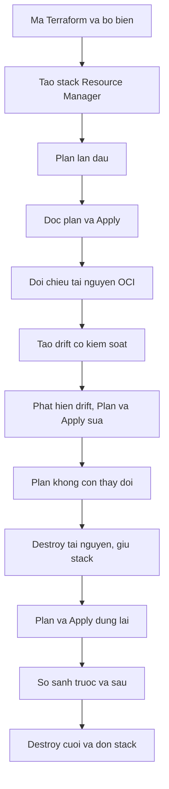

# Bài thực hành dựng lại môi trường bằng Terraform Resource Manager

## 1. Bối cảnh và kết quả cần đạt

Trong chương **Thực hành nền tảng OCI** của module **CLOUD_PROVIDERS_ORACLE**, bài này đưa cấu hình mạng từ các thao tác rời rạc trên Console thành mã có thể triển khai lại. Tình huống là một nhóm cần tạo môi trường học tập, kiểm tra cấu hình, giải phóng tài nguyên rồi dựng lại cùng kiến trúc vào buổi thực hành tiếp theo.

Bạn sẽ dùng **OCI Resource Manager** để chạy Terraform dưới dạng các job. Môi trường gồm VCN, subnet riêng, route table và security list trong một compartment dành cho lab. Phạm vi này kết nối kiến thức tenancy, compartment, IAM và VCN với việc tự động hóa hạ tầng, theo dõi thay đổi và kiểm soát tài nguyên. Compute, lưu trữ và cơ sở dữ liệu Oracle có thể sử dụng mạng này trong một bài triển khai tiếp theo; bài hiện tại tập trung vào khả năng dựng lại lớp mạng.

Sau khi hoàn thành, bạn cần có bằng chứng rằng:

- Một bộ mã và bộ biến xác định tạo được bốn tài nguyên do Terraform quản lý trực tiếp.
- Bạn đọc được plan trước khi apply và đối chiếu kết quả với OCI thực tế.
- Một thay đổi thủ công được phát hiện và đưa trở lại cấu hình trong mã.
- Sau khi destroy, cùng stack có thể tạo lại môi trường với CIDR, tên và quy tắc mạng tương đương.
- OCID mới được phân biệt với thuộc tính cấu hình cần giữ ổn định.
- Tài nguyên lab được dọn xong trước khi xóa stack.

**Dựng lại hạ tầng không đồng nghĩa với phục hồi dữ liệu ứng dụng.** Bài này không tạo cơ sở dữ liệu hay volume chứa dữ liệu. Nếu mở rộng sang những dịch vụ đó, bản sao lưu, chính sách giữ lại và quy trình phục hồi phải được thiết kế riêng.

## 2. Hiểu đúng configuration, stack, job và state

| Thành phần | Vai trò trong bài thực hành |
| --- | --- |
| Terraform configuration | Các file `.tf` mô tả tài nguyên và quan hệ phụ thuộc mong muốn |
| Variables | Region, compartment và các tham số riêng của lần triển khai |
| Stack | Đối tượng Resource Manager giữ cấu hình, biến và liên kết với state |
| Plan job | Tính toán các hành động Terraform dự kiến thực hiện |
| Apply job | Thực hiện thay đổi theo plan được chọn |
| Terraform state | Ánh xạ địa chỉ tài nguyên trong mã với tài nguyên OCI thực tế |
| Destroy job | Giải phóng tài nguyên thuộc phạm vi quản lý của stack |
| Drift detection | Phát hiện khác biệt giữa tài nguyên thực tế và cấu hình đã thực thi gần nhất |

Ví dụ, địa chỉ `oci_core_subnet.app` là tên logic trong Terraform. Giá trị `ocid1.subnet...` trong state là định danh của một subnet cụ thể trên OCI. Sau khi destroy rồi tạo lại, địa chỉ Terraform vẫn có thể giữ nguyên, còn OCID thay đổi.

Resource Manager quản lý việc chạy job và lưu state cho stack; quyền truy cập vẫn được IAM kiểm soát. Việc có quyền tạo stack không tự cấp quyền tạo mọi tài nguyên bên trong stack. Xem [tổng quan Resource Manager](https://docs.oracle.com/en-us/iaas/Content/ResourceManager/Concepts/resourcemanager.htm) và [phân quyền, bảo mật Resource Manager](https://docs.oracle.com/en-us/iaas/Content/Security/Reference/resourcemanager_security.htm).

Luồng chính của bài:



## 3. Kiến trúc và giới hạn của lab

Sử dụng một compartment có sẵn, ví dụ `oci-labs`. Stack và tài nguyên mạng cùng nằm trong compartment đó; toàn bộ bài sử dụng một region.

```text
Tenancy da duoc cap quyen
└── Compartment: oci-labs
    ├── Resource Manager stack: oci-rebuild-lab
    └── VCN: rebuild08-vcn, 10.80.0.0/24
        ├── Route table rieng: rebuild08-rt
        │   └── Khong co route rule tuy chinh
        ├── Security list rieng: rebuild08-sl
        │   ├── Ingress TCP 443 tu 10.80.0.0/26
        │   └── Egress TCP 443 den 10.80.0.0/26
        └── Regional private subnet: rebuild08-app
            └── 10.80.0.0/26, cam public IPv4 tren VNIC
```

Các quyết định thiết kế:

- **Subnet theo region:** mã không gắn subnet với một availability domain cụ thể.
- **Không tạo gateway:** không có Internet Gateway, NAT Gateway, Service Gateway hoặc DRG trong lab.
- **Route table riêng:** khai báo rõ bảng định tuyến gắn với subnet, thay vì phụ thuộc ngầm vào default route table.
- **Security list riêng:** chỉ minh họa lưu lượng HTTPS trong subnet; subnet không gắn default security list.
- **Không tạo workload:** không cần Compute capacity, SSH key, image OCID hay thông tin đăng nhập cơ sở dữ liệu để hoàn thành bài.
- **Free-form tags:** giúp nhận diện tài nguyên và người chịu trách nhiệm trong phạm vi lab.

VCN vẫn có định tuyến nội bộ do OCI cung cấp. Một route table không có route rule tùy chỉnh không có nghĩa là mọi gói tin trong VCN đều bị loại bỏ. Tương tự, security list cho phép TCP 443 chỉ mở điều kiện ở lớp mạng; nó không cài ứng dụng HTTPS hay chứng minh một dịch vụ đang lắng nghe.

Khi tạo VCN, OCI còn tạo các đối tượng mặc định như DHCP options, default route table và default security list. Chúng không phải bốn resource block riêng trong mã dưới đây. Vì vậy, số đối tượng nhìn thấy trên Console có thể lớn hơn số tài nguyên được tính trong plan.

## 4. Chuẩn bị compartment, IAM và thông tin đầu vào

### 4.1. Điều kiện thực hành

Bạn cần:

1. Tài khoản OCI đăng nhập được vào tenancy học tập.
2. Một region đã đăng ký sử dụng và còn quota cho tài nguyên mạng của lab.
3. Một compartment dành riêng cho thực hành, có thể xem và quản lý tài nguyên mạng.
4. Quyền quản lý stack, job và các tài nguyên mạng trong compartment đó.
5. Trình soạn thảo văn bản và công cụ tạo ZIP trên máy học tập.

Không cần cài Terraform CLI để đi hết luồng Console của bài. Mã sẽ được thực thi trong Resource Manager. Các lệnh PowerShell ở phần đóng gói chỉ phục vụ việc tạo ZIP trên máy học tập.

Trước khi bắt đầu, xác nhận compartment không chứa tài nguyên dùng chung mà bạn có thể vô tình tác động. Chọn một `lab_prefix` riêng nếu có nhiều người thực hành đồng thời. Kiểm tra dải IP không chồng lấn với mạng dự kiến kết nối trong tương lai.

### 4.2. Ví dụ chính sách IAM cho nhóm thực hành

Quản trị viên có thể dùng các policy sau làm điểm xuất phát, với nhóm và compartment được thay bằng giá trị thực tế:

```text
Allow group 'Default'/'OciLabOperators' to manage orm-stacks in compartment oci-labs
Allow group 'Default'/'OciLabOperators' to manage orm-jobs in compartment oci-labs
Allow group 'Default'/'OciLabOperators' to manage virtual-network-family in compartment oci-labs
```

`Default` là tên identity domain minh họa. Nhóm thuộc domain khác phải dùng tên domain tương ứng. Policy cần được tạo ở vị trí có hiệu lực đối với compartment đích. Việc liệt kê compartment trên Console có thể còn phụ thuộc quyền xem cây compartment do quản trị viên cấp.

Đây là quyền đủ rộng để nhóm tạo, sửa và xóa các thành phần mạng trong compartment lab. Nó phục vụ bài thực hành, không phải mẫu quyền tối thiểu cho mọi hệ thống sản xuất. Nếu stack và tài nguyên được đặt ở hai compartment khác nhau, quyền Resource Manager và quyền mạng phải áp dụng đúng từng nơi.

Các policy này được chuẩn bị trước, bên ngoài Terraform của bài; việc destroy stack không xóa nhóm IAM hoặc policy. Cơ sở cho các quyền stack và job được trình bày tại [Securing Resource Manager](https://docs.oracle.com/en-us/iaas/Content/Security/Reference/resourcemanager_security.htm).

### 4.3. Ghi lại bộ biến

| Biến | Giá trị minh họa | Cách lấy hoặc lựa chọn |
| --- | --- | --- |
| `region` | `ap-singapore-1` | Region identifier của region bạn được phép dùng |
| `compartment_ocid` | OCID thực của `oci-labs` | Sao chép ở trang chi tiết compartment |
| `lab_prefix` | `rebuild08` | Tên riêng cho lần thực hành |
| `vcn_cidr` | `10.80.0.0/24` | Một mạng IPv4 /24 trong dải 10.0.0.0/8 phù hợp lab |

Đừng thay `compartment_ocid` bằng tenancy OCID chỉ vì cả hai đều là OCID. Trong bài này, compartment đích là compartment lab đã được thống nhất.

Tên biến `region` và `compartment_ocid` có thể được Resource Manager điền sẵn khi tạo stack. Bạn vẫn phải đối chiếu giá trị thực tế. Cấu hình provider chạy trong Resource Manager chỉ cần trường `region`; không đưa private key, fingerprint hay file thông tin xác thực cá nhân vào ZIP. Xem [yêu cầu cấu hình Terraform cho Resource Manager](https://docs.oracle.com/en-us/iaas/Content/ResourceManager/Concepts/terraformconfigresourcemanager.htm).

## 5. Tạo bộ cấu hình Terraform đầy đủ

Trên máy học tập, tạo một thư mục làm việc mới với bốn file sau. Nội dung các file `.tf` phải nằm ở thư mục gốc của ZIP khi tải lên.

```text
oci-rebuild-lab/
├── versions.tf
├── variables.tf
├── main.tf
└── outputs.tf
```

Không cần `schema.yaml` cho ví dụ này. Các biến Terraform thông thường đủ để Resource Manager hiển thị biểu mẫu đầu vào.

### 5.1. `versions.tf`

```hcl
terraform {
  required_version = "~> 1.5.0"

  required_providers {
    oci = {
      source  = "oracle/oci"
      version = "= 7.0.0"
    }
  }
}

provider "oci" {
  region = var.region
}
```

Bài chọn Terraform `1.5.x` và ghim OCI provider `7.0.0` làm mốc cấu hình cụ thể, không coi đây là phiên bản mới nhất. Khi tạo stack, chọn Terraform `1.5.x` tương ứng với `required_version`. Có thể xem [các phiên bản Terraform được Resource Manager hỗ trợ](https://docs.oracle.com/en-us/iaas/Content/ResourceManager/Reference/terraformversions.htm) và [bản phát hành OCI provider 7.0.0](https://github.com/oracle/terraform-provider-oci/releases/tag/v7.0.0).

Việc ghim phiên bản giúp hai lượt tạo môi trường dùng cùng phiên bản provider. Nếu tổ chức yêu cầu phiên bản khác, cập nhật constraint trước lượt triển khai đầu tiên, kiểm tra plan và giữ nguyên phiên bản đó trong phép thử dựng lại. Không đồng thời thay kiến trúc và nâng provider giữa hai lượt cần so sánh.

Không khai báo backend khác trong bài. State của stack được Resource Manager quản lý; chạy một bản sao cấu hình bằng Terraform local với state riêng sẽ tạo ra một luồng quản lý khác.

### 5.2. `variables.tf`

```hcl
variable "region" {
  description = "OCI region identifier used by this lab."
  type        = string
}

variable "compartment_ocid" {
  description = "OCID of the existing lab compartment."
  type        = string

  validation {
    condition     = can(regex("^ocid1\\.compartment\\.", var.compartment_ocid))
    error_message = "Use the OCID of the lab compartment."
  }
}

variable "lab_prefix" {
  description = "Prefix for lab resource display names."
  type        = string
  default     = "rebuild08"

  validation {
    condition     = can(regex("^[a-z][a-z0-9-]{2,19}$", var.lab_prefix))
    error_message = "Use 3-20 lowercase letters, digits or hyphens; start with a letter."
  }
}

variable "vcn_cidr" {
  description = "IPv4 /24 network within 10.0.0.0/8 for this lab."
  type        = string
  default     = "10.80.0.0/24"

  validation {
    condition = (
      can(cidrnetmask(var.vcn_cidr)) &&
      can(regex("^10\\.[0-9]+\\.[0-9]+\\.0/24$", var.vcn_cidr))
    )
    error_message = "Use a valid network such as 10.80.0.0/24."
  }
}
```

Validation chỉ bắt lỗi định dạng và giới hạn mẫu đầu vào. Nó không xác nhận compartment có tồn tại, region đã được đăng ký, quota còn đủ hoặc người chạy có quyền IAM tương ứng.

### 5.3. `main.tf`

```hcl
locals {
  subnet_cidr = cidrsubnet(var.vcn_cidr, 2, 0)

  common_tags = {
    ManagedBy   = "Terraform"
    Environment = "learning"
    Lab         = var.lab_prefix
  }
}

resource "oci_core_vcn" "lab" {
  compartment_id = var.compartment_ocid
  cidr_blocks    = [var.vcn_cidr]
  display_name   = "${var.lab_prefix}-vcn"
  dns_label      = "labvcn"
  freeform_tags  = local.common_tags
}

resource "oci_core_route_table" "lab" {
  compartment_id = var.compartment_ocid
  vcn_id         = oci_core_vcn.lab.id
  display_name   = "${var.lab_prefix}-rt"
  route_rules    = []
  freeform_tags  = local.common_tags
}

resource "oci_core_security_list" "lab" {
  compartment_id = var.compartment_ocid
  vcn_id         = oci_core_vcn.lab.id
  display_name   = "${var.lab_prefix}-sl"
  freeform_tags  = local.common_tags

  ingress_security_rules {
    description = "Allow HTTPS from the lab subnet only"
    protocol    = "6"
    source      = local.subnet_cidr
    source_type = "CIDR_BLOCK"
    stateless   = false

    tcp_options {
      min = 443
      max = 443
    }
  }

  egress_security_rules {
    description      = "Allow HTTPS to the lab subnet only"
    protocol         = "6"
    destination      = local.subnet_cidr
    destination_type = "CIDR_BLOCK"
    stateless        = false

    tcp_options {
      min = 443
      max = 443
    }
  }
}

resource "oci_core_subnet" "app" {
  compartment_id             = var.compartment_ocid
  vcn_id                     = oci_core_vcn.lab.id
  cidr_block                 = local.subnet_cidr
  display_name               = "${var.lab_prefix}-app"
  dns_label                  = "app"
  prohibit_public_ip_on_vnic  = true
  route_table_id             = oci_core_route_table.lab.id
  security_list_ids          = [oci_core_security_list.lab.id]
  dhcp_options_id            = oci_core_vcn.lab.default_dhcp_options_id
  freeform_tags              = local.common_tags
}
```

`cidrsubnet("10.80.0.0/24", 2, 0)` tạo dải subnet đầu tiên có prefix `/26`, tức `10.80.0.0/26`. Cách tính này giữ subnet phụ thuộc trực tiếp vào VCN thay vì yêu cầu nhập lại hai CIDR có thể mâu thuẫn.

Các tham chiếu `.id` tạo quan hệ phụ thuộc: VCN có trước; route table và security list phụ thuộc VCN; subnet phụ thuộc cả ba đối tượng đó. Terraform có thể xử lý các nhánh độc lập song song và đảo thứ tự phụ thuộc khi destroy. Không cần thêm `depends_on` cho những quan hệ đã thể hiện bằng tham chiếu.

`protocol = "6"` là TCP, còn `stateless = false` chọn quy tắc stateful. Hai quy tắc chỉ cho phép khởi tạo kết nối HTTPS trong dải subnet; lưu lượng phản hồi của kết nối stateful đã được cho phép được theo dõi theo trạng thái. Đây không phải bộ quy tắc mạng hoàn chỉnh cho một ứng dụng thực tế.

Các trường gắn route table, security list, DHCP options và cấm public IPv4 được mô tả trong [OCI provider: subnet](https://docs.oracle.com/en-us/iaas/tools/terraform-provider-oci/latest/docs/r/core_subnet.html). Có thể đối chiếu cấu trúc quy tắc tại [OCI provider: security list](https://docs.oracle.com/en-us/iaas/tools/terraform-provider-oci/latest/docs/r/core_security_list.html) và bảng định tuyến tại [OCI provider: route table](https://docs.oracle.com/en-us/iaas/tools/terraform-provider-oci/latest/docs/r/core_route_table.html).

### 5.4. `outputs.tf`

```hcl
output "resource_ids" {
  description = "OCI identifiers; these change after destroy and rebuild."

  value = {
    vcn           = oci_core_vcn.lab.id
    subnet        = oci_core_subnet.app.id
    route_table   = oci_core_route_table.lab.id
    security_list = oci_core_security_list.lab.id
  }
}

output "network_contract" {
  description = "Configuration attributes to compare across deployments."

  value = {
    region        = var.region
    vcn_cidrs     = oci_core_vcn.lab.cidr_blocks
    subnet_cidr   = oci_core_subnet.app.cidr_block
    subnet_name   = oci_core_subnet.app.display_name
    subnet_private = oci_core_subnet.app.prohibit_public_ip_on_vnic
  }
}
```

`resource_ids` phục vụ tìm tài nguyên cụ thể. `network_contract` gom các thuộc tính cần đối chiếu giữa hai lần triển khai. Output không thay thế việc xem các liên kết và quy tắc thực tế trên Console.

### 5.5. Đóng gói cấu hình

Chạy PowerShell trong thư mục chứa bốn file `.tf` nếu muốn đóng gói bằng lệnh:

```powershell
$labSourceFiles = @(
    '.\versions.tf',
    '.\variables.tf',
    '.\main.tf',
    '.\outputs.tf'
)

Compress-Archive -LiteralPath $labSourceFiles -DestinationPath '.\oci-rebuild-lab.zip'
Get-FileHash -LiteralPath '.\oci-rebuild-lab.zip' -Algorithm SHA256
```

Lệnh giả định ZIP đích chưa tồn tại. Nếu sửa mã, hãy tạo một ZIP có tên phiên bản mới để giữ bằng chứng cấu hình đã dùng ở mỗi mốc.

Mở ZIP kiểm tra bốn file nằm ngay ở gốc. Không đóng gói `.terraform/`, `*.tfstate`, file khóa riêng tư hay thông tin đăng nhập. Resource Manager yêu cầu thư mục làm việc có file `.tf`, không có thư mục `.terraform` và không chứa state; xem [quy định cấu trúc cấu hình](https://docs.oracle.com/en-us/iaas/Content/ResourceManager/Concepts/terraformconfigresourcemanager.htm).

## 6. Tạo stack trong Resource Manager

1. Đăng nhập OCI Console và chọn region đã ghi trong bộ biến.
2. Tìm **Resource Manager**, mở danh sách **Stacks** và chọn compartment lab.
3. Chọn **Create stack**; dùng cấu hình của bạn với nguồn **ZIP file**.
4. Tải lên `oci-rebuild-lab.zip`.
5. Đặt tên stack là `oci-rebuild-lab`, kiểm tra compartment lưu stack.
6. Chọn Terraform `1.5.x` phù hợp constraint của bài.
7. Ở phần cấu hình biến, nhập `region`, `compartment_ocid`, `lab_prefix`, `vcn_cidr` đã chuẩn bị.
8. Kiểm tra lại toàn bộ giá trị và để tùy chọn **Run apply** ở trạng thái không chọn.
9. Tạo stack, ghi lại stack OCID và region chứa stack.

Nguồn ZIP và biến là hai phần cần lưu cùng nhau để tái tạo môi trường. ZIP giống nhau nhưng biến khác có thể tạo tài nguyên trong compartment khác hoặc với CIDR khác. Quy trình Console được mô tả trong [tạo stack từ ZIP](https://docs.oracle.com/en-us/iaas/Content/ResourceManager/Tasks/create-stack-local.htm).

Region lưu stack và region trong provider là hai khái niệm có thể khác nhau ở thiết kế nâng cao. Bài này cố ý chọn cùng một region để giảm khả năng tìm nhầm tài nguyên.

Tại thời điểm này, stack tồn tại nhưng chưa có nghĩa hạ tầng mạng đã được triển khai.

## 7. Chạy và đọc plan đầu tiên

Từ trang stack, chọn **Plan** hoặc **Terraform actions → Plan**, tùy cách Console hiển thị. Đặt tên dễ nhận diện, ví dụ `plan-initial`, rồi chờ job kết thúc.

Nếu giao diện có tùy chọn refresh trạng thái tài nguyên trước khi so sánh, giữ refresh bật. Không chọn nâng provider trong phép thử này vì phiên bản đã được ghim.

Mở log của job và tìm các địa chỉ tài nguyên dự kiến:

```text
oci_core_vcn.lab
oci_core_route_table.lab
oci_core_security_list.lab
oci_core_subnet.app
```

Với stack mới và đúng cấu hình trên, phần tổng kết dự kiến là:

```text
Plan: 4 to add, 0 to change, 0 to destroy.
```

Đây là kết quả minh họa để đối chiếu, không phải log đã chạy thay bạn. Bạn phải đọc log thực tế của chính job.

Trước khi apply, kiểm tra:

| Điểm kiểm tra | Giá trị mong đợi |
| --- | --- |
| Compartment | OCID compartment lab đã chọn |
| VCN CIDR | `10.80.0.0/24` nếu giữ mặc định |
| Subnet CIDR | `10.80.0.0/26` nếu giữ mặc định |
| Public IP trên VNIC | Bị cấm trong subnet |
| Security list | TCP 443 trong dải subnet, không phải `0.0.0.0/0` |
| Route rule tùy chỉnh | Không có |
| Compute, volume, database, gateway | Không được tạo bởi cấu hình bài này |
| Hành động xóa hoặc thay thế | Không có ở lần triển khai đầu tiên |

Một số thuộc tính như OCID và metadata chỉ biết sau apply; Terraform có thể hiển thị `known after apply`. Điều đó bình thường với định danh do dịch vụ cấp. Compartment hoặc CIDR sai thì cần sửa biến hay mã rồi tạo plan mới.

Job `SUCCEEDED` chỉ cho biết việc tạo plan hoàn tất. Plan có nội dung sai vẫn có thể được sinh thành công. Bạn cần kiểm tra cả trạng thái job và hành động bên trong.

## 8. Apply và kiểm tra môi trường lần đầu

Chọn **Apply**, rồi ở mục chọn execution plan hãy chọn plan mới nhất vừa kiểm tra, ví dụ job `plan-initial`. Nếu plan không còn khả dụng hoặc bạn đã sửa cấu hình, tạo plan mới trước khi apply.

Resource Manager cho phép apply tham chiếu plan mới nhất đã sinh. Trong bài này, giữ mã và biến ổn định giữa hai thao tác để hành động được thực thi đúng với nội dung đã đọc. Xem [tạo Apply job](https://docs.oracle.com/en-us/iaas/Content/ResourceManager/Tasks/create-job-apply.htm).

Đặt tên job `apply-initial` và chờ `SUCCEEDED`. Kết quả Terraform dự kiến:

```text
Apply complete! Resources: 4 added, 0 changed, 0 destroyed.
```

Sau đó đối chiếu ở hai nơi:

1. **Trong Resource Manager:** xem log, output và state sau apply. Ghi lại bốn OCID trong `resource_ids` cùng giá trị `network_contract`.
2. **Trong Networking:** mở VCN của lab, kiểm tra subnet, route table và security list theo OCID, region và compartment.

Cần xác nhận subnet đang gắn đúng route table và security list do mã tạo. Việc có một security list đúng tên trong VCN chưa chứng minh subnet sử dụng nó.

Với subnet, kiểm tra loại private, CIDR và phạm vi regional. Với security list, kiểm tra cả ingress lẫn egress và cổng 443. Với route table, kiểm tra không có route rule đi ra Internet. Ghi lại tags để việc tìm và dọn tài nguyên dễ hơn.

Bài không triển khai máy chủ nên không dùng SSH, ping hay `curl` làm tiêu chí hoàn thành. Những kiểm tra đó cần workload, đường đi mạng và dịch vụ tương ứng. Ở đây, bằng chứng là cấu hình control plane đúng với mã và liên kết tài nguyên đúng.

## 9. Tạo drift có kiểm soát và đưa môi trường về mã

### 9.1. Thay đổi một thuộc tính ít tác động

Ngay sau `apply-initial`, trước khi chạy plan khác:

1. Mở subnet `rebuild08-app` trong Networking.
2. Chỉ đổi **display name** thành `rebuild08-app-manual`.
3. Giữ nguyên CIDR, liên kết mạng và các thuộc tính còn lại.
4. Lưu thay đổi và ghi thời điểm thao tác.

Tên trên áp dụng khi giữ `lab_prefix = rebuild08`; nếu dùng prefix khác, thay tương ứng. Thay đổi display name không đổi OCID subnet. Mã vẫn yêu cầu tên cũ nên môi trường đã lệch khỏi cấu hình.

### 9.2. Phát hiện drift

Trở lại stack, tìm **Run drift detection** trong menu hành động và chọn quét các tài nguyên của stack. Chờ tác vụ hoàn tất rồi xem chi tiết subnet.

Theo tài liệu OCI, drift detection dùng được với stack đáp ứng điều kiện, trong đó có stack có job chạy gần nhất là Apply hoặc Import state. Vì vậy, bài đặt bước này ngay sau Apply thành công. Nếu đã chạy một Plan job sau Apply và giao diện không cho thực hiện drift detection, hãy giữ nguyên cấu hình, chạy Apply hợp lệ thành công rồi bắt đầu lại phép thử đổi tên. Xem [Detecting Drift in a Stack](https://docs.oracle.com/iaas/Content/ResourceManager/Tasks/detect-drift.htm).

Kết quả cần tìm là subnet bị đánh dấu có khác biệt và thuộc tính display name đã đổi. Drift detection chỉ báo cáo; nó không tự sửa tên trở lại.

### 9.3. Sửa bằng plan và apply

Chạy Plan mới, ví dụ `plan-reconcile-name`, với refresh trạng thái bật. Nội dung dự kiến thể hiện cập nhật tại chỗ:

```text
~ oci_core_subnet.app
    display_name: "rebuild08-app-manual" -> "rebuild08-app"

Plan: 0 to add, 1 to change, 0 to destroy.
```

Đây là bản rút gọn minh họa, không phải nguyên dạng bắt buộc của log. Hãy xác nhận plan thực tế không đề xuất thay thế subnet rồi apply plan đó.

Sau `SUCCEEDED`, kiểm tra lại tên subnet trên Console. OCID subnet phải giữ nguyên trong phép sửa display name này.

Nếu thay đổi thủ công thực sự là yêu cầu mới được chấp thuận, cách làm sẽ là cập nhật mã để phản ánh yêu cầu rồi tạo plan. Trong phép thử hiện tại, tên ban đầu trong mã là cấu hình cần giữ nên apply sẽ đưa môi trường trở về tên đó.

## 10. Kiểm tra tính ổn định khi chạy lại

Sau khi sửa drift, chạy thêm một Plan job với cùng mã, cùng biến và state hiện tại.

Kết quả mong đợi:

```text
No changes. Your infrastructure matches the configuration.
```

Hoặc log thể hiện tổng số hành động thêm, sửa, xóa đều bằng 0. Đây là bằng chứng của tính ổn định trong phạm vi các thuộc tính Terraform quản lý: yêu cầu không đổi và thực tế đã khớp thì không cần thay đổi tài nguyên nữa.

Nếu plan còn khác biệt, đọc thuộc tính cụ thể trước khi tiếp tục. Có thể ai đó vừa sửa tài nguyên, biến đã thay đổi, provider khác phiên bản hoặc có thuộc tính được dịch vụ chuẩn hóa. Không bỏ qua khác biệt chỉ để có được một dòng tổng kết đẹp.

Lưu thông tin baseline sau khi môi trường đã ổn định:

| Bằng chứng | Nội dung cần ghi |
| --- | --- |
| Cấu hình | ZIP đã dùng và SHA-256 của ZIP |
| Công cụ | Terraform version và OCI provider version trong log |
| Bộ biến | Region, compartment OCID, prefix, VCN CIDR |
| Quản lý thực thi | Stack OCID, Apply job OCID, trạng thái job |
| Định danh lần đầu | Bốn giá trị trong `resource_ids` |
| Thuộc tính cần giữ | Giá trị `network_contract` và quy tắc mạng trên Console |
| Tính ổn định | Plan sau đối chiếu không còn hành động thay đổi |

Nếu tải state về để lưu bằng chứng, đặt nó ở vị trí được kiểm soát truy cập. State có thể chứa dữ liệu nhạy cảm trong những cấu hình mở rộng; không đưa state vào ZIP cấu hình hay kho mã dùng chung. Xem [bảo mật Terraform state trong Resource Manager](https://docs.oracle.com/en-us/iaas/Content/Security/Reference/resourcemanager_security.htm).

## 11. Destroy có chủ đích và giữ lại stack

Đây là bước giải phóng hạ tầng lab để kiểm tra khả năng dựng lại. Trước khi chạy, xác nhận đúng stack và bốn OCID đã ghi; subnet không có VNIC hoặc dịch vụ khác được gắn thêm ngoài bài.

1. Từ stack lab, chọn **Destroy** hoặc hành động Terraform tương ứng.
2. Đặt tên job `destroy-before-rebuild`.
3. Giữ nguyên cấu hình, bộ biến và phiên bản provider đã dùng.
4. Thực hiện destroy, chờ job kết thúc rồi xem log và state.
5. Kiểm tra trên Networking rằng VCN và subnet lần đầu đã được xóa.
6. Giữ lại stack để thực hiện lượt dựng lại.

Với đúng bốn resource block của bài và không có thay đổi ngoài phạm vi, kết quả dự kiến là:

```text
Destroy complete! Resources: 4 destroyed.
```

Terraform xóa subnet trước những đối tượng mà subnet tham chiếu. Khi VCN bị xóa, các thành phần mặc định thuộc vòng đời VCN được dịch vụ xử lý tương ứng. Nếu một tài nguyên còn đang được sử dụng, destroy có thể thất bại một phần; cần xem đối tượng nào còn tồn tại.

Destroy không xóa stack, lịch sử job hoặc cơ chế lưu state của stack. State hiện tại sau destroy thành công không còn ánh xạ đến bốn tài nguyên đang hoạt động; state của các job trước vẫn là bằng chứng lịch sử. Xóa stack quá sớm sẽ làm mất khả năng theo dõi qua state của stack. Xem [Destroy job và vòng đời tài nguyên](https://docs.oracle.com/en-us/iaas/Content/ResourceManager/Tasks/create-job-destroy.htm).

**Không nhập lại state cũ để dựng lại tài nguyên vừa destroy.** State cũ chứa OCID của những tài nguyên đã bị xóa; nó không phải bản sao lưu có khả năng phục sinh các tài nguyên đó.

## 12. Dựng lại từ cùng mã và cùng bộ biến

Trên chính stack vừa destroy:

1. Kiểm tra nguồn cấu hình và các biến vẫn đúng với baseline.
2. Chạy `plan-rebuild`.
3. Đọc plan; kỳ vọng bốn tài nguyên được tạo mới.
4. Apply đúng plan vừa kiểm tra, đặt tên `apply-rebuild`.
5. Chờ `SUCCEEDED`, ghi lại output và kiểm tra tài nguyên trên Console.
6. Chạy Plan một lần nữa để xác nhận không còn thay đổi.

Sau destroy thành công, plan dựng lại dự kiến:

```text
Plan: 4 to add, 0 to change, 0 to destroy.
```

Lần tạo lại không yêu cầu bạn nhập OCID cũ vào mã. Các tham chiếu giữa VCN, route table, security list và subnet sẽ tự sử dụng OCID mới do lượt apply này tạo ra.

Hoàn thành bảng so sánh bằng dữ liệu thực tế:

| Thuộc tính | Lần đầu | Sau dựng lại | Kỳ vọng |
| --- | --- | --- | --- |
| Region | Ghi giá trị thực | Ghi giá trị thực | Giống nhau |
| Compartment OCID | Ghi giá trị thực | Ghi giá trị thực | Giống nhau |
| VCN CIDR | Ghi giá trị thực | Ghi giá trị thực | Giống nhau |
| Subnet CIDR | Ghi giá trị thực | Ghi giá trị thực | Giống nhau |
| Tên tài nguyên và tags | Ghi giá trị thực | Ghi giá trị thực | Giống nhau |
| Subnet private, regional | Ghi giá trị thực | Ghi giá trị thực | Giống nhau |
| Quy tắc TCP 443 | Ghi giá trị thực | Ghi giá trị thực | Giống nhau |
| Gắn route table, security list | OCID của lượt đầu | OCID của lượt sau | Đúng đối tượng trong cùng lượt |
| OCID VCN và subnet | OCID lượt đầu | OCID lượt sau | Khác nhau |
| OCID route table, security list | OCID lượt đầu | OCID lượt sau | Khác nhau |
| Thời điểm tạo | Ghi thời điểm | Ghi thời điểm | Khác nhau |
| Plan sau kiểm tra | Không đổi | Không đổi | Đều không cần hành động |

Khả năng tái tạo được đánh giá qua cấu hình và quan hệ tài nguyên. Nó không đòi OCI cấp lại cùng định danh. Một hệ thống bên ngoài giữ OCID cũ phải được cập nhật bằng output mới hoặc bằng cơ chế khám phá phù hợp.

Nếu muốn kiểm tra một stack hoàn toàn mới, chỉ làm sau khi đã dọn tài nguyên của stack cũ. Tạo stack mới từ cùng ZIP và bộ biến sẽ khởi đầu với state riêng. Không dùng hai stack độc lập để cùng quản lý một bộ tài nguyên.

## 13. Phân biệt dựng lại với tiếp quản tài nguyên đang tồn tại

| Tình huống | Cách tiếp cận |
| --- | --- |
| Stack còn, destroy đã xóa tài nguyên thành công | Plan rồi Apply lại từ cấu hình hiện tại |
| Stack còn, tài nguyên còn, một display name bị sửa | Refresh, đọc Plan rồi Apply để đồng bộ theo mã |
| Một tài nguyên đã bị xóa thủ công nhưng state còn | Plan có refresh để xem tài nguyên nào cần tạo lại và các liên kết bị ảnh hưởng |
| Stack hoặc state bị mất, tài nguyên vẫn còn | Kiểm kê tài nguyên, xác định quyền sở hữu, khôi phục state phù hợp hoặc lập quy trình import |
| Cần giữ dữ liệu của database hoặc volume | Dùng phương án backup, retention và restore phù hợp từng dịch vụ |

Tạo stack mới từ mã cũ khi hạ tầng cũ vẫn tồn tại không tự động tiếp quản hạ tầng đó. Với state rỗng, Terraform có thể đề xuất tạo tài nguyên trùng tên hoặc gặp xung đột. Tên hiển thị không phải khóa để Terraform nhận diện tài nguyên đã có.

Resource Discovery có thể hỗ trợ sinh cấu hình từ tài nguyên được hỗ trợ trong compartment, nhưng vẫn cần xem lại phạm vi phát hiện, mã được sinh và state liên quan trước khi quản lý tiếp. Nó không thay thế việc giữ cấu hình gốc, bộ biến và lịch sử triển khai.

Khi import là cần thiết, mỗi địa chỉ Terraform phải được ghép đúng với OCID thực tế và cấu hình tương ứng. Đây là một quy trình tiếp quản tài nguyên đang tồn tại, nằm ngoài vòng destroy rồi dựng lại của lab hiện tại.

## 14. Xử lý lỗi thường gặp

| Biểu hiện | Nguyên nhân cần kiểm tra | Hướng xử lý |
| --- | --- | --- |
| Upload xong nhưng không thấy biến | `.tf` nằm sai cấp thư mục hoặc cấu hình không được đọc | Mở ZIP, đưa bốn file về đúng thư mục gốc rồi cập nhật cấu hình stack |
| Không tương thích Terraform version | Phiên bản chọn trên stack không khớp `required_version` | Chọn phiên bản phù hợp; nếu đổi chuẩn phiên bản thì cập nhật mã trước và tạo lại plan |
| Không tải được provider | Phiên bản không khả dụng, cấu hình registry hoặc chính sách môi trường | Đọc log khởi tạo provider, kiểm tra nguồn `oracle/oci` và constraint; không tùy tiện bỏ ghim phiên bản giữa hai lượt |
| `NotAuthorizedOrNotFound` | Sai OCID, thiếu quyền, sai compartment hoặc tìm sai region | Đối chiếu từng biến và policy; lỗi có thể che cả trường hợp không tồn tại lẫn không được xem |
| Lỗi CIDR hoặc quota | Đầu vào không hợp lệ, vượt giới hạn dịch vụ hoặc quota compartment | Kiểm tra CIDR và giới hạn trước khi plan lại |
| Apply thất bại sau khi đã tạo một phần | Một thao tác OCI lỗi sau các thao tác khác đã thành công | Đọc log và state mới nhất, kiểm kê tài nguyên rồi Plan lại trên cùng stack |
| Plan sau apply vẫn có thay đổi | Drift, biến khác, cấu hình khác hoặc provider khác | Xem thuộc tính cụ thể và xác định nguồn thay đổi trước khi apply |
| Destroy báo tài nguyên đang được dùng | Có VNIC hoặc phụ thuộc ngoài bài gắn vào subnet/VCN | Xác định chủ sở hữu và gỡ phụ thuộc lab đúng cách, sau đó chạy lại destroy |
| Không thấy tài nguyên sau apply | Đang mở sai region, compartment hoặc chỉ tìm theo tên | Dùng OCID trong output và kiểm tra lại bộ lọc Console |

Một apply thất bại không bảo đảm đã quay lui các tài nguyên tạo trước đó. Hãy tiếp tục từ state hiện tại của cùng stack thay vì xóa state hoặc lập tức tạo stack khác.

Nếu cần sửa mã sau khi đã upload ZIP, cập nhật nguồn cấu hình của stack rồi chạy plan mới. Không chỉ sửa file trên máy và cho rằng stack đã tự nhận bản sửa. Quy trình cập nhật được mô tả tại [Updating a Stack's Terraform Configuration](https://docs.oracle.com/en-us/iaas/Content/ResourceManager/Tasks/update-stack-tf-config.htm).

## 15. Chi phí, giám sát và tính sẵn sàng trong phạm vi bài

Thiết kế chỉ tạo tài nguyên mạng nền tảng, tránh đưa Compute, NAT Gateway, load balancer, lưu trữ hay database vào phép thử tái tạo. Vẫn cần kiểm tra tài nguyên thực sự được tạo, loại job Resource Manager được chọn nếu tenancy có nhiều lựa chọn, và chính sách giá hiện hành của tenancy. Không suy ra toàn bộ môi trường miễn phí chỉ vì một số thành phần có thể nằm trong hạn mức miễn phí.

Các cách kiểm soát phù hợp với bài:

- Dùng compartment lab và prefix riêng để kiểm kê phạm vi.
- Áp dụng tags nhất quán; dùng bộ lọc chi phí hoặc báo cáo có hỗ trợ các tag tương ứng khi cần.
- Theo dõi trạng thái job và log Resource Manager cho mỗi bước Plan, Apply, Destroy.
- Dùng OCI Audit khi cần truy vết ai đã sửa subnet trong phép thử drift.
- Với hoạt động thực hành kéo dài, chuẩn bị budget và cảnh báo chi phí theo quy định của tenancy; cảnh báo không phải cơ chế tự động ngăn mọi khoản phí.
- Kết thúc bằng kiểm tra tài nguyên thực tế, không chỉ dựa vào việc đã đóng trang Console.

Subnet regional hỗ trợ thiết kế workload trải trên các availability domain mà region cung cấp. Tuy nhiên, lab này chưa có workload, cân bằng tải, dự phòng dữ liệu hoặc kiểm thử chuyển đổi dự phòng. Thành công của việc dựng lại lớp mạng không chứng minh một ứng dụng đã đạt tính sẵn sàng cao hoặc đạt mục tiêu thời gian phục hồi.

Nếu mở rộng sang hệ thống thực, cần quản lý riêng image/version ứng dụng, secret, backup cơ sở dữ liệu, dữ liệu volume, DNS, quota và khả năng cấp phát Compute. Khi đó, thời gian chạy Terraform chỉ là một phần của toàn bộ quy trình phục hồi dịch vụ.

## 16. Dọn tài nguyên và hoàn tất hồ sơ thực hành

Sau khi so sánh xong lượt dựng lại:

1. Lưu ZIP cấu hình, bộ biến không chứa secret, các job OCID và bảng kết quả.
2. Chạy Destroy lần cuối trên stack lab, chờ `SUCCEEDED` và đọc log.
3. Kiểm tra bốn tài nguyên do Terraform quản lý đã được giải phóng; kiểm kê thêm tài nguyên nếu bạn đã tự mở rộng ngoài bài.
4. Chỉ xóa stack sau khi đã xác nhận không còn tài nguyên cần nó quản lý.
5. Giữ compartment, nhóm IAM và policy nếu đó là thành phần dùng chung cho các bài thực hành tiếp theo.

Hồ sơ hoàn thành tối thiểu gồm bằng chứng của lượt tạo đầu, phép phát hiện và sửa drift, plan không còn thay đổi, destroy trước dựng lại, lượt dựng lại và lần dọn cuối. Điền kết quả từ job thực tế; không dùng các đoạn log minh họa trong bài thay cho bằng chứng chạy.

Bạn hoàn thành lab khi cùng một cấu hình và bộ biến tạo lại được kiến trúc đã xác định, các liên kết dùng OCID mới chính xác, plan cuối không còn thay đổi và tài nguyên thực hành đã được dọn theo phạm vi đã chọn.
