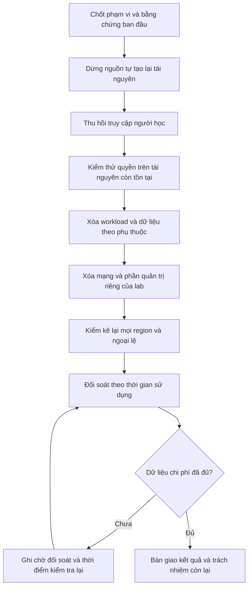

# Bài thực hành thu hồi quyền, xóa tài nguyên và đối soát chi phí

Một môi trường Oracle Cloud Infrastructure (OCI) chỉ kết thúc vòng đời thực hành khi quyền truy cập đã được thu hồi đúng phạm vi, tài nguyên đã được xử lý đến trạng thái cuối và chi phí đã được giải thích bằng dữ liệu sử dụng. Việc đăng xuất Console, dừng một máy ảo hoặc thấy biểu đồ chi phí chưa tăng chưa đủ để chứng minh ba điều đó.

Bài thuộc chương **Thực hành nền tảng OCI**, tập trung vào giai đoạn đóng môi trường trong phạm vi tenancy, compartment, IAM, VCN, Compute, lưu trữ và dịch vụ cơ sở dữ liệu Oracle. Quy trình dưới đây là phương án thực hành đề xuất: người học áp dụng vào tài nguyên lab mình sở hữu, ghi lại bằng chứng và phân biệt việc đã hoàn thành với việc còn chờ hệ thống cập nhật.

## 1. Mục tiêu và điều kiện thực hành

Sau bài này, người học có thể:

- Lập danh mục tài nguyên theo OCID, compartment, region và người chịu trách nhiệm.
- Thu hồi quyền của người học và thông tin xác thực của lab mà vẫn giữ được đường quản trị để dọn dẹp.
- Xóa tài nguyên theo quan hệ phụ thuộc, theo dõi tác vụ bất đồng bộ và phát hiện tài nguyên còn sót.
- Đối chiếu thời điểm ngừng sử dụng với thời gian sử dụng trong báo cáo chi phí, giải thích khoản ghi nhận muộn và khoản cần điều tra.
- Bàn giao biên bản đóng lab có bằng chứng, ngoại lệ và người theo dõi rõ ràng.

### 1.1. Môi trường đầu vào

Sử dụng compartment lab riêng, ví dụ `lab-oci-cleanup`, cùng các tài nguyên đã có từ quá trình thực hành. Phạm vi tối thiểu gồm một Compute instance, boot volume, VCN và một danh tính người học có quyền đọc instance. Nếu có sẵn block volume, Object Storage, Load Balancer hoặc Autonomous Database của lab thì đưa chúng vào danh mục. Không cần tạo thêm dịch vụ chỉ để thực hiện bài dọn dẹp.

Phải xác định được:

| Thành phần | Điều kiện trước khi bắt đầu |
| --- | --- |
| Tenancy và compartment | Có OCID chính xác; xác nhận đây là môi trường được phép thu hồi |
| Region | Có danh sách mọi region lab từng sử dụng, kể cả region chứa bản sao |
| Dữ liệu | Đã phân loại dữ liệu có thể hủy và dữ liệu phải giữ |
| Danh tính người học | Là tài khoản hoặc danh tính thử nghiệm, không phải tài khoản quản trị duy nhất |
| Danh tính dọn dẹp | Có quyền cần thiết để kiểm kê, xóa tài nguyên và kiểm tra kết quả |
| Người đối soát | Có quyền xem dữ liệu Billing & Cost Management phù hợp |
| Đường quản trị | Còn hoạt động sau khi gỡ quyền người học và khi xóa mạng lab |

Không thực hiện lệnh xóa trên tài nguyên chỉ vì tên hiển thị có chữ `lab`. Tên có thể trùng hoặc đã được tái sử dụng; OCID, compartment, region và xác nhận sở hữu mới là cơ sở chọn đích.

### 1.2. Ba vai trò cần phân biệt

**Người học** là đối tượng bị thu hồi quyền. **Người dọn dẹp** thao tác bằng danh tính khác để hoàn tất xóa tài nguyên. **Người đối soát** kiểm tra chi phí và ngoại lệ; trong lab nhỏ có thể cùng là người dọn dẹp nhưng vẫn cần tách hai nhóm bằng chứng.

Nếu người học cũng là quản trị viên tenancy, hãy dùng danh tính thử nghiệm riêng cho phép thử thu hồi quyền. Không gỡ quyền quản trị cuối cùng để mô phỏng tình huống kết thúc lab.

## 2. Định nghĩa kết quả và mốc thời gian

Tạo biên bản theo dõi với ba trục độc lập:

| Trục | Điều cần chứng minh | Bằng chứng chưa đủ |
| --- | --- | --- |
| Truy cập | Danh tính lab không còn thực hiện được thao tác đã bị thu hồi | Chỉ đóng tab hoặc đăng xuất |
| Tài nguyên | Mọi tài nguyên trong danh mục đã xóa hoặc có ngoại lệ giữ lại được xác nhận | Chỉ nhìn danh sách Compute của một region |
| Chi phí | Khoản phát sinh gắn với thời gian sử dụng và các tài nguyên còn giữ đã được giải thích | Chỉ nhìn tổng tháng hoặc forecast |

Ghi các mốc theo UTC, dùng định dạng như `2026-11-21T03:10:00Z`:

- `T_inventory`: chốt danh mục và dữ liệu chi phí ban đầu.
- `T_revoke`: thay đổi IAM hoặc credential cuối cùng của từng đường truy cập.
- `T_access_verified`: hoàn thành phép thử xác nhận quyền đã bị thu hồi.
- `T_delete_requested`: gửi yêu cầu xóa của từng tài nguyên.
- `T_delete_completed`: dịch vụ xác nhận thao tác đã hoàn thành.
- `T_cost_checked`: truy vấn dữ liệu chi phí cho một cửa sổ sử dụng xác định.

Không gộp mọi tài nguyên vào một thời điểm xóa duy nhất. Một instance có thể kết thúc trước boot volume; một backup được giữ lại có vòng đời khác toàn bộ môi trường ứng dụng.



## 3. Bước 1 — Chốt danh mục và lưu bằng chứng

### 3.1. Danh mục thu hồi

Điền bảng thực tế trước khi thao tác. Một hàng có thể đại diện cho một tài nguyên; với số lượng lớn, lập danh sách chi tiết kèm theo biên bản.

| Tài nguyên | Định danh cần ghi | Quan hệ cần kiểm tra | Quyết định |
| --- | --- | --- | --- |
| Compute instance | OCID, region, compartment | Boot volume, data volume, VNIC, pool | Xóa hoặc giữ có lý do |
| Boot/block volume | OCID, availability domain | Attachment, backup, replication | Xử lý độc lập với instance |
| Object Storage bucket | Namespace, tên, region, compartment | Object version, PAR, replication, multipart | Làm sạch đúng phạm vi rồi xóa |
| Load Balancer | OCID, region | Backend, subnet, địa chỉ liên quan | Xóa nếu riêng lab |
| Cơ sở dữ liệu Oracle | OCID, loại dịch vụ, region | Backup, clone, bản sao, ứng dụng dùng chung | Theo đúng vòng đời của dịch vụ |
| VCN và subnet | OCID, region | VNIC, gateway, endpoint, route | Xóa sau các tài nguyên sử dụng mạng |
| IAM của lab | User/group/policy/dynamic group và phạm vi | Quyền kế thừa, nhóm khác, credential | Thu hồi theo danh tính và quyền hiệu lực |
| Tự động hóa | Pipeline, stack, lịch chạy, pool | Có thể tạo lại tài nguyên nào | Dừng trước khi xóa workload |
| Giám sát và lưu vết | Log group, alarm, kênh thông báo | Nơi cần giữ bằng chứng vận hành | Giữ hoặc xóa theo yêu cầu lưu trữ |

Đánh dấu từng mục là `DELETE`, `KEEP` hoặc `SHARED`. Với `KEEP`, ghi chủ sở hữu, hạn lưu giữ, chi phí dự kiến và ngày xem xét lại. Với `SHARED`, xác nhận lab đã tháo liên kết của mình nhưng không tự xóa tài nguyên dùng chung.

Compartment có phạm vi toàn tenancy và hiện diện qua các region đã đăng ký. Vì vậy, một trang dịch vụ trống trong region đang chọn không chứng minh compartment đã hết tài nguyên. [Oracle: Working with Compartments](https://docs.oracle.com/en-us/iaas/Content/Identity/compartments/Working_with_Compartments.htm).

Dùng Tenancy Explorer hoặc công cụ tìm kiếm để hỗ trợ khám phá, sau đó kiểm tra trực tiếp các dịch vụ liên quan. Danh sách tìm kiếm chịu giới hạn loại tài nguyên và quyền nhìn thấy; không dùng kết quả rỗng làm bằng chứng duy nhất.

### 3.2. Kiểm kê bằng OCI CLI trong PowerShell

Các lệnh sau chỉ đọc. Thay toàn bộ giá trị mẫu bằng định danh thực; profile phải được cấu hình sẵn cho đúng danh tính. Không đưa private key, auth token hay mật khẩu vào biên bản.

```powershell
$CleanupProfile = 'LAB_CLEANUP'
$StudentProfile = 'LAB_STUDENT'
$LabRegion = '<region-cua-lab>'
$LabCompartmentId = '<ocid-compartment-lab>'
$LabInstanceId = '<ocid-instance-can-thu-hoi>'
$LabAvailabilityDomain = '<ten-availability-domain-thuc-te>'

oci compute instance list --profile $CleanupProfile --region $LabRegion --compartment-id $LabCompartmentId --all
oci bv volume list --profile $CleanupProfile --region $LabRegion --compartment-id $LabCompartmentId --all
oci bv boot-volume list --profile $CleanupProfile --region $LabRegion --availability-domain $LabAvailabilityDomain --compartment-id $LabCompartmentId --all
oci network vcn list --profile $CleanupProfile --region $LabRegion --compartment-id $LabCompartmentId --all
```

Lặp việc kiểm kê ở từng region lab đã dùng và từng availability domain liên quan đến boot volume. `--all` lấy đủ các trang của truy vấn hiện tại; nó không tự quét mọi region, mọi compartment con hoặc mọi availability domain.

Nếu lab có compartment con, đưa từng compartment con vào phạm vi kiểm tra. Nếu tài nguyên từng được chuyển compartment, lưu OCID và vị trí hiện tại để không bỏ sót trong cả phần dọn dẹp lẫn phần chi phí.

### 3.3. Bảo toàn bằng chứng và dữ liệu cần giữ

Lưu danh mục, cấu hình cần thiết, kết quả kiểm tra quyền và dữ liệu chi phí ban đầu vào vị trí được phép tồn tại sau khi lab bị xóa. Không đặt bản duy nhất trong instance hoặc bucket sắp hủy.

Phân biệt **bằng chứng vận hành** với **backup dữ liệu ứng dụng**. Một bản xuất danh mục nhỏ có thể đủ làm bằng chứng; tạo thêm backup toàn bộ volume có thể kéo dài trách nhiệm lưu trữ và phát sinh chi phí. Chỉ tạo backup khi có yêu cầu giữ dữ liệu, kiểm tra khả năng đọc hoặc khôi phục theo yêu cầu đó, rồi ghi nơi lưu và ngày xóa.

Nếu có dữ liệu không thuộc lab, dừng thao tác xóa tài nguyên chứa dữ liệu đó cho đến khi chủ sở hữu xác nhận cách xử lý. Không di chuyển hoặc xóa dữ liệu dùng chung chỉ để làm bảng kiểm có vẻ sạch.

## 4. Bước 2 — Dừng các nguồn có thể tái tạo tài nguyên

Kiểm tra trước các nguồn sau nếu lab từng sử dụng:

1. Pipeline CI/CD, lịch gọi OCI CLI hoặc SDK và tác vụ tự triển khai.
2. Instance pool, autoscaling, bộ điều khiển ứng dụng hoặc lịch khởi động dịch vụ.
3. Terraform và OCI Resource Manager: xác định stack/workspace nào sở hữu tài nguyên.
4. Cơ chế backup, replication, xuất dữ liệu hoặc ứng dụng vẫn đang ghi vào bucket.
5. Automation có thể tạo lại cấu hình IAM, tài nguyên mạng hoặc cơ sở dữ liệu.

Với pool hoặc bộ điều khiển duy trì số lượng instance, xóa riêng một instance có thể dẫn đến việc tạo instance thay thế. Hãy xử lý bộ điều khiển và tài nguyên thành viên theo đúng phạm vi sở hữu, thay vì liên tục xóa triệu chứng.

Ghi tên nguồn tự động hóa, thời điểm dừng và cách xác nhận đã dừng. Giữ thông tin xác thực tối thiểu mà công cụ dọn dẹp còn cần; thu hồi nó sau khi công cụ hoàn thành. Việc giữ tạm này phải có người chịu trách nhiệm và thời hạn, không trở thành credential vô chủ.

**Điểm kiểm tra:** không còn nguồn được biết đến có thể tự tạo lại tài nguyên lab; trạng thái IaC và đường quản trị vẫn còn dùng được cho bước xóa.

## 5. Bước 3 — Thu hồi quyền và kiểm thử trước khi xóa đích

### 5.1. Lập bản đồ quyền hiệu lực

Liệt kê các đường người học có thể truy cập:

| Đường truy cập | Việc cần rà soát |
| --- | --- |
| Console qua identity domain hoặc liên kết danh tính | Tài khoản lab, group membership, nhóm do nhà cung cấp danh tính đồng bộ |
| CLI/SDK dùng API signing key | Key gắn với người dùng, profile và quyền IAM của người dùng đó |
| Auth token hoặc customer secret key | Credential phục vụ giao thức hoặc công cụ tương ứng |
| Instance/resource principal | Dynamic group, matching rule, policy và workload còn hoạt động |
| Object Storage PAR | Yêu cầu truy cập được tạo cho bucket hoặc object của lab |
| SSH, tài khoản hệ điều hành | Key đã cài trong máy, user cục bộ, phiên còn mở |
| Cơ sở dữ liệu và ứng dụng | Database user, wallet, mật khẩu, secret hoặc token ứng dụng |

Thu hồi IAM OCI không tự xóa tài khoản Linux hoặc database user. Tương tự, đổi mật khẩu Console không phải là bằng chứng API key, customer secret key hoặc đường SSH đã hết tác dụng.

IAM cấp quyền theo các policy áp dụng cho danh tính. Người dùng có thể nhận cùng một quyền qua nhiều nhóm hoặc policy ở cấp tenancy/compartment cha. Xóa một policy riêng của lab chỉ đủ khi không còn đường cấp quyền khác. Đặc biệt, không sửa policy quản trị chung hoặc policy của nhóm khác chỉ để làm phép thử của một người dùng thất bại.

### 5.2. Tạo bằng chứng truy cập ban đầu

Chọn một instance lab còn tồn tại mà người học đang có quyền `read`. Kiểm thử quyền đọc giúp chứng minh thu hồi mà không cần tạo thêm tài nguyên.

```powershell
oci compute instance get --profile $StudentProfile --region $LabRegion --instance-id $LabInstanceId
$StudentBeforeExitCode = $LASTEXITCODE

oci compute instance get --profile $CleanupProfile --region $LabRegion --instance-id $LabInstanceId
$CleanupBeforeExitCode = $LASTEXITCODE
```

Ghi danh tính thực của từng profile, OCID đích, region, thời điểm, mã thoát và kết quả. Cả hai lần đọc phải thành công trước khi dùng chúng làm đối chứng. Nếu người học đã bị từ chối ngay từ đầu, phép thử chưa chứng minh được thay đổi do lần thu hồi này.

### 5.3. Thực hiện thu hồi theo phạm vi lab

Thao tác bằng danh tính quản trị hoặc người dọn dẹp được phân quyền:

1. Mở đúng identity domain chứa người học. Gỡ người học khỏi các nhóm cấp quyền lab, hoặc điều chỉnh đúng cơ chế cấp nhóm ở nguồn liên kết danh tính.
2. Gỡ các statement/policy chỉ dành cho lab nếu chúng hết mục đích. Với policy chứa nhiều statement, giữ nguyên phần còn phục vụ người khác.
3. Rà các quyền nhận từ tenancy, compartment cha và nhóm khác. Nếu tài khoản thử nghiệm vẫn là quản trị viên, chọn lại danh tính thử nghiệm phù hợp để đánh giá.
4. Thu hồi API key, auth token và customer secret key chỉ được tạo cho lab. Không sao chép giá trị bí mật vào ảnh chụp hoặc báo cáo.
5. Xử lý tài khoản lab tạm thời và phiên truy cập theo cơ chế quản trị của identity domain hoặc nguồn danh tính. Không xóa tài khoản cá nhân còn phục vụ công việc khác.
6. Gỡ quyền của workload bằng dynamic group/policy sau khi xác nhận workload đó không còn cần quyền để xuất dữ liệu hoặc hoàn tất dọn dẹp.
7. Thu hồi PAR của lab; xử lý riêng tài khoản OS/database và secret ứng dụng nếu tài nguyên tương ứng còn được giữ.

Thay đổi IAM được lan truyền giữa các region, vì vậy cần kiểm thử lại tại region đích sau khi thay đổi có thời gian áp dụng. Nếu kiểm tra quá sớm, ghi nhận kết quả và kiểm tra lại; không tăng quyền người dùng để vượt qua bước này. [Oracle: Managing Policies](https://docs.oracle.com/en-us/iaas/Content/Identity/Tasks/managingpolicies.htm).

PAR cần được kiểm kê riêng: đổi credential đăng nhập của người tạo không tự làm PAR hết tác dụng. Xóa PAR sẽ thu hồi đường truy cập đó; không lưu URL đầy đủ vì URL là thông tin mang quyền truy cập. [Oracle: Object Storage Pre-Authenticated Requests](https://docs.oracle.com/en-us/iaas/Content/Object/Tasks/usingpreauthenticatedrequests.htm).

### 5.4. Phép thử sau thu hồi

Trước khi terminate instance, chạy lại đúng phép thử đọc bằng hai danh tính:

```powershell
oci compute instance get --profile $StudentProfile --region $LabRegion --instance-id $LabInstanceId
$StudentAfterExitCode = $LASTEXITCODE

oci compute instance get --profile $CleanupProfile --region $LabRegion --instance-id $LabInstanceId
$CleanupAfterExitCode = $LASTEXITCODE
```

Kết quả mong đợi:

| Kiểm tra | Trước thu hồi | Sau thu hồi |
| --- | --- | --- |
| Người học đọc đúng instance | Thành công | Bị từ chối hoặc không xác thực được, tùy biện pháp đã áp dụng |
| Người dọn dẹp đọc cùng instance | Thành công | Vẫn thành công |
| Đường truy cập khác của lab | Có danh mục | Đã thu hồi và có phép thử phù hợp |

Phân biệt lỗi xác thực do key đã bị xóa với lỗi phân quyền khi danh tính vẫn xác thực được nhưng không còn quyền đọc. Nếu muốn chứng minh riêng việc gỡ IAM, kiểm thử bằng một credential còn hợp lệ sau khi gỡ quyền, rồi mới thu hồi credential đó.

Thông báo như `NotAuthorizedOrNotFound` có thể không phân biệt thiếu quyền với tài nguyên không tồn tại. Chỉ kết luận phép thử thu hồi đạt khi người dọn dẹp còn đọc được **cùng OCID, cùng region** tại thời điểm đối chứng. Lỗi mạng, sai profile, sai region hoặc tài nguyên đã bị xóa đều không chứng minh IAM đã được thu hồi đúng.

Một phép đọc thất bại chỉ chứng minh thao tác đó với đích đó bị chặn. Hoàn thành bước này còn đòi hỏi rà soát mọi đường đã liệt kê, gồm PAR và các quyền OS/database nếu chúng thuộc phạm vi lab.

## 6. Bước 4 — Xóa tài nguyên theo quan hệ phụ thuộc

Thực hiện theo danh mục `DELETE`. Quan hệ thực tế quyết định thứ tự; không coi bảng sau là danh sách bắt buộc tạo đủ dịch vụ.

| Nhóm | Thứ tự và điểm kiểm tra |
| --- | --- |
| Workload | Dừng traffic và bộ điều khiển; xử lý Load Balancer, ứng dụng, Compute hoặc database của lab |
| Lưu trữ | Kiểm tra attachment; xử lý volume, backup, bucket và bản sao theo quyết định lưu dữ liệu |
| Mạng | Chờ tài nguyên dùng subnet/VNIC được tháo; xóa thành phần mạng riêng của lab theo phụ thuộc |
| Quản trị riêng | Xử lý policy, dynamic group, alarm, stack và credential tạm sau khi chúng hết nhiệm vụ |
| Compartment | Chỉ xóa nếu được giao đóng compartment và đã xử lý hết tài nguyên bên trong |

Với mỗi thao tác, ghi OCID, thời điểm gửi yêu cầu, trạng thái cuối và lỗi nếu có. Yêu cầu API được chấp nhận không đồng nghĩa tài nguyên đã xóa xong; chờ lifecycle state hoặc work request theo cơ chế của dịch vụ.

### 6.1. Compute: chọn rõ số phận từng volume

Trong Console, mở instance theo OCID, chọn **Terminate** và đọc kỹ các lựa chọn xử lý boot/data volume. Oracle mô tả Console mặc định giữ boot volume; vì vậy phải chọn rõ việc giữ hoặc xóa, rồi kiểm kê lại storage. [Oracle: Terminating an Instance](https://docs.oracle.com/en-us/iaas/Content/Compute/Tasks/terminatinginstance.htm).

Ví dụ CLI dưới đây xóa **một instance đã xác minh** cùng boot volume. Chỉ thực hiện khi boot volume không còn dữ liệu phải giữ:

```powershell
oci compute instance get --profile $CleanupProfile --region $LabRegion --instance-id $LabInstanceId
if ($LASTEXITCODE -ne 0) {
    throw 'Chua xac minh duoc instance; dung truoc lenh terminate.'
}

$InstanceConfirmation = Read-Host 'Nhap lai OCID instance da doi chieu trong danh muc DELETE'
if ($InstanceConfirmation -ne $LabInstanceId) {
    throw 'OCID xac nhan khong khop; dung thao tac.'
}

oci compute instance terminate --profile $CleanupProfile --region $LabRegion --instance-id $LabInstanceId --preserve-boot-volume false --preserve-data-volumes-created-at-launch true --wait-for-state SUCCEEDED
if ($LASTEXITCODE -ne 0) {
    throw 'Lenh terminate hoac buoc cho that bai; kiem tra trang thai thuc te.'
}

oci compute instance get --profile $CleanupProfile --region $LabRegion --instance-id $LabInstanceId
```

Trong phiên bản CLI được tài liệu dẫn chiếu mô tả, `--wait-for-state SUCCEEDED` chờ **work request**; `TERMINATED` là trạng thái của **instance** cần đối chiếu sau đó. Lệnh giữ data volume tạo lúc khởi tạo để xử lý riêng ở bước kế tiếp. Tham khảo đúng tùy chọn bằng `oci compute instance terminate --help` của bản CLI đang cài. [OCI CLI: compute instance terminate](https://docs.oracle.com/en-us/iaas/tools/oci-cli/latest/oci_cli_docs/cmdref/compute/instance/terminate.html).

Nếu cần giữ boot volume, đặt `--preserve-boot-volume true` và đưa nó vào danh sách `KEEP`. Không dựa vào mặc định của Console để suy ra mặc định API/CLI.

Sau khi instance hoàn tất terminate:

- Đối chiếu boot volume và block volume với danh mục; xác nhận trạng thái attachment trước khi xóa riêng volume còn lại.
- Kiểm tra backup của boot/block volume, custom image nếu lab từng tạo, volume replica và bản sao ở region khác.
- Với dữ liệu trên đĩa cục bộ, hoàn tất quyết định bảo toàn dữ liệu trước terminate; không giả định có thể gắn lại như một block volume.
- Phân biệt bản ghi instance ở trạng thái `TERMINATED` với instance còn hoạt động. Không lặp lệnh xóa chỉ vì bản ghi vẫn xuất hiện.

Dừng instance là biện pháp vận hành tạm thời, không phải trạng thái hoàn thành của bài thu hồi. Cần kiểm tra riêng tài nguyên lưu trữ và các dịch vụ vẫn tồn tại.

### 6.2. Object Storage: kiểm tra nhiều lớp trước khi xóa bucket

Thao tác trong đúng namespace, bucket, region và compartment. Ngừng ứng dụng ghi dữ liệu trước, sau đó xử lý các thành phần đã kiểm kê:

1. Xóa PAR của lab và kiểm tra cấu hình truy cập công khai nếu bucket còn giữ.
2. Xử lý replication theo quan hệ nguồn/đích; đưa bucket đích vào danh mục riêng nếu thuộc lab.
3. Liệt kê object và phiên bản; xóa vĩnh viễn đúng các phiên bản thuộc quyết định hủy.
4. Kiểm tra delete marker để xác nhận không còn nội dung bị che khỏi danh sách thông thường.
5. Hủy multipart upload chưa hoàn tất của lab.
6. Xóa bucket khi các điều kiện của dịch vụ đã được đáp ứng.

Trong bucket bật versioning, xóa object mà không chỉ định version có thể chỉ tạo delete marker; phiên bản cũ vẫn được lưu và cần xử lý riêng. [Oracle: Object Storage Versioning](https://docs.oracle.com/en-us/iaas/Content/Object/Tasks/usingversioning.htm).

Đối chiếu lỗi không xóa được bucket với object/version, PAR, replication policy và multipart upload còn tồn tại. [Oracle: Troubleshooting Object Storage Object Versioning](https://docs.oracle.com/en-us/iaas/Content/Object/Troubleshooting/usingversioning_topic-Troubleshooting_Versioning.htm).

Ở danh sách multipart upload trong Console, kiểm tra bộ lọc tuổi upload; bỏ bộ lọc mặc định nếu cần thấy đủ các upload mới. [Oracle: Deleting a Multipart Upload](https://docs.oracle.com/en-us/iaas/Content/Object/Tasks/To_delete_uncommitted_multipart_uploads.htm).

Nếu gặp retention rule còn hiệu lực, xác định đối tượng được bảo vệ và hạn giữ. Không tìm cách vượt retention rule đã khóa; ghi ngoại lệ và người chịu trách nhiệm xử lý sau thời hạn cho phép. [Oracle: Object Storage Data Retention Rules](https://docs.oracle.com/en-us/iaas/Content/Object/Tasks/usingretentionrules.htm).

Không bật retention lock chỉ để thử xóa trong bài này. Cũng không cần bật versioning nếu bucket chưa dùng; chỉ xử lý tính năng đã có trong môi trường.

### 6.3. Dịch vụ cơ sở dữ liệu Oracle, nếu có

Xác định rõ tài nguyên là Autonomous Database, Base Database Service hay loại dịch vụ khác. Tên thao tác, quan hệ phụ thuộc và chính sách backup khác nhau; không áp dụng quy trình terminate Compute cho mọi cơ sở dữ liệu.

Với đúng dịch vụ đang dùng:

- Xác nhận ứng dụng và người dùng đã ngừng ghi, dữ liệu cần giữ đã được xử lý.
- Rà database user, wallet và secret nếu cơ sở dữ liệu còn được giữ hoặc có đích dùng chung.
- Đọc hộp thoại terminate/delete, ghi lại lựa chọn về backup và khả năng khôi phục; không suy đoán rằng backup luôn bị xóa hoặc luôn được giữ.
- Kiểm tra clone, bản sao phục vụ tính sẵn sàng, backup độc lập và dữ liệu xuất ra Object Storage nếu lab từng tạo chúng.
- Chờ trạng thái cuối của dịch vụ; đối soát mọi thành phần còn giữ theo định danh thực tế.

Nếu lab không có cơ sở dữ liệu, ghi `không áp dụng`; không tạo database để hoàn thiện bảng kiểm. Nếu backup bắt buộc phải giữ, việc còn tồn tại backup là một ngoại lệ có quản lý, không được báo thành môi trường không còn chi phí.

### 6.4. Mạng: giải phóng tài nguyên sử dụng trước, VCN sau

Sau khi xử lý workload và endpoint liên quan, kiểm tra từng subnet còn VNIC hoặc thành phần dịch vụ nào sử dụng. Tiếp tục xử lý Load Balancer, private endpoint, mount target hay attachment nếu chúng xuất hiện trong danh mục thực tế.

Với tài nguyên chỉ dành cho lab, thứ tự thực hiện thường gồm:

1. Tháo liên kết hoặc xóa tài nguyên đang sử dụng subnet và địa chỉ mạng.
2. Kiểm tra reserved public IP do lab cấp phát; xử lý riêng mục còn giữ sau workload.
3. Xử lý gateway, route và các quan hệ kết nối theo phụ thuộc được Console/API báo.
4. Xóa subnet cùng các đối tượng mạng tùy chỉnh khi đã hết đối tượng sử dụng.
5. Xóa VCN; để quy trình xóa VCN xử lý các đối tượng mặc định theo cơ chế dịch vụ.

Không ép xóa từng đối tượng mặc định như thể chúng là tài nguyên độc lập. Nếu dùng quy trình xóa VCN có bước tổng hợp tài nguyên liên quan, đọc toàn bộ phạm vi trước khi xác nhận. Với VCN/subnet dùng chung, chỉ xóa workload và liên kết của lab đã được phép xử lý.

Giữ đường truy cập quản trị đến khi công việc cần nó hoàn tất. Chẳng hạn, nếu CLI đang chạy từ một máy bên trong VCN sắp xóa, chuyển sang điểm quản trị còn hoạt động trước khi xóa đường mạng đó.

### 6.5. Thành phần quản trị và compartment

Hoàn tất việc lưu bằng chứng trước khi xóa log group, bucket chứa bản xuất hoặc máy thực thi CLI của lab. Giữ các log và thông báo cần thiết để phát hiện lỗi dọn dẹp cho đến khi đóng phần kỹ thuật; không xóa cấu hình Audit hoặc cơ chế lưu vết chung của tenancy nhằm làm sạch lab.

Xử lý policy, dynamic group và credential tạm còn lại sau khi xác nhận không còn tác vụ dọn dẹp sử dụng chúng. Rà cả đối tượng IAM nằm ngoài compartment nhưng được tạo chỉ cho lab. Với group hoặc policy dùng chung, chỉ loại bỏ phần gắn với lab theo phân quyền đã được giao.

Chỉ xóa compartment khi mục tiêu thực hành bao gồm việc đó. Oracle yêu cầu xử lý tài nguyên bên trong, kể cả policy gắn vào compartment; thao tác xóa có work request và có thể thất bại. Kiểm tra kết quả cuối cùng thay vì chỉ thấy compartment biến mất khỏi bộ chọn. [Oracle: Managing Compartments](https://docs.oracle.com/en-us/iaas/Content/Identity/Tasks/managingcompartments.htm).

Không dùng xóa compartment như lệnh xóa dây chuyền thay cho kiểm kê. Nếu cần giữ compartment để kiểm tra chi phí hoặc tiếp tục học, ghi rõ quyết định; trạng thái rỗng của compartment và việc đóng tenancy là hai vấn đề khác nhau.

## 7. Nhánh thực hiện bằng Terraform hoặc OCI Resource Manager

Áp dụng phần này khi tài nguyên lab do IaC quản lý. Chọn một đường dọn dẹp có kiểm soát để giữ được khả năng theo dõi tài nguyên:

1. Dừng lịch `apply` và pipeline có thể tái triển khai.
2. Xác minh workspace/stack, tenancy, provider region và state đúng với lab.
3. Lưu state theo chính sách bảo mật vì state có thể chứa thông tin nhạy cảm.
4. Xem destroy plan hoặc thông tin thay đổi mà công cụ cung cấp; đối chiếu danh sách xóa với manifest.
5. Thực hiện destroy bằng credential còn đủ quyền, theo dõi kết quả job và từng lỗi phụ thuộc.
6. Kiểm kê lại bằng OCI để phát hiện tài nguyên tạo thủ công, tài nguyên ngoài state hoặc tài nguyên được giữ theo cấu hình.
7. Chỉ xóa stack/state backend hoặc thu hồi credential dọn dẹp sau khi không còn cần chúng cho tài nguyên chưa xử lý xong.

Một job destroy thành công chỉ xác nhận phạm vi mà công cụ thực sự quản lý. Không dùng kết quả đó để kết luận mọi backup, object, credential hoặc chi phí ngoài state đều đã hết.

Nếu destroy thất bại một phần, ghi các tài nguyên đã xóa và phần còn lại. Sửa đúng lỗi quyền, dependency hoặc bảo vệ dữ liệu; không xóa state để che tài nguyên chưa xử lý.

## 8. Bước 5 — Kiểm kê lại và xác nhận đóng phần kỹ thuật

Dùng danh tính còn quyền nhìn thấy đầy đủ phạm vi lab để kiểm tra lại theo cùng ma trận compartment × region × loại tài nguyên của bước đầu. Với boot volume, kiểm tra cả availability domain liên quan. Truy vấn tài nguyên bằng danh tính đã bị thu hồi quyền không có giá trị chứng minh môi trường đã sạch.

Đối chiếu từng hàng trong manifest:

| Trạng thái ghi nhận | Cách hiểu và hành động |
| --- | --- |
| Đã xóa | Có trạng thái cuối hoặc bằng chứng từ dịch vụ và thời điểm hoàn tất |
| Đang xóa | Còn chờ; tiếp tục theo dõi, chưa đánh dấu hoàn tất |
| Xóa thất bại | Ghi lỗi, quan hệ phụ thuộc và người xử lý |
| Giữ lại | Có lý do, chủ sở hữu, ngày hết hạn và trách nhiệm chi phí |
| Dùng chung | Xác nhận phần liên kết của lab đã xử lý; giữ nguyên tài nguyên chung |
| Không nhìn thấy | Kiểm tra lại quyền, region, compartment và công cụ trước khi kết luận |

Kiểm tra thêm một vòng sau khi nguồn tự động hóa đã dừng để phát hiện tài nguyên được tạo lại. Nếu xuất hiện OCID mới, truy nguồn từ Audit, pipeline, pool hoặc tài khoản ứng dụng; bổ sung danh mục thay vì chỉ xóa bản mới rồi kết thúc.

Phần kỹ thuật đạt khi không còn tài nguyên `DELETE` đang hoạt động hoặc tác vụ xóa chưa hoàn tất, quyền lab đã bị thu hồi có bằng chứng và các ngoại lệ được giao trách nhiệm. Phần chi phí có thể vẫn cần đợi dữ liệu; ghi rõ hai trạng thái này trong biên bản.

## 9. Bước 6 — Đối soát chi phí theo thời gian sử dụng

### 9.1. Chụp dữ liệu trước và sau với cùng phạm vi

Trong Billing & Cost Management, mở Cost Analysis bằng danh tính có quyền phù hợp. Ghi lại bộ lọc và cách hiển thị để có thể tái lập truy vấn:

- Cửa sổ thời gian và múi giờ; dùng UTC nhất quán với mốc vận hành.
- Compartment, phạm vi compartment con và các region cần xét.
- Service, resource OCID khi dữ liệu hỗ trợ, cùng tag phục vụ theo dõi chi phí nếu đã có.
- Độ hạt theo giờ hoặc ngày mà báo cáo cung cấp.
- Loại số liệu: usage, cost đã ghi nhận hay forecast; đơn vị tiền và cách xử lý credit/discount nếu xuất hiện.

Lấy lần đầu cho khoảng từ khi bắt đầu lab đến lúc kiểm kê, rồi lấy lại cho cửa sổ bao gồm cả sau khi xóa hoàn tất. Có thể nhóm theo service để tìm nguồn chi phí, sau đó đi xuống resource và usage interval khi dữ liệu cho phép.

Cost Analysis có độ trễ và có phần forecast; không coi số forecast của khoảng gần hiện tại là khoản sử dụng đã được xác nhận. [Oracle: Cost Analysis](https://docs.oracle.com/en-us/iaas/Content/Billing/Concepts/costanalysisoverview.htm).

Nếu đã xóa compartment và không còn chọn được nó trong bộ lọc quen thuộc, dùng phạm vi báo cáo được cấp quyền rộng hơn cùng OCID đã lưu để truy lại dữ liệu. Không tạo lại compartment cùng tên nhằm suy ra rằng dữ liệu lịch sử sẽ thuộc đối tượng mới.

### 9.2. Phân biệt lúc sử dụng với lúc báo cáo xuất hiện

Dùng **Cost Reports** để điều tra chi tiết khi biểu đồ tổng hợp chưa giải thích được chênh lệch. Chọn một định dạng báo cáo và ghi schema đang dùng; không trộn trực tiếp cột của định dạng OCI với FOCUS. Oracle nêu dữ liệu có thể đến muộn tới 24 giờ, vì vậy phải xem thời gian sử dụng của dòng dữ liệu thay vì chỉ thời điểm tải báo cáo. [Oracle: Cost Reports](https://docs.oracle.com/en-us/iaas/Content/Billing/Concepts/costusagereportsoverview.htm).

Lịch kiểm tra đề xuất cho lab là một lần khi đóng phần kỹ thuật và một lần sau khi dữ liệu đã đi qua độ trễ được công bố. Nếu vẫn thiếu dữ liệu hoặc có điều chỉnh muộn, ghi `chờ đối soát` và hẹn kiểm tra tiếp theo; không biến thời gian chờ thành cam kết hóa đơn đã chốt.

Các mốc cần so sánh cho từng dòng nghi vấn:

| Mốc | Ý nghĩa |
| --- | --- |
| Bắt đầu/kết thúc usage interval | Khoảng dịch vụ ghi nhận sử dụng |
| Hoàn thành xóa tài nguyên | Mốc vận hành dùng để đối chiếu |
| Sinh/tải báo cáo | Thời điểm dữ liệu trở nên nhìn thấy với người kiểm tra |
| Kỳ hóa đơn | Khung đối soát kế toán; có thể gồm credit hoặc điều chỉnh riêng |

Dòng xuất hiện sau khi xóa nhưng có usage interval trước khi xóa không tự chứng minh tài nguyên vẫn đang chạy. Nếu usage interval giao cắt thời điểm xóa, kiểm tra độ hạt, quy tắc đo của dịch vụ và các thành phần còn giữ trước khi kết luận.

### 9.3. Ví dụ số liệu giả định

Giả sử instance hoàn tất terminate lúc `10:00Z`; boot volume giữ lại được xóa lúc `10:30Z`. Báo cáo nhận lúc `16:00Z` có các dòng sau. Các giá trị USD chỉ để luyện cách đọc, không phải bảng giá OCI.

| Thành phần | Usage interval | Chi phí giả định | Nhận định ban đầu |
| --- | --- | ---: | --- |
| Compute của instance | 09:00–10:00Z | 0,060 | Phù hợp với khoảng sử dụng trước khi terminate |
| Boot volume | 10:00–11:00Z | 0,004 | Khoảng đo giao cắt mốc xóa; cần đọc quy tắc đo, không coi toàn giờ là thời gian chạy |
| Volume backup được giữ | 11:00–12:00Z | 0,001 | Phù hợp với ngoại lệ giữ backup nếu OCID khớp |
| NAT Gateway của lab | 12:00–13:00Z | 0,010 | Khoảng sau khi workload đã xóa; rà gateway và quyết định giữ mạng |

Tổng các dòng là `0,075 USD`. Chỉ được cộng như vậy khi cùng loại số liệu và cùng tiền tệ, không có dòng trùng hoặc bản điều chỉnh cần xử lý riêng. Không chia chi phí cho số giờ để suy ra bảng giá từ ví dụ này.

Tổng kỳ vọng có thể trình bày theo nhóm:

```text
Chi phí cần giải thích của lab
= khoản sử dụng trước khi đóng
+ khoản trong thời gian xóa đang hoàn tất
+ khoản từ tài nguyên được giữ có chủ đích
+ điều chỉnh hợp lệ của kỳ đối soát
```

Chênh lệch chưa giải thích là khoản cần điều tra, không mặc định là lỗi tính phí. Đối chiếu lần lượt OCID, region, usage interval, đơn vị đo và tài nguyên phụ thuộc.

### 9.4. Những khoản dễ bỏ sót

Dùng danh sách sau làm câu hỏi kiểm kê, không mặc định mọi mục đều phát sinh phí trong mọi tenancy:

- Boot/block volume, volume backup, custom image hoặc replica còn lại sau Compute.
- Object version, multipart upload, bản sao bucket và dung lượng log còn giữ.
- Load Balancer, gateway, public IP hoặc thành phần mạng được tính phí theo điều kiện dịch vụ đang dùng.
- Backup, clone hoặc bản sao cơ sở dữ liệu không nằm trong thao tác xóa chính.
- Dữ liệu truyền ra, request, thời hạn lưu tối thiểu hoặc điều chỉnh liên quan đến loại lưu trữ thực tế.
- Tài nguyên ở region khác, compartment con hoặc compartment đã chuyển đến.
- Khoản không gắn đủ tag hoặc chi phí dùng chung cần phương pháp phân bổ riêng.

Nếu tài nguyên được gắn nhãn Free Tier hoặc Always Free, vẫn kiểm kê và đối soát theo điều kiện thực tế của tài khoản. Tổng cost bằng không có thể đi cùng usage khác không hoặc credit bù trừ; nó không chứng minh không còn tài nguyên.

Budget giúp cảnh báo mức chi, không tự chặn mọi sử dụng khi vượt ngưỡng. Giữ cảnh báo cần thiết trong lúc chờ đối soát và xem xét lại sau khi bàn giao. [Oracle: Track and Manage Usage and Cost](https://docs.oracle.com/en/solutions/oci-best-practices/track-and-manage-usage-and-cost1.html).

### 9.5. Tiêu chí kết thúc đối soát

Đánh dấu phần chi phí đã đối soát khi:

1. Dữ liệu cho cửa sổ sử dụng cần kiểm tra đã đủ để phân tích theo độ trễ báo cáo và phạm vi được cấp quyền.
2. Mọi khoản của lab đều được gắn với tài nguyên, dịch vụ hoặc nguyên tắc phân bổ có thể giải thích.
3. Khoản sau mốc xóa đã được phân loại thành usage đến muộn, khoảng đo giao cắt, tài nguyên giữ lại, điều chỉnh hoặc vấn đề cần xử lý.
4. Tài nguyên giữ lại có chi phí và trách nhiệm theo dõi rõ ràng.
5. Không còn chênh lệch chưa giải thích; nếu vẫn còn, trạng thái phải thể hiện đang chờ hoặc cần điều tra.

Không yêu cầu tổng chi phí tháng giảm về 0 vì chi phí lịch sử vẫn tồn tại. Mục tiêu là không có mức sử dụng ngoài ý muốn tiếp tục phát sinh và giải thích được các khoản thuộc vòng đời lab. Việc đối soát vận hành này không thay thế hóa đơn cuối kỳ.

## 10. Xử lý lỗi thường gặp

| Hiện tượng | Kiểm tra nguyên nhân | Cách xử lý trong phạm vi lab |
| --- | --- | --- |
| Người học vẫn đọc được instance | Nhóm khác, policy kế thừa, profile đang dùng, độ trễ áp dụng IAM | Xác minh danh tính và mọi đường cấp quyền, rồi thử lại cùng OCID |
| Cả hai profile đều đọc thất bại | Sai region/OCID, lỗi mạng, tài nguyên đã xóa hoặc người dọn dẹp mất quyền | Khôi phục phép đối chứng trước khi kết luận thu hồi đạt |
| Credential báo lỗi nhưng Console vẫn có quyền | Mới thu hồi một API key; group membership hoặc phiên khác vẫn còn | Kiểm kê và thu hồi từng đường truy cập |
| Instance mới xuất hiện sau khi xóa | Pool, lịch triển khai, pipeline hoặc controller còn chạy | Dừng nguồn tái tạo, ghi OCID mới và kiểm kê lại |
| Subnet/VCN không xóa được | Còn VNIC, endpoint, gateway hoặc dependency khác | Đọc lỗi dịch vụ, tìm chủ sở hữu và xử lý dependency trước |
| Bucket nhìn trống nhưng xóa thất bại | Version, delete marker, PAR, replication hoặc multipart upload | Hiển thị đủ thành phần và xử lý đúng từng loại |
| Object không thể xóa vì retention | Dữ liệu còn được bảo vệ theo rule | Ghi ngoại lệ và hạn xử lý hợp lệ; không cố vượt khóa |
| Compartment không xóa được | Còn tài nguyên, policy, compartment con hoặc thiếu quyền nhìn thấy | Kiểm tra đầy đủ phạm vi bằng danh tính phù hợp, xem work request |
| Chi phí vẫn tăng sau terminate | Volume/backup còn giữ, dịch vụ mạng, replica hoặc usage đến muộn | So sánh OCID và usage interval với mốc hoàn tất xóa |
| Destroy báo lỗi một phần | Thiếu quyền, dependency, bảo vệ dữ liệu hoặc state không khớp | Giữ state, giải quyết đúng lỗi và xử lý phần còn lại |

Nếu chưa có bằng chứng, ghi rõ điều chưa xác nhận và bước kiểm tra kế tiếp. Không mở rộng quyền toàn tenancy cho người học hoặc bỏ mọi bảo vệ dữ liệu chỉ để dọn dẹp nhanh hơn.

## 11. Biên bản bàn giao và tiêu chí hoàn thành

Biên bản cuối bài nên có cấu trúc sau; đây là mẫu nội dung để người học điền theo kết quả thực tế:

```text
Tenancy / compartment OCID:
Region và compartment con đã kiểm tra:
Người thực hiện / người đối soát:
Khoảng thời gian thực hành, múi giờ UTC:

Truy cập:
- Danh tính lab và các đường truy cập đã rà soát:
- Thay đổi IAM / credential đã thực hiện:
- Phép thử trước và sau, OCID đích, thời điểm, kết quả đối chứng:

Tài nguyên:
- Danh sách DELETE và trạng thái cuối từng tài nguyên:
- Work request hoặc request ID liên quan:
- Tài nguyên KEEP / SHARED, chủ sở hữu, hạn xem xét và trách nhiệm chi phí:
- Kết quả kiểm kê lại, nguồn tự động hóa đã dừng:

Chi phí:
- Bộ lọc, cửa sổ sử dụng, loại số liệu và tiền tệ:
- Thời điểm tải dữ liệu, định dạng báo cáo:
- Tổng đã giải thích, chênh lệch và nguyên nhân:
- Mục chờ dữ liệu / thời điểm kiểm tra tiếp / người chịu trách nhiệm:

Kết luận:
- Thu hồi truy cập: đạt / chưa đạt.
- Đóng phần kỹ thuật: hoàn tất / còn ngoại lệ / chưa hoàn tất.
- Đối soát chi phí: đã đối soát / chờ dữ liệu / cần điều tra.
- Nơi lưu bằng chứng và người nhận bàn giao:
```

Che credential, PAR URL, nội dung secret và dữ liệu nhạy cảm trong mọi bản xuất hoặc ảnh chụp. Lưu request ID và định danh cần điều tra trong nơi được phép, không đưa private key hoặc token vào báo cáo.

Bài thực hành hoàn thành khi ba trục có kết luận được hỗ trợ bằng bằng chứng và phần giữ lại được giao trách nhiệm cụ thể. Nếu tài nguyên đã xóa nhưng dữ liệu chi phí chưa đủ, báo đúng trạng thái **đóng phần kỹ thuật, chờ đối soát** cùng lịch kiểm tra tiếp; không đánh dấu cả vòng đời đã đóng chỉ để kết thúc buổi học.
