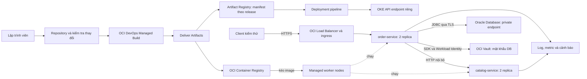

# Dự án microservices trên OKE với CI/CD và OCI Vault

## 1. Bài toán và kết quả cần đạt

Bạn phụ trách đưa một ứng dụng đặt hàng nhỏ lên Oracle Cloud Infrastructure (OCI). Ứng dụng phải chạy trên Oracle Kubernetes Engine (OKE), phát hành từ mã nguồn qua CI/CD, lấy mật khẩu cơ sở dữ liệu từ OCI Vault và có bằng chứng về khả năng phục hồi khi triển khai lỗi.

Đây là bài thực hành thuộc chương **Dự án tích hợp và đánh giá** của module Oracle Cloud Infrastructure. Sản phẩm cuối cùng cần thể hiện mối liên hệ giữa tenancy, compartment, IAM, VCN, Compute chạy worker node, Container Registry, Vault, Oracle Database, giám sát và kiểm soát chi phí. Việc Pod chuyển sang trạng thái `Running` mới chỉ là một phần của kết quả.

Sau dự án, người học cần làm được các việc sau:

- Thiết kế và triển khai hai microservice với ranh giới chức năng rõ ràng.
- Phân biệt danh tính người vận hành, pipeline, node và ứng dụng.
- Phát hành image có phiên bản truy vết được từ commit đến Pod.
- Đọc secret bằng OKE Workload Identity mà không đưa mật khẩu vào Git hay image.
- Kiểm chứng lưu trữ bền vững, idempotency, rollout, rollback và xoay vòng secret.
- Giải thích được chi phí, giới hạn sẵn sàng và các bước dọn tài nguyên.

Các đoạn mã trong bài là khung triển khai của dự án. Người học tạo repository ứng dụng riêng để hoàn thiện nghiệp vụ và IaC theo các hợp đồng bên dưới. Các chuỗi `<...>` và `${...}` là chỗ cần thay hoặc tham số của pipeline; không được để nguyên khi triển khai. Các lệnh shell minh họa dùng Bash trên máy quản trị hoặc môi trường build Linux đã cấu hình OCI CLI và kubectl.

## 2. Phạm vi chức năng và tiêu chí thành công

### 2.1. Hai dịch vụ và một kho dữ liệu bền vững

| Thành phần | Trách nhiệm | Dữ liệu và quyền |
| --- | --- | --- |
| `catalog-service` | Trả thông tin sản phẩm và giá hiện hành | Danh mục mẫu được đóng gói cùng phiên bản ứng dụng; không có secret |
| `order-service` | Kiểm tra sản phẩm, tính tiền, tạo và tra cứu đơn hàng | Ghi dữ liệu qua tài khoản `ORDER_APP`; được đọc đúng secret mật khẩu của tài khoản này |
| Oracle Database | Lưu đơn hàng, khóa idempotency và dữ liệu phục vụ đối soát | Endpoint riêng; không cho client Internet truy cập trực tiếp |

Danh mục tĩnh giúp tập trung vào OKE, CI/CD và Vault. Việc dữ liệu đơn hàng nằm trong bộ nhớ Pod không đáp ứng dự án: hai replica phải thấy cùng một đơn và việc thay Pod không được làm mất đơn đã ghi thành công.

Chọn một dịch vụ Oracle Database phù hợp với tài khoản và region, chẳng hạn Autonomous Database với private endpoint. Tài khoản ứng dụng chỉ có quyền trên schema cần thiết. Dự án sử dụng kết nối JDBC qua TLS, xác minh tên máy chủ và chuỗi tin cậy. Nếu cấu hình cơ sở dữ liệu hỗ trợ kết nối TLS không cần wallet, dùng connection string tương ứng lấy từ Console. Nếu cấu hình yêu cầu mTLS/wallet, phải bổ sung cách phân phối và xoay vòng wallet; không giả định chỉ có mật khẩu là đủ.

### 2.2. Hợp đồng API

| API | Hành vi bắt buộc |
| --- | --- |
| `GET /api/products/P100` tại catalog | Trả sản phẩm mẫu, giá thập phân và tiền tệ |
| `POST /api/orders` tại order | Nhận sản phẩm, số lượng và header `Idempotency-Key`; tự lấy giá từ catalog |
| `GET /api/orders/{id}` tại order | Đọc đơn đã ghi trong cơ sở dữ liệu |
| `GET /health/live` | Kiểm tra tiến trình có thể tiếp tục chạy |
| `GET /health/ready` | Kiểm tra Pod đủ điều kiện nhận nghiệp vụ |
| `GET /version` | Trả mã commit hoặc release đang chạy, không trả cấu hình nhạy cảm |

Ví dụ request:

```http
POST /api/orders HTTP/1.1
Content-Type: application/json
Idempotency-Key: demo-order-001

{"productId":"P100","quantity":2}
```

Quy ước cho bài thực hành:

- Lần tạo đầu trả `201`, một `orderId` và số tiền do server tính.
- Cùng khóa, cùng payload trả `200` và cùng nội dung đơn đã lưu.
- Cùng khóa nhưng payload khác trả `409`.
- Sản phẩm không tồn tại trả `404`; số lượng không hợp lệ trả `400`.
- Catalog không phản hồi trong thời hạn cho phép thì order trả lỗi phụ thuộc có kiểm soát, chẳng hạn `503`; không ghi một đơn thành công giả.
- Giá được xử lý bằng `BigDecimal` hoặc kiểu số thập phân tương đương, không dùng `double` để tính tiền.

Tính duy nhất của khóa phải do cơ sở dữ liệu bảo vệ. Kiểm tra khóa trong bộ nhớ rồi mới insert không ngăn được hai replica cùng xử lý một request.

Một schema khởi đầu:

```sql
CREATE TABLE orders (
    order_id        VARCHAR2(36) PRIMARY KEY,
    idempotency_key  VARCHAR2(128) NOT NULL,
    payload_hash    CHAR(64) NOT NULL,
    product_id      VARCHAR2(64) NOT NULL,
    quantity        NUMBER(10) NOT NULL,
    unit_price      NUMBER(12, 2) NOT NULL,
    total_amount    NUMBER(14, 2) NOT NULL,
    currency        CHAR(3) NOT NULL,
    created_at      TIMESTAMP WITH TIME ZONE DEFAULT SYSTIMESTAMP NOT NULL,
    CONSTRAINT uq_orders_idempotency UNIQUE (idempotency_key),
    CONSTRAINT ck_orders_quantity CHECK (quantity > 0)
);
```

`payload_hash` là hash của dữ liệu nghiệp vụ đã chuẩn hóa, không phải hash tùy ý trên JSON có thứ tự field bất định. Khi insert gặp xung đột unique, đọc bản ghi hiện có và so sánh hash. Chỉ phản hồi thành công sau khi transaction đã commit.

Trong hệ thống có nhiều khách hàng, khóa cần được phân vùng theo danh tính khách hàng đã xác thực. Dự án này dùng một tenant nghiệp vụ thử nghiệm và dữ liệu giả. Endpoint phục vụ kiểm thử chỉ được mở cho nguồn truy cập đã cho phép; trước khi cung cấp dịch vụ công khai, phải có xác thực người dùng và kiểm tra quyền sở hữu đơn hàng.

### 2.3. Mục tiêu đo trong lab

| Tiêu chí | Mục tiêu thực hành | Cách chứng minh |
| --- | --- | --- |
| Phát hành | Commit hợp lệ tạo image và triển khai dev qua pipeline | Build run, artifact, deployment run và phiên bản Pod khớp nhau |
| Tính bền vững | Thay toàn bộ Pod ứng dụng không làm mất đơn đã commit | Tạo đơn, thay Pod, đọc lại cùng `orderId` |
| Hiệu năng | 20 request/giây trong 10 phút, p95 dưới 500 ms, lỗi dưới 1% | Báo cáo có workload, số mẫu, cấu hình DB và tài nguyên |
| Sẵn sàng khi rollout | Không có khoảng mất toàn bộ backend ready | Theo dõi EndpointSlice/Pod và kết quả gọi liên tục |
| Phục hồi bản lỗi | Phục hồi release tốt trong 10 phút kể từ lúc phát hiện | Dòng thời gian của lần diễn tập |
| Phân quyền | Catalog không đọc được secret của order | Kết quả kiểm thử phủ định và dấu vết OCI tương ứng |

Đây là ngưỡng đánh giá của lab, không phải SLA mặc định của OCI. Nếu không đạt, báo cáo số đo thực tế và nguyên nhân. Khôi phục dữ liệu sau sự cố cơ sở dữ liệu là bài toán khác với rollback ứng dụng; chỉ công bố RPO/RTO dữ liệu sau khi có bài thử backup/restore phù hợp.

## 3. Kiến trúc tham chiếu



Luồng phát hành và luồng chạy ứng dụng cần được xem độc lập:

1. Pipeline build đọc mã nguồn, chạy kiểm thử và tạo hai image.
2. Deliver Artifacts đưa image và manifest vào kho artifact.
3. Deployment pipeline lấy đúng phiên bản manifest để cập nhật OKE.
4. Kubelet trên node kéo image bằng cơ chế xác thực registry đã cấu hình.
5. Ứng dụng order dùng service account của Pod để lấy secret từ Vault.
6. Order sử dụng mật khẩu đó để kết nối cơ sở dữ liệu qua mạng riêng.

Quyền push image không tạo ra quyền đọc mật khẩu cơ sở dữ liệu. Quyền đọc secret của Pod cũng không tự cấp quyền kéo image trước khi container khởi động.

### 3.1. Phân chia compartment và môi trường

Một bố cục dễ kiểm soát trong lab:

| Compartment | Chứa tài nguyên |
| --- | --- |
| `capstone-cicd` | DevOps project, repository, build/deployment pipeline, OCIR repository, Artifact Registry |
| `capstone-dev` | VCN, OKE Enhanced cluster, node pool, Load Balancer, Vault, secret và DB của dev |

Đặt cluster và runtime secret cùng compartment `capstone-dev` trong tuyến triển khai chính của bài. Nếu đặt tài nguyên đích ở compartment khác, phải kiểm tra thêm yêu cầu workload mapping của OKE và IAM liên quan; không chỉ đổi tên compartment trong policy.

Bản mở rộng có thể dùng `capstone-stage` và `capstone-prod` với cluster, DB và secret riêng. Hai namespace trên một cluster hữu ích để tiết kiệm chi phí học tập, nhưng không tương đương việc tách cluster cho hai miền tin cậy. Không đưa bản lab có DB dùng chung sang tên “production” mà bỏ qua giới hạn này.

### 3.2. Quyết định mạng

- Dùng OKE Enhanced cluster với managed node pool. Worker node không có public IP.
- Đặt Kubernetes API endpoint ở subnet riêng; quản trị viên đi qua VPN hoặc tuyến quản trị được phê duyệt.
- Deployment environment của OCI DevOps phải có kết nối private tới API endpoint; có IAM đúng nhưng không có tuyến mạng vẫn không triển khai được.
- Dành subnet phù hợp cho Load Balancer, node, Pod nếu kiểu CNI yêu cầu, và private endpoint của DB.
- Cấu hình route, DNS, NSG và các luồng điều khiển OKE theo kiểu mạng đã chọn.
- Dùng Service Gateway cho những dịch vụ OCI được hỗ trợ; những đích khác cần NAT Gateway hoặc egress proxy theo thiết kế. Không coi Service Gateway là đường ra cho mọi API.
- Kiểm tra cụ thể đường đi tới registry, endpoint Secrets, endpoint xác thực workload và các máy chủ phụ thuộc. Chỉ mở cổng TCP 443 mà thiếu DNS hoặc route vẫn có thể thất bại.

| Luồng ứng dụng | Cho phép từ đâu | Đích và mục đích |
| --- | --- | --- |
| HTTPS bên ngoài | CIDR của người kiểm thử | Listener 443 của Load Balancer |
| Ingress đến order | Pod ingress/controller đã xác định | Cổng 8080 của order |
| Order đến catalog | Pod có nhãn `app: order-service` | Cổng 8080 của catalog |
| Order đến DB | Nguồn mạng thực tế của Pod hoặc node theo CNI | Cổng TCPS trong connection string |
| Pod đến DNS | Pod ứng dụng | Resolver của cluster, UDP/TCP 53 khi áp dụng policy egress |
| Order đến OCI | Đường egress đã cho phép | HTTPS tới các endpoint cần cho Vault và xác thực |

Bảng trên mô tả luồng ứng dụng, chưa thay thế toàn bộ yêu cầu mạng của OKE. NSG kiểm soát tài nguyên mạng OCI; Kubernetes NetworkPolicy kiểm soát lưu lượng Pod khi CNI thực thi policy. Hai cơ chế không thay thế nhau.

## 4. Chuẩn bị hạ tầng và repository

### 4.1. Đầu vào phải ghi nhận

Trước khi build, lập bảng cấu hình không chứa secret:

| Biến | Ví dụ hình thức | Ý nghĩa |
| --- | --- | --- |
| `OCI_REGION` | `<region-id>` | Region của dự án |
| `REGISTRY` | `<region-key>.ocir.io` | Host registry đúng region |
| `OCIR_NAMESPACE` | `<object-storage-namespace>` | Namespace của tenancy; không mặc định bằng tên tenancy |
| `CLUSTER_OCID` | `ocid1.cluster...` | Cluster Enhanced đích |
| `ORDER_DB_SECRET_OCID` | `ocid1.vaultsecret...` | Định danh secret, không phải giá trị secret |
| `DB_URL` | Connection string TCPS đã xác minh | Địa chỉ DB và cấu hình TLS |
| `DB_USERNAME` | `ORDER_APP` | Tài khoản ứng dụng ít quyền |
| `RUNTIME_IMAGE` | `<approved-jre21-image>@sha256:<digest>` | Base image đã được chọn và ghim digest |

Ghi lại phiên bản Kubernetes, kubectl, OCI CLI, Java, Maven, OCI SDK, CNI, ingress controller và kiến trúc CPU. Dùng phiên bản đang được hỗ trợ trong region và ghim chúng vào cấu hình của dự án. Image build cho `amd64` không tự chạy được trên node `arm64`.

### 4.2. Thứ tự dựng hạ tầng

1. Tạo compartment, nhóm người vận hành và ngân sách cảnh báo.
2. Dựng VCN, subnet, route table, gateway, NSG và DNS cần thiết.
3. Tạo OKE Enhanced cluster, node pool đủ tối thiểu hai node và kiểm tra đường quản trị.
4. Tạo DB private endpoint, schema, quyền ứng dụng và migration ban đầu.
5. Tạo Vault, khóa mã hóa và secret mật khẩu; cấp quyền runtime ở phần tiếp theo.
6. Tạo OCIR repository riêng tư, Artifact Registry và DevOps project.
7. Tạo deployment environment kết nối tới private OKE endpoint.
8. Bootstrap namespace, service account, image pull secret, ingress và TLS.
9. Chạy pipeline đầu tiên rồi thực hiện kiểm thử nghiệm thu.

Nên mô tả hạ tầng bằng Terraform hoặc OCI Resource Manager để tái tạo được. Tách thay đổi hạ tầng có quyền rộng khỏi pipeline phát hành ứng dụng. Nếu dùng Terraform để tạo secret hoặc DB password, đánh giá việc giá trị nhạy cảm có xuất hiện trong state; gắn `sensitive` chỉ che hiển thị, không làm biến mất giá trị đã lưu trong state.

Một cấu trúc repository ứng dụng:

```text
.
├── pom.xml
├── mvnw
├── .mvn/
├── catalog-service/
│   ├── pom.xml
│   ├── Dockerfile
│   └── src/
├── order-service/
│   ├── pom.xml
│   ├── Dockerfile
│   └── src/
├── database/
│   └── migrations/
├── deploy/
│   └── workloads.yaml
├── tests/
│   └── smoke.sh
└── build_spec.yaml
```

Mỗi module tạo file `target/app.jar` bằng cấu hình `finalName`. Chạy unit test và integration test trong lifecycle `verify`; cấu hình Surefire/Failsafe sao cho test nghiệp vụ và transaction thực sự được chạy. Trong CI, dùng credential giả hoặc DB kiểm thử tách biệt; pipeline không cần mật khẩu DB runtime.

## 5. Thiết kế danh tính và phân quyền

### 5.1. Ma trận quyền

| Danh tính | Quyền cần có | Giới hạn phải kiểm chứng |
| --- | --- | --- |
| Người dựng hạ tầng | Tạo mạng, OKE, DB và thiết lập IAM trong phạm vi được giao | Không dùng credential cá nhân của người này trong container |
| Build pipeline | Đọc source, ghi image/artifact, kích hoạt deployment theo cấu hình | Không đọc được secret DB của ứng dụng |
| Deployment pipeline | Đọc artifact và triển khai tới cluster/môi trường đích | Không nhận quyền quản trị toàn tenancy |
| Node/kubelet | Kéo image riêng tư theo cơ chế đã chọn | Không được cấp quyền đọc DB secret chỉ để kéo image |
| `order-sa` | Đọc bundle của đúng secret DB | Không quản lý Vault, không cập nhật secret |
| `catalog-sa` | Không cần truy cập Vault | Không đọc được secret của order |
| Nhóm phát hành | Duyệt hoặc chạy phát hành theo vai trò | Có nhật ký người thực hiện và release được duyệt |

OCI IAM quyết định quyền với tài nguyên OCI. Kubernetes RBAC quyết định thao tác với API Kubernetes. Một service account của ứng dụng không cần được cấp `get secrets` trong Kubernetes chỉ để gọi OCI Secrets API.

Người có quyền tạo hoặc sửa Pod để dùng `order-sa` có thể tạo workload mang danh tính order. Vì vậy, việc hạn chế quyền sửa workload, thực thi lệnh trong Pod và sửa pipeline là một phần của ranh giới bảo vệ secret.

### 5.2. Runtime dùng OKE Workload Identity

Tuyến chính dùng Workload Identity của **Enhanced cluster**. Danh tính được ràng buộc bởi cluster, namespace và service account; không tạo dynamic group cho danh tính workload. Ứng dụng sử dụng OCI SDK hỗ trợ cơ chế này. Java SDK dòng 3.x cần tối thiểu phiên bản 3.88.0 theo tài liệu Oracle; ghim một phiên bản phù hợp cho toàn bộ dependency OCI. Xem [Granting Workloads Access to OCI Resources](https://docs.oracle.com/en-us/iaas/Content/ContEng/Tasks/contenggrantingworkloadaccesstoresources.htm).

Policy mẫu dành cho đúng workload và đúng secret:

```text
Allow any-user to read secret-bundles in compartment capstone-dev where all {
  request.principal.type = 'workload',
  request.principal.cluster_id = '<CLUSTER_OCID>',
  request.principal.namespace = 'capstone-dev',
  request.principal.service_account = 'order-sa',
  target.secret.id = '<ORDER_DB_SECRET_OCID>'
}
```

Điều kiện sau `where all` là phần bắt buộc của thiết kế này. `any-user` không có nghĩa mọi người được đọc secret khi tất cả điều kiện danh tính vẫn được áp dụng.

`read secret-bundles` phục vụ việc lấy nội dung secret. Không thay bằng quyền `manage secret-family` cho tiện. Biến `target.secret.id` cho phép giới hạn theo OCID secret; xem [tham chiếu IAM cho Vault và Secret Management](https://docs.oracle.com/en-us/iaas/Content/Identity/policyreference/keypolicyreference.htm).

Các thao tác của người tạo secret với Vault và khóa mã hóa là một vai trò riêng. Không tự bổ sung quyền giải mã khóa hoặc quyền quản lý Vault cho ứng dụng nếu thao tác cần làm chỉ là lấy secret bundle qua Secrets API.

### 5.3. Pipeline dùng resource principal

Tạo hai dynamic group riêng, chọn đúng resource pipeline thay vì gom mọi tài nguyên trong tenancy:

```text
ALL {
  resource.type = 'devopsbuildpipeline',
  resource.id = '<BUILD_PIPELINE_OCID>'
}
```

```text
ALL {
  resource.type = 'devopsdeploypipeline',
  resource.id = '<DEPLOY_PIPELINE_OCID>'
}
```

Chính sách khởi đầu trong compartment CI/CD có thể cần các quyền ghi repository/artifact và thao tác DevOps. Phía deployment cần đọc artifact và quyền OKE thích hợp. Oracle công bố các ví dụ như sau; thay tên dynamic group theo cấu hình thực tế:

```text
Allow dynamic-group CapstoneBuild to manage repos in compartment capstone-cicd
Allow dynamic-group CapstoneBuild to manage generic-artifacts in compartment capstone-cicd
Allow dynamic-group CapstoneBuild to manage devops-family in compartment capstone-cicd

Allow dynamic-group CapstoneDeploy to read all-artifacts in compartment capstone-cicd
Allow dynamic-group CapstoneDeploy to manage cluster in compartment capstone-dev
```

Đây là điểm xuất phát cho lab với phạm vi compartment, chưa phải bộ quyền tối thiểu cho mọi tổ chức. Bổ sung quyền mạng cần cho private environment bằng vai trò thiết lập hạ tầng, rồi thu hẹp quyền pipeline theo thao tác và tài nguyên thực tế. Với identity domain, dùng định danh nhóm đúng domain. Đối chiếu [OCI DevOps IAM Policies](https://docs.oracle.com/en-us/iaas/Content/devops/using/devops_iampolicies.htm).

Không mặc định rằng một RoleBinding theo namespace sẽ thu hẹp được mọi quyền của principal đã có quyền OKE rộng. Kiểm chứng khả năng hiệu lực của danh tính triển khai, nhất là khi dùng cluster chung. Tài khoản bootstrap quản trị cluster không được tái sử dụng làm danh tính runtime.

## 6. Đọc mật khẩu từ OCI Vault trong ứng dụng Java

### 6.1. Tổ chức secret

Tạo secret `order-db-password` chứa mật khẩu của tài khoản `ORDER_APP`. Chỉ đưa OCID secret, username và connection string không chứa mật khẩu vào cấu hình triển khai.

Phân biệt ba loại dữ liệu:

| Dữ liệu | Nơi lưu trong thiết kế |
| --- | --- |
| DB hostname, service name, username, secret OCID | ConfigMap hoặc tham số triển khai |
| DB password | OCI Vault |
| Credential dùng để kéo private image | Luồng bootstrap registry riêng ở phần 7 |

Nội dung trả về của secret bundle được biểu diễn bằng Base64. Base64 là mã hóa biểu diễn, không phải mã hóa bảo mật. SDK tải bundle được phép truy cập rồi ứng dụng giải mã biểu diễn trong bộ nhớ. Tham khảo [SecretsClient](https://docs.oracle.com/en-us/iaas/tools/java/latest/com/oracle/bmc/secrets/SecretsClient.html) và [Base64SecretBundleContentDetails](https://docs.oracle.com/en-us/iaas/tools/java/latest/com/oracle/bmc/secrets/model/Base64SecretBundleContentDetails.html).

### 6.2. Dependency và cấu hình DataSource

Với Spring Boot, dùng JDBC, Actuator và Oracle JDBC driver tương thích với phiên bản Java/DB. Ghim OCI SDK đồng bộ, chẳng hạn dùng property `oci.sdk.version` với một phiên bản 3.x đã xác nhận hỗ trợ Workload Identity. Khai báo các artifact sau với cùng phiên bản:

```xml
<dependency>
    <groupId>com.oracle.oci.sdk</groupId>
    <artifactId>oci-java-sdk-addons-oke-workload-identity</artifactId>
    <version>${oci.sdk.version}</version>
</dependency>
<dependency>
    <groupId>com.oracle.oci.sdk</groupId>
    <artifactId>oci-java-sdk-secrets</artifactId>
    <version>${oci.sdk.version}</version>
</dependency>
<dependency>
    <groupId>com.oracle.oci.sdk</groupId>
    <artifactId>oci-java-sdk-common-httpclient-jersey3</artifactId>
    <version>${oci.sdk.version}</version>
</dependency>
```

Đoạn cấu hình dưới đây đọc secret lúc khởi động. Import và các bean được nêu đầy đủ để thể hiện đường đi của credential:

```java
import com.oracle.bmc.auth.okeworkloadidentity
        .OkeWorkloadIdentityAuthenticationDetailsProvider;
import com.oracle.bmc.secrets.SecretsClient;
import com.oracle.bmc.secrets.model.Base64SecretBundleContentDetails;
import com.oracle.bmc.secrets.requests.GetSecretBundleRequest;
import com.zaxxer.hikari.HikariDataSource;
import org.springframework.context.annotation.Bean;
import org.springframework.context.annotation.Configuration;

import java.nio.charset.StandardCharsets;
import java.util.Arrays;
import java.util.Base64;

@Configuration
public class OrderDatabaseConfiguration {

    @Bean
    OkeWorkloadIdentityAuthenticationDetailsProvider workloadIdentity() {
        return new OkeWorkloadIdentityAuthenticationDetailsProvider
                .OkeWorkloadIdentityAuthenticationDetailsProviderBuilder()
                .build();
    }

    @Bean(destroyMethod = "close")
    SecretsClient secretsClient(
            OkeWorkloadIdentityAuthenticationDetailsProvider identity) {
        return SecretsClient.builder()
                .region(required("OCI_REGION"))
                .build(identity);
    }

    @Bean(destroyMethod = "close")
    HikariDataSource dataSource(SecretsClient secrets) {
        var response = secrets.getSecretBundle(
                GetSecretBundleRequest.builder()
                        .secretId(required("ORDER_DB_SECRET_OCID"))
                        .stage(GetSecretBundleRequest.Stage.Current)
                        .build());

        var content = response.getSecretBundle().getSecretBundleContent();
        if (!(content instanceof Base64SecretBundleContentDetails encoded)) {
            throw new IllegalStateException("Unsupported secret content type");
        }

        byte[] password = Base64.getDecoder().decode(encoded.getContent());
        try {
            var pool = new HikariDataSource();
            pool.setJdbcUrl(required("DB_URL"));
            pool.setUsername(required("DB_USERNAME"));
            pool.setPassword(new String(password, StandardCharsets.UTF_8));
            pool.setMaximumPoolSize(5);
            pool.setMinimumIdle(1);
            pool.setConnectionTimeout(3000);
            pool.setInitializationFailTimeout(10000);
            return pool;
        } finally {
            Arrays.fill(password, (byte) 0);
        }
    }

    private static String required(String name) {
        String value = System.getenv(name);
        if (value == null || value.isBlank()) {
            throw new IllegalStateException("Missing configuration: " + name);
        }
        return value;
    }
}
```

Dùng một provider và client được tái sử dụng trong vòng đời ứng dụng. Không dựng một provider cho từng request đặt hàng. Đoạn mã không ghi response secret ra log và không truyền mật khẩu qua biến môi trường của Pod. Mảng byte được xóa sau khi dùng, nhưng `String` và thư viện kết nối vẫn có thể giữ credential trong heap; không được mô tả thao tác này là bảo đảm xóa sạch mọi bản sao trong bộ nhớ.

Bản khởi đầu đọc `CURRENT` một lần khi tạo DataSource. Việc cập nhật Vault không tự thay mật khẩu trong connection pool đang chạy. Bài thực hành sẽ xoay vòng bằng rolling restart sau khi kiểm tra credential mới.

### 6.3. Health endpoint và hành vi khi phụ thuộc lỗi

Ánh xạ Actuator sang hợp đồng endpoint của dự án, ví dụ với order:

```yaml
server:
  shutdown: graceful

spring:
  lifecycle:
    timeout-per-shutdown-phase: 20s

management:
  endpoints:
    web:
      base-path: /
      exposure:
        include: health
  endpoint:
    health:
      probes:
        enabled: true
      show-details: never
      group:
        live:
          include: livenessState
        ready:
          include: readinessState,db
```

Với catalog, nhóm `ready` chỉ cần `readinessState` vì không có DataSource. Hai endpoint `/health/live` và `/health/ready` phải thật sự trả mã HTTP đúng trước khi dùng các manifest bên dưới.

Không kiểm tra kết nối Vault cho mỗi lần probe khi ứng dụng đã có credential hợp lệ. Liveness kiểm tra trạng thái tiến trình; readiness có thể phản ánh khả năng dùng DB của order. Khi catalog lỗi, order trả lỗi có kiểm soát cho API cần catalog thay vì làm mọi Pod order liên tục restart.

Startup probe cho phép ứng dụng Java có thời gian khởi động; readiness thất bại loại Pod khỏi các endpoint sẵn sàng, còn liveness thất bại có thể khiến container bị khởi động lại. Tham khảo [hướng dẫn probe của Kubernetes](https://kubernetes.io/docs/tasks/configure-pod-container/configure-liveness-readiness-startup-probes/).

## 7. Bootstrap Kubernetes và credential kéo image

### 7.1. Namespace và service account

Các tài nguyên nền tảng do người quản trị bootstrap trước pipeline ứng dụng:

```yaml
apiVersion: v1
kind: Namespace
metadata:
  name: capstone-dev
  labels:
    pod-security.kubernetes.io/enforce: restricted
---
apiVersion: v1
kind: ServiceAccount
metadata:
  name: order-sa
  namespace: capstone-dev
automountServiceAccountToken: true
---
apiVersion: v1
kind: ServiceAccount
metadata:
  name: catalog-sa
  namespace: capstone-dev
automountServiceAccountToken: false
```

Order cần token service account cho Workload Identity. Catalog không cần token trong ứng dụng. Token của order phải được giữ trong Pod; không in token để “kiểm tra nhanh”.

### 7.2. Image pull secret là luồng riêng

Tuyến lab dùng private OCIR repository và Kubernetes Secret kiểu `kubernetes.io/dockerconfigjson`. Tạo tài khoản kéo image có quyền đọc repository cần thiết, dùng OCI auth token tương ứng và định dạng username theo tenancy/identity domain. Không dùng mật khẩu đăng nhập Console thay auth token. Xem [Pulling Images from Registry during Deployment](https://docs.oracle.com/en-us/iaas/Content/ContEng/Tasks/contengpullingimagesfromocir.htm).

Một cách bootstrap tránh đưa token vào dòng lệnh là lưu **toàn bộ Docker config JSON** hợp lệ trong secret riêng `ocir-pull-dockerconfig` ở Vault. Nội dung JSON chứa phần `auths` cho đúng host registry. Secret này không phải secret DB và không được cấp cho `order-sa`.

Trên máy quản trị Linux có thư mục tạm trong bộ nhớ, người bootstrap có quyền đọc đúng secret registry chạy:

```bash
set -euo pipefail
set +x
umask 077

: "${OCIR_PULL_SECRET_OCID:?Set the registry secret OCID}"
tmp_dir="$(mktemp -d "${XDG_RUNTIME_DIR:-/dev/shm}/capstone-pull.XXXXXX")"
trap 'rm -f "$tmp_dir/config.json"; rmdir "$tmp_dir"' EXIT

oci secrets secret-bundle get   --secret-id "$OCIR_PULL_SECRET_OCID"   --stage CURRENT   --query 'data."secret-bundle-content".content'   --raw-output   | base64 --decode > "$tmp_dir/config.json"

jq -e '.auths | type == "object"' "$tmp_dir/config.json" > /dev/null

kubectl -n capstone-dev create secret generic ocir-pull   --type=kubernetes.io/dockerconfigjson   --from-file=.dockerconfigjson="$tmp_dir/config.json"   --dry-run=client -o yaml   | kubectl apply --server-side -f -
```

Không bật trace shell, ghi lại stdout trung gian hoặc lưu file tạm vào repository. Thực hiện trong phiên quản trị đã xác thực, có kết nối mạng tới cả Vault và OKE. Kiểm tra chính sách log/audit của cluster không thu thập nội dung Secret.

Kubernetes Secret vẫn tồn tại trong cluster và phải được bảo vệ bằng RBAC, cấu hình mã hóa và kiểm soát quyền tạo Pod. Sau khi đổi auth token registry, cập nhật secret này và kiểm tra kéo một image mới. Container đang chạy không chứng minh token mới kéo image được.

### 7.3. Cấu hình không nhạy cảm

Tạo ConfigMap bằng cấu hình đúng của dev:

```yaml
apiVersion: v1
kind: ConfigMap
metadata:
  name: order-config
  namespace: capstone-dev
data:
  OCI_REGION: "<region-id>"
  ORDER_DB_SECRET_OCID: "<ORDER_DB_SECRET_OCID>"
  DB_URL: "<verified-jdbc-tcps-connection-string>"
  DB_USERNAME: "ORDER_APP"
  CATALOG_BASE_URL: "http://catalog-service:8080"
```

Trong lab, ConfigMap này do bootstrap quản lý. Nếu đưa ConfigMap vào artifact phát hành, phải version hóa và rollback cùng manifest. Thay đổi ConfigMap không tự cập nhật biến môi trường của Pod đang chạy; cần rollout thích hợp.

## 8. Đóng gói và triển khai hai dịch vụ

### 8.1. Dockerfile dùng chung cấu trúc

Mỗi module dùng Dockerfile sau; pipeline cung cấp base image đã ghim digest:

```dockerfile
ARG RUNTIME_IMAGE
FROM ${RUNTIME_IMAGE}
WORKDIR /app
COPY --chown=10001:10001 target/app.jar /app/app.jar
USER 10001:10001
ENV JAVA_TOOL_OPTIONS="-XX:MaxRAMPercentage=70.0 -Djava.io.tmpdir=/tmp"
EXPOSE 8080
ENTRYPOINT ["java", "-jar", "/app/app.jar"]
```

Không copy `.oci`, kubeconfig, wallet chưa được bảo vệ hoặc file mật khẩu vào build context. `.dockerignore` cần loại những file đó và vẫn cho phép copy đúng `target/app.jar`. `JAVA_TOOL_OPTIONS` chỉ chứa tùy chọn JVM, không chứa credential.

### 8.2. Manifest ứng dụng theo release

File `deploy/workloads.yaml` chứa cả hai Deployment và Service. `${REGISTRY}`, `${OCIR_NAMESPACE}` và `${RELEASE_ID}` được thay bởi DevOps artifact parameter replacement ở lúc triển khai.

```yaml
apiVersion: apps/v1
kind: Deployment
metadata:
  name: catalog-service
  namespace: capstone-dev
spec:
  replicas: 2
  revisionHistoryLimit: 5
  minReadySeconds: 10
  progressDeadlineSeconds: 300
  strategy:
    type: RollingUpdate
    rollingUpdate:
      maxSurge: 1
      maxUnavailable: 0
  selector:
    matchLabels:
      app: catalog-service
  template:
    metadata:
      labels:
        app: catalog-service
        release: "${RELEASE_ID}"
    spec:
      serviceAccountName: catalog-sa
      automountServiceAccountToken: false
      imagePullSecrets:
        - name: ocir-pull
      terminationGracePeriodSeconds: 45
      securityContext:
        runAsNonRoot: true
        runAsUser: 10001
        runAsGroup: 10001
        fsGroup: 10001
        seccompProfile:
          type: RuntimeDefault
      topologySpreadConstraints:
        - maxSkew: 1
          topologyKey: kubernetes.io/hostname
          whenUnsatisfiable: ScheduleAnyway
          labelSelector:
            matchLabels:
              app: catalog-service
      containers:
        - name: app
          image: "${REGISTRY}/${OCIR_NAMESPACE}/capstone-catalog:${RELEASE_ID}"
          imagePullPolicy: Always
          ports:
            - name: http
              containerPort: 8080
          env:
            - name: APP_RELEASE
              value: "${RELEASE_ID}"
          resources:
            requests:
              cpu: "250m"
              memory: "384Mi"
            limits:
              cpu: "1"
              memory: "768Mi"
          securityContext:
            allowPrivilegeEscalation: false
            readOnlyRootFilesystem: true
            capabilities:
              drop: ["ALL"]
          startupProbe:
            httpGet:
              path: /health/live
              port: http
            periodSeconds: 5
            failureThreshold: 36
          readinessProbe:
            httpGet:
              path: /health/ready
              port: http
            periodSeconds: 5
          livenessProbe:
            httpGet:
              path: /health/live
              port: http
            periodSeconds: 10
          volumeMounts:
            - name: tmp
              mountPath: /tmp
      volumes:
        - name: tmp
          emptyDir:
            sizeLimit: 128Mi
---
apiVersion: v1
kind: Service
metadata:
  name: catalog-service
  namespace: capstone-dev
spec:
  type: ClusterIP
  selector:
    app: catalog-service
  ports:
    - name: http
      port: 8080
      targetPort: http
---
apiVersion: apps/v1
kind: Deployment
metadata:
  name: order-service
  namespace: capstone-dev
spec:
  replicas: 2
  revisionHistoryLimit: 5
  minReadySeconds: 10
  progressDeadlineSeconds: 300
  strategy:
    type: RollingUpdate
    rollingUpdate:
      maxSurge: 1
      maxUnavailable: 0
  selector:
    matchLabels:
      app: order-service
  template:
    metadata:
      labels:
        app: order-service
        release: "${RELEASE_ID}"
    spec:
      serviceAccountName: order-sa
      automountServiceAccountToken: true
      imagePullSecrets:
        - name: ocir-pull
      terminationGracePeriodSeconds: 45
      securityContext:
        runAsNonRoot: true
        runAsUser: 10001
        runAsGroup: 10001
        fsGroup: 10001
        seccompProfile:
          type: RuntimeDefault
      topologySpreadConstraints:
        - maxSkew: 1
          topologyKey: kubernetes.io/hostname
          whenUnsatisfiable: ScheduleAnyway
          labelSelector:
            matchLabels:
              app: order-service
      containers:
        - name: app
          image: "${REGISTRY}/${OCIR_NAMESPACE}/capstone-order:${RELEASE_ID}"
          imagePullPolicy: Always
          ports:
            - name: http
              containerPort: 8080
          envFrom:
            - configMapRef:
                name: order-config
          env:
            - name: APP_RELEASE
              value: "${RELEASE_ID}"
          resources:
            requests:
              cpu: "250m"
              memory: "384Mi"
            limits:
              cpu: "1"
              memory: "768Mi"
          securityContext:
            allowPrivilegeEscalation: false
            readOnlyRootFilesystem: true
            capabilities:
              drop: ["ALL"]
          startupProbe:
            httpGet:
              path: /health/live
              port: http
            periodSeconds: 5
            failureThreshold: 36
          readinessProbe:
            httpGet:
              path: /health/ready
              port: http
            periodSeconds: 5
          livenessProbe:
            httpGet:
              path: /health/live
              port: http
            periodSeconds: 10
          volumeMounts:
            - name: tmp
              mountPath: /tmp
      volumes:
        - name: tmp
          emptyDir:
            sizeLimit: 128Mi
---
apiVersion: v1
kind: Service
metadata:
  name: order-service
  namespace: capstone-dev
spec:
  type: ClusterIP
  selector:
    app: order-service
  ports:
    - name: http
      port: 8080
      targetPort: http
```

Ứng dụng tự triển khai `/version` từ `APP_RELEASE`; biến này không tự tạo endpoint. Với topology spread dạng `ScheduleAnyway`, scheduler cố gắng phân bố Pod nhưng không bảo đảm cứng hai replica ở hai node khác nhau. Kiểm tra `kubectl get pods -o wide` và ghi lại phân bố thực tế.

Hai replica còn cần năng lực dự phòng để tạo Pod surge. Nếu cluster hết CPU hoặc RAM, rollout có thể dừng dù ứng dụng không có lỗi. Kubernetes điều khiển rolling update bằng `maxSurge` và `maxUnavailable`; xem [Update a Deployment Without Downtime](https://kubernetes.io/docs/tasks/run-application/update-deployment-rolling/).

### 8.3. NetworkPolicy và ingress

Dùng CNI đã được xác nhận thực thi NetworkPolicy. Ví dụ dưới đây chặn ingress mặc định rồi chỉ mở catalog cho order:

```yaml
apiVersion: networking.k8s.io/v1
kind: NetworkPolicy
metadata:
  name: default-deny-ingress
  namespace: capstone-dev
spec:
  podSelector: {}
  policyTypes:
    - Ingress
---
apiVersion: networking.k8s.io/v1
kind: NetworkPolicy
metadata:
  name: catalog-from-order
  namespace: capstone-dev
spec:
  podSelector:
    matchLabels:
      app: catalog-service
  policyTypes:
    - Ingress
  ingress:
    - from:
        - podSelector:
            matchLabels:
              app: order-service
      ports:
        - protocol: TCP
          port: 8080
```

Bổ sung policy cho order nhận TCP 8080 từ namespace và nhãn Pod ingress controller thực tế. Nếu controller sử dụng host network hoặc cơ chế nguồn lưu lượng khác, kiểm chứng nguồn nhìn thấy tại Pod trước khi chốt policy. Tương tự, mở luồng scrape cho hệ thống giám sát và luồng test cho Job kiểm thử có nhãn riêng. Khi bật default deny, các luồng đó không tự được cho phép.

Bộ policy trên chỉ cô lập **ingress**. Egress vẫn cần được thiết kế, theo dõi và thu hẹp bằng cơ chế phù hợp; không được tuyên bố các manifest này đã chặn mọi đường đưa dữ liệu ra ngoài.

Bootstrap ingress bằng controller được hỗ trợ trên cấu hình OKE đã chọn. Cấu hình hostname thử nghiệm, chứng thư, listener HTTPS 443, backend order và health check. Catalog chỉ có ClusterIP. Không tắt xác minh TLS trong client để làm bài thử “đạt”.

### 8.4. Gián đoạn có chủ đích và co giãn

Ví dụ PDB cho order:

```yaml
apiVersion: policy/v1
kind: PodDisruptionBudget
metadata:
  name: order-service
  namespace: capstone-dev
spec:
  minAvailable: 1
  selector:
    matchLabels:
      app: order-service
```

Tạo PDB tương tự cho catalog nếu thực hiện drain node. PDB chi phối các eviction tự nguyện tuân theo cơ chế này; nó không ngăn node hỏng, không thay chiến lược rollout và không bảo vệ thao tác xóa Pod trực tiếp.

Có thể thêm HPA cho order với `minReplicas: 2`, `maxReplicas: 4` và mục tiêu CPU 70% sau khi có metrics API hoạt động. Khi HPA quản lý replica, tránh để mỗi lần apply manifest lại ép replica về 2; điều chỉnh mẫu manifest hoặc quy trình ownership cho trường `spec.replicas`.

Tính ngân sách kết nối DB trước khi scale:

```text
(maxReplicas + số Pod surge) × poolSize + kết nối của Job
    <= giới hạn DB - phần dành cho quản trị và tác vụ khác
```

Ví dụ `(4 + 1) × 5 + 2 = 27` kết nối, trong khi phần ngân sách dành cho ứng dụng là 30. HPA tăng Pod không tự làm DB xử lý được thêm tải và không tự tạo thêm node.

## 9. Xây dựng CI/CD bằng OCI DevOps

### 9.1. Những bất biến của release

Mỗi release phải xác định được:

- Commit nguồn đầy đủ.
- Build run duy nhất.
- Hai image URI và digest tương ứng.
- Phiên bản manifest.
- Môi trường triển khai, người duyệt nếu có và kết quả kiểm thử.

Không dùng `latest` cho phát hành. Tuyến khởi đầu dùng tag duy nhất theo commit và build run, không tái gán tag cho nội dung khác. Ghi digest của từng image sau Deliver Artifacts để đối chiếu khi nghiệm thu. Với môi trường cần kiểm soát chặt hơn, tạo manifest trỏ trực tiếp `image@sha256:...` từ digest đã xác minh.

Tag duy nhất là quy ước phát hành cần được bảo vệ bằng quyền và quy trình; tag vẫn không có tính bất biến nội tại như digest. Lần build lại cùng commit phải có release ID khác. Chuyển môi trường bằng cùng artifact đã kiểm tra, không build lại từ source cho từng môi trường.

### 9.2. Managed Build

File `build_spec.yaml`:

```yaml
version: 0.1
component: build
timeoutInSeconds: 1800
shell: bash
failImmediatelyOnError: true

env:
  variables:
    RUNTIME_IMAGE: "<approved-jre21-image>@sha256:<digest>"
  exportedVariables:
    - RELEASE_ID

steps:
  - type: Command
    name: Test and package application
    timeoutInSeconds: 900
    command: |
      set -euo pipefail
      cd "$OCI_PRIMARY_SOURCE_DIR"
      : "${OCI_PRIMARY_SOURCE_COMMIT_HASH:?Missing source commit}"
      : "${OCI_BUILD_RUN_ID:?Missing build run ID}"
      run_suffix="$(printf '%s' "$OCI_BUILD_RUN_ID" | sha256sum | cut -c1-12)"
      RELEASE_ID="${OCI_PRIMARY_SOURCE_COMMIT_HASH}-${run_suffix}"
      export RELEASE_ID
      ./mvnw -B -ntp verify

  - type: Command
    name: Build container images and package manifest
    timeoutInSeconds: 700
    command: |
      set -euo pipefail
      cd "$OCI_PRIMARY_SOURCE_DIR"
      docker build --pull         --build-arg RUNTIME_IMAGE="$RUNTIME_IMAGE"         -t capstone-catalog:build         -f catalog-service/Dockerfile catalog-service
      docker build --pull         --build-arg RUNTIME_IMAGE="$RUNTIME_IMAGE"         -t capstone-order:build         -f order-service/Dockerfile order-service
      mkdir -p dist
      cp deploy/workloads.yaml dist/workloads.yaml
      printf '%s\n' "$RELEASE_ID" > dist/release-id.txt

outputArtifacts:
  - name: catalog_image
    type: DOCKER_IMAGE
    location: capstone-catalog:build
  - name: order_image
    type: DOCKER_IMAGE
    location: capstone-order:build
  - name: workloads_yaml
    type: BINARY
    location: dist/workloads.yaml
  - name: release_id
    type: BINARY
    location: dist/release-id.txt
```

Chọn build runner có Java/Maven hoặc Maven Wrapper, Docker và công cụ Linux cần thiết, đồng thời xác nhận kiến trúc image phù hợp node. Nếu test tích hợp dùng container DB, runner phải hỗ trợ cách chạy đó. Ghim dependency và plugin trong POM; dùng Maven Wrapper không tự ghim mọi dependency.

`catalog_image` và `order_image` là tên output của stage, không phải tên OCIR repository. Tag local `:build` chỉ dùng trong build run; Deliver Artifacts gắn output đó với đích release duy nhất.

`exportedVariables` dùng để chuyển `RELEASE_ID` sang stage sau. `outputArtifacts.location` của ví dụ là đường dẫn hoặc tag local cố định; không dựa vào việc nội suy exported variable ở vị trí này. Định dạng và phạm vi biến được mô tả trong [Build Specification](https://docs.oracle.com/en-us/iaas/Content/devops/using/build_specs.htm).

Build này không cần đọc mật khẩu DB runtime. Nếu repository nguồn bên ngoài cần PAT, lưu PAT trong secret riêng và chỉ cấp quyền cho principal thực sự dùng kết nối đó. Không đưa PAT hoặc secret vào `exportedVariables`, artifact đầu ra hay log test.

### 9.3. Deliver Artifacts

Tạo DevOps artifact resource và ánh xạ:

| Output của Managed Build | Kho đích | Phiên bản đích |
| --- | --- | --- |
| `catalog_image` | `REGISTRY/OCIR_NAMESPACE/capstone-catalog` | Tag `${RELEASE_ID}` |
| `order_image` | `REGISTRY/OCIR_NAMESPACE/capstone-order` | Tag `${RELEASE_ID}` |
| `workloads_yaml` | Generic artifact có path `capstone/workloads.yaml` | Version `${RELEASE_ID}` |
| `release_id` | Generic artifact có path `capstone/release-id.txt` | Version `${RELEASE_ID}` |

Với container artifact, URI tham chiếu có dạng:

```text
<region-key>.ocir.io/<namespace>/capstone-order:${RELEASE_ID}
```

Bật thay tham số tại những artifact resource cần dùng release ID. Kiểm tra output name trong Deliver Artifacts khớp tuyệt đối tên trong build spec. Bước này đưa artifact vào OCIR hoặc Artifact Registry bằng quyền của pipeline, không cần script `docker login` chứa auth token cá nhân. Xem [Deliver Artifacts Stage](https://docs.oracle.com/en-us/iaas/Content/devops/using/deliverartifact-stage.htm).

### 9.4. Deployment pipeline và chốt kiểm tra

Luồng tối thiểu:

```text
Commit được chấp nhận
  → Managed Build: test và tạo image
  → Deliver Artifacts
  → Trigger Deployment: truyền RELEASE_ID
  → Deploy OKE vào dev
  → Run OKE Job: smoke test
  → Lưu kết quả và đánh dấu release đủ điều kiện
```

Trong deployment pipeline:

1. Khai báo `RELEASE_ID`, `REGISTRY` và `OCIR_NAMESPACE` là tham số không nhạy cảm.
2. Artifact manifest tham chiếu `capstone/workloads.yaml` tại đúng version `${RELEASE_ID}` trong Artifact Registry.
3. Bật parameter replacement cho nội dung manifest để thay ba biến image và nhãn release.
4. Chọn deployment environment của private OKE cluster; kiểm tra namespace đích.
5. Chọn stage **Deploy - OKE**, timeout và chính sách rollback khi kiểm tra triển khai của stage thất bại.
6. Thêm **Run OKE Job** với image công cụ kiểm thử đã ghim phiên bản, có Bash, curl, jq và script smoke.
7. Bảo đảm Job có service account không cần quyền OCI, tài nguyên, thời hạn chạy và NetworkPolicy cho phép gọi order.
8. Ghi nhận kết quả test cùng release trước khi chuyển môi trường.

OCI DevOps áp dụng manifest của Deploy OKE theo cơ chế server-side apply; artifact phải được sắp đúng thứ tự phụ thuộc. Tính năng rollback khi validation của stage thất bại cần được cấu hình rõ. Xem [Deploying to a Kubernetes Cluster](https://docs.oracle.com/en-us/iaas/Content/devops/using/deploy_oke.htm).

Không xem thành công của một stage deploy là bằng chứng nghiệp vụ đã đạt. Một smoke Job ở stage sau thất bại cũng không mặc nhiên kích hoạt mọi cơ chế rollback của stage trước. Trong lab, phải có thao tác chạy lại release tốt đã định danh; nếu tự động hóa phản ứng này, diễn tập đúng nhánh lỗi đó.

Với stage/prod mở rộng, thêm phê duyệt bởi nhóm phát hành rồi dùng lại hai image đã kiểm tra, với cấu hình và secret riêng của môi trường. Manifest ví dụ có namespace `capstone-dev` cố định; tạo overlay hoặc mẫu namespace phù hợp trước khi dùng cho môi trường khác.

### 9.5. Kiểm tra dependency và image

Chạy kiểm tra dependency và image bằng công cụ có phiên bản cố định hoặc dịch vụ OCI đã chọn. Tối thiểu phải lưu kết quả và đưa lỗi nghiêm trọng, có thể khai thác vào quyết định chấp nhận release.

Nếu scanner chạy bất đồng bộ sau push, pipeline phải đợi và đọc kết quả của **đúng digest**, hoặc đặt bước duyệt dựa trên kết quả đó. Việc “đã bật scanning” không tự tạo một quality gate. Bản lab phải chỉ rõ gate nào tự động, gate nào do người kiểm tra; không mô tả bước thủ công là tự động.

## 10. Kiểm thử nghiệm thu

### 10.1. Smoke test có kiểm tra nội dung

Chuẩn hóa response tạo/đọc đơn gồm ít nhất `orderId`, `productId`, `quantity`, `unitPrice`, `totalAmount`, `currency`. Với sản phẩm mẫu `P100`, đơn vị `VND`, giá `120000.00`, hai sản phẩm phải cho tổng `240000.00`.

Script `tests/smoke.sh` chạy trong toolbox Job nội bộ hoặc máy kiểm thử có quyền truy cập ingress. Job nội bộ phải được NetworkPolicy cho phép.

```bash
#!/usr/bin/env bash
set -euo pipefail

: "${BASE_URL:?Set the order API base URL}"
: "${RELEASE_ID:?Set the release under test}"

base="${BASE_URL%/}"
key="smoke-${RELEASE_ID}"
work="$(mktemp -d)"
trap 'rm -f "$work/first.json" "$work/replay.json" "$work/read.json"; rmdir "$work"' EXIT
payload='{"productId":"P100","quantity":2}'

create_code="$(curl --silent --show-error   --connect-timeout 3 --max-time 10   -o "$work/first.json" -w '%{http_code}'   -H 'Content-Type: application/json'   -H "Idempotency-Key: $key"   -d "$payload" "$base/api/orders")"
[[ "$create_code" == 201 || "$create_code" == 200 ]]

order_id="$(jq -er '.orderId' "$work/first.json")"
jq -e '.productId == "P100" and .quantity == 2
       and .totalAmount == 240000 and .currency == "VND"'   "$work/first.json" > /dev/null

replay_code="$(curl --silent --show-error   --connect-timeout 3 --max-time 10   -o "$work/replay.json" -w '%{http_code}'   -H 'Content-Type: application/json'   -H "Idempotency-Key: $key"   -d "$payload" "$base/api/orders")"
[[ "$replay_code" == 200 ]]
[[ "$(jq -cS . "$work/first.json")" == "$(jq -cS . "$work/replay.json")" ]]

curl --fail --silent --show-error   --connect-timeout 3 --max-time 10   "$base/api/orders/$order_id" -o "$work/read.json"
[[ "$(jq -er '.orderId' "$work/read.json")" == "$order_id" ]]

conflict_code="$(curl --silent --show-error   --connect-timeout 3 --max-time 10   -o /dev/null -w '%{http_code}'   -H 'Content-Type: application/json'   -H "Idempotency-Key: $key"   -d '{"productId":"P100","quantity":3}' "$base/api/orders")"
[[ "$conflict_code" == 409 ]]

printf 'Smoke passed for release %s\n' "$RELEASE_ID"
```

Script chấp nhận `200` ở lần đầu để có thể chạy lại cùng release. API phải trả body đơn ổn định, không thêm timestamp ngẫu nhiên cho mỗi lần replay. Không thêm `--insecure` hoặc bật curl verbose với credential.

Smoke test chưa chứng minh chống race. Bổ sung test nhiều request đồng thời cùng khóa qua Service để tăng khả năng đi tới nhiều replica, rồi xác nhận cơ sở dữ liệu chỉ có một đơn và mọi response hợp lệ cùng `orderId`.

### 10.2. Kiểm tra triển khai và lưu trữ

Các lệnh quan sát không in secret:

```bash
kubectl -n capstone-dev get deploy,pods,svc
kubectl -n capstone-dev get pods -o wide
kubectl -n capstone-dev rollout status deployment/catalog-service --timeout=5m
kubectl -n capstone-dev rollout status deployment/order-service --timeout=5m
kubectl -n capstone-dev get endpointslices   -l kubernetes.io/service-name=order-service
kubectl -n capstone-dev get pods   -o jsonpath='{range .items[*]}{.metadata.name}{"\t"}{range .status.containerStatuses[*]}{.imageID}{" "}{end}{"\n"}{end}'
```

Đối chiếu `imageID` của ứng dụng với digest trong hồ sơ release. Nếu dùng multi-platform image, ghi rõ quan hệ giữa digest manifest list và digest image theo kiến trúc mà node thực tế chạy.

Tạo một đơn trước, ghi `orderId`, thực hiện rolling restart của order và catalog, rồi đọc lại đơn. Bài thử này chứng minh dữ liệu không phụ thuộc vòng đời Pod; nó không thay thế diễn tập phục hồi cơ sở dữ liệu.

### 10.3. Kiểm thử phân quyền và mạng

| Tình huống | Cách thử có kiểm soát | Kết quả mong đợi |
| --- | --- | --- |
| Order đọc secret hợp lệ | Khởi động order đúng service account | Kết nối DB thành công, không log mật khẩu |
| Catalog đọc secret order | Job thử dùng `catalog-sa`, bật token riêng cho test, gọi SDK với secret OCID của order | Bị OCI từ chối; không chỉ lỗi vì thiếu token |
| Sai namespace | Job SDK dùng service account cùng tên trong namespace khác | Bị từ chối |
| Sai cluster | Thử từ cluster khác nếu có môi trường diễn tập | Bị từ chối |
| Secret khác | Workload thử đọc một secret không nằm trong policy | Bị từ chối |
| Truy cập catalog từ Pod khác | Pod kiểm thử không mang nhãn order gọi catalog | Bị policy mạng chặn |
| Pipeline đọc DB secret | Thao tác thử bằng đúng principal pipeline | Không được cấp quyền lấy bundle |

Job thử phủ định phải được người có quyền phù hợp tạo và dọn sau thử nghiệm. Không sửa policy để “giúp test chạy”. Đặc biệt, thiếu token, DNS lỗi hoặc không có route không phải bằng chứng IAM đã giới hạn đúng tài nguyên.

OCI có thể trả lỗi kết hợp không được phép/không tìm thấy tài nguyên. Ghi mã lỗi, request ID và đối chiếu Audit khi có sự kiện tương ứng; không bắt buộc mọi tình huống phải hiện đúng một thông báo `403`.

### 10.4. Tải thử và các nhánh lỗi

Thiết kế tải có cả tạo đơn mới, replay và đọc đơn. Mỗi đơn mới dùng khóa khác nhau; nếu mọi request dùng cùng khóa, kết quả chủ yếu đo replay chứ không đo ghi DB.

| Diễn tập | Điều cần quan sát |
| --- | --- |
| Xóa một Pod order | Service còn endpoint ready, request mới vẫn có thể xử lý |
| Drain một node theo quy trình | PDB, phân bố Pod và tài nguyên dự phòng hoạt động ra sao |
| Catalog chậm hoặc trả lỗi | Timeout phía order có giới hạn, không tạo bão retry |
| DB mất kết nối | Order không nhận thành công giả; readiness và cảnh báo phản ánh lỗi |
| Image tag không tồn tại | `ImagePullBackOff` được phát hiện, release tốt còn phục vụ hoặc được khôi phục |
| Image sai kiến trúc CPU | Chẩn đoán được lỗi chạy container và khôi phục release phù hợp |
| Secret không đọc được | Bản Pod mới không được nhận traffic; điều tra đúng lớp IAM/mạng |
| Build/test thất bại | Không có deployment tiếp theo cho build đó |

Dùng dữ liệu giả và môi trường lab. Khi mô phỏng lỗi DB hoặc IAM, chọn phạm vi thử đủ nhỏ và ghi thời điểm phục hồi. Không đánh đổi việc mất toàn bộ môi trường chỉ để tạo một ảnh chụp lỗi.

## 11. Xoay vòng secret và rollback

### 11.1. Xoay vòng mật khẩu có phối hợp

Với ứng dụng chỉ nạp secret lúc khởi động, quy trình cần phối hợp cả DB và Vault:

1. Ghi lại phiên bản secret hiện tại, release đang chạy và phương án quay lui.
2. Chuẩn bị credential mới trong DB bằng cơ chế hỗ trợ chuyển tiếp. Có thể dùng hai tài khoản ứng dụng tương đương quyền hoặc khả năng rollover mật khẩu nếu phiên bản/cấu hình DB hỗ trợ.
3. Lưu credential mới thành version mới trong Vault; kiểm tra bằng workload diễn tập được cấp đúng quyền.
4. Chuyển version đã kiểm tra thành `CURRENT`. Nếu đổi username, cập nhật cấu hình môi trường tương ứng.
5. Rolling restart order để Pod mới đọc credential mới; giữ Pod cũ cho tới khi Pod mới ready.
6. Kiểm tra tạo đơn, đọc đơn, pool kết nối và lỗi xác thực trên cả giai đoạn chuyển tiếp.
7. Sau cửa sổ quan sát, vô hiệu hóa credential cũ, dọn phiên bản theo chính sách và lưu bằng chứng.

Không giả định mọi cấu hình Oracle Database đều cho hai mật khẩu đồng thời. Nếu không có cơ chế chuyển tiếp phù hợp, phải bố trí cửa sổ bảo trì hoặc thay đổi thiết kế tài khoản.

Vault không tự đổi mật khẩu trong DB khi người vận hành chỉ thêm một secret version. Đổi DB trước có thể làm các Pod cũ lỗi; đổi Vault trước có thể làm Pod mới dùng mật khẩu DB chưa chấp nhận. Đây là lý do phải có trình tự và cửa sổ tương thích.

Kết quả nghiệm thu phải cho thấy Pod mới đã nạp phiên bản mới và credential cũ đã bị thu hồi. Không chứng minh bằng cách in hai mật khẩu ra màn hình.

### 11.2. Rollback ứng dụng

Lưu ít nhất một release tốt gồm cặp image và manifest tương thích. Khi bản mới lỗi:

1. Dừng việc tiếp tục phát hành vào cùng môi trường.
2. Xác định phạm vi: image, manifest, ConfigMap, credential hay migration.
3. Chạy deployment với `RELEASE_ID` tốt đã lưu, dùng đúng artifact cũ.
4. Chờ rollout hoàn tất, chạy lại smoke test và theo dõi chỉ số nghiệp vụ.
5. Ghi thời gian phát hiện, bắt đầu khôi phục, hết lỗi và kết quả dữ liệu.

`kubectl rollout undo` có thể hỗ trợ thao tác khẩn cấp với revision Deployment, nhưng không khôi phục toàn bộ cấu hình, secret, DB schema hay mọi artifact của một release. Trạng thái cuối cùng phải được phản ánh lại trong nguồn phát hành để lần chạy tiếp theo không đưa lỗi trở lại.

Thay đổi schema nên đi theo hướng expand–migrate–contract: thêm cấu trúc tương thích trước, chuyển ứng dụng và dữ liệu, rồi mới loại cấu trúc cũ. Chạy migration bằng Job có phiên bản và quyền riêng; không cho mọi replica cùng tự sửa schema khi khởi động.

Rollback image không phải rollback dữ liệu. Nếu migration phá khả năng tương thích, phải có kế hoạch phục hồi riêng và kết quả diễn tập phù hợp trước khi công bố mục tiêu RTO.

## 12. Quan sát, chẩn đoán và kiểm soát chi phí

### 12.1. Log và metric cần thu thập

Ứng dụng ghi log JSON ra stdout với `service`, `release`, `traceId`, `orderId` khi có, mã HTTP và thời gian xử lý. Không ghi Authorization header, token service account, secret bundle, chuỗi kết nối chứa mật khẩu hoặc toàn bộ request nhạy cảm.

Triển khai bộ thu log có hỗ trợ cho OKE để chuyển log ứng dụng tới OCI Logging hoặc hệ thống đã chọn. Việc bật log cho DevOps project không tự thu log của mọi Pod.

Các nhóm chỉ số tối thiểu:

| Nhóm | Chỉ số và mục đích |
| --- | --- |
| HTTP | Request rate, tỷ lệ lỗi, p50/p95/p99 để phát hiện suy giảm nghiệp vụ |
| Kubernetes | Pod ready, restart, Pending, OOMKilled và rollout chưa hoàn tất |
| Node | CPU, RAM, filesystem và chênh lệch giữa allocatable với requests |
| JVM | Heap, GC và số thread để phân biệt thiếu bộ nhớ với nghẽn khác |
| DB pool | Kết nối active, pending, timeout và thời gian query |
| Vault | Lỗi lấy secret, thời điểm lần nạp thành công, version đã nạp nếu được phép ghi metadata |
| Pipeline | Thời gian build/deploy, tỷ lệ thất bại và release đang ở mỗi môi trường |

Không giả định các metric ứng dụng tự xuất hiện trong OCI Monitoring. Cấu hình Micrometer/Prometheus hoặc đường xuất metric thích hợp, rồi thiết lập collector và dashboard tương ứng.

Cảnh báo có thể bắt đầu từ: lỗi HTTP trên 1% trong 5 phút với số request tối thiểu, không còn backend ready, tăng restart bất thường, DB pool liên tục hết kết nối và triển khai vượt thời hạn. Mỗi cảnh báo phải có người nhận và hành động kiểm tra đầu tiên.

### 12.2. Bảng chẩn đoán

| Triệu chứng | Kiểm tra ưu tiên | Sai lầm thường gặp |
| --- | --- | --- |
| Deployment pipeline timeout | Private endpoint, route, DNS, NSG, quyền thiết lập môi trường | Chỉ tăng timeout |
| `ImagePullBackOff` | URI/tag, host registry, image pull secret, quyền đọc repo, đường mạng | Cho ứng dụng quyền Vault rộng hơn |
| `CrashLoopBackOff` lúc nạp secret | Enhanced cluster, SDK, service account, policy, endpoint và request ID | In token hoặc mật khẩu để debug |
| Pod `Running` nhưng không ready | Endpoint health, DB TLS, credential, connection pool | Đổi readiness luôn trả `200` |
| Catalog gọi được từ mọi Pod | CNI có thực thi policy không, selector và nhãn thực tế | Chỉ nhìn thấy NetworkPolicy object rồi kết luận đã cô lập |
| Đơn hàng bị lặp | Unique constraint, transaction và xử lý race | Chỉ dùng cache idempotency trong từng replica |
| Scale Pod làm DB lỗi | Tổng pool, kết nối còn sống và ngân sách DB | Tiếp tục tăng replica |
| Rollout bị `Pending` | CPU/RAM còn trống, quota, topology và dung lượng node | Quy ngay lỗi cho image |

### 12.3. Ngân sách và tài nguyên phát sinh

Lập dự toán từ bảng giá hiện hành của region và cấu hình đã chọn; không mặc định mọi tài nguyên thuộc Free Tier. Hạch toán:

- Phí cluster Enhanced, Compute của worker node và boot volume.
- Load Balancer, lưu lượng mạng và các thành phần egress.
- Dịch vụ cơ sở dữ liệu, backup và lưu trữ.
- Image/artifact còn giữ lại, log ingest và thời gian lưu log.
- Build run, tác vụ kiểm thử và các môi trường bật đồng thời.
- Kiểu Vault/khóa đã chọn và các khoản phí áp dụng.

Đặt tag như `project=oke-capstone`, `environment=dev`, `owner=<team>`, `expires-on=<date>` và ngân sách cảnh báo. Budget alert giúp phát hiện chi tiêu; nó không mặc nhiên dừng tài nguyên khi vượt ngưỡng.

Giữ hai node trong thời gian diễn tập sẵn sàng. Nếu hạ về một node để tiết kiệm sau lab, ghi rõ môi trường đó không còn đáp ứng mục tiêu chịu lỗi node đã kiểm tra trước đó.

## 13. Hồ sơ bàn giao và đánh giá

Bàn giao một bộ bằng chứng gắn với release thực tế:

1. Sơ đồ kiến trúc có compartment, subnet, luồng mạng, danh tính và điểm chứa secret.
2. Repository có source, test, Dockerfile, manifest và IaC đủ để tái tạo môi trường.
3. Bảng phiên bản công cụ, OCID tài nguyên cần đối chiếu và tham số không nhạy cảm.
4. Build run, deployment run, commit, release ID, image digest và kết quả scan.
5. Kết quả smoke, test đồng thời cùng khóa, thay Pod và tải thử.
6. Kết quả kiểm thử từ chối truy cập Vault và thử cô lập mạng.
7. Dòng thời gian rollout lỗi, rollback và xoay vòng credential.
8. Dashboard, cảnh báo, dự toán chi phí và danh sách tài nguyên sau dọn dẹp.
9. Các giới hạn còn lại, gồm xác thực người dùng, dữ liệu, độ sẵn sàng và việc gì còn làm thủ công.

Có thể chấm theo thang 100 điểm:

| Nhóm đánh giá | Điểm | Dấu hiệu đạt |
| --- | --- | --- |
| Kiến trúc và mạng OCI | 15 | Private node/API/DB, đường triển khai và ingress được giải thích bằng bằng chứng |
| Ứng dụng và dữ liệu | 15 | API đúng, tiền tệ đúng, đơn bền vững và idempotency an toàn khi đồng thời |
| Kubernetes và sẵn sàng | 15 | Probe, tài nguyên, rollout, phân bố Pod và giới hạn PDB được kiểm chứng |
| CI/CD và artifact | 20 | Truy vết commit tới Pod, tag không tái sử dụng, chuyển môi trường bằng artifact đã kiểm tra |
| Vault và IAM | 20 | Workload Identity đúng, quyền secret hẹp, không lộ credential, thử phủ định và rotation đạt |
| Vận hành, chi phí và bàn giao | 15 | Quan sát được lỗi, rollback có thời gian đo, chi phí và cleanup có hồ sơ |

Không đạt điều kiện bắt buộc nếu còn credential thật trong Git/image/log, phải dùng `cluster-admin` cho ứng dụng, dữ liệu đơn mất khi thay Pod, hoặc không có đường phục hồi từ bản phát hành lỗi. Điểm số cao ở phần khác không bù cho các lỗi này.

Một bản trình diễn tốt cần giải thích được: danh tính nào thực hiện từng thao tác; vì sao catalog không đọc được secret order; image chạy trên Pod đến từ build nào; điều gì xảy ra khi Vault tạm gián đoạn; và giới hạn phục hồi nằm ở ứng dụng hay dữ liệu.

## 14. Dọn tài nguyên sau dự án

Thực hiện theo ownership và thứ tự phụ thuộc:

1. Dừng trigger và pipeline có thể tự tạo lại tài nguyên.
2. Lưu bằng chứng không nhạy cảm, backup hoặc xuất dữ liệu thử nếu cần giữ.
3. Gỡ ingress và Service tạo Load Balancer; xác nhận tài nguyên OCI tương ứng được thu hồi.
4. Xóa workload, Job, PVC và kiểm tra reclaim policy trước khi xử lý volume.
5. Xóa node pool, cluster và các thành phần dành riêng cho lab.
6. Xử lý DB và backup theo yêu cầu lưu giữ đã thống nhất.
7. Xóa image/artifact không cần giữ; thu hồi auth token registry và credential dùng cho kết nối nguồn.
8. Xóa policy/dynamic group chỉ phục vụ lab sau khi tài nguyên phụ thuộc không còn cần chúng.
9. Lập lịch xóa secret, khóa hoặc Vault theo cơ chế và thời gian chờ mà dịch vụ áp dụng; kiểm tra lại trạng thái sau đó.
10. Xóa gateway, subnet, NSG và VCN khi các tài nguyên gắn kèm đã được dọn.
11. Kiểm tra tài nguyên còn sót và báo cáo chi phí, có tính đến độ trễ cập nhật.

Xóa namespace không đồng nghĩa mọi dịch vụ OCI liên quan đã hết chi phí. Chỉ đóng dự án khi hồ sơ thể hiện rõ tài nguyên nào đã xóa, tài nguyên nào đang chờ xóa và tài nguyên nào được giữ lại có chủ đích.
