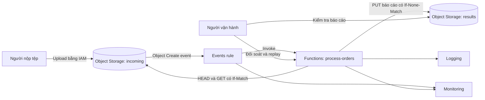

# Dự án xử lý tệp bằng Object Storage, Events và Functions

## 1. Bối cảnh và mục tiêu

Bài thuộc chương **Dự án tích hợp và đánh giá** của module `CLOUD_PROVIDERS_ORACLE`. Bạn sẽ kết hợp compartment, IAM, VCN, Object Storage, Events, Functions và giám sát để xây dựng một quy trình nhập tệp trên Oracle Cloud Infrastructure (OCI).

Tình huống: một nhóm kinh doanh gửi các tệp đơn hàng CSV vào bucket riêng tư. Hệ thống phải tự động kiểm tra tệp, tính tổng tiền nếu dữ liệu hợp lệ và lưu báo cáo JSON. Nhóm vận hành cần biết tệp nào bị từ chối, lần chạy nào thất bại vì hạ tầng và cách chạy lại mà không tạo thêm kết quả cho cùng một đầu vào.

Sau bài này, bạn cần tự chứng minh được:

- Tệp mới kích hoạt đúng function thông qua một Events rule có phạm vi rõ ràng.
- Function dùng resource principal với quyền giới hạn theo bucket và thao tác.
- Dữ liệu được kiểm tra trước khi kết quả được công bố.
- Sự kiện trùng, chạy đồng thời và tệp bị thay thế không làm sai báo cáo.
- Log, metric và quy trình đối soát đủ để phát hiện tệp chưa được xử lý.
- Hệ thống có cách triển khai lại, kiểm soát chi phí và thu hồi tài nguyên.

Đây là một bài tích hợp hạ tầng với xử lý dữ liệu nhỏ. Báo cáo JSON cũng có thể trở thành đầu vào cho một bước nạp Oracle Database sau này; phiên bản cơ sở chưa cần cơ sở dữ liệu.

## 2. Đề bài và hợp đồng xử lý

### 2.1. Phạm vi phiên bản cơ sở

Các tên dưới đây là quy ước của dự án mẫu; thay chúng đồng bộ nếu môi trường của bạn dùng tên khác.

| Thành phần | Quy ước |
| --- | --- |
| Compartment của bài thực hành | `cpt-capstone-files` |
| Bucket đầu vào | `capstone-incoming` |
| Bucket báo cáo | `capstone-results` |
| Application của Functions | `capstone-file-app` |
| Function | `process-orders` |
| Prefix đầu vào | `incoming/` |
| Prefix báo cáo | `reports/` |
| Phiên bản thuật toán | `orders-v1` |

Đặt hai bucket, application và Events rule trong cùng region, cùng compartment của bài thực hành. Mỗi lần nộp tệp phải dùng một object name mới, chẳng hạn `incoming/2026-11-21/batch-001.csv`. Không ghi đè object đầu vào trong luồng bình thường.

Các giới hạn sau là **quyết định của bài thực hành**, không phải giới hạn tối đa của OCI:

| Thuộc tính | Giá trị khởi đầu |
| --- | --- |
| Kích thước tệp | Tối đa 5 MiB, tức `5 * 1024 * 1024` byte |
| Số bản ghi dữ liệu | Từ 1 đến 50.000, không tính header |
| Encoding | UTF-8; chấp nhận BOM UTF-8 |
| Bộ nhớ function | 512 MB |
| Timeout function | 120 giây |
| Quy tắc dữ liệu lỗi | Từ chối toàn bộ tệp, báo lỗi đầu tiên |
| Đồng tiền của bộ dữ liệu | USD, cố định cho toàn bài |

Không dùng mục tiêu timeout này làm cam kết độ trễ. Bạn phải đo cả thời gian chờ sự kiện, cold start và thời gian xử lý trong môi trường thực tế.

### 2.2. Dữ liệu đầu vào

Tệp `orders.csv` dùng để kiểm tra đường đi thành công:

```csv
order_id,amount
ORD-001,100.50
ORD-002,250.00
ORD-003,15.25
```

Quy tắc kiểm tra:

1. Header phải đúng hai cột `order_id,amount`, đúng thứ tự và không có cột thừa.
2. `order_id` dài 1–64 ký tự, chỉ gồm chữ ASCII, chữ số, dấu gạch ngang hoặc gạch dưới; không trùng trong cùng tệp.
3. `amount` không âm, có tối đa 9 chữ số ở phần nguyên và tối đa 2 chữ số thập phân; không dùng dấu phân cách hàng nghìn hoặc dạng số mũ.
4. Khoảng trắng ở hai đầu giá trị được loại bỏ trước khi kiểm tra. Header không được tự sửa.
5. Tệp phải có ít nhất một bản ghi. Một dòng thiếu cột, thừa cột hoặc CSV sai cú pháp làm toàn bộ tệp bị từ chối.
6. Tiền được cộng bằng kiểu thập phân chính xác, không dùng `float`.

Với dữ liệu trên, kết quả mong đợi là 3 bản ghi và tổng `365.75` USD. Các dòng trống mà thư viện CSV bỏ qua không được tính là bản ghi.

### 2.3. Báo cáo đầu ra

Mỗi định danh đầu vào và phiên bản thuật toán có một object báo cáo:

```text
reports/<operation_id>.json
```

`operation_id` là SHA-256 của mảng JSON chứa namespace, bucket, object name, ETag và phiên bản thuật toán. Dùng cấu trúc JSON trước khi băm để không bị nhập nhằng do ký tự phân cách trong object name.

Ví dụ báo cáo thành công; các giá trị định danh là minh họa:

```json
{
  "operation_id": "<sha256-64-ky-tu>",
  "processor_version": "orders-v1",
  "source": {
    "namespace": "<namespace>",
    "bucket": "capstone-incoming",
    "object_name": "incoming/2026-11-21/batch-001.csv",
    "etag": "<etag-tu-su-kien>"
  },
  "status": "accepted",
  "record_count": 3,
  "currency": "USD",
  "total_amount": "365.75"
}
```

Tệp không hợp lệ có `status: rejected`, mã `reason` và, khi xác định được, số dòng vật lý `line`. Báo cáo bị từ chối không có tổng tiền hợp lệ một phần. Không chép giá trị ô sai vào log hay báo cáo lỗi.

Phân biệt bốn kết quả của một lần gọi:

| Kết quả lần gọi | Ý nghĩa |
| --- | --- |
| `accepted` | Báo cáo chấp nhận đã được ghi bền vững |
| `rejected` | Báo cáo từ chối nghiệp vụ đã được ghi bền vững |
| `duplicate` | Báo cáo cho định danh này đã tồn tại; đọc báo cáo để biết `accepted` hay `rejected` |
| `ignored` | Sự kiện nằm ngoài hợp đồng, chẳng hạn object không phải CSV trong prefix yêu cầu |

Lỗi quyền, kết nối, timeout hoặc lỗi ghi báo cáo phải làm invocation thất bại. Chỉ trả về bình thường sau khi đã xác nhận báo cáo tồn tại hoặc chủ động bỏ qua một sự kiện ngoài phạm vi.

## 3. Kiến trúc và ranh giới trách nhiệm



Object Storage lưu byte của tệp; sự kiện chỉ mang thông tin để tìm tệp. Events chọn thông điệp phù hợp và chuyển tới action. Function tải tệp, kiểm tra và tạo báo cáo. OCI hỗ trợ action cho Functions, Notifications và Streaming; ở phiên bản cơ sở chỉ cần action Functions. Xem [Overview of Events](https://docs.oracle.com/en-us/iaas/Content/Events/Concepts/eventsoverview.htm).

Tách bucket đầu vào và đầu ra tạo một ranh giới dễ kiểm tra: rule chỉ nhận bucket đầu vào; việc function ghi JSON vào bucket đầu ra không quay lại kích hoạt chính nó. Code vẫn kiểm tra namespace, bucket và prefix như lớp bảo vệ bổ sung.

### 3.1. Kết nối mạng

Tạo application trong một private regional subnet. Cấu hình:

- Service Gateway phục vụ Oracle Services Network của region.
- Route tới service CIDR phù hợp, thông thường là `All <region> Services in Oracle Services Network`, qua Service Gateway.
- Egress HTTPS TCP 443 tới đích dịch vụ cần thiết, cùng DNS hoạt động theo cấu hình VCN.
- Đủ địa chỉ IP trong subnet cho tải dự kiến và các tài nguyên khác dùng chung.

Function trong bài chỉ gọi Object Storage của cùng region. Nếu bổ sung API Internet thì phải thiết kế đường ra tương ứng. Môi trường build cũng cần kết nối tới registry và nguồn tải dependency; đây là đường mạng khác với luồng tải CSV lúc chạy. Tham khảo [Private Network Access](https://docs.oracle.com/en-us/iaas/Content/Functions/Concepts/functionsprivateaccess.htm) và [Preparing for Functions](https://docs.oracle.com/en-us/iaas/Content/Functions/Concepts/functionsprerequisites.htm).

Private subnet không tự biến invoke endpoint thành endpoint chỉ truy cập nội bộ. Quyền gọi function vẫn phải được kiểm soát bằng IAM. Oracle giải thích riêng điều này trong [Creating Applications](https://docs.oracle.com/en-us/iaas/Content/Functions/Tasks/functionscreatingapps.htm).

### 3.2. Danh tính và quyền

Có ba nhóm quyền cần tách biệt:

| Chủ thể | Nhiệm vụ | Phạm vi quyền |
| --- | --- | --- |
| Người triển khai | Tạo và cập nhật application, function, image và rule | Tài nguyên triển khai của compartment thực hành |
| Events service | Gọi function đích | Invocation trong compartment chứa function |
| Resource principal của function | Đọc CSV và ghi báo cáo | Hai bucket đã chỉ định |

Chứng thực của người triển khai có thể được dùng trong OCI CLI/Fn CLI. Function đang chạy dùng resource principal, không cần API private key, auth token của người dùng hoặc tệp cấu hình OCI đóng vào image.

Sau khi deploy function và lấy OCID, tạo dynamic group `dg-capstone-file-processor` với điều kiện thành viên:

```text
resource.id = '<FUNCTION_OCID>'
```

Cách này giới hạn vào đúng function được giao. Nếu xóa rồi tạo lại function, OCID thay đổi và phải cập nhật dynamic group. IAM policy phải đặt ở vị trí có thể cấp quyền tới compartment đích. Với identity domain không mặc định, dùng cách định danh dynamic group phù hợp của tenancy. Tham khảo [Resource Principal cho Functions](https://docs.oracle.com/en-us/iaas/Content/Functions/Tasks/functionsaccessingociresources.htm).

Các policy runtime mẫu, mỗi statement là một dòng:

```text
Allow dynamic-group dg-capstone-file-processor to manage objects in compartment cpt-capstone-files where all {target.bucket.name='capstone-incoming', request.permission='OBJECT_READ'}
Allow dynamic-group dg-capstone-file-processor to manage objects in compartment cpt-capstone-files where all {target.bucket.name='capstone-results', any {request.permission='OBJECT_READ', request.permission='OBJECT_CREATE', request.permission='OBJECT_OVERWRITE'}}
Allow service cloudEvents to use fn-invocation in compartment cpt-capstone-files
```

Hai statement đầu dùng `manage` kết hợp điều kiện `request.permission`; vì vậy function không được toàn quyền với object. Đầu vào chỉ có quyền đọc. Đầu ra có quyền đọc để kiểm tra báo cáo đã tồn tại và quyền ghi object. Không cấp quyền xóa hoặc liệt kê cho runtime.

`PutObject` có thể yêu cầu `OBJECT_OVERWRITE` nếu tên object đã tồn tại. Policy mẫu cho phép quyền đó trong bucket đầu ra; code luôn gửi điều kiện cấm ghi đè để giải quyết chạy đua. IAM và điều kiện request có vai trò khác nhau: policy này không phải cơ chế lưu trữ bất biến trước một function bị sửa mã. Đối chiếu [quyền Object Storage theo API](https://docs.oracle.com/en-us/iaas/Content/Identity/policyreference/objectstoragepolicyreference.htm).

Statement cuối thu hẹp lời gọi của Events vào `fn-invocation`, resource type chứa quyền `FN_INVOCATION`. Người tạo rule còn cần các quyền quản lý/tra cứu tài nguyên đích riêng. Nếu nhiều function dùng chung compartment và cần cô lập chặt hơn, thiết kế thêm điều kiện IAM hoặc tách compartment sau khi xác minh chính sách áp dụng. Xem [Details for Functions](https://docs.oracle.com/en-us/iaas/Content/Identity/policyreference/functionspolicyreference.htm) và [ví dụ Oracle về Events gọi Functions](https://blogs.oracle.com/cloud-infrastructure/governance-and-automation-with-oracle-events-and-functions).

Các quyền nền tảng phục vụ tạo VNIC, lấy image và triển khai cần được thiết lập theo [Creating Policies for Functions](https://docs.oracle.com/en-us/iaas/Content/Functions/Tasks/functionscreatingpolicies.htm). Policy đọc/ghi CSV ở trên không thay thế phần chuẩn bị tenancy này.

## 4. Sự kiện, ETag và tính lặp an toàn

### 4.1. Đọc đúng payload OCI

Đối với object, phải bật phát sự kiện trên bucket; tạo bucket thông thường chưa đủ. Sự kiện cần nhận là `com.oraclecloud.objectstorage.createobject`. Một payload rút gọn dùng để hiểu hợp đồng:

```json
{
  "cloudEventsVersion": "0.1",
  "eventID": "lab-event-001",
  "eventType": "com.oraclecloud.objectstorage.createobject",
  "eventTime": "2026-11-21T03:00:00Z",
  "source": "objectstorage",
  "data": {
    "compartmentId": "<COMPARTMENT_OCID>",
    "resourceName": "incoming/2026-11-21/batch-001.csv",
    "additionalDetails": {
      "namespace": "<NAMESPACE>",
      "bucketName": "capstone-incoming",
      "eTag": "<ETAG>"
    }
  }
}
```

Object name lấy từ `data.resourceName`; ETag có cách viết `eTag` trong `additionalDetails`. Không mặc định có `objectName`, `versionId` hoặc một cấu trúc `Records` của nhà cung cấp khác. Đối chiếu payload thật khi nghiệm thu với [Object event types và ví dụ của Oracle](https://docs.oracle.com/en-us/iaas/Content/Events/Reference/eventsproducers.htm).

### 4.2. Vì sao không chỉ dùng event ID?

Oracle mô tả Events có thể giao trùng thông điệp. Thiết kế phải chấp nhận nhiều lần gọi cho cùng thay đổi tài nguyên; không dựa vào thứ tự nhận sự kiện để xác định dữ liệu mới nhất. Xem [đặc tính giao thông điệp của Events](https://www.oracle.com/apac/cloud/events-service/).

`eventID` phù hợp để lần theo lần giao. Định danh xử lý trong dự án này dựa vào nguồn dữ liệu và `orders-v1`, giúp một lần replay có event ID khác vẫn tìm đúng báo cáo cũ. Hai object khác tên nhưng cùng nội dung vẫn là hai đầu vào độc lập.

Quy trình công bố báo cáo:

1. Tạo `operation_id` xác định từ thông tin nguồn.
2. Kiểm tra báo cáo đã tồn tại để tránh xử lý lại không cần thiết.
3. Đọc object bằng ETag trong sự kiện, kiểm tra dữ liệu và dựng báo cáo trong bộ nhớ.
4. Ghi đúng một object báo cáo với `If-None-Match: *`.
5. Nếu request ghi bị `412`, kiểm tra báo cáo đã có rồi kết thúc dưới dạng `duplicate`.

Bước 2 chỉ là tối ưu; bước 4 mới bảo vệ khi hai invocation cùng thấy báo cáo chưa tồn tại. Hai invocation vẫn có thể cùng đọc và tính toán, nhưng chỉ một lần công bố thắng. Cơ chế này không loại bỏ mọi lần thực thi trùng và không tự bảo vệ tác dụng phụ khác như gửi email hay ghi nhiều bảng.

### 4.3. Tệp bị thay thế giữa lúc phát sự kiện và lúc đọc

ETag là dấu hiệu kiểm tra tính nhất quán của resource, không được coi là SHA-256 của nội dung và không thay cho version ID. Function gửi `If-Match` khi `HEAD` và `GET` nguồn để tránh vô tình đọc object mới hơn dưới cùng tên. Các tùy chọn tương ứng của SDK là `if_match` và `if_none_match`; xem [ObjectStorageClient](https://docs.oracle.com/en-us/iaas/tools/python/latest/api/object_storage/client/oci.object_storage.ObjectStorageClient.html).

Nếu điều kiện đọc không khớp, phiên bản cơ sở ghi báo cáo `rejected` với `SOURCE_CHANGED`. Điều đó có nghĩa là byte của đầu vào mà sự kiện mô tả chưa được xử lý. Người vận hành cần yêu cầu nộp lại bằng tên mới hoặc phục hồi đúng version trong một thiết kế có versioning.

Bật versioning giúp giữ lịch sử, nhưng code dưới đây chưa tìm và đọc phiên bản cũ. Muốn hỗ trợ ghi đè như một tính năng, cần hợp đồng ánh xạ sự kiện sang version ID, quyền đọc version và kiểm thử riêng. Chỉ thêm `updateobject` vào filter chưa hoàn thành yêu cầu này.

## 5. Chuẩn bị tài nguyên và môi trường triển khai

### 5.1. Điều kiện bắt đầu

Bạn cần một tenancy được phép tạo tài nguyên, compartment thực hành, hạn mức Functions phù hợp, VCN/subnet đã chuẩn bị và một người quản trị có thể cấp IAM policy.

Các lệnh terminal trong bài dùng **Bash**, phù hợp với một môi trường phát triển Linux hoặc Cloud Shell đã được thiết lập cho Functions. Cần OCI CLI, Fn CLI, Docker và `jq`; kiểm tra quyền truy cập region và registry trước khi triển khai. Tên file mã nguồn bên dưới là những file người học tạo trong thư mục dự án của mình.

Hoàn thành bước chuẩn bị Functions và đăng nhập registry theo [Functions: Get Started using Cloud Shell](https://docs.oracle.com/en-us/iaas/Content/developer/functions/func-setup-cs/01-summary.htm). Fn context phải trỏ đến đúng compartment, API endpoint và registry của bài thực hành. Không đặt auth token hoặc API private key trong mã nguồn.

Khai báo biến của phiên thực hành:

```bash
export OCI_CLI_REGION='<region-id>'
export COMPARTMENT_OCID='<ocid-compartment-thuc-hanh>'
export SUBNET_OCID='<ocid-private-regional-subnet>'
export NAMESPACE="$(oci os ns get --query data --raw-output)"
export SOURCE_BUCKET='capstone-incoming'
export RESULT_BUCKET='capstone-results'
```

Ghi lại phiên bản CLI, runtime, region và các OCID tài nguyên trong hồ sơ triển khai. Những placeholder trong dấu `<...>` phải được thay trước khi dùng.

### 5.2. Tạo bucket riêng tư

```bash
oci os bucket create \
  --compartment-id "$COMPARTMENT_OCID" \
  --namespace-name "$NAMESPACE" \
  --name "$SOURCE_BUCKET" \
  --public-access-type NoPublicAccess \
  --storage-tier Standard \
  --object-events-enabled true

oci os bucket create \
  --compartment-id "$COMPARTMENT_OCID" \
  --namespace-name "$NAMESPACE" \
  --name "$RESULT_BUCKET" \
  --public-access-type NoPublicAccess \
  --storage-tier Standard \
  --object-events-enabled false
```

Nếu bucket đã tồn tại, kiểm tra cấu hình hiện hữu trước khi tiếp tục. Trong Console, xác minh quyền truy cập là private và chỉ bucket nguồn bật phát object events. Các tham số tương ứng được mô tả tại [OCI CLI: bucket create](https://docs.oracle.com/en-us/iaas/tools/oci-cli/latest/oci_cli_docs/cmdref/os/bucket/create.html).

Không cần dùng Archive cho đầu vào đang chờ xử lý; dữ liệu đã archive cần quy trình khôi phục trước khi đọc. Việc tự động chuyển lớp lưu trữ chỉ nên áp dụng sau khi đã xác định vòng đời dữ liệu.

### 5.3. Khởi tạo application và function

Sau khi Fn context đã cấu hình:

```bash
fn list apps
fn create app capstone-file-app --subnet-id "$SUBNET_OCID"
fn init --runtime python process-orders
cd process-orders
```

Giữ các trường runtime, entrypoint, build image và run image mà Fn CLI sinh ra. Trong `func.yaml`, đặt hoặc cập nhật:

```yaml
memory: 512
timeout: 120
```

Trong `requirements.txt`, giữ dependency FDK và bổ sung OCI Python SDK. Một cấu hình khởi đầu để build thử là:

```text
fdk
oci
```

Trước khi bàn giao, chốt các phiên bản dependency đã kiểm chứng và ghi lại image digest. Hai dòng không ghim phiên bản ở trên chưa bảo đảm build tái lập theo thời gian. Runtime và FDK được Oracle cập nhật; chọn phiên bản được hỗ trợ theo [Function Development Kits](https://docs.oracle.com/en-us/iaas/Content/Functions/Tasks/functionssupportedlanguageversions.htm).

## 6. Hiện thực function xử lý CSV

Mã mẫu sau dành cho `func.py`. Nó chỉ xử lý dữ liệu trong giới hạn bài thực hành, dùng một object báo cáo làm đơn vị công bố và không có tác dụng phụ ngoài Object Storage và log.

```python
import csv
import hashlib
import io
import json
import os
import re
import time
from decimal import Decimal

import oci
from fdk import response


MAX_BYTES = 5 * 1024 * 1024
MAX_ROWS = 50_000
PROCESSOR_VERSION = "orders-v1"
EVENT_TYPE = "com.oraclecloud.objectstorage.createobject"
ORDER_ID = re.compile(r"[A-Za-z0-9_-]{1,64}")
AMOUNT = re.compile(r"(?:0|[1-9][0-9]{0,8})(?:\.[0-9]{1,2})?")
_client = None


class RejectFile(Exception):
    def __init__(self, reason, line=None):
        super().__init__(reason)
        self.reason = reason
        self.line = line


def storage_client():
    global _client
    if _client is None:
        signer = oci.auth.signers.get_resource_principals_signer()
        _client = oci.object_storage.ObjectStorageClient(
            config={},
            signer=signer,
            timeout=(5, 20),
            retry_strategy=oci.retry.NoneRetryStrategy(),
        )
    return _client


def emit(status, **fields):
    print(json.dumps({"status": status, **fields}, ensure_ascii=False),
          flush=True)


def report_exists(client, namespace, bucket, name):
    try:
        client.head_object(namespace, bucket, name)
        return True
    except oci.exceptions.ServiceError as exc:
        if exc.status == 404:
            return False
        raise


def fetch_source(client, namespace, bucket, name, etag):
    try:
        head = client.head_object(
            namespace, bucket, name, if_match=etag
        )
        if int(head.headers["content-length"]) > MAX_BYTES:
            raise RejectFile("FILE_TOO_LARGE")

        downloaded = client.get_object(
            namespace, bucket, name, if_match=etag
        )
        try:
            payload = downloaded.data.raw.read(
                MAX_BYTES + 1, decode_content=True
            )
        finally:
            downloaded.data.close()
    except oci.exceptions.ServiceError as exc:
        if exc.status == 412:
            raise RejectFile("SOURCE_CHANGED") from exc
        raise

    if len(payload) > MAX_BYTES:
        raise RejectFile("FILE_TOO_LARGE")
    return payload


def summarize_csv(payload):
    try:
        text = payload.decode("utf-8-sig")
    except UnicodeDecodeError as exc:
        raise RejectFile("INVALID_UTF8") from exc

    reader = csv.DictReader(io.StringIO(text, newline=""), strict=True)
    seen = set()
    count = 0
    total = Decimal("0.00")

    try:
        if reader.fieldnames != ["order_id", "amount"]:
            raise RejectFile("INVALID_HEADER", line=1)

        for row in reader:
            count += 1
            if count > MAX_ROWS:
                raise RejectFile("TOO_MANY_ROWS", reader.line_num)
            if None in row or any(value is None for value in row.values()):
                raise RejectFile("INVALID_COLUMN_COUNT", reader.line_num)

            order_id = row["order_id"].strip()
            amount = row["amount"].strip()
            if ORDER_ID.fullmatch(order_id) is None:
                raise RejectFile("INVALID_ORDER_ID", reader.line_num)
            if order_id in seen:
                raise RejectFile("DUPLICATE_ORDER_ID", reader.line_num)
            if AMOUNT.fullmatch(amount) is None:
                raise RejectFile("INVALID_AMOUNT", reader.line_num)

            seen.add(order_id)
            total += Decimal(amount)
    except csv.Error as exc:
        raise RejectFile("INVALID_CSV", reader.line_num) from exc

    if count == 0:
        raise RejectFile("NO_DATA_ROWS")
    return {
        "record_count": count,
        "currency": "USD",
        "total_amount": format(total.quantize(Decimal("0.01")), "f"),
    }


def handler(ctx, data: io.BytesIO = None):
    started = time.monotonic()
    trace = {"event_id": "unknown", "operation_id": "unknown"}

    def finish(status, **fields):
        elapsed_ms = round((time.monotonic() - started) * 1000)
        emit(status, **trace, elapsed_ms=elapsed_ms, **fields)
        return response.Response(
            ctx,
            response_data=json.dumps({"status": status, **fields}),
            headers={"Content-Type": "application/json"},
        )

    try:
        event = json.loads(data.getvalue() if data else b"{}")
        if not isinstance(event, dict):
            raise ValueError("INVALID_EVENT")
        event_id = event.get("eventID")
        if not isinstance(event_id, str) or not event_id:
            raise ValueError("MISSING_EVENT_ID")
        trace["event_id"] = event_id[:128]

        if event.get("eventType") != EVENT_TYPE:
            return finish("ignored", reason="EVENT_TYPE")

        item = event["data"]
        details = item["additionalDetails"]
        namespace = details["namespace"]
        bucket = details["bucketName"]
        name = item["resourceName"]
        etag = details["eTag"]
        required = (namespace, bucket, name, etag)
        if not all(isinstance(value, str) and value for value in required):
            raise ValueError("INVALID_SOURCE_FIELDS")

        if (namespace != os.environ["SOURCE_NAMESPACE"]
                or bucket != os.environ["SOURCE_BUCKET"]):
            return finish("ignored", reason="SOURCE_SCOPE")
        if not name.startswith("incoming/") or not name.endswith(".csv"):
            return finish("ignored", reason="OBJECT_NAME")

        result_bucket = os.environ["RESULT_BUCKET"]
        if result_bucket == bucket:
            raise ValueError("RESULT_BUCKET_MUST_DIFFER")

        identity = json.dumps(
            [namespace, bucket, name, etag, PROCESSOR_VERSION],
            ensure_ascii=False, separators=(",", ":"),
        ).encode("utf-8")
        operation_id = hashlib.sha256(identity).hexdigest()
        trace["operation_id"] = operation_id
        result_name = f"reports/{operation_id}.json"
        client = storage_client()
        emit("started", **trace)

        if report_exists(client, namespace, result_bucket, result_name):
            return finish("duplicate", result_object=result_name)

        report = {
            "operation_id": operation_id,
            "processor_version": PROCESSOR_VERSION,
            "source": {
                "namespace": namespace,
                "bucket": bucket,
                "object_name": name,
                "etag": etag,
            },
        }

        try:
            payload = fetch_source(client, namespace, bucket, name, etag)
            report.update(summarize_csv(payload))
            report["status"] = "accepted"
        except RejectFile as exc:
            report["status"] = "rejected"
            report["reason"] = exc.reason
            if exc.line is not None:
                report["line"] = exc.line

        body = json.dumps(
            report, ensure_ascii=False, sort_keys=True, separators=(",", ":")
        ).encode("utf-8")
        try:
            client.put_object(
                namespace, result_bucket, result_name, body,
                content_length=len(body),
                content_type="application/json",
                if_none_match="*",
            )
        except oci.exceptions.ServiceError as exc:
            if exc.status == 412 and report_exists(
                client, namespace, result_bucket, result_name
            ):
                return finish("duplicate", result_object=result_name)
            raise

        fields = {"result_object": result_name}
        if "reason" in report:
            fields["reason"] = report["reason"]
        return finish(report["status"], **fields)

    except Exception as exc:
        # Không ghi payload, giá trị ô hoặc toàn bộ thông báo SDK vào log.
        emit(
            "failed", **trace,
            error_type=type(exc).__name__,
            service_status=getattr(exc, "status", None),
            service_code=getattr(exc, "code", None),
            elapsed_ms=round((time.monotonic() - started) * 1000),
        )
        raise
```

### 6.1. Những lựa chọn cần hiểu trong mã

**Giới hạn tài nguyên:** code kiểm tra kích thước trước khi tải và chỉ đọc tối đa giới hạn cộng một byte. Giới hạn số dòng còn bảo vệ bộ nhớ dành cho tập `seen`. Bản mẫu tải tệp nhỏ vào bộ nhớ; nó chưa phải bộ xử lý streaming cho tệp hàng GB.

**Độ chính xác:** `Decimal` tránh sai số cộng tiền từ biểu diễn nhị phân. Giới hạn định dạng được kiểm tra trước khi tạo `Decimal`, nên các giá trị như `NaN`, `Infinity`, `1e3` và số âm đều bị từ chối.

**Định danh ổn định:** báo cáo không chứa thời điểm invocation hoặc event ID. Thông tin thay đổi theo lần giao nằm trong log, giúp báo cáo của cùng đầu vào và phiên bản xử lý giữ nội dung ổn định.

**Xử lý lỗi có phạm vi:** chỉ `412` của lệnh đọc nguồn được diễn giải thành `SOURCE_CHANGED`; chỉ `412` của lệnh ghi báo cáo kèm xác nhận báo cáo tồn tại được diễn giải thành trùng. `404` khi đọc nguồn vẫn là lỗi cần điều tra vì có thể là thiếu object hoặc vấn đề phân quyền bị che dưới cùng kiểu phản hồi.

**Retry có chủ đích:** SDK retry được tắt trong ví dụ để không cộng nhiều vòng chờ ngoài dự kiến. Timeout `(5, 20)` áp dụng cho kết nối/đọc mạng của request, không phải đồng hồ tổng của cả invocation. Khi thêm retry cho lỗi tạm thời, phải giới hạn tổng ngân sách thời gian và vẫn giữ cơ chế replay/đối soát. Function timeout là giới hạn cuối cùng.

**Giới hạn bảo vệ thông tin:** log do ứng dụng chủ động ghi không chứa nội dung CSV. Exception được ném lại để invocation thất bại; vì runtime có thể ghi traceback, vẫn phải giới hạn quyền xem log và không đưa dữ liệu nhạy cảm vào thông điệp exception, object name hoặc tên tài nguyên.

### 6.2. Deploy và cấu hình runtime

Trong thư mục `process-orders`, deploy sau khi đã cập nhật mã và dependency:

```bash
fn deploy --app capstone-file-app

fn config app capstone-file-app SOURCE_NAMESPACE "$NAMESPACE"
fn config app capstone-file-app SOURCE_BUCKET "$SOURCE_BUCKET"
fn config app capstone-file-app RESULT_BUCKET "$RESULT_BUCKET"
```

Ứng dụng được dành riêng cho bài này nên có thể đặt cấu hình ở mức application. Nếu chia sẻ application cho nhiều function, đánh giá phạm vi cấu hình phù hợp hơn. Ghi lại OCID của function từ Console vào biến `FUNCTION_OCID`, rồi hoàn thành dynamic group và policy runtime ở mục 3.

```bash
export FUNCTION_OCID='<ocid-cua-process-orders>'
```

Không diễn giải ngay lần thử lỗi sau khi sửa IAM là bằng chứng policy sai; danh tính và quyền có thể chưa được cập nhật trong token đang được cache. Giữ thời gian thay đổi và lần thử trong hồ sơ để điều tra.

## 7. Nối Object Storage với function bằng Events

### 7.1. Tạo filter có phạm vi

Trong Console, tạo rule ở đúng region và compartment nguồn. Chọn loại sự kiện Object Storage **Create Object**, giới hạn thêm bucket và namespace. Filter tương đương:

```json
{
  "eventType": ["com.oraclecloud.objectstorage.createobject"],
  "data": {
    "compartmentId": ["<COMPARTMENT_OCID>"],
    "additionalDetails": {
      "bucketName": ["capstone-incoming"],
      "namespace": ["<NAMESPACE>"]
    }
  }
}
```

Đây là JSON pattern của Events, không phải biểu thức SQL hay toàn bộ payload sự kiện. Code kiểm tra prefix và hậu tố `.csv`, nên phiên bản cơ sở không phụ thuộc cú pháp wildcard của filter. Xem [Matching Events with Filters](https://docs.oracle.com/en-us/iaas/Content/Events/Concepts/filterevents.htm).

Chọn action **Functions**, trỏ tới application và function vừa deploy; bật cả rule lẫn action. Có thể tạo bằng OCI CLI với `jq` để dựng JSON từ biến:

```bash
CONDITION=$(jq -nc \
  --arg cid "$COMPARTMENT_OCID" \
  --arg bucket "$SOURCE_BUCKET" \
  --arg ns "$NAMESPACE" \
  '{eventType:["com.oraclecloud.objectstorage.createobject"],
    data:{compartmentId:[$cid],
      additionalDetails:{bucketName:[$bucket],namespace:[$ns]}}}')

ACTIONS=$(jq -nc --arg fid "$FUNCTION_OCID" \
  '{actions:[{actionType:"FAAS",isEnabled:true,functionId:$fid}]}')

RULE_OCID=$(oci events rule create \
  --compartment-id "$COMPARTMENT_OCID" \
  --display-name 'capstone-on-order-created' \
  --is-enabled true \
  --condition "$CONDITION" \
  --actions "$ACTIONS" \
  --query data.id --raw-output)
```

Tham số rule được mô tả tại [OCI CLI: events rule create](https://docs.oracle.com/en-us/iaas/tools/oci-cli/latest/oci_cli_docs/cmdref/events/rule/create.html). Sau khi tạo, xem lại OCID function trong action; đừng chỉ dựa vào tên hiển thị giống nhau.

### 7.2. Kiểm tra đường đi thành công

Tạo `orders.csv` đúng nội dung ở mục 2, rồi upload dưới một tên chưa dùng:

```bash
export OBJECT_NAME="incoming/$(date -u +%Y-%m-%d)/batch-$(date -u +%s)-${RANDOM}.csv"

oci os object put \
  --namespace-name "$NAMESPACE" \
  --bucket-name "$SOURCE_BUCKET" \
  --name "$OBJECT_NAME" \
  --file orders.csv \
  --if-none-match '*'
```

Ghi lại object name và ETag trả về. Theo dõi rule metric, invocation và application log. Từ log `accepted`, lấy `result_object` rồi tải báo cáo bằng danh tính người kiểm tra có quyền đọc bucket:

```bash
export RESULT_OBJECT='reports/<operation-id-tu-log>.json'

oci os object get \
  --namespace-name "$NAMESPACE" \
  --bucket-name "$RESULT_BUCKET" \
  --name "$RESULT_OBJECT" \
  --file result.json
```

Chỉ xác nhận thành công khi nội dung báo cáo có đúng object nguồn, ETag, số bản ghi và tổng tiền. Invocation kết thúc bình thường hoặc số lượng object đầu ra tăng chưa đủ chứng minh dữ liệu được tính đúng.

Những object đã có trước khi bật phát sự kiện hoặc trước khi có rule không được coi là đã được backfill. Ghi chúng vào danh sách đối soát để xử lý có kiểm soát.

## 8. Kế hoạch kiểm thử và bằng chứng nghiệm thu

### 8.1. Ma trận kiểm thử bắt buộc

Chạy các tình huống dưới đây trong compartment thực hành. Mỗi ca cần có tên object mới hoặc một bộ đầu vào được chuẩn bị riêng để tránh báo cáo cũ che khuất hành vi cần kiểm tra.

| Ca | Thao tác | Kết quả cần quan sát |
| --- | --- | --- |
| T01 | Upload CSV mẫu 3 dòng | Báo cáo `accepted`, 3 bản ghi, tổng `365.75` |
| T02 | Thay một số tiền bằng `abc`, `-1`, `1e3` hoặc `NaN` | Báo cáo `rejected`, `INVALID_AMOUNT`, không có tổng tiền |
| T03 | Tệp chỉ có header | `rejected`, `NO_DATA_ROWS` |
| T04 | Thiếu/thừa cột hoặc đảo thứ tự header | `INVALID_COLUMN_COUNT` hoặc `INVALID_HEADER` tương ứng |
| T05 | Hai dòng có cùng `order_id` | `DUPLICATE_ORDER_ID` và dòng phát hiện lỗi |
| T06 | Tệp không giải mã được bằng UTF-8 | `INVALID_UTF8` |
| T07 | Tệp lớn hơn 5 MiB hoặc có hơn 50.000 bản ghi | `FILE_TOO_LARGE` hoặc `TOO_MANY_ROWS` |
| T08 | Gọi lại cùng payload nhiều lần | Có một báo cáo; lần sau trả `duplicate` |
| T09 | Gọi đồng thời hai invocation cho cùng đầu vào chưa có báo cáo | Một báo cáo cuối cùng; không bị ghi đè hoặc tạo thêm object báo cáo |
| T10 | Tắt rule, upload rồi thay thế tệp; invoke payload mang ETag cũ | Khi chưa có báo cáo cũ, tạo `rejected` với `SOURCE_CHANGED` |
| T11 | Gỡ quyền đọc nguồn hoặc ghi kết quả trong môi trường thử | Invocation thất bại, có log `failed`; không báo thành công nghiệp vụ |
| T12 | Upload một object vào bucket kết quả | Không xuất hiện vòng lặp invocation do rule của bài |
| T13 | Upload `.txt` hoặc CSV ngoài prefix `incoming/` vào bucket nguồn | Invocation có thể xảy ra, nhưng kết thúc `ignored`, không có báo cáo |
| T14 | Khôi phục quyền sau T11 rồi replay đầu vào còn nguyên | Báo cáo được tạo; replay tiếp vẫn an toàn |

Ở T10, giữ lại ETag cũ trước khi thay thế. Nếu báo cáo của đầu vào cũ đã tồn tại thì kết quả `duplicate` là đúng; nó không kiểm tra lại byte nguồn. Sau thử nghiệm, khôi phục rule và quy tắc nộp tệp không ghi đè.

Ở T11, chờ thay đổi IAM có hiệu lực rồi mới kết luận. Ghi rõ danh tính nào bị thu hồi quyền; thu hồi quyền của người dùng CLI không đồng nghĩa thu hồi resource principal của function.

### 8.2. Tạo payload replay có kiểm soát

Đối với một object do bạn sở hữu, lấy ETag đã lưu từ lần upload hoặc từ phép kiểm tra metadata của đúng object hiện hành. Payload sau dùng để invoke trực tiếp; đây là dữ liệu kiểm thử bạn tạo, không phải bằng chứng Events đã tự phát sự kiện:

```bash
export SOURCE_ETAG='<etag-cua-dung-dau-vao>'

jq -n \
  --arg ns "$NAMESPACE" \
  --arg bucket "$SOURCE_BUCKET" \
  --arg name "$OBJECT_NAME" \
  --arg etag "$SOURCE_ETAG" \
  '{cloudEventsVersion:"0.1",eventID:"manual-replay-001",
    eventType:"com.oraclecloud.objectstorage.createobject",
    source:"objectstorage",
    data:{resourceName:$name,
      additionalDetails:{namespace:$ns,bucketName:$bucket,eTag:$etag}}}' \
  > event.json

fn invoke capstone-file-app process-orders < event.json
fn invoke capstone-file-app process-orders < event.json
```

Để kiểm tra chạy đua, chuẩn bị một object nguồn chưa có báo cáo, rồi invoke cùng `event.json` đồng thời từ hai terminal được cấp quyền. Dùng object key và số lần ghi báo cáo làm bằng chứng. Không chỉ đếm invocation vì nhiều lần thực thi vẫn có thể là hành vi đúng.

### 8.3. Cấu trúc bằng chứng cho mỗi ca

Lưu các thông tin sau trong hồ sơ kiểm thử của người học:

- Mã ca, dữ liệu đầu vào hoặc cách sinh dữ liệu, thời gian UTC và kết quả mong đợi.
- Object name, ETag và `operation_id` nếu đã tạo được.
- Log kết thúc tương ứng, nội dung báo cáo và đối chiếu phép tính độc lập.
- Kết quả thực tế, điểm sai khác và thao tác khôi phục cấu hình nếu có.

Phân biệt rõ ca đã chạy trên OCI, ca chỉ được mô phỏng và ca chưa chạy. Không dùng ảnh Console của một lần chạy thành công để thay cho cả ma trận.

## 9. Giám sát theo ba lớp

### 9.1. Lớp giao sự kiện

Theo dõi namespace metric `oci_cloudevents`, giới hạn theo rule:

| Metric | Điều cần kiểm tra |
| --- | --- |
| `PublishedEvents` | Nguồn có phát sự kiện trong compartment hay không |
| `MatchedEvents` | Filter có khớp thông điệp mong đợi hay không |
| `DeliverySucceedEvents` | Events ghi nhận giao được tới action |
| `DeliveryFailedEvents` | Có lần giao tới action không thành công |

Đây là metric của việc phát, khớp và giao thông điệp. Chúng chưa chứng minh CSV hợp lệ hoặc báo cáo đã đúng. Đối chiếu tên metric và dimension tại [Events Metrics](https://docs.oracle.com/en-us/iaas/Content/Events/Reference/eventsmetrics.htm).

### 9.2. Lớp thực thi function

Trong namespace `oci_faas`, theo dõi `FunctionInvocationCount`, `FunctionExecutionDuration` và `FunctionResponseCount`. Với metric phản hồi, kiểm tra các giá trị `responseType` như `Error` và `Throttled`. Chọn khoảng thời gian và function OCID chính xác; metric có thể đến chậm hơn log. Xem [Function Metrics](https://docs.oracle.com/en-us/iaas/Content/Functions/Reference/functionsmetrics.htm).

Tạo cảnh báo thử nghiệm cho lỗi giao sự kiện, function lỗi và throttling; xác minh đường gửi cảnh báo tới nơi nhận do nhóm thực hành quản lý. Ngưỡng phải dựa trên tải kiểm thử và nhu cầu phản ứng. Không coi biểu đồ không có dữ liệu là bằng chứng hệ thống hoàn toàn khỏe.

### 9.3. Lớp kết quả nghiệp vụ

Bật Function Invocation Logs của application qua OCI Logging, chọn log group và thời hạn lưu phù hợp. Mã mẫu chủ động ghi log JSON bằng `print`; hướng dẫn của Oracle nằm tại [Storing and Viewing Function Logs](https://docs.oracle.com/en-us/iaas/Content/Functions/Tasks/functionsexportingfunctionlogfiles.htm).

Một log kết thúc có dạng:

```json
{
  "status": "accepted",
  "event_id": "lab-event-001",
  "operation_id": "<sha256>",
  "elapsed_ms": 620,
  "result_object": "reports/<sha256>.json"
}
```

`accepted`, `rejected`, `duplicate`, `ignored` và `failed` là trạng thái của ứng dụng. Chúng không tự xuất hiện thành metric OCI mới. Nếu cần cảnh báo theo tỷ lệ tệp bị từ chối, thiết lập truy vấn/tổng hợp log hoặc chủ động phát custom metric với IAM và chi phí tương ứng.

Dashboard thực hành nên trả lời được: có bao nhiêu đầu vào cần xử lý, bao nhiêu định danh đã có báo cáo chấp nhận hoặc từ chối, còn bao nhiêu định danh chưa có báo cáo. Đếm theo `operation_id`; đếm số dòng log sẽ phóng đại kết quả khi replay.

Nếu thêm Notifications thành một action khác của cùng Events rule, thông báo đó phản ánh sự kiện tệp xuất hiện. Các action không tạo chuỗi giao dịch “function xong rồi mới thông báo”; thông báo hoàn tất nghiệp vụ cần một bước phát riêng sau khi báo cáo đã ghi thành công.

## 10. Xử lý sự cố, đối soát và chạy lại

### 10.1. Phân loại trước khi sửa

| Triệu chứng | Hướng điều tra đầu tiên | Cách xử lý |
| --- | --- | --- |
| Upload xong nhưng không có event phù hợp | Emit events, region, compartment, filter | Sửa cấu hình rồi đưa object bị bỏ sót vào đối soát |
| Event khớp nhưng function không được gọi | Action bị tắt, OCID sai, quyền invocation | Kiểm tra action và IAM trước khi thử lại |
| Function không khởi tạo | Image, kiến trúc application, dependency, entrypoint | Xem invocation log, sửa và deploy lại image đã xác định |
| Function timeout khi gọi Object Storage | Route, Service Gateway, egress, DNS | Khôi phục đường kết nối rồi replay |
| Đọc nguồn trả lỗi quyền hoặc không tìm thấy | Dynamic group, policy, object name, nguồn bị xóa | Xác minh cả danh tính và sự tồn tại bằng tài khoản vận hành |
| Ghi báo cáo thất bại | Quyền bucket đầu ra, cấu hình tên bucket, mạng | Khắc phục rồi replay; giữ nguồn nguyên vẹn |
| Có báo cáo `rejected` | Mã `reason` và dòng lỗi | Sửa dữ liệu rồi nộp bằng object name mới |
| Có `SOURCE_CHANGED` | Đầu vào đã bị thay thế | Nộp lại đầu vào bất biến hoặc phục hồi đúng version theo quy trình riêng |
| Nhiều invocation nhưng một báo cáo | Sự kiện trùng, replay, chạy đua | Kiểm tra tính đúng của báo cáo và chi phí phát sinh |
| Invocation tăng liên tục sau mỗi kết quả | Rule khớp cả bucket/prefix đầu ra | Tắt rule, sửa filter rồi kiểm tra lại |

Không xử lý chung mọi `404` thành “tệp đã xóa”. OCI có thể không tiết lộ sự tồn tại của tài nguyên mà caller không được phép xem. Cũng không biến mọi exception thành phản hồi `200` có chuỗi `error` trong JSON.

### 10.2. Ranh giới của retry

Events giao được một thông điệp, một invocation được chấp nhận và một báo cáo được công bố là những mốc riêng. Không suy ra rằng mọi exception nghiệp vụ/hạ tầng bên trong function đều được dịch vụ tự động chạy lại cho tới khi thành công.

Phiên bản cơ sở dùng ba cơ chế: báo cáo bền vững, log lỗi và replay do vận hành. Nó chưa có hàng đợi, dead-letter queue hay bộ điều phối tự động. Không gán tên DLQ cho một bucket chỉ vì có báo cáo `rejected` trong đó.

Khi thử lỗi có chủ đích, ghi lại hành vi thực tế của luồng Events → Functions trong tenancy: lỗi ở khâu giao action khác lỗi xảy ra sau khi function bắt đầu. Dù quan sát thấy dịch vụ retry, vẫn phải đối soát đầu vào chưa có báo cáo và kiểm tra điều kiện hết thời gian/không còn retry.

### 10.3. Quy trình đối soát phiên bản cơ sở

Trong bài nhỏ, người vận hành có thể thực hiện quy trình này thủ công. Danh tính đối soát có quyền liệt kê/đọc phù hợp; không cần mở rộng quyền runtime của function.

1. Lấy danh sách object dưới `incoming/` và metadata nguồn; dùng phân trang nếu danh sách vượt một trang trả về.
2. Chỉ chọn object đủ cũ so với thời gian chờ bình thường đã đo, để tránh replay dồn dập trong lúc lần chạy ban đầu còn hoạt động.
3. Từ namespace, bucket, object name, ETag và phiên bản thuật toán, tính `operation_id` bằng đúng quy tắc trong mã.
4. Kiểm tra `reports/<operation_id>.json`. Ghi nhận riêng báo cáo `accepted`, `rejected` và đầu vào chưa có báo cáo.
5. Với đầu vào chưa có báo cáo, tìm lỗi tương ứng, khắc phục nguyên nhân rồi invoke payload replay với đúng ETag.
6. Đối chiếu lại báo cáo sau replay và ghi nhận kết quả xử lý sự cố.

Nếu object đầu vào đã bị ghi đè, danh sách hiện tại không tái tạo được thông tin mọi lần nộp trong quá khứ. Muốn đối soát toàn bộ lịch sử cần manifest lúc upload hoặc versioning cùng cơ chế tra cứu phiên bản. Đây là lý do quy tắc không ghi đè là điều kiện của phiên bản cơ sở.

Không xóa báo cáo từ chối chỉ để ép lần chạy sau trở thành thành công. Khi dữ liệu được sửa, nộp bằng tên mới. Khi thuật toán thay đổi, tăng `PROCESSOR_VERSION`, cập nhật bằng chứng kiểm thử và chấp nhận rằng định danh báo cáo mới sẽ khác.

## 11. Hiệu năng, chi phí và khả năng phục hồi

### 11.1. Đo tải có giới hạn

Bắt đầu với một tệp nhỏ, sau đó tăng lên vài chục tệp bằng các object name riêng. Giữ nguyên nội dung dữ liệu khi muốn so sánh tác động của cấu hình bộ nhớ.

Đo ít nhất hai khoảng thời gian:

- **Thời gian trong invocation:** từ lúc handler bắt đầu đến khi trả kết quả, như `elapsed_ms` trong log.
- **Thời gian đầu cuối:** từ khi upload hoàn tất đến khi báo cáo có thể đọc được, được ghi nhận bởi công cụ kiểm thử hoặc thao tác vận hành.

Ghi riêng các lần cold start nếu nhận diện được và các lần bị throttling. Mục tiêu tự đặt có thể là 95% tệp nhỏ có báo cáo trong khoảng thời gian mà nhóm thống nhất; phải nêu kích thước tệp, mức đồng thời, số mẫu và kết quả đo. Đây là tiêu chí nghiệm thu của nhóm, không phải SLA của OCI.

Nếu tăng bộ nhớ, đo lại cả thời gian lẫn chi phí. Nếu tăng độ đồng thời, theo dõi giới hạn dịch vụ, IP subnet và số request Object Storage. Không tăng timeout để che việc function đang xử lý khối lượng công việc ngoài thiết kế.

### 11.2. Mô hình chi phí

Chi phí cần khảo sát gồm thời gian/bộ nhớ Functions, số request và dung lượng Object Storage, image lưu trong registry, log, cảnh báo và các thành phần mạng thực sự được dùng. Dùng giá hiện hành tại region/tenancy khi lập dự toán; bài không giả định toàn bộ tài nguyên được miễn phí.

Mô hình tính sơ bộ phục vụ so sánh:

```text
Tài nguyên tính toán ≈ tổng(memory_GB × thời_gian_chạy_giây)
Request lưu trữ ≈ các lần HEAD + GET + PUT + hoạt động đối soát
Dung lượng lưu ≈ tệp nguồn + báo cáo + version được giữ lại
```

Mô hình này chưa bao gồm cách làm tròn và mọi mục tính phí của nhà cung cấp. Sự kiện trùng có thể không tạo thêm báo cáo nhưng vẫn phát sinh invocation, request và log.

Đặt budget theo compartment hoặc tag, có người nhận cảnh báo và quy định khi nào dừng thử tải. Budget là ngưỡng theo dõi mềm, không tự cắt tài nguyên khi đạt số tiền đặt trước; tham khảo [OCI Budgets](https://docs.oracle.com/en-us/iaas/Content/Billing/Concepts/budgetsoverview.htm).

Gắn tag mục đích, chủ sở hữu và ngày hết hạn cho các tài nguyên hỗ trợ tag. Chọn retention log và vòng đời object phù hợp: giữ nguồn ít nhất đủ cho đối soát, điều tra và replay; chỉ chuyển tầng hoặc xóa sau khi xác nhận điều kiện nghiệp vụ. Versioning, nếu bật, cần chính sách giữ/xóa version riêng.

### 11.3. Khả năng phục hồi

Byte nguồn còn nguyên trong Object Storage là cơ sở để chạy lại sau lỗi của function hoặc một cấu hình triển khai hỏng. Lưu mã nguồn, cấu hình application, policy, filter và image digest giúp tái lập pipeline.

Một bài diễn tập phục hồi có thể gồm: làm hỏng cấu hình đầu ra, upload một lô nhỏ, quan sát lỗi, khôi phục cấu hình, đối soát rồi replay cho tới khi mỗi đầu vào có báo cáo. Ghi lại thời gian phát hiện và thời gian phục hồi đo được.

Kiến trúc cơ sở triển khai trong một region, chưa có failover giữa các region. Managed service giúp giảm công việc quản trị hạ tầng, nhưng không tự giải quyết đầu vào bị xóa, policy sai, rule bị tắt hoặc dữ liệu bị ghi đè. Nếu bổ sung dự phòng region, phải thiết kế riêng việc sao chép dữ liệu, triển khai lại tài nguyên, kích hoạt pipeline ở nơi dự phòng và tránh xử lý hai nơi không kiểm soát.

## 12. Bàn giao và tiêu chí đánh giá

### 12.1. Sản phẩm cần nộp

Hồ sơ capstone của người học cần có:

1. Sơ đồ kiến trúc kèm region, compartment và ranh giới mạng/danh tính.
2. Mã function, dependency đã chốt, cấu hình build/runtime và image digest.
3. Cấu hình bucket, Events filter/action, dynamic group và policy; thay OCID nhạy cảm bằng placeholder khi chia sẻ công khai.
4. Tệp mẫu hợp lệ, các tệp lỗi tiêu biểu, báo cáo đầu ra và bảng kết quả kiểm thử.
5. Bằng chứng xử lý trùng và chạy đồng thời, có object key và nội dung báo cáo.
6. Cấu hình log/metric/cảnh báo, cùng một ví dụ điều tra lỗi đến nguyên nhân.
7. Quy trình đối soát/replay, kết quả diễn tập phục hồi, dự toán chi phí và danh sách tài nguyên cần thu hồi.

Quá trình triển khai nên được mô tả đủ rõ để một người khác lặp lại trong compartment sạch. Nếu dùng Terraform hoặc OCI Resource Manager, đưa tham số môi trường ra biến và kiểm tra plan trước khi áp dụng. Không đưa state có thông tin nhạy cảm hoặc credential vào kho mã.

### 12.2. Thang điểm tham khảo

| Tiêu chí | Điểm | Bằng chứng đạt |
| --- | ---: | --- |
| Luồng tích hợp và kết quả nghiệp vụ | 20 | Upload thực kích hoạt xử lý, báo cáo tính đúng và từ chối đúng |
| IAM và mạng | 15 | Resource principal, policy có phạm vi, kết nối private hoạt động |
| Xử lý trùng và nhất quán đầu vào | 20 | Kiểm tra ETag, conditional write, replay và chạy đua an toàn |
| Phân loại lỗi và phục hồi | 15 | Không nuốt lỗi hạ tầng, có đối soát và phục hồi được lô lỗi |
| Quan sát và bằng chứng kiểm thử | 15 | Theo dõi được cả giao sự kiện, invocation và kết quả nghiệp vụ |
| Tái triển khai và vận hành | 10 | Dependency/image được chốt, cấu hình đủ và runbook dùng được |
| Chi phí và thu hồi tài nguyên | 5 | Có dự toán, budget và xác nhận dọn tài nguyên thực hành |
| **Tổng** | **100** | |

Những điều kiện chặn nghiệm thu gồm: đầu ra tính sai nhưng vẫn báo chấp nhận, bí mật người dùng được đóng vào image, rule gây vòng lặp hoặc invocation báo thành công dù chưa ghi được báo cáo. Điểm số các mục khác không thay thế việc khắc phục những lỗi này.

### 12.3. Trình tự demo

Một buổi demo có thể thực hiện theo thứ tự: trình bày luồng và policy; upload CSV hợp lệ; mở báo cáo; nộp CSV sai; replay một đầu vào; chạy thử đồng thời; gây một lỗi quyền có kiểm soát; khôi phục và đối soát. Kết thúc bằng các số liệu đã đo và giới hạn còn tồn tại.

Người trình bày cần giải thích được vì sao đầu vào bị từ chối khác lỗi invocation, vì sao conditional write cần thiết dù đã kiểm tra object tồn tại và vì sao thêm một bước ghi cơ sở dữ liệu sẽ cần thiết kế lại tính lặp an toàn.

## 13. Hướng mở rộng có giới hạn rõ ràng

Chỉ bổ sung sau khi phiên bản cơ sở đã được nghiệm thu:

- **Versioning:** đọc đúng version theo một hợp đồng định danh đã xác minh; không suy ra version ID từ ETag.
- **Lưu trạng thái nghiệp vụ:** dùng OCI NoSQL hoặc Oracle Database để theo dõi nhiều bước, với khóa duy nhất và giao dịch/cơ chế điều phối phù hợp. Tính duy nhất của báo cáo Object Storage không tự tạo giao dịch nguyên tử với database.
- **Xử lý tải lớn:** bổ sung tầng nhận việc bền vững và consumer có giới hạn đồng thời, hoặc chuyển xử lý dài sang một dịch vụ phù hợp hơn. Thiết kế cơ chế đưa việc vào hàng đợi, retry, hết hạn và xử lý việc lỗi; không coi Events có action trực tiếp cho mọi dịch vụ hàng đợi.
- **Thông báo kết quả:** chỉ phát sau khi báo cáo đã công bố; định danh thông báo theo đầu vào và phiên bản để kiểm soát gửi trùng.
- **Dữ liệu thật:** đánh giá phân loại dữ liệu, mã hóa, thời hạn lưu, quyền xem báo cáo và log; tránh đưa thông tin cá nhân vào object name.

Mỗi mở rộng cần một tình huống lỗi mới trong kế hoạch kiểm thử và một cách đối soát kết quả. Giữ phiên bản thuật toán, định danh đầu vào và phạm vi tác dụng phụ nhất quán trong toàn bộ thiết kế.

## 14. Thu hồi tài nguyên thực hành

Trước khi xóa, lưu bằng chứng cần nộp và xác nhận compartment chỉ chứa tài nguyên của bài. Thực hiện tuần tự:

1. Dừng upload mới và tắt Events rule để ngừng phát sinh công việc từ luồng thực hành.
2. Chờ invocation đang chạy kết thúc, hoàn tất đối soát và lưu các báo cáo cần giữ.
3. Xóa rule, function và application do bài tạo; kiểm tra trước các tài nguyên dùng chung.
4. Xóa image/repository riêng không còn dùng và các cấu hình log/cảnh báo dành riêng cho bài.
5. Xóa object thử nghiệm, version và multipart upload còn dở nếu có, rồi xóa các bucket riêng khi đã đủ điều kiện.
6. Gỡ policy và dynamic group dành riêng cho function; thu hồi credential hoặc token triển khai tạm thời đã tạo cho bài.
7. Thu hồi subnet, gateway và VCN riêng sau khi xác nhận không còn tài nguyên phụ thuộc.
8. Kiểm tra lại danh sách tài nguyên và mức sử dụng trong compartment; lưu thời điểm hoàn tất để đối chiếu chi phí ghi nhận sau đó.

Nếu dữ liệu hoặc tài nguyên đang thuộc chính sách giữ lại, ghi rõ chủ sở hữu và thời hạn thay vì cố xóa. Hồ sơ hoàn thành phải phân biệt tài nguyên đã thu hồi với tài nguyên được chủ động giữ lại.
