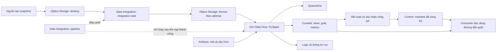

# Dự án data lake với Data Integration và Data Flow

## 1. Mục tiêu và sản phẩm cần bàn giao

Bài capstone thuộc chương **Dự án tích hợp và đánh giá** của module `CLOUD_PROVIDERS_ORACLE`. Bạn xây dựng một data lake theo lô trên Oracle Cloud Infrastructure (OCI), vận dụng compartment, IAM, Object Storage, xử lý dữ liệu và giám sát thành một hệ thống có thể vận hành. Hai dịch vụ trung tâm là **OCI Data Integration** để thiết kế luồng nạp, tham số hóa và điều phối, cùng **OCI Data Flow** để chạy Apache Spark mà không tự quản trị cụm máy chủ.

Sau dự án, bạn cần chứng minh được bốn điều:

- Dữ liệu đi từ nguồn đến báo cáo theo quy tắc nghiệp vụ được mô tả rõ.
- Người dùng, workspace và Spark run có đúng quyền cần thiết để làm phần việc của mình.
- Một lần chạy thất bại hoặc chạy lại không khiến người đọc sử dụng dữ liệu dở dang hay tính trùng doanh thu.
- Có bằng chứng đối soát, quan sát vận hành, ước lượng chi phí và dọn tài nguyên.

Sản phẩm nộp gồm sơ đồ kiến trúc, cấu hình tài nguyên/IAM, thiết kế Data Integration, mã PySpark, dữ liệu thử, kết quả đối soát, nhật ký thử lỗi và runbook. Những tệp được nhắc đến trong bài là sản phẩm người học tự tạo khi triển khai dự án.

## 2. Đề bài: tổng hợp doanh thu đơn hàng hằng ngày

Một doanh nghiệp bán lẻ nhận snapshot đơn hàng của từng ngày kinh doanh. Đội phân tích cần doanh thu đã thanh toán theo ngày và khu vực. Nguồn có thể chứa nhiều phiên bản của cùng một đơn, giá không hợp lệ hoặc trạng thái ngoài hợp đồng.

Phạm vi bắt buộc của bản thực hành:

| Hạng mục | Quyết định của dự án |
| --- | --- |
| Nguồn | CSV trong một bucket Object Storage riêng tư |
| Đơn vị dữ liệu | Một dòng biểu diễn một phiên bản của một đơn hàng |
| Khóa nghiệp vụ | `order_id` trong snapshot một ngày |
| Phiên bản thắng | Dòng hợp lệ có `updated_at` mới nhất |
| Doanh thu | `quantity × unit_price` của đơn có trạng thái `PAID` |
| Ngày nghiệp vụ | `event_date` do hệ thống nguồn cung cấp, theo lịch kinh doanh Việt Nam |
| Mốc thời gian cập nhật | `updated_at` ở UTC, biểu diễn bằng hậu tố `Z` |
| Đầu ra | Silver chi tiết, gold tổng hợp, quarantine và số liệu đối soát |
| Cách cập nhật | Xử lý lại toàn bộ snapshot của một ngày và công bố một phiên bản kết quả |

Đây là bài toán **snapshot theo ngày**, chưa phải CDC hay ghi tăng dần từng sự kiện. Khi có điều chỉnh muộn của ngày cũ, nguồn cung cấp snapshot đầy đủ mới cho ngày đó. Pipeline tính lại ngày tương ứng; consumer chuyển sang phiên bản đã được xác nhận. Không cộng kết quả của snapshot mới vào snapshot cũ.

Ngưỡng hoàn thành do nhóm đặt trước khi chạy. Ví dụ: xử lý xong trước 07:00 giờ Việt Nam sau khi nguồn sẵn sàng, có khả năng tính lại một ngày và khôi phục phiên bản công bố trước. Đây là mục tiêu của dự án, không phải SLA do OCI bảo đảm.

## 3. Kiến trúc và phân định trách nhiệm



Các tầng dữ liệu được dùng như sau:

- **Landing:** lưu nguyên bản snapshot nguồn và manifest nguồn; không sửa nội dung sau khi xác nhận sẵn sàng.
- **Bronze:** đầu ra nạp của Data Integration, giữ nguyên tám trường dưới dạng chuỗi để lỗi nghiệp vụ vẫn đi tới bước kiểm tra.
- **Silver:** dữ liệu đã chuẩn hóa, hợp lệ và chọn phiên bản mới nhất cho mỗi đơn.
- **Gold:** bảng doanh thu theo ngày, khu vực, chỉ tính đơn `PAID`.
- **Quarantine:** dòng bị loại cùng lý do và thông tin truy vết về tệp bronze. Bản nguyên gốc vẫn nằm ở landing.
- **Control:** manifest cho biết phiên bản kết quả nào được phép sử dụng.

Cần phân biệt ba khái niệm dễ nhầm:

| Khái niệm | Vai trò trong bài |
| --- | --- |
| Data flow trong Data Integration | Đồ thị nguồn, ánh xạ và đích do bạn thiết kế trong workspace |
| OCI Data Flow application | Định nghĩa ứng dụng Spark, mã thực thi và cấu hình chạy |
| OCI Data Flow task trong Data Integration | Tác vụ gọi một application OCI Data Flow đã tồn tại |

Bài này dùng ứng dụng PySpark tự viết và gọi nó bằng OCI Data Flow task. Oracle mô tả tác vụ này là cách chạy, lập lịch và theo dõi ứng dụng Data Flow từ Data Integration. [Tài liệu OCI Data Flow tasks](https://docs.oracle.com/en-us/iaas/Content/data-integration/using/oci-dataflow-tasks.htm).

Một cách tích hợp khác là publish integration task hoặc data loader task sang OCI Data Flow để tạo JAR và application tương ứng. Không trộn cách đó với quy trình PySpark của bài; đặc biệt, tài liệu Oracle nêu các giới hạn tham số riêng của application được tạo bằng cơ chế publish này. [Publishing to OCI Data Flow](https://docs.oracle.com/en-us/iaas/Content/data-integration/using/publish-to-service.htm).

## 4. Chuẩn bị tài nguyên và bố trí dữ liệu

### 4.1. Điều kiện thực hành

Bạn cần một tenancy được phép sử dụng các dịch vụ liên quan, một region thống nhất, quyền tạo hoặc sử dụng tài nguyên trong compartment dự án, cùng hạn mức Data Flow phù hợp. Xác nhận dịch vụ, shape và phiên bản Spark khả dụng tại region trước khi triển khai. Tài khoản chỉ có tài nguyên miễn phí chưa đủ để mặc định rằng toàn bộ dự án không phát sinh phí.

Tạo compartment riêng, ví dụ `lake-capstone`. Áp dụng tag như `project=oci-sales-lake`, `owner=<nhom>` và `environment=lab` cho tài nguyên hỗ trợ tag. Ghi lại region, compartment OCID và Object Storage namespace. Namespace không đồng nghĩa với tên hiển thị của tenancy.

### 4.2. Bucket và prefix

Tên dưới đây là ví dụ; nếu cần đổi tên, thay đồng bộ trong IAM, Data Integration, ứng dụng và manifest.

| Bucket | Nội dung | Chủ thể ghi chính |
| --- | --- | --- |
| `lake-landing` | CSV và manifest nguồn bất biến | Người hoặc hệ thống cung cấp dữ liệu |
| `lake-bronze` | Kết quả nạp theo lần thử | Data Integration workspace |
| `lake-curated` | Silver, gold và metrics theo lần thử | Data Flow run |
| `lake-quarantine` | Dữ liệu bị loại | Data Flow run |
| `lake-artifacts` | Mã PySpark có phiên bản | Người phát hành mã |
| `lake-logs` | Log của Data Flow | Các principal theo cấu hình log |
| `lake-control` | Manifest đã được xác nhận | Người hoặc bộ điều khiển công bố |

Ví dụ đường dẫn:

```text
lake-landing/
  sales/business_date=2026-11-20/snapshot_id=s001/orders.csv
  sales/business_date=2026-11-20/snapshot_id=s001/source-manifest.json

lake-bronze/
  sales/business_date=2026-11-20/attempt_id=a001/<cac-tep-CSV-do-DI-tao>

lake-curated/
  sales/attempts/business_date=2026-11-20/attempt_id=a001/silver/
  sales/attempts/business_date=2026-11-20/attempt_id=a001/gold/
  sales/attempts/business_date=2026-11-20/attempt_id=a001/metrics/

lake-quarantine/
  sales/business_date=2026-11-20/attempt_id=a001/

lake-control/
  sales/published/business_date=2026-11-20/manifest.json
```

Object Storage dùng object key và prefix; dấu `/` không biến các prefix thành thư mục có giao dịch đổi tên. Phân tách bucket giúp kiểm soát quyền trong bản thực hành; với hệ thống lớn, cần đánh giá thêm số lượng bucket, quyền theo prefix và cách quản trị.

Spark đọc Object Storage bằng URI:

```text
oci://<bucket>@<namespace>/<object-key-hoac-prefix>
```

Các output Parquet là tập tệp trong một prefix, không phải một tệp `.parquet` duy nhất. Silver và gold đã được tách theo ngày qua đường dẫn attempt; không cần tạo thêm partition ngày bên trong mỗi output của bộ dữ liệu nhỏ này.

## 5. IAM: tách người thiết kế, workspace và Spark run

### 5.1. Ma trận quyền

| Chủ thể | Quyền cần có trong thiết kế |
| --- | --- |
| Người thiết lập hạ tầng | Tạo compartment, bucket và cấu hình IAM trong phạm vi được giao |
| Người phát triển pipeline | Sử dụng workspace, xem nguồn/đích, quản lý application và run được giao |
| Data Integration workspace | Đọc landing, ghi bronze, gọi Data Flow application/run |
| Data Flow run | Đọc bronze và artifacts; ghi curated, quarantine, logs |
| Người công bố | Đọc kết quả và run; cập nhật manifest trong control |
| Người phân tích | Đọc manifest và gold được cấp quyền |

Consumer chỉ đọc manifest là một **quy ước truy cập của ứng dụng**. Nếu được cấp đọc toàn bucket curated, người dùng vẫn có thể đọc prefix chưa công bố. Khi cần cưỡng chế chặt, bổ sung điều kiện IAM phù hợp hoặc một lớp phục vụ chỉ cho phép đọc phiên bản đã phát hành.

### 5.2. Policy mẫu cho workspace

Các đoạn sau minh họa phần quyền runtime của bài trong cùng tenancy. Thay mọi placeholder trước khi dùng. Người triển khai vẫn phải cấp quyền cho nhóm người dùng để duyệt tài nguyên, sử dụng workspace và tạo ứng dụng; quyền của workspace không thay thế quyền của người thao tác Console.

```text
Allow any-user to read objectstorage-namespaces in tenancy where all {request.principal.type='disworkspace', request.principal.id='<workspace-ocid>'}

Allow any-user to read buckets in compartment lake-capstone where all {request.principal.type='disworkspace', request.principal.id='<workspace-ocid>'}

Allow any-user to read objects in compartment lake-capstone where all {request.principal.type='disworkspace', request.principal.id='<workspace-ocid>', target.bucket.name='lake-landing'}

Allow any-user to manage objects in compartment lake-capstone where all {request.principal.type='disworkspace', request.principal.id='<workspace-ocid>', target.bucket.name='lake-bronze'}
```

Các điều kiện giới hạn vào một workspace và đúng bucket dữ liệu. Đối chiếu quyền duyệt nguồn/đích của người dùng và quyền resource principal của workspace với [Policy Examples cho Data Integration](https://docs.oracle.com/en-us/iaas/Content/data-integration/using/policy-examples.htm).

Để workspace điều phối Data Flow, bổ sung trong compartment chứa application và run:

```text
Allow any-user to manage dataflow-application in compartment lake-capstone where all {request.principal.type='disworkspace', request.principal.id='<workspace-ocid>'}

Allow any-user to manage dataflow-run in compartment lake-capstone where all {request.principal.type='disworkspace', request.principal.id='<workspace-ocid>'}
```

Đây là mẫu quyền tích hợp ở phạm vi compartment. Vì `manage` cho phép nhiều thao tác, dùng compartment riêng cho bài và đánh giá khả năng thu hẹp theo API, application hoặc vai trò khi đưa vào môi trường thật. Xem [Required Policies and Setup](https://docs.oracle.com/en-us/iaas/Content/data-integration/using/oci-dataflow-tasks.htm).

### 5.3. Dynamic group cho Data Flow run

Tạo dynamic group `lake-spark-runs` với matching rule:

```text
ALL {resource.type='dataflowrun', resource.compartment.id='<compartment-ocid>'}
```

Rule trên bao gồm mọi Data Flow run trong compartment. Compartment này phải dành cho dự án; khi chia sẻ, cần thu hẹp thêm theo application theo hướng dẫn Oracle. [Resource Principal Policies](https://docs.oracle.com/en-us/iaas/Content/data-flow/using/resource-principal-policies.htm).

Ví dụ policy truy cập dữ liệu:

```text
Allow dynamic-group lake-spark-runs to read objectstorage-namespaces in tenancy

Allow dynamic-group lake-spark-runs to read buckets in compartment lake-capstone

Allow dynamic-group lake-spark-runs to read objects in compartment lake-capstone where any {target.bucket.name='lake-bronze', target.bucket.name='lake-artifacts'}

Allow dynamic-group lake-spark-runs to manage objects in compartment lake-capstone where any {target.bucket.name='lake-curated', target.bucket.name='lake-quarantine', target.bucket.name='lake-logs'}
```

Cấu hình application/run sử dụng resource principal, chẳng hạn Spark property `dataflow.auth=resource_principal`. Chỉ tạo dynamic group chưa khiến một run tự chuyển từ chế độ xác thực khác sang resource principal. [Supported Spark Properties](https://docs.oracle.com/en-us/iaas/Content/data-flow/using/dfs_provide_jvm_options.htm).

Cấu hình quyền đọc log cho dịch vụ và cho người vận hành theo kiểu log đã chọn. Nếu cần dịch vụ Data Flow đọc log từ bucket, dùng policy giới hạn vào `lake-logs` theo tài liệu cấu hình, thay vì mở quyền cho toàn bộ dữ liệu. [Thiết lập bucket và quyền log](https://docs.oracle.com/en-us/iaas/Content/data-integration/using/task-run-configuration-setup.htm).

Thử xác nhận cả hai chiều: run đọc được bronze và ghi được curated, đồng thời không ghi được landing hoặc control. Khi kiểm tra quyền bị từ chối, dùng tài nguyên thử của chính bài; không thử ghi lên snapshot đã được chốt.

## 6. Kết nối mạng và bảo vệ dữ liệu

Bản cơ sở chỉ kết nối dịch vụ OCI với các bucket riêng tư qua endpoint được dịch vụ hỗ trợ; không cần một Compute instance thường trực. Bucket riêng tư là thiết lập kiểm soát truy cập, không tự mô tả toàn bộ đường đi mạng.

Nếu mở rộng nguồn sang Oracle Database trong private subnet, phải thiết kế kết nối cho **cả hai bên có truy cập nguồn**: workspace Data Integration và Data Flow run. Private endpoint của workspace không tự trở thành private endpoint của Data Flow. Chuẩn bị VCN/subnet, phân giải DNS, route và NSG/security list cho luồng thực sự cần dùng; chỉ mở cổng listener đã cấu hình cho nguồn. Nếu đường đi từ subnet tới Object Storage dùng Service Gateway, route phải trỏ tới dịch vụ phù hợp trong region.

Mật khẩu kết nối cơ sở dữ liệu được tham chiếu từ OCI Vault theo khả năng của connector; không đặt mật khẩu, wallet hay khóa API trong mã, argument hoặc log. Với cách cấu hình integration task chạy bằng Data Flow, Oracle có các yêu cầu riêng về Vault và FQDN cần kiểm tra trước khi mở rộng. [Required Setup and Policies](https://docs.oracle.com/en-us/iaas/Content/data-integration/using/task-run-configuration-setup.htm).

Dữ liệu mẫu chỉ dùng mã khách hàng giả. Với dữ liệu thật, xác định trường nhạy cảm, thời hạn lưu, quyền đọc quarantine và yêu cầu khóa mã hóa. Quarantine thường chứa giá trị gốc nên cũng cần được bảo vệ như nguồn.

## 7. Hợp đồng dữ liệu và bộ dữ liệu kiểm chứng

### 7.1. Schema và quy tắc

CSV dùng UTF-8, dấu phẩy phân cách, dòng đầu là header và đúng thứ tự tám cột. Bản lab không sử dụng trường chứa xuống dòng. Khi nạp sang bronze, ánh xạ tất cả cột thành chuỗi với độ dài đủ chứa dữ liệu thử; không suy luận `unit_price` thành số rồi bỏ mất dòng có giá `abc`.

| Cột | Kiểu tại bronze | Quy tắc khi tạo silver |
| --- | --- | --- |
| `order_id` | Chuỗi | Bắt buộc có giá trị sau khi trim |
| `updated_at` | Chuỗi | Timestamp ISO dạng `YYYY-MM-DDTHH:MM:SSZ` hợp lệ |
| `event_date` | Chuỗi | Ngày hợp lệ, đúng ngày nghiệp vụ được yêu cầu |
| `customer_id` | Chuỗi | Bắt buộc có giá trị |
| `region` | Chuỗi | Chuẩn hóa chữ hoa; thuộc `HCM`, `HN`, `DN` |
| `status` | Chuỗi | Chuẩn hóa chữ hoa; thuộc `PAID`, `CANCELLED` |
| `quantity` | Chuỗi | Từ 1 đến 999999, biểu diễn bằng chữ số nguyên |
| `unit_price` | Chuỗi | Không âm, tối đa 9 chữ số phần nguyên và 2 chữ số thập phân |

Tiền dùng decimal, đơn vị VND; không dùng số thực nhị phân cho phép tính doanh thu. Giới hạn số trong bảng là hợp đồng của bộ dữ liệu lab, không phải hạn mức của OCI.

Quy tắc xử lý phiên bản:

1. Chuẩn hóa khoảng trắng, khu vực và trạng thái; lưu biểu diễn dòng trước chuẩn hóa để điều tra.
2. Chuyển kiểu có kiểm soát và đưa dòng vi phạm vào quarantine với một hoặc nhiều mã lỗi.
3. Trên các dòng hợp lệ, nếu cùng `order_id` và cùng timestamp cập nhật nhưng nội dung khác nhau, dừng run vì nguồn có xung đột phiên bản.
4. Chọn bản cập nhật mới nhất của mỗi đơn; các dòng cũ hoặc bản sao giống hệt bị loại khỏi silver.
5. Giữ cả đơn `CANCELLED` trong silver, nhưng chỉ đơn `PAID` đóng góp vào gold.

Đơn vị xử lý là đơn hàng có một giá và một số lượng. Nếu nguồn thật có nhiều dòng hàng trong một đơn, phải đổi khóa thành khóa dòng hàng và định nghĩa lại phép tổng hợp; không thể giữ nguyên thuật toán loại trùng theo `order_id`.

### 7.2. CSV đầu vào

Lưu nội dung sau thành `orders.csv` trong snapshot `s001` của ngày `2026-11-20`:

```csv
order_id,updated_at,event_date,customer_id,region,status,quantity,unit_price
O1001,2026-11-20T01:00:00Z,2026-11-20,C001,HCM,PAID,2,120000.00
O1002,2026-11-20T01:10:00Z,2026-11-20,C002,HN,PAID,1,250000.00
O1002,2026-11-20T02:10:00Z,2026-11-20,C002,HN,PAID,2,250000.00
O1003,2026-11-20T01:20:00Z,2026-11-20,C003,HCM,CANCELLED,1,100000.00
O1004,2026-11-20T01:30:00Z,2026-11-20,C004,HCM,PAID,-1,50000.00
O1005,2026-11-20T01:40:00Z,2026-11-20,C005,HN,PAID,1,abc
O1006,2026-11-20T01:50:00Z,2026-11-20,C006,DN,PAID,3,30000.00
O1007,2026-11-20T02:00:00Z,2026-11-20,C007,DN,REFUNDED,1,90000.00
```

Nguồn tạo `source-manifest.json` sau khi đã upload đủ CSV. Ví dụ nội dung tối thiểu:

```json
{
  "business_date": "2026-11-20",
  "snapshot_id": "s001",
  "schema_version": "1",
  "expected_rows": 8,
  "objects": ["orders.csv"],
  "ready": true
}
```

Trong bản lab, người vận hành kiểm tra manifest và tên tệp trước khi khởi chạy, đồng thời ghi lại ETag hoặc checksum của từng object nguồn trong hồ sơ nghiệm thu. Không đọc JSON này như CSV. Trong triển khai tự động, cần thêm bước kiểm tra readiness, danh sách tệp, schema và dấu vết toàn vẹn trước tác vụ nạp. Số dòng kỳ vọng phải đến từ nguồn độc lập; không lấy số dòng bronze rồi gọi đó là số dòng dự kiến.

## 8. Xây dựng phần nạp bằng Data Integration

### 8.1. Tham số dùng xuyên suốt

| Tham số | Giá trị chạy mẫu | Ý nghĩa |
| --- | --- | --- |
| `P_BUSINESS_DATE` | `2026-11-20` | Ngày dữ liệu cần tính |
| `P_SNAPSHOT_ID` | `s001` | Snapshot nguồn bất biến |
| `P_ATTEMPT_ID` | `a001` | Lần thử; mỗi lần chạy thật dùng giá trị mới |
| `P_EXPECTED_ROWS` | `8` | Tổng dòng do nguồn khai báo |
| `P_MAX_BAD_RATIO` | `0.40` | Ngưỡng lỗi cố ý nới cho bộ dữ liệu thử |
| `P_INPUT_URI` | URI bronze của lần thử | Đầu vào PySpark |
| `P_OUTPUT_BASE` | URI curated của lần thử | Gốc silver, gold và metrics |
| `P_QUARANTINE_URI` | URI quarantine của lần thử | Nơi lưu dòng bị loại |

Ngày nghiệp vụ, snapshot và attempt là ba định danh khác nhau. Chạy lại cùng snapshot vẫn cần attempt mới. Các URI phải được tạo hoặc nhập nhất quán với ba định danh; không để một tác vụ ghi `a002` trong khi Spark còn đọc `a001`.

### 8.2. Thiết kế data flow nạp

1. Tạo workspace và project, ví dụ `SalesLakeProject`.
2. Tạo Object Storage data asset cùng connection thích hợp, kiểm tra kết nối và quyền duyệt bucket.
3. Tạo data flow `df_ingest_orders`, có Source trỏ tới CSV của snapshot, ánh xạ tám cột và Target là `lake-bronze`.
4. Khai báo hoặc chỉnh schema nguồn thành chuỗi; kiểm tra preview có cả `abc`, số lượng âm và trạng thái lạ.
5. Cấu hình Target là CSV, UTF-8, header bật, dấu phẩy phân cách. Đồng bộ quote và escape với trình đọc Spark.
6. Tham số hóa entity nguồn và prefix đích để nạp đúng snapshot vào đúng attempt.
7. Validate data flow; tạo integration task `task_ingest_orders` bao lấy data flow này.

Ví dụ tên entity nguồn theo tham số:

```text
sales/business_date=${P_BUSINESS_DATE}/snapshot_id=${P_SNAPSHOT_ID}/*.csv
```

Ví dụ tên entity đích khi tạo đầu ra theo prefix:

```text
sales/business_date=${P_BUSINESS_DATE}/attempt_id=${P_ATTEMPT_ID}/
```

Chọn đúng chế độ output nhiều tệp hoặc một tệp trong giao diện, rồi xem object key thực tế sau lần chạy thử. Đừng mặc định công cụ sẽ đặt tệp đích là `orders.csv`. Oracle hỗ trợ tham số trong tên entity và có quy tắc dấu `/` khác nhau cho output theo thư mục và output một tệp. [Using Data Flow Operators](https://docs.oracle.com/en-us/iaas/Content/data-integration/using/using-operators.htm).

Prefix đích phải mới cho mỗi attempt. Bước nạp không được âm thầm nối thêm dữ liệu của lần trước. Nếu nạp dở, giữ nguyên bằng chứng và thực hiện lần thử khác với attempt mới.

### 8.3. Xác nhận phần nạp

Publish integration task vào application Data Integration dùng cho lab, đợi publish thành công, rồi chạy thử. Kiểm tra bronze có đủ tám dòng dữ liệu, đúng header và không bị đổi giá trị `abc` thành null hay bị mất dòng. Chỉ sau bước này mới ghép tác vụ Spark.

Nếu muốn chạy lại toàn pipeline sau lần thử riêng tác vụ nạp, dùng `P_ATTEMPT_ID` mới. Trong Data Integration, task phải được publish trước khi chạy hoặc lập lịch. [Running Published Tasks](https://docs.oracle.com/en-us/iaas/Content/data-integration/using/published-tasks.htm).

## 9. Ứng dụng PySpark trên OCI Data Flow

### 9.1. Hành vi của mã mẫu

Mã dưới đây xử lý một snapshot của một ngày, đọc bronze đã có schema tám cột. CSV hỏng cấu trúc làm run thất bại; lỗi giá trị theo nghiệp vụ được ghi vào quarantine. Mặc định ngưỡng dòng lỗi là 0. Riêng bộ dữ liệu cố ý chứa ba lỗi trên tám dòng cần truyền `--max-bad-ratio 0.40` để hoàn tất đường chạy kiểm chứng.

Mỗi output dùng `errorifexists` để tránh ghi đè dữ liệu cùng attempt. Việc tạo nhiều output không phải một giao dịch; cơ chế công bố ở phần sau ngăn consumer sử dụng run chưa hoàn tất.

### 9.2. Mã `sales_lake.py`

```python
import argparse
import json
import re
from datetime import date
from decimal import Decimal

from pyspark.sql import SparkSession, Window
from pyspark.sql import functions as F
from pyspark.sql import types as T


parser = argparse.ArgumentParser()
parser.add_argument('--input', required=True)
parser.add_argument('--output-base', required=True)
parser.add_argument('--quarantine', required=True)
parser.add_argument('--business-date', required=True)
parser.add_argument('--snapshot-id', required=True)
parser.add_argument('--attempt-id', required=True)
parser.add_argument('--expected-input-rows', type=int, required=True)
parser.add_argument('--max-bad-ratio', type=Decimal, default=Decimal('0'))
args = parser.parse_args()

date.fromisoformat(args.business_date)
if not re.fullmatch(r'[A-Za-z0-9][A-Za-z0-9_-]{0,63}', args.attempt_id):
    raise ValueError('Invalid attempt ID')
if not Decimal('0') <= args.max_bad_ratio <= Decimal('1'):
    raise ValueError('Invalid bad-row threshold')
if args.expected_input_rows <= 0:
    raise ValueError('This lab requires a non-empty snapshot')

spark = SparkSession.builder.appName('sales-lake-capstone').getOrCreate()
spark.conf.set('spark.sql.session.timeZone', 'UTC')
# Invalid casts become null and are handled by the quality rules below.
spark.conf.set('spark.sql.ansi.enabled', 'false')
spark.conf.set('spark.sql.legacy.timeParserPolicy', 'CORRECTED')

fields = [
    'order_id', 'updated_at', 'event_date', 'customer_id',
    'region', 'status', 'quantity', 'unit_price'
]
schema = T.StructType([T.StructField(c, T.StringType(), True) for c in fields])

raw = (
    spark.read.schema(schema)
    .option('header', 'true')
    .option('enforceSchema', 'false')
    .option('mode', 'FAILFAST')
    .csv(args.input)
    .withColumn('source_file', F.input_file_name())
    .cache()
)
n_input = raw.count()
if n_input != args.expected_input_rows:
    raise RuntimeError(
        f'Source count mismatch: expected={args.expected_input_rows}, actual={n_input}'
    )

base = raw.withColumn('raw_record_json', F.to_json(F.struct(*fields)))
for name in fields:
    base = base.withColumn(name, F.trim(F.col(name)))
base = (
    base.withColumn('region', F.upper('region'))
    .withColumn('status', F.upper('status'))
    .withColumn('_event_date', F.to_date('event_date', 'yyyy-MM-dd'))
    .withColumn('_updated_ts', F.to_timestamp(
        'updated_at', "yyyy-MM-dd'T'HH:mm:ssX"
    ))
    .withColumn('_quantity', F.col('quantity').cast('long'))
    .withColumn('_unit_price', F.col('unit_price').cast(T.DecimalType(18, 2)))
)

rules = [
    ('MISSING_ORDER_ID', F.length('order_id') > 0),
    ('MISSING_CUSTOMER_ID', F.length('customer_id') > 0),
    ('INVALID_REGION', F.col('region').isin('HCM', 'HN', 'DN')),
    ('INVALID_STATUS', F.col('status').isin('PAID', 'CANCELLED')),
    ('INVALID_DATE', F.col('_event_date').isNotNull()
        & F.col('event_date').rlike(r'^\d{4}-\d{2}-\d{2}$')),
    ('WRONG_BUSINESS_DATE', F.col('_event_date')
        == F.lit(args.business_date).cast('date')),
    ('INVALID_UPDATED_AT', F.col('_updated_ts').isNotNull()
        & F.col('updated_at').rlike(r'^\d{4}-\d{2}-\d{2}T\d{2}:\d{2}:\d{2}Z$')),
    ('INVALID_QUANTITY', F.col('quantity').rlike(r'^[0-9]{1,6}$')
        & (F.col('_quantity') > 0)),
    ('INVALID_PRICE', F.col('unit_price').rlike(r'^[0-9]{1,9}(\.[0-9]{1,2})?$')
        & F.col('_unit_price').isNotNull()),
]

flagged = base.withColumn(
    'error_codes',
    F.concat_ws('|', *[
        F.when(~F.coalesce(test, F.lit(False)), F.lit(code))
        for code, test in rules
    ])
).cache()
invalid = flagged.filter(F.col('error_codes') != '').cache()
valid = flagged.filter(F.col('error_codes') == '').withColumn(
    '_record_hash', F.sha2(F.to_json(F.struct(*fields)), 256)
).cache()

n_bad = invalid.count()
n_valid = valid.count()
if n_input != n_bad + n_valid:
    raise RuntimeError('Input reconciliation failed')

# Even rejected runs retain bad records for investigation.
invalid.withColumn('attempt_id', F.lit(args.attempt_id)).write.mode(
    'errorifexists'
).parquet(args.quarantine)

bad_ratio = Decimal(n_bad) / Decimal(n_input)
print(json.dumps({
    'event': 'quality_check',
    'attempt_id': args.attempt_id,
    'input_rows': n_input,
    'invalid_rows': n_bad,
    'invalid_ratio': str(bad_ratio)
}))
if bad_ratio > args.max_bad_ratio:
    raise RuntimeError('Bad-row threshold exceeded')

conflicts = (
    valid.groupBy('order_id', '_updated_ts')
    .agg(F.countDistinct('_record_hash').alias('variants'))
    .filter(F.col('variants') > 1)
)
if conflicts.limit(1).count() > 0:
    raise RuntimeError('Conflicting records share order ID and update timestamp')

window = Window.partitionBy('order_id').orderBy(
    F.col('_updated_ts').desc(),
    F.col('_record_hash').desc(),
    F.col('source_file').asc()
)
silver = (
    valid.withColumn('_rank', F.row_number().over(window))
    .filter(F.col('_rank') == 1)
    .select(
        'order_id', 'customer_id', 'region', 'status',
        F.col('_event_date').alias('event_date'),
        F.col('_updated_ts').alias('updated_at'),
        F.col('_quantity').alias('quantity'),
        F.col('_unit_price').alias('unit_price'),
        'source_file'
    )
    .withColumn('line_amount',
        (F.col('quantity') * F.col('unit_price')).cast(T.DecimalType(28, 2)))
    .withColumn('attempt_id', F.lit(args.attempt_id))
    .cache()
)
if silver.filter(F.col('line_amount').isNull()).limit(1).count() > 0:
    raise RuntimeError('Amount conversion failed')

paid = silver.filter(F.col('status') == 'PAID')
gold = (
    paid.groupBy('event_date', 'region')
    .agg(
        F.count('*').alias('paid_order_count'),
        F.sum('line_amount').alias('revenue_vnd')
    )
    .withColumn('attempt_id', F.lit(args.attempt_id))
    .cache()
)
n_silver = silver.count()
n_paid = paid.count()
revenue = gold.agg(F.sum('revenue_vnd')).first()[0]
if n_paid > 0 and revenue is None:
    raise RuntimeError('Revenue aggregation failed')

metrics = {
    'schema_version': '1',
    'business_date': args.business_date,
    'snapshot_id': args.snapshot_id,
    'attempt_id': args.attempt_id,
    'input_rows': n_input,
    'valid_rows_before_dedup': n_valid,
    'invalid_rows': n_bad,
    'removed_versions': n_valid - n_silver,
    'silver_rows': n_silver,
    'paid_order_count': n_paid,
    'gold_rows': gold.count(),
    'revenue_vnd': str(revenue if revenue is not None else Decimal('0.00')),
    'invalid_ratio': str(bad_ratio),
    'max_bad_ratio': str(args.max_bad_ratio),
    'quality_pass': True,
}
if n_input != n_bad + metrics['removed_versions'] + n_silver:
    raise RuntimeError('Final row reconciliation failed')

output = args.output_base.rstrip('/')
silver.write.mode('errorifexists').parquet(output + '/silver')
gold.write.mode('errorifexists').parquet(output + '/gold')
spark.createDataFrame([(json.dumps(metrics),)], ['value']).coalesce(1).write.mode(
    'errorifexists'
).text(output + '/metrics')
print(json.dumps({'event': 'candidate_outputs_written', **metrics}))
spark.stop()
```

Mã chỉ lấy về driver kết quả tổng hợp rất nhỏ và kết quả kiểm tra có xung đột hay không; không `collect()` toàn bộ đơn hàng. `cache()` và các lượt `count()` giúp bài lab dễ đối soát, nhưng cần đánh giá lại lưu trữ trung gian và số lần quét khi tăng quy mô.

Đặt tên metric `removed_versions` vì các dòng bị loại gồm phiên bản cũ và bản sao giống hệt, không chỉ bản sao vật lý. Nếu nguồn muốn một dòng lỗi mới nhất làm mất hiệu lực phiên bản hợp lệ cũ, phải đổi quy tắc nghiệp vụ; mã hiện tại chọn phiên bản mới nhất **trong tập hợp lệ**.

### 9.3. Tạo application và kiểm thử riêng

Upload mã có phiên bản vào `lake-artifacts`, ví dụ `sales/v1/sales_lake.py`. Tạo application Python trong OCI Data Flow, chọn phiên bản Spark được hỗ trợ, cấu hình driver/executor nhỏ phù hợp và đặt vị trí log. Ghi lại chính xác phiên bản Spark, shape, OCPU, bộ nhớ, số executor và mã nguồn của lần thử. [Creating a PySpark Data Flow Application](https://docs.oracle.com/iaas/data-flow/using/dfs_create_pyspark_data_flow_app.htm).

Bật resource principal như phần IAM. Không đặt `spark.master` hay tự khai báo địa chỉ cụm; Data Flow quản lý môi trường chạy.

Danh sách argument của lần chạy mẫu, trình bày mỗi dòng một cặp để dễ đọc:

```text
--input oci://lake-bronze@<namespace>/sales/business_date=2026-11-20/attempt_id=a001/
--output-base oci://lake-curated@<namespace>/sales/attempts/business_date=2026-11-20/attempt_id=a001
--quarantine oci://lake-quarantine@<namespace>/sales/business_date=2026-11-20/attempt_id=a001/
--business-date 2026-11-20
--snapshot-id s001
--attempt-id a001
--expected-input-rows 8
--max-bad-ratio 0.40
```

Đây là các token argument cho ứng dụng, không phải một lệnh shell hoàn chỉnh. Nhập theo định dạng mà giao diện Data Flow đang dùng yêu cầu. Khi thử Spark riêng sau một lần đã ghi thành công, đổi attempt của output và quarantine; nếu tái dùng bronze cũ, ghi rõ điều đó trong bằng chứng kiểm thử riêng. Khi chạy toàn pipeline, bronze và output phải cùng attempt.

Mã chỉ dùng API PySpark và thư viện chuẩn; chưa cần dependency archive. Nếu thêm thư viện ngoài, đóng gói và quản lý phiên bản phụ thuộc cùng với phiên bản Spark của application.

## 10. Điều phối bằng pipeline Data Integration

### 10.1. Tạo OCI Data Flow task

Tạo task `task_transform_sales` kiểu **OCI Data Flow**, chọn application PySpark vừa tạo và cấu hình các thuộc tính chạy. Dùng scalar parameter cho các giá trị truyền vào argument.

Ví dụ trường Arguments trong OCI Data Flow task của Data Integration là danh sách phân cách bằng dấu phẩy:

```text
--input,${P_INPUT_URI},--output-base,${P_OUTPUT_BASE},--quarantine,${P_QUARANTINE_URI},--business-date,${P_BUSINESS_DATE},--snapshot-id,${P_SNAPSHOT_ID},--attempt-id,${P_ATTEMPT_ID},--expected-input-rows,${P_EXPECTED_ROWS},--max-bad-ratio,${P_MAX_BAD_RATIO}
```

Đối chiếu giá trị thực nhận trong run để xác nhận từng flag và giá trị là một argument riêng. Oracle hỗ trợ scalar parameter theo cú pháp `${PARAMETER_NAME}`; khi đã dùng scalar trong Arguments, không đồng thời parameterize toàn bộ thuộc tính Arguments. [Creating an OCI Data Flow Task](https://docs.oracle.com/en-us/iaas/Content/data-integration/using/oci-dataflow-tasks-create.htm).

### 10.2. Ghép pipeline

Tạo pipeline `pipeline_daily_sales`:

```text
Start
  → task_ingest_orders
  → task_transform_sales
  → End
```

Cấu hình Spark task chỉ chạy khi bước nạp thành công. Cấu hình End yêu cầu chuỗi xử lý bắt buộc thành công; không chọn một luật kết thúc khiến pipeline thành công dù bước xử lý dữ liệu lỗi. Nếu thêm nhánh thông báo lỗi, việc gửi thông báo thành công cũng không được biến lần xử lý thất bại thành thành công. [Using Pipeline Operators](https://docs.oracle.com/en-us/iaas/Content/data-integration/using/pipeline-operators.htm), [Listing Task Runs](https://docs.oracle.com/en-us/iaas/Content/data-integration/using/task-runs-list.htm).

Ánh xạ tham số từ pipeline xuống cả hai task. Với bộ dữ liệu này, cấu hình thực thi ban đầu như sau:

```text
P_BUSINESS_DATE = 2026-11-20
P_SNAPSHOT_ID = s001
P_ATTEMPT_ID = a002
P_EXPECTED_ROWS = 8
P_MAX_BAD_RATIO = 0.40
P_INPUT_URI = oci://lake-bronze@<namespace>/sales/business_date=2026-11-20/attempt_id=a002/
P_OUTPUT_BASE = oci://lake-curated@<namespace>/sales/attempts/business_date=2026-11-20/attempt_id=a002
P_QUARANTINE_URI = oci://lake-quarantine@<namespace>/sales/business_date=2026-11-20/attempt_id=a002/
```

`a002` được dùng vì `a001` có thể đã dành cho các lần kiểm thử riêng. Nếu chưa dùng `a001`, có thể chọn nó; điều kiện là mọi prefix của lần thử mới chưa có dữ liệu.

Tạo pipeline task bao lấy pipeline, publish vào application Data Integration và chờ publish thành công. Chạy pipeline task đã publish. Sau khi sửa thiết kế hoặc mapping, phải publish phiên bản sửa và xác nhận phiên bản đang chạy; chỉ Save bản thiết kế chưa đủ để kết luận bản đã publish thay đổi. [Use a Pipeline](https://docs.oracle.com/en-us/iaas/Content/data-integration/tutorials/06-use-a-pipeline.htm).

### 10.3. Lịch chạy và kiểm soát chạy trùng

Trong bản lab, hoàn thành một lần chạy thủ công rồi tạo schedule/task schedule cho pipeline task đã publish để chứng minh khả năng tự động khởi chạy. Chọn thời điểm, múi giờ và tham số một cách tường minh, kiểm tra một lượt được kích hoạt bởi lịch rồi vô hiệu hóa lịch thử. Mỗi lượt thử lịch phải dùng attempt mới và nguồn đã sẵn sàng.

Một schedule có bộ giá trị cố định không tự tạo ngày nghiệp vụ, snapshot hay attempt mới. Để vận hành hằng ngày, cần một bước chuẩn bị hoặc bộ điều khiển xác định ngày theo lịch kinh doanh, chọn snapshot `ready`, sinh attempt duy nhất và cung cấp bộ tham số đồng bộ khi gọi pipeline. Không giả định ngày hệ thống UTC luôn là ngày nghiệp vụ Việt Nam.

Nếu bật **Disable simultaneous execution**, ghi rõ phạm vi mà dịch vụ áp dụng cho loại task và cách khởi chạy đang dùng; không coi checkbox này là khóa phân tán cho mọi đường gọi. Bản lab chỉ cho phép một người/bộ điều khiển phát lệnh cho một ngày tại một thời điểm. Các attempt vẫn có prefix riêng để giảm tác động nếu có chạy chồng.

Retry chỉ phù hợp với lỗi tạm thời và phải tạo attempt mới cho toàn bộ chuỗi ghi mới của bài. Lỗi schema, chất lượng hoặc xung đột phiên bản cần sửa nguyên nhân trước khi chạy lại. Không retry vô hạn.

## 11. Đối soát đầu ra và công bố kết quả

### 11.1. Kết quả chính xác cho bộ dữ liệu mẫu

| Chỉ số | Kết quả mong đợi | Giải thích |
| --- | --- | --- |
| Dòng đầu vào bronze | 8 | Không tính header |
| Dòng quarantine | 3 | `O1004`, `O1005`, `O1007` |
| Dòng hợp lệ trước loại phiên bản | 5 | Bao gồm hai phiên bản `O1002` |
| Phiên bản bị loại | 1 | Bản `O1002` cập nhật lúc 01:10 |
| Dòng silver | 4 | `O1001`, `O1002`, `O1003`, `O1006` |
| Đơn đã thanh toán | 3 | Không tính `O1003` đã hủy |
| Dòng gold | 3 | Mỗi khu vực có một nhóm |
| Tổng doanh thu | 830000.00 VND | 240000 + 500000 + 90000 |

Bảng gold, thứ tự hiển thị có thể khác:

| event_date | region | paid_order_count | revenue_vnd |
| --- | --- | --- | --- |
| 2026-11-20 | DN | 1 | 90000.00 |
| 2026-11-20 | HCM | 1 | 240000.00 |
| 2026-11-20 | HN | 1 | 500000.00 |

Ba phép kiểm tra cần trình bày trong biên bản:

```text
8 = 3 dòng lỗi + 5 dòng hợp lệ trước loại phiên bản
5 = 1 phiên bản bị loại + 4 đơn trong silver
830000.00 = tổng line_amount của 3 đơn PAID trong silver
```

Dòng `O1002` phải có số lượng 2 và doanh thu 500000.00. Nếu gold ra 1080000.00, nhiều khả năng bạn đã cộng cả phiên bản cũ trị giá 250000.00. Nếu ra 930000.00, có thể bạn đã tính thêm đơn hủy trị giá 100000.00.

Đọc `metrics/part-*` để lấy JSON do ứng dụng ghi; không mong đợi có sẵn tệp tên `metrics.json`. Ngoài metrics, mở bảng silver và quarantine để chứng minh đúng đơn thắng và đúng mã lỗi. Trạng thái run thành công không tự chứng minh báo cáo đúng nghiệp vụ.

### 11.2. Cổng công bố

Consumer chỉ đọc kết quả được tham chiếu bởi manifest tại `lake-control`. Spark chỉ tạo **ứng viên kết quả**, không có quyền ghi manifest công bố.

Người vận hành lab thực hiện quy trình sau:

1. Kiểm tra pipeline task thành công theo luật End đã đặt và các task con bắt buộc đều thành công.
2. Xác nhận Data Flow run tương ứng kết thúc `SUCCEEDED`, không còn đang chạy hoặc đang hủy.
3. Đối chiếu ngày, snapshot, attempt, phiên bản mã, các đường dẫn và metrics với manifest nguồn.
4. Kiểm tra các điều kiện nghiệp vụ, số dòng và tổng tiền; xác nhận ngưỡng lỗi được chấp nhận cho lần thử.
5. Tạo manifest công bố chứa đường dẫn silver/gold của đúng attempt và thông tin run để truy vết.
6. Ghi một object manifest bằng điều kiện chống ghi đè ngoài ý muốn; đọc lại manifest và kiểm tra consumer dùng đúng URI.

Ví dụ nội dung `approved-manifest.json` cho lần thử `a002`:

```json
{
  "schema_version": "1",
  "business_date": "2026-11-20",
  "snapshot_id": "s001",
  "attempt_id": "a002",
  "source_manifest": "oci://lake-landing@<namespace>/sales/business_date=2026-11-20/snapshot_id=s001/source-manifest.json",
  "code_version": "sales/v1/sales_lake.py",
  "data_integration_run_key": "<run-key-thuc-te>",
  "data_flow_run_ocid": "<run-ocid-thuc-te>",
  "silver_uri": "oci://lake-curated@<namespace>/sales/attempts/business_date=2026-11-20/attempt_id=a002/silver",
  "gold_uri": "oci://lake-curated@<namespace>/sales/attempts/business_date=2026-11-20/attempt_id=a002/gold",
  "input_rows": 8,
  "invalid_rows": 3,
  "silver_rows": 4,
  "revenue_vnd": "830000.00",
  "quality_pass": true
}
```

Thay placeholder bằng giá trị thật và bổ sung ETag/checksum nguồn đã ghi nhận. Không xuất bản nguyên ví dụ với các placeholder chưa thay.

Ví dụ OCI CLI trong PowerShell để công bố lần đầu, sau khi đã lưu manifest hợp lệ tại máy người vận hành:

```powershell
oci os object put `
  --namespace-name '<namespace>' `
  --bucket-name 'lake-control' `
  --name 'sales/published/business_date=2026-11-20/manifest.json' `
  --file '.\approved-manifest.json' `
  --content-type 'application/json' `
  --if-none-match '*'
```

Nếu object đã tồn tại, thao tác có điều kiện này phải thất bại thay vì âm thầm thay phiên bản đang công bố. Khi công bố thay thế, đọc manifest hiện tại và ETag, xác nhận thứ tự snapshot được phép phát hành rồi dùng `--if-match '<etag-hien-tai>'`. Nếu ETag đã đổi, dừng và đối chiếu lại. OCI CLI hỗ trợ các điều kiện này trong lệnh [Object Storage object put](https://docs.oracle.com/en-us/iaas/tools/oci-cli/latest/oci_cli_docs/cmdref/os/object/put.html).

ETag giúp phát hiện cập nhật đồng thời; nó không tự biết snapshot nào mới hơn về nghiệp vụ. Bộ điều khiển công bố phải ngăn việc một run cũ kết thúc muộn thay thế snapshot đã được xác nhận mới hơn.

Cập nhật một object manifest không tạo giao dịch xuyên nhiều object dữ liệu. Tính nhất quán của thiết kế đến từ các output bất biến đã hoàn tất, một điểm tham chiếu công bố và consumer đọc manifest một lần cho mỗi lượt truy vấn. Không dùng sự hiện diện của một tệp `_SUCCESS` tại một output để khẳng định mọi output khác hoặc toàn pipeline đã thành công.

### 11.3. Chạy lại, rollback và mở rộng tự động hóa

Với cùng snapshot và cùng mã, một attempt mới phải tạo cùng kết quả nghiệp vụ; các trường provenance như `attempt_id` và `source_file` có thể khác. Chỉ công bố một attempt cho mỗi ngày. Consumer không được wildcard qua mọi `attempt_id`, vì cách đó sẽ đọc cả các lần tính lại và cộng trùng.

Nếu cần rollback, xác minh phiên bản trước còn đầy đủ dữ liệu rồi cập nhật manifest bằng điều kiện ETag. Giữ lịch sử thay đổi manifest và danh tính người công bố; có thể bật Object Storage versioning cho bucket control theo chính sách lưu trữ đã chọn.

Phần bắt buộc của lab tự động hóa nạp và xử lý bằng pipeline, còn cổng công bố được thực hiện theo runbook. Mức mở rộng là một bộ điều khiển hoặc OCI Function thực hiện đầy đủ kiểm tra, khóa theo ngày và cập nhật manifest có điều kiện. Chỉ sau khi có thành phần đó và kiểm thử lỗi tương ứng mới mô tả hệ thống là tự động từ nguồn đến công bố.

## 12. Quan sát vận hành và xử lý sự cố

### 12.1. Dấu vết cần ghi

Mỗi lần thử cần liên kết được:

```text
business_date + snapshot_id + attempt_id
  → Data Integration application / pipeline run key
  → ingestion task run
  → OCI Data Flow application OCID / run OCID
  → phiên bản mã và cấu hình Spark
  → URI đầu vào, output, quarantine và metrics
  → manifest công bố hoặc lý do không công bố
```

Ghi thời điểm nguồn sẵn sàng, thời điểm submit, thời gian chờ, thời gian thực thi và thời điểm công bố riêng biệt. Khoảng chờ cấp tài nguyên không đồng nghĩa thời gian Spark xử lý. Với dữ liệu nhỏ, phần khởi tạo dịch vụ có thể chiếm phần lớn tổng thời gian.

Theo dõi ít nhất số dòng đầu vào, dòng lỗi theo mã, phiên bản bị loại, tổng tiền, thời gian hoàn thành và số lần retry. Code mẫu in JSON cho kiểm tra chất lượng và ứng viên kết quả vào log; muốn cảnh báo trên các chỉ số đó, phải cấu hình đường thu thập và metric hoặc cơ chế phân tích log phù hợp. Chỉ in một trường JSON chưa tự tạo custom metric trong OCI Monitoring.

Xem Runs/Pipeline graph trong Data Integration, log driver/executor và Spark UI của Data Flow. Khi thiết lập alarm, ghi rõ metric/log nào là nguồn, điều kiện và kênh thông báo; không mặc định mọi trường nghiệp vụ đã có sẵn thành metric dịch vụ.

### 12.2. Bảng chẩn đoán

| Hiện tượng | Bằng chứng cần xem | Hành động phù hợp |
| --- | --- | --- |
| Không duyệt được bucket trong designer | Quyền nhóm người dùng, compartment và data asset | Sửa quyền người thiết kế hoặc lựa chọn tài nguyên |
| Designer đọc được nhưng run báo từ chối truy cập | Principal runtime, dynamic group, policy và chế độ auth | Xác định workspace hay Data Flow run đang bị từ chối |
| Không tìm thấy input | Namespace, prefix thực tế, ngày/snapshot/attempt và kết quả nạp | Đối chiếu tham số cả hai task |
| Tổng dòng không bằng manifest | Danh sách tệp nguồn, schema, kết quả đọc/ghi bronze | Dừng công bố, điều tra thiếu hoặc thừa dữ liệu |
| Run dừng ở cổng chất lượng | `quality_check`, quarantine và ngưỡng đã truyền | Sửa dữ liệu hoặc xử lý ngoại lệ có biên bản |
| Lỗi header/CSV | Schema, delimiter, header, quote/escape của nguồn và bronze | Đồng bộ cấu hình, giữ bản raw để truy vết |
| Báo path đã tồn tại | Attempt và những output đã được ghi | Tạo attempt mới; không xóa bằng chứng để ép chạy tiếp |
| Chờ tài nguyên lâu | Hạn mức, shape, quota và trạng thái run | Điều chỉnh cấu hình trong phạm vi ngân sách |
| Job chậm khi dữ liệu tăng | Spark UI, shuffle, skew và kích thước tệp | Phân tích trước khi tăng executor |
| Pipeline báo thành công nhưng gold sai | Luật End, task con, quy tắc loại phiên bản và lọc trạng thái | Kiểm tra điều kiện thành công và đối soát nghiệp vụ |

## 13. Thử lỗi và chứng minh tính sẵn sàng

Trước khi thử lỗi, phải có một manifest đã công bố hợp lệ. Mỗi ca dùng attempt mới; chỉ thay quyền hoặc dữ liệu thử trong phạm vi dự án.

| Ca kiểm thử | Thao tác | Kết quả chấp nhận |
| --- | --- | --- |
| Luồng mẫu | Chạy tám dòng với ngưỡng 0.40 | Đúng các số liệu tại phần đối soát |
| Ngưỡng nghiêm ngặt | Chạy cùng nguồn với ngưỡng 0 | Run lỗi, có quarantine, manifest cũ giữ nguyên |
| Nguồn thiếu | Chọn snapshot/prefix không tồn tại | Không chạy thành công chuỗi xử lý và không công bố |
| Từ chối ghi | Bỏ quyền ghi bucket thử của runtime | Có bằng chứng lỗi quyền, không tạo manifest mới |
| Trùng attempt | Dùng lại prefix output đã tồn tại | Bị chặn bởi quy tắc output, không ghi đè |
| Xung đột phiên bản | Thêm dòng hợp lệ cùng ID/timestamp nhưng khác giá | Run lỗi vì xung đột; cập nhật expected_rows theo nguồn thử |
| Tính lại cùng snapshot | Chạy attempt mới với cùng nguồn và mã | Cùng tập đơn và tổng tiền, consumer vẫn chỉ đọc một phiên bản |
| Điều chỉnh muộn | Tạo snapshot đầy đủ `s002`, đổi giá `O1001` thành 130000.00 | Tổng mới 850000.00, chỉ có hiệu lực sau công bố |
| Lỗi giữa các output | Trong bản mã thử, gây lỗi sau khi ghi silver và trước gold | Có thể có output dở, nhưng consumer tiếp tục dùng manifest cũ |
| Công bố đồng thời | Hai người/bộ điều khiển dùng cùng ETag cũ | Chỉ một cập nhật có điều kiện thành công |
| Rollback | Chuyển manifest về attempt trước còn đầy đủ dữ liệu | Consumer đọc lại đúng doanh thu phiên bản trước |

Ở ca điều chỉnh muộn, snapshot `s002` vẫn chứa toàn bộ dữ liệu của ngày, bao gồm ba dòng lỗi được cố ý giữ trong đề. Vì `O1001` có số lượng 2, mức tăng giá 10000 tạo thêm 20000 doanh thu.

Dịch vụ được quản lý giảm phần việc quản trị cụm, nhưng một run vẫn có thể thất bại. Phương án sẵn sàng của bài là giữ nguồn bất biến, tách attempt, chỉ chuyển manifest sau thành công và giữ phiên bản công bố trước để tiếp tục phục vụ hoặc rollback.

Đề xuất RPO/RTO của nhóm phải có phạm vi rõ: mất khả năng tính mới khác với mất dữ liệu đã công bố. Khả năng tính lại từ snapshot giúp phục hồi một run, chưa bảo đảm phục hồi khi mất toàn bộ region. Nếu yêu cầu đa region, cần thiết kế riêng cho sao chép dữ liệu, artifacts, cấu hình IAM, khả dụng dịch vụ, độ trễ sao chép và diễn tập chuyển vùng; ghi chi phí và mất mát chấp nhận được.

## 14. Hiệu năng và kiểm soát chi phí

### 14.1. Tối ưu theo bằng chứng

Bắt đầu với dữ liệu nhỏ để xác nhận tính đúng, sau đó tăng số dòng có kiểm soát và ghi thời gian cùng chi phí. Dữ liệu tám dòng không đủ để kết luận cấu hình Spark đã tối ưu.

- Chọn shape và số executor nhỏ phù hợp hạn mức lab; tăng khi số liệu CPU, bộ nhớ hoặc shuffle cho thấy cần thiết.
- Giữ Parquet cho silver/gold; tránh hàng nghìn tệp quá nhỏ khi tăng số lần ghi.
- Đánh giá phân vùng theo ngày khi lưu nhiều ngày; tránh phân vùng theo `order_id` có độ phân biệt cao.
- Không gom toàn bộ dữ liệu vào driver. Chỉ `coalesce(1)` cho JSON metrics rất nhỏ như trong mã mẫu.
- Với quy mô lớn, tối ưu lại số action, mức cache và phép group/window; một khóa có rất nhiều phiên bản có thể gây lệch tải.
- Nếu dùng autoscaling hoặc pool, đặt giới hạn và đưa chi phí giữ tài nguyên chờ vào dự toán.

### 14.2. Bảng dự toán

Không gắn một mức giá cố định vào bài vì giá, đơn vị tính, region và loại hợp đồng có thể khác. Khi làm dự án, ghi ngày tra cứu và đơn giá thực tế từ bảng giá hoặc công cụ ước lượng OCI.

| Khoản | Dữ liệu cần ghi để ước lượng |
| --- | --- |
| Data Integration | Đơn vị tính áp dụng cho workspace/thực thi và thời gian sử dụng |
| Data Flow | Driver/executor, OCPU, bộ nhớ, thời gian, số run và retry |
| Object Storage | Dung lượng từng tầng, số bản giữ lại, request và tier |
| Logs/Monitoring | Dung lượng log, retention và các thành phần quan sát sử dụng |
| Mạng | Dữ liệu truyền ra và các thành phần mạng có tính phí nếu có |
| Thành phần mở rộng | Function, database, catalog, pool hoặc dịch vụ khác đã thêm |

Ước lượng theo công thức tổng quát:

```text
Chi phí kỳ đánh giá
  = tổng(lượng sử dụng theo từng đơn vị tính × đơn giá tương ứng)
  + lưu trữ, request, log, mạng và thành phần phụ trợ
```

Tạo budget cho compartment hoặc tag phù hợp, gắn ngưỡng thông báo và người chịu trách nhiệm. Budget là ngưỡng mềm để theo dõi/cảnh báo; không dùng nó như cơ chế tự ngắt toàn bộ dịch vụ đúng khi chạm một số tiền. [OCI Budgets](https://docs.oracle.com/en-us/iaas/Content/Billing/Concepts/budgetsoverview.htm).

Đặt giới hạn số lần thử, số executor và thời gian chạy phù hợp. Ghi cả chi phí thất bại và chi phí lưu các attempt cũ; không chỉ báo cáo chi phí của lượt thành công cuối cùng.

## 15. Tiêu chí đánh giá và hồ sơ nghiệm thu

| Nhóm tiêu chí | Điểm | Bằng chứng cần nộp |
| --- | --- | --- |
| Kiến trúc và hợp đồng dữ liệu | 15 | Sơ đồ, định nghĩa snapshot/khóa/phiên bản, giới hạn phạm vi |
| IAM và kết nối | 15 | Ma trận quyền, policy đã thay placeholder, thử được phép và bị từ chối |
| Data Integration | 15 | Data asset, task nạp, tham số, pipeline đã publish và một lượt kích hoạt bởi lịch |
| Data Flow và chất lượng dữ liệu | 20 | Mã có phiên bản, cấu hình run, quarantine, loại phiên bản và đối soát 830000.00 |
| Chạy lại, công bố và phục hồi | 20 | Manifest, lần tính lại, ca lỗi giữa output, cập nhật có điều kiện và rollback |
| Quan sát, chi phí và bàn giao | 15 | Dấu vết run, log, dự toán, chi phí thực tế nếu có và runbook |
| **Tổng** | **100** | |

Một triển khai có tổng điểm cao vẫn chưa đạt yêu cầu hoàn thành nếu tính trùng doanh thu khi chạy lại, làm mất lỗi dữ liệu không có dấu vết, công bố output của run thất bại hoặc để lộ bí mật trong sản phẩm bàn giao. Đây là điều kiện nghiệm thu của dự án.

Bộ hồ sơ nên đủ để một người khác triển khai lại trong compartment lab của họ:

- Tài liệu ngắn mô tả kiến trúc, quyết định thiết kế và những phần còn thủ công.
- Danh sách tài nguyên, region, phiên bản mã/Spark và cấu hình runtime.
- Thiết kế hoặc bản export phù hợp của Data Integration cùng bảng ánh xạ tham số; không kèm bí mật.
- Snapshot mẫu, manifest nguồn và kết quả silver/gold/quarantine/metrics.
- Thông tin các run thành công, thất bại và rollback, liên kết bằng attempt.
- Bảng dự toán, bằng chứng tắt lịch thử và danh sách tài nguyên còn giữ.

Runbook tối thiểu phải mô tả cách kiểm tra nguồn sẵn sàng, chọn ngày/snapshot, sinh attempt, khởi chạy pipeline đã publish, theo dõi task con, xử lý lỗi, đối soát, công bố có điều kiện và quay về phiên bản trước.

## 16. Dọn tài nguyên và hướng mở rộng

Sau khi lưu bằng chứng cần giữ, vô hiệu hóa task schedule trước để tránh phát sinh run mới. Hủy các run đang chạy của bài; xử lý pool hoặc thành phần luôn bật nếu đã tạo. Dọn output thử và các lần upload chưa hoàn tất theo phạm vi lab, đồng thời kiểm tra object version, retention rule và lifecycle trước khi xóa bucket. Không xóa snapshot hoặc output mà manifest còn tham chiếu.

Khi tháo dỡ hoàn toàn, gỡ application, workspace, bucket, private endpoint, policy và dynamic group dành riêng cho bài theo thứ tự phụ thuộc. Xác nhận không còn dự án khác sử dụng tài nguyên đó; quyền dùng chung cần được giữ lại. Kiểm tra chi phí và danh mục tài nguyên sau khi hoàn tất thay vì chỉ dựa vào việc Console không còn một application.

Khi bản cơ sở đã nghiệm thu, có thể chọn một hướng mở rộng có mục tiêu đo được:

- Nạp snapshot từ Oracle Database bằng Data Integration qua mạng riêng, dùng Vault cho thông tin kết nối.
- Đăng ký metadata/schema và lineage phù hợp để đội phân tích khám phá dữ liệu; không mặc định chỉ có bucket là đã có catalog nghiệp vụ.
- Phục vụ gold cho cơ sở dữ liệu phân tích Oracle hoặc công cụ BI, bổ sung đối soát ở tầng phục vụ.
- Chuyển sang bảng có cơ chế giao dịch như Delta Lake hoặc giải pháp được runtime hỗ trợ khi cần merge/upsert; phải kiểm chứng phiên bản và semantics, không coi ghi đè Parquet là tương đương.
- Tự động hóa cổng readiness và công bố bằng bộ điều khiển có kiểm tra trạng thái run, thứ tự snapshot và cập nhật manifest có điều kiện.

Kết quả cần bảo vệ trước hội đồng là một chuỗi xử lý OCI có dữ liệu đúng, quyền rõ, lỗi có thể điều tra, chi phí có thể giải thích và kết quả công bố có thể phục hồi.
