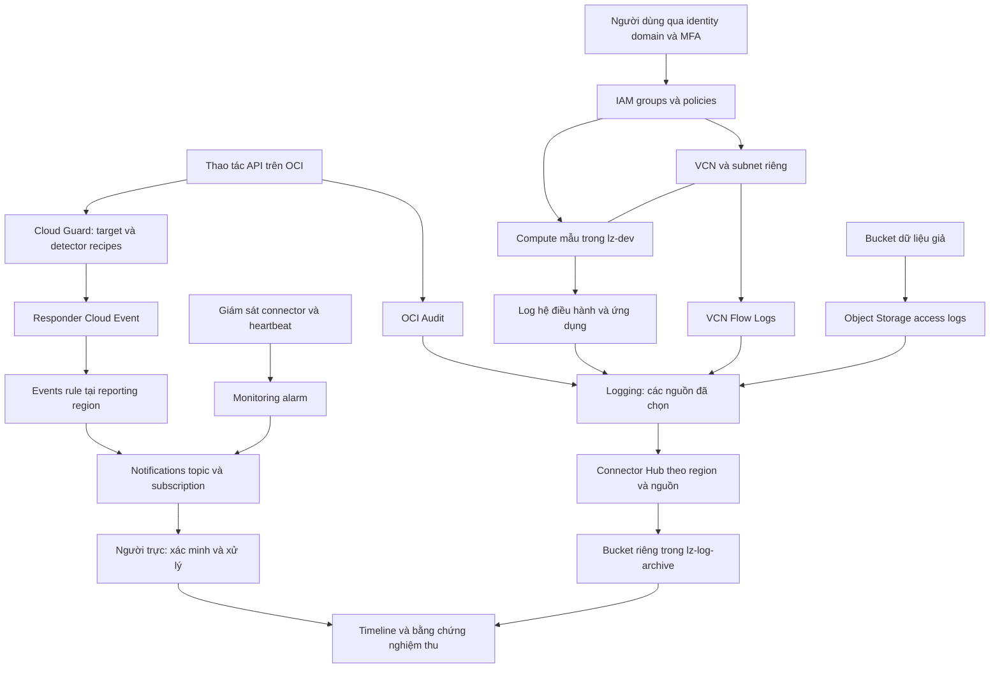

# Dự án landing zone có kiểm toán và giám sát bảo mật

## 1. Bối cảnh và kết quả cần đạt

Trong chương **Dự án tích hợp và đánh giá** của module `CLOUD_PROVIDERS_ORACLE`, bạn sẽ xây dựng một landing zone trên Oracle Cloud Infrastructure (OCI) cho doanh nghiệp giả định An Phú. Đây là nền tảng để các nhóm triển khai ứng dụng vào cloud với cách tổ chức tài nguyên, quyền truy cập, mạng, lưu trữ và vận hành đã được thống nhất.

An Phú chuẩn bị chuyển một dịch vụ xử lý hồ sơ nội bộ lên OCI. Nhóm phát triển cần môi trường thử nghiệm; nhóm nền tảng quản lý mạng và hạ tầng; nhóm bảo mật cần phát hiện cấu hình rủi ro; kiểm toán viên cần truy xuất được ai đã thay đổi tài nguyên, thay đổi vào lúc nào và kết quả ra sao. Khi workload gặp sự cố, hệ thống vẫn phải giữ được bằng chứng phục vụ điều tra.

Đề bài yêu cầu tạo một landing zone quy mô phòng lab, có khả năng mở rộng thành thiết kế cho production. Bạn phải chứng minh được chuỗi:

**Phân quyền → triển khai → ghi nhận hoạt động → phát hiện → thông báo → xử lý → lưu bằng chứng.**

Hoàn thành dự án khi có thể:

- Giải thích ranh giới giữa tenancy, identity domain, compartment, region và VCN trong thiết kế.
- Triển khai workload mẫu trong mạng riêng, phân tách quyền vận hành ứng dụng với quyền quản trị bảo mật và kho log.
- Truy vết được một thay đổi cấu hình bằng OCI Audit và phân biệt nó với log truy cập dữ liệu.
- Lưu bản sao log vào Object Storage, kiểm chứng quyền đọc và quyền xóa bằng các danh tính khác nhau.
- Phát hiện một cấu hình rủi ro bằng Cloud Guard, nhận thông báo thật và hoàn thành một runbook xử lý.
- Phát hiện được chính đường ống thu thập log bị hỏng, thay vì chỉ theo dõi workload.
- Tái tạo hạ tầng bằng Infrastructure as Code (IaC), quản lý chi phí và trình bày giới hạn về tính sẵn sàng.

Bài tập tập trung vào nền tảng quản trị OCI. Bạn có thể chọn Compute làm workload mẫu; tích hợp một dịch vụ cơ sở dữ liệu Oracle qua private endpoint là phần mở rộng khi đã hoàn thành các kiểm soát cốt lõi.

## 2. Phạm vi, điều kiện và quy ước thực hành

### 2.1. Phạm vi bắt buộc

Một bản triển khai tối thiểu gồm các compartment theo chức năng; nhóm IAM và policy theo vai trò; một VCN với subnet riêng; workload Compute nhỏ; OCI Audit; service logs phù hợp; Cloud Guard; Events và Notifications; đường xuất log qua Connector Hub vào bucket riêng; giám sát đường ống log; budget và bộ bằng chứng nghiệm thu.

Security Zones được dùng để bổ sung một phép thử phòng ngừa trên compartment riêng. Nếu tài khoản hoặc region chưa đáp ứng điều kiện triển khai, phải ghi rõ hạn chế, cung cấp thiết kế thay thế và đánh dấu phần thực nghiệm tương ứng là chưa thực hiện. Một thiết kế trên giấy không được tính là phép thử đã thành công.

### 2.2. Điều kiện trước khi bắt đầu

Bạn cần một tenancy được phép thực hành, quyền bootstrap do người quản trị cấp, một region đã đăng ký có đủ dịch vụ cần dùng, OCI CLI đã xác thực và công cụ IaC đã được cấu hình. Phải có ít nhất các danh tính thử nghiệm tách biệt cho người triển khai ứng dụng, người vận hành bảo mật và người kiểm toán.

Một người có thể đảm nhận nhiều vai trò trong phòng lab, nhưng phải đổi đúng phiên đăng nhập hoặc CLI profile khi kiểm thử. Chạy mọi phép thử bằng tài khoản quản trị sẽ che khuất lỗi phân quyền.

Chọn trước một hạn mức chi tiêu cho buổi thực hành và kiểm tra quota, service limit, năng lực cấp phát Compute. Không mặc định tenancy được cung cấp miễn phí mọi thành phần trong thiết kế. Dữ liệu dùng để thử chỉ là dữ liệu giả, không chứa hồ sơ, mật khẩu hay khóa truy cập thật.

### 2.3. Quy ước kết quả

Mỗi phép thử có một mã như `T01`, một danh tính thực hiện, thời điểm UTC, tài nguyên đích, kết quả mong đợi, kết quả thực tế và tham chiếu bằng chứng. Trạng thái là `PASS`, `FAIL` hoặc `NOT_RUN`; không dùng `PASS` khi mới quan sát được cấu hình mà chưa thực hiện thao tác.

Các thời lượng, ngưỡng và thời gian lưu được chọn trong bài là yêu cầu thiết kế của dự án giả định, không phải SLA của Oracle. Đo độ trễ thực tế và giải thích sai lệch khi nghiệm thu.

## 3. Kiến trúc tham chiếu

### 3.1. Cây compartment

```text
Tenancy root
└── lz-ap
    ├── lz-network
    ├── lz-security
    ├── lz-log-archive
    ├── lz-workloads
    │   ├── lz-dev
    │   └── lz-prod
    └── lz-drill
```

| Phạm vi | Tài nguyên hoặc chức năng chính | Chủ thể chịu trách nhiệm |
| --- | --- | --- |
| Tenancy root | Tích hợp danh tính, policy cần phạm vi tenancy, cấu hình bootstrap | Quản trị tenancy |
| `lz-network` | VCN, subnet, route table, gateway và NSG dùng chung | Nhóm mạng |
| `lz-security` | Tài nguyên điều phối bảo mật phù hợp, topic, rule, alarm, log group tập trung | Nhóm bảo mật |
| `lz-log-archive` | Bucket lưu bản sao log và bằng chứng | Nhóm quản trị kho log |
| `lz-dev`, `lz-prod` | Compute và các tài nguyên ứng dụng theo môi trường | Nhóm ứng dụng theo phạm vi được cấp |
| `lz-drill` | Tài nguyên giả dùng diễn tập phát hiện và phòng ngừa | Người điều phối thực hành |

Compartment là ranh giới tổ chức và phân quyền, không phải subnet. Compartment không thuộc riêng một region; nhiều tài nguyên bên trong có phạm vi region. VCN và subnet là tài nguyên mạng của region. Identity domain quản lý danh tính; đặt một VM trong `lz-prod` không tự tạo nhóm người dùng hay chính sách cho môi trường đó.

Cloud Guard có reporting region và phạm vi target riêng. Đặt tên `lz-security` không tự làm mọi tài nguyên trong tenancy được giám sát. Tương tự, tạo log group ở compartment trung tâm không tự thu thập log từ mọi compartment khác.

### 3.2. Sơ đồ các luồng chính



Sơ đồ tách đường lưu bằng chứng khỏi đường thông báo. Một email cảnh báo không thay thế log gốc; có log trong bucket cũng chưa chứng minh người trực sẽ nhận được cảnh báo.

## 4. Yêu cầu bảo mật và tiêu chí chấp nhận

Thiết kế bắt đầu bằng các mối đe dọa cụ thể, sau đó mới chọn dịch vụ triển khai.

| Mã kiểm soát | Rủi ro | Kiểm soát cần xây dựng | Cách chứng minh |
| --- | --- | --- | --- |
| C01 | Tài khoản ứng dụng tự nâng quyền | Tách quản trị IAM khỏi triển khai workload; không cấp quyền quản trị toàn tenancy cho nhóm ứng dụng | Nhóm ứng dụng triển khai được phần việc hợp lệ nhưng không sửa được policy nền tảng |
| C02 | Workload bị truy cập trực tiếp từ Internet | Private subnet, không public IP, NSG và route theo luồng đã duyệt | Đối chiếu cấu hình và thử kết nối từ nguồn hợp lệ, nguồn không hợp lệ |
| C03 | Không biết ai thay đổi cấu hình | Audit có thể truy vấn theo đúng region, compartment và thời gian | Tìm được bản ghi tương ứng với một thay đổi đã thực hiện |
| C04 | Nhầm audit hạ tầng với truy cập dữ liệu | Bật access logs trên bucket dữ liệu mẫu | Phân biệt bằng chứng sửa bucket với bằng chứng đọc object |
| C05 | Người vận hành ứng dụng xóa dấu vết | Bucket log riêng, IAM tách biệt và retention rule phù hợp | Người ứng dụng không đọc/xóa log; đối tượng có quyền xóa vẫn bị retention đang hiệu lực chặn |
| C06 | Cấu hình rủi ro tồn tại mà không ai biết | Cloud Guard, detector phù hợp, responder phát sự kiện, Events và Notifications | Một finding thật đi đến người nhận thật |
| C07 | Đường thu thập log bị dừng | Theo dõi connector, độ tươi dữ liệu và heartbeat | Diễn tập gián đoạn có cảnh báo và khôi phục được dữ liệu trong phạm vi hỗ trợ |
| C08 | Cấu hình sai được tạo mới | Security Zone với policy cụ thể đã chọn | API bị chặn và tài nguyên sai không xuất hiện |
| C09 | Thay đổi thủ công làm lệch IaC | State được bảo vệ, có plan và quy trình xử lý drift | Tái chạy không tạo thay đổi bất ngờ; một drift mẫu được phát hiện |
| C10 | Tài nguyên lab phát sinh chi phí kéo dài | Tag, budget, quota thích hợp và kế hoạch thu hồi | Có ước tính, người sở hữu và danh sách tài nguyên sau thu hồi |

Với C05, cần tách hai nguyên nhân bị từ chối: IAM chặn danh tính không có quyền; retention chặn thay đổi đối tượng còn được bảo vệ. Một lỗi thiếu quyền đơn thuần không chứng minh retention hoạt động.

## 5. Thiết kế IAM và trách nhiệm vận hành

### 5.1. Ma trận vai trò

| Vai trò | Quyền cần thiết | Ranh giới phải kiểm thử |
| --- | --- | --- |
| Bootstrap administrator | Tạo nền tảng danh tính và các policy cần thiết ban đầu | Không dùng làm danh tính vận hành hằng ngày |
| Network operator | Quản lý mạng trong phạm vi được giao | Không sửa IAM và kho log |
| Workload deployer | Quản lý tài nguyên ứng dụng được duyệt trong `lz-dev` | Không sửa mạng nền tảng, Cloud Guard, connector hoặc bucket log |
| Security operator | Xem và xử lý finding, quản lý luồng phát hiện trong phạm vi được giao | Không đồng thời nắm mọi quyền xóa kho bằng chứng |
| Log custodian | Quản lý cấu hình lưu giữ và truy xuất kho log | Có quy trình cho thay đổi retention và quyền truy cập |
| Auditor | Đọc Audit, log và bằng chứng đúng phạm vi | Không thay đổi workload hoặc kiểm soát bảo mật |
| Automation principal | Quyền của agent, connector hoặc job theo nhiệm vụ | Không kế thừa khóa cá nhân hay quyền quản trị rộng |

Một policy cho nhóm Workload deployer phải bao gồm những quyền phụ thuộc thực sự cần để dùng subnet, VNIC, image và volume. Quyền sử dụng tài nguyên mạng dùng chung phải được thu hẹp theo nhu cầu; không giải quyết lỗi cấp VM bằng cách cấp `manage all-resources in tenancy`.

OCI IAM cộng gộp các quyền được cấp từ các policy và nhóm liên quan. Cần kiểm tra cả quyền kế thừa từ compartment cha lẫn các nhóm khác mà người dùng thuộc về. Chỉ thêm một policy hẹp không thu hồi một policy rộng đã tồn tại.

### 5.2. Ví dụ policy đọc bằng chứng

Mẫu sau dùng OCID để tránh nhầm nhóm trùng tên ở các identity domain. Thay toàn bộ giá trị trong dấu `<...>` bằng OCID thật và đặt policy tại phạm vi có thẩm quyền đối với các compartment đích:

```text
Allow group id <auditor_group_ocid> to read audit-events in compartment id <landing_zone_compartment_ocid>
Allow group id <auditor_group_ocid> to read log-groups in compartment id <security_compartment_ocid>
Allow group id <auditor_group_ocid> to read log-content in compartment id <security_compartment_ocid>
Allow group id <auditor_group_ocid> to read buckets in compartment id <archive_compartment_ocid>
Allow group id <auditor_group_ocid> to read objects in compartment id <archive_compartment_ocid>
```

Đây là phần policy đọc bằng chứng trong thiết kế, chưa phải toàn bộ policy vận hành. Cú pháp `group id` và `compartment id` được mô tả trong [OCI IAM Policy Syntax](https://docs.oracle.com/en-us/iaas/Content/Identity/Concepts/policysyntax.htm). Quyền đọc metadata log group và quyền tìm kiếm nội dung log là các quyền khác nhau; xem [Logs and Log Groups](https://docs.oracle.com/en-us/iaas/Content/Logging/Task/managinglogs.htm).

Mẫu trên cố ý chỉ đọc Audit của cây landing zone. Hoạt động IAM ở root hoặc ở compartment chứa identity domain có thể nằm ngoài cây đó. Lập bản đồ nơi phát sinh Audit cho từng thao tác IAM cần giám sát, rồi bổ sung quyền và nguồn thu thập tương ứng. Nếu cho kiểm toán viên đọc Audit toàn tenancy, phải ghi rõ quyết định mở rộng phạm vi. Không suy ra rằng truy vấn `lz-dev` bao phủ mọi thay đổi danh tính. Oracle minh họa phạm vi Audit của identity domain trong [Generate IAM Reports from OCI Audit](https://docs.oracle.com/en/learn/generating-iam-reports-from-oci-audit/).

### 5.3. Danh tính máy và truy cập khẩn cấp

Agent trên Compute dùng instance principal với dynamic group khớp đúng tập instance cần gửi log. Connector dùng cơ chế ủy quyền mà dịch vụ hỗ trợ, giới hạn theo nguồn, đích và nhiệm vụ. Lưu riêng policy của người tạo connector và policy cho connector thực thi; việc một quản trị viên tạo được connector chưa chứng minh dịch vụ đọc/ghi được dữ liệu.

Duy trì một tài khoản truy cập khẩn cấp có người quản lý, phương thức xác thực được kiểm soát và quy trình ghi nhận mỗi lần sử dụng. Sau bootstrap, kiểm tra các phiên làm việc thông thường bằng danh tính ít quyền và xác nhận việc sử dụng quyền khẩn cấp có thể truy vết.

## 6. Mạng riêng và workload kiểm chứng

### 6.1. Kế hoạch địa chỉ và luồng kết nối

Dùng VCN mẫu `10.60.0.0/16`, subnet ứng dụng `10.60.10.0/24` và subnet dữ liệu dự phòng `10.60.20.0/24`. Khi mở rộng kết nối về doanh nghiệp, kiểm tra trùng CIDR trước khi nối mạng. Các dải này là ví dụ của phòng lab.

Compute không có public IP. Truy cập quản trị qua OCI Bastion hoặc kết nối riêng được duyệt; nếu chọn Bastion, cần hoàn thành quyền, cấu hình phiên và điều kiện mạng liên quan. Chỉ tuyên bố SSH qua Bastion thành công sau khi thực sự mở được một phiên.

| Luồng | Cách kiểm soát |
| --- | --- |
| Người quản trị đến SSH của VM | Nguồn quản trị đã duyệt, phiên ngắn hạn, NSG và firewall hệ điều hành tương ứng |
| VM đến Oracle Services Network | Service Gateway và route/service CIDR thích hợp khi dịch vụ đích được hỗ trợ |
| VM cập nhật gói từ Internet, nếu cần | NAT Gateway cho outbound; ghi rõ lý do, đích và thời gian sử dụng |
| Ứng dụng đến cơ sở dữ liệu, nếu triển khai | Endpoint riêng và NSG mở đúng cổng của dịch vụ đã chọn |
| Nguồn không hợp lệ đến VM | Không có đường truy cập và quy tắc cho phép tương ứng |

NAT Gateway không tạo quyền truy cập inbound từ Internet vào VM. Service Gateway không thay thế quyền IAM. Route table xác định đường đi, còn NSG, security list và firewall của máy quyết định những lớp kiểm soát lưu lượng tương ứng.

Khi một VNIC chịu cả NSG và security list, các quy tắc cho phép được kết hợp. Vì vậy, đóng cổng trong NSG không khắc phục được một quy tắc mở rộng còn tồn tại trong security list. Đối chiếu toàn bộ tập quy tắc liên quan và thử bằng kết nối mới; cơ chế này được mô tả tại [OCI Security Rules](https://docs.oracle.com/en-us/iaas/Content/Network/Concepts/securityrules.htm).

### 6.2. Workload tối thiểu

Triển khai một Compute nhỏ chạy dịch vụ trả về trạng thái sức khỏe hoặc xử lý một yêu cầu giả. Log ứng dụng cần có timestamp UTC, mã tương quan của yêu cầu và kết quả xử lý. Không ghi secret hoặc toàn bộ payload nhạy cảm.

Bật VCN Flow Logs cho phạm vi mạng mẫu và custom log cho hệ điều hành/ứng dụng nếu dùng agent. Một VM có thể đủ cho phép thử tích hợp, nhưng đây vẫn là một điểm lỗi đơn. Bản thiết kế production phải nêu cách phân phối instance qua fault domain hoặc availability domain phù hợp, cân bằng tải, sao lưu và phục hồi; chưa triển khai thì không được ghi nhận là đã đạt HA.

## 7. Xây dựng khả năng kiểm toán và kho bằng chứng

### 7.1. Phân loại nguồn dữ liệu

| Nguồn | Câu hỏi hỗ trợ trả lời | Giới hạn cần hiểu |
| --- | --- | --- |
| OCI Audit | Ai gọi API quản trị được hỗ trợ, gọi lúc nào, lên tài nguyên nào và kết quả gì? | Không thay thế toàn bộ nhật ký truy cập dữ liệu hay audit bên trong cơ sở dữ liệu |
| Object Storage access logs | Có thao tác đọc/ghi object nào, từ danh tính và nguồn nào? | Phải bật category phù hợp và xác minh thực tế được ghi nhận |
| VCN Flow Logs | Kết nối mạng nào được quan sát, được chấp nhận hay từ chối? | Không phải bản sao nội dung gói tin hoặc nội dung truy vấn SQL |
| Log hệ điều hành/ứng dụng | Tiến trình hoặc yêu cầu nghiệp vụ nào gặp vấn đề? | Cần agent/cấu hình, quyền gửi log và kiểm soát dữ liệu nhạy cảm |
| Cloud Guard problem | Detector nào phát hiện tình trạng hoặc hành vi rủi ro? | Finding là dữ liệu phân tích; cần liên kết về tài nguyên và log liên quan |
| Connector run logs và metrics | Đường chuyển log có đang chạy và chuyển được dữ liệu? | Không tự chứng minh từng nguồn dự kiến đều đã được đưa vào cấu hình |

OCI Audit tự ghi các lời gọi API endpoint công khai được hỗ trợ. Đối với Object Storage, tài liệu Audit phân biệt sự kiện liên quan bucket với sự kiện liên quan object; không dùng Audit làm bằng chứng duy nhất cho `GetObject`. Xem [Overview of Audit](https://docs.oracle.com/en-us/iaas/Content/Audit/Concepts/auditoverview.htm).

Trên bucket dữ liệu giả, bật cả Read Access Events và Write Access Events khi cần kiểm thử đọc/ghi. Oracle nêu service logs của Object Storage được phân phối theo cơ chế best effort, vì vậy không cam kết mọi yêu cầu dữ liệu đều có một bản ghi được giao thành công. Xem [Details for Object Storage](https://docs.oracle.com/en-us/iaas/Content/Logging/Reference/details_for_object_storage.htm).

Nếu mở rộng sang Oracle Database, phải thiết kế thêm audit trong cơ sở dữ liệu cho hành vi truy cập dữ liệu hoặc SQL cần theo dõi. Tạo hoặc cập nhật một tài nguyên database trên OCI và đọc một bảng bên trong database là hai lớp hoạt động khác nhau.

### 7.2. Retention và bảo vệ dữ liệu

Audit logs được OCI lưu 365 ngày và thời gian này không thay đổi được. Đây là cơ chế riêng với retention của service/custom logs trong Logging và retention rule của bucket lưu bản sao. Tham khảo [Audit Log Retention Period](https://docs.oracle.com/en-us/iaas/Content/Audit/Tasks/settingretentionperiod.htm).

Dự án chọn chính sách ví dụ sau:

| Lớp lưu trữ | Chính sách cho phòng lab | Quyết định cần có khi lên production |
| --- | --- | --- |
| Audit do OCI quản lý | Dùng cơ chế lưu giữ của dịch vụ | Đánh giá nhu cầu lưu bản sao dài hạn hoặc phục vụ hệ thống khác |
| Service/custom logs trong Logging | Chọn 30 ngày cho nguồn thực hành nếu cấu hình hỗ trợ | Tính thời gian điều tra thường gặp, lưu lượng và chi phí truy vấn |
| Bucket log archive | Private; retention thử nghiệm ngắn, chưa khóa | Thời gian lưu theo yêu cầu doanh nghiệp và quyết định có khóa hay không |
| Gói bằng chứng nghiệm thu | Lưu vào nơi chỉ nhóm liên quan được đọc | Chủ sở hữu, thời hạn lưu, quyền chia sẻ và quy trình tiêu hủy |

Đặt bucket log trong `lz-log-archive`, không cho nhóm ứng dụng quyền quản trị bucket hoặc object. Tách quyền sửa retention khỏi quyền đọc bằng chứng. Không tạo pre-authenticated request cho kho log trong bài thực hành.

Để kiểm chứng retention, tạo một object giả trong bucket thử, áp dụng time-bound retention rule chưa khóa, sau đó thử xóa object bằng danh tính có đủ quyền xóa nhưng không có quyền sửa rule. Thao tác phải bị chặn vì retention đang hiệu lực. Làm phép thử đối chứng trên object trong bucket không có retention để xác nhận danh tính thử thực sự có quyền xóa.

Retention rule đã có hiệu lực bảo vệ object ngay cả khi chưa khóa rule; khóa bảo vệ việc sửa rule và là thao tác không thể đảo ngược sau khi có hiệu lực. Bài lab không yêu cầu khóa retention. Tài liệu Oracle mô tả thời gian chờ khóa bắt buộc 14 ngày và các ràng buộc tại [Object Storage Data Retention Rules](https://docs.oracle.com/en-us/iaas/Content/Object/Tasks/usingretentionrules.htm).

Một bucket private và một rule chưa khóa không tạo khả năng chống mọi quản trị viên của tenancy can thiệp. Nêu rõ giả định tin cậy, người có thể sửa policy/rule và biện pháp phê duyệt thay đổi khi thiết kế production.

Mặc định bảo vệ dữ liệu bằng cơ chế mã hóa của dịch vụ. Nếu chọn customer-managed key trong OCI Vault, phải bổ sung quyền dùng khóa, cảnh báo thay đổi trạng thái khóa và phương án khôi phục. Mất khả năng giải mã cũng có thể làm mất khả năng sử dụng bằng chứng dù object vẫn tồn tại.

### 7.3. Xuất log bằng Connector Hub

Connector Hub, trước đây có tên Service Connector Hub, hỗ trợ chuyển dữ liệu từ Logging đến Object Storage. Dịch vụ sử dụng cơ chế phân phối ít nhất một lần; phía xử lý sau đó cần chịu được bản ghi trùng. Xem [Overview of Connector Hub](https://docs.oracle.com/en-us/iaas/Content/connector-hub/overview.htm).

Thực hiện theo thứ tự:

1. Lập bảng nguồn gồm region, compartment, log group, log và người sở hữu. Với Audit, chọn nguồn `_Audit` theo giao diện cấu hình hỗ trợ.
2. Tạo bucket private tại region đã chọn cho luồng lưu trữ, rồi cấp quyền đọc/ghi cần thiết cho cơ chế thực thi của connector.
3. Tạo connector với nguồn Logging và đích Object Storage; tách prefix theo region và loại nguồn để dễ điều tra.
4. Ban đầu chuyển nguồn đã chọn mà chưa lọc bỏ các nhóm sự kiện quan trọng. Bổ sung filter khi đã có bằng chứng phạm vi bao phủ.
5. Bật run logs của connector và đưa chúng vào nguồn giám sát sức khỏe riêng.
6. Tạo một thay đổi thử, tìm nó ở nguồn, rồi kiểm tra object đích và nội dung bản ghi sau giải nén.
7. Lặp lại với một compartment con và với nguồn IAM ở ngoài cây workload nếu thuộc phạm vi giám sát.

Không mặc định một nguồn được chọn tại compartment cha tự bao phủ toàn bộ compartment con. Phải chứng minh nguồn thực tế của cấu hình. Mỗi region có tài nguyên log và luồng chuyển dữ liệu cần được kiểm tra; lưu vào bucket tập trung không làm mọi nguồn tự xuất hiện.

Connector dùng Logging làm nguồn có cửa sổ lưu dữ liệu phục vụ chuyển tiếp 24 giờ. Đây không phải thời gian lưu của Audit. Gián đoạn vượt cửa sổ này có thể tạo khoảng thiếu ở đích; một connector mới cũng không tự chuyển toàn bộ lịch sử Audit 365 ngày. Nếu cần bù lịch sử, dùng quy trình xuất riêng từ nguồn còn lưu giữ và ghi nhận phạm vi đã bù. Xem [Creating a Connector with a Logging Source](https://docs.oracle.com/en-us/iaas/Content/connector-hub/create-service-connector-logging-source.htm).

Tránh tạo vòng lặp thu thập: nếu bật access logs trên chính bucket archive, không gửi log ghi vào bucket đó trở lại cùng bucket qua một luồng tự sinh thêm log vô hạn. Tách nguồn giám sát kho log và kiểm tra bộ lọc/phạm vi thu thập.

## 8. Phát hiện và phòng ngừa bằng Cloud Guard, Security Zones

### 8.1. Cấu hình Cloud Guard theo phạm vi

Bật Cloud Guard bằng danh tính bootstrap được cấp quyền. Ghi lại reporting region, các region thuộc phạm vi thiết kế, target và detector/responder recipes áp dụng cho từng nhánh compartment.

Gắn detector recipe phù hợp cho cấu hình và hoạt động cần theo dõi. Kiểm tra một compartment con mới có thực sự chịu cấu hình mong đợi; target con có thể thay đổi cấu hình kế thừa. Reporting region dùng cho điều phối Cloud Guard không được suy ra chỉ từ home region. Các khái niệm này được mô tả trong [Cloud Guard Concepts](https://docs.oracle.com/en-us/iaas/Content/cloud-guard/using/cg-concepts.htm).

Đối với lab, cho phép tự động phát sự kiện thông báo nhưng chỉ thực hiện khắc phục thay đổi tài nguyên sau khi người vận hành xác minh. Nếu clone responder recipe, rà soát từng rule để chỉ bật chế độ tự động cho hành động cần thiết và đã hiểu tác động.

### 8.2. Hoàn thiện chuỗi thông báo

Một cấu hình hay bị bỏ sót là responder **Cloud Event**. Muốn nhận finding qua Events và Notifications, target phải gắn responder recipe có rule phát Cloud Event được bật và tự động thực thi. Không tắt toàn bộ responder rồi kỳ vọng Events vẫn nhận finding.

Tại reporting region:

1. Kiểm tra responder recipe đang gắn vào target và trạng thái rule Cloud Event.
2. Tạo Notifications topic dành cho bảo mật, tạo subscription và hoàn tất xác nhận nếu giao thức yêu cầu.
3. Gửi một thông điệp thử để xác nhận topic/subscription có thể chuyển thông báo.
4. Tạo Events rule trong compartment có phạm vi bao phủ sự kiện cần bắt, với action chuyển đến topic.
5. Chọn loại sự kiện phát hiện problem mới. Giá trị `eventType` là:

```text
com.oraclecloud.cloudguard.problemdetected
```

6. Ban đầu dùng điều kiện đủ rộng cho problem thử nghiệm trong phạm vi lab. Sau khi xác nhận đường truyền, thêm điều kiện severity hoặc thuộc tính từ payload thực tế.
7. Tạo finding mới và ghi nhận đủ problem ID, thời gian, event và thông báo nhận được.

Cấu hình responder, reporting region và event type được Oracle mô tả tại [Configuring Notifications](https://docs.oracle.com/en-us/iaas/Content/cloud-guard/using/export-notifs-config.htm).

Thông điệp gửi thử ở bước 3 chỉ chứng minh Notifications hoạt động; phải hoàn thành bước 7 mới chứng minh tích hợp Cloud Guard đến người nhận. Một problem đã tồn tại trước khi tạo rule không nhất thiết tạo lại thông báo phát hiện mới. Xem cách xử lý trường hợp này trong [Troubleshooting Cloud Guard](https://docs.oracle.com/en-us/iaas/Content/cloud-guard/using/trouble.htm).

### 8.3. Security Zones là lớp phòng ngừa

Trong `lz-drill`, tạo một compartment con cho phép thử Security Zone và chọn recipe có policy phù hợp với phép thử, chẳng hạn hạn chế bucket public. Ghi rõ rule nào đang bật và tài nguyên nào chịu phạm vi đó.

Thử tạo cấu hình vi phạm bằng danh tính vốn có quyền thực hiện thao tác tương ứng. Kết quả mong đợi là thao tác bị từ chối do Security Zone và tài nguyên sai không được tạo. Phép thử phải tách biệt với trường hợp bị IAM từ chối vì thiếu quyền.

Security Zones kiểm tra thao tác theo policy trong recipe; Cloud Guard phát hiện và theo dõi vấn đề theo cấu hình giám sát. Khi tạo Security Zone, OCI tạo target Cloud Guard tương ứng, vì vậy cần rà lại bản đồ target sau bước này. Tham khảo [Getting Started with Security Zones](https://docs.oracle.com/en-us/iaas/Content/security-zone/using/get-started.htm).

Không áp dụng một recipe nghiêm ngặt lên toàn bộ cây đang có tài nguyên mà chưa đối chiếu kiến trúc. Bài tập dùng nhánh riêng để quan sát cơ chế phòng ngừa mà vẫn duy trì vùng diễn tập phát hiện ngoài zone.

## 9. Giám sát chính đường thu thập và cảnh báo

Một hệ thống có thể yên lặng vì không có sự cố, cũng có thể vì connector đã ngừng chuyển log. Vì vậy, dashboard phải có cả tình trạng workload lẫn tình trạng đường ống bằng chứng.

Theo dõi tối thiểu trạng thái connector, lỗi chạy, mức độ trễ của dữ liệu và lần cuối heartbeat được quan sát tại kho đích. Connector Hub có metrics phục vụ theo dõi data freshness; run logs cung cấp thông tin từng lần chạy. Xem [Troubleshooting Connectors](https://docs.oracle.com/en-us/iaas/Content/connector-hub/troubleshooting.htm) và [Logs for Connector Hub](https://docs.oracle.com/en-us/iaas/Content/connector-hub/service-logging.htm).

Thiết kế heartbeat của dự án như sau:

- Một job tạo bản ghi custom log chứa mã `lz-heartbeat` và timestamp UTC mỗi 5 phút.
- Một luồng đưa nguồn này qua connector đang cần kiểm tra tới archive.
- Một job kiểm chứng độc lập đọc dữ liệu heartbeat tại đích và công bố custom metric về tuổi của heartbeat mới nhất.
- Monitoring alarm phát hiện tuổi vượt ngưỡng 20 phút; có thêm cách phát hiện khi chính job kiểm chứng không còn xuất metric.

Các mốc 5 và 20 phút là lựa chọn ban đầu cho lab. Phải điều chỉnh sau khi đo thời gian gom lô, chuyển dữ liệu và chạy job. Heartbeat chỉ chứng minh đường đi của nguồn heartbeat; nó không thay thế phép thử bao phủ từng nguồn Audit/service log trong bảng nguồn.

Đường báo lỗi connector không được chỉ dựa vào connector đang lỗi. Ví dụ, Monitoring alarm gửi trực tiếp đến Notifications, còn người trực có thể kiểm tra metrics và run logs bằng một phiên có quyền đọc độc lập. Khi tăng mức quan trọng cho production, bổ sung người trực dự phòng và phương án khi kênh thông báo chính không sử dụng được.

## 10. Tự động hóa và thứ tự triển khai

### 10.1. Chia IaC theo trách nhiệm và vòng đời

Có thể dùng Terraform với OCI provider hoặc OCI Resource Manager. Dù chọn công cụ nào, cần biểu diễn các phần sau trong mã nguồn hoặc tài liệu bootstrap có thể tái lập:

| Thành phần | Đầu vào chính | Đầu ra cần công bố |
| --- | --- | --- |
| Foundation | Tenancy, compartment cha, tên, tag | Compartment OCID và bản đồ vai trò |
| Identity | Group OCID, phạm vi tài nguyên, principal | Policy, dynamic group hoặc cấu hình ủy quyền liên quan |
| Network | CIDR, luồng đã duyệt, nhu cầu gateway | VCN, subnet, NSG và route identifiers |
| Evidence | Nguồn log, bucket đích, retention | Log group/log, bucket, connector và bảng nguồn |
| Detection | Reporting region, target, recipes | Target, Events rule, topic và alarm identifiers |
| Workload | Image, shape, subnet, NSG | Instance và endpoint kiểm thử riêng |

Hợp đồng đầu vào minh họa dưới đây chỉ là đặc tả thiết kế cho IaC của dự án, không phải payload gửi trực tiếp cho OCI API:

```yaml
project: lz-ap
deployment_region: <oci-region-identifier>
cloud_guard_reporting_region: <oci-region-identifier>
network:
  vcn_cidr: 10.60.0.0/16
  app_subnet_cidr: 10.60.10.0/24
  public_ip_for_app: false
archive:
  bucket_name: <unique-lab-archive-bucket-name>
  access: private
  retention_lock_required_in_lab: false
monitoring:
  heartbeat_interval_minutes: 5
  initial_stale_threshold_minutes: 20
ownership:
  team: platform-lab
  environment: lab
```

Không lưu API private key, mật khẩu database hoặc nội dung secret vào file biến hay repository. State và output của công cụ IaC cũng cần kiểm soát truy cập vì có thể chứa dữ liệu nhạy cảm. Ghi lại phiên bản công cụ/provider đã kiểm chứng và giữ lock file thích hợp để lần dựng sau dùng cùng bộ phụ thuộc.

### 10.2. Lộ trình triển khai

1. **Chốt thiết kế:** sơ đồ, vai trò, region, hạn mức chi tiêu, nguồn log và phép thử.
2. **Bootstrap:** compartment, nhóm và policy nền tảng. Tạo các profile thử nghiệm tách biệt.
3. **Đặt nền bằng chứng:** bucket, log group, connector, topic và quyền đọc/ghi cần thiết.
4. **Tạo mạng và workload:** private subnet, NSG, đường quản trị, VM và log ứng dụng.
5. **Bật phát hiện:** target, recipes, Cloud Event responder, Events rule và Security Zone thử nghiệm.
6. **Bật giám sát sức khỏe:** metrics, heartbeat, alarm và bảng theo dõi nguồn.
7. **Chạy kiểm thử:** thu bằng chứng thật, xử lý lỗi và ghi các mục chưa thực hiện.
8. **Kiểm tra khả năng tái lập:** chạy plan sau apply, giải thích thay đổi còn lại và xử lý drift mẫu.
9. **Nghiệm thu và thu hồi:** bàn giao gói bằng chứng, tài nguyên giữ lại và chi phí dự kiến.

Bật Audit không phải một bước cần thực hiện thủ công theo kiểu cài agent cho VM; phần phải triển khai là quyền truy vấn, xác định nguồn, luồng xuất và phương pháp sử dụng bằng chứng. Sau bootstrap, các thay đổi tiếp theo cần đi qua IaC; ngoại lệ diễn tập có thời điểm bắt đầu, kết thúc và cách đưa state/cấu hình về trạng thái mong muốn.

## 11. Thực hành truy xuất bằng chứng Audit

Ví dụ PowerShell sau chỉ đọc dữ liệu, lấy toàn bộ trang kết quả trong cửa sổ 30 phút. Nó yêu cầu OCI CLI đã được cấu hình và profile kiểm toán có quyền tại compartment đích. Thay placeholder trước khi chạy:

```powershell
$auditProfile = '<auditor-cli-profile>'
$auditRegion = '<oci-region-identifier>'
$auditCompartmentId = '<compartment-ocid>'
$auditEndUtc = [DateTime]::UtcNow
$auditStartUtc = $auditEndUtc.AddMinutes(-30)

$auditArguments = @(
    'audit', 'event', 'list',
    '--profile', $auditProfile,
    '--region', $auditRegion,
    '--compartment-id', $auditCompartmentId,
    '--start-time', $auditStartUtc.ToString('yyyy-MM-ddTHH:mm:00Z'),
    '--end-time', $auditEndUtc.ToString('yyyy-MM-ddTHH:mm:00Z'),
    '--all',
    '--output', 'json'
)

$auditJson = & oci @auditArguments
if ($LASTEXITCODE -ne 0) {
    throw 'Khong truy xuat duoc Audit; kiem tra quyen, region va tham so.'
}

$auditResult = ($auditJson -join [Environment]::NewLine) | ConvertFrom-Json
$auditResult.data
```

Cú pháp, phân trang và định dạng thời gian được mô tả tại [OCI CLI: audit event list](https://docs.oracle.com/en-us/iaas/tools/oci-cli/latest/oci_cli_docs/cmdref/audit/event/list.html). Cửa sổ này kết thúc ở đầu phút hiện tại do định dạng thời gian; thao tác rất mới có thể nằm ngoài cửa sổ hoặc chưa được xử lý, nên chạy lại sau với thời gian phù hợp.

Không mặc định lệnh truy vấn một compartment trả về toàn bộ compartment con hoặc mọi region. Lặp theo bảng nguồn và phạm vi thực tế cần điều tra. Không thêm một tham số đệ quy không được lệnh hỗ trợ.

Để tạo dấu vết dễ tìm, dùng danh tính được cấp quyền cập nhật một tag hoặc thuộc tính không nhạy cảm trên tài nguyên thử. Ghi lại thời gian, OCID và request ID nếu giao diện cung cấp; sau đó đối chiếu với bản ghi Audit. Không chọn thay đổi IAM rộng chỉ để tạo log mẫu.

Khi đọc bản ghi, tìm các trường về thời gian, tên thao tác, danh tính, tài nguyên, nguồn yêu cầu và kết quả. Cấu trúc hiển thị trong Audit API, Logging Search và object xuất có thể khác lớp bao bọc hoặc cách đặt tên. Lấy một bản ghi thực tế làm mẫu trước khi viết bộ lọc, không sao chép đường dẫn trường một cách máy móc giữa các định dạng.

## 12. Kế hoạch kiểm thử nghiệm thu

### 12.1. Bộ kiểm thử bắt buộc

| Mã | Danh tính và thao tác | Kết quả cần đạt | Bằng chứng tối thiểu |
| --- | --- | --- | --- |
| T01 | Workload deployer triển khai tài nguyên hợp lệ trong dev | Thành công trong đúng phạm vi | Output triển khai, OCID, cấu hình mạng |
| T02 | Cùng danh tính thử sửa policy nền tảng | Bị từ chối; policy không đổi | Lỗi API/request ID nếu có và cấu hình sau thử |
| T03 | Auditor đọc Audit, log và object bằng chứng đã được cấp | Đọc được; không sửa được tài nguyên ứng dụng | Kết quả đọc và một phép thử thay đổi bị từ chối |
| T04 | Nguồn quản trị hợp lệ và nguồn không hợp lệ tạo kết nối mới đến VM | Luồng hợp lệ hoạt động; luồng ngoài thiết kế bị chặn | Route, NSG/security list, kết quả kết nối và log mạng khi có |
| T05 | Người được phép cập nhật thuộc tính tài nguyên thử | Có bản ghi Audit phù hợp | Thời gian, danh tính, OCID và kết quả thao tác |
| T06 | Danh tính đọc một object giả trong bucket mẫu đã bật read logs | Có access log phù hợp khi được dịch vụ giao | Object, thời gian, principal, thao tác và mã kết quả |
| T07 | Tạo một thay đổi mẫu rồi kiểm tra nguồn và archive | Tìm được bản ghi tương ứng ở hai nơi | Log gốc, object đích, khóa đối chiếu và độ trễ |
| T08 | Workload deployer thử truy cập/xóa object archive | Bị IAM chặn theo thiết kế | Danh tính, lỗi và object còn tồn tại |
| T09 | Danh tính có quyền xóa thử xóa object đang được retention bảo vệ | Bị retention chặn; phép thử đối chứng xóa được | Rule, thời gian hiệu lực và hai kết quả đối chứng |
| T10 | Tạo cấu hình rủi ro có kiểm soát ngoài Security Zone | Cloud Guard tạo finding và thông báo đến subscription thật | Cấu hình thử, problem ID, event và thời gian nhận |
| T11 | Tạo cấu hình vi phạm policy trong Security Zone | Bị Security Zone chặn; tài nguyên sai không tồn tại | Recipe/rule, lỗi thao tác và trạng thái tài nguyên |
| T12 | Tạm dừng connector lab theo kế hoạch | Giám sát nhận biết dữ liệu cũ/không chuyển và phát cảnh báo | Trạng thái, metric, thông báo, timeline phục hồi |
| T13 | Tạo drift vô hại, chạy plan rồi khôi phục | Drift được thấy và xử lý có giải thích | Plan trước/sau, thao tác khôi phục |
| T14 | Kiểm tra bảng nguồn với một compartment con và nguồn IAM cần thiết | Phạm vi thu thập khớp thiết kế | Thao tác mẫu tại từng nguồn và bản ghi ở đích |

Đối với T06, nếu không tìm thấy access log trong cửa sổ quan sát, ghi nhận kết quả thực tế và điều tra; không suy ra chắc chắn không có truy cập dữ liệu. Với T10, một ảnh màn hình danh sách Problems chưa chứng minh thông báo đã tới người nhận. Với T12, email gửi tay không chứng minh alarm phát hiện mất dữ liệu.

### 12.2. Diễn tập finding có kiểm soát

Chọn một detector đang bật, được hỗ trợ với loại tài nguyên và phạm vi thử. Ví dụ, dùng bucket rỗng trong nhánh diễn tập ngoài Security Zone, chuyển sang mức truy cập public mà detector đã chọn theo dõi. Không đặt dữ liệu thật, không tạo quyền ghi công khai và không dùng bucket archive làm mục tiêu.

Trước khi thay đổi, ghi trạng thái ban đầu, người chịu trách nhiệm, thời hạn kết thúc và cách trả bucket về private. Khi thực hiện:

1. Ghi thời gian thay đổi, bucket và danh tính thực hiện.
2. Kiểm tra Audit cho thao tác quản trị bucket.
3. Quan sát finding mới tương ứng trong target dự kiến.
4. Kiểm tra event và thông báo chứa problem/resource cần xử lý.
5. Trả tài nguyên về cấu hình an toàn trong thời hạn diễn tập đã đặt.
6. Xác nhận cấu hình thực tế đã đúng và theo dõi vòng đời finding.
7. Nếu hết thời hạn mà chưa có finding, vẫn hoàn tác; ghi `FAIL` hoặc `NOT_RUN` theo phần đã thực hiện, rồi điều tra cấu hình giám sát.

Không đặt một thời gian quét Cloud Guard cố định rồi coi đó là cam kết của dịch vụ. Lưu thời điểm tạo sai lệch, phát hiện, nhận cảnh báo và khắc phục để đo độ trễ thực tế.

### 12.3. Diễn tập gián đoạn đường xuất log

Dùng connector lab, không dùng pipeline đang vận hành cho hệ thống thật. Ghi lại cấu hình trước thử, tạm dừng, tạo một heartbeat hoặc sự kiện đánh dấu và chờ alarm theo ngưỡng đã cấu hình. Sau đó kích hoạt lại connector, xác nhận có dữ liệu mới ở đích và tìm lại sự kiện đánh dấu.

Nếu gián đoạn còn trong cửa sổ dịch vụ hỗ trợ, kiểm tra phần chuyển tiếp được bù thực tế. Nếu không, lập bảng khoảng thiếu và chạy quy trình xuất bù riêng từ nguồn còn giữ dữ liệu. Đối chiếu theo event ID hoặc khóa tương quan và thời gian; không chỉ so số lượng vì một số cơ chế giao có thể tạo bản ghi trùng.

## 13. Runbook xử lý một cảnh báo

Áp dụng runbook sau cho cảnh báo cấu hình bucket public trong lab; khi xử lý loại tài nguyên khác, thay thao tác khắc phục tương ứng.

| Bước | Việc người trực thực hiện | Kết quả cần lưu |
| --- | --- | --- |
| Tiếp nhận | Xác nhận topic, problem ID, region, compartment và tài nguyên | Thời điểm nhận và người xử lý |
| Xác minh | Đọc finding và cấu hình thực tế; phân biệt diễn tập với thay đổi ngoài kế hoạch | Detector/rule, mức rủi ro và trạng thái tài nguyên |
| Bảo toàn bằng chứng | Lưu payload cảnh báo, Audit liên quan và tham chiếu log gốc | ID bản ghi, request ID nếu có, object/prefix lưu bằng chứng |
| Giới hạn tác động | Đưa bucket về private bằng vai trò được phép | Thời gian và kết quả thao tác khắc phục |
| Điều tra | Xác định chủ thể, nguồn yêu cầu, các thay đổi kề thời điểm và phạm vi liên quan | Timeline và giả thuyết có bằng chứng hỗ trợ |
| Kiểm chứng | Đọc lại cấu hình, thử truy cập phù hợp và theo dõi finding | Cấu hình sau sửa và kết quả thử |
| Kết thúc | Hoàn thiện ticket, nguyên nhân, hành động phòng ngừa và thay đổi IaC | Người xác nhận và công việc còn lại |

Không chỉ bấm dismiss để làm sạch dashboard. Dismiss phản ánh quyết định xử lý finding; việc bucket còn public hay không phải được kiểm tra trực tiếp. Nếu là ngoại lệ được chấp thuận, ghi lý do, người sở hữu, phạm vi và thời hạn xem xét lại.

Mẫu timeline cho phép thử:

```text
test_id: T10
resource_id: <bucket-ocid-or-supported-resource-id>
actor: <test-principal-id>
change_at_utc: <timestamp>
audit_event_id: <event-id>
cloud_guard_problem_id: <problem-ocid>
problem_first_detected_at_utc: <timestamp>
notification_received_at_utc: <timestamp>
configuration_restored_at_utc: <timestamp>
verification_result: <PASS|FAIL>
evidence_reference: <restricted-evidence-location>
```

Đo riêng thời gian từ thay đổi đến phát hiện, từ phát hiện đến nhận thông báo và từ nhận đến khôi phục. Một phép thử tạo dữ liệu không đủ để suy ra độ tin cậy của hệ thống trong mọi tình huống; trình bày đúng phạm vi đã chứng minh.

## 14. Chi phí, tính sẵn sàng và thu hồi tài nguyên

### 14.1. Kiểm soát chi phí

Gắn tag về dự án, môi trường và người sở hữu. Ước tính riêng Compute/volume, gateway, dữ liệu log được nhập và giữ, Object Storage, yêu cầu truy cập, job/Functions nếu dùng và chi phí truyền dữ liệu liên quan. Dùng mức giá và điều kiện tài khoản tại thời điểm triển khai để lập bảng tính; không coi dịch vụ có nhãn miễn phí trong một trường hợp là miễn phí cho mọi cấu hình.

Công thức dự toán đơn giản:

```text
Chi phí lab dự kiến
  = chi phí tài nguyên theo thời gian chạy
  + chi phí nhập, lưu và truy vấn log theo cách tính của dịch vụ
  + chi phí lưu object và số yêu cầu
  + chi phí xử lý heartbeat/kiểm chứng
  + chi phí mạng có áp dụng
```

Đặt budget với cảnh báo theo mức chi tiêu thực tế và dự báo phù hợp. Budget là giới hạn mềm để theo dõi và cảnh báo, không tự dừng mọi tài nguyên khi đạt mức tiền đã đặt. Kết hợp quota phù hợp cho một số loại tài nguyên và quy trình thu hồi để kiểm soát lab. Xem [OCI Budgets](https://docs.oracle.com/en-us/iaas/Content/Billing/Concepts/budgetsoverview.htm).

### 14.2. Tính sẵn sàng của chức năng bảo mật

| Sự cố | Hệ quả cần dự tính | Thiết kế hoặc bằng chứng cần có |
| --- | --- | --- |
| VM ứng dụng dừng | Log ứng dụng/heartbeat từ VM có thể ngừng | Có phép kiểm tra độc lập để phân biệt workload dừng với connector hỏng |
| Connector dừng hoặc lỗi quyền | Archive thiếu dữ liệu mới | Alarm độc lập, quy trình khôi phục và xuất bù |
| Người trực không nhận email | Không có hành động dù đã có finding | Subscription được kiểm chứng, người nhận dự phòng theo mức quan trọng |
| Region triển khai không sẵn sàng | Khả năng đọc log hoặc điều phối tại region đó bị ảnh hưởng | Quyết định region dự phòng, phạm vi sao chép và bài thử khôi phục nếu có yêu cầu |
| Khóa do khách hàng quản lý bị vô hiệu hóa | Dữ liệu vẫn tồn tại nhưng không đọc được | Kiểm soát vòng đời khóa và runbook phục hồi |

Tập trung dữ liệu về một bucket là một quyết định quản trị, không tự tạo phương án phục hồi đa region. Bản production cần định nghĩa RPO cho bằng chứng, RTO cho khả năng điều tra và kiểm thử khôi phục tương ứng. Bản lab một region phải công bố rõ giới hạn này.

### 14.3. Thứ tự thu hồi

Sau nghiệm thu, dừng các phép thử và job sinh dữ liệu, hoàn tác cấu hình diễn tập, rồi gỡ workload và tài nguyên phụ thuộc theo kế hoạch IaC. Giữ luồng bằng chứng đủ lâu để quan sát các thao tác thu hồi cần ghi nhận. Xuất gói nghiệm thu trước khi gỡ connector và hạ tầng log do lab sở hữu.

Kiểm tra volume còn lại, gateway, địa chỉ IP được cấp riêng, bucket, rule, topic, alarm và policy hỗ trợ đã tạo. Với tài nguyên IAM hoặc Cloud Guard dùng chung tenancy, chỉ thu hồi phần đã được giao cho lab, có xác nhận quyền sở hữu.

Object còn được retention bảo vệ có thể khiến việc xóa bucket thất bại. Với rule chưa khóa của lab, người có thẩm quyền xử lý theo kế hoạch giữ/xóa bằng chứng; không cố vô hiệu hóa các bảo vệ của kho đang vận hành. Ghi lại mọi tài nguyên cần giữ cùng lý do, chủ sở hữu và chi phí dự kiến sau buổi thực hành.

## 15. Hồ sơ bàn giao và thang đánh giá

### 15.1. Hồ sơ cần nộp

Hồ sơ của người học gồm sơ đồ kiến trúc; bản đồ compartment và region; ma trận IAM; mã IaC và hướng dẫn bootstrap/tái tạo; bảng nguồn log; cấu hình detector, responder, Events và Notifications; danh sách alarm; runbook; bảng chi phí; kết quả kiểm thử và bằng chứng.

Mỗi dòng kiểm thử phải trỏ tới tài nguyên hoặc bản ghi cụ thể. Ảnh chụp màn hình chỉ hỗ trợ diễn giải; bằng chứng chính nên giữ payload gốc hoặc tham chiếu truy xuất có quyền kiểm soát, thời gian UTC và ID tương quan. Khi chia sẻ bản báo cáo ra ngoài nhóm được cấp quyền, dùng bản đã che dữ liệu nhạy cảm và giữ bản gốc ở kho hạn chế truy cập.

Tách rõ ba nhóm kết quả trong hồ sơ: phần đã triển khai và kiểm thử; phần đã thiết kế nhưng chưa triển khai; phần còn lỗi hoặc chưa có đủ bằng chứng. Danh sách thiếu sót trung thực giúp đánh giá khả năng vận hành tốt hơn một bảng toàn `PASS` không có chứng cứ.

### 15.2. Thang điểm đề xuất

| Hạng mục | Điểm tối đa | Dấu hiệu đạt |
| --- | --- | --- |
| Kiến trúc và phạm vi trách nhiệm | 15 | Giải thích đúng tenancy, identity domain, compartment, region, VCN và phạm vi giám sát |
| IAM và mạng riêng | 20 | Có kiểm thử quyền hợp lệ, quyền bị chặn và luồng mạng thực tế |
| Audit, service logs và kho bằng chứng | 20 | Phân biệt đúng nguồn, truy vết được hoạt động và chứng minh bảo vệ object |
| Phát hiện, thông báo và phòng ngừa | 20 | Có finding thật, thông báo thật và phép thử Security Zone khi khả dụng |
| Vận hành đường ống và xử lý sự cố | 10 | Phát hiện gián đoạn, hoàn tác và chỉ ra khoảng thiếu dữ liệu nếu có |
| IaC, chi phí, giới hạn sẵn sàng và thu hồi | 10 | Có khả năng tái lập, dự toán và danh sách tài nguyên cuối cùng |
| Chất lượng hồ sơ và giải thích quyết định | 5 | Bằng chứng nhất quán, hạn chế rõ ràng và đề xuất cải tiến có căn cứ |
| **Tổng** | **100** | |

Ngưỡng hoàn thành đề xuất là 80/100 và phải qua các điều kiện bắt buộc: không dùng quyền quản trị toàn tenancy cho danh tính ứng dụng; tìm được dấu vết Audit; ứng dụng không xóa được kho log; chứng minh được một cảnh báo từ nguồn phát hiện đến người nhận; diễn tập được gián đoạn đường xuất log và hoàn tác cấu hình thử.

Nếu chưa thực hiện được một điều kiện bắt buộc, ghi dự án **chưa hoàn thành phần nghiệm thu tương ứng** dù các phần khác có điểm cao. Khi bảo vệ dự án, người học phải giải thích được vì sao có đủ căn cứ cho từng kết quả và kiểm soát nào cần bổ sung trước khi dùng thiết kế cho production.
