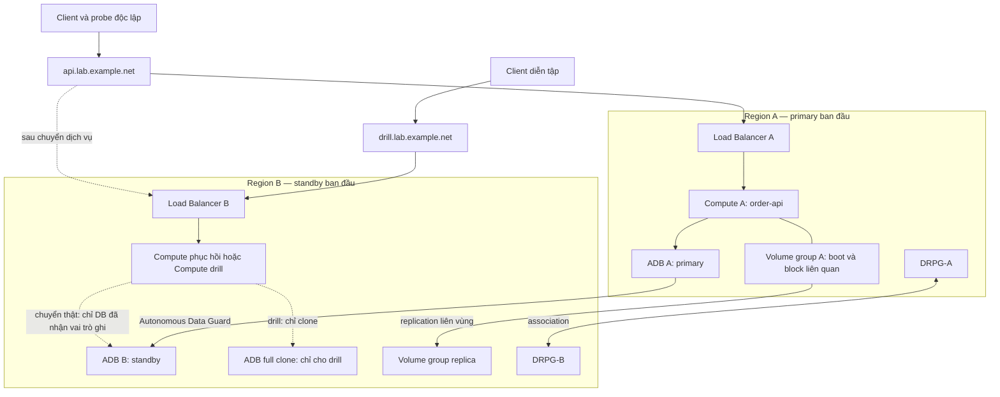

# Dự án ứng dụng hai region với diễn tập Full Stack DR

Trong chương **Dự án tích hợp và đánh giá** của module **CLOUD_PROVIDERS_ORACLE**, dự án này yêu cầu triển khai và chứng minh khả năng phục hồi của một ứng dụng đặt hàng trên hai OCI region. Người học kết hợp tenancy, compartment, IAM, VCN, Compute, lưu trữ, cơ sở dữ liệu Oracle, giám sát và tự động hóa thành một quy trình vận hành có thể diễn tập lại.

Kết quả cần chứng minh là: khi chuyển dịch vụ sang region dự phòng, người dùng truy cập được bằng tên miền quen thuộc, ứng dụng kết nối đúng database, dữ liệu đã xác nhận được đối soát và hệ thống chỉ có một phía được phép nhận giao dịch thật. Trạng thái thành công của một DR plan chỉ là một phần bằng chứng.

## 1. Đề bài và phạm vi nghiệm thu

Xây dựng ứng dụng `order-api` với một trang web đơn giản hoặc một HTTP client đóng vai trò khách hàng. Ứng dụng lưu đơn hàng trong Oracle Autonomous Database Serverless, workload ATP; chạy trên OCI Compute sau OCI Load Balancer. Region A phục vụ bình thường; region B được chuẩn bị cho phục hồi.

Dùng OCI Full Stack Disaster Recovery, viết tắt **Full Stack DR**, để điều phối phục hồi Compute, storage và database, kết hợp các bước tự định nghĩa cho cấu hình ứng dụng, backend của load balancer, kiểm chứng và chuyển DNS.

Phải thực hiện đủ bốn hoạt động:

1. **Start drill và Stop drill:** dựng bản thử nghiệm ở B, kiểm tra đọc/ghi trên database clone, sau đó thu dọn.
2. **Switchover A → B:** chuyển vai trò có kế hoạch khi cả hai region còn hoạt động.
3. **Switchover B → A:** kiểm tra khả năng chuyển về sau khi đã thiết lập lại bảo vệ theo chiều ngược.
4. **Failover mô phỏng A → B:** cô lập phía A trong môi trường lab, phục hồi ở B và đối soát mức mất dữ liệu quan sát được.

Đây là dự án triển khai trong tenancy lab có tài nguyên tính phí. Không giả định tài khoản Free Tier, hạn mức hiện có hoặc mọi cặp region đều đáp ứng yêu cầu. Trước khi tạo tài nguyên, xác nhận khả năng sử dụng Full Stack DR, Autonomous Data Guard liên vùng, shape Compute, dung lượng lưu trữ và ngân sách tại hai region đã chọn.

### Mục tiêu do dự án đặt ra

| Hạng mục | Mục tiêu nghiệm thu | Bằng chứng cần có |
| --- | --- | --- |
| Switchover | Thời gian gián đoạn người dùng không quá 15 phút | Nhật ký probe qua tên miền chính và thời điểm phục hồi ổn định |
| Dữ liệu sau switchover | Không thiếu đơn hàng đã được ứng dụng xác nhận thành công trước khi dừng ghi | So sánh tập request ID và nội dung đơn hàng |
| Failover mô phỏng | RTO quan sát được không quá 30 phút | Timeline từ lúc gây gián đoạn đến lúc giao dịch qua DNS chính hoạt động ổn định |
| Dữ liệu sau failover | Cửa sổ mất dữ liệu quan sát được không quá 5 phút | Ledger phía client và kết quả đối soát database đích |
| Drill | Hoàn tất dựng và kiểm chứng trong 45 phút | Execution log, kiểm thử clone và bằng chứng ứng dụng A tiếp tục phục vụ |
| Cô lập | Không có giao dịch drill đi vào database phục vụ thật | Cấu hình kết nối, identity, network và kết quả kiểm tra dữ liệu |
| Trạng thái kết thúc | Có primary rõ ràng, có bảo vệ trở lại hoặc đã dọn lab theo kế hoạch | Vai trò database, hướng replication, tài nguyên và chi phí còn lại |

Các con số trên là mục tiêu học tập, không phải SLA hay cam kết RTO/RPO của Oracle. Nếu hạn mức, topology hoặc ngân sách buộc phải thay đổi mục tiêu, ghi quyết định trước khi chạy thử; giữ nguyên cả kết quả không đạt để phân tích.

## 2. Kiến trúc tham chiếu: pilot light và một phía ghi

Chọn mô hình **pilot light** cho tầng ứng dụng:

- Compute phục vụ ở A được khai báo là **moving instance**.
- Boot volume của Compute thuộc một volume group được replication sang B.
- B có sẵn VCN, subnet, NSG, load balancer và các phụ thuộc cần thiết để khởi chạy Compute phục hồi.
- Database dùng **cross-region Autonomous Data Guard**; đây là cơ chế bảo vệ dữ liệu nghiệp vụ.
- Khi drill, dùng **Full clone** ở B theo khả năng hỗ trợ của cấu hình ADB/Full Stack DR đang triển khai.
- Toàn bộ trạng thái nghiệp vụ bền vững nằm trong database. Boot volume chứa hệ điều hành, ứng dụng và script; không lưu đơn hàng, session quan trọng hoặc wallet lâu dài trên đó.

Với moving instance, cần bảo vệ cả boot volume và các block volume gắn kèm trong volume group phù hợp. Full Stack DR sử dụng các thành phần hạ tầng đã chuẩn bị; việc tạo DR plan không thay thế bước thiết lập replication. Xem [chuẩn bị Compute cho Full Stack DR](https://docs.oracle.com/en-us/iaas/disaster-recovery/doc/compute-instances-disaster-recovery.html).



Hai đường nối từ Compute B đến database biểu diễn hai chế độ loại trừ nhau. Một tiến trình ứng dụng không được đồng thời mở kết nối đến database thật và clone.

### Những thành phần đã tồn tại và những thành phần được phục hồi

| Thành phần | A khi hoạt động bình thường | B trước khi có sự kiện | Cách xử lý trong dự án |
| --- | --- | --- | --- |
| VCN, subnet, route, NSG | Có sẵn | Có sẵn | Tạo bằng IaC; kiểm tra trước diễn tập |
| Load balancer và TLS | Có sẵn | Có sẵn | Tạo trước; script quản lý backend theo chế độ |
| Compute ứng dụng | Đang chạy | Chưa cần Compute ứng dụng thường trực | Full Stack DR khởi chạy từ storage phục hồi |
| Boot volume | Gắn với Compute A | Có replica của volume group | Dùng cơ chế phục hồi của Full Stack DR |
| ADB phục vụ nghiệp vụ | Primary | Peer standby liên vùng | Autonomous Data Guard và DR plan |
| Database drill | Không có | Được tạo khi Start drill | Chọn Full clone; không dùng database phục vụ thật để ghi thử |
| DNS chính | Trỏ về load balancer A | Chưa nhận lưu lượng thật | Bước tự định nghĩa có điều kiện kiểm chứng |
| DNS drill | Không dùng cho khách hàng thật | Trỏ về load balancer B | Chỉ mở đường tới backend drill |

Dự án chủ động quản lý load balancer qua **user-defined steps** để tách rõ backend phục vụ thật và backend drill. Không đồng thời cấu hình built-in load balancer member làm cùng công việc; hai cơ chế cùng sửa backend sẽ khiến khó xác định trạng thái đúng.

Một máy ứng dụng mỗi phía đủ cho phạm vi tối thiểu của bài. Thiết kế đó vẫn có điểm lỗi đơn trong một region. Trong báo cáo, giải thích cách bổ sung nhiều instance và phân bố fault domain hoặc availability domain mà không đánh đồng HA trong region với DR liên vùng.

## 3. Các khái niệm phải phân biệt

**DR protection group, gọi tắt DRPG**, là nhóm các thành phần được bảo vệ theo một cấu hình DR. **DR plan** là workflow cho một hoạt động phục hồi. Một **plan execution** là một lần chạy cụ thể, có kết quả và nhật ký riêng.

Các plan group chạy theo thứ tự; các step cùng một group có thể chạy song song. Vì vậy, một step khởi động ứng dụng phụ thuộc vào database không được đặt song song với step tạo hoặc chuyển vai trò database. Có thể tùy biến plan bằng user-defined group, nhưng phải giữ đúng phụ thuộc của các group built-in. Xem [tổng quan DR plan](https://docs.oracle.com/en-us/iaas/disaster-recovery/doc/overview-dr-plans.html).

| Hoạt động | Có chuyển dịch vụ thật không? | Có cần nguồn còn hoạt động để hoàn tất các bước nguồn không? | Ý nghĩa với dữ liệu |
| --- | --- | --- | --- |
| Precheck | Không | Tùy phép kiểm tra | Kiểm tra sẵn sàng; không chứng minh dữ liệu nghiệp vụ đã phục hồi |
| Start drill | Không | Không dùng để kết luận về một outage thật | Tạo môi trường kiểm chứng độc lập theo cấu hình drill |
| Stop drill | Không | Không được làm gián đoạn nguồn đang phục vụ | Gỡ tài nguyên drill; dữ liệu viết vào clone không được coi là dữ liệu thật |
| Switchover | Có, có kế hoạch | Có, để dừng nguồn và chuyển đổi có trật tự | Phải dừng ghi, hoàn tất chuyển đổi rồi mới mở ghi ở đích |
| Failover | Có, do sự cố | Các bước phục hồi ở đích không được phụ thuộc vào việc chạy lệnh thành công tại nguồn | Có thể mất dữ liệu chưa đến phía dự phòng; phải đo và đối soát |

**Replication** truyền trạng thái sang phía khác; thao tác sai và dữ liệu hỏng cũng có thể được truyền theo. **Backup** cung cấp điểm khôi phục riêng theo chính sách lưu giữ. Dự án cần có phương án backup database và kiểm tra khả năng phục hồi, dù đã dùng Data Guard.

**RTO** là thời gian phục hồi mục tiêu. **RPO** là mức mất dữ liệu tối đa có thể chấp nhận, thường biểu diễn bằng thời gian. Trong báo cáo phải tách mục tiêu ban đầu khỏi số liệu đo được.

## 4. Điều kiện đầu vào và phân quyền

### 4.1. Chuẩn bị tenancy và người vận hành

Trước khi tạo DRPG, hoàn thành các việc sau:

1. Đăng ký hai region trong cùng tenancy và ghi lại region identifier.
2. Chọn compartment dành riêng cho bài, ví dụ `cmp-oci-dr-lab`; ghi OCID của từng tài nguyên thay vì chỉ dùng display name.
3. Kiểm tra service limits và capacity tại B, kể cả trường hợp cần khởi chạy Compute hoặc tạo database clone.
4. Có subdomain được quyền quản trị, chứng chỉ TLS hợp lệ và quyền sửa đúng record của bài.
5. Có OCI CLI hoặc công cụ API tương đương, quyền đọc execution log và công cụ `curl`, `jq` trên máy chạy probe.
6. Đồng bộ thời gian trên các máy đo; lưu timestamp UTC.
7. Có người đảm nhiệm quyết định chuyển dịch vụ, người vận hành và người quan sát. Một người có thể giữ nhiều vai trò trong lab nhưng nhật ký phải ghi rõ.

Chọn một máy probe nằm ngoài hai Compute ứng dụng. Nếu probe nằm trong region đang được mô phỏng mất dịch vụ, cần thêm một nguồn quan sát độc lập; nếu không, mất probe sẽ bị nhầm thành mất ứng dụng.

### 4.2. Tách quyền điều phối và quyền chạy ứng dụng

| Chủ thể | Nhóm quyền cần thiết | Phạm vi nên giới hạn |
| --- | --- | --- |
| Người dựng lab | Tạo network, Compute, storage, database và cấu hình DR | Compartment lab; quyền tenancy chỉ khi tác vụ yêu cầu |
| Người vận hành DR | Đọc cấu hình, chạy và theo dõi plan theo mô hình phân quyền đã chọn | DRPG và tài nguyên của bài |
| Resource principal của Full Stack DR | Thao tác các member và lưu operation log | Compartment chứa từng loại tài nguyên được quản lý |
| Compute phục hồi | Đọc đúng secret/wallet cần dùng; gửi log và metric | Phân biệt identity hoặc điều kiện quyền cho chế độ active và drill |
| Bước chuyển DNS | Đọc, cập nhật record được giao và xác minh kết quả | DNS zone của lab; không dùng khóa quản trị tenancy |
| Người đánh giá | Đọc log, metric, cấu hình đã che bí mật | Không cần mật khẩu database |

Tài liệu Oracle khuyến nghị resource principal cho Full Stack DR. Chính sách cần phụ thuộc loại member, vị trí log và loại custom step; không có một policy tối thiểu dùng được cho mọi topology. Khi dùng Run Command, chuẩn bị Oracle Cloud Agent, plugin và quyền thực thi tương ứng. Đối chiếu [resource principals](https://docs.oracle.com/en-us/iaas/disaster-recovery/doc/policies/resource-principals.html) và [policy cho Compute, Oracle Cloud Agent](https://docs.oracle.com/en-us/iaas/disaster-recovery/doc/policies/policies-for-compute-service-and-oracle-cloud-agent.html).

Không đưa API signing key, mật khẩu ADMIN, wallet hoặc secret plaintext vào boot image, Terraform output, script, ảnh chụp và operation log. Script chỉ nhận tham chiếu secret; giá trị nhạy cảm được lấy lúc chạy, lưu trong vùng tạm có quyền truy cập hạn chế và xóa khi kết thúc.

### 4.3. Thiết kế kết nối có thể kiểm tra

Dùng hai VCN có CIDR không chồng lấn, chẳng hạn A là `10.40.0.0/16` và B là `10.50.0.0/16`. Mỗi phía có subnet cho load balancer và subnet private cho Compute. Chuẩn bị kết nối private tới database theo cấu hình ADB được chọn.

Luồng cho phép tối thiểu:

- Người dùng đến HTTPS listener của load balancer.
- Load balancer đến cổng ứng dụng, ví dụ `8080`, và endpoint health check.
- Compute active đến database đang phục vụ qua kết nối TLS theo cấu hình database.
- Compute đến các endpoint OCI cần cho Agent, secret và telemetry.
- Compute drill chỉ đến database clone cùng các dịch vụ kiểm thử được phép.

Không mở public IP cho Compute hoặc database chỉ để rút ngắn bài làm. Dùng Bastion hoặc Run Command cho quản trị. Không tạo remote peering giữa hai VCN chỉ vì dùng hai region; xác định luồng nào thật sự cần kết nối liên vùng. Các dịch vụ replication được quản lý phải được cấu hình theo yêu cầu của dịch vụ, không suy rằng chúng sử dụng route của ứng dụng.

Kiểm tra tổng hợp cả NSG, security list, route và firewall trên hệ điều hành. Một luồng vẫn có thể đi qua nếu còn một đường cho phép khác.

## 5. Thiết kế ứng dụng để đo được tính đúng

### 5.1. Hợp đồng HTTP

| Endpoint | Hành vi bắt buộc |
| --- | --- |
| `GET /live` | Xác nhận tiến trình HTTP còn sống; không dùng làm bằng chứng phục hồi nghiệp vụ |
| `GET /ready` | Chỉ trả `200` khi cấu hình đúng chế độ, kết nối database đích hợp lệ và ứng dụng sẵn sàng nhận giao dịch theo vai trò |
| `POST /orders` | Ghi đơn trong một transaction; chỉ trả thành công sau commit |
| `GET /orders/{requestId}` | Đọc đúng đơn đã ghi; trả cả dữ liệu cần đối soát |
| `GET /internal/runtime` | Endpoint có xác thực dành cho kiểm tra region, mode, phiên bản và định danh database đã xác minh |
| `GET /internal/orders?runId=...` | Export có xác thực, trả mảng đơn của một lần đo; xử lý đủ các trang nếu triển khai phân trang |

Endpoint nội bộ không được trả connection string chứa mật khẩu, nội dung wallet hoặc secret. Header phản hồi như `X-App-Region` và `X-DR-Mode` có thể hỗ trợ quan sát, nhưng không thay thế kiểm tra database thực tế.

Ví dụ yêu cầu tạo đơn:

```http
POST /orders HTTP/1.1
Host: api.lab.example.net
Content-Type: application/json
Idempotency-Key: run-20261121-001-000042
Authorization: Bearer <token-cua-lab>

{
  "runId": "run-20261121-001",
  "clientSeq": 42,
  "amountVnd": 125000
}
```

Phản hồi phải chứa `requestId` trùng idempotency key, `runId`, `clientSeq`, số tiền và region xử lý. Trả `201` khi tạo mới; có thể trả `200` khi trả lại kết quả của yêu cầu lặp hợp lệ.

### 5.2. Schema tối thiểu

Chạy DDL bằng tài khoản quản lý schema của ứng dụng, sau đó chỉ cấp cho runtime các quyền cần thiết:

```sql
CREATE TABLE orders (
    request_id     VARCHAR2(96) PRIMARY KEY,
    run_id         VARCHAR2(64) NOT NULL,
    client_seq     NUMBER(18, 0) NOT NULL,
    amount_vnd     NUMBER(18, 0) NOT NULL,
    payload_hash   CHAR(64) NOT NULL,
    source_region  VARCHAR2(64) NOT NULL,
    dr_mode        VARCHAR2(16) NOT NULL,
    created_at     TIMESTAMP(6) WITH TIME ZONE
                   DEFAULT SYSTIMESTAMP NOT NULL,
    CONSTRAINT uq_orders_run_seq UNIQUE (run_id, client_seq),
    CONSTRAINT ck_orders_amount CHECK (amount_vnd > 0),
    CONSTRAINT ck_orders_mode CHECK (dr_mode IN ('ACTIVE', 'DRILL'))
);
```

Quy ước `amount_vnd` là số đồng Việt Nam nguyên, tránh sai số do số thực. `payload_hash` là SHA-256 của nội dung yêu cầu đã chuẩn hóa theo hợp đồng của ứng dụng.

Luồng ghi phải đáp ứng:

1. Kiểm tra tính hợp lệ của yêu cầu và idempotency key.
2. Ghi đơn trong database transaction.
3. Nếu key đã tồn tại, đọc bản ghi đã commit và so sánh hash. Cùng nội dung thì trả kết quả cũ; khác nội dung thì trả `409`.
4. Chỉ xác nhận thành công sau khi commit hoàn tất.
5. Nếu client timeout, coi kết quả là **chưa biết**. Client có thể tra cứu hoặc gửi lại cùng key.

Unique constraint phải là cơ chế cuối cùng xử lý hai yêu cầu đồng thời. Không dùng thao tác “SELECT chưa thấy rồi INSERT” làm đảm bảo duy nhất.

Session HTTP được thiết kế stateless. Nếu bổ sung cache, file upload, hàng đợi hoặc dịch vụ thanh toán, phải bổ sung cơ chế DR và tiêu chí nhất quán cho chúng; phạm vi tối thiểu của bài chưa bao gồm các phụ thuộc này.

### 5.3. Không cho bản sao boot tự chạy nhầm database

Đặt ứng dụng ở trạng thái không tự nhận lưu lượng ngay khi boot. Một phương án đơn giản cho lab là không enable dịch vụ ứng dụng tự khởi động; custom step sẽ cấp cấu hình runtime, chạy kiểm tra rồi mới start dịch vụ.

Hệ quả cần ghi rõ: sau một lần reboot thông thường cũng phải chạy workflow khởi động đã kiểm soát. Với hệ thống thực tế, có thể thay bằng startup guard được kiểm thử, nhưng không được bỏ qua bước xác minh chỉ để ứng dụng tự lên.

Trước khi mở `/ready`, kiểm tra đồng thời:

- Region thực tế của instance, không chỉ giá trị chép từ image.
- Mode `ACTIVE` hoặc `DRILL` được truyền cho đúng execution.
- OCID và endpoint database đích đã được xác minh qua OCI API và kết nối thực tế.
- Phiên bản ứng dụng tương thích với schema.
- Mode `DRILL` không có credential của database phục vụ thật.
- Mode `ACTIVE` chỉ được mở sau khi database đích có trạng thái và vai trò phù hợp với nhận ghi.

## 6. Dựng hạ tầng theo các mốc có thể xác minh

### Mốc 1 — Chốt inventory và giá trị định danh

Lập một inventory gồm: hai region, compartment, VCN, subnet, NSG, load balancer, backend set, instance, volume group, database, peer database, DRPG, secret, DNS zone và operation-log bucket.

Dùng tên tài nguyên gắn vị trí cố định như `drpg-a` và `drpg-b`. Primary và standby là vai trò có thể đổi; không dùng tên `primary` trong script như một giả định rằng A luôn nhận ghi.

Ví dụ một manifest không chứa bí mật:

```json
{
  "application": "order-api",
  "regionA": "<region-identifier-A>",
  "regionB": "<region-identifier-B>",
  "productionHost": "api.lab.example.net",
  "drillHost": "drill.lab.example.net",
  "databaseProtection": "CROSS_REGION_AUTONOMOUS_DATA_GUARD",
  "computeRecovery": "MOVING_INSTANCE",
  "drillDatabase": "FULL_CLONE",
  "applicationBuild": "<git-commit-hoac-image-digest>",
  "schemaVersion": "1"
}
```

Đây là mẫu tài liệu của dự án. Các chuỗi trong dấu `<...>` phải được thay bằng giá trị đã xác minh, không dùng làm tham số triển khai.

### Mốc 2 — Network, IAM, TLS và DNS

Tạo hạ tầng ở cả hai region. Thiết lập chứng chỉ cho tên miền chính và tên miền drill; kiểm tra HTTPS trước khi thử phục hồi.

Tại load balancer B, tạo hai backend set riêng:

- `bs-active`: dùng khi B nhận lưu lượng thật.
- `bs-drill`: dùng trong diễn tập.

Dùng routing rule theo hostname hoặc cấu hình listener tương đương để `drill.lab.example.net` chỉ đi tới `bs-drill`. Khi chưa chuyển dịch vụ, `bs-active` ở B không có backend sẵn sàng.

DNS chính ban đầu trỏ tới A. DNS drill trỏ tới B. Trong dự án này, việc chuyển DNS chính do plan điều phối sau bước xác nhận sẵn sàng; không bật cơ chế tự chuyển theo health check có thể vượt qua điều kiện database và fencing.

Đặt TTL theo kế hoạch, ví dụ 60 giây, từ trước cửa sổ thử nghiệm. TTL không chấm dứt kết nối TCP hiện có và không đảm bảo mọi client cập nhật đúng sau từng ấy giây.

### Mốc 3 — Database và bảo vệ dữ liệu

Tạo ADB-S ATP ở A, cấu hình cross-region Autonomous Data Guard với peer tại B và chờ hoàn tất khởi tạo. Full Stack DR yêu cầu peer liên vùng cho cấu hình ADB-S này; không thay bằng local standby rồi coi là bảo vệ khỏi mất region. Xem [chuẩn bị ADB-S cho Full Stack DR](https://docs.oracle.com/en-us/iaas/disaster-recovery/doc/prepare-shared-databases-disaster-recovery.html).

Ghi lại database OCID, peer OCID, trạng thái, vai trò và thông tin replication mà dịch vụ cung cấp. Kiểm tra giới hạn tính năng của workload, kiểu endpoint và hình thức xác thực thực tế.

Tạo schema, user runtime và dữ liệu khởi tạo. Thiết lập backup, retention và phương án phục hồi độc lập. Chuẩn bị secret cần cho drill ở B, đúng Vault/key và quyền truy cập theo cấu hình tạo clone.

Trong cấu hình member ADB, chọn `Full clone` cho DR drill nếu tổ hợp dịch vụ đang dùng hỗ trợ. Khai báo password secret và các thuộc tính đích theo giao diện/API hiện hành. Xem [thêm ADB-S và chọn loại standby cho drill](https://docs.oracle.com/en-us/iaas/disaster-recovery/doc/add-autonomous-database-protection-group.html).

Trước khi chạy, xác minh plan đã tham chiếu đúng database được bảo vệ và peer B. Hoàn tất khai báo peer theo mô hình member mà Console/API hiện hành yêu cầu, rồi chạy precheck; không tự thêm một database cùng tên hoặc clone để thay cho Data Guard peer.

Nếu môi trường không hỗ trợ Full clone drill như đã thiết kế, dừng mốc này và ghi thiếu điều kiện đầu vào. Không âm thầm chuyển bài sang ghi thử trên primary hoặc dùng switchover thay cho drill.

### Mốc 4 — Compute và volume group

Tạo Compute A, cài ứng dụng, runtime và script quản trị. Pin phiên bản ứng dụng; ghi checksum hoặc build identifier. Chuẩn bị Oracle Cloud Agent và xác minh Run Command chạy được đúng user.

Tạo volume group cùng availability domain với Compute A, đưa boot volume cùng mọi block volume gắn với instance vào nhóm. Bật cross-region replication và chờ phía B xuất hiện replica đủ điều kiện phục hồi. Chọn đích phục hồi phù hợp với subnet, availability domain và shape đã chuẩn bị. Xem [chuẩn bị Block Storage](https://docs.oracle.com/en-us/iaas/disaster-recovery/doc/get-started-with-full-stack-disaster-recovery/preparing-block-storage-for-full-stack-disaster-recovery.html).

Không coi trạng thái “đã cấu hình replication” là bằng chứng replica đầu tiên đã sẵn sàng. Ghi độ trễ hoặc thời điểm replica có thể quan sát được trước mỗi lần diễn tập.

Không lưu wallet hoặc runtime config trỏ primary cố định trong boot volume. Dùng cấu hình tạm ở `/run/order-api` hoặc cơ chế tương đương, được tạo lại sau khi khởi chạy Compute phục hồi.

Replication boot volume và Data Guard không tạo một transaction chung giữa filesystem và database. Vì vậy, dự án đóng băng deploy/schema migration trong lúc thử nghiệm và kiểm tra tương thích phiên bản trước khi start ứng dụng.

### Mốc 5 — DRPG và operation log

Tạo DRPG tại A và B, associate chúng, đặt A là primary và B là standby theo trạng thái ban đầu. Chuẩn bị Object Storage làm vị trí lưu operation log ở các phía cần dùng, có quyền ghi và retention phù hợp.

Đăng ký Compute A dạng moving instance cùng volume group bảo vệ. Đăng ký database theo hướng dẫn member ADB hiện hành và kiểm tra liên kết với đúng cross-region peer.

Các tài nguyên như VCN, TLS và DNS vẫn là phụ thuộc cần chuẩn bị dù không được khai báo thành member trong thiết kế này. Ghi rõ thành phần nào do Full Stack DR built-in quản lý, thành phần nào do custom step quản lý và thành phần nào là điều kiện có sẵn.

### Mốc 6 — Tạo và bổ sung các plan

Tại DRPG đang giữ vai trò standby, tạo plan cho `Start drill`, `Stop drill`, `Switchover` và `Failover`. Gắn tên với hướng chuyển và loại hoạt động, ví dụ `switchover-a-to-b`.

DR plan được tạo tại DRPG đã associate và có vai trò standby. Vì vậy, lần đầu chưa được giả định đã có sẵn plan B → A tại A. Sau chuyển đổi đầu tiên, A trở thành standby; lúc đó tạo và kiểm tra plan chiều về. Xem [tạo DR plan](https://docs.oracle.com/en-us/iaas/disaster-recovery/doc/create-plan-groups.html).

Sau mỗi lần thay đổi member hoặc cấu hình liên quan, refresh plan nếu được yêu cầu, đọc lại các nhóm sinh ra và chạy precheck trước khi execution thật.

## 7. Hợp đồng cho các custom step

Full Stack DR cung cấp điều phối, nhưng script phải hiểu nghiệp vụ và trạng thái đích. Chuẩn hóa các đầu vào sau:

| Đầu vào | Ý nghĩa |
| --- | --- |
| `EXECUTION_ID` | Định danh duy nhất của lần thực thi, dùng cho log và phạm vi tài nguyên tạm |
| `DR_MODE` | `ACTIVE` hoặc `DRILL` |
| `TARGET_REGION` | Region cần phục hồi |
| `TARGET_INSTANCE_OCID` | Instance đích lấy từ tài nguyên phục hồi của execution |
| `TARGET_DATABASE_OCID` | Database đã nhận vai trò phục vụ hoặc clone dành riêng cho drill |
| `DATABASE_SECRET_OCID` | Secret tương ứng với database đích |
| `EXPECTED_BUILD` | Build cần chạy sau phục hồi |
| `TARGET_BACKEND_SET` | `bs-active` hoặc `bs-drill` theo mode |

Các tên trên là **hợp đồng của dự án**, không phải biến môi trường mà Full Stack DR mặc định tự cung cấp. Người học phải cấu hình tham số của step hoặc viết wrapper đọc execution và tra OCI API để tạo đúng giá trị.

Không chọn Compute bằng “instance đầu tiên có display name này”. Tài nguyên thật, tài nguyên cũ và tài nguyên drill có thể cùng tồn tại. Dùng OCID lấy từ execution, hoặc tag/định danh tương quan được quản lý chặt và xác minh duy nhất.

### Các bước tối thiểu cần triển khai

| Step do dự án định nghĩa | Tác vụ | Điều kiện thành công |
| --- | --- | --- |
| `quiesce-source` | Ngừng nhận yêu cầu mới, dừng worker, chờ giao dịch đang xử lý | Không còn nguồn phát sinh ghi từ ứng dụng; có mốc UTC |
| `resolve-target` | Tra instance, database, endpoint và build đích | Tất cả định danh thuộc đúng region, mode và execution |
| `configure-runtime` | Lấy secret, tạo cấu hình tạm, đặt quyền file | Không dùng giá trị kết nối cũ từ boot image |
| `start-and-verify` | Start ứng dụng; kiểm tra readiness và giao dịch canary | Đọc/ghi được đúng database, đúng region và mode |
| `attach-target-backend` | Đăng ký backend vào đúng backend set | Health check đạt; có thể gọi ứng dụng qua TLS |
| `switch-production-dns` | Cập nhật record chính với điều kiện trạng thái mong đợi | Chỉ chạy ở mode active, sau kiểm chứng và xác nhận fencing |
| `detach-drill-backend` | Gỡ lưu lượng thử trước khi dừng tài nguyên | Không còn request vào Compute/clone sắp thu dọn |
| `capture-evidence` | Ghi thời điểm, trạng thái và tham chiếu log | Không chứa bí mật; liên kết được với execution |

Mỗi step phải có timeout, mã thoát rõ ràng, log chứa execution ID, cơ chế chạy lại và kiểm tra trạng thái hiện có. Ví dụ, step đăng ký backend phải nhận biết backend đã có; step tạo cấu hình phải thay thế nguyên tử; step sửa DNS phải đọc lại kết quả.

Với thao tác cập nhật tài nguyên qua API, sử dụng ETag/điều kiện tương đương nếu API hỗ trợ để phát hiện thay đổi đồng thời. Không cho một retry cũ chuyển DNS ngược về đích đã hết hiệu lực.

### Điều kiện chặn trước khi start ứng dụng

Đây là pseudocode cho guard, không phải một CLI có sẵn:

```text
assert execution_id được nhận diện và thuộc ứng dụng order-api
assert region_thực_tế(instance) == target_region
assert build_trên_instance == expected_build
assert database_ocid và endpoint được xác minh từ API

if mode == DRILL:
    assert database là full clone của lần drill hiện tại
    assert database không phải primary hoặc standby phục vụ thật
    assert cấu hình egress và quyền secret không cho dùng database thật
    assert backend_set == bs-drill
    assert bước chuyển DNS chính bị vô hiệu hóa
else if mode == ACTIVE:
    assert database đích sẵn sàng nhận ghi theo dịch vụ
    assert đã có bằng chứng phía nguồn không còn phục vụ ghi
    assert backend_set == bs-active
else:
    fail

tạo runtime config không chứa fallback tới database cũ
start ứng dụng
thực hiện canary với request_id riêng
đọc lại canary và xác nhận đúng database
chỉ sau đó công bố readiness
```

Nếu không đọc được secret của clone, guard phải thất bại. Tuyệt đối không fallback sang secret của primary để cố làm cho health check xanh.

## 8. Bố trí workflow và điểm kiểm soát

Giữ thứ tự các built-in group mà Full Stack DR sinh theo phụ thuộc tài nguyên. Chèn custom group ở vị trí phù hợp sau khi đọc plan cụ thể. Oracle có tài liệu về [thứ tự mặc định của các DR plan group](https://docs.oracle.com/en-us/iaas/disaster-recovery/doc/Order-of-dr-plan-groups.html); không dùng bảng thiết kế dưới đây để tự ý đảo các group built-in.

| Plan | Trước phục hồi | Phục hồi và kiểm chứng tại đích | Sau kiểm chứng |
| --- | --- | --- | --- |
| Start drill | Kiểm tra primary vẫn phục vụ; xác nhận luồng drill tách biệt | Built-in tạo storage/Compute và ADB clone theo cấu hình; custom step resolve clone, cấp cấu hình và kiểm tra | Chỉ thêm backend drill; giữ nguyên DNS chính |
| Stop drill | Gỡ backend drill; ngừng ứng dụng và worker drill | Built-in thu dọn tài nguyên drill tương ứng | Kiểm tra clone, Compute, volume tạm đã được xử lý; xác nhận primary và replication bình thường |
| Switchover | Precheck; chặn nhận đơn mới; drain; dừng toàn bộ writer nguồn | Built-in chuyển database/storage và khởi chạy Compute đích; custom step cấu hình và canary | Thêm backend active, chuyển DNS, đo ngoài hệ thống, xác minh bảo vệ chiều ngược |
| Failover | Kiểm tra đích; ghi quyết định và bằng chứng fencing của lab | Built-in phục hồi tại đích; custom step xác minh database nhận ghi và chạy canary | Mở backend active, chuyển DNS, đối soát và giữ nguồn cũ bị cô lập |

Với ADB-S có cấu hình được hỗ trợ, Full Stack DR có các bước drill tạo clone và dọn clone. Không suy rộng khả năng đó sang mọi loại Oracle Database. Ví dụ, tài liệu built-in phân biệt khả năng drill của Base Database với ADB. Xem [built-in plan groups theo loại tài nguyên](https://docs.oracle.com/en-us/iaas/disaster-recovery/doc/built-in-plan-groups.html).

**Điểm không thể đảo ngược bằng cách đơn giản:** khi database B đã nhận giao dịch thật, chuyển DNS về A không phải rollback an toàn. Khi đó cần khôi phục quan hệ bảo vệ, đồng bộ dữ liệu và thực hiện quy trình chuyển về có kiểm soát.

Cancel một execution không được hiểu là hoàn tác những thao tác đã thành công. Khi có lỗi giữa chừng, ghi trạng thái thực tế của từng thành phần trước khi retry, skip hoặc bắt đầu thao tác khác.

## 9. Tạo bằng chứng từ phía client

### 9.1. Ledger độc lập

Mỗi lần đo dùng một `runId` mới. Client phải lưu ngoài hai Compute ứng dụng:

- Request ID và số thứ tự.
- Thời điểm gửi, thời điểm nhận kết quả theo UTC.
- Payload hoặc hash payload.
- HTTP status và lỗi transport.
- Region/mode trả về.
- Phân loại **ACK**, **thất bại rõ ràng** hoặc **chưa biết kết quả**.

ACK chỉ có nghĩa khi API đã trả thành công sau commit và phản hồi đúng yêu cầu. Một request timeout có thể đã commit; không tự xếp nó vào tập dữ liệu bị mất.

Ví dụ script Bash tạo tải tuần tự, có thể chạy từ máy probe Linux hoặc môi trường Bash tương thích. Script giả định API đã triển khai đúng hợp đồng ở mục 5, `curl` và `jq` đã được cài, `API_TOKEN` được cấp trước khi chạy:

```bash
#!/usr/bin/env bash
set -euo pipefail
export LC_ALL=C

: "${BASE_URL:?Vi du https://api.lab.example.net}"
: "${API_TOKEN:?Can token goi API cua lab}"

RUN_ID="${RUN_ID:-run-$(date -u +%Y%m%dT%H%M%SZ)-$$}"
LEDGER="${LEDGER:-attempts-${RUN_ID}.jsonl}"
INTERVAL_SECONDS="${INTERVAL_SECONDS:-2}"
body_file="$(mktemp)"
trap 'rm -f -- "$body_file"' EXIT

for seq in $(seq 1 1800); do
  request_id="${RUN_ID}-${seq}"
  payload="$(jq -nc \
    --arg run "$RUN_ID" --argjson seq "$seq" \
    '{runId:$run, clientSeq:$seq, amountVnd:125000}')"
  sent_at="$(date -u +%Y-%m-%dT%H:%M:%SZ)"
  : > "$body_file"
  rc=0

  status="$(curl --silent --show-error \
    --connect-timeout 3 --max-time 10 \
    --output "$body_file" --write-out '%{http_code}' \
    --header "Authorization: Bearer ${API_TOKEN}" \
    --header 'Content-Type: application/json' \
    --header "Idempotency-Key: ${request_id}" \
    --data "$payload" \
    "${BASE_URL%/}/orders")" || rc=$?

  received_at="$(date -u +%Y-%m-%dT%H:%M:%SZ)"
  ack=false
  if [[ "$rc" -eq 0 && ( "$status" == 200 || "$status" == 201 ) ]] &&
     jq -e --arg id "$request_id" --arg run "$RUN_ID" \
       --argjson seq "$seq" \
       '.requestId == $id and .runId == $run
        and .clientSeq == $seq and .amountVnd == 125000' \
       "$body_file" >/dev/null 2>&1; then
    ack=true
  fi

  jq -nc \
    --arg run "$RUN_ID" --arg id "$request_id" \
    --argjson seq "$seq" --arg payload "$payload" \
    --arg sent "$sent_at" --arg received "$received_at" \
    --arg status "$status" --argjson rc "$rc" \
    --argjson ack "$ack" --rawfile response "$body_file" \
    '{runId:$run, requestId:$id, clientSeq:$seq,
      payload:($payload|fromjson),
      sentAt:$sent, receivedAt:$received,
      httpStatus:$status, curlExit:$rc,
      ack:$ack, responseText:$response}' >> "$LEDGER"

  sleep "$INTERVAL_SECONDS"
done
```

Script ghi từng lần thử, không tự retry. Sau diễn tập, tra cứu các request chưa biết kết quả hoặc gửi lại cùng idempotency key để kiểm tra tính chống trùng.

Chu kỳ thực tế lớn hơn `INTERVAL_SECONDS` vì còn thời gian xử lý request. Không dùng số lần lặp nhân với khoảng nghỉ để suy ra thời gian phục hồi; lấy timestamp thực tế trong ledger.

### 9.2. Probe readiness và giao dịch

Chạy thêm probe định kỳ qua **tên miền chính**, ghi HTTP status, latency, region/mode và kết quả giao dịch canary. Định nghĩa trước “phục hồi ổn định”, chẳng hạn:

- Có ít nhất 5 giao dịch liên tiếp thành công qua DNS chính.
- Chuỗi kiểm tra kéo dài ít nhất 60 giây.
- Mỗi giao dịch tạo được đơn và đọc lại đúng dữ liệu.
- Tất cả phản hồi từ region đang được công nhận là active.

`/live` trả `200` không thỏa điều kiện này. Gọi trực tiếp IP load balancer cũng không chứng minh client qua DNS chính đã phục hồi.

### 9.3. Đối soát tập dữ liệu

Sau khi dừng generator và đã giải quyết các request còn đang xử lý, export đầy đủ đơn của `runId` từ database đang phục vụ. Có thể gọi endpoint nội bộ có xác thực hoặc chạy truy vấn bằng tài khoản chỉ đọc, rồi chuẩn hóa thành mảng JSON `recovered.json`.

Ví dụ tạo hai tập ID trong môi trường phân tích của người học:

```bash
export LC_ALL=C

jq -r 'select(.ack == true) | .requestId' "$LEDGER" \
  | sort -u > acknowledged.ids

jq -r '.[].requestId' recovered.json \
  | sort -u > recovered.ids

comm -23 acknowledged.ids recovered.ids > missing-acknowledged.ids
comm -13 acknowledged.ids recovered.ids > recovered-without-ack.ids
```

`missing-acknowledged.ids` là các giao dịch đã ACK nhưng không thấy ở đích. `recovered-without-ack.ids` có thể gồm request đã commit nhưng client timeout; cần đối chiếu toàn bộ ledger trước khi kết luận đó là lỗi.

So sánh thêm số tiền, run ID, client sequence và hash payload. Chỉ so sánh tổng số dòng hoặc giá trị `MAX(client_seq)` sẽ bỏ sót lỗ hổng và sai nội dung.

## 10. Đo RTO và RPO đúng phạm vi

### 10.1. Timeline

Ghi ít nhất các mốc sau:

| Mốc | Định nghĩa |
| --- | --- |
| `t_incident` | Bắt đầu gián đoạn có chủ đích trong bài failover, hoặc bắt đầu cửa sổ dừng phục vụ của switchover |
| `t_detected` | Monitoring/người trực nhận biết vấn đề |
| `t_decision` | Quyết định chuyển dịch vụ được ghi nhận |
| `t_plan_start` | Execution bắt đầu |
| `t_target_verified` | Ứng dụng đích qua canary và đúng database |
| `t_dns_updated` | Ghi nhận cập nhật DNS chính |
| `t_recovered` | Kết thúc chuỗi kiểm chứng phục hồi ổn định từ client |
| `t_protection_restored` | Hệ thống có bảo vệ DR trở lại theo chiều mới |

Các khoảng thời gian quan trọng:

```text
Thời gian phát hiện = t_detected - t_incident
Thời gian quyết định = t_decision - t_detected
Thời gian điều phối = t_target_verified - t_plan_start
RTO quan sát được = t_recovered - t_incident
Thời gian chưa có bảo vệ đầy đủ sau phục hồi
    = t_protection_restored - t_recovered
```

Nếu lỗi phát hiện bằng probe theo chu kỳ, thời điểm gián đoạn có sai số giữa lần thành công cuối và lần thất bại đầu. Báo cáo khoảng sai số đó. Với thao tác gây lỗi có timestamp riêng, dùng timestamp đã ghi và đối chiếu probe.

Thời lượng execution chưa bao gồm đầy đủ thời gian phát hiện, quyết định, DNS, reconnect và kiểm chứng nghiệp vụ. Không báo nó thành RTO toàn hệ thống.

### 10.2. RPO và cửa sổ mất dữ liệu quan sát được

Gọi:

- `A` là tập request đã được client ghi ACK trước sự kiện.
- `B` là tập request đọc lại được từ database đích.
- `M = A \ B` là tập request đã ACK nhưng không phục hồi được.

Nếu `M` rỗng, kết luận: **không quan sát thấy mất dữ liệu đã ACK trong lần thử này**. Điều đó không chứng minh topology bảo đảm RPO bằng 0 cho mọi sự cố.

Nếu `M` không rỗng, sắp các ACK theo thứ tự của client tuần tự. Xác định tiền tố liên tục đã phục hồi đầy đủ và thời điểm ACK cuối của tiền tố đó:

```text
Cửa sổ mất dữ liệu quan sát được
    ≈ t_incident - t_ack_cuối_của_tiền_tố_được_phục_hồi
```

Chỉ dùng biểu diễn này khi dữ liệu mất tạo thành phần đuôi phù hợp với mô hình đo. Nếu có lỗ hổng giữa các ACK đã phục hồi, phải điều tra tính nhất quán; không chọn một timestamp đẹp để che lỗi.

Nếu không có đủ ACK trước sự kiện, clock lệch hoặc ledger bị mất, ghi **không đủ bằng chứng để đo RPO**, thay vì tự cho kết quả 0. Báo cáo cả số giao dịch mất, thời gian tương ứng và độ phân giải của tải thử.

Trong bài drill, đo thời gian dựng môi trường và độ mới của dữ liệu clone so với mốc snapshot/clone. Không gọi số đó là RPO của một lần failover thật.

## 11. Thực hiện drill mà không chuyển dịch vụ thật

### Trước Start drill

1. Xác nhận A đang phục vụ ổn định; chạy generator và probe qua DNS chính.
2. Ghi trạng thái Data Guard, volume replication, DRPG và tài nguyên hiện có ở B.
3. Chạy precheck cho plan drill; xử lý lỗi trước khi tạo clone.
4. Xác nhận `bs-active` tại B không thể nhận luồng drill.
5. Kiểm tra custom step chuyển DNS chính bị vô hiệu hóa đối với mode drill.
6. Chặn gửi email, webhook, thanh toán, tác vụ định kỳ và consumer thật từ môi trường drill.
7. Xác nhận đủ quota và ngân sách cho clone, Compute, volume và log phát sinh.

Precheck của Full Stack DR kiểm tra các điều kiện tài nguyên theo loại member. Người học vẫn phải bổ sung kiểm tra readiness và dữ liệu nghiệp vụ. Tham khảo [các precheck của Full Stack DR](https://docs.oracle.com/en-us/iaas/disaster-recovery/doc/prechecks-disaster-recovery.html).

### Chạy và kiểm chứng

Thực thi Start drill ở DRPG B, theo dõi execution ID và các group. Chờ tài nguyên đích được tạo và database clone sẵn sàng.

Custom step phải lấy đúng OCID của clone được tạo cho execution hiện tại, lấy thông tin kết nối tương ứng và cấp cho Compute drill. Không dùng nguyên wallet hoặc service name của primary chép từ boot volume.

Sau đó:

- Thêm Compute drill vào `bs-drill`.
- Gọi `drill.lab.example.net` và xác minh mode là `DRILL`.
- Tạo đơn với `runId` riêng có tiền tố `drill-`, đọc lại và kiểm tra idempotency.
- Xác nhận dữ liệu drill có trong clone và không xuất hiện trong database phục vụ thật.
- Tiếp tục kiểm tra đơn thật ở A trong suốt thời gian drill.
- Thử một tình huống cấu hình sai có kiểm soát, ví dụ thiếu tham chiếu secret clone, và chứng minh guard không mở readiness hoặc fallback sang primary.

Kiểm tra âm phải được giới hạn ở tài nguyên drill; không thu hồi quyền của primary đang phục vụ chỉ để tạo lỗi.

### Stop drill và kết thúc

Chạy Stop drill để gỡ backend, dừng ứng dụng và thu dọn tài nguyên theo plan. Kiểm tra lại các tài nguyên thực tế, không chỉ nhìn execution thành công.

Phải chứng minh:

- Không còn backend drill phục vụ.
- Compute, clone và volume tạm được dọn theo thiết kế.
- DNS chính, primary database và ứng dụng A vẫn đúng trạng thái.
- Data Guard và volume replication tiếp tục đáp ứng trạng thái mong đợi.
- Không còn secret tạm, wallet tạm hoặc job drill chạy nền.

Dữ liệu viết trong clone dùng để kiểm thử và sẽ bị loại bỏ cùng môi trường drill. Không có bước nhập các đơn drill vào database thật.

## 12. Switchover A → B và kiểm tra chuyển về

### 12.1. Chuyển có kế hoạch

Thực hiện trong cửa sổ bảo trì của lab:

1. Khóa thay đổi deploy, schema và IaC; lưu inventory cùng revision của plan.
2. Chạy precheck và xác nhận các cơ chế bảo vệ dữ liệu sẵn sàng.
3. Bắt đầu tải đo và probe; ghi baseline độ trễ, lỗi và số đơn.
4. Bắt đầu cửa sổ gián đoạn, chặn nhận đơn mới, drain request đang chạy và dừng mọi writer nguồn, kể cả worker.
5. Chờ các transaction đang xử lý hoàn tất hoặc ghi nhận kết quả chưa biết để đối soát.
6. Chạy plan switchover; theo dõi chuyển đổi database, storage và Compute.
7. Resolve tài nguyên B; cấp cấu hình mode `ACTIVE`; xác nhận đúng database đã nhận vai trò ghi.
8. Chạy canary, thêm backend active và kiểm tra HTTPS trước khi chuyển DNS.
9. Chuyển DNS chính sang B; duy trì fencing và dừng ứng dụng A trong thời gian cache còn giữ địa chỉ cũ.
10. Chạy chuỗi kiểm chứng ổn định qua tên miền chính, dừng generator có kiểm soát rồi đối soát.

Có thể nhận lỗi hoặc retry trong cửa sổ chuyển dịch vụ. Bài đạt về dữ liệu khi không thiếu các đơn đã ACK thuộc phạm vi đo và không tạo đơn trùng khi gửi lại cùng key.

### 12.2. Khôi phục bảo vệ theo chiều mới

Sau chuyển đổi, kiểm tra ba lớp riêng:

- Vai trò thực tế của database A/B.
- Vai trò và trạng thái của DRPG A/B.
- Hướng bảo vệ của volume group và khả năng phục hồi Compute về A.

Chỉ khi B đang được bảo vệ trở lại, A có standby hợp lệ và các replica đã sẵn sàng mới coi là hoàn tất trạng thái vận hành sau switchover.

DRPG và database có vai trò tương ứng không có nghĩa mọi custom step đã tự đảo chiều. Kiểm tra lại destination subnet, load balancer, DNS record, secret và mapping tài nguyên của plan chiều về.

### 12.3. Chuyển B → A

Khi A đã là standby, tạo hoặc refresh plan chiều B → A, bổ sung custom step và chạy precheck. Thực hiện switchover theo cùng trình tự kiểm soát.

Dùng một `runId` mới; không trộn ledger chiều đi và chiều về. Đối soát dữ liệu được ghi cả trước và sau lần chuyển đầu.

Mục tiêu của phần này là chứng minh khả năng phục hồi có thể lặp lại. Một lần chuyển A → B thành công nhưng không có phương án bảo vệ và chuyển về vẫn để hệ thống trong trạng thái rủi ro cao.

## 13. Failover mô phỏng và xử lý nguồn cũ

### 13.1. Gây lỗi có phạm vi rõ ràng

Sau khi chuyển về A và xác nhận bảo vệ A → B đã sẵn sàng, dùng run mới để thử failover.

Trong lab, mô phỏng gián đoạn bằng cách cô lập tầng ứng dụng A hoặc dừng các Compute/worker nguồn theo runbook. Ghi rõ **đây là mô phỏng gián đoạn ứng dụng tại region A**, không gọi đó là bằng chứng OCI region thật sự bị mất.

Nếu chỉ dừng một Compute, kết quả không kiểm thử được mọi tình huống mất control plane, network, identity hoặc dịch vụ khu vực. Ghi giới hạn đó trong báo cáo.

### 13.2. Fencing và một phía ghi

Trước khi mở ghi tại B, chứng minh writer tại A đã bị chặn bền vững trong phạm vi lab:

- Compute/worker nguồn đã dừng hoặc bị cô lập khỏi đường ghi.
- Không có cron, queue consumer, batch job hoặc máy khác dùng credential ứng dụng để tiếp tục ghi.
- Nguồn không thể tự start ứng dụng và nhận lưu lượng sau reboot.
- Đường truy cập còn lưu DNS cache không thể tạo giao dịch ở phía cũ.

DNS chỉ điều hướng client; nó không dừng worker và không phải cơ chế fencing. Khi mất liên lạc thật với nguồn, cần cơ chế được thiết kế sẵn để đảm bảo một phía ghi và quyết định rủi ro vận hành. Không dùng giả định “ping không được nên nguồn chắc chắn đã chết”.

Các bước failover phục hồi ở B không được yêu cầu một lệnh SSH hoặc API tại A phải chạy thành công. Bằng chứng fencing của bài mô phỏng được chuẩn bị và ghi nhận trước khi thực thi phần phục hồi.

### 13.3. Chạy failover và đối soát

1. Ghi `t_incident`, giữ client tiếp tục thử gửi để thấy gián đoạn.
2. Ghi phát hiện, quyết định, trạng thái replication gần nhất có thể quan sát và mức mất dữ liệu có thể chấp nhận.
3. Chạy failover plan ở phía B; không dùng switchover thay thế.
4. Theo dõi database đích, storage phục hồi và Compute mới.
5. Cấu hình runtime, kiểm chứng đúng database nhận ghi, chạy canary.
6. Thêm backend active, chuyển DNS chính và kiểm tra từ client độc lập.
7. Dừng tải sau chuỗi phục hồi ổn định; export dữ liệu và so sánh với ledger.
8. Điều tra các ACK thiếu, request chưa biết kết quả và đơn trùng nếu có.

Tách kết quả “plan chạy xong”, “người dùng giao dịch được” và “không mất dữ liệu đã ACK”. Đây là ba kết luận khác nhau và có thể đạt ở những thời điểm khác nhau.

### 13.4. Khi phía A hoạt động lại

Giữ ứng dụng A bị cô lập. Không mở lại chỉ vì load balancer báo healthy hoặc tên region cũ xuất hiện trong monitoring.

Kiểm tra vai trò database qua dịch vụ. Tùy trạng thái sau failover và khả năng của cấu hình, thực hiện quy trình Oracle hỗ trợ để khôi phục, tái tạo hoặc đồng bộ peer. Chờ bảo vệ trở lại, kiểm tra dữ liệu và chạy precheck trước khi lên kế hoạch switchover về.

Không tự giả định former primary đã trở thành standby hợp lệ ngay sau failover. Không merge thủ công dữ liệu của hai phía vào nhau nếu xuất hiện divergent writes; giữ bằng chứng và xử lý theo quy trình khôi phục được thiết kế.

## 14. Quan sát và xử lý execution lỗi

### Những tín hiệu cần đưa vào dashboard

| Lớp | Tín hiệu | Quyết định hỗ trợ |
| --- | --- | --- |
| Người dùng | Tỷ lệ tạo/đọc đơn thành công, latency, region trả lời | Xác định phục hồi thực tế |
| Ứng dụng | Readiness, lỗi pool kết nối, timeout, build, mode | Phát hiện cấu hình sai sau boot |
| Database | Vai trò, trạng thái peer, chỉ số bảo vệ/độ trễ mà dịch vụ cung cấp | Đánh giá sẵn sàng và dữ liệu có thể mất |
| Storage | Trạng thái replication, thời điểm replica và volume khôi phục | Xác định khả năng khởi chạy Compute |
| Load balancer | Backend health, địa chỉ backend, lỗi listener | Phân biệt lỗi ứng dụng với lỗi định tuyến |
| Full Stack DR | Execution/group/step, thời lượng, retry và mã lỗi | Khoanh vùng bước làm chậm hoặc thất bại |
| Thay đổi và chi phí | Audit log, tài nguyên tạm, mức tiêu thụ theo tag | Truy vết thao tác và phát hiện tài nguyên bỏ quên |

Operation log của Full Stack DR được lưu tại vị trí đã cấu hình; dashboard và client ledger cần tồn tại độc lập với Compute nguồn. Cách quan sát tiến độ được mô tả tại [theo dõi DR plan execution](https://docs.oracle.com/en-us/iaas/disaster-recovery/doc/monitor-progress-dr-plan-executions.html).

### Tình huống cần xử lý trong runbook

| Hiện tượng | Kiểm tra trước | Cách xử lý có kiểm soát |
| --- | --- | --- |
| Compute B không khởi chạy | Capacity, quota, shape, subnet, đích phục hồi volume | Bổ sung điều kiện đích; chạy lại đúng step sau khi đọc trạng thái |
| Database đã chuyển nhưng ứng dụng lỗi | Endpoint, wallet, secret, TLS, pool kết nối, schema | Giữ DNS chưa chuyển; sửa cấu hình và chạy canary lại |
| Readiness xanh nhưng giao dịch lỗi | Readiness có thật sự kiểm tra điều kiện nhận ghi không | Sửa guard; không dùng `/live` thay cho readiness |
| Load balancer không nhận backend mới | Private IP và port của Compute phục hồi | Resolve lại theo execution; cập nhật backend, kiểm tra health |
| Client vẫn đến A | DNS cache, kết nối cũ, cấu hình resolver | Duy trì fencing nguồn; đo bằng nhiều probe theo kế hoạch |
| Drill gọi nhầm database thật | Cấu hình runtime, identity, quyền secret và egress | Dừng drill; giữ bằng chứng; xử lý tác động trước khi thử lại |
| Custom step chạy lại tạo tài nguyên trùng | Khóa tương quan execution và kiểm tra trạng thái hiện có | Bổ sung idempotency; không xóa tài nguyên thật theo display name |
| Execution lỗi giữa chừng | Bước nào đã chuyển database, DNS, backend | Chốt trạng thái thực tế và điểm phục hồi; retry có kiểm chứng |

Không skip bước canary, fencing hoặc chuyển vai trò database chỉ để lấy execution thành công. Với step lỗi do quyền hoặc cấu hình, sửa nguyên nhân và xác định tác động của retry.

Trạng thái Failed/Paused có thể giữ DRPG trong quá trình cập nhật và hạn chế execution mới. Việc retry, resume hoặc cancel cần dựa trên trạng thái execution thực tế; không tạo execution khác để lách trạng thái. Xem [vòng đời tài nguyên Full Stack DR](https://docs.oracle.com/en-us/iaas/disaster-recovery/doc/lifecylce-states-fsdr.html).

## 15. Tự động hóa, chi phí và thu dọn

### 15.1. IaC phải hiểu thay đổi do DR

Dùng Terraform hoặc OCI Resource Manager để mô tả hạ tầng ổn định ở hai region. Pin phiên bản provider và lưu lock file trong sản phẩm nộp; không để lần diễn tập sau tự đổi schema provider.

Tách rõ:

- Hạ tầng nền: network, load balancer, DNS zone, compartment và policy.
- Cấu hình bảo vệ: Data Guard, storage replication, DRPG và plan.
- Tài nguyên runtime do DR tạo: Compute phục hồi, volume khôi phục và database clone.

Không chạy một `terraform apply` cũ trong khi DR đang chuyển đổi. DR có thể thay đổi tài nguyên, member hoặc vai trò ngoài state ban đầu; plan cũ có thể đề nghị tạo lại hoặc xóa thành phần đang phục vụ.

Sau diễn tập, reconcile state và cấu hình theo trạng thái mong muốn đã chốt. Đọc kỹ diff trước khi apply; không dùng `ignore_changes` rộng để che mọi drift.

### 15.2. Lập dự toán theo trạng thái

| Trạng thái | Các khoản cần tính |
| --- | --- |
| Bình thường | Compute A, storage A và replica, ADB primary/standby, hai load balancer, backup, log và phí Full Stack DR liên quan |
| Đang drill | Thêm Compute, volume phục hồi, ADB full clone, log và lưu lượng thử |
| Sau failover | Tài nguyên B đang hoạt động, nguồn cũ còn giữ để xử lý, tái thiết lập bảo vệ |
| Kết thúc lab | Backup/snapshot giữ lại, volume mồ côi, database/clone, load balancer, lưu trữ log và tài nguyên mạng còn tính phí |

Dùng rate card hoặc công cụ dự toán theo region và hợp đồng của tenancy ở thời điểm triển khai; ghi giả định thời gian chạy và licensing/database capacity. Không cộng phí theo số DRPG một cách tùy ý: Full Stack DR có cách tính liên quan đến tài nguyên được bảo vệ. Tham khảo [chi tiết billing của Full Stack DR](https://docs.oracle.com/en-us/iaas/disaster-recovery/doc/billing-details.html).

Gắn tag như `project=oci-dr-capstone` và `execution=<id>` cho tài nguyên hỗ trợ tag, thiết lập budget alert và người nhận. Budget alert phục vụ cảnh báo; dự án vẫn cần lịch kiểm tra và cơ chế thu dọn, không coi cảnh báo là lệnh tự dừng mọi tài nguyên.

### 15.3. Thứ tự thu dọn

1. Chốt có tiếp tục giữ môi trường hay kết thúc hoàn toàn.
2. Dừng generator, probe gây tải và mọi job ứng dụng.
3. Export bằng chứng, ledger và dữ liệu cần giữ; kiểm tra có thể đọc lại.
4. Nếu đang drill, thực hiện Stop drill và xác minh tài nguyên tạm.
5. Nếu kết thúc lab, xác định primary hiện tại và xử lý backup/retention trước khi xóa database.
6. Gỡ bảo vệ, association và tài nguyên theo phụ thuộc thực tế, sau khi không còn cần plan để thu dọn.
7. Xóa Compute, volume/replica, clone, load balancer và hạ tầng không còn dùng theo inventory đã kiểm tra.
8. Thu hồi quyền, secret và DNS record chỉ dành cho bài sau khi mọi bước cần chúng đã kết thúc.
9. Kiểm tra tài nguyên còn lại ở cả hai region và cập nhật dự toán chi phí tiếp tục phát sinh.

Không dùng lệnh xóa hàng loạt chỉ dựa vào tiền tố tên. Phân biệt database thật, standby, clone drill và backup cần lưu bằng định danh đã xác minh.

## 16. Sản phẩm nộp và thang đánh giá

### Bộ bằng chứng tối thiểu

Bài nộp của người học gồm:

- Sơ đồ hai region, bảng inventory đã che bí mật và danh sách phụ thuộc.
- Mã ứng dụng, schema, build identifier và cơ chế idempotency.
- IaC hoặc hướng dẫn triển khai có thể lặp lại; script custom step và mô tả quyền.
- Cấu hình hoặc bản export plan, thứ tự group và điều kiện chặn.
- Log Start drill/Stop drill, switchover hai chiều và failover mô phỏng.
- Ledger client, export dữ liệu đích, kết quả đối soát ID và nội dung.
- Timeline đo RTO/RPO, sai số đo, chi phí dự kiến/thực tế và trạng thái sau thử nghiệm.
- Báo cáo ngắn về lỗi gặp phải, nguyên nhân, thay đổi đã làm và giới hạn chưa kiểm thử.

Không nộp API key, password, private key, wallet, token hoặc secret plaintext. Chỉ cần chứng minh cơ chế tham chiếu và truy cập đúng quyền.

### Thang điểm tham khảo

| Tiêu chí | Điểm | Điều kiện đạt |
| --- | --- | --- |
| Kiến trúc và phạm vi | 15 | Hai region, phụ thuộc đầy đủ, phân biệt HA/DR và mục tiêu đo được |
| IAM, network và bí mật | 15 | Quyền đúng phạm vi, Compute private, drill không truy cập dữ liệu thật |
| Ứng dụng và dữ liệu | 15 | ACK sau commit, idempotency, guard, đối soát nội dung |
| Drill và thu dọn | 15 | Tạo/kiểm chứng/dọn clone và Compute drill; primary tiếp tục phục vụ |
| Switchover và chiều về | 15 | Chuyển hai chiều, không thiếu ACK trong phạm vi đo, khôi phục bảo vệ |
| Failover và phép đo | 15 | Mô phỏng có fencing, phục hồi qua DNS, đo từ client và giải thích dữ liệu mất |
| Tự động hóa, chi phí và báo cáo | 10 | Có thể lặp lại, xử lý retry/drift, biết tài nguyên còn tính phí |
| **Tổng** | **100** | |

Các lỗi sau khiến chưa đạt yêu cầu cốt lõi dù tổng điểm hình thức cao: drill ghi vào database phục vụ thật; hai phía đồng thời nhận ghi mà không có thiết kế phù hợp; lộ bí mật; không có ledger nhưng kết luận không mất dữ liệu; hoặc chỉ chuyển DNS rồi coi toàn bộ DR đã hoàn tất.

Dự án hoàn thành khi có thể chỉ ra bằng bằng chứng: phía nào đang phục vụ, database nào nhận ghi, các giao dịch đã ACK được xử lý ra sao, người dùng gián đoạn bao lâu và hệ thống đã được bảo vệ trở lại như thế nào.
