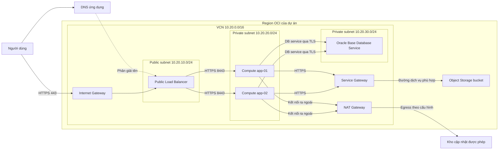
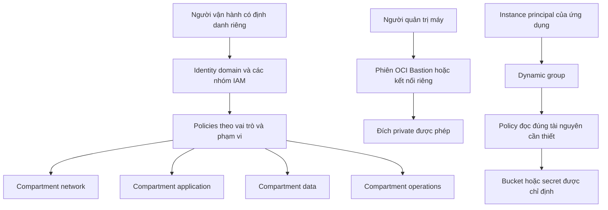

# Hoàn thiện sơ đồ, runbooks và bàn giao môi trường OCI

## 1. Mục tiêu của bài học

Một môi trường Oracle Cloud Infrastructure (OCI) chỉ có thể bàn giao để vận hành khi người tiếp nhận xác định được tài nguyên đang chạy, hiểu các phụ thuộc và xử lý được những tình huống đã thống nhất. Việc triển khai thành công bằng Console hoặc Terraform mới chứng minh môi trường đã được tạo ra tại một thời điểm.

Trong chương **Dự án tích hợp và đánh giá** của module **CLOUD_PROVIDERS_ORACLE**, bài học này tập trung hoàn thiện ba phần đầu ra của dự án:

- **Sơ đồ hiện trạng**: mô tả kiến trúc đã triển khai, ranh giới quyền hạn, đường đi của lưu lượng và phạm vi chịu lỗi.
- **Runbooks**: hướng dẫn thao tác có điều kiện bắt đầu, kết quả mong đợi, điểm quyết định, điều kiện dừng và cách xác nhận phục hồi.
- **Hồ sơ bàn giao**: liên kết tài nguyên, mã hạ tầng, quyền truy cập, giám sát, phục hồi dữ liệu, chi phí và trách nhiệm vận hành.

Sau bài học, người học có thể tổ chức một buổi bàn giao trong đó đội tiếp nhận tự tìm tài nguyên, thực hiện chẩn đoán bằng quyền được cấp và diễn tập một quy trình phục hồi trong phạm vi cho phép.

Các tên tài nguyên, CIDR, mục tiêu phục hồi và mã hồ sơ dưới đây đều là **ví dụ giảng dạy**. Chúng không xác nhận một tenancy thực tế đã triển khai hoặc đã đạt các mục tiêu này.

## 2. Xác định môi trường và phạm vi bàn giao

### 2.1. Tình huống xuyên suốt

Giả sử dự án triển khai ứng dụng quản lý đơn hàng với cấu hình sau:

| Thành phần | Phương án ví dụ | Nội dung cần bàn giao |
| --- | --- | --- |
| Tenancy và IAM | Một tenancy, các nhóm vận hành theo vai trò | Định danh tenancy, identity domain nếu dùng, nhóm, policy và người quản lý quyền |
| Compartments | `network`, `application`, `data` và `operations` | Quan hệ cha con, tài nguyên thuộc từng compartment, phạm vi policy |
| VCN | VCN `10.20.0.0/16`, các subnet theo tầng | CIDR, route tables, NSG, security lists, gateway và DNS |
| Điểm vào | Public Load Balancer nhận HTTPS | Listener, chứng chỉ, backend set, health check và chủ sở hữu DNS |
| Compute | Hai máy ứng dụng không có public IP | Image, shape, cấu hình, cách cập nhật và miền đặt máy |
| Cơ sở dữ liệu | Oracle Base Database Service, một DB system một node | DB system, database, PDB/service, backup destination và quy trình phục hồi tương ứng |
| Object Storage | Bucket tài liệu ứng dụng | Namespace, bucket, quyền, vòng đời và phương án phục hồi đối tượng |
| Vận hành | Monitoring, Logging, Notifications và Audit | Nơi quan sát, điều kiện cảnh báo, người nhận và cách truy vết thay đổi |
| Tự động hóa | Terraform hoặc OCI Resource Manager nếu dự án sử dụng | Mã nguồn, phiên bản công cụ, biến cấu hình, nơi giữ state và lịch sử chạy |

Giả sử hai máy ứng dụng được đặt tại hai fault domains khác nhau trong cùng một availability domain (AD), nếu cấu hình thực tế của vùng và dịch vụ cho phép. Hồ sơ phải ghi đúng vị trí đã triển khai. Hai máy như vậy chưa chứng minh ứng dụng chịu được mất toàn bộ AD. DB một node vẫn là điểm phụ thuộc quan trọng dù tầng ứng dụng có hai máy.

Nếu dự án thực tế dùng Autonomous Database hoặc loại cơ sở dữ liệu Oracle khác, cần thay đúng phần inventory, truy cập, sao lưu và phục hồi cho dịch vụ đó. Không lấy thao tác quản trị DB host của Base Database áp dụng nguyên trạng cho Autonomous Database.

### 2.2. Ba trạng thái phải phân biệt

Mỗi thành phần và khả năng vận hành cần có một trong các trạng thái sau:

| Trạng thái | Ý nghĩa | Ví dụ |
| --- | --- | --- |
| Đã triển khai, đã kiểm chứng | Có cấu hình thực tế và bằng chứng thực hiện | Người nhận đã dùng tài khoản riêng để xem trạng thái Load Balancer |
| Đã triển khai, chưa kiểm chứng | Tài nguyên tồn tại nhưng kết quả chưa được thử | Đã cấu hình backup nhưng chưa thử phục hồi |
| Chưa triển khai hoặc ngoài phạm vi | Là giới hạn hoặc phương án tương lai | Chưa có cơ sở dữ liệu dự phòng tại vùng khác |

Không đưa tài nguyên dự kiến vào sơ đồ hiện trạng như thể chúng đã hoạt động. Nếu muốn mô tả kiến trúc đích, đặt ở sơ đồ riêng và ghi rõ đây là kế hoạch.

### 2.3. Ghi rõ phạm vi hỗ trợ

Trước khi viết hướng dẫn, thống nhất:

- Đây là môi trường lab, kiểm thử hay production; dữ liệu thuộc mức nhạy cảm nào.
- Dịch vụ nào nằm trong phạm vi hỗ trợ và thời gian hỗ trợ.
- Ai chịu trách nhiệm nền tảng OCI, ứng dụng, cơ sở dữ liệu, bảo mật và chi phí.
- Sự cố nào được tự xử lý; sự cố nào cần người có quyền phê duyệt hoặc chuyên môn khác.
- Thời điểm bàn giao có hiệu lực và thời gian đội triển khai tiếp tục hỗ trợ.

Một nhóm vận hành chỉ phụ trách VCN và Compute không thể mặc nhiên chịu trách nhiệm xác nhận tính đúng đắn của dữ liệu đơn hàng sau phục hồi. Trách nhiệm đó phải có người đại diện ứng dụng hoặc nghiệp vụ.

## 3. Thiết kế bộ hồ sơ bàn giao có thể truy vết

### 3.1. Tổ chức tài liệu theo câu hỏi vận hành

Cây dưới đây là cấu trúc tham khảo cho hồ sơ của dự án; bài học không yêu cầu tạo các tệp này ngay:

```text
handover/
  index.md
  environment.md
  inventory/
    resources.csv
    dependencies.md
  architecture/
    context.mmd
    deployment.mmd
    traffic-and-trust.md
  access/
    role-matrix.md
    emergency-access.md
  runbooks/
    RB-01-application-unhealthy.md
    RB-02-database-recovery.md
    RB-03-access-denied.md
    RB-04-cost-anomaly.md
  operations/
    monitoring.md
    backup-and-retention.md
    maintenance.md
  automation/
    deployment-and-state.md
  evidence/
    manifest.csv
  acceptance.md
```

Trang chỉ mục cần dẫn đến câu trả lời cho các câu hỏi thường gặp: “Ứng dụng đang chạy ở đâu?”, “Alarm này cần làm gì?”, “Ai được thay route?”, “Bản phục hồi gần nhất đã được thử khi nào?” và “Ai chịu tiền cho tài nguyên phát sinh?”.

Không phụ thuộc hoàn toàn vào một trang chỉ truy cập được qua chính ứng dụng đang được phục hồi. Đội vận hành cần có cách mở tài liệu và kênh liên lạc khi ứng dụng hoặc đường truy cập thông thường gặp sự cố.

### 3.2. Bản kê phiên bản bàn giao

Mỗi đợt bàn giao cần một bản kê ngắn:

```yaml
handover_id: HD-OCI-ORDER-001
environment: lab
service: order-service
documentation_revision: "<ma-phien-ban-tai-lieu>"
infrastructure_revision: "<commit-ma-ha-tang>"
application_release: "<phien-ban-hoac-artifact-digest>"
verified_at_utc: "<YYYY-MM-DDThh:mm:ssZ>"
tenancy_reference: "<dinh-danh-noi-bo>"
region: "<region-thuc-te>"
resource_inventory_reference: "<tham-chieu-inventory>"
runbook_revision: "<phien-ban-runbooks>"
evidence_manifest_reference: "<tham-chieu-bang-chung>"
service_owner: "<vai-tro-chiu-trach-nhiem>"
operations_owner: "<vai-tro-tiep-nhan>"
acceptance_state: DRAFT
```

Đây là mẫu bản kê của hồ sơ bàn giao, không phải cấu hình OCI hay cấu trúc metadata bài học. Các giá trị trong dấu `<...>` cần được thay bằng dữ liệu đã xác minh trước khi nghiệm thu.

Ngày cập nhật tài liệu và ngày thực hiện thử nghiệm có thể khác nhau. Giữ cả hai khi chúng ảnh hưởng đến độ tin cậy của bằng chứng.

### 3.3. Inventory cần đủ thông tin để tìm đúng tài nguyên

Một dòng inventory nên có các trường sau:

| Nhóm trường | Thông tin cần lưu |
| --- | --- |
| Định danh | Mã nội bộ, loại tài nguyên, tên hiển thị, OCID hoặc tham chiếu OCID trong kho có kiểm soát |
| Vị trí | Tenancy, region, compartment; AD/fault domain nếu áp dụng |
| Phụ thuộc | Subnet, NSG, backend set, volume, database service hoặc gateway liên quan |
| Quyền sở hữu | Đội phụ trách, người phê duyệt thay đổi, môi trường và cost center |
| Nguồn cấu hình | Địa chỉ tài nguyên trong IaC hoặc nơi ghi nhận cấu hình thủ công |
| Vòng đời | Chính sách sao lưu, bảo trì, thời hạn tài nguyên tạm và điều kiện thu hồi |

Tên hiển thị có thể trùng hoặc bị thay đổi. OCID giúp xác định tài nguyên cụ thể, nhưng phải đi kèm region và ngữ cảnh compartment để người tiếp nhận không thao tác nhầm môi trường.

OCID không phải mật khẩu. Tuy nhiên, inventory vẫn tiết lộ cấu trúc nội bộ nên cần giới hạn người đọc theo mục đích. Không đưa private key, database password, nội dung secret hoặc wallet vào bảng kê.

## 4. Hoàn thiện sơ đồ hiện trạng

### 4.1. Dùng nhiều góc nhìn, mỗi sơ đồ giải quyết một việc

Một sơ đồ chứa mọi policy, subnet, luồng dữ liệu và lịch backup thường khó sử dụng khi có sự cố. Với dự án này, nên có ít nhất ba góc nhìn:

| Góc nhìn | Câu hỏi cần trả lời | Chi tiết chính |
| --- | --- | --- |
| Bối cảnh và phụ thuộc | Người dùng và hệ thống ngoài tương tác với ứng dụng thế nào? | DNS, điểm vào, hệ thống ngoài, người vận hành |
| Triển khai và lưu lượng | Gói tin đi qua đâu, tài nguyên nằm ở đâu? | Region, VCN, subnet, gateway, Compute, DB, các cổng |
| Quản trị và chịu lỗi | Ai được thay gì, lỗi nào đã được bao phủ? | Compartments, IAM, đường quản trị, AD/fault domains và giới hạn phục hồi |

Mỗi sơ đồ cần ghi tên môi trường, phạm vi, phiên bản, ngày xác minh và chú giải. Tài nguyên không nằm trong VCN, như bucket Object Storage, cần đặt ngoài khung VCN.

### 4.2. Ví dụ sơ đồ triển khai và lưu lượng

Sơ đồ dưới đây minh họa luồng ứng dụng. Nó lược bỏ vị trí AD/fault domain và chi tiết IAM; các thông tin đó phải có trong inventory hoặc góc nhìn khác.



Mũi tên DNS biểu diễn quan hệ phân giải tên, không phải đường truyền HTTP. Tương tự, sơ đồ giản lược không thay thế các route và security rules thực tế.

Trong cấu hình ví dụ, TLS kết thúc tại Load Balancer và được thiết lập lại đến backend trên cổng `8443`. Hồ sơ cần ghi cách kiểm tra chứng chỉ backend, kho tin cậy và lịch gia hạn. Nếu dự án dùng HTTP nội bộ hoặc TLS passthrough, phải mô tả đúng lựa chọn đó và các hệ quả tương ứng.

Internet Gateway, NAT Gateway và Service Gateway có mục đích khác nhau. Đường đi qua gateway cần route và quy tắc bảo mật phù hợp; chỉ vẽ gateway chưa chứng minh luồng đã hoạt động. Xem [tài liệu Oracle về bảo vệ VCN và các gateway](https://docs.oracle.com/en-us/iaas/Content/Security/Reference/networking_security.htm).

### 4.3. Lập ma trận luồng để kiểm tra được sơ đồ

| Luồng | Nguồn → đích | Giao thức/cổng ví dụ | Điều cần đối chiếu |
| --- | --- | --- | --- |
| F-01 | Người dùng → Load Balancer | HTTPS/443 | DNS, public IP, listener, chứng chỉ, route và quyền vào |
| F-02 | Load Balancer → ứng dụng | HTTPS/8443 | Backend set, NSG hai đầu, firewall máy, tiến trình và chứng chỉ |
| F-03 | Ứng dụng → DB service | Theo connect descriptor đã cấu hình | Private endpoint, tên service/PDB, cổng TLS thực tế, NSG và thông tin xác thực |
| F-04 | Ứng dụng → Object Storage | HTTPS/443 | Route qua Service Gateway khi áp dụng, service CIDR label, IAM và quyền bucket |
| F-05 | Ứng dụng → kho cập nhật | HTTPS/443 | NAT route, DNS và cơ chế kiểm soát đích nếu dự án yêu cầu |
| F-06 | Người vận hành → tài nguyên private | Theo loại phiên Bastion hoặc kết nối riêng | Quyền tạo phiên, nguồn được phép, TTL phiên, route và cổng đích |
| F-07 | Thành phần giám sát → dịch vụ thu thập | Theo dịch vụ và agent thực tế | Agent/plugin nếu cần, kết nối mạng, IAM và dữ liệu đến nơi nhận |

Đối với F-03, không điền một cổng mặc định cho mọi dịch vụ Oracle Database. Dùng connect descriptor của đúng database và kiểu kết nối đã triển khai.

Security rules của NSG và security lists đều phải được xem xét. Một rule cho phép rộng ở security list có thể khiến giới hạn dự định ở NSG không đạt mục đích; NSG không tạo một lớp “deny” phủ lên những rule cho phép khác. Cần xét thêm stateful/stateless và firewall hệ điều hành. Cơ sở đối chiếu là [Security Rules của OCI](https://docs.oracle.com/en-us/iaas/Content/Network/Concepts/securityrules.htm).

NAT Gateway không phải cơ chế lọc theo tên miền. Nếu yêu cầu chỉ cho ra một số repository, hồ sơ phải chỉ rõ proxy, firewall hoặc cơ chế kiểm soát đích thực tế đang dùng.

### 4.4. Thể hiện ranh giới quản trị riêng



Sơ đồ này thể hiện hai việc khác nhau: IAM kiểm soát hành động trên tài nguyên OCI; đường mạng quản trị cho phép kết nối đến hệ điều hành hoặc dịch vụ đích. Có quyền xem instance không đồng nghĩa có thể SSH; kết nối được tới DB không đồng nghĩa được đọc bảng nghiệp vụ.

Nếu dự án dùng Managed SSH của OCI Bastion, ghi rõ các điều kiện liên quan đến hệ điều hành và plugin của loại phiên đó. Với SSH port forwarding, dùng điều kiện của loại phiên tương ứng. Không đưa một hướng dẫn Bastion chung cho mọi kiểu đích.

### 4.5. Cách đối chiếu sơ đồ với môi trường

Đi theo từng luồng, thay vì chỉ nhìn tên tài nguyên:

1. Từ DNS, tìm đúng Load Balancer, listener và backend set.
2. Từ backend, xác định instance/VNIC, subnet, NSG và các security lists áp dụng.
3. Từ kết nối ứng dụng, xác định đúng DB endpoint, service và bucket.
4. Từ route table, xác định lưu lượng ra dịch vụ Oracle và ra Internet đi qua đâu.
5. Đối chiếu vị trí AD/fault domain, số bản sao và phụ thuộc dùng chung.
6. Ghi người kiểm tra, thời điểm, định danh bằng chứng và những phần chưa xác minh.

Nếu có drift giữa mã hạ tầng và cấu hình đang chạy, ghi nhận chênh lệch trước khi kết luận sơ đồ đúng. Một bản Terraform plan không thay thế việc xác nhận ứng dụng truy cập được dependency.

## 5. Ghi rõ tính sẵn sàng, sao lưu và giới hạn phục hồi

### 5.1. Không suy diễn khả năng chịu lỗi từ số lượng máy

Bản bàn giao cần trả lời riêng cho từng phạm vi lỗi:

| Phạm vi lỗi | Điều phải chứng minh | Giới hạn của cấu hình ví dụ |
| --- | --- | --- |
| Một tiến trình ứng dụng | Health check phát hiện; lưu lượng chuyển đến backend còn khỏe | Chưa đủ nếu cả hai máy dùng chung cấu hình lỗi |
| Một Compute instance | Tầng ứng dụng còn đủ năng lực; có thể tái tạo máy | Cần thử với trạng thái phiên, tác vụ nền và connection pool |
| Một fault domain | Máy và phụ thuộc được bố trí phù hợp | DB một node vẫn có thể gây gián đoạn toàn bộ ứng dụng |
| Một AD | Các thành phần cần thiết có phương án ngoài AD lỗi | Hai máy trong cùng AD chưa bao phủ trường hợp này |
| Một region | Có dữ liệu, hạ tầng và cách chuyển dịch vụ ở region khác | Chưa có trong ví dụ mặc định |
| Xóa nhầm hoặc hỏng dữ liệu logic | Có điểm phục hồi sạch và quy trình kiểm tra dữ liệu | Replication có thể truyền cả lỗi logic; không thay thế backup |

Bên nhận cần biết những dòng nào đã diễn tập, những dòng nào mới có thiết kế và những dòng nào được chấp nhận ngoài phạm vi.

### 5.2. RTO và RPO phải gắn với một kịch bản

- **RTO** là mục tiêu thời gian khôi phục dịch vụ sau gián đoạn, theo mốc bắt đầu và mốc kết thúc đã thống nhất.
- **RPO** là mục tiêu về khoảng dữ liệu có thể mất, thường diễn đạt bằng thời gian giữa thời điểm sự cố và điểm dữ liệu phục hồi được.

Ví dụ dự án đề xuất RTO 120 phút và RPO 15 phút cho kịch bản mất khả năng sử dụng database trong một region còn hoạt động. Đây là mục tiêu dự án, không phải cam kết mặc định của OCI.

Khi diễn tập, ghi ít nhất các mốc sau:

```text
T0: Dịch vụ bắt đầu gián đoạn hoặc mốc giả lập đã thống nhất.
T1: Hệ thống giám sát phát hiện.
T2: Người trực bắt đầu xử lý.
T3: Database/đích phục hồi sẵn sàng.
T4: Ứng dụng kết nối lại.
T5: Giao dịch kiểm chứng hoàn thành, dịch vụ được xác nhận phục hồi.

Thời gian phục hồi quan sát được = T5 - T0.
Khoảng mất dữ liệu quan sát được = thời điểm sự cố - điểm dữ liệu phục hồi.
```

Không lấy `T3 - T2` làm thời gian phục hồi toàn dịch vụ. Khoảng này bỏ qua phát hiện, điều phối, cấu hình kết nối và kiểm chứng ứng dụng.

Ví dụ số học giả lập: sự cố lúc 10:00 UTC, điểm dữ liệu phục hồi 09:53 UTC, dịch vụ được kiểm chứng lúc 11:17 UTC. Thời gian phục hồi là 77 phút và khoảng dữ liệu có thể mất là 7 phút. Các con số này chỉ minh họa cách tính, không phải bằng chứng dự án đã đạt RTO/RPO.

### 5.3. Bàn giao khả năng phục hồi theo từng loại dữ liệu

| Đối tượng | Nội dung phải ghi | Bằng chứng có ý nghĩa |
| --- | --- | --- |
| Oracle Database | Dịch vụ cụ thể, backup destination, lịch, retention, điểm phục hồi, encryption key và người thực hiện | Một lần phục hồi cùng kiểm tra dữ liệu và giao dịch ứng dụng |
| Block/Boot Volume | Volume nào được sao lưu, policy, phạm vi nhất quán | Tạo volume/instance từ bản sao và kiểm tra khả năng sử dụng |
| Object Storage | Versioning nếu dùng, lifecycle, replication/copy nếu có, quyền xóa và bảo vệ retention nếu áp dụng | Khôi phục đối tượng hoặc phiên bản thử nghiệm theo quy trình đã chọn |
| Cấu hình ứng dụng | Artifact, biến cấu hình, tham chiếu secret và cách dựng lại | Dựng được một instance thay thế với phiên bản xác định |
| IaC và state | Kho mã, backend state, quyền, phiên bản và cơ chế khôi phục | Đội nhận truy cập được đúng mã/state và xác định được revision |
| Khóa mã hóa và thông tin xác thực | Chủ sở hữu, cách cấp quyền, luân chuyển và phụ thuộc khi phục hồi | Tài khoản/đích phục hồi được phép dùng khóa mà không chia sẻ bí mật trong tài liệu |

Một backup “thành công” chưa chứng minh khả năng phục hồi đầu cuối. Nếu không truy cập được khóa mã hóa, thiếu capacity, thiếu quota hoặc không tạo được đích mạng, bước restore có thể bị chặn.

Không giả định bucket tài liệu ứng dụng cũng là nơi lưu backup của Oracle Database. Với Base Database Service, cần ghi đúng backup destination và cơ chế recovery của cấu hình hiện tại. Oracle có hướng dẫn riêng cho [Base Database Service tích hợp Recovery Service](https://docs.oracle.com/en/solutions/back-up-base-database-zero-data-loss-recovery/integrate-oracle-base-database-service-and-oracle-zero-data-loss-autonomous-recovery-service1.html).

## 6. Chuyển kiến thức thao tác thành runbook

### 6.1. Phân biệt ba loại tài liệu

**Thiết kế** giải thích vì sao chọn kiến trúc. **Runbook** hướng dẫn thực hiện một công việc hoặc xử lý một tình huống xác định. **Nhật ký sự cố** ghi lại điều thực sự đã xảy ra.

Câu “kiểm tra database rồi khởi động lại ứng dụng” thiếu điều kiện, cách nhận biết đúng database và tiêu chí thành công. Runbook cần giúp người khác ra quyết định mà không phải đoán ý tác giả.

### 6.2. Mẫu runbook tối thiểu

| Mục | Nội dung cần có |
| --- | --- |
| Định danh | Mã runbook, phiên bản, môi trường, chủ sở hữu, ngày thử gần nhất |
| Kích hoạt | Alarm, triệu chứng, tác vụ định kỳ hoặc yêu cầu thay đổi |
| Phạm vi | Dịch vụ/tài nguyên áp dụng và những trường hợp không áp dụng |
| Điều kiện trước khi làm | Quyền, kết nối, công cụ, backup, cửa sổ thao tác và người phê duyệt nếu cần |
| Xác định đích | Tenancy, region, compartment, OCID, phiên bản ứng dụng |
| Chẩn đoán | Thao tác quan sát, kết quả dự kiến và cách hiểu kết quả khác thường |
| Hành động | Các bước đánh số, mỗi bước có đầu vào và kết quả kiểm tra |
| Điểm dừng | Điều kiện thiếu quyền, sai môi trường, dữ liệu chưa rõ hoặc rủi ro tăng |
| Hoàn nguyên/phục hồi tiếp | Cách quay về trạng thái trước và giới hạn khi đã phát sinh dữ liệu mới |
| Xác nhận thành công | Kiểm tra kỹ thuật, nghiệp vụ, cảnh báo và khoảng theo dõi |
| Chuyển cấp | Vai trò cần gọi, điều kiện gọi và thông tin cần chuyển |
| Bằng chứng | Thời điểm, người thực hiện, request/work request ID nếu có, kết quả đã làm sạch bí mật |

Runbook nên có thời lượng dự kiến cho từng giai đoạn để người trực nhận ra khi nào đang vượt ngưỡng. Các thời lượng cần được hiệu chỉnh từ diễn tập, không điền tùy ý để làm đẹp RTO.

### 6.3. Viết theo nhánh quyết định có thể kiểm chứng

Một bước tốt có dạng: “Nếu chỉ backend `app-01` unhealthy trong khi `app-02` đủ năng lực và bài kiểm tra giao dịch còn đạt, cô lập `app-01` theo quy trình thay đổi đã duyệt; sau đó xác nhận không còn request mới vào backend này”.

Bước đó chỉ rõ:

- Điều kiện áp dụng.
- Hành động có phạm vi nhỏ.
- Kết quả cần quan sát.
- Tham chiếu đến quy trình thay đổi tương ứng.

Nếu cả hai backend cùng mất kết nối DB, thay từng Compute có thể không giải quyết nguyên nhân. Runbook cần chuyển sang kiểm tra dependency dùng chung.

### 6.4. Đoạn thu thập trạng thái bằng OCI CLI

Ví dụ PowerShell sau chỉ truy vấn Compute và trạng thái alarm. Các placeholder phải được thay từ inventory, dùng OCI CLI đã được cấu hình theo phương thức xác thực của tổ chức. Tên profile không tự tạo ra quyền.

```powershell
$ErrorActionPreference = 'Stop'

$OciProfile = '<PROFILE_VAN_HANH>'
$OciRegion = '<REGION_DA_XAC_MINH>'
$InstanceOcid = '<OCID_COMPUTE_CAN_KIEM_TRA>'
$AlarmCompartmentOcid = '<OCID_COMPARTMENT_CHUA_ALARM>'

$RequiredValues = @(
    $OciProfile,
    $OciRegion,
    $InstanceOcid,
    $AlarmCompartmentOcid
)

if ($RequiredValues.Where({ $_ -match '^<.*>$' }).Count -gt 0) {
    throw 'Can thay tat ca placeholder bang gia tri tu inventory.'
}

oci --version
if ($LASTEXITCODE -ne 0) {
    throw 'Khong chay duoc OCI CLI.'
}

$InstanceJson = oci compute instance get --instance-id $InstanceOcid --profile $OciProfile --region $OciRegion --output json
if ($LASTEXITCODE -ne 0) {
    throw 'Truy van Compute that bai; dung va xac minh loi/quyen/dich.'
}

$InstanceData = (($InstanceJson -join [Environment]::NewLine) | ConvertFrom-Json).data
[pscustomobject]@{
    Id = $InstanceData.id
    Name = $InstanceData.'display-name'
    State = $InstanceData.'lifecycle-state'
    Compartment = $InstanceData.'compartment-id'
    AvailabilityDomain = $InstanceData.'availability-domain'
    FaultDomain = $InstanceData.'fault-domain'
} | ConvertTo-Json

oci monitoring alarm-status list-alarms-status --compartment-id $AlarmCompartmentOcid --all --profile $OciProfile --region $OciRegion --output json
if ($LASTEXITCODE -ne 0) {
    throw 'Truy van alarm that bai; dung va xac minh loi/quyen/dich.'
}
```

Đọc kết quả theo ngữ cảnh:

- Instance `RUNNING` chỉ mô tả vòng đời Compute; ứng dụng hoặc database vẫn có thể lỗi.
- Compartment chứa alarm có thể khác compartment chứa Compute. Không tái sử dụng một biến compartment cho mọi thao tác.
- Danh sách alarm rỗng không chứng minh hệ thống khỏe; cần xác nhận đúng region, compartment, quyền và alarm đã được tạo.
- Alarm `OK` chưa đủ nếu metric bị thiếu hoặc truy vấn/dimension không phản ánh tài nguyên đang chạy.

Cú pháp tham chiếu: [Get Compute Instance](https://docs.oracle.com/en-us/iaas/tools/oci-cli/latest/oci_cli_docs/cmdref/compute/instance/get.html) và [List Alarm Statuses](https://docs.oracle.com/en-us/iaas/tools/oci-cli/latest/oci_cli_docs/cmdref/monitoring/alarm-status/list-alarms-status.html). Đối chiếu phiên bản CLI của đội vận hành trước khi sử dụng. Không bật chế độ debug rồi đưa toàn bộ đầu ra chưa làm sạch vào hồ sơ chung.

## 7. Runbook mẫu RB-01: Ứng dụng trả lỗi hoặc backend unhealthy

### 7.1. Phạm vi và điều kiện bắt đầu

**Kích hoạt:** tỷ lệ lỗi hoặc độ trễ vượt ngưỡng của dự án, kiểm tra từ bên ngoài thất bại, hoặc Load Balancer báo backend unhealthy.

**Áp dụng:** ứng dụng sau Load Balancer trong môi trường đã ghi trong inventory.

**Quyền cần có:** đọc Load Balancer, Compute, metric và log liên quan; quyền thay backend hoặc triển khai chỉ cần khi chuyển sang bước khắc phục. Tài khoản quan sát không cần quyền quản trị tenancy.

**Điều kiện dừng ngay:** chưa xác định được môi trường, nghi ngờ dữ liệu hỏng/rò rỉ, cả hai backend không đủ khả năng phục vụ, hoặc có thay đổi database chưa rõ khả năng hoàn nguyên.

### 7.2. Thu thập và khoanh vùng

| Bước | Thao tác | Kết quả cần có | Nhánh tiếp theo |
| --- | --- | --- | --- |
| 1 | Xác nhận URL, region, OCID Load Balancer và thời điểm bắt đầu lỗi | Đúng dịch vụ, đúng môi trường, có mốc thời gian UTC | Nếu sai đích, dừng trước khi thay đổi |
| 2 | Kiểm tra DNS, TLS và gửi request thử đã được phép từ bên ngoài | Phân biệt lỗi phân giải tên, chứng chỉ, kết nối và HTTP | Lỗi tại DNS/TLS chuyển đến người quản lý thành phần tương ứng |
| 3 | Xem backend health, listener và health-check configuration | Biết backend nào lỗi, health path/port/timeout thực tế | Một backend lỗi: kiểm tra riêng; tất cả lỗi: kiểm tra phụ thuộc chung |
| 4 | Xem trạng thái Compute, tiến trình, tài nguyên máy và log ứng dụng | Phân biệt máy chết, tiến trình lỗi, quá tải và lỗi dependency | Máy chạy nhưng app lỗi: tiếp tục vào cấu hình/log |
| 5 | Đối chiếu kết nối DB, Object Storage và quyền ứng dụng | Xác định lỗi mạng, xác thực, hết kết nối hoặc lỗi dịch vụ | Chuyển runbook tương ứng nếu dependency là nguyên nhân |
| 6 | Đối chiếu release, thay đổi cấu hình và Audit trong khoảng liên quan | Có danh sách thay đổi với người thực hiện, thời điểm và ticket | Chọn hành động dựa trên bằng chứng, không tự quy kết mọi lỗi cho release |

Health path phải thể hiện điều nhóm muốn đo. Một endpoint chỉ trả `200` khi tiến trình còn sống có thể bỏ qua lỗi DB; một endpoint phụ thuộc mọi hệ thống ngoài có thể làm toàn bộ backend bị loại khi một chức năng phụ gặp sự cố. Bàn giao ý nghĩa của health check cùng cấu hình của nó.

### 7.3. Khắc phục theo nhánh

**Một backend lỗi, backend còn lại đủ năng lực:**

1. Xác nhận lưu lượng và mức sử dụng tài nguyên của backend khỏe còn trong giới hạn đã thống nhất.
2. Ngừng đưa request mới vào backend lỗi theo cơ chế drain/offline của cấu hình Load Balancer đang dùng; kiểm tra tác vụ nền và request còn chạy.
3. Lưu log cần thiết trước khi khởi động lại hoặc thay máy.
4. Khắc phục theo nguyên nhân: cấu hình, tiến trình, phiên bản hoặc dựng lại instance từ nguồn đã xác định.
5. Kiểm tra cục bộ, health check và giao dịch thử trước khi đưa backend trở lại.
6. Theo dõi phân phối lưu lượng và lỗi sau khi backend tham gia lại.

**Cả hai backend lỗi sau một release:**

1. Kiểm tra tính tương thích của artifact trước với schema và dữ liệu hiện tại.
2. Nếu rollback ứng dụng được cho phép và an toàn với schema, thực hiện quy trình rollback đã thử.
3. Nếu migration không tương thích ngược, dừng rollback tùy tiện; phối hợp người phụ trách ứng dụng/DB để chọn sửa tiếp hoặc phục hồi dữ liệu.
4. Không khởi động lại hàng loạt chỉ vì chưa xác định được nguyên nhân.

**Lỗi dependency dùng chung:** giữ nguyên những bằng chứng liên quan và chuyển đến runbook DB, truy cập hoặc mạng. Việc thay một máy ứng dụng không sửa được một route hoặc credential dùng chung đang sai.

### 7.4. Xác nhận và đóng sự cố

Chỉ kết luận phục hồi khi có đủ điều kiện của dự án:

- Đúng số backend dự kiến khỏe; không có backend bị quên ở trạng thái cô lập.
- Kiểm tra từ đường truy cập của người dùng thành công.
- Một giao dịch thử qua ứng dụng được xác nhận đúng, có cách nhận diện và xử lý dữ liệu thử.
- Tỷ lệ lỗi, độ trễ và tài nguyên ổn định trong khoảng theo dõi đã thống nhất.
- Alarm đã về trạng thái phù hợp và không bị tắt để che lỗi.
- Thay đổi khẩn cấp đã được ghi nhận, có người đưa về mã hạ tầng hoặc cấu hình chuẩn.

Lưu timeline, tác động, hành động đã làm, kết quả và việc cần theo dõi. Nếu cảnh báo vẫn firing, ghi rõ nguyên nhân; không đóng chỉ vì một request thử đã thành công.

## 8. Runbook mẫu RB-02: Phục hồi Oracle Database và kết nối lại ứng dụng

### 8.1. Chọn đúng mục đích phục hồi

Phân biệt **diễn tập phục hồi**, **phục hồi sau mất dữ liệu**, **chuyển sang standby** và **quay lui một thay đổi**. Chúng có điều kiện và rủi ro khác nhau.

Runbook mẫu này tổ chức diễn tập hoặc phục hồi từ khả năng backup/recovery đã cấu hình cho **Oracle Base Database Service**. Runbook thực tế phải chỉ rõ hình thức tạo đích phục hồi hay restore tại chỗ được dịch vụ và cấu hình đó hỗ trợ. Không dùng một lệnh restore chung cho mọi loại Oracle Database.

**Đầu vào bắt buộc:**

- Định danh DB system, database, PDB/service, region và môi trường.
- Loại sự cố, thời điểm dữ liệu bắt đầu không còn tin cậy và mốc phục hồi được chọn.
- Backup/recovery point đủ điều kiện và các phụ thuộc cần thiết.
- Đích phục hồi, quyền truy cập, mạng, quota/capacity và encryption key.
- Người cho phép mất dữ liệu hoặc gián đoạn trong phạm vi đã thống nhất.
- Cách cô lập ghi dữ liệu, kiểm tra nghiệp vụ và cập nhật connect descriptor.

Nếu không xác định được điểm dữ liệu sạch trước lỗi logic, không chọn “latest” chỉ vì đó là tùy chọn mới nhất.

### 8.2. Trình tự có điểm quyết định

| Bước | Công việc | Điều kiện đi tiếp |
| --- | --- | --- |
| 1. Ghi nhận | Xác định tác động, mở timeline và bảo toàn bằng chứng | Có người điều phối và môi trường đích rõ ràng |
| 2. Kiểm tra nguồn | Xác minh backup/recovery point, retention, khóa và quyền | Điểm phục hồi còn dùng được, phù hợp nguyên nhân sự cố |
| 3. Chuẩn bị đích | Kiểm tra mạng, capacity, quota, cấu hình dịch vụ và chi phí tạm | Đích đáp ứng yêu cầu; không ghi đè nhầm nguồn đang cần bảo toàn |
| 4. Kiểm soát ghi | Dừng hoặc điều phối các nguồn ghi theo kế hoạch chuyển đổi | Biết ứng dụng, batch và tích hợp nào còn có thể ghi |
| 5. Thực hiện recovery | Dùng đúng thủ tục của dịch vụ và ghi request/work request ID nếu có | Tác vụ hoàn tất, không bỏ qua thông báo lỗi |
| 6. Kiểm tra DB | Kiểm tra trạng thái, PDB/service, quyền, mốc dữ liệu và tập dữ liệu kiểm chứng | DBA/người phụ trách xác nhận dữ liệu phù hợp |
| 7. Kết nối ứng dụng | Cập nhật endpoint hoặc secret reference khi cần, làm mới connection pool | Ứng dụng kết nối đúng đích đã phục hồi |
| 8. Kiểm tra đầu cuối | Chạy giao dịch thử và đối chiếu tích hợp quan trọng | Người phụ trách ứng dụng xác nhận phục vụ đúng |
| 9. Mở lại ghi | Chỉ cho một phía nhận ghi theo kế hoạch | Không có hai nguồn ghi độc lập ngoài thiết kế |
| 10. Theo dõi và kết thúc | Đo RTO/RPO, xác nhận backup tiếp theo và xử lý đích tạm | Có bằng chứng, người chấp nhận và lịch thu hồi |

Trong diễn tập, ưu tiên đích riêng khi dịch vụ hỗ trợ và ngân sách cho phép. Đích thử phải được cô lập khỏi tác vụ gửi thư, thanh toán, webhook hoặc các tích hợp có tác động thực tế.

### 8.3. Kiểm tra dữ liệu vượt qua trạng thái “database available”

Tập kiểm chứng cần phù hợp ứng dụng, chẳng hạn:

- Một marker giao dịch đã tạo trước thời điểm diễn tập.
- Tổng số bản ghi hoặc giá trị kiểm soát trong phạm vi dữ liệu thử.
- Khả năng đọc một đơn hàng và tạo giao dịch kiểm chứng được phép.
- Tính phù hợp giữa DB, tệp trong Object Storage và sự kiện đã gửi ra hệ thống khác.
- Khả năng dùng đúng service name/PDB, schema, quyền và secret sau khi đổi đích.

Đối với một ứng dụng dùng cả database và bucket, phục hồi DB về 09:53 không tự đưa bucket về 09:53. Cần chỉ rõ cách phát hiện và đối soát tham chiếu tệp bị lệch.

### 8.4. Giới hạn hoàn nguyên sau chuyển đổi

Nếu đích phục hồi đã nhận giao dịch mới, chuyển ngược về DB cũ có thể làm mất hoặc phân kỳ dữ liệu. Runbook phải có điểm quyết định trước khi mở lại ghi và phương án đối soát nếu cần chuyển ngược.

Nếu quá trình restore thất bại, ghi rõ trạng thái nguồn/đích, tác vụ còn chạy và các thay đổi kết nối đã thực hiện. Không tự xóa tài nguyên để “làm sạch” khi chưa biết tài nguyên nào đang giữ dữ liệu hoặc bằng chứng cần bảo toàn.

Backup, sao chép dữ liệu và phục hồi ngoài region là các khả năng khác nhau. Chỉ ghi đã có phương án DR ngoài region khi cả dữ liệu, khóa, quyền, mạng, hạ tầng ứng dụng và cách chuyển dịch vụ đều đã được chuẩn bị trong phạm vi đó.

## 9. Runbooks bổ sung cho truy cập và chi phí

### 9.1. RB-03: Không truy cập được tài nguyên

**Kích hoạt:** Console/CLI báo không được phép, không tìm thấy tài nguyên dự kiến, hoặc kết nối quản trị thất bại.

Thực hiện theo thứ tự:

1. Xác nhận URL/endpoint, tenancy, profile, region, compartment và OCID. So sánh với inventory thay vì đổi quyền ngay.
2. Phân biệt lỗi xác thực, lỗi IAM và lỗi kết nối mạng. Với người dùng, kiểm tra phiên đăng nhập hoặc phương thức ký yêu cầu; với workload, kiểm tra đúng principal và dynamic group đang dùng.
3. Kiểm tra membership trong đúng identity domain nếu áp dụng, policy cho đúng loại hành động/tài nguyên, phạm vi compartment và policy từ cấp cha.
4. Với lỗi dạng `NotAuthorizedOrNotFound`, kiểm tra đồng thời quyền và sự tồn tại/vị trí của tài nguyên. Không kết luận chắc chắn rằng tài nguyên đã bị xóa.
5. Nếu CLI đọc được Compute nhưng SSH không vào được, kiểm tra đường Bastion/kết nối riêng, phiên còn hiệu lực, cổng đích, firewall, SSH key và dịch vụ đích. Quyền xem Compute không cấp quyền đăng nhập hệ điều hành.
6. Nếu cần bổ sung quyền, người quản lý IAM thực hiện thay đổi tối thiểu theo yêu cầu đã ghi nhận.
7. Thử lại bằng chính danh tính của người tiếp nhận, lưu kết quả đã làm sạch bí mật và thu hồi quyền tạm khi kết thúc.

**Điều kiện dừng:** chưa xác định được danh tính đang gọi, yêu cầu mở quyền vượt vai trò, hoặc đang có dấu hiệu tài khoản bị sử dụng trái phép.

Không xử lý một lỗi đọc bucket bằng cách cấp `manage all-resources in tenancy`. Quyền rộng làm mất thông tin về điều kiện thực sự cần thiết và tạo thêm trách nhiệm vận hành.

### 9.2. RB-04: Chi phí tăng bất thường

**Kích hoạt:** budget alert, báo cáo sử dụng hoặc người phụ trách chi phí phát hiện sai lệch so với baseline.

| Giai đoạn | Việc cần làm |
| --- | --- |
| Xác minh | Kiểm tra kỳ báo cáo, thời gian cập nhật dữ liệu, tiền tệ, phạm vi compartment/tag và baseline so sánh |
| Khoanh vùng | Tách theo dịch vụ, tài nguyên, region, ngày tạo, owner và thay đổi triển khai gần nhất |
| Đánh giá | Phân biệt tăng tải hợp lệ, tài nguyên tạm bị bỏ quên, dung lượng/log tăng và cấu hình sai |
| Kiểm soát | Cùng owner chọn dừng lịch lab, giảm tài nguyên hoặc thu hồi đúng đối tượng sau khi xét dữ liệu và phụ thuộc |
| Xác nhận | Theo dõi xu hướng sau thay đổi, ghi nhận độ trễ báo cáo và kiểm tra dịch vụ còn hoạt động |
| Phòng ngừa | Bổ sung owner tag, thời hạn tài nguyên tạm, lịch review, quota phù hợp hoặc điều kiện kiểm tra trước triển khai |

Budgets của OCI là ngưỡng mềm để theo dõi và cảnh báo; không tự ngăn tài nguyên làm chi phí vượt ngưỡng. Cơ chế kiểm soát cần kết hợp quy trình và giới hạn kỹ thuật phù hợp. Tham khảo [hướng dẫn Oracle về quản lý sử dụng và chi phí](https://docs.oracle.com/en/solutions/oci-best-practices/track-and-manage-usage-and-cost1.html).

Trước khi dừng hoặc xóa, xác định đây có phải DB, volume, backup hay tài nguyên phục hồi tạm còn cần dùng. Dừng một Compute không đồng nghĩa mọi tài nguyên liên quan đều hết chi phí; volume và các dịch vụ phụ thuộc vẫn cần được xem xét theo cách tính phí tương ứng.

**Điều kiện đóng:** đã xác định owner, nguyên nhân, hành động, kết quả theo dõi và tài nguyên nào tiếp tục được giữ cùng lý do. Không xóa dữ liệu để đạt một ngưỡng chi phí mà chưa có quyết định của người chịu trách nhiệm.

## 10. Bàn giao quyền và bí mật theo vai trò

### 10.1. Ma trận vai trò tham khảo

| Vai trò | Công việc chính | Phạm vi quyền cần làm rõ |
| --- | --- | --- |
| Người trực quan sát | Xem trạng thái, metric, log và mở sự cố | Các compartment/dịch vụ được hỗ trợ, dữ liệu log được phép xem |
| Người vận hành ứng dụng | Thay backend, triển khai và hoàn nguyên ứng dụng | Compute/Load Balancer và công cụ triển khai theo phạm vi |
| Người quản trị mạng | Sửa route, NSG, security lists, gateway và DNS liên quan | Tài nguyên mạng và quy trình phối hợp khi ảnh hưởng ứng dụng |
| Người phụ trách DB | Sao lưu, phục hồi, bảo trì và xác nhận dữ liệu | Quyền OCI của dịch vụ DB cùng quyền DB nội bộ cần thiết |
| Người quản lý IAM/bảo mật | Cấp/thu quyền, quản lý truy cập khẩn cấp và điều tra | Policy, nhóm, identity domain, khóa/secret theo phân công |
| Người quản lý chi phí | Xem sử dụng, budget và phân bổ owner | Phạm vi báo cáo và quyền thay đổi tài nguyên tách biệt |

Đây là mô hình trách nhiệm, không phải tên nhóm bắt buộc hay policy để sao chép. Một người có thể giữ nhiều vai trò trong lab, nhưng hồ sơ vẫn cần phân biệt trách nhiệm.

Kiểm tra quyền bằng tài khoản riêng của bên nhận. Một ảnh chụp màn hình từ tài khoản quản trị của bên giao không chứng minh bên nhận có thể vận hành.

### 10.2. Không bàn giao bằng cách sao chép thông tin xác thực

Với mỗi loại bí mật, chỉ ghi:

- Nơi quản lý có kiểm soát, chẳng hạn tham chiếu secret trong OCI Vault.
- Ứng dụng hoặc vai trò nào được phép sử dụng.
- Cách xin quyền, luân chuyển, thu hồi và xử lý khi nghi lộ.
- Thành phần nào cần reload/restart khi đổi phiên bản thông tin xác thực.
- Cách kiểm tra thành công mà không in nội dung bí mật ra log.

Không nhúng API private key, mật khẩu DB, token, wallet, private SSH key hay URL truy cập có mang token vào Markdown, sơ đồ, ảnh chụp hoặc repository. Đường dẫn chia sẻ kiểu pre-authenticated request cũng cần được coi là thông tin có khả năng cấp quyền truy cập.

Terraform state và plan có thể chứa giá trị nhạy cảm. Không coi việc đánh dấu biến `sensitive` là đủ để làm mọi bản state hoặc plan an toàn cho người đọc tài liệu.

### 10.3. Truy cập khẩn cấp và thu hồi sau bàn giao

Quy trình truy cập khẩn cấp cần nêu rõ người giữ quyền, điều kiện sử dụng, xác minh danh tính, cách ghi nhận hành động và rà soát sau sự cố. Nếu quyền tạm không tự hết hạn, phải có người và mốc thời gian chịu trách nhiệm thu hồi.

Sau khi đội nhận đã xác minh đủ quyền vận hành:

1. Kiểm kê credential, key và tài khoản tạm do giai đoạn triển khai tạo ra.
2. Chuyển quyền sở hữu sang vai trò/tài khoản của tổ chức theo quy trình.
3. Luân chuyển hoặc thu hồi những quyền không còn cần thiết.
4. Kiểm tra lại workload và đường truy cập hỗ trợ sau thay đổi.
5. Giữ đường truy cập khẩn cấp đã được kiểm chứng, tránh tự khóa khả năng quản trị.

## 11. Bàn giao khả năng quan sát và lịch vận hành

### 11.1. Liên kết triệu chứng với người xử lý

Một dashboard chỉ hữu ích nếu đội nhận biết dùng nó để quyết định điều gì.

| Tín hiệu | Ngữ cảnh phải bàn giao | Tài liệu hành động |
| --- | --- | --- |
| Tỷ lệ lỗi/độ trễ của ứng dụng | Nguồn metric, cửa sổ đo, dimension, ngưỡng và giờ hoạt động | RB-01 |
| Backend unhealthy | Tên backend set, health path/port và số backend tối thiểu | RB-01 |
| Compute quá tải | Metric hạ tầng và metric hệ điều hành/agent thực sự có thu thập | Kiểm tra tải hoặc thay máy theo quy trình |
| Lỗi kết nối DB/backup | Nguồn tín hiệu, database đích và phạm vi cảnh báo | RB-02 hoặc thủ tục DB tương ứng |
| Không có dữ liệu giám sát | Cách phát hiện metric/log ngừng gửi | Quy trình kiểm tra agent, quyền và đường mạng |
| Thay đổi mạng/IAM quan trọng | Audit event, khoảng tìm kiếm và định danh tài nguyên | RB-03 hoặc quy trình điều tra |
| Chi phí tăng | Budget, phạm vi theo dõi và độ trễ dữ liệu | RB-04 |

Ghi rõ compartment chứa alarm, compartment của tài nguyên được theo dõi và nơi đặt log. Nếu thu thập tập trung, chúng có thể khác nhau.

Audit phục vụ truy vết các hoạt động được OCI Audit ghi nhận; nó không thay thế log giao dịch nghiệp vụ hoặc toàn bộ SQL audit trong database. Việc cần truy vết ai đã thay NSG và việc cần biết ai đã sửa đơn hàng phải có nguồn dữ liệu tương ứng.

### 11.2. Kiểm tra cả đường gửi cảnh báo

Cần xác nhận alarm được đánh giá, đích Notifications đúng và người trực thực sự nhận được thông báo. Nếu loại subscription yêu cầu xác nhận, kiểm tra bước đó đã hoàn tất.

Một phép thử có kiểm soát nên ghi:

```text
Mã thử: OBS-001
Alarm/nguồn kích hoạt: <định danh>
Cách kích hoạt an toàn: <thao tác hoặc dữ liệu thử>
Thời điểm kích hoạt UTC: <thời điểm>
Đích thông báo và người kiểm tra: <vai trò/kênh>
Thời điểm nhận UTC: <thời điểm>
Runbook người nhận mở được: <mã và phiên bản>
Cách trả cấu hình về bình thường: <bước đã thực hiện>
Kết quả: CHƯA_THỬ / ĐẠT / KHÔNG_ĐẠT
```

Không để cấu hình thử ở trạng thái gây cảnh báo liên tục hoặc tắt alarm thật sau khi thử. Theo dõi từ bên ngoài, diễn tập lỗi và kiểm tra kế hoạch DR là những thực hành vận hành được Oracle đề cập trong [hướng dẫn vận hành cloud deployments](https://docs.oracle.com/en/solutions/oci-best-practices/best-practices-operating-cloud-deployments-efficiency.html).

### 11.3. Lịch vận hành phải có người chịu trách nhiệm

| Chu kỳ/sự kiện | Công việc | Đầu ra cần lưu |
| --- | --- | --- |
| Mỗi ca hoặc theo lịch hỗ trợ | Xem sự cố mở, alarm, trạng thái backup và tài nguyên bất thường | Nhật ký ca hoặc xác nhận kiểm tra |
| Theo lịch tuần/tháng của dự án | Rà tài nguyên tạm, dung lượng, log retention và chi phí | Danh sách xử lý có owner |
| Trước khi chứng chỉ/credential hết hạn | Gia hạn hoặc luân chuyển theo hạn thực tế | Kết quả kiểm tra sau thay đổi |
| Theo lịch bảo trì của dịch vụ | Đánh giá tác động, cập nhật máy/DB/app theo phạm vi trách nhiệm | Change record và kết quả xác nhận |
| Sau thay đổi đáng kể | Cập nhật inventory, sơ đồ, runbook và bằng chứng liên quan | Revision hồ sơ mới |
| Theo lịch diễn tập | Thử phục hồi và khả năng nhận cảnh báo | Kết quả đo, giới hạn và việc cần sửa |

Chọn chu kỳ dựa trên yêu cầu của dự án. Không ghi “định kỳ” mà thiếu người thực hiện, thời điểm đến hạn và nơi lưu kết quả.

## 12. Bàn giao mã hạ tầng và cách triển khai lại

### 12.1. Những thông tin đội nhận phải tìm được

Nếu dùng Terraform hoặc OCI Resource Manager, hồ sơ cần liên kết:

- Repository và revision tương ứng với môi trường.
- Phiên bản Terraform, provider và lock file được dự án sử dụng.
- Stack/workspace, backend state, cơ chế kiểm soát truy cập và xử lý khóa trạng thái.
- Nguồn biến cấu hình và tham chiếu secret; không sao chép giá trị bí mật vào tài liệu.
- Cách tạo và đọc plan; người được phép apply; cách tra cứu lịch sử job.
- Các tài nguyên tạo thủ công, được import hoặc được quản lý ở nơi khác.
- Cách xử lý drift và thay đổi khẩn cấp.
- Cách thu hồi riêng tài nguyên diễn tập mà không ảnh hưởng môi trường được bàn giao.

Một plan không thay đổi chỉ chứng minh công cụ không đề xuất thay đổi theo những đầu vào nó đọc và quyền hiện có. Nó không chứng minh dữ liệu phục hồi được, DNS đúng hoặc giao dịch ứng dụng thành công.

Đối với state dùng chung, hướng dẫn không được cho người vận hành tự xóa lock khi chưa xác định tiến trình giữ lock còn chạy hay không.

### 12.2. Ánh xạ từ mã đến tài nguyên và quy trình

Một bảng truy vết nhỏ thường hữu ích hơn một thư mục chứa nhiều bản export:

| Thành phần | Tham chiếu triển khai | Tham chiếu vận hành |
| --- | --- | --- |
| App Compute | Địa chỉ tài nguyên/module IaC và artifact ứng dụng | Inventory + RB-01 |
| DB | Tài nguyên IaC hoặc thủ tục tạo được quản lý riêng | Inventory + RB-02 |
| NSG/route | Địa chỉ tài nguyên và change record gần nhất | Sơ đồ luồng + RB-03 |
| Alarm | Địa chỉ tài nguyên hoặc cấu hình đã ghi nhận | Bảng tín hiệu + OBS-001 |
| Tài nguyên tạm | Revision/job tạo, tag owner và thời hạn | RB-04 + danh sách thu hồi |

Chỉ chạy lệnh tạo, thay đổi hoặc hủy hạ tầng trong bài thực hành khi phạm vi thực hiện đã được xác định. Hồ sơ bàn giao không nên đưa một lệnh `destroy` toàn bộ stack vào bước “dọn tài nguyên thử”.

## 13. Tổ chức kiểm chứng bàn giao bằng thao tác của bên nhận

### 13.1. Đảo vai người thực hiện

Buổi trình diễn của đội triển khai giúp giải thích hệ thống. Bằng chứng mạnh hơn là đội tiếp nhận tự thực hiện theo tài liệu, còn đội triển khai quan sát và chỉ can thiệp khi có nguy cơ vượt phạm vi đã thống nhất.

Một phiên kiểm chứng có thể gồm:

1. Đội nhận mở chỉ mục, xác định đúng tenancy, region và các compartments.
2. Dùng sơ đồ để giải thích một request từ người dùng đến database.
3. Dùng danh tính riêng tìm Load Balancer, backend, Compute, DB và nơi xem log.
4. Truy vấn trạng thái và xác định alarm/runbook tương ứng.
5. Xử lý một tình huống an toàn đã chọn, chẳng hạn cô lập một backend trong lab khi backend còn lại đủ năng lực.
6. Thực hiện hoặc quan sát bằng chứng phục hồi DB đúng phạm vi diễn tập được phê duyệt; đối chiếu RTO/RPO.
7. Xác định owner chi phí, tài nguyên tạm và cách kết thúc diễn tập.

Nếu không có điều kiện thực hiện recovery trong phiên này, sử dụng bằng chứng còn hiệu lực của lần diễn tập tương ứng và ghi rõ ai đã thực hiện, với revision/cấu hình nào. Bài diễn giải trên giấy chỉ xác minh hiểu quy trình, không thay thế kết quả phục hồi thực tế.

### 13.2. Quản lý bằng chứng có ngữ cảnh

Mỗi bằng chứng cần có định danh và ngữ cảnh tối thiểu:

| Trường | Ý nghĩa |
| --- | --- |
| evidence_id | Mã để liên kết từ runbook và biên bản |
| scenario | Việc đang chứng minh, chẳng hạn mất một backend |
| environment/resource | Môi trường và tham chiếu tài nguyên |
| executor/time | Vai trò thực hiện, thời gian UTC |
| revision | Tài liệu, mã hạ tầng và phiên bản app liên quan |
| expected/observed | Kết quả mong đợi và kết quả quan sát |
| location/access | Nơi lưu và người được đọc |
| result/follow_up | Đạt, không đạt, chưa chạy; việc cần làm tiếp |

Ảnh chụp nên hiển thị đủ ngữ cảnh cần kiểm tra nhưng che bí mật và dữ liệu nhạy cảm. Nếu dùng log hoặc kết quả CLI, giữ phần chứng minh kết luận và loại bỏ dữ liệu không cần chia sẻ.

Không biến placeholder hoặc số liệu giảng dạy thành kết quả “ĐẠT”. Một bằng chứng thiếu thời điểm hoặc không xác định được tài nguyên không đủ để xác nhận trạng thái hiện tại.

## 14. Nghiệm thu, ghi nhận rủi ro và chuyển trách nhiệm

### 14.1. Điều kiện nghiệm thu

| Nhóm | Tiêu chí nghiệm thu |
| --- | --- |
| Hiện trạng | Inventory và sơ đồ liên kết đúng tài nguyên; không trộn kiến trúc dự kiến với đang chạy |
| Quyền | Bên nhận dùng danh tính riêng thực hiện được các thao tác thuộc vai trò |
| Runbooks | Có đầu vào, nhánh quyết định, điểm dừng, xác nhận và chuyển cấp |
| Phục hồi | Có bằng chứng phù hợp phạm vi, dữ liệu được kiểm tra và RTO/RPO được đo |
| Quan sát | Người trực nhận được cảnh báo và mở được tài liệu hành động |
| Tự động hóa | Tìm được mã, revision, state/job và cách xử lý thay đổi |
| Chi phí | Có baseline, owner, budget/cảnh báo và kế hoạch tài nguyên tạm |
| Trách nhiệm | Có người nhận, thời điểm hiệu lực, hỗ trợ chuyển tiếp và danh sách tồn đọng |

Các khả năng ngoài phạm vi phải được ghi rõ. Nghiệm thu một lab trong một region không chứng nhận hệ thống đã sẵn sàng production hoặc đã có DR đa vùng.

### 14.2. Ghi rủi ro bằng tác động và quyết định

Ví dụ dòng rủi ro:

```text
Mã: RISK-DB-01
Hiện trạng: DB một node, chưa có standby ngoài region.
Tác động: Sự cố DB/region có thể gây gián đoạn ngoài khả năng lab hiện tại.
Kiểm soát đang có: Backup và diễn tập phục hồi trong phạm vi đã kiểm chứng.
Phần chưa chứng minh: Phục hồi khi mất toàn bộ region.
Người chịu trách nhiệm: <vai trò>
Người chấp nhận phạm vi lab: <vai trò>
Việc tiếp theo và hạn: <hành động + thời hạn hoặc mốc xem xét>
Trạng thái: MỞ
```

“Đã bật backup” không phải lý do để đóng rủi ro mất region nếu chưa có cách dùng backup, khóa và hạ tầng tại nơi phục hồi phù hợp.

### 14.3. Biên bản bàn giao ngắn nhưng có hiệu lực

Biên bản cần chứa:

- Mã và phiên bản hồ sơ; danh sách môi trường/dịch vụ được bàn giao.
- Người hoặc vai trò bên giao, bên nhận và người chấp nhận rủi ro.
- Kết quả kiểm chứng, mã bằng chứng và mục chưa thực hiện.
- Các giới hạn, ngoại lệ, việc tồn đọng có owner và thời hạn.
- Thời điểm bên nhận bắt đầu trực; thời gian và kênh hỗ trợ chuyển tiếp.
- Trạng thái nghiệm thu: đạt, đạt trong phạm vi với ngoại lệ được chấp nhận, hoặc chưa đạt.
- Kế hoạch rà soát quyền tạm và cập nhật hồ sơ sau thay đổi.

Ngoại lệ không được dùng để mô tả một phép thử chưa chạy như thể đã thành công. Nếu điều kiện bắt buộc của phạm vi dự án chưa đạt, biên bản phải phản ánh trạng thái chưa đạt.

## 15. Bài thực hành hoàn thiện gói bàn giao

### 15.1. Đầu vào

Sử dụng môi trường capstone OCI của bạn cùng mã triển khai, inventory hiện có và phạm vi thực hành đã được cho phép. Không giả định tenancy có sẵn quyền quản trị, capacity hay ngân sách để tạo DB/region thứ hai.

Trước thao tác thay đổi, chọn một kịch bản có thể thực hiện an toàn trong môi trường đó, giới hạn tác động và xác định người chịu trách nhiệm.

### 15.2. Sản phẩm cần hoàn thiện

1. **Bản kê bàn giao** có revision tài liệu, hạ tầng, ứng dụng và thời điểm xác minh.
2. **Inventory** đủ định danh, vị trí, phụ thuộc và owner.
3. **Bộ sơ đồ hiện trạng** cùng ma trận luồng, vị trí triển khai và giới hạn chịu lỗi.
4. **Runbooks** cho ứng dụng unhealthy, DB recovery, lỗi truy cập và bất thường chi phí.
5. **Ma trận quyền**, hướng dẫn truy cập khẩn cấp và xử lý credential tạm.
6. **Hồ sơ vận hành** gồm giám sát, đường gửi cảnh báo, backup/retention, bảo trì và chi phí.
7. **Bằng chứng kiểm chứng** từ thao tác của bên nhận và một kịch bản đã thống nhất.
8. **Biên bản nghiệm thu** ghi rõ phạm vi, kết quả, rủi ro và trách nhiệm tiếp theo.

Nếu chưa thể thử phục hồi DB, đánh dấu mục đó “CHƯA KIỂM CHỨNG”, mô tả điều kiện còn thiếu và không tuyên bố hoàn thành tiêu chí phục hồi.

### 15.3. Thang đánh giá gợi ý

| Hạng mục | Điểm tối đa | Cơ sở chấm |
| --- | ---: | --- |
| Inventory, sơ đồ và ma trận luồng | 20 | Khớp tài nguyên, có phụ thuộc và ranh giới rõ |
| Runbooks | 25 | Có thể làm theo, có nhánh quyết định, điểm dừng và xác nhận |
| Phục hồi và tính sẵn sàng | 20 | Nêu đúng phạm vi, có bằng chứng và đo RTO/RPO |
| Quyền và quản lý bí mật | 10 | Bên nhận thao tác được, quyền phù hợp, không lộ bí mật |
| Mã hạ tầng và truy vết cấu hình | 10 | Tìm được revision, state/job và phần ngoài IaC |
| Giám sát và chi phí | 10 | Cảnh báo đến người xử lý, có owner và cách xử lý bất thường |
| Nghiệm thu và chuyển trách nhiệm | 5 | Có thời điểm hiệu lực, tồn đọng và hỗ trợ chuyển tiếp |
| **Tổng** | **100** | Đánh giá trong phạm vi đã thống nhất |

Dù tổng điểm cao, chưa coi gói bàn giao đạt khi còn lộ bí mật, không có người tiếp nhận trách nhiệm, bên nhận không có quyền thực hiện thao tác bắt buộc hoặc tuyên bố phục hồi thành công mà thiếu bằng chứng.

## 16. Những lỗi làm hồ sơ khó sử dụng

| Lỗi | Hậu quả | Cách sửa |
| --- | --- | --- |
| Chỉ có ảnh sơ đồ, không có nguồn chỉnh sửa | Khó cập nhật khi tài nguyên thay đổi | Bàn giao nguồn và phiên bản cùng bản xem |
| Dùng tên hiển thị mà thiếu OCID/ngữ cảnh | Dễ chọn nhầm tài nguyên | Liên kết inventory với region, compartment và định danh cụ thể |
| Gọi mọi subnet là “private” nhưng không đối chiếu route/rules | Mô tả sai khả năng truy cập | Kiểm tra thuộc tính subnet và đường đi thực tế |
| Runbook chỉ có danh sách lệnh | Người trực không biết kết quả nào đúng | Thêm kết quả mong đợi, nhánh quyết định và điểm dừng |
| Ghi backup thành công là đã đạt RTO/RPO | Bỏ sót thời gian và lỗi phục hồi | Thử đầu cuối, kiểm tra dữ liệu và đo đúng mốc |
| Dùng tài khoản của người triển khai để trình diễn | Không chứng minh quyền của bên nhận | Kiểm chứng bằng danh tính bên nhận |
| Đặt tài liệu ở nơi không vào được khi sự cố | Người trực mất hướng dẫn đúng lúc cần | Có đường truy cập độc lập phù hợp chính sách |
| Xóa tài nguyên tạm mà không kiểm tra phụ thuộc | Mất dữ liệu hoặc làm hỏng môi trường | Thu hồi theo inventory, owner và phạm vi diễn tập |
| Không cập nhật sau thay đổi khẩn cấp | Tài liệu và IaC lệch hiện trạng | Giao người cập nhật và revision cần hoàn thành |

## 17. Tiêu chí tự kiểm tra trước buổi bàn giao

- [ ] Mỗi tài nguyên chính tìm được từ inventory và xuất hiện đúng trong sơ đồ liên quan.
- [ ] Các luồng người dùng, ứng dụng, dữ liệu, quản trị và giám sát có thể giải thích được.
- [ ] Vị trí AD/fault domain và giới hạn của kiến trúc được ghi trung thực.
- [ ] Mỗi runbook có người phụ trách, đích thao tác, điều kiện bắt đầu/dừng, xác nhận và chuyển cấp.
- [ ] Quyền của bên nhận đã được thử bằng danh tính riêng.
- [ ] Tài liệu và bằng chứng không chứa bí mật hoặc dữ liệu nhạy cảm ngoài phạm vi chia sẻ.
- [ ] Phục hồi được kiểm chứng theo dịch vụ DB và cấu hình thực tế, hoặc được đánh dấu chưa kiểm chứng.
- [ ] Alarm đến được người trực; người trực mở được runbook tương ứng.
- [ ] Mã triển khai, artifact, state/job và những thay đổi thủ công có thể truy vết.
- [ ] Chi phí và tài nguyên diễn tập có owner, thời hạn và cách xử lý.
- [ ] Rủi ro/tồn đọng có người chịu trách nhiệm và thời hạn.
- [ ] Biên bản ghi rõ thời điểm nhận trách nhiệm và phạm vi đã nghiệm thu.

Kết quả cần đạt của bài học là một môi trường OCI có thể được người khác tiếp nhận bằng tài liệu, quyền và bằng chứng cụ thể. Khả năng vận hành được xác nhận qua thao tác của bên nhận và kết quả kiểm chứng trong phạm vi dự án.
