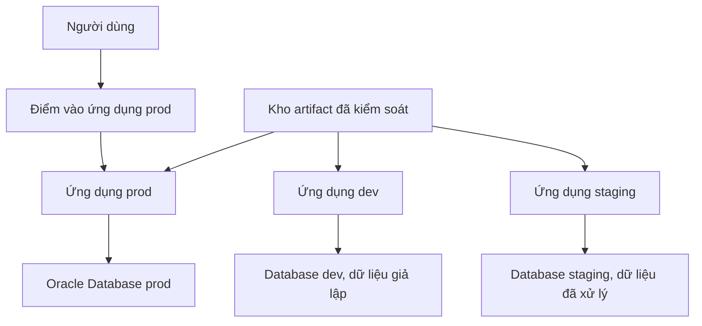

# Phân tách production, staging và development

## Mục tiêu và bối cảnh

Trong chương **Tổ chức tài nguyên và landing zone** của module **CLOUD_PROVIDERS_ORACLE**, phân tách môi trường là bước biến cấu trúc tenancy thành những ranh giới vận hành có thể kiểm chứng. Một lỗi thử nghiệm, một tài khoản developer bị lộ hoặc một tác vụ dọn dữ liệu ở development cần được giới hạn trước khi ảnh hưởng đến production.

Bài này xét một ứng dụng Java chạy trên Oracle Cloud Infrastructure (OCI), sử dụng Compute, Object Storage và cơ sở dữ liệu Oracle. Các lựa chọn dưới đây là thiết kế minh họa; cần điều chỉnh theo yêu cầu của ứng dụng, đội ngũ vận hành và khả năng chi trả.

Sau bài học, bạn có thể:

- Xác định vai trò của development, staging và production.
- Thiết kế cây compartment phù hợp với ranh giới phân quyền.
- Phân biệt cách ly quyền quản trị, mạng, dữ liệu và luồng triển khai.
- Tách danh tính, cấu hình và trạng thái hạ tầng giữa các môi trường.
- Đặt tiêu chí kiểm tra để chứng minh development không được truy cập tài nguyên production ngoài các ngoại lệ đã phê duyệt.

## 1. Ba môi trường phục vụ ba mục đích

| Môi trường | Câu hỏi cần trả lời | Đặc điểm đề xuất |
| --- | --- | --- |
| Development, gọi tắt là dev | Thay đổi mới có hoạt động trong quá trình phát triển không? | Thay đổi thường xuyên, dữ liệu giả lập, có thể tái tạo, hạn mức nhỏ |
| Staging | Bản phát hành này đã sẵn sàng để đưa vào vận hành chưa? | Gần production về kiến trúc và cách triển khai, dữ liệu đã xử lý, thay đổi được kiểm soát |
| Production, gọi tắt là prod | Dịch vụ có đáp ứng người dùng thật một cách an toàn và ổn định không? | Dữ liệu thật, quyền truy cập chặt, có giám sát, sao lưu và quy trình xử lý sự cố |

Staging có thể dùng ít Compute hơn production nếu mục tiêu là kiểm tra cấu hình và quy trình triển khai. Tuy nhiên, kết quả thử tải từ staging quy mô nhỏ không chứng minh được năng lực chịu tải của production. Muốn kiểm tra hiệu năng, cần thiết kế một phép thử có quy mô và điều kiện phù hợp.

Một tổ chức nhỏ có thể bắt đầu với dev và prod. Khi đưa staging vào sử dụng, phải xác định nó kiểm tra điều gì mà dev chưa làm được, chẳng hạn nâng cấp schema, triển khai không gián đoạn hoặc khôi phục từ bản sao lưu đã xử lý. Nếu staging chỉ là một máy chủ cũ ít được cập nhật, nó dễ tạo cảm giác an toàn sai.

**Nguyên tắc thiết kế:** môi trường được xác định bằng tài nguyên, quyền và quy trình riêng; tên hiển thị hoặc một biến `ENV=prod` chưa đủ tạo ra ranh giới.

## 2. Phân tách cần bao phủ những lớp nào?

Hãy xét sự cố giả định: một ứng dụng dev chứa lỗi khiến nó ghi nhầm vào cơ sở dữ liệu prod. Chỉ chuyển máy dev sang compartment khác chưa giải quyết được sự cố nếu ứng dụng vẫn giữ mật khẩu prod và vẫn kết nối được đến database đó.

| Lớp cần tách | Ranh giới cần thiết kế | Câu hỏi kiểm tra |
| --- | --- | --- |
| Tổ chức tài nguyên | Compartment theo môi trường hoặc tenancy riêng | Tài nguyên này thuộc môi trường nào? |
| IAM quản trị OCI | Group, policy, dynamic group hoặc danh tính triển khai có phạm vi rõ | Ai có thể tạo, sửa, xóa hoặc đọc tài nguyên? |
| Mạng | VCN, subnet, route, security rule và điểm kết nối | Luồng mạng nào thực sự đi qua được? |
| Dữ liệu và thông tin xác thực | Database, bucket, secret, khóa và tài khoản ứng dụng | Dev có thể lấy hoặc sử dụng dữ liệu prod bằng đường nào? |
| Tự động hóa | State, cấu hình, danh tính pipeline và bước phê duyệt riêng | Job dev có thể tác động prod khi cấu hình sai không? |
| Vận hành | Giám sát, khôi phục, chi phí và chủ sở hữu theo môi trường | Ai nhận cảnh báo và ai được xử lý? |

Cần kiểm tra cả **quyền quản trị tài nguyên qua OCI API** và **quyền sử dụng dịch vụ của ứng dụng**. Ví dụ, tài khoản có thể không được liệt kê DB System trong OCI Console nhưng vẫn đăng nhập được database nếu có credential và đường mạng phù hợp. Quyền OCI và quyền bên trong Oracle Database là hai lớp cần quản trị riêng.

## 3. Chọn cây compartment theo ranh giới môi trường

### 3.1. Một thiết kế bắt đầu từ môi trường

Với một nhóm ứng dụng, có thể tổ chức như sau:

```text
Tenancy
├── Platform
│   ├── Security
│   └── SharedServices
├── Production
│   └── Orders
│       ├── Network
│       ├── Application
│       └── Data
├── Staging
│   └── Orders
│       ├── Network
│       ├── Application
│       └── Data
└── Development
    └── Orders
        ├── Network
        ├── Application
        └── Data
```

Đây là một phương án minh họa, không phải cấu trúc bắt buộc của OCI. Nếu chỉ có vài tài nguyên và một nhóm quản trị, có thể bỏ các compartment con `Network`, `Application`, `Data` để giảm gánh nặng quản lý.

Tách theo môi trường ở cấp cao giúp người quản trị nhìn rõ nơi cần áp dụng ranh giới prod. Sau đó chỉ thêm cấp con khi có khác biệt thực tế về người quản lý, policy hoặc cách vận hành. Oracle khuyến nghị phân chia workload production và non-production thành các compartment riêng. [Tham khảo hướng dẫn cách ly tài nguyên của Oracle](https://docs.oracle.com/en/solutions/oci-best-practices/isolate-resources-and-control-access1.html).

Tên compartment nên ổn định. Pipeline dùng OCID để xác định đích triển khai, còn người vận hành dùng tên và tag để đọc hiểu. Không dựa riêng vào một tên có chữ `prod` để quyết định độ tin cậy của tài nguyên.

### 3.2. Tránh đặt prod bên dưới nơi developer được toàn quyền

Giả sử cây compartment là:

```text
Project
├── Development
├── Staging
└── Production
```

Nếu nhóm developer được `manage all-resources` trong `Project`, phạm vi đó bao gồm các compartment con. Việc tạo policy hẹp hơn ở `Production` không tự thu hồi quyền rộng đã được cấp.

Trong OCI, quyền áp dụng xuống compartment con theo cơ chế kế thừa. Vì vậy, cần rà soát policy ở tenancy và toàn bộ cấp cha trước khi kết luận một môi trường đã được cách ly. [Tài liệu Policy Inheritance](https://docs.oracle.com/en-us/iaas/Content/Identity/policieshow/Policy_Inheritance.htm).

Thiết kế ở trên vẫn dùng được nếu quyền ở `Project` chỉ dành cho nhóm nền tảng được tin cậy, còn quyền developer chỉ trỏ vào `Development`. Vấn đề nằm ở phạm vi quyền thực tế, không nằm riêng ở hình dạng cây.

### 3.3. Khi nào cân nhắc tenancy riêng?

| Phương án | Phù hợp khi | Chi phí quản trị cần chấp nhận |
| --- | --- | --- |
| Một tenancy, nhiều compartment | Có quản trị IAM tập trung và muốn dùng chung một phần nền tảng | Phải kiểm soát quyền tenancy, kế thừa và các phụ thuộc dùng chung |
| Tenancy prod riêng với non-prod | Cần ranh giới quản trị mạnh hơn hoặc muốn giảm quyền lực chung giữa hai khu vực | Quản lý danh tính, kết nối, phân phối artifact và giám sát qua nhiều tenancy |
| Tenancy riêng theo đơn vị, sau đó tách môi trường | Các đơn vị có chủ sở hữu và chính sách vận hành khác nhau | Dễ phát sinh nhiều cấu hình và quy trình cần đồng bộ |

Policy không kế thừa từ tenancy này sang tenancy khác; tuy vậy, các quyền truy cập liên tenancy được cấu hình có chủ đích vẫn cần kiểm soát. Oracle xem tenancy là ranh giới bảo mật cao nhất trong cấu trúc quản trị OCI. [Tham khảo IAM Security Structure](https://docs.oracle.com/en-us/iaas/Content/cloud-adoption-framework/iam-security-structure.htm).

Tenancy riêng không tự ngăn việc dùng chung mật khẩu, gửi dữ liệu sai đích hoặc cấu hình kết nối mạng quá rộng. Nó bổ sung một ranh giới quản trị; các lớp còn lại vẫn phải được thiết kế.

## 4. Thiết kế IAM theo người dùng và danh tính máy

### 4.1. Bắt đầu từ ma trận trách nhiệm

Một ma trận cho ứng dụng Orders có thể là:

| Vai trò | Development | Staging | Production |
| --- | --- | --- | --- |
| Developer | Quản lý các thành phần ứng dụng được giao | Xem thông tin cần cho kiểm thử | Không có quyền sửa trực tiếp thường trực |
| Nhóm kiểm thử | Dùng dữ liệu thử và công cụ kiểm thử | Chạy nghiệm thu theo phạm vi được giao | Không quản trị hạ tầng |
| Pipeline dev | Triển khai dev | Không có quyền triển khai | Không có quyền triển khai |
| Pipeline staging | Không cần quyền sửa | Triển khai staging | Không có quyền triển khai |
| Pipeline prod | Không cần quyền sửa | Có thể đọc kết quả nghiệm thu qua kênh được phép | Triển khai phạm vi ứng dụng sau phê duyệt |
| Vận hành production | Theo nhiệm vụ được giao | Theo nhiệm vụ được giao | Vận hành và xử lý sự cố |
| Quản trị nền tảng | Theo trách nhiệm nền tảng | Theo trách nhiệm nền tảng | Quyền nhạy cảm được kiểm soát và ghi nhận |

Ma trận mô tả ý định. Cần chuyển từng ô thành policy, quyền hệ điều hành, quyền database và quyền trong công cụ CI/CD tương ứng.

Không dùng một credential quản trị tenancy cho tất cả pipeline. Với workload dùng instance principal hoặc resource principal, cũng phải giới hạn phạm vi policy; việc không lưu API key không đồng nghĩa danh tính đó có quyền nhỏ.

### 4.2. Ví dụ policy giới hạn phạm vi

Ví dụ dưới đây minh họa phần quyền quản lý Compute của hai danh tính khác nhau. Thay các placeholder bằng OCID thật trước khi sử dụng:

```text
Allow group id <DEV_GROUP_OCID> to manage instance-family in compartment id <DEV_APPLICATION_COMPARTMENT_OCID>

Allow group id <PROD_OPERATOR_GROUP_OCID> to manage instance-family in compartment id <PROD_APPLICATION_COMPARTMENT_OCID>
```

Cú pháp `group id` và `compartment id` giúp chỉ rõ chủ thể và vị trí. `instance-family` là một nhóm loại tài nguyên, không có nghĩa chỉ được thao tác một máy duy nhất. [Tham khảo Policy Syntax](https://docs.oracle.com/en-us/iaas/Content/Identity/Concepts/policysyntax.htm).

Hai dòng này **chưa phải bộ quyền triển khai Compute hoàn chỉnh**. Việc khởi tạo instance còn phụ thuộc vào quyền dùng subnet, image, volume và các tài nguyên liên quan. Với thiết kế tách Network khỏi Application, phải cấp quyền phụ thuộc vào đúng tài nguyên mạng của môi trường tương ứng.

Để hoàn thiện bộ quyền, hãy liệt kê những thao tác pipeline thực sự cần rồi cấp theo loại tài nguyên và vị trí thích hợp. Tránh giải quyết lỗi thiếu quyền bằng cách thêm `manage all-resources in tenancy`.

### 4.3. Kiểm tra các đường mở rộng quyền

Một developer được giới hạn ở dev vẫn có thể tạo rủi ro nếu đồng thời được:

- Thay đổi policy áp dụng cho prod.
- Sửa thành viên nhóm vận hành prod.
- Sửa quy tắc dynamic group để máy dev trở thành thành viên nhóm có quyền prod.
- Lấy secret hoặc sử dụng khóa bảo vệ dữ liệu prod.
- Sửa danh tính, script hoặc cấu hình của pipeline prod.
- Di chuyển tài nguyên hoặc compartment làm thay đổi phạm vi quản trị.

Khi đánh giá quyền, phải xét tổng quyền từ mọi nhóm và mọi policy liên quan. Một tài khoản thử nghiệm có thêm quyền quản trị nền tảng không phù hợp để chứng minh rằng developer chỉ truy cập được dev.

Quy trình truy cập khẩn cấp vào prod nên có người chịu trách nhiệm, lý do, thời gian hiệu lực và bước kiểm tra sau sử dụng. Không biến quyền khẩn cấp thành credential dùng hàng ngày.

## 5. Tách mạng bằng VCN và kiểm soát luồng

Compartment tổ chức tài nguyên và phạm vi quyền quản trị. VCN và cấu hình kết nối mới quyết định phần lớn ranh giới mạng của workload; không nên xem compartment là một firewall. [Tham khảo Access Control của Networking](https://docs.oracle.com/en-us/iaas/Content/Network/Concepts/accesscontrol.htm).

### 5.1. Một VCN cho mỗi môi trường

Với ứng dụng Orders, có thể quy hoạch địa chỉ giả định:

| Môi trường | CIDR VCN minh họa | Thành phần |
| --- | --- | --- |
| Dev | `10.10.0.0/16` | Subnet ứng dụng và dữ liệu dev |
| Staging | `10.20.0.0/16` | Subnet ứng dụng và dữ liệu staging |
| Prod | `10.30.0.0/16` | Các subnet phục vụ truy cập, ứng dụng và dữ liệu prod |

Các dải địa chỉ phải được kiểm tra với mạng doanh nghiệp, VPN và kế hoạch kết nối tương lai. CIDR khác nhau giúp tránh xung đột khi cần kết nối; bản thân việc khác CIDR không tạo ra chính sách cấm truy cập.



Sơ đồ mô tả các luồng mong muốn. Việc không vẽ một đường từ dev đến prod không phải bằng chứng rằng đường mạng đó đã bị chặn.

### 5.2. Viết yêu cầu mạng thành các luồng cụ thể

Ví dụ cho prod:

- Người dùng vào điểm tiếp nhận HTTPS của ứng dụng theo thiết kế.
- Chỉ tầng ứng dụng prod được kết nối cổng dịch vụ database prod.
- Truy cập quản trị đi qua kênh được phê duyệt, có danh tính và thời hạn.
- Dev và staging không có nhu cầu kết nối trực tiếp đến database prod.
- Kết nối đến dịch vụ dùng chung được giới hạn theo đúng nhu cầu, không mở toàn bộ giữa các VCN.

Khi triển khai, cần kiểm tra route table, kết nối qua DRG hoặc peering, security list, NSG, firewall và đường trả về. Cũng phải xem các endpoint công khai: dev có thể đi ra Internet rồi gọi endpoint prod dù không có kết nối riêng giữa hai VCN.

Security list và NSG đều tham gia cho phép lưu lượng. Không giả định một NSG hẹp sẽ phủ định rule rộng ở lớp khác; cần kiểm tra toàn bộ rule áp dụng, cùng cơ chế bảo vệ bổ sung nếu hệ thống có sử dụng. [Tham khảo Security Rules](https://docs.oracle.com/en-us/iaas/Content/Network/Concepts/securityrules.htm).

### 5.3. Chia sẻ dịch vụ có chọn lọc

Kho artifact, hệ thống thu thập log hoặc DNS có thể được quản trị tập trung. Với mỗi dịch vụ dùng chung, cần mô tả:

1. Ai được ghi hoặc thay đổi cấu hình.
2. Môi trường nào được đọc phần dữ liệu nào.
3. Sự cố của dịch vụ đó ảnh hưởng đến những môi trường nào.
4. Credential hoặc kết nối dùng chung có mở đường vào prod không.

Ví dụ, dev có thể tải artifact đã công bố nhưng không được ghi đè artifact mà pipeline prod sẽ sử dụng. Một kho dùng chung với quyền ghi quá rộng có thể phá vỡ ranh giới triển khai dù các Compute đã nằm trong VCN riêng.

## 6. Tách dữ liệu, secret và cơ sở dữ liệu Oracle

### 6.1. Không dùng database prod làm dữ liệu thử nghiệm trực tiếp

Với ứng dụng Orders, nên chọn mức tách phù hợp cho database và tài khoản ứng dụng:

| Thành phần | Dev | Staging | Prod |
| --- | --- | --- | --- |
| Dữ liệu | Sinh giả lập, có thể reset | Bộ dữ liệu đại diện đã xử lý | Dữ liệu vận hành thật |
| Tài khoản ứng dụng | Tài khoản riêng dev | Tài khoản riêng staging | Tài khoản riêng prod |
| Endpoint | Đích dev được cấu hình riêng | Đích staging được cấu hình riêng | Đích prod được kiểm soát |
| Secret | Giá trị dành cho dev | Giá trị dành cho staging | Giá trị dành cho prod |
| Sao lưu | Theo nhu cầu phát triển | Phục vụ diễn tập kiểm thử | Theo mục tiêu khôi phục của dịch vụ |

Database có thể dùng Oracle Base Database Service, Autonomous Database hoặc phương án khác tùy ứng dụng. Dù dùng dịch vụ nào, hãy phân biệt quyền quản lý tài nguyên OCI với quyền đăng nhập và quyền trên schema.

Nếu nhiều môi trường dùng các schema trong cùng một database, chúng vẫn chia sẻ những thành phần như năng lực xử lý và phạm vi quản trị database. Thiết kế này có thể tiết kiệm chi phí cho một số nhu cầu, nhưng phải ghi rõ mức chia sẻ và ảnh hưởng khi có sự cố. Nó không tương đương với database độc lập.

### 6.2. Quy trình đưa dữ liệu đại diện sang staging

Không cấp cho developer quyền tải bản sao lưu prod để tự xử lý. Một luồng được kiểm soát có thể là:

```text
Nguồn production
    -> Tác vụ trích xuất được cấp quyền riêng
    -> Vùng xử lý hạn chế truy cập
    -> Ẩn danh hoặc thay thế dữ liệu nhạy cảm
    -> Kiểm tra kết quả và dữ liệu còn sót
    -> Bộ dữ liệu được phê duyệt cho staging
```

Cần xử lý cả thông tin trong trường tự do, tài liệu đính kèm, file export và log. Xóa tên trong một bảng chưa đủ nếu email, số điện thoại hoặc token vẫn tồn tại ở nơi khác.

Vùng xử lý tạm và bản export trung gian cũng là dữ liệu cần bảo vệ. Quy định người được truy cập, thời gian lưu và cách dọn dẹp chúng sau khi hoàn tất.

### 6.3. Secret riêng nhưng cấu hình ứng dụng cũng phải đúng

Một cấu hình minh họa cho staging:

```properties
app.environment=staging
app.database.endpoint=<STAGING_DATABASE_ENDPOINT>
app.database.secret-reference=<STAGING_DATABASE_SECRET_REFERENCE>
app.storage.bucket=orders-staging-documents
app.external.payment-mode=sandbox
app.notifications.delivery-mode=test-sink
```

Đây là hợp đồng cấu hình minh họa, không phải các thuộc tính chuẩn của mọi ứng dụng Java hay một framework cụ thể.

Secret reference phải trỏ đến bí mật của đúng môi trường, được lấy bằng danh tính được cấp quyền tương ứng. Không đưa mật khẩu vào Git, file cấu hình mẫu hoặc output pipeline.

Với hệ thống đặt hàng, cần tách thêm cổng thanh toán, email, SMS và webhook. Một bản staging có database riêng vẫn có thể gây tác động thật nếu gửi thông báo đến khách hàng hoặc dùng credential thanh toán prod.

## 7. Tự động hóa và đưa cùng bản phát hành qua các môi trường

### 7.1. Dùng chung cách dựng hạ tầng, tách đích và trạng thái

Với Terraform hoặc OCI Resource Manager, có thể dùng chung module hạ tầng và tách các tham số:

```text
Module hạ tầng dùng chung
├── dev: compartment, subnet, kích thước, secret reference riêng
├── staging: compartment, subnet, kích thước, secret reference riêng
└── prod: compartment, subnet, kích thước, secret reference riêng
```

Mỗi môi trường cần phạm vi state và quyền truy cập state riêng theo thiết kế. Chỉ tách file biến trong khi vẫn dùng nhầm cùng state hoặc cùng danh tính quản trị rộng có thể khiến job dev tác động prod.

State có thể chứa thông tin nhạy cảm. Tách tên file không đủ; cần kiểm soát quyền đọc, ghi, khóa đồng thời và cơ chế khôi phục phù hợp với backend đang sử dụng.

Trước khi áp dụng thay đổi, pipeline nên kiểm tra một bộ giá trị đích đã phê duyệt:

```text
environment = staging
tenancy_ocid = <EXPECTED_TENANCY_OCID>
compartment_ocid = <EXPECTED_STAGING_COMPARTMENT_OCID>
region = <EXPECTED_REGION>
deployment_identity = <EXPECTED_STAGING_IDENTITY>
state_or_stack = <EXPECTED_STAGING_STATE_OR_STACK>
```

Nếu một giá trị không khớp, dừng trước bước thay đổi tài nguyên. Khi lập kế hoạch, hiển thị rõ môi trường, đích triển khai và các thao tác xóa hoặc thay thế để người duyệt đánh giá.

### 7.2. Chuyển phiên bản phần mềm, không chuyển máy dev thành máy prod

Luồng phát hành đề xuất:

1. Build artifact từ một phiên bản mã nguồn xác định.
2. Chạy kiểm thử tự động và lưu định danh artifact.
3. Triển khai artifact đó vào dev để kiểm tra tích hợp.
4. Triển khai cùng artifact vào staging với cấu hình staging.
5. Nghiệm thu, kiểm tra migration và chuẩn bị khôi phục.
6. Phê duyệt rồi triển khai đúng artifact đã nghiệm thu vào prod.
7. Theo dõi sau triển khai và thực hiện phương án xử lý nếu vượt ngưỡng chấp nhận.

Không build lại tùy ý ở bước prod vì đầu ra có thể khác bản đã được nghiệm thu. Cấu hình thay đổi theo môi trường, còn nội dung bản phát hành cần có định danh kiểm chứng được.

Tương tự, không xem việc chuyển một Compute instance sang compartment prod là quy trình phát hành hoàn chỉnh. Máy đó có thể vẫn giữ credential, dữ liệu và cấu hình phát triển.

### 7.3. Migration database cần phương án riêng

Đối với ứng dụng Java dùng Oracle Database, kiểm tra trên staging ít nhất:

- Schema hiện tại có đúng phiên bản dự kiến không.
- Migration có tương thích với phiên bản ứng dụng đang chạy không.
- Có khóa bảng hoặc tăng tải gây gián đoạn không.
- Khi ứng dụng mới thất bại, có thể quay lại ứng dụng cũ với schema mới không.
- Nếu phải phục hồi dữ liệu, chấp nhận mất bao nhiêu dữ liệu và mất bao lâu.

Quay lại artifact ứng dụng không đồng nghĩa đã hoàn tác migration. Cần xác định trước migration có thể đảo ngược, phải sửa tiến lên hay cần khôi phục từ bản sao lưu.

## 8. Vận hành, tính sẵn sàng và chi phí theo môi trường

### 8.1. Đặt mục tiêu khôi phục rõ ràng

Production cần mục tiêu thời gian phục hồi, gọi là RTO, và mức mất dữ liệu chấp nhận được, gọi là RPO. Chọn backup, dự phòng và kiến trúc sẵn sàng dựa trên mục tiêu đó.

Staging nên có khả năng diễn tập quy trình khôi phục cần dùng ở prod. Dev ưu tiên tái tạo từ mã nguồn và dữ liệu giả lập. Việc có ba môi trường không tự làm production có tính sẵn sàng cao; các môi trường có thể vẫn phụ thuộc vào cùng một đường kết nối hoặc dịch vụ nền tảng.

Cảnh báo prod cần đến đúng người trực vận hành. Log tập trung nên giữ nhãn môi trường và quyền đọc phù hợp để người làm dev không mặc nhiên đọc log chứa dữ liệu prod. Không ghi secret hoặc nội dung nhạy cảm vào log.

### 8.2. Budget và quota giải quyết hai vấn đề khác nhau

| Công cụ | Dùng để làm gì | Giới hạn cần hiểu |
| --- | --- | --- |
| Budget | Theo dõi chi phí và phát cảnh báo theo cấu hình | Là giới hạn mềm, không tự ngắt chi tiêu |
| Compartment quota | Giới hạn mức sử dụng loại tài nguyên trong phạm vi được hỗ trợ | Không thay thế quyền IAM hoặc mọi biện pháp quản lý chi phí |
| Service limit | Giới hạn dịch vụ áp dụng cho tenancy và phạm vi dịch vụ tương ứng | Có thể ảnh hưởng nhiều môi trường dùng chung phạm vi giới hạn |
| Tag | Nhận diện môi trường, chủ sở hữu và mục đích sử dụng | Không tự tạo một ranh giới truy cập |

Oracle mô tả budget là giới hạn mềm cho chi tiêu hạ tầng. Cần có người nhận và xử lý cảnh báo; không mặc định hệ thống sẽ dừng tài nguyên khi vượt budget. [Tham khảo Creating a Budget](https://docs.oracle.com/en-us/iaas/Content/Billing/Tasks/create-budget.htm).

Quota do quản trị viên đặt để kiểm soát mức tiêu thụ compartment; service limit vẫn được áp dụng dù quota được đặt cao hơn. Quota là giới hạn sử dụng, không phải cam kết giữ sẵn năng lực Compute cho prod. [Tham khảo Quota Policy Syntax](https://docs.oracle.com/en-us/iaas/Content/Quotas/Concepts/quota_policy_syntax.htm).

Với dev, có thể đề xuất lịch dừng tài nguyên, thời hạn tồn tại và hạn mức nhỏ. Chỉ áp dụng lịch dừng khi chủ sở hữu đã xác nhận các tác vụ cần chạy liên tục. Dừng Compute cũng không đồng nghĩa mọi chi phí lưu trữ hoặc dịch vụ liên quan đều biến mất.

Một bộ tag nội bộ minh họa:

```text
Environment = dev | staging | prod
Application = orders
Owner = orders-platform
CostCenter = engineering
ExpiresAt = <thời hạn nếu tài nguyên có vòng đời tạm>
```

Các tag trên là quy ước thiết kế. Nếu muốn tự động dọn tài nguyên theo thời hạn, phải xây dựng quy trình riêng, kiểm tra đúng môi trường và có cơ chế loại trừ tài nguyên cần giữ.

## 9. Bài thực hành: thiết kế và kiểm chứng ranh giới Orders

### 9.1. Điều kiện và phạm vi

Thực hiện trong tenancy thực hành đã được phép sử dụng. Không cần dùng dữ liệu thật hoặc triển khai production thật để học cách phân tách. Các tên prod trong bài thực hành có thể chỉ là tài nguyên mô phỏng.

Chuẩn bị:

- OCI CLI đã cấu hình với những danh tính kiểm thử riêng.
- Một người quản trị được phép tạo compartment và policy thực hành.
- Region mục tiêu được xác định.
- Tài nguyên nhỏ hoặc tài nguyên có sẵn được chủ sở hữu cho phép dùng để kiểm tra.
- Kế hoạch dọn dẹp tài nguyên thực hành sau khi hoàn tất.

### 9.2. Trình tự thực hiện

**Bước 1 — Vẽ ranh giới.** Chọn cây compartment đơn giản, ghi OCID của từng môi trường và liệt kê tài nguyên thuộc mỗi nơi. Chỉ thêm compartment con khi có lý do phân quyền cụ thể.

**Bước 2 — Lập ma trận quyền.** Tạo danh tính kiểm thử developer, staging deployment và prod operator. Ghi quyền mong muốn trước khi viết policy. Danh tính developer không được đồng thời nằm trong nhóm quản trị tenancy.

**Bước 3 — Thiết kế mạng và dữ liệu.** Đặt VCN và database thử nghiệm theo môi trường, xác định rõ các luồng được phép. Dùng bộ dữ liệu giả lập và credential riêng.

**Bước 4 — Tách tự động hóa.** Định nghĩa đích triển khai và state hoặc stack riêng. Thêm kiểm tra môi trường trước khi áp dụng bất kỳ thay đổi nào.

**Bước 5 — Kiểm tra quyền được phép và quyền phải bị từ chối.** Dùng cùng loại thao tác, đúng region và tài nguyên có tồn tại để tránh kết luận sai.

Ví dụ lệnh PowerShell chỉ đọc để kiểm tra quyền liệt kê Compute bằng một profile dành cho developer:

```powershell
$devCompartmentOcid = '<DEV_APPLICATION_COMPARTMENT_OCID>'
$prodCompartmentOcid = '<PROD_APPLICATION_COMPARTMENT_OCID>'
$targetRegion = '<OCI_REGION>'

oci compute instance list --profile DEV_TEST --region $targetRegion --compartment-id $devCompartmentOcid --all
oci compute instance list --profile DEV_TEST --region $targetRegion --compartment-id $prodCompartmentOcid --all
```

Thay placeholder bằng giá trị thực hành. Tên profile chỉ là nhãn trong cấu hình CLI; cần xác minh profile đó thực sự đại diện cho danh tính nào.

Nếu ma trận cho phép developer liệt kê instance dev nhưng không cho liệt kê instance prod, lệnh đầu phải thành công và lệnh sau phải bị từ chối. Không dùng thao tác xóa hoặc sửa tài nguyên prod để thử ranh giới.

Một danh sách rỗng chưa chứng minh quyền bị từ chối: có thể compartment không có instance hoặc đang kiểm tra sai region. Lỗi `NotAuthorizedOrNotFound` cũng chưa đủ để kết luận nguyên nhân là IAM. Người quản trị cần xác nhận đích có tồn tại, region đúng và cùng thao tác đó thành công với danh tính đối chứng có quyền phù hợp.

### 9.3. Ma trận kiểm chứng

| Phép kiểm tra | Kết quả mong muốn | Bằng chứng cần ghi |
| --- | --- | --- |
| Developer liệt kê Compute dev | Thành công nếu đúng ma trận | Danh tính, region, compartment và kết quả API |
| Developer liệt kê Compute prod | Bị từ chối nếu không được cấp quyền đọc | Đích hợp lệ và kết quả đối chứng |
| Workload dev đọc secret prod | Bị từ chối | Đúng secret thử nghiệm và đúng danh tính workload |
| Ứng dụng dev kết nối database prod mô phỏng | Không thành công theo thiết kế | Kiểm tra route, rule, endpoint và thử kết nối có kiểm soát |
| Staging dùng dịch vụ thanh toán | Chỉ dùng sandbox | Endpoint và thông tin cấu hình đã loại bỏ secret |
| Pipeline dev nhận cấu hình đích prod | Dừng trước bước áp dụng | Log kiểm tra đích triển khai |
| Artifact được đưa lên staging và prod mô phỏng | Có cùng định danh đã nghiệm thu | Digest hoặc định danh bất biến tương đương |
| Khôi phục dữ liệu staging | Đáp ứng mục tiêu thử nghiệm đã đặt | Thời gian thực hiện và kiểm tra dữ liệu sau khôi phục |

Với phép thử secret, chỉ cần ghi nhận kết quả cho phép hoặc từ chối; không lưu giá trị bí mật vào biên bản. Với phép thử mạng, sử dụng tài nguyên mô phỏng và endpoint đã được cho phép kiểm tra.

Các phép thử trên kiểm tra những đường truy cập cụ thể. Muốn kết luận toàn bộ ranh giới đạt yêu cầu, vẫn phải đối chiếu cây compartment, policy kế thừa, cấu hình mạng, quyền database và quyền trong pipeline.

**Bước 6 — Hoàn tất hồ sơ vận hành.** Ghi người sở hữu từng môi trường, cách truy cập khẩn cấp, nơi nhận cảnh báo, ngân sách dự kiến và các phụ thuộc dùng chung. Sau thực hành, dọn tài nguyên theo đúng danh sách đã phê duyệt.

## 10. Những sai lầm cần nhận diện

| Sai lầm | Hậu quả | Điều chỉnh |
| --- | --- | --- |
| Chỉ thêm hậu tố `-dev`, `-prod` | Tên khác nhưng vẫn dùng chung quyền và dữ liệu | Thiết kế và kiểm tra từng lớp ranh giới |
| Cấp developer quyền rộng ở cấp cha | Quyền có thể bao phủ prod bên dưới | Thu hẹp vị trí và loại tài nguyên được cấp |
| Dùng một API key cho mọi pipeline | Một job bị xâm nhập có thể ảnh hưởng nhiều môi trường | Danh tính và phạm vi quyền riêng |
| Dev, staging và prod dùng chung credential database | Lỗi cấu hình dễ biến thành ghi nhầm dữ liệu | Tách tài khoản, secret và endpoint |
| Staging gửi email hoặc thanh toán thật | Kiểm thử gây tác động bên ngoài | Tách tích hợp và kiểm tra cấu hình trước chạy |
| Cho rằng NSG hẹp sẽ vô hiệu hóa mọi rule rộng | Có thể vẫn tồn tại luồng truy cập ngoài ý muốn | Rà soát toàn bộ rule và đường mạng |
| Dùng chung state rồi chỉ đổi biến môi trường | Thay đổi có thể nhắm nhầm tài nguyên | Tách state, quyền và kiểm tra đích |
| Xem budget là trần chi tiêu tự động | Chi phí có thể tiếp tục tăng sau cảnh báo | Kết hợp cảnh báo, quota và quy trình xử lý |
| Tạo staging nhưng không cập nhật cùng kiến trúc | Kết quả nghiệm thu thiếu độ tin cậy | Ghi nhận khác biệt và duy trì khả năng tái tạo |

## 11. Câu hỏi tự kiểm tra

1. Trong cây compartment hiện tại, policy cấp cha nào có thể cấp quyền vào production?
2. Nếu credential của ứng dụng dev bị lộ, kẻ có credential đó có thể đọc dữ liệu prod theo những đường nào?
3. Nếu không có peering giữa VCN dev và prod, endpoint công khai của prod có còn truy cập được từ dev không?
4. Pipeline prod có thể dùng credential hoặc state của dev do cấu hình nhầm không?
5. Staging giống prod ở những điểm cần kiểm tra nào, và khác ở những điểm nào?
6. Khi budget dev vượt ngưỡng, ai xử lý và bằng cơ chế gì?
7. Nếu migration database đã chạy, quay lại artifact ứng dụng cũ có an toàn không?
8. Bằng chứng nào cho thấy một phép thử bị từ chối vì đúng ranh giới quyền, thay vì sai region hoặc sai OCID?

Một thiết kế phân tách môi trường có giá trị khi bạn trả lời được các câu hỏi này bằng cấu hình cụ thể và bằng chứng kiểm tra. Cây compartment là điểm bắt đầu; IAM, mạng, dữ liệu, tự động hóa và vận hành cùng quyết định ranh giới thực tế.