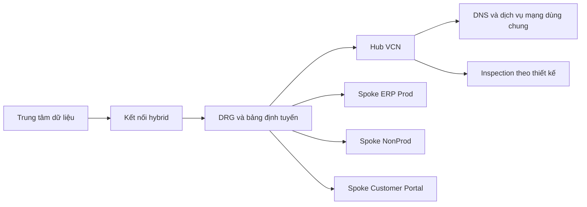

# Thiết kế landing zone OCI cho doanh nghiệp

Trong chương **Tổ chức tài nguyên và landing zone** của module **CLOUD_PROVIDERS_ORACLE**, landing zone là nền tảng để các nhóm đưa workload lên Oracle Cloud Infrastructure theo một cách thống nhất. Nền tảng này kết nối mô hình tenancy, compartment và IAM với mạng VCN, bảo vệ dữ liệu, giám sát, tự động hóa và kiểm soát chi phí.

Một thiết kế hữu ích phải trả lời được: ai được triển khai, triển khai ở đâu, được kết nối tới đâu, ai nhận cảnh báo và ai chịu trách nhiệm khi có sự cố. Những câu trả lời cần được thể hiện bằng cấu hình có thể triển khai, kiểm chứng và duy trì qua nhiều phiên bản.

## Mục tiêu học tập

Sau bài học, bạn có thể:

- Chuyển yêu cầu doanh nghiệp thành các quyết định thiết kế landing zone OCI.
- Lựa chọn ranh giới tenancy, compartment, identity domain và VCN phù hợp.
- Phân công quyền quản trị giữa nhóm nền tảng, bảo mật, mạng, ứng dụng và cơ sở dữ liệu.
- Thiết kế cách tiếp nhận workload, ghi nhận chi phí, giám sát và phục hồi.
- Xác định bằng chứng cần có trước khi mở landing zone cho các nhóm sử dụng.

## 1. Phạm vi của một landing zone

### 1.1. Các lớp cần có

Có thể xem landing zone qua sáu lớp liên kết với nhau:

| Lớp | Quyết định cần đưa ra | Kết quả bàn giao |
| --- | --- | --- |
| Danh tính và tổ chức | Ranh giới quản trị; ai được làm gì | Cây compartment, nhóm, policy và cơ chế đăng nhập |
| Kết nối | Địa chỉ mạng, luồng dữ liệu, kết nối hybrid | VCN, subnet, route, NSG và phương án DNS |
| Bảo vệ | Cách ngăn cấu hình rủi ro và bảo vệ bí mật | Bộ kiểm soát, quản lý khóa, đường quản trị |
| Quan sát và vận hành | Phát hiện, tiếp nhận và xử lý sự cố | Log, metric, alarm, đầu mối trực và runbook |
| Quản trị chi phí | Ai sở hữu chi phí và giới hạn sử dụng | Tags, budgets, quotas và báo cáo phân bổ |
| Tự động hóa | Tái tạo, thay đổi và nâng cấp nền tảng | Mã IaC, trạng thái triển khai và quy trình phát hành |

Oracle cung cấp landing zone dựa trên Terraform và các module cho những lớp nền tảng này. Có thể triển khai từ blueprint rồi điều chỉnh theo nhu cầu. Xem [Landing Zones Overview](https://docs.oracle.com/en-us/iaas/Content/cloud-adoption-framework/oci-landing-zones-overview.htm).

### 1.2. Chọn blueprint làm điểm xuất phát

**OCI Core Landing Zone** hợp nhất các hướng tiếp cận Oracle Enterprise Landing Zone và CIS Landing Zone, sử dụng framework theo module. Đây là điểm tham khảo phù hợp khi thiết kế nền tảng OCI cho doanh nghiệp. Phạm vi và tùy chọn thực tế phải đối chiếu với phiên bản blueprint được chọn. Xem [OCI Core Landing Zone](https://docs.oracle.com/en-us/iaas/Content/cloud-adoption-framework/oci-core-landing-zone.htm).

Khi đánh giá blueprint, lập danh sách ba nhóm:

1. Thành phần phù hợp và sẽ sử dụng theo cấu hình tham chiếu.
2. Thành phần cần tùy chỉnh vì yêu cầu của tổ chức.
3. Thành phần doanh nghiệp phải bổ sung, chẳng hạn tích hợp hệ thống trực sự cố hoặc quy trình cấp quyền nội bộ.

Ghi rõ phiên bản blueprint, phiên bản provider và những thay đổi đã thực hiện. Mức độ phù hợp với một benchmark của mẫu tham chiếu không tự chứng minh toàn bộ hệ thống đáp ứng yêu cầu tuân thủ. Cần đối chiếu cấu hình thực tế, phạm vi workload và bằng chứng vận hành.

## 2. Bắt đầu bằng yêu cầu và giả định

Xét doanh nghiệp giả định **An Phú** với các đặc điểm:

- Có sáu nhóm ứng dụng, một nhóm mạng, một nhóm bảo mật và một nhóm quản trị cơ sở dữ liệu Oracle.
- Hệ thống ERP đang kết nối với trung tâm dữ liệu hiện hữu.
- Cần môi trường production, non-production và sandbox.
- Một số ứng dụng có giao diện công khai; dữ liệu nghiệp vụ và endpoint cơ sở dữ liệu dùng kết nối riêng.
- Nhóm tài chính cần biết chi phí từng ứng dụng và phần chi phí nền tảng dùng chung.
- ERP đặt mục tiêu giả định RTO hai giờ và RPO mười lăm phút.

RTO là thời gian khôi phục mục tiêu; RPO thể hiện mức mất dữ liệu tối đa chấp nhận được tính theo thời gian. Hai giá trị trên là yêu cầu của tình huống, chưa phải kết quả mà kiến trúc đã đạt.

Trước khi vẽ sơ đồ, ghi yêu cầu theo mẫu:

| Nhóm yêu cầu | Câu hỏi cần làm rõ | Ảnh hưởng đến thiết kế |
| --- | --- | --- |
| Phạm vi quản trị | Production có cần quản trị độc lập hoàn toàn không? | Một hoặc nhiều tenancy |
| Dữ liệu | Dữ liệu nào được phép đặt tại các region dự kiến? | Lựa chọn region và sao lưu |
| Kết nối | Nguồn, đích, giao thức và độ trễ cần thiết là gì? | CIDR, hybrid, DNS và inspection |
| Tính sẵn sàng | Chịu được lỗi máy, lỗi vùng triển khai hay lỗi region? | Bố trí tài nguyên và phục hồi |
| Nhân sự | Ai triển khai, ai phê duyệt thay đổi, ai trực sự cố? | Nhóm IAM và phân chia trách nhiệm |
| Tài chính | Phân bổ chi phí theo đơn vị nào? | Compartment, tags và budgets |
| Mở rộng | Bao nhiêu workload và mức tăng trưởng dự kiến? | Dự phòng địa chỉ, quotas và mẫu tiếp nhận |

Chốt những giả định còn chưa được xác minh và người chịu trách nhiệm xác minh. Ví dụ, “đường truyền dự phòng đủ băng thông chạy ERP” phải được kiểm tra bằng đo đạc và diễn tập, không chỉ xuất hiện trong sơ đồ.

## 3. Chọn ranh giới tổ chức và phân quyền

### 3.1. Một tenancy hay nhiều tenancy?

Tenancy là ranh giới quản trị cao nhất trong mô hình IAM OCI. Nhiều tenancy giúp tăng tính tự chủ và cách ly quản trị, đồng thời tăng công việc duy trì danh tính, policy, kết nối và vận hành. Xem [IAM Security Structure](https://docs.oracle.com/en-us/iaas/Content/cloud-adoption-framework/iam-security-structure.htm).

| Phương án | Có thể phù hợp khi | Đánh đổi cần xem xét |
| --- | --- | --- |
| Một tenancy, nhiều compartment | Các nhóm chấp nhận chung quản trị nền tảng | Cần kiểm soát chặt quyền ở cấp cha và tenancy |
| Tách tenancy theo phạm vi quản trị | Cần tự chủ hoặc ranh giới tổ chức mạnh hơn | Phải duy trì baseline và tích hợp ở nhiều nơi |
| Nhiều tenancy trong một tổ chức OCI | Có nhu cầu quản lý một tập tenancy theo mô hình tổ chức | Phải làm rõ quyền quản trị, chính sách chia sẻ và báo cáo |

Với An Phú, giả định hội đồng kiến trúc chấp nhận một tenancy và phân tách production bằng compartment cùng mạng riêng. Quyết định này cần được đánh giá lại nếu tổ chức yêu cầu một nhóm quản trị production hoàn toàn độc lập.

### 3.2. Cây compartment theo trách nhiệm và vòng đời

Một cấu trúc minh họa:

```text
Tenancy / Root
└── Enterprise
    ├── Platform
    │   ├── Network
    │   ├── Security
    │   └── Operations
    ├── Workloads
    │   ├── ERP
    │   │   ├── Prod
    │   │   │   ├── App
    │   │   │   └── Data
    │   │   └── NonProd
    │   └── CustomerPortal
    │       ├── Prod
    │       └── NonProd
    └── Sandbox
```

Trong ví dụ này:

- `Network` chứa tài nguyên mạng do nhóm nền tảng quản lý.
- `Security` chứa các tài nguyên bảo mật dùng chung theo phạm vi dịch vụ hỗ trợ.
- `Operations` chứa tài nguyên phục vụ giám sát và vận hành được bố trí tại đây.
- Nhánh workload phân tách quyền sở hữu, môi trường và dữ liệu khi cần.
- `Sandbox` có giới hạn sử dụng, thời hạn và quy trình dọn tài nguyên riêng.

Cây này là phương án thiết kế của tình huống, không phải cấu trúc bắt buộc của blueprint. Một số tài nguyên có phạm vi tenancy hoặc yêu cầu vị trí riêng; phải lập bản đồ tài nguyên thực tế thay vì cố đưa tất cả vào các nhánh trên.

Compartment tồn tại xuyên các region mà tenancy đăng ký. Quyền cấp ở các cấp cha có thể được kế thừa xuống dưới. Vì vậy, tạo một nhánh `Prod` không tự loại bỏ quyền quá rộng đã cấp ở cấp trên. Xem [Managing Compartments](https://docs.oracle.com/en-us/iaas/Content/Identity/Tasks/managingcompartments.htm).

Cần phân biệt các ranh giới:

| Thành phần | Vai trò trong thiết kế |
| --- | --- |
| Tenancy | Quản trị tài nguyên và IAM ở phạm vi cao nhất |
| Identity domain | Tổ chức danh tính và cấu hình quản lý danh tính |
| Compartment | Tổ chức tài nguyên, quyền và quản trị sử dụng |
| VCN và các kiểm soát mạng | Quy định đường truyền và phạm vi kết nối |

Để kiểm chứng production được cách ly, phải thử cả quyền API lẫn kết nối mạng. Một máy ở compartment khác vẫn có thể kết nối tới production nếu đường mạng và các lớp bảo vệ cho phép.

### 3.3. Ma trận trách nhiệm

| Nhóm | Quyền cần thiết trong tình huống | Giới hạn thiết kế |
| --- | --- | --- |
| Nhóm nền tảng | Quản lý baseline và tiếp nhận workload | Thay đổi nền tảng chung theo quy trình phát hành |
| Nhóm mạng | Quản lý mạng, route và kết nối hybrid | Không mặc định có quyền đọc dữ liệu ứng dụng |
| Nhóm bảo mật | Quản lý kiểm soát, phát hiện và điều tra | Quyền thay cấu hình khác với quyền đọc dữ liệu nghiệp vụ |
| Nhóm ứng dụng ERP | Triển khai thành phần ứng dụng trong phạm vi được cấp | Không tự mở kết nối tới workload khác |
| Nhóm DBA | Quản trị dịch vụ cơ sở dữ liệu cần thiết | Phân biệt quyền dịch vụ OCI với quyền bên trong database |
| Nhóm tài chính | Đọc chi phí và quản lý ngân sách theo phân công | Không cần quyền thay đổi Compute hoặc mạng |
| Pipeline IaC | Thực hiện thay đổi đã được duyệt trong phạm vi cụ thể | Credential và quyền gắn với tác vụ, môi trường |

Thiết kế đăng nhập tập trung với IdP của doanh nghiệp khi phù hợp, MFA cho truy cập quản trị và quy trình cấp/thu hồi quyền theo nhân sự. Có tài khoản truy cập khẩn cấp được bảo vệ, kiểm tra định kỳ và theo dõi việc sử dụng. Đối với workload, đánh giá instance principal hoặc resource principal khi dịch vụ hỗ trợ để giảm việc phân phối khóa lâu dài.

Quyền triển khai bootstrap và quyền vận hành thường ngày cần được ghi riêng. Kết thúc bootstrap phải kiểm tra lại các quyền rộng tạm thời, chủ sở hữu pipeline và quyền thay đổi IAM.

## 4. Thiết kế mạng cho tăng trưởng và cách ly

### 4.1. Lập kế hoạch địa chỉ trước khi tạo VCN

Bảng địa chỉ minh họa cho region chính:

| Miền mạng | CIDR ví dụ | Mục đích |
| --- | --- | --- |
| Hub | `10.80.0.0/20` | Kết nối dùng chung và thành phần inspection nếu được chọn |
| ERP production | `10.80.32.0/20` | Các subnet của ERP production |
| ERP non-production | `10.80.48.0/20` | Phát triển và kiểm thử ERP |
| Customer Portal production | `10.80.64.0/20` | Ứng dụng cổng khách hàng |
| Dự phòng mở rộng | Phần còn lại đã được IPAM phân bổ | Workload và subnet tương lai |

Đây chỉ là dải địa chỉ ví dụ. Trước khi dùng, đối chiếu với on-premises, các cloud khác, mạng đối tác và kế hoạch region phục hồi. Kích thước subnet phải tính số địa chỉ cần cho mở rộng, cập nhật cuốn chiếu và loại dịch vụ dự kiến.

### 4.2. Kiến trúc hub-and-spoke minh họa



Sơ đồ thể hiện quan hệ kết nối dự kiến; các mũi tên không có nghĩa mọi luồng đều được phép. DRG là router ảo; route table và route distribution quyết định đường giữa các attachment. Muốn kiểm soát kết nối phải kiểm tra cả bảng định tuyến tương ứng và các lớp bảo vệ mạng. Xem [Dynamic Routing Gateways](https://docs.oracle.com/en-us/iaas/Content/Network/Tasks/managingDRGs.htm).

Có hub VCN hoặc firewall trong hub chưa chứng minh traffic thực sự đi qua inspection. Với luồng yêu cầu kiểm tra, thiết kế đường đi và đường về, kiểm tra tránh đường vòng, rồi đối chiếu log của thiết bị inspection trong phép thử.

Nếu tổ chức chỉ có ít workload và không cần kết nối dùng chung phức tạp, có thể chọn cấu trúc đơn giản hơn. Quyết định dùng hub-and-spoke nên dựa trên luồng dữ liệu, trách nhiệm vận hành và nhu cầu kiểm soát.

### 4.3. Định nghĩa luồng theo nguồn và đích

| Nguồn | Đích | Luồng được đề xuất cho tình huống |
| --- | --- | --- |
| Internet | Điểm vào công khai của ứng dụng | HTTPS qua lớp bảo vệ phù hợp |
| Lớp ứng dụng ERP | Endpoint cơ sở dữ liệu ERP | Chỉ giao thức và cổng của dịch vụ cần dùng |
| Nhóm quản trị được phép | Tài nguyên private | Đường quản trị được kiểm soát và có thời hạn |
| NonProd | Prod | Chặn theo thiết kế, chỉ mở ngoại lệ có phạm vi rõ |
| Workload | Dịch vụ OCI hỗ trợ | Đường riêng phù hợp với dịch vụ và yêu cầu |
| Workload | Internet | Chỉ outbound cần thiết qua đường đã kiểm soát |

VCN có phạm vi một region. Subnet có thể là regional; private subnet giúp giới hạn việc gán public IP. NSG áp dụng cho tài nguyên trong nhóm, còn security list áp dụng qua subnet. NAT Gateway hỗ trợ outbound cho tài nguyên không có public IP; Service Gateway cung cấp đường riêng tới các dịch vụ Oracle được hỗ trợ. Xem [Networking Overview](https://docs.oracle.com/en-us/iaas/Content/Network/Concepts/overview.htm).

Đối với ERP, chọn endpoint database private theo khả năng dịch vụ. Điểm vào công khai của Customer Portal được bố trí tách khỏi vùng dữ liệu nhạy cảm. Khi thiết kế quy tắc, kiểm tra tổng hợp các security list, NSG và firewall liên quan; một quy tắc rộng còn tồn tại có thể làm sai ý định giới hạn ban đầu.

### 4.4. Hybrid và DNS là hạng mục nghiệm thu riêng

Tài liệu kết nối phải có:

- Prefix nào được quảng bá, route nào được nhận và ai quản lý phía on-premises.
- Đường chính, đường dự phòng, dung lượng và điều kiện chuyển đường.
- Domain nào được phân giải ở đâu, cơ chế chuyển tiếp truy vấn và xử lý xung đột tên.
- Kết quả thử độ trễ, mất gói, đường về và truy cập endpoint bằng tên miền.

FastConnect và VPN là các lựa chọn kết nối cần đánh giá theo yêu cầu. Việc đã tạo hai kết nối không chứng minh chúng độc lập về thiết bị, nhà cung cấp hoặc tuyến truyền. Cần kiểm tra điểm lỗi chung và diễn tập chuyển đường.

## 5. Xây dựng các kiểm soát bảo mật có thể vận hành

### 5.1. Kết hợp ngăn ngừa, phát hiện và khắc phục

| Nhóm kiểm soát | Mục đích | Ví dụ thiết kế cho An Phú |
| --- | --- | --- |
| Ngăn ngừa | Hạn chế thao tác tạo rủi ro | Policy tối thiểu, mạng private, Security Zones phù hợp |
| Phát hiện | Nhận biết cấu hình hoặc hoạt động đáng chú ý | Cloud Guard, Audit và log dịch vụ |
| Khắc phục | Đưa hệ thống về trạng thái được chấp nhận | Runbook, thay credential, khôi phục cấu hình |

Cloud Guard dùng target để xác định phạm vi kiểm tra, detector để phát hiện vấn đề và responder để thực hiện hành động được cấu hình. Cần chọn phạm vi và recipe phù hợp từng khu vực tài nguyên. Xem [Getting Started with Cloud Guard](https://docs.oracle.com/en-us/iaas/Content/cloud-guard/using/part-start.htm).

Đối với An Phú, nhóm bảo mật bắt đầu bằng việc phân loại các phát hiện và thử quy trình tiếp nhận. Chỉ bật hành động tự khắc phục sau khi kiểm tra tác động đến ứng dụng. Ví dụ, việc làm private một bucket công khai ngoài ý muốn có thể cần xử lý khác với bucket vốn được thiết kế để phục vụ nội dung công khai.

Security Zones kiểm tra các thao tác tạo hoặc thay đổi tài nguyên thuộc phạm vi hỗ trợ theo recipe và có thể từ chối thao tác vi phạm. Chọn recipe theo yêu cầu của vùng dữ liệu và kiểm tra các phụ thuộc tài nguyên. Điểm bắt đầu là [tài liệu Security Zones](https://docs.oracle.com/en-us/iaas/Content/security-zone/home.htm) và [cách tích hợp trong Core Landing Zone](https://docs.oracle.com/en-us/iaas/Content/cloud-adoption-framework/oci-core-landing-zone.htm).

Không gắn một bộ yêu cầu cấm public vào toàn bộ phạm vi ứng dụng rồi kỳ vọng vẫn tạo được thành phần public ở đó. Với tình huống ERP và Customer Portal, cần thiết kế vị trí vùng public, vùng ứng dụng và vùng dữ liệu sao cho phù hợp từng kiểm soát. Khi có xung đột, điều chỉnh kiến trúc hoặc ghi nhận ngoại lệ với phạm vi rõ ràng.

### 5.2. Quản lý khóa, bí mật và đường quản trị

Bản thiết kế cần xác định:

- Dữ liệu nào cần khóa do khách hàng quản lý, dịch vụ nào hỗ trợ và ai được sử dụng khóa.
- Ai quản lý vòng đời khóa, ai quản trị dịch vụ dùng khóa và ai có quyền đọc dữ liệu.
- Bí mật được cấp vào runtime qua cơ chế nào, được thay và thu hồi ra sao.
- Người quản trị vào tài nguyên private qua đường nào, bằng danh tính gì và lưu bằng chứng ở đâu.
- Khi khóa, bí mật hoặc đường quản trị gặp sự cố, quy trình phục hồi nào được sử dụng.

Đối với cơ sở dữ liệu Oracle, phải làm rõ cả quyền quản trị tài nguyên OCI và quyền bên trong database. Một nhóm có thể cần quản lý hạ tầng database nhưng không được mặc định có quyền đọc mọi bảng nghiệp vụ.

## 6. Thiết kế quan sát từ đầu đến người xử lý

### 6.1. Xác định bằng chứng cho từng câu hỏi

| Câu hỏi vận hành | Nguồn dữ liệu cần đánh giá |
| --- | --- |
| Ai đã thay đổi một tài nguyên? | Audit cho API được hỗ trợ |
| Một luồng mạng có đi qua tuyến dự kiến không? | Flow logs, log inspection và phép thử kết nối |
| Ứng dụng có đáp ứng người dùng không? | Metric, log và phép thử của ứng dụng |
| Có cấu hình rủi ro mới xuất hiện không? | Phát hiện của Cloud Guard và kiểm tra cấu hình |
| Database có đáp ứng mục tiêu phục hồi không? | Trạng thái bảo vệ dữ liệu và kết quả phục hồi thử |
| Cảnh báo có đến đúng người không? | Bằng chứng gửi, nhận và xử lý thông báo |

Audit tự ghi nhận các lời gọi API công khai được hỗ trợ. Phải kiểm tra mức bao phủ: ví dụ tài liệu Audit phân biệt sự kiện liên quan bucket với sự kiện object của Object Storage. Nếu cần theo dõi đọc/ghi object, đánh giá log dịch vụ tương ứng thay vì suy ra Audit đã có mọi truy cập dữ liệu. Xem [Overview of Audit](https://docs.oracle.com/en-us/iaas/Content/Audit/Concepts/auditoverview.htm).

### 6.2. Hoàn thiện đường đi của cảnh báo

Một chuỗi vận hành minh họa:

```text
Nguồn log / metric / phát hiện
        ↓
Tuyến tiếp nhận và xử lý tương ứng
        ↓
Nơi lưu tập trung hoặc SIEM; quy tắc phát hiện
        ↓
Kênh thông báo của nhóm phụ trách
        ↓
Người tiếp nhận → runbook → bằng chứng xử lý
```

Với từng nguồn, ghi rõ region, compartment, quyền gửi/đọc, thời gian lưu và cách xử lý khi đường chuyển tiếp bị lỗi. Nếu dùng Connector Hub hoặc một công cụ chuyển tiếp khác, kiểm tra nguồn, đích và cơ chế xác thực của đúng luồng tích hợp đó.

Cần làm một phép thử xuyên suốt: tạo sự kiện mẫu trong môi trường thử nghiệm, quan sát nơi lưu, kiểm tra điều kiện cảnh báo và xác nhận người trực nhận được thông tin. Một topic đã được tạo nhưng chưa có người nhận hoạt động chưa đáp ứng mục tiêu vận hành.

Log cũng có thể chứa dữ liệu nhạy cảm. Quy định quyền đọc, loại bỏ bí mật khỏi log ứng dụng và kiểm soát nơi xuất dữ liệu. Chọn thời gian lưu theo nhu cầu điều tra đã được thống nhất, đồng thời tính chi phí lưu trữ và truy vấn.

## 7. Quản trị chi phí bằng nhiều công cụ

### 7.1. Quy ước tags và chủ sở hữu

Ví dụ bộ defined tags của An Phú:

| Tag | Ý nghĩa | Ví dụ |
| --- | --- | --- |
| `Governance.Owner` | Nhóm chịu trách nhiệm | `erp-platform` |
| `Governance.CostCenter` | Đơn vị phân bổ chi phí | `FIN-ERP` |
| `Governance.Environment` | Môi trường | `prod` |
| `Governance.Application` | Workload | `erp` |
| `Governance.DataClass` | Phân loại theo quy ước nội bộ | `internal` |

Tag defaults có thể áp dụng defined tags khi tạo tài nguyên trong compartment và nhánh con tương ứng. Chúng không tự gắn lại tag cho tài nguyên đã tồn tại. Quyền thay tag namespace và giá trị tag cũng cần được quản trị. Xem [Managing Tag Defaults](https://docs.oracle.com/en-us/iaas/Content/Tagging/Tasks/managingtagdefaults.htm).

Cần kiểm tra các loại tài nguyên thực tế có hỗ trợ tags cần dùng hay không và có báo cáo được theo chiều phân bổ mong muốn không. Đối với nền tảng dùng chung, ghi riêng phương pháp phân bổ, chẳng hạn phân bổ chi phí kết nối hoặc logging theo quy tắc nội bộ đã được thống nhất.

Trong sandbox, có thể bổ sung metadata về ngày hết hạn. Metadata đó chỉ có tác dụng dọn tài nguyên khi đã có quy trình hoặc automation thực hiện, có điều kiện loại trừ và có chủ sở hữu.

### 7.2. Phân biệt budget, quota và service limit

| Công cụ | Vai trò | Điều cần lưu ý |
| --- | --- | --- |
| Budget | Theo dõi chi tiêu và cảnh báo | Là ngưỡng mềm; không tự dừng mọi tài nguyên |
| Compartment quota | Giới hạn tiêu thụ tài nguyên thuộc quota được cấu hình | Không phải trần tiền tệ cho toàn bộ hóa đơn |
| Service limit | Giới hạn dịch vụ do Oracle đặt cho phạm vi tương ứng | Không bảo đảm luôn có sẵn năng lực vật lý để cấp phát |

Budgets có thể theo compartment hoặc tags. Cảnh báo được đánh giá định kỳ, vì vậy không dùng budget như một cơ chế ngắt chi tiêu tức thì. Budgets được tạo tại root compartment dù mục tiêu theo dõi có thể là một compartment khác. Xem [Budgets](https://docs.oracle.com/en-us/iaas/Content/Billing/Concepts/budgetsoverview.htm).

Quota do quản trị viên thiết lập, khác với service limit do Oracle đặt. Cần chọn đúng service family, tên quota và phạm vi cho tài nguyên muốn kiểm soát. Xem [Overview of Compartment Quotas](https://docs.oracle.com/en-us/iaas/Content/Quotas/Concepts/resourcequotas.htm).

Ví dụ thiết kế cho sandbox:

- Gửi cảnh báo tại các mốc giả định 70%, 90% và 100% ngân sách được giao.
- Giới hạn một số loại tài nguyên tốn kém theo nhu cầu thử nghiệm.
- Định kỳ kiểm tra tài nguyên không còn người dùng, volume và bản sao lưu còn giữ lại.
- Nếu tự động dừng hoặc xóa tài nguyên, ghi rõ điều kiện, phạm vi và cách tránh tác động tài nguyên dùng chung.

Chi phí nền tảng cần tính cả firewall, kết nối, logging, khóa, sao lưu và tài nguyên dự phòng. Đánh giá quy mô ban đầu bằng yêu cầu thực tế, sau đó hiệu chỉnh từ số liệu sử dụng; không mặc định triển khai toàn bộ tùy chọn của blueprint.

## 8. Tính sẵn sàng và phục hồi phải gắn với workload

### 8.1. Từ lỗi hạ tầng đến lỗi region

| Kịch bản | Nội dung phải thiết kế và kiểm tra |
| --- | --- |
| Lỗi một tiến trình hoặc máy | Health check, phân phối tải và cơ chế thay thế |
| Lỗi trong một khu vực hạ tầng | Bố trí tài nguyên phù hợp AD/FD và khả năng của dịch vụ |
| Mất đường kết nối hybrid | Đường dự phòng, route và dung lượng khi chuyển đường |
| Lỗi region | Dữ liệu, hạ tầng, danh tính và kết nối ở region phục hồi |
| Xóa nhầm hoặc dữ liệu sai | Bản sao phù hợp và quy trình phục hồi tới thời điểm cần thiết |

Không giả định mọi region có cùng số Availability Domain. Fault Domain hỗ trợ phân tách bố trí phần cứng trong một Availability Domain; việc phân bổ tài nguyên cần phù hợp loại dịch vụ và region đã chọn. Xem [Regions and Availability Domains](https://docs.oracle.com/en-us/iaas/Content/General/Concepts/regions.htm).

Với ERP của An Phú, danh sách chuẩn bị cho phục hồi gồm:

1. Region đích được lựa chọn theo yêu cầu dữ liệu và dịch vụ cần dùng.
2. Kế hoạch mạng, địa chỉ, DNS và kết nối tới các hệ thống phụ thuộc.
3. Cơ chế bảo vệ dữ liệu phù hợp với loại Oracle Database được chọn.
4. Khóa, bí mật và quyền truy cập cần cho khôi phục tại đích.
5. Service limits, quota và phương án năng lực cấp phát của region đích.
6. Trình tự chuyển dịch vụ, kiểm tra nghiệp vụ và quay lại region chính.

Tùy loại database, nhóm DBA đánh giá các lựa chọn như Data Guard hoặc phục hồi từ backup theo khả năng dịch vụ. IaC tái tạo được hạ tầng không có nghĩa dữ liệu ứng dụng đã được đồng bộ. Bản backup còn tồn tại cũng chưa chứng minh có thể khôi phục trong RTO.

### 8.2. Đo kết quả bằng diễn tập

Để đánh giá mục tiêu RTO hai giờ và RPO mười lăm phút, thiết kế bài diễn tập có thời điểm bắt đầu, mốc dữ liệu đối chiếu và tiêu chí xác nhận nghiệp vụ. Đo cả thời gian phát hiện, quyết định chuyển, khởi tạo tài nguyên, phục hồi dữ liệu và xác nhận ứng dụng.

Nếu kết quả không đạt, ghi rõ nguyên nhân và điều chỉnh phương án: mức tài nguyên dự phòng, cơ chế bảo vệ dữ liệu, automation hoặc quy trình phối hợp. Các quyết định này phải cân đối với chi phí duy trì và tầm quan trọng của workload.

## 9. Triển khai nền tảng bằng IaC và quản lý thay đổi

### 9.1. Phân chia trạng thái theo trách nhiệm

Một cách chia phạm vi triển khai minh họa:

| Phạm vi IaC | Nội dung điển hình | Người chịu trách nhiệm |
| --- | --- | --- |
| Bootstrap | Thiết lập quyền và nơi quản lý trạng thái ban đầu | Nhóm nền tảng được giao |
| Foundation | Tổ chức compartment, nhóm và baseline quản trị | Nhóm nền tảng phối hợp bảo mật |
| Regional network | VCN, DRG, route và kết nối theo region | Nhóm mạng |
| Regional operations | Logging, thông báo và các thành phần vận hành theo phạm vi dịch vụ | Nhóm vận hành |
| Workload | Tài nguyên ứng dụng và dữ liệu trong phạm vi được cấp | Nhóm workload |

Đây là cách phân chia đề xuất, cần điều chỉnh theo phụ thuộc của module và mô hình vận hành. Dùng outputs có kiểm soát để chuyển OCID và thông tin kết nối giữa các phạm vi. Tránh để hai state cùng quản lý một tài nguyên hoặc để hai pipeline đồng thời thay đổi cùng một phạm vi.

Quản lý quyền đọc/ghi state như một tài sản nhạy cảm, vì state có thể chứa dữ liệu cấu hình và bí mật. Quy trình phải có cách sao lưu, khôi phục trạng thái và khóa chống cập nhật đồng thời phù hợp backend được chọn.

### 9.2. Chu trình thay đổi

```text
Yêu cầu và quyết định kiến trúc
        ↓
Thay đổi mã cùng cấu hình môi trường
        ↓
Kiểm tra cấu hình và xem kế hoạch thay đổi
        ↓
Rà soát tác động IAM, mạng, dữ liệu và chi phí
        ↓
Triển khai trên môi trường thử nghiệm
        ↓
Kiểm chứng và phát hành theo phạm vi đã duyệt
        ↓
Theo dõi trạng thái thực tế và cập nhật bằng chứng
```

Trước khi triển khai production, kiểm tra kế hoạch có thay thế hoặc xóa tài nguyên quan trọng không. Phương án phục hồi phải nêu được cách xử lý dữ liệu và phụ thuộc; quay lại phiên bản mã cũ chưa chắc khôi phục được tài nguyên đã bị xóa.

Nếu dùng OCI Resource Manager, drift detection giúp so sánh trạng thái thực tế với cấu hình triển khai gần nhất của stack theo điều kiện hỗ trợ. Nó giúp phát hiện những thay đổi ngoài quy trình quản lý, nhưng vẫn cần người xử lý kết quả. Xem [Detecting Drift in a Stack](https://docs.oracle.com/en-us/iaas/Content/ResourceManager/Tasks/detect-drift.htm).

Với thay đổi khẩn cấp bằng Console, ghi lại người thực hiện, mục đích và tài nguyên tác động. Sau sự cố, đối chiếu trạng thái với mã quản lý để tránh lần triển khai sau vô tình đảo ngược bản sửa hoặc giữ lại cấu hình không còn cần.

### 9.3. Lộ trình triển khai có điểm kiểm chứng

1. **Chốt đầu vào:** sơ đồ trách nhiệm, ranh giới tenancy, region, địa chỉ và yêu cầu vận hành.
2. **Bootstrap có kiểm soát:** chuẩn bị danh tính triển khai và nơi quản lý state.
3. **Thiết lập tổ chức:** compartment, nhóm, policy, tags và quyền quản lý thay đổi.
4. **Thiết lập bảo vệ:** baseline bảo mật, quản lý khóa và phạm vi phát hiện.
5. **Triển khai mạng:** VCN, hybrid, DNS và các luồng đã xác định.
6. **Hoàn thiện vận hành:** log, metric, cảnh báo và người tiếp nhận.
7. **Hoàn thiện chi phí:** budgets, quotas và báo cáo phân bổ.
8. **Tiếp nhận workload thử:** dùng một ứng dụng ít rủi ro để kiểm tra quy trình đầy đủ.
9. **Nghiệm thu rồi mở rộng:** khắc phục thiếu sót, phát hành baseline và bàn giao hỗ trợ.

Thứ tự chi tiết có thể thay đổi theo phụ thuộc kỹ thuật. Ví dụ, một kiểm soát dữ liệu có thể cần khóa được tạo trước workload; đường chuyển log có thể cần quyền dịch vụ trước khi hoàn thiện kiểm chứng.

## 10. Chuẩn hóa tiếp nhận workload và quản lý ngoại lệ

### 10.1. Một hồ sơ tiếp nhận đủ thông tin

Nhóm ứng dụng nên cung cấp:

- Chủ sở hữu nghiệp vụ, kỹ thuật và đầu mối vận hành.
- Môi trường, phân loại dữ liệu, region dự kiến và các hệ thống phụ thuộc.
- Luồng kết nối theo nguồn, đích, giao thức, cổng và mục đích.
- Nhu cầu Compute, lưu trữ và loại dịch vụ Oracle Database.
- Mục tiêu sẵn sàng, RTO, RPO và cách kiểm tra.
- Ngân sách, tags phân bổ và thời hạn sử dụng nếu có.

Kết quả tiếp nhận cần bàn giao compartment, nhóm và quyền, tham chiếu subnet/NSG, cách lấy cấu hình hoặc bí mật, đường gửi log, cảnh báo và runbook liên quan. Nhóm workload cần biết đâu là phần được tự thay đổi và đâu là thành phần nền tảng dùng chung.

### 10.2. Ghi nhận quyết định và ngoại lệ

Ví dụ bản ghi quyết định kiến trúc:

```text
Quyết định: ERP Prod dùng mạng riêng, kết nối hybrid qua nền tảng mạng chung.
Lý do: cần truy cập hệ thống nội bộ và giới hạn đường vào database.
Chủ sở hữu: nhóm mạng phối hợp nhóm ERP.
Phụ thuộc: kế hoạch địa chỉ, DNS, route và năng lực đường dự phòng.
Bằng chứng cần có: phép thử luồng được phép, luồng bị chặn và chuyển đường.
Điều kiện xem xét lại: yêu cầu tự chủ quản trị hoặc thay đổi quy mô đáng kể.
```

Nếu một ứng dụng cần ngoại lệ, bản ghi nên có phạm vi tài nguyên, lý do, rủi ro đã được đánh giá, kiểm soát bù, người chịu trách nhiệm và ngày xem xét lại. Tránh để một ngoại lệ cho một ứng dụng trở thành policy mở rộng cho toàn bộ tenancy.

Khi đóng ngoại lệ, cập nhật cả cấu hình thực tế, mã quản lý và bằng chứng kiểm tra. Việc xóa một dòng trong tài liệu không bảo đảm đường kết nối hoặc quyền đã được thu hồi.

## 11. Nghiệm thu landing zone bằng bằng chứng

Bảng sau là tiêu chí đề xuất cho tình huống An Phú. Thực hiện các phép thử trên phạm vi được chuẩn bị cho nghiệm thu, tránh tác động workload đang vận hành.

| Hạng mục | Phép thử | Bằng chứng đạt |
| --- | --- | --- |
| IAM | Danh tính ứng dụng thao tác trong phạm vi được cấp và thử ngoài phạm vi | Thành công đúng phạm vi; yêu cầu ngoài phạm vi bị từ chối |
| Mạng | Thử luồng ERP tới database và luồng NonProd tới Prod không được phép | Đường nghiệp vụ hoạt động; không có kết nối ngoài thiết kế |
| Inspection | Tạo traffic mẫu trên đường yêu cầu inspection | Đường đi/đường về đúng và có bằng chứng tại điểm kiểm tra |
| DNS và hybrid | Phân giải tên, truy cập endpoint và thử chuyển đường | Kết nối đáp ứng yêu cầu đã thống nhất |
| Bảo mật | Thử một cấu hình vi phạm đã chọn trong môi trường thử | Hệ thống ngăn hoặc phát hiện theo đúng loại kiểm soát |
| Quan sát | Tạo sự kiện và kiểm tra cảnh báo tới nhóm trực | Sự kiện có thể truy tìm và người phụ trách nhận được |
| Tags và chi phí | Kiểm tra tài nguyên mẫu và chiều phân bổ | Truy được chủ sở hữu và đơn vị chịu chi phí |
| Quota | Thử yêu cầu vượt quota trong phạm vi nghiệm thu | Bị chặn theo quota đã đặt, không ảnh hưởng ngoài phạm vi |
| Phục hồi | Khôi phục workload hoặc dữ liệu mẫu | Có kết quả đo so với RTO/RPO mục tiêu |
| IaC | Kiểm tra kế hoạch tiếp theo và phát hiện thay đổi ngoài quy trình | Không có thay đổi ngoài dự kiến chưa được xử lý |

Các lỗi thiết kế thường gặp cần đối chiếu:

- Tạo nhiều compartment nhưng để quyền quá rộng ở cấp tenancy hoặc cấp cha.
- Vẽ firewall trong hub nhưng route thực tế cho phép traffic đi vòng.
- Dùng ngân sách như một cơ chế bảo đảm không phát sinh thêm tiền.
- Bật log và tạo alarm nhưng chưa kiểm tra người nhận hoặc quyền đọc dữ liệu.
- Có region phục hồi nhưng thiếu khóa, bí mật, năng lực hoặc hệ thống phụ thuộc.
- Tùy chỉnh blueprint mà không ghi phiên bản và không có phương án nâng cấp.

Một landing zone có thể mở cho sử dụng khi đã có người sở hữu từng lớp, các cấu hình nền tảng được quản lý, các phép thử thiết yếu có bằng chứng và các điểm chưa đạt có phương án xử lý rõ ràng.

## 12. Bài thực hành thiết kế

Dùng tình huống An Phú để lập một hồ sơ thiết kế gồm:

1. Ma trận yêu cầu, giả định và quyết định một hoặc nhiều tenancy.
2. Cây compartment cùng ma trận quyền của các nhóm.
3. Sơ đồ VCN, kế hoạch CIDR và bảng luồng kết nối.
4. Danh sách kiểm soát ngăn ngừa, phát hiện và người xử lý.
5. Quy ước tags, ngân sách và phạm vi quota đề xuất.
6. Kế hoạch triển khai IaC, tiếp nhận workload và diễn tập phục hồi.
7. Bảng nghiệm thu, bằng chứng cần thu thập và các ngoại lệ còn mở.

Để tự đánh giá thiết kế, chọn thêm một workload và mô tả chính xác những phần cần bổ sung. Nếu mỗi workload mới đều cần quyền quản trị toàn tenancy hoặc thay đổi kết nối không kiểm soát, hãy xem lại mô hình phân quyền và mẫu tiếp nhận. Thiết kế tốt giúp các nhóm mở rộng trong phạm vi trách nhiệm rõ ràng, đồng thời duy trì được bảo mật, chi phí và khả năng vận hành.
