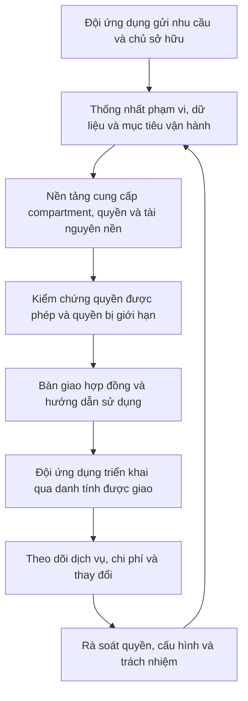

# Mô hình quản trị tập trung và phân quyền cho đội ứng dụng

## Mục tiêu và bối cảnh

Trong chương **Tổ chức tài nguyên và landing zone** của module **CLOUD_PROVIDERS_ORACLE**, thiết kế compartment cần gắn với một câu hỏi vận hành: ai được quyết định và thay đổi những gì? Một cây tài nguyên có tên rõ ràng vẫn khó quản lý nếu mọi yêu cầu triển khai đều phải chờ quản trị viên, hoặc nếu mỗi đội ứng dụng đều có quyền thay đổi toàn bộ tenancy.

Bài học này xây dựng một mô hình trong đó đội nền tảng quản lý các thành phần dùng chung và các ranh giới bảo vệ, còn đội ứng dụng chủ động triển khai, quan sát và vận hành dịch vụ trong phạm vi được giao. Bối cảnh minh họa là hai đội **Orders** và **Billing**, phát triển ứng dụng Java trên OCI Compute, sử dụng Object Storage và dịch vụ cơ sở dữ liệu Oracle.

Sau bài học, bạn có thể:

- Phân biệt quản trị tập trung, phân quyền hoàn toàn và mô hình kết hợp.
- Lập ma trận trách nhiệm giữa nền tảng, bảo mật, đội ứng dụng và chủ sở hữu dịch vụ.
- Chuyển trách nhiệm thành phạm vi compartment, IAM policy và danh tính tự động hóa.
- Phân biệt nơi gắn policy với nơi policy cấp quyền.
- Xây dựng quy trình tiếp nhận ứng dụng, cấp quyền, xử lý ngoại lệ và thu hồi quyền.
- Kiểm chứng rằng đội ứng dụng làm được công việc được giao và không vượt sang phạm vi đội khác.

## 1. Quản trị là phân định quyết định và trách nhiệm

Quản trị đám mây không chỉ là tạo người dùng hoặc duyệt yêu cầu. Nó xác định:

1. Những quy tắc nào áp dụng chung.
2. Ai có quyền thay đổi từng thành phần.
3. Ai chịu trách nhiệm khi dịch vụ gặp sự cố hoặc phát sinh chi phí.
4. Bằng chứng nào cho thấy các quy tắc đang được thực hiện.
5. Khi cần ngoại lệ, ai chấp thuận và khi nào ngoại lệ hết hạn.

Oracle Cloud Adoption Framework đặt vai trò, trách nhiệm, quy trình phối hợp và cải tiến liên tục trong phạm vi governance. Cấu hình OCI cần phản ánh cách tổ chức thực sự làm việc. [Tham khảo Governance trong OCI Cloud Adoption Framework](https://docs.oracle.com/en-us/iaas/Content/cloud-adoption-framework/governance.htm).

Ví dụ, đội nền tảng có thể chịu trách nhiệm đường kết nối mạng đến database, đội database chịu trách nhiệm sao lưu, còn đội Orders chịu trách nhiệm truy vấn và migration schema. Khi API đặt hàng chậm, cần có người điều phối dựa trên triệu chứng và bằng chứng; không nên để từng đội chỉ xác nhận phần mình “vẫn chạy”.

## 2. Ba mô hình và lựa chọn thực tế

| Mô hình | Cách vận hành | Điểm phù hợp | Vấn đề cần giải quyết |
| --- | --- | --- | --- |
| Tập trung | Một nhóm chủ yếu tạo và thay đổi hạ tầng cho các ứng dụng | Quy mô nhỏ, cần kiểm soát tập trung, đội ứng dụng chưa sẵn sàng vận hành OCI | Hàng đợi yêu cầu, phụ thuộc người quản trị, khó mở rộng |
| Phân quyền rộng | Mỗi đội tự quản lý phần lớn tài nguyên và quy tắc của mình | Đội có năng lực hạ tầng và phạm vi tổ chức tương đối độc lập | Cấu hình không đồng nhất, quyền rộng, chi phí và trách nhiệm dễ phân tán |
| Kết hợp | Nền tảng cung cấp nền móng và giới hạn; ứng dụng tự phục vụ trong phạm vi đã xác định | Nhiều đội cần triển khai nhanh nhưng vẫn có chuẩn chung | Cần hợp đồng rõ, công cụ hỗ trợ và kiểm chứng ranh giới |

Mô hình kết hợp không nhất thiết chia đều số lượng công việc. Một tổ chức có thể tập trung quản trị IAM và kết nối doanh nghiệp nhưng phân quyền mạnh cho đội ứng dụng ở Compute, deployment và giám sát.

Mức phân quyền còn phụ thuộc vào năng lực của đội. Nhóm mới có thể bắt đầu bằng các mẫu triển khai đã chuẩn bị; nhóm trưởng thành hơn có thể được tự thay đổi nhiều thành phần hơn sau khi chứng minh khả năng vận hành. Không nên cấp quyền rộng chỉ vì đội có nhiều yêu cầu tồn đọng.

### Ví dụ một quyết định phân quyền

Orders muốn tăng số instance khi lưu lượng cao:

- Nếu thay đổi nằm trong cấu hình và hạn mức đã được phê duyệt, pipeline của Orders có thể thực hiện.
- Nếu thay đổi cần mở thêm kết nối mạng hoặc tăng giới hạn tiêu thụ dùng chung, cần phối hợp với người sở hữu phần đó.
- Nếu thay đổi ảnh hưởng mục tiêu khôi phục hoặc chi phí dịch vụ, chủ sở hữu dịch vụ phải tham gia quyết định.

Như vậy, quyền tự chủ được xác định bằng loại thay đổi và mức ảnh hưởng.

## 3. Xác định phần nền tảng giữ quyền và phần ứng dụng tự chủ

### 3.1. Phạm vi quản trị tập trung đề xuất

Đội nền tảng, phối hợp với bảo mật và các nhóm chuyên trách, có thể quản lý:

- Cấu trúc tenancy và các compartment nền tảng.
- Liên kết danh tính, nhóm quản trị và các policy có ảnh hưởng nhiều đội.
- Kết nối mạng doanh nghiệp, định tuyến dùng chung và quy tắc xuất nhập quan trọng.
- Chuẩn giám sát, thu thập log, quản lý khóa và phương án xử lý sự cố nền tảng.
- Quota, quy ước nhận diện chi phí và quy trình phân bổ nguồn lực.
- Module hạ tầng dùng chung, cơ chế kiểm tra trước triển khai và danh mục dịch vụ tự phục vụ.

“Tập trung” ở đây là quyền sở hữu và trách nhiệm rõ ràng. Không bắt buộc một người duy nhất thực hiện mọi thao tác. Ngay trong đội nền tảng cũng nên tách danh tính dùng cho IAM, mạng và triển khai tự động để giới hạn ảnh hưởng khi có lỗi.

### 3.2. Phạm vi tự chủ của đội ứng dụng

Đội ứng dụng có thể được giao:

- Quản lý phiên bản ứng dụng và cấu hình thuộc ứng dụng.
- Triển khai Compute hoặc thành phần thực thi được chấp thuận.
- Điều chỉnh quy mô trong phạm vi đã thống nhất.
- Xây dựng dashboard, cảnh báo và quy trình xử lý lỗi của dịch vụ.
- Quản lý các dữ liệu hoặc bucket thuộc phạm vi được giao.
- Thực hiện migration schema theo quy trình phối hợp với chủ sở hữu database.
- Đề xuất tối ưu chi phí và dọn tài nguyên hết vòng đời.

Quyền OCI chỉ là một phần. Quyền sửa mã nguồn, phê duyệt pipeline, truy cập hệ điều hành và quản trị schema đều phải khớp với trách nhiệm trên.

### 3.3. Ma trận trách nhiệm minh họa

Trong bảng sau, **A** là người chịu trách nhiệm cuối cùng cho kết quả, **R** là bên trực tiếp thực hiện, **C** là bên được tham vấn. Một đầu việc nên có một A rõ ràng.

| Đầu việc | Chủ sở hữu dịch vụ | Nền tảng | Bảo mật | Đội ứng dụng |
| --- | --- | --- | --- | --- |
| Thiết lập compartment và quyền ban đầu | C | A/R | C | C |
| Phê duyệt mô hình quyền nhạy cảm | C | R | A | C |
| Vận hành kết nối mạng dùng chung | C | A/R | C | C |
| Phát hành ứng dụng | A | C | Theo mức ảnh hưởng | R |
| Đặt mục tiêu khôi phục dịch vụ | A | C | C | R |
| Cấu hình backup theo phần tài nguyên được giao | A | R cho dịch vụ nền tảng | C | R cho phần ứng dụng |
| Xử lý sự cố logic ứng dụng | A | C | Khi có dấu hiệu bảo mật | R |
| Phân tích và tối ưu chi phí ứng dụng | A | C | Khi cần | R |
| Cấp ngoại lệ bảo mật | C | R khi thực thi | A | R khi đề nghị |
| Thu hồi quyền khi đội kết thúc nhiệm vụ | C | A/R | C | R khi bàn giao |

Đây là mô hình minh họa. Nếu có đội database hoặc nhóm trực vận hành riêng, cần bổ sung họ và tách các đầu việc đủ cụ thể để tránh nhiều bên cùng nghĩ bên kia chịu trách nhiệm.

## 4. Biểu diễn mô hình bằng compartment

Một cấu trúc ví dụ:

```text
Tenancy
├── Platform
│   ├── Network
│   │   ├── OrdersNetwork
│   │   │   ├── NonProduction
│   │   │   └── Production
│   │   └── BillingNetwork
│   ├── Security
│   └── Operations
└── Applications
    ├── Orders
    │   ├── NonProduction
    │   │   ├── Application
    │   │   └── Data
    │   └── Production
    │       ├── Application
    │       └── Data
    └── Billing
        ├── NonProduction
        └── Production
```

Cấu trúc này thể hiện hai ý định:

- Đội nền tảng quản lý tài nguyên mạng, kể cả mạng dành riêng cho từng ứng dụng.
- Mỗi đội ứng dụng có phạm vi tài nguyên riêng và tiếp tục tách theo môi trường khi cần.

Không phải hệ thống nào cũng cần nhiều cấp như ví dụ. Chỉ thêm compartment khi có khác biệt về quyền, chủ sở hữu hoặc cách vận hành. Việc đặt mạng trong Platform cũng không bắt buộc; một lựa chọn khác là đặt mạng cạnh ứng dụng rồi chỉ cấp quyền sửa cho nhóm mạng.

### Phân biệt quản lý tài nguyên và sử dụng tài nguyên

Orders có thể cần dùng subnet do nền tảng quản lý để khởi tạo Compute. Điều này không có nghĩa Orders phải được sửa route table, tạo Internet Gateway hoặc thay đổi kết nối doanh nghiệp.

Cần mô tả riêng:

- Ai quản lý tài nguyên mạng.
- Ai được sử dụng những thành phần cần thiết để triển khai.
- Ai được xem cấu hình để chẩn đoán lỗi.
- Ai được thay đổi luồng kết nối.

Compartment tạo phạm vi tổ chức và IAM; nó không tự tạo firewall giữa Orders và Billing. Cấu hình mạng, quyền dữ liệu và danh tính workload vẫn phải được kiểm soát.

### Không cấp quyền rộng ở cha rồi mong thu hẹp ở con

Nếu cấp cho Orders quyền quản lý toàn bộ tài nguyên trong `Applications`, quyền có thể bao phủ Billing bên dưới. Policy ở compartment con không tự thu hồi quyền đã nhận từ cấp cha.

OCI áp dụng kế thừa policy theo cây compartment. Vì vậy, đánh giá quyền của một đội phải xét policy ở tenancy và các cấp cha, cùng mọi nhóm mà danh tính đó thuộc về. [Tham khảo Policy Inheritance](https://docs.oracle.com/en-us/iaas/Content/Identity/policieshow/Policy_Inheritance.htm).

## 5. Nơi gắn policy và phạm vi cấp quyền là hai quyết định

Một IAM policy có ít nhất hai khía cạnh cần phân biệt:

| Khía cạnh | Câu hỏi | Ý nghĩa quản trị |
| --- | --- | --- |
| Nơi gắn policy, tức attachment | Policy được tạo trong compartment nào? | Góp phần quyết định ai được sửa hoặc xóa policy |
| Vị trí cấp quyền trong statement | Statement cho phép thao tác tài nguyên ở đâu? | Quyết định phạm vi tài nguyên được cấp quyền |

Một policy do nền tảng quản lý có thể được gắn ở cấp cha thích hợp nhưng chỉ cấp cho Orders quyền vào một compartment ứng dụng cụ thể. Gắn ở tenancy không tự biến mọi statement thành quyền trên toàn tenancy; vẫn phải đọc vị trí và điều kiện trong từng statement.

Oracle mô tả nơi gắn policy là yếu tố quyết định nhóm quản trị policy nào có thể thay đổi hoặc xóa nó. [Tham khảo Working with Policies](https://docs.oracle.com/en-us/iaas/Content/Identity/policymgmt/managingpolicies_topic-Working_with_Policies.htm).

### Hai mức phân quyền khác nhau

**Ủy quyền vận hành tài nguyên:** Orders được triển khai Compute và quản lý thành phần ứng dụng đã giao. Nền tảng vẫn sở hữu policy.

**Ủy quyền quản trị policy:** Orders còn được viết hoặc sửa policy trong phạm vi của mình. Đây là quyền mạnh hơn và cần đánh giá riêng.

Không nên mặc định dùng `manage all-resources` để giải quyết nhu cầu triển khai ứng dụng. Quyền này có thể bao gồm quản lý policy trong compartment. Nếu tổ chức muốn giữ việc cấp quyền ở trung tâm, nên chọn loại tài nguyên và quyền cụ thể.

Oracle lưu ý `manage all-resources` bao gồm cả quản lý policy, và khuyến nghị hạn chế người có quyền viết policy. [Tham khảo Best Practices for IAM on OCI](https://docs.oracle.com/en-us/iaas/Content/Resources/Assets/whitepapers/best-practices-for-iam-on-oci.pdf).

Ủy quyền quản trị policy có thể phù hợp với một đơn vị đã được giao quản trị compartment đầy đủ. Khi đó phải ghi nhận rằng đơn vị có khả năng mở rộng quyền trong phạm vi được phép, xác định phần nào vẫn do nền tảng kiểm soát và kiểm tra tác động đến tài nguyên dùng chung.

## 6. Tách danh tính con người, triển khai và workload

Một đội ứng dụng thường cần ít nhất ba loại danh tính:

| Loại danh tính | Mục đích | Phạm vi thiết kế |
| --- | --- | --- |
| Người dùng | Xem trạng thái, xử lý công việc được giao, truy cập khẩn cấp | Theo nhóm và nhiệm vụ; quyền nhạy cảm có kiểm soát |
| Pipeline triển khai | Tạo hoặc thay đổi hạ tầng và phiên bản ứng dụng | Theo ứng dụng, môi trường và loại thay đổi |
| Workload đang chạy | Gọi dịch vụ OCI để phục vụ chức năng ứng dụng | Chỉ những API và dữ liệu cần trong lúc chạy |

Không dùng một tài khoản quản trị chung cho cả ba. Khi điều tra sự cố, cần phân biệt hành động do người dùng, pipeline hay ứng dụng thực hiện.

### 6.1. Ví dụ policy cho danh tính triển khai

Các statement sau minh họa một phần quyền của nhóm triển khai Orders ở non-production. Thay placeholder bằng OCID thật khi áp dụng:

```text
Allow group id <ORDERS_NONPROD_DEPLOY_GROUP_OCID> to manage instance-family in compartment id <ORDERS_NONPROD_APPLICATION_COMPARTMENT_OCID>

Allow group id <ORDERS_NONPROD_DEPLOY_GROUP_OCID> to read virtual-network-family in compartment id <ORDERS_NONPROD_NETWORK_COMPARTMENT_OCID>
```

Dòng thứ nhất giới hạn nhóm loại tài nguyên Compute vào compartment ứng dụng của Orders. Dòng thứ hai minh họa quyền đọc cấu hình mạng trong phạm vi mạng đã dành cho Orders non-production.

Đây **không phải bộ quyền đầy đủ để khởi tạo Compute**. Triển khai thực tế còn cần quyền trên các phụ thuộc như subnet, image và volume, tùy cấu hình. Quyền đọc mạng không đồng nghĩa được gắn VNIC vào subnet hoặc thay đổi cấu hình mạng.

Cách viết bằng OCID giúp chỉ rõ nhóm và compartment; cú pháp IAM vẫn cần được đối chiếu với quyền của từng dịch vụ. [Tham khảo Policy Syntax](https://docs.oracle.com/en-us/iaas/Content/Identity/Concepts/policysyntax.htm).

Nếu pipeline chạy bằng instance principal hoặc resource principal, cần cấp cho đúng loại chủ thể đó thay vì sao chép nguyên statement dành cho user group. Việc xác thực không dùng API key lưu sẵn không làm phạm vi quyền tự thu hẹp.

### 6.2. Ví dụ quyền runtime có phạm vi dữ liệu cụ thể

Giả sử ứng dụng Orders đọc các tệp cấu hình trong một bucket riêng. Một policy minh họa:

```text
Allow dynamic-group id <ORDERS_RUNTIME_DYNAMIC_GROUP_OCID> to read objects in compartment id <ORDERS_DATA_COMPARTMENT_OCID> where target.bucket.name = 'orders-runtime-config'
```

Statement này thể hiện ý định cho runtime đọc object trong bucket đã chọn. Nó không tự cấp quyền ghi object, quản lý tenancy hoặc triển khai instance. [Tham khảo ví dụ policy đọc Object Storage từ dynamic group](https://docs.oracle.com/en-us/iaas/Content/Compute/Tasks/instances.htm).

Trước khi dùng, cần xác định bucket thực tế, môi trường tương ứng, quyền phụ thuộc cần thiết và tổng quyền từ các policy khác. Không dùng tên bucket trong ví dụ làm quy ước bảo mật cho toàn hệ thống.

Dynamic group xác định thành viên bằng matching rule, sau đó IAM policy cấp quyền cho nhóm tài nguyên đó. Một quy tắc dựa trên compartment có thể đưa cả instance hiện có và instance được tạo sau này vào nhóm. [Tham khảo Managing Dynamic Groups](https://docs.oracle.com/iaas/Content/Identity/dynamicgroups/managingdynamicgroups.htm).

Ví dụ matching rule cho một compartment ứng dụng:

```text
instance.compartment.id = '<ORDERS_APPLICATION_COMPARTMENT_OCID>'
```

Đây là điều kiện thành viên, không phải statement cấp quyền. Nó xét compartment được chỉ định; không nên suy rằng quy tắc này tự bao gồm mọi compartment con như cơ chế kế thừa policy. [Tham khảo Writing Matching Rules](https://docs.oracle.com/en-us/iaas/Content/Identity/dynamicgroups/Writing_Matching_Rules_to_Define_Dynamic_Groups.htm).

### 6.3. Quyền triển khai có thể dẫn đến quyền sử dụng của runtime

Nếu một người có thể tạo instance trong compartment mà dynamic group cấp quyền đọc dữ liệu nhạy cảm, người đó có thể tạo workload để sử dụng quyền runtime. Tương tự, người có quyền đổi startup script, truy cập hệ điều hành hoặc đưa mã mới vào ứng dụng có thể ảnh hưởng cách workload sử dụng dữ liệu.

Vì vậy, câu “developer không được đọc secret prod trên Console” chưa đủ chứng minh developer không thể lấy dữ liệu prod. Cần xét cả:

- Quyền sửa mã nguồn và phê duyệt bản phát hành.
- Quyền sửa pipeline hoặc thay thế artifact.
- Quyền thay đổi cấu hình instance và truy cập hệ điều hành.
- Quyền làm tài nguyên trở thành thành viên dynamic group.
- Quyền thay đổi policy hoặc các tag tham gia quyết định quyền.

Nếu tổ chức cần ngăn một người tự đưa mã vào prod, phải kiểm soát chuỗi phê duyệt và danh tính triển khai prod. Một bước duyệt trên giao diện CI/CD không có tác dụng đầy đủ nếu người đó vẫn có credential để triển khai trực tiếp bằng CLI.

## 7. Xây dựng các biện pháp bảo vệ theo nhiều lớp

Có thể chia biện pháp quản trị thành bốn nhóm:

| Nhóm | Cách dùng trong mô hình phân quyền | Ví dụ |
| --- | --- | --- |
| Ngăn chặn | Chặn hành động vượt phạm vi tại điểm thực thi | IAM giới hạn compartment, quota, kiểm soát mạng |
| Kiểm tra trước thay đổi | Phát hiện cấu hình không đạt trước khi áp dụng | Kiểm tra plan, kiểm tra đích triển khai, quy tắc trong pipeline |
| Phát hiện sau thay đổi | Nhận diện cấu hình lệch chuẩn hoặc hành vi bất thường | Cloud Guard, log, cảnh báo, so sánh cấu hình thực tế |
| Khắc phục | Sửa lỗi hoặc hạn chế tác động sau khi phát hiện | Thu hồi quyền, cô lập tài nguyên, khôi phục cấu hình đã duyệt |

Không phải quy tắc nào cũng được IAM biểu đạt trực tiếp. Một yêu cầu như “mọi database phải có phương án khôi phục đã thử” còn cần cấu hình backup, quy trình thử phục hồi và bằng chứng kết quả.

### 7.1. Phân biệt kiểm tra pipeline và kiểm soát trong OCI

Nếu một quy tắc chỉ chạy trong pipeline, người có quyền thay đổi trực tiếp tài nguyên vẫn có thể bỏ qua quy tắc đó. Để quy trình tự động có giá trị, cần thu hẹp quyền thao tác trực tiếp và kiểm soát danh tính có thể thực hiện thay đổi.

Quyền khẩn cấp có thể được giữ lại cho một nhóm được chỉ định. Mọi lần dùng cần có lý do, thời hạn, nhật ký và bước xử lý cấu hình phát sinh sau sự cố.

Không mô tả một quy ước đặt tên hoặc yêu cầu duyệt bằng văn bản như thể đó là rào cản kỹ thuật. Với mỗi biện pháp, cần biết nó thực sự chặn, chỉ cảnh báo hay chỉ hướng dẫn con người.

### 7.2. Security Zones và Cloud Guard có vai trò khác nhau

Security Zones kiểm tra các thao tác thuộc phạm vi được hỗ trợ theo recipe áp dụng và có thể từ chối thao tác vi phạm. Cloud Guard kiểm tra cấu hình hoặc hoạt động để phát hiện vấn đề và có thể được cấu hình responder cho một số hành động.

Chúng bổ sung cho IAM và quy trình vận hành. Không mặc định mọi quy tắc nội bộ đều được Security Zones hỗ trợ hoặc mọi phát hiện của Cloud Guard đều đã được tự động sửa. [Tham khảo Security Services của OCI](https://docs.oracle.com/en-us/iaas/Content/Security/Concepts/security_features.htm).

Trước khi áp dụng vào ứng dụng, cần kiểm tra recipe, loại tài nguyên và thao tác có liên quan. Một ứng dụng cần điểm vào công khai phải có thiết kế phù hợp; không bật một bộ quy tắc mà chưa đánh giá tác động đến kiến trúc.

## 8. Cung cấp một hợp đồng dịch vụ cho đội ứng dụng

Tự phục vụ cần một đầu vào rõ và một đầu ra dùng được. Đội nền tảng có thể cung cấp danh mục như:

- Không gian ứng dụng với compartment, nhóm và danh tính triển khai.
- Mạng ứng dụng theo mẫu đã thống nhất.
- Cấu hình Compute hoặc nền tảng thực thi được hỗ trợ.
- Mẫu truy cập Object Storage và secret.
- Phương án database Oracle với trách nhiệm backup, vá lỗi và schema được xác định.
- Giám sát nền tảng và hướng dẫn kết nối cảnh báo ứng dụng.

### 8.1. Một hợp đồng tiếp nhận Orders

Mẫu nội dung minh họa:

```text
Ứng dụng: Orders
Chủ sở hữu dịch vụ: <người hoặc vai trò chịu trách nhiệm>
Đội vận hành ứng dụng: <đội>
Môi trường: <non-production hoặc production>
Compartment được giao: <OCID>
Region được phép triển khai: <danh sách đã thống nhất>
Danh tính triển khai: <định danh>
Mạng và kết nối được cung cấp: <phạm vi>
Dữ liệu và secret được phép sử dụng: <phạm vi>
Hạn mức tài nguyên: <loại và mức>
Chi phí dự kiến và người chịu trách nhiệm: <thông tin>
Mục tiêu khôi phục: <RTO, RPO>
Nơi nhận cảnh báo: <kênh hoặc nhóm trực>
Quy trình thay đổi ngoài phạm vi: <đầu mối>
Ngày rà soát quyền tiếp theo: <thời điểm>
```

Đây là hợp đồng vận hành, không phải schema cấu hình chuẩn của OCI. Những thông tin cần dùng cho tự động hóa có thể được biểu diễn trong hệ thống quản lý nội bộ với kiểm tra phù hợp.

### 8.2. Phân định trách nhiệm database và dữ liệu

Với cơ sở dữ liệu Oracle, nên tách ít nhất ba câu hỏi:

1. Ai quản lý tài nguyên database trên OCI?
2. Ai quản lý tài khoản, quyền và schema bên trong database?
3. Ai chịu trách nhiệm chất lượng dữ liệu, migration và kết quả khôi phục của ứng dụng?

Nền tảng tạo database không đồng nghĩa nền tảng hiểu mọi migration của Orders. Ngược lại, đội Orders quản lý schema không tự có quyền thay đổi chính sách backup hoặc cấu hình mạng database.

Tương tự, Object Storage cần chủ sở hữu dữ liệu rõ ràng. Nếu đội được tự tạo bucket, phải xác định ai quyết định quyền truy cập, thời gian lưu, cơ chế chia sẻ và việc xóa dữ liệu. Không cấp quyền quản lý bucket rồi giả định mọi hình thức chia sẻ đều đã được ngăn bằng quy trình.

### 8.3. Hợp đồng cần có giới hạn hỗ trợ

Đội ứng dụng cần biết:

- Loại cấu hình nào được nền tảng hỗ trợ.
- Ai xử lý khi module hạ tầng dùng chung gặp lỗi.
- Thay đổi nào tự thực hiện được.
- Thay đổi nào cần tham vấn hoặc phê duyệt.
- Mức hỗ trợ khi ứng dụng dùng thành phần ngoài danh mục.

Giới hạn rõ giúp giảm các yêu cầu xử lý thủ công và tránh tình trạng một bên phải chịu trách nhiệm cho thành phần họ không kiểm soát.

## 9. Luồng tiếp nhận, triển khai và quản lý thay đổi



### 9.1. Quy trình tiếp nhận một ứng dụng mới

**Bước 1 — Xác nhận chủ sở hữu và nhu cầu.** Thu thập môi trường, dịch vụ dự kiến, dữ liệu, tích hợp, mục tiêu sẵn sàng và chi phí. Không bắt đầu bằng yêu cầu chung chung “cấp quyền admin để thử”.

**Bước 2 — Chọn mẫu gần nhất.** Dùng module hoặc cấu hình nền đã được duyệt. Ghi rõ các điểm không đáp ứng để xử lý như thay đổi hoặc ngoại lệ có chủ sở hữu.

**Bước 3 — Cấp tài nguyên và danh tính.** Tạo phạm vi ứng dụng, nhóm người dùng, danh tính triển khai và quyền runtime theo trách nhiệm. Nền tảng có thể tự động hóa bước này.

**Bước 4 — Kiểm chứng trước bàn giao.** Chứng minh đội làm được thao tác cần thiết và không truy cập được phạm vi ứng dụng khác. Ghi nhận các phụ thuộc dùng chung.

**Bước 5 — Bàn giao và vận hành.** Cung cấp định danh tài nguyên, cách triển khai, cách nhận cảnh báo, cách đề nghị mở rộng và cách yêu cầu hỗ trợ.

### 9.2. Phân loại thay đổi theo tác động

| Loại thay đổi | Cách xử lý đề xuất |
| --- | --- |
| Đổi phiên bản ứng dụng trong phạm vi đã giao | Đội ứng dụng tự thực hiện qua luồng phát hành đã thống nhất |
| Tăng tài nguyên trong quota và cấu hình được hỗ trợ | Đội ứng dụng tự thực hiện, theo dõi chi phí và kết quả |
| Mở kết nối mới đến hệ thống khác | Chủ sở hữu mạng và dữ liệu cùng đánh giá |
| Thay đổi IAM, nhóm hoặc matching rule | Theo quy trình quản trị danh tính được chỉ định |
| Tăng quota hoặc cần thêm service limit | Đánh giá nhu cầu dùng chung và chi phí trước khi điều chỉnh |
| Thay đổi có thể làm giảm khả năng khôi phục | Chủ sở hữu dịch vụ quyết định với các đội liên quan |
| Xử lý khẩn cấp | Dùng luồng khẩn cấp có kiểm soát và rà soát sau sự cố |

Một cấu hình sửa trực tiếp trong lúc xử lý sự cố cần được đối chiếu với mã hạ tầng. Nếu không, lần triển khai kế tiếp có thể ghi đè bản sửa hoặc làm trạng thái thực tế tiếp tục lệch khỏi cấu hình quản lý.

### 9.3. Quản lý ngoại lệ có thời hạn

Một ngoại lệ cần ghi rõ:

- Yêu cầu cụ thể và lý do.
- Phạm vi tài nguyên, danh tính hoặc kết nối liên quan.
- Người chấp thuận và người chịu trách nhiệm khắc phục.
- Biện pháp giảm tác động trong thời gian chờ.
- Thời điểm hết hạn và cách thu hồi.
- Kết quả kiểm chứng sau khi đóng ngoại lệ.

Ví dụ, Orders cần truy cập tạm một endpoint để chuyển dữ liệu. Không nên biến yêu cầu này thành quyền mạng rộng không có ngày kết thúc. Khi ngoại lệ hết hạn, phải kiểm tra quyền và kết nối đã được thu hồi thực tế, không chỉ đóng yêu cầu trong hệ thống.

## 10. Quan sát hoạt động, chi phí và hiệu quả quản trị

### 10.1. Tập trung khả năng quan sát, phân quyền dữ liệu quan sát

Nền tảng cần nhìn thấy tình trạng chung; đội ứng dụng cần đủ log và metric để tự xử lý dịch vụ. Hai nhu cầu này không đồng nghĩa mọi đội được đọc log của nhau.

Thiết kế nên xác định:

- Nhãn ứng dụng, môi trường và chủ sở hữu trong thông tin quan sát.
- Phạm vi log hoặc dashboard đội ứng dụng được xem.
- Cảnh báo nào đến đội ứng dụng, cảnh báo nào đến nền tảng.
- Cách liên kết một lần triển khai với thay đổi tài nguyên và sự cố.
- Người được thay đổi hoặc xóa cấu hình thu thập, lưu trữ và xuất log.

OCI Audit ghi lại các lời gọi tới API công khai được hỗ trợ, bao gồm hoạt động qua Console, CLI và SDK. Nó hỗ trợ truy vết thay đổi tài nguyên, nhưng không thay thế toàn bộ log ứng dụng hoặc audit bên trong database. [Tham khảo Overview of Audit](https://docs.oracle.com/en-us/iaas/Content/Audit/Concepts/auditoverview.htm).

Ví dụ, để điều tra một truy vấn xóa dữ liệu, có thể cần thông tin bên trong Oracle Database và ứng dụng. Nhật ký một API quản lý tài nguyên OCI không tự chứng minh ai đã thực hiện câu SQL đó.

### 10.2. Giao trách nhiệm chi phí cùng quyền triển khai

Khi Orders được quyền tạo tài nguyên, hợp đồng cần nêu ai theo dõi và giải thích chi phí. Nền tảng có thể chuẩn hóa cách nhận diện, cung cấp báo cáo và đặt quota; đội Orders vẫn cần đánh giá tài nguyên dư thừa hoặc cấu hình vượt nhu cầu.

Một bộ thông tin nhận diện nội bộ có thể gồm:

```text
Application = orders
Environment = non-production
Owner = orders-team
CostCenter = <đơn vị chịu chi phí>
Lifecycle = <lâu dài hoặc tạm thời>
```

Các giá trị này là quy ước minh họa. Nếu tag tham gia quyết định truy cập hoặc tự động hóa, cần quản trị người được thay đổi tag; không xem đó chỉ là nhãn trình bày.

Budget dùng để theo dõi và cảnh báo chi tiêu, không tự chặn mọi chi phí vượt ngưỡng. Quota kiểm soát mức tiêu thụ loại tài nguyên trong phạm vi được hỗ trợ; việc tăng quota vẫn phải xét giới hạn dịch vụ và nhu cầu dùng chung. [Tham khảo Track and Manage Usage and Cost](https://docs.oracle.com/en/solutions/oci-best-practices/track-and-manage-usage-and-cost1.html).

Không dùng cơ chế tự dừng tài nguyên production chỉ vì một cảnh báo chi phí mà chưa có quyết định vận hành phù hợp. Một tác vụ khắc phục chi phí cũng có thể làm gián đoạn dịch vụ.

### 10.3. Đo xem mô hình có giúp đội ứng dụng làm việc tốt hơn không

| Chỉ số đề xuất | Điều cần quan sát |
| --- | --- |
| Thời gian từ yêu cầu hợp lệ đến môi trường dùng được | Quy trình tiếp nhận có bị chờ thủ công quá lâu không |
| Tỷ lệ thay đổi ứng dụng tự thực hiện trong phạm vi chuẩn | Danh mục tự phục vụ có đáp ứng nhu cầu thực tế không |
| Số lần phải cấp quyền tạm ngoài mẫu | Mẫu quyền thiếu chức năng hay đội đang vượt phạm vi |
| Số cấu hình thực tế lệch khỏi mã hạ tầng | Có thay đổi ngoài luồng hoặc thiếu cập nhật cấu hình không |
| Số ngoại lệ quá hạn | Trách nhiệm khắc phục và thu hồi có được thực hiện không |
| Tài nguyên không có chủ sở hữu rõ | Có nguy cơ chi phí hoặc dữ liệu bị bỏ quên không |
| Kết quả thử khôi phục | Trách nhiệm backup có tạo ra khả năng phục hồi thực tế không |

Đây là chỉ số quản trị đề xuất, không phải bộ metric tự động có sẵn cho mọi tenancy. Nên đọc chúng cùng bối cảnh. Nhiều yêu cầu bị từ chối có thể là ranh giới hoạt động đúng, nhưng cũng có thể cho thấy quyền được thiết kế thiếu và đội ứng dụng đang bị chặn công việc hợp lệ.

## 11. Thực hành: bàn giao phạm vi Orders mà giữ ranh giới Billing

### 11.1. Điều kiện thực hành

Dùng tenancy hoặc khu vực thực hành được phép sử dụng. Orders và Billing có thể là hai ứng dụng mô phỏng, không cần tài nguyên production thật.

Chuẩn bị:

- Compartment và tài nguyên kiểm thử có chủ sở hữu.
- Một danh tính quản trị để thiết lập và đối chứng.
- Một danh tính kiểm thử chỉ thuộc các nhóm Orders dự kiến.
- Region và OCID đã xác minh.
- Ma trận quyền mong muốn cùng kế hoạch dọn dẹp tài nguyên thực hành.

Không dùng tài khoản đang có quyền quản trị tenancy để chứng minh Orders đã bị giới hạn. Nếu danh tính có nhiều nhóm, phải kiểm tra tổng quyền trước khi thử.

### 11.2. Trình tự thực hiện

**Bước 1 — Viết hợp đồng.** Chọn phần Orders được tự vận hành, phần nền tảng giữ quyền và phần Billing cần bảo vệ. Ghi chủ sở hữu, phạm vi dữ liệu và nơi tiếp nhận yêu cầu vượt phạm vi.

**Bước 2 — Ánh xạ sang tài nguyên.** Ghi compartment của Orders Application, Orders Data, mạng được cấp cho Orders và phạm vi Billing dùng để kiểm tra.

**Bước 3 — Chọn danh tính.** Tách người dùng kiểm thử, pipeline triển khai và workload. Chỉ tạo dynamic group khi bài thực hành cần workload gọi dịch vụ OCI.

**Bước 4 — Viết policy cần thiết.** Bắt đầu từ thao tác cụ thể. Nếu cần thêm quyền phụ thuộc, ghi rõ dịch vụ và lý do; không mở rộng thẳng lên tenancy.

**Bước 5 — Kiểm tra ranh giới.** Dùng phép thử được phép và phép thử phải bị từ chối. Các lệnh PowerShell sau chỉ đọc thông tin:

```powershell
$ordersApplicationCompartment = '<ORDERS_APPLICATION_COMPARTMENT_OCID>'
$billingApplicationCompartment = '<BILLING_APPLICATION_COMPARTMENT_OCID>'
$ordersVcnOcid = '<ORDERS_VCN_OCID>'
$targetRegion = '<OCI_REGION>'

oci compute instance list --profile ORDERS_TEST --region $targetRegion --compartment-id $ordersApplicationCompartment --all
oci compute instance list --profile ORDERS_TEST --region $targetRegion --compartment-id $billingApplicationCompartment --all
oci network vcn get --profile ORDERS_TEST --region $targetRegion --vcn-id $ordersVcnOcid
```

Profile `ORDERS_TEST` phải trỏ đến đúng danh tính kiểm thử. Trong mô hình minh họa, Orders được xem instance trong phạm vi mình và đọc mạng được cấp, nhưng không được xem instance Billing.

Một kết quả rỗng không chứng minh thao tác bị từ chối: có thể compartment chưa có instance hoặc đang dùng sai region. Lỗi `NotAuthorizedOrNotFound` cũng cần đối chứng để loại trừ sai OCID hoặc tài nguyên không tồn tại.

Người quản trị xác nhận tài nguyên đích bằng danh tính có quyền thích hợp. Không ghi credential, secret hoặc nội dung dữ liệu nhạy cảm vào hồ sơ thử nghiệm.

### 11.3. Ma trận bằng chứng bàn giao

| Hạng mục | Kết quả cần chứng minh | Cách kiểm tra đề xuất |
| --- | --- | --- |
| Phạm vi ứng dụng | Orders truy cập được phần tài nguyên cần thiết | API chỉ đọc và một triển khai nhỏ trong khu thực hành |
| Ranh giới đội | Orders không truy cập ngoài quyền sang Billing | API chỉ đọc với đích đã được đối chứng |
| Mạng | Orders sử dụng hoặc quan sát mạng theo hợp đồng | Kiểm tra policy, cấu hình và luồng mạng phù hợp |
| Quyền cấp quyền | Đội ứng dụng không tự sửa policy nếu không được ủy quyền | Rà soát tổng quyền; thử thay đổi chỉ trong phạm vi mô phỏng đã cho phép |
| Danh tính runtime | Workload chỉ đọc đúng dữ liệu được cấp | Dùng dữ liệu giả và đối chiếu matching rule, policy |
| Triển khai | Job ứng dụng không dùng credential quản trị nền tảng | Kiểm tra danh tính thực thi và phạm vi quyền của job |
| Quan sát | Đội ứng dụng nhận được cảnh báo thuộc dịch vụ mình | Phát một tín hiệu thử có kiểm soát |
| Chi phí | Mỗi tài nguyên có chủ sở hữu và phạm vi theo dõi | Đối chiếu tag, compartment và hợp đồng |
| Thu hồi quyền | Quyền thử nghiệm không còn dùng được sau thu hồi | Kiểm tra lại bằng danh tính đã bị thu hồi theo quy trình |

Các lệnh chỉ đọc không chứng minh trực tiếp rằng mọi thao tác ghi đều bị chặn. Cần kết hợp phân tích policy và các phép thử ghi có kiểm soát trong khu thực hành. Không thử xóa tài nguyên thật hoặc sửa IAM production để kiểm tra giới hạn.

**Bước 6 — Bàn giao.** Lưu kết quả theo từng danh tính và thao tác, ghi các giới hạn còn tồn tại, người xử lý và thời hạn. Bên nhận phải thực hiện được luồng triển khai hoặc quan sát cơ bản bằng quyền của mình.

## 12. Rà soát và kết thúc vòng đời phân quyền

Quyền cần được xem lại khi có thay đổi nhân sự, thay đổi kiến trúc, sự cố, kết thúc dự án hoặc đến kỳ rà soát đã thống nhất.

Một đợt rà soát nên trả lời:

- Chủ sở hữu dịch vụ và nhóm trực có còn đúng không?
- Người dùng, pipeline và workload có còn cần toàn bộ quyền hiện tại không?
- Có policy mới ở cấp cha làm mở rộng phạm vi không?
- Nhóm hoặc matching rule có thay đổi thành viên ngoài dự kiến không?
- Có credential dùng chung hoặc job đang chạy bằng quyền khẩn cấp không?
- Các ngoại lệ đã hết hạn có được đóng thực tế không?
- Quyền database, hệ điều hành và công cụ CI/CD có khớp với IAM không?

Khi một đội ngừng vận hành ứng dụng, thứ tự bàn giao cần tránh làm mất dữ liệu hoặc mất khả năng điều tra:

1. Xác định người tiếp nhận dịch vụ hoặc quyết định ngừng dịch vụ.
2. Xử lý dữ liệu, sao lưu, thời gian lưu và các nghĩa vụ bàn giao.
3. Dừng các pipeline và lịch tự động không còn cần thiết.
4. Thu hồi quyền, credential và quyền truy cập công cụ liên quan.
5. Kiểm tra hiệu lực thu hồi; không chỉ dựa vào việc đã sửa thành viên nhóm.
6. Dọn tài nguyên đúng phạm vi và kiểm tra chi phí còn tiếp tục phát sinh.
7. Cập nhật hồ sơ sở hữu, cảnh báo và kết nối còn lại.

Thu hồi quyền OCI không tự xóa bản dữ liệu đã tải xuống hoặc hoàn tác quyền bên trong database. Việc kết thúc quyền cần được thực hiện trên toàn bộ các hệ thống liên quan.

## 13. Những sai lầm phổ biến

| Sai lầm | Hệ quả | Điều chỉnh |
| --- | --- | --- |
| Mọi yêu cầu đều cần một quản trị viên thao tác | Đội nền tảng trở thành nơi chờ xử lý | Chuẩn hóa phạm vi tự phục vụ và tự động hóa tiếp nhận |
| Cấp `manage all-resources` cho mọi đội | Có thể trao cả quyền quản trị policy ngoài ý định | Chọn loại tài nguyên và phạm vi cụ thể |
| Chỉ kiểm tra policy ngay trong compartment ứng dụng | Bỏ sót quyền từ tenancy hoặc cấp cha | Đánh giá tổng quyền và kế thừa |
| Gộp danh tính người dùng, pipeline và runtime | Khó truy vết, phạm vi ảnh hưởng lớn | Tách danh tính theo mục đích |
| Giữ quyền prod rộng nhưng chỉ thêm bước duyệt CI/CD | Có đường triển khai bỏ qua phê duyệt | Thu hẹp quyền trực tiếp và bảo vệ danh tính triển khai |
| Cấp quyền dùng mạng đồng nghĩa được sửa toàn bộ mạng | Ứng dụng có thể ảnh hưởng kết nối của đội khác | Tách quản lý, sử dụng và quan sát |
| Giao đội ứng dụng tự chủ nhưng không cho đủ log | Đội không tự chẩn đoán được sự cố | Cung cấp khả năng quan sát theo phạm vi |
| Tập trung log nhưng cho mọi đội đọc toàn bộ | Dữ liệu ứng dụng khác có thể bị lộ | Phân quyền dữ liệu quan sát |
| Ngoại lệ không có ngày hết hạn | Quyền tạm trở thành quyền thường trực | Có người chịu trách nhiệm và phép kiểm tra thu hồi |
| Giao quyền tạo tài nguyên mà không giao trách nhiệm chi phí | Tài nguyên và chi phí bị bỏ quên | Gắn chủ sở hữu, theo dõi và vòng đời |

## 14. Câu hỏi tự kiểm tra

1. Những quyết định nào thuộc nền tảng, và những thay đổi nào Orders được tự thực hiện?
2. Nếu một policy gắn ở tenancy chỉ cấp quyền vào Orders Application, quyền được cấp nằm ở đâu và ai có thể sửa policy?
3. Vì sao quyền triển khai ứng dụng và quyền quản trị policy cần được xem xét riêng?
4. Một developer không đọc được secret bằng Console nhưng có quyền thay mã chạy trên prod có thể tạo rủi ro gì?
5. Danh tính của pipeline triển khai khác danh tính runtime ở những thao tác nào?
6. Các biện pháp nào thật sự chặn thay đổi, và các biện pháp nào chỉ phát hiện hoặc cảnh báo?
7. Khi một yêu cầu triển khai bị chặn vì thiếu quyền phụ thuộc, cần xác định điều gì trước khi mở rộng quyền?
8. Ai chịu trách nhiệm chứng minh database của ứng dụng có thể khôi phục đúng mục tiêu?
9. Bằng chứng nào cho thấy Orders không vượt sang Billing, ngoài việc hai đội có compartment riêng?
10. Khi đội ngừng vận hành dịch vụ, quyền và dữ liệu cần được xử lý ở những hệ thống nào?

Mô hình quản trị cần giúp đội ứng dụng thực hiện công việc được giao bằng một luồng rõ ràng, đồng thời giữ các ranh giới có thể kiểm chứng. Compartment, policy, pipeline và trách nhiệm vận hành phải cùng thể hiện một cách phân quyền thống nhất.
