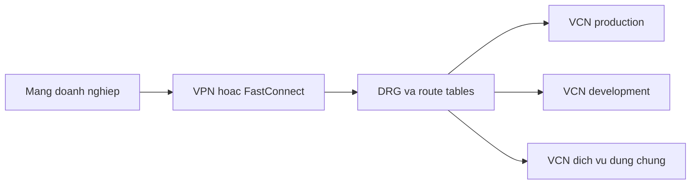
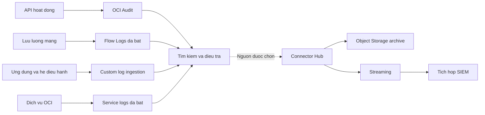

# Quản trị danh tính, kết nối và nhật ký trong landing zone

Một landing zone trên Oracle Cloud Infrastructure (OCI) cần giúp các đội triển khai ứng dụng trong một môi trường có quy tắc rõ ràng. Tạo sẵn compartment và VCN mới chỉ là phần khởi đầu. Đội vận hành còn phải biết ai được thay đổi hạ tầng, lưu lượng được phép đi qua đâu và có thể tìm bằng chứng hoạt động ở nguồn nào.

Ba câu hỏi này liên hệ chặt chẽ. Nếu một người có thể sửa mạng rồi tắt nguồn log mà không bị phát hiện, việc chia compartment chưa đem lại khả năng quản trị như mong muốn. Nếu ứng dụng có IAM policy đúng nhưng không có đường mạng đến dịch vụ, workload vẫn thất bại. Nếu đã bật log nhưng không ai có quyền tìm kiếm hoặc không có người xử lý cảnh báo, sự cố vẫn có thể bị bỏ qua.

Bài học thuộc chương **Tổ chức tài nguyên và landing zone**. Nội dung xây dựng một mô hình quản trị phối hợp danh tính, kết nối và nhật ký cho các workload Compute, lưu trữ và cơ sở dữ liệu Oracle trên OCI.

## 1. Kết quả cần đạt của một landing zone có thể vận hành

Một landing zone có thể bàn giao khi trả lời được những câu hỏi cụ thể sau:

| Mảng | Câu hỏi phải trả lời được | Bằng chứng |
| --- | --- | --- |
| Danh tính | Ai có thể triển khai, đọc dữ liệu, đổi mạng và thay chính sách? | Group, role, policy, membership và quy trình thu hồi |
| Kết nối | Những nguồn nào được truy cập đích nào, qua đường nào? | Ma trận kết nối, route, NSG, DNS và kết quả kiểm tra |
| Nhật ký | Hoạt động quan trọng được ghi ở đâu, ai đọc và giữ bao lâu? | Danh mục nguồn log, quyền đọc, retention và bản ghi mẫu |
| Vận hành | Ai phản ứng khi quyền sai, kết nối hỏng hoặc log ngừng đến? | Chủ sở hữu, cảnh báo, runbook và kiểm tra khôi phục |

Ví dụ xuyên suốt bài học là một tổ chức có nhóm mạng, nhóm bảo mật, nhóm ứng dụng và người kiểm toán. Workload production cần truy cập database riêng tư, đọc Object Storage và gửi log phục vụ điều tra. Môi trường development phải được tách quyền và các đường kết nối với production.

Đây là mô hình minh họa. Không coi tên compartment, CIDR hoặc cách chia đội trong bài là yêu cầu bắt buộc của mọi OCI landing zone.

## 2. Bố trí tài nguyên và xác định chủ sở hữu

### 2.1. Một cấu trúc compartment tham khảo

```text
Tenancy
└── lz-main
    ├── lz-network
    ├── lz-security
    │   ├── lz-logs
    │   └── lz-log-archive
    └── lz-workloads
        ├── lz-dev
        └── lz-prod
```

Ý nghĩa thiết kế:

- `lz-network`: hạ tầng kết nối dùng chung như DRG và các tài nguyên mạng được phân công cho đội mạng.
- `lz-security`: các dịch vụ bảo mật theo mô hình tổ chức.
- `lz-logs`: log group và log được đặt tập trung khi loại nguồn hỗ trợ cách bố trí đó.
- `lz-log-archive`: bucket lưu bản sao nhật ký nếu cần lưu trữ lâu hơn.
- `lz-dev`, `lz-prod`: tài nguyên workload được tách theo môi trường.

Một số VCN hoặc tài nguyên mạng của workload có thể được đặt trong compartment riêng của ứng dụng, với quyền quản trị được phân công tương ứng. Điều quan trọng là biết chủ sở hữu và phạm vi quyền, không phải đưa mọi VCN vào cùng một compartment bằng mọi giá.

OCI Core Landing Zone cũng sử dụng các nhóm tài nguyên dành cho mạng, bảo mật, ứng dụng và database, cùng các thành phần IAM để phân tách trách nhiệm. Xem [OCI Core Landing Zone](https://docs.oracle.com/en-us/iaas/Content/cloud-adoption-framework/oci-core-landing-zone.htm).

### 2.2. Compartment không phải hàng rào mạng

Đặt hai instance vào hai compartment khác nhau không tự chặn kết nối IP giữa chúng. Ngược lại, đặt tài nguyên cùng compartment không tự cho phép một user truy cập tất cả tài nguyên đó.

Cần phân biệt:

- Compartment tổ chức tài nguyên và tạo phạm vi cho chính sách quản trị.
- VCN, subnet, route, NSG và các cơ chế liên quan quyết định đường đi cùng quyền truyền lưu lượng.
- IAM quyết định các hành động API và quyền truy cập dịch vụ theo chính sách.
- Hệ điều hành, ứng dụng và database còn có lớp xác thực, phân quyền riêng.

Compartment cũng không thay thế region. Log, VCN, DRG và nhiều tài nguyên khác có phạm vi region; kiến trúc nhiều region phải thiết kế nguồn, đích và kiểm tra cho từng region.

### 2.3. Phân công trách nhiệm

| Vai trò | Trách nhiệm chính | Giới hạn cần thiết kế |
| --- | --- | --- |
| Đội danh tính hoặc platform | Federation, group, quyền quản trị, tự động hóa cấp phát | Hạn chế cấp quyền toàn tenancy cho công việc thường ngày |
| Đội mạng | CIDR, DRG, DNS, route, kết nối hybrid và phân đoạn mạng | Không tự mặc định có quyền đọc dữ liệu ứng dụng |
| Đội bảo mật | Yêu cầu thu thập log, kiểm tra bảo mật, cảnh báo | Tách quyền đọc nội dung với quyền thay hoặc xóa cấu hình khi phù hợp |
| Đội ứng dụng | Triển khai và vận hành workload được giao | Không tự sửa kết nối dùng chung hoặc chính sách toàn tenancy |
| Người kiểm toán | Xem cấu hình và bằng chứng trong phạm vi nhiệm vụ | Không cần quyền sửa hạ tầng để đọc bằng chứng |

Một người có thể giữ nhiều vai trò ở tổ chức nhỏ. Khi đó, vẫn cần biết mỗi thao tác sử dụng vai trò nào và ai xem lại thay đổi có ảnh hưởng lớn.

## 3. Quản trị danh tính của con người

### 3.1. Từ nguồn danh tính đến quyền tài nguyên

Luồng quản trị có thể được mô tả như sau:

```text
Danh tính doanh nghiệp hoặc local user
              ↓
Xác thực, MFA và sign-on policy
              ↓
Group hoặc vai trò được cấp
              ↓
OCI IAM policy theo phạm vi
              ↓
API và tài nguyên được phép thao tác
```

Federation giúp tổ chức sử dụng nguồn danh tính tập trung, nhưng không tự thay thế việc cấp quyền OCI. Người dùng đăng nhập thành công vẫn phải có group, role hoặc quyền phù hợp.

Đối với tài khoản quản trị, cần có MFA và quy trình khôi phục. Tài khoản sử dụng thường ngày nên tách khỏi đường quản trị khẩn cấp theo thiết kế của tổ chức. Không dùng chung một tài khoản quản trị giữa nhiều người nếu cần truy vết ai đã thay đổi hạ tầng.

### 3.2. Cấp quyền qua group và theo nhiệm vụ

Có thể tạo các group như:

- `LZ-Network-Operators`.
- `LZ-Security-Operators`.
- `LZ-Prod-Deployers`.
- `LZ-Dev-Deployers`.
- `LZ-Auditors`.

Tên chỉ là nhãn. Quyền thực tế được tạo bởi policy và các role liên quan; một group có tên “read-only” vẫn có thể có quyền sửa nếu policy cấp như vậy.

Bắt đầu từ nhiệm vụ, rồi xác định API và resource type cần dùng. Tránh cấp `manage all-resources in tenancy` để giải quyết một dependency chưa rõ khi triển khai. Những dependency như sử dụng subnet, gắn volume hay truy cập key cần được xử lý theo dịch vụ và phạm vi liên quan.

### 3.3. Kiểm tra quyền kế thừa và quyền cộng dồn

Một policy ở compartment cha có thể áp dụng xuống các compartment con theo cơ chế kế thừa. Nếu đội development nhận quyền rộng ở `lz-workloads`, việc tạo `lz-prod` bên dưới không tự loại bỏ quyền đó.

Khi đánh giá một user, xem:

1. Các group mà người đó thuộc.
2. Role quản trị identity domain hoặc ứng dụng liên quan.
3. Policy ở tenancy và các cấp tổ tiên.
4. Quyền tại compartment đích.
5. Những danh tính tự động hóa mà người đó có thể sử dụng hoặc điều khiển.

Một policy hẹp mới không tự thu hẹp quyền do policy rộng cũ cấp. Việc phân quyền cần xét tổng đường cấp quyền thực tế.

### 3.4. Thu hồi phải bao gồm credential ngoài trình duyệt

Khi nhân sự đổi vai trò hoặc nghỉ việc, cần xem membership, role, phiên đăng nhập và credential như API signing key hay auth token. Đổi mật khẩu Console không tự thay tất cả credential khác.

Trong federation, xác định rõ đội nào chịu trách nhiệm vô hiệu hóa tại IdP và đội nào kiểm tra quyền còn lại tại OCI. Nếu cho phép local login dự phòng, phải đưa đường đó vào cùng quy trình rà soát.

## 4. Quản trị danh tính workload và pipeline

Ứng dụng và công cụ triển khai cũng là các chủ thể có thể gọi API. Không nên coi mọi hoạt động do pipeline thực hiện đều có thể gán cho người đã bấm nút chạy nếu pipeline dùng một credential chung không được quản lý rõ.

### 4.1. Chọn danh tính theo nơi thực thi

| Nơi chạy | Cách tiếp cận cần xem xét |
| --- | --- |
| OCI Compute | Instance Principals và Dynamic Group có matching rule phù hợp |
| Dịch vụ OCI hỗ trợ danh tính tài nguyên | Resource Principals theo cơ chế của dịch vụ |
| Pipeline ngoài OCI | Cơ chế xác thực được nền tảng hỗ trợ, có quản lý vòng đời và phạm vi quyền |
| Máy của người vận hành | Credential cá nhân hoặc phiên xác thực phù hợp, có truy vết |

Dynamic Group chỉ xác định tập tài nguyên theo điều kiện. Quyền được cấp bằng policy. Đặc biệt, quyền sửa tag, tạo instance hoặc chuyển instance vào compartment có thể ảnh hưởng việc một máy khớp matching rule.

### 4.2. Tách danh tính triển khai và danh tính runtime

Một ứng dụng chỉ cần đọc một bucket không cần quyền tạo Compute. Pipeline triển khai có thể cần tạo tài nguyên nhưng không nhất thiết phải đọc nội dung dữ liệu production.

Nên ghi rõ:

- Danh tính tạo hạ tầng.
- Danh tính ứng dụng sử dụng lúc chạy.
- Danh tính thu thập và vận chuyển log.
- Danh tính tìm kiếm log hoặc kiểm toán.

Mỗi danh tính có chủ sở hữu, phạm vi và cách thu hồi. Nếu cùng một pipeline có thể sửa IAM, mở mạng và xóa log archive, tác động khi pipeline bị chiếm quyền sẽ lớn hơn nhiều.

### 4.3. Quản lý thay đổi qua hạ tầng dưới dạng mã

Quản lý cấu hình IAM, mạng và nguồn log cùng với các thay đổi triển khai giúp người duyệt thấy được tác động liên quan. Tuy nhiên, mã hạ tầng chỉ mô tả cấu hình dự kiến; phải có kiểm tra drift để biết tài nguyên đang chạy có khác cấu hình đó không.

State và credential của công cụ tự động hóa là dữ liệu cần bảo vệ. Không đưa token, mật khẩu hoặc private key vào output triển khai rồi chuyển nguyên output đó sang log tập trung.

## 5. Quản trị kết nối bằng ma trận luồng

### 5.1. Xác định nguồn, đích và mục đích trước khi viết rule

Một ma trận kết nối có thể gồm:

| Nguồn | Đích | Giao thức hoặc cổng minh họa | Mục đích | Quyết định |
| --- | --- | --- | --- | --- |
| Người vận hành được cấp quyền | Bastion hoặc đường quản trị được chọn | Theo cơ chế quản trị | Vào tài nguyên private | Cho phép có kiểm soát |
| Load balancer | Backend ứng dụng | HTTPS hoặc cổng backend thực tế | Phục vụ request | Cho phép |
| Ứng dụng production | Oracle Database private | Cổng listener thực tế | Truy vấn dữ liệu | Cho phép |
| Workload private | Object Storage được phép | HTTPS 443 | Đọc cấu hình hoặc backup | Cho phép theo IAM |
| Development | Database production | Cổng database | Không có nhu cầu nghiệp vụ | Không cho phép |
| Internet bất kỳ | SSH trực tiếp đến VM private | TCP 22 | Không có nhu cầu | Không cho phép |

Cổng database không luôn là 1521; phải lấy từ cấu hình kết nối thật. Mọi giá trị trong bảng là thiết kế minh họa, không phải tập rule để sao chép nguyên.

### 5.2. Route và bộ lọc lưu lượng là hai lớp khác nhau

Route xác định next hop. NSG và security list kiểm soát lưu lượng ở phạm vi tương ứng. Có route không đồng nghĩa cổng ứng dụng được mở; có rule cho phép không đồng nghĩa tồn tại đường đi.

Với mỗi luồng, kiểm tra:

1. DNS trả đúng địa chỉ dự kiến.
2. Địa chỉ nguồn và đích không bị chồng lấn ngoài thiết kế.
3. Route chiều đi và chiều về.
4. DRG attachment, route table và route distribution nếu có.
5. NSG, security list và firewall của hệ điều hành.
6. Tiến trình hoặc listener đang hoạt động ở cổng đích.
7. Xác thực và quyền trong dịch vụ đích.

Nếu các lớp cho phép có tác động cộng dồn, một security list rộng có thể làm mất ý nghĩa hạn chế mà người thiết kế tưởng đã đạt bằng NSG. Cần kiểm tra toàn bộ tập rule liên quan, không chỉ một đối tượng vừa sửa.

## 6. Kết nối hybrid, hub-and-spoke và truy cập quản trị

### 6.1. DRG là thành phần định tuyến cần được phân đoạn

DRG có thể kết nối các VCN, FastConnect virtual circuit, Site-to-Site VPN và các thành phần được hỗ trợ khác. Attachment và route table của DRG quyết định lưu lượng được chuyển tiếp giữa những kết nối nào.

Một mô hình logic:



Các mũi tên biểu diễn kết nối có thể thiết kế, không khẳng định mọi spoke được phép trao đổi với nhau. Muốn cách ly development và production, phải kiểm soát route được nhập cùng các lớp lọc lưu lượng.

Không mặc định hub-and-spoke tự đưa mọi gói tin qua firewall. Nếu cần kiểm tra lưu lượng tập trung, phải thiết kế đường đi qua thành phần kiểm tra, đường về và hành vi khi thành phần đó lỗi. Oracle mô tả cách route table và route distribution hoạt động trong [Dynamic Routing Gateways](https://docs.oracle.com/en-us/iaas/Content/Network/Tasks/managingDRGs.htm).

### 6.2. Đường dự phòng phải được kiểm chứng

Có hai kết nối không đồng nghĩa đã có khả năng khôi phục như mong muốn. Cần xem các điểm lỗi chung, BGP, độ ưu tiên route, khả năng thiết bị phía doanh nghiệp và việc ứng dụng chịu được gián đoạn đến mức nào.

Với mô hình FastConnect chính và VPN dự phòng, phải kiểm tra:

- Prefix nào được quảng bá qua mỗi đường.
- Khi một đường mất, đường nào được chọn.
- Lưu lượng chiều về có thay đổi tương ứng không.
- Thiết bị kiểm tra stateful có gặp định tuyến bất đối xứng không.
- DNS và ứng dụng có tiếp tục hoạt động sau khi mạng hội tụ không.

Tắt một đường production để thử failover là thay đổi có ảnh hưởng, cần nằm trong quy trình vận hành phù hợp. Bài thực hành ban đầu nên dùng môi trường riêng và phạm vi kiểm tra nhỏ.

### 6.3. Service Gateway, NAT Gateway và endpoint private

Service Gateway cho phép truy cập riêng đến các Oracle services được hỗ trợ trong cùng region qua Oracle Services Network. Nó không cung cấp đường ra mọi endpoint internet.

NAT Gateway phục vụ nhu cầu chủ động kết nối từ tài nguyên private ra endpoint public theo thiết kế mạng. Một private endpoint của dịch vụ lại có cơ chế địa chỉ, route và DNS riêng.

Ví dụ, đọc Object Storage qua Service Gateway không chứng minh workload có thể tải gói phần mềm từ một máy chủ ngoài OCI. Với mỗi dependency, xác định hostname, region và kiểu endpoint trước khi chọn đường đi. Phạm vi của Service Gateway được Oracle mô tả trong [Access to Oracle Services: Service Gateway](https://docs.oracle.com/en-us/iaas/Content/Network/Tasks/servicegateway.htm).

### 6.4. DNS thuộc trách nhiệm kết nối

Một kết nối hybrid có route đúng vẫn có thể thất bại nếu máy tại OCI không phân giải được tên nội bộ doanh nghiệp, hoặc on-premises nhận nhầm địa chỉ public.

Cần quy định:

- Ai sở hữu zone và bản ghi.
- Luồng phân giải tên giữa cloud và on-premises.
- Endpoint và quy tắc forwarding theo khả năng của OCI DNS.
- Cách tránh vòng lặp forwarding.
- Cách kiểm tra khi thay đổi địa chỉ dịch vụ hoặc chuyển region.

Không sửa file hosts trên từng máy như giải pháp quản trị lâu dài cho một landing zone có nhiều workload.

### 6.5. Đường quản trị có giới hạn thời gian

OCI Bastion cung cấp truy cập hạn chế và có thời hạn đến tài nguyên không có public endpoint. Quyền tạo session, địa chỉ nguồn được phép, key SSH và kết nối đến đích vẫn cần được quản lý.

Không giả định một Bastion duy nhất ở hub có thể dùng cho tài nguyên ở mọi VCN. Bastion gắn với một VCN; cần bố trí theo phạm vi được dịch vụ hỗ trợ. Xem [Bastion Overview](https://docs.oracle.com/en-us/iaas/Content/Bastion/Concepts/bastionoverview.htm).

Bastion cũng không tự thay thế quyền trong hệ điều hành hoặc database, và không nên được hiểu là đã ghi lại đầy đủ mọi lệnh shell hay nội dung SQL. Nếu cần bằng chứng ở mức đó, phải thiết kế nguồn audit riêng của hệ điều hành hoặc database.

## 7. Xây dựng danh mục nhật ký

“Bật logging” chưa đủ cụ thể. Cần lập danh mục cho từng loại bằng chứng và biết những câu hỏi mà mỗi nguồn có thể trả lời.

| Nguồn | Câu hỏi điển hình | Giới hạn cần hiểu |
| --- | --- | --- |
| OCI Audit | Ai gọi API hỗ trợ nào, trên tài nguyên nào, khi nào? | Không thay thế mọi log dữ liệu, hệ điều hành hoặc SQL |
| VCN Flow Logs | Luồng IP/cổng nào được ghi nhận là chấp nhận hoặc từ chối? | Không phải bản sao payload hay bằng chứng mọi lớp ứng dụng thành công |
| Service logs | Dịch vụ đích xử lý request hoặc tác vụ như thế nào? | Phải bật đúng category và nguồn được hỗ trợ |
| Custom application logs | Ứng dụng xử lý nghiệp vụ, lỗi và correlation ID nào? | Phụ thuộc instrumentation và cơ chế đưa log lên |
| OS và database audit | Ai đăng nhập máy hoặc thao tác trong database? | Cần cấu hình riêng theo nền tảng |
| Identity domain hoặc IdP logs | Đăng nhập và thay đổi danh tính diễn ra thế nào? | Có nguồn và phạm vi khác với một service log thông thường |

### 7.1. Audit và service log không đồng nhất

OCI Audit ghi nhận API operations của các dịch vụ được hỗ trợ. Khi tìm bằng chứng tạo instance hoặc đổi cấu hình, chọn đúng compartment, region và khoảng thời gian.

Đối với thao tác đọc dữ liệu của một dịch vụ, phải kiểm tra category hoặc audit riêng của dịch vụ đó. Không suy ra “Audit không thấy” thành “thao tác chưa xảy ra”.

Oracle trình bày sự khác nhau giữa Audit, service logs và custom logs trong [Logging Overview](https://docs.oracle.com/en-us/iaas/Content/Logging/Concepts/loggingoverview.htm).

### 7.2. Flow Logs dùng cho quan sát luồng, không phải mọi loại chẩn đoán

Flow Logs ghi các thuộc tính lưu lượng tại phạm vi capture được cấu hình. Chọn đúng VCN, subnet hoặc VNIC theo khả năng dịch vụ và kiểm tra filter đang áp dụng.

Một bản ghi ACCEPT không chứng minh ứng dụng đã xác thực thành công; request vẫn có thể bị từ chối tại TLS, IAM, database hoặc ứng dụng. Không có bản ghi cũng chưa đủ kết luận không có lưu lượng: có thể sai nguồn, sai thời gian, filter loại bỏ hoặc loại lưu lượng không được ghi.

Một số lưu lượng hạ tầng link-local không xuất hiện trong Flow Logs. Tham khảo các nguồn và giới hạn trong [Details for VCN Flow Logs](https://docs.oracle.com/en-us/iaas/Content/Logging/Reference/details_for_vcn_flow_logs.htm).

### 7.3. Thống nhất định danh và thời gian

Nên có các thuộc tính giúp đối chiếu:

- Thời gian UTC và thời điểm ingest nếu nguồn cung cấp.
- Tenancy, region, compartment và resource OCID.
- Principal hoặc user, nếu sự kiện có thông tin đó.
- Request ID, correlation ID hoặc trace ID.
- Môi trường, ứng dụng và chủ sở hữu theo quy ước.

Không coi một correlation ID do ứng dụng ghi là bằng chứng danh tính đã được xác thực. Cũng không chèn token, mật khẩu, private key, chuỗi kết nối có secret hoặc toàn bộ payload nhạy cảm chỉ để dễ tìm kiếm.

## 8. Tập trung log và phân quyền đọc

### 8.1. Tập trung là mô hình quản trị

Có thể đặt các log group vào compartment bảo mật ở từng region khi nguồn cho phép, rồi phân quyền theo nhóm và log group. Một cách khác là giữ log ở compartment nguồn, cấp quyền tìm kiếm cho đội bảo mật và chuyển bản sao đến nơi tập trung.

Cả hai cách đều cần trả lời:

- Ai được tạo hoặc sửa log.
- Ai được đọc nội dung.
- Ai được đổi retention hoặc xóa cấu hình.
- Ai quản lý bucket archive và key nếu sử dụng.
- Ai nhận cảnh báo khi nguồn ngừng gửi.

Một log group tập trung không tự kéo log từ mọi resource vào đó. Audit cũng không bị chuyển toàn bộ vị trí lưu chỉ vì tạo một log group tên `central-audit`.

### 8.2. Ví dụ cấp quyền đọc cho người kiểm toán

Giả sử nhóm `LZ-Auditors` thuộc identity domain `Default`. Các placeholder `<...>` phải được thay bằng OCID thật:

```text
Allow group 'Default'/'LZ-Auditors' to read audit-events in compartment id <LZ_PARENT_COMPARTMENT_OCID>
Allow group 'Default'/'LZ-Auditors' to read log-groups in compartment id <LOG_COMPARTMENT_OCID>
Allow group 'Default'/'LZ-Auditors' to read log-content in compartment id <LOG_COMPARTMENT_OCID>
```

Ba dòng phục vụ những nhu cầu khác nhau:

| Policy | Mục đích |
| --- | --- |
| `read audit-events` | Đọc Audit trong phạm vi được cấp |
| `read log-groups` | Xem log group và thông tin log |
| `read log-content` | Tìm kiếm, đọc nội dung log theo quyền tương ứng |

Quyền đọc Audit dưới `lz-main` không bao phủ mọi sự kiện tại root tenancy. Nếu cần theo dõi thay đổi IAM có phạm vi tenancy, phải thiết kế quyền và nguồn sự kiện cho phạm vi đó.

Thay tên domain khi nhóm nằm ở domain khác. Tạo policy ở vị trí có thể cấp quyền cho các compartment đích. Ví dụ không bao gồm quyền cấu hình log hay đọc object trong bucket archive.

Oracle công bố resource types của Logging trong [Details for Logging](https://docs.oracle.com/en-us/iaas/Content/Identity/policyreference/loggingpolicyreference.htm) và quyền đọc Audit trong [Viewing Audit Log Events](https://docs.oracle.com/en-us/iaas/Content/Audit/Tasks/viewinglogevents.htm).

### 8.3. Người vận hành ứng dụng không mặc nhiên đọc mọi log

Log có thể chứa dữ liệu khách hàng, cấu trúc nội bộ hoặc thông tin lỗi nhạy cảm. Nếu nhiều ứng dụng dùng chung compartment log, cần thiết kế phạm vi đọc phù hợp, có thể dùng các log group riêng và điều kiện IAM được hỗ trợ.

Tách quyền đọc với quyền thay cấu hình giúp giảm nguy cơ sửa hoặc tắt nguồn bằng chứng. Tuy nhiên, người có quyền cao trên máy nguồn vẫn có thể tác động log trước khi ingest; archive không tự bảo đảm tính đầy đủ của dữ liệu chưa từng được gửi.

## 9. Vận chuyển, lưu giữ và giám sát đường log

### 9.1. Một pipeline log tham khảo



Sơ đồ mô tả các vai trò logic. Connector đọc nguồn Logging hoặc nguồn được hỗ trợ đã cấu hình, không đọc kết quả tìm kiếm tương tác của người dùng. Có thể cần nhiều connector cho các nguồn, region hoặc đích khác nhau.

### 9.2. Quyền vận chuyển phải tách khỏi quyền của người tạo connector

Tạo connector thành công chưa chứng minh nó đọc được nguồn và ghi được đích. Cần cấu hình quyền cho cơ chế dịch vụ tương ứng, đúng source compartment, target compartment, bucket hoặc stream.

Nếu đích dùng key do khách hàng quản lý, kiểm tra thêm các quyền và dependency liên quan đến key theo dịch vụ. Không cấp quyền tenancy rộng cho mọi service principal chỉ để bỏ lỗi ban đầu.

Một bài kiểm tra hoàn chỉnh phải tạo bản ghi mẫu, nhìn thấy ở nguồn và tìm được bản tương ứng ở đích.

### 9.3. Retention của Audit khác Logging

OCI Audit hiện giữ log 365 ngày; tài liệu nêu đây là thiết lập cấp tenancy không thể thay đổi. Xem [Audit Log Retention Period](https://docs.oracle.com/en-us/iaas/Content/Audit/Tasks/settingretentionperiod.htm).

Đối với log được cấu hình trong Logging, lựa chọn retention có thể từ 30 đến 180 ngày theo các mức được hỗ trợ. Không áp dụng con số 365 ngày của Audit cho mọi service log. Xem [Enabling Logging for a Resource](https://docs.oracle.com/en-us/iaas/Content/Logging/Task/enabling_logging.htm).

Nếu cần giữ lâu hơn, thiết kế bản sao sang Object Storage hoặc hệ thống lưu giữ phù hợp. Phải phân biệt:

- Thời gian tìm kiếm trực tiếp trong Logging.
- Thời gian giữ object ở archive.
- Cách bảo vệ object khỏi sửa hoặc xóa.
- Lifecycle, phiên bản, key và quyền đọc khi phục hồi.

Đưa log vào bucket không tự làm bucket bất biến. Nếu dùng retention rule hoặc cơ chế hạn chế xóa, cần xác định rõ thời hạn và tác động trước khi khóa cấu hình. Thay đổi lifecycle cũng phải tương thích yêu cầu giữ bằng chứng.

### 9.4. Connector không thay thế việc kiểm tra mất dữ liệu

Connector Hub sử dụng cơ chế giao ít nhất một lần, nên hệ thống nhận phải tính đến bản ghi trùng. Nếu cần thống kê chính xác, thiết kế khóa định danh hoặc cách loại trùng phù hợp. Xem [Overview of Connector Hub](https://docs.oracle.com/en-us/iaas/Content/connector-hub/overview.htm).

Nguồn Logging của connector có cửa sổ đọc được Oracle mô tả là 24 giờ. Đây không phải retention của log gốc. Một connector hỏng lâu không được mặc định sẽ tự backfill toàn bộ lịch sử sau khi sửa. Cần theo dõi khoảng thiếu và có phương án xử lý riêng theo nguồn. Xem [Creating a Connector with a Logging Source](https://docs.oracle.com/en-us/iaas/Content/connector-hub/create-service-connector-logging-source.htm).

Theo dõi cả:

- Trạng thái connector.
- Lỗi đọc và ghi.
- Bản ghi mới nhất đã đến đích.
- Độ trễ giữa sự kiện và bản sao archive.
- Sự thay đổi lưu lượng ingest bất thường.

Không có bản ghi mới có thể là môi trường yên lặng hoặc pipeline hỏng. Một bản ghi kiểm tra định kỳ không chứa dữ liệu nhạy cảm có thể giúp phân biệt hai tình huống.

## 10. Thực hành nghiệm thu một luồng hoàn chỉnh

Bài thực hành nên được thực hiện trên landing zone thử nghiệm hoặc tài nguyên được giao riêng. Không cần xây toàn bộ kết nối hybrid để kiểm tra bước đầu.

### 10.1. Chuẩn bị

Chuẩn bị các đối tượng:

1. Một workload Compute private trong môi trường thử nghiệm.
2. Một bucket riêng tư có object văn bản nhỏ không nhạy cảm.
3. Danh tính workload chỉ được đọc bucket cần thiết.
4. Đường mạng đến Object Storage phù hợp với endpoint và region.
5. Flow Logs cho phạm vi mạng được chọn.
6. Service log category phù hợp cho thao tác cần quan sát, nếu được hỗ trợ.
7. Log group, người đọc log và connector đến bucket archive nếu có yêu cầu.
8. Một danh tính kiểm toán chỉ có quyền đọc bằng chứng trong phạm vi bài lab.

Ghi lại OCID, region, UTC timestamp và tên object trước khi chạy. Không đưa secret vào tên tài nguyên hoặc dữ liệu kiểm tra.

### 10.2. Kiểm tra danh tính và kết nối

Từ Compute, dùng danh tính workload để đọc object được cấp quyền. Sau đó kiểm tra một bucket riêng tư có thật nhưng ngoài phạm vi được cấp.

Kết quả cần quan sát:

| Trường hợp | Kết quả mong đợi |
| --- | --- |
| Đường mạng đúng, danh tính đúng, bucket được cấp | Đọc thành công |
| Đường mạng đúng, bucket ngoài phạm vi | Bị từ chối theo cơ chế dịch vụ |
| Danh tính đúng nhưng đường mạng không hoạt động | Lỗi kết nối, không kết luận IAM sai |
| User kiểm toán muốn sửa mạng hoặc log | Không được phép nếu thiết kế chỉ cấp quyền đọc |

Đích dùng cho kiểm tra từ chối phải tồn tại và do người quản trị xác nhận. Dùng một bucket ngẫu nhiên không tồn tại không chứng minh ranh giới phân quyền đúng.

### 10.3. Kiểm tra Audit bằng CLI

Ví dụ dưới dùng **Bash**, OCI CLI đã cấu hình profile cho danh tính kiểm toán và khoảng thời gian gần lúc kiểm tra:

```bash
export LZ_REGION='<REGION>'
export LZ_RESOURCE_COMPARTMENT='<RESOURCE_COMPARTMENT_OCID>'
export LZ_START_UTC='<YYYY-MM-DDTHH:MM:00Z>'
export LZ_END_UTC='<YYYY-MM-DDTHH:MM:00Z>'

oci audit event list \
  --compartment-id "$LZ_RESOURCE_COMPARTMENT" \
  --start-time "$LZ_START_UTC" \
  --end-time "$LZ_END_UTC" \
  --region "$LZ_REGION" \
  --profile LZ_AUDITOR
```

Thay mọi placeholder; thời điểm bắt đầu phải trước thời điểm kết thúc. Chọn khoảng nhỏ và đúng compartment của hoạt động cần tìm. Nếu kết quả phân trang, xử lý các trang tiếp theo; không coi trang đầu là toàn bộ bằng chứng.

Để tạo một sự kiện quản trị dễ đối chiếu, có thể thực hiện một thay đổi mô tả không nhạy cảm trên tài nguyên thử nghiệm bằng danh tính được giao quyền, rồi ghi nhận thời gian và request ID. Không yêu cầu người kiểm toán tự có quyền sửa tài nguyên.

Audit có độ trễ xử lý. Kết quả rỗng ngay sau thao tác chưa đủ chứng minh việc ghi log lỗi. Tham số của lệnh được mô tả trong [OCI CLI — audit event list](https://docs.oracle.com/en-us/iaas/tools/oci-cli/latest/oci_cli_docs/cmdref/audit/event/list.html).

### 10.4. Tìm nội dung log được cấu hình trong Logging

Ví dụ truy vấn một log group:

```bash
export LZ_LOG_SCOPE='<LOG_COMPARTMENT_OCID>/<LOG_GROUP_OCID>'

oci logging-search search-logs \
  --search-query "search \"$LZ_LOG_SCOPE\" | sort by datetime desc" \
  --time-start "$LZ_START_UTC" \
  --time-end "$LZ_END_UTC" \
  --region "$LZ_REGION" \
  --profile LZ_AUDITOR
```

Compartment trong `LZ_LOG_SCOPE` là nơi chứa log group, có thể khác compartment của workload. Nếu cần truy vấn chính xác một log, thêm `/<LOG_OCID>` vào scope theo cú pháp được hỗ trợ.

Đối chiếu bản ghi mẫu theo resource, thời gian và request hoặc correlation ID mà nguồn thực tế có. Không giả định schema của Flow Logs giống schema của custom application logs. Cách dùng CLI được mô tả trong [Logging Search — Using the CLI](https://docs.oracle.com/en-us/iaas/Content/Logging/Task/using_the_cli_logsearch.htm).

### 10.5. Kiểm tra bản sao và giới hạn quyền

Nếu đã cấu hình connector:

1. Xác nhận bản ghi xuất hiện tại nguồn.
2. Xác nhận connector có thể xử lý nguồn và đích.
3. Tìm object hoặc thông điệp đích chứa bản ghi thử.
4. Đo độ trễ và kiểm tra dấu hiệu trùng.
5. Xác nhận người đọc chỉ có quyền phù hợp với nhiệm vụ.
6. Ghi lại cách nhận biết connector ngừng hoạt động.

Trạng thái ACTIVE của connector là một bằng chứng cấu hình, không thay thế việc tìm thấy dữ liệu ở đích.

Không cố xóa object production để kiểm tra khả năng bảo vệ archive. Nếu cần thử quy tắc hạn chế xóa, dùng bucket và object thử nghiệm phù hợp với quy trình được giao.

## 11. Điều tra sự cố qua cả ba lớp

Giả sử ứng dụng production không kết nối được đến Oracle Database sau một đợt triển khai.

Thay vì mở rộng IAM và NSG cùng lúc, điều tra theo chuỗi:

1. Xác nhận lỗi là DNS, TCP, TLS, đăng nhập database hay quyền SQL.
2. Kiểm tra danh tính triển khai và các thay đổi gần thời điểm lỗi.
3. Dùng Audit tìm thay đổi liên quan đến route, NSG, tài nguyên hoặc cấu hình.
4. Kiểm tra đường đi và đường về qua VCN, DRG, thiết bị kiểm tra mạng.
5. Dùng Flow Logs trong phạm vi phù hợp để bổ sung bằng chứng về luồng.
6. Đối chiếu log ứng dụng, listener và database.
7. Sửa thành phần có nguyên nhân đã xác định, rồi kiểm tra lại luồng và nguồn log.

Một kết nối TCP thành công không chứng minh tài khoản database có quyền SQL. Một bản ghi Audit về cập nhật NSG không chứng minh NSG là nguyên nhân duy nhất. Cần nối các bằng chứng theo thời gian và phạm vi.

Tương tự, nếu không tìm thấy log sau sự cố, kiểm tra cả việc nguồn có bật không, ai có thể thay cấu hình, quyền tìm kiếm, region, retention và pipeline chuyển tiếp. Đừng chỉ tăng quyền đọc cho mọi người để xử lý kết quả rỗng.

## 12. Tiêu chí bàn giao và duy trì landing zone

| Hạng mục | Điều kiện có thể kiểm chứng |
| --- | --- |
| Danh tính con người | Group và quyền phù hợp nhiệm vụ; có MFA, thu hồi và đường quản trị dự phòng |
| Danh tính workload | Credential có chủ sở hữu; quyền runtime và quyền triển khai được xác định |
| Kết nối | Có ma trận luồng; kiểm tra được DNS, route hai chiều và các lớp lọc |
| Phân đoạn | Development không có đường truy cập production ngoài thiết kế |
| Quan sát | Có bản ghi mẫu cho các nguồn log quan trọng |
| Phân quyền log | Tách nhu cầu đọc với nhu cầu cấu hình và lưu trữ |
| Lưu giữ | Retention, archive, lifecycle và quyền phục hồi được ghi rõ |
| Pipeline log | Có bằng chứng dữ liệu đến đích và cảnh báo khi đường log hỏng |
| Khả năng sẵn sàng | Đường dự phòng được thử theo phạm vi phù hợp |
| Chi phí | Biết nguồn ingest lớn, thời gian giữ và người chịu trách nhiệm ngân sách |

Flow Logs, log ingestion, lưu trữ archive, Streaming, SIEM và các thành phần mạng có thể tạo chi phí. Cần chọn phạm vi thu thập và retention theo nhu cầu, đồng thời duy trì bằng chứng bảo mật cần thiết. Cắt log production chỉ để giảm một chỉ số chi phí có thể làm mất khả năng điều tra.

Sau mỗi thay đổi lớn, xem lại quyền, route và nguồn log như một tập liên quan. Khi thêm region, ứng dụng hoặc kết nối doanh nghiệp mới, phải cập nhật chủ sở hữu, ma trận luồng và kiểm tra dữ liệu log tại đích. Landing zone chỉ duy trì giá trị khi các quy tắc quản trị tiếp tục phản ánh môi trường đang vận hành.
