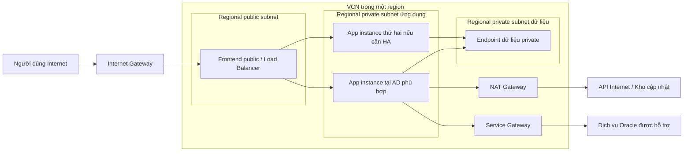

# Regional subnet, public subnet và private subnet

Khi thiết kế mạng Oracle Cloud Infrastructure (OCI), bạn thường phải trả lời hai câu hỏi khác nhau: tài nguyên có thể đặt ở availability domain nào, và tài nguyên có được phép có địa chỉ public để giao tiếp trực tiếp với Internet hay không. **Regional subnet** trả lời câu hỏi về phạm vi availability domain; **public subnet** và **private subnet** trả lời câu hỏi về khả năng truy cập mạng công khai.

Hai lựa chọn này độc lập. Một subnet có thể vừa regional vừa private, hoặc vừa regional vừa public. Regional không có nghĩa là public, và private không có nghĩa là tài nguyên hoàn toàn không thể giao tiếp với hệ thống bên ngoài.

Trong chương **Mạng Virtual Cloud Network**, bài học này giúp bạn chọn subnet cho Compute, điểm vào ứng dụng và các dịch vụ cơ sở dữ liệu Oracle. Phần thực hành tập trung vào IPv4, đồng thời chỉ ra những điểm cần xét riêng khi bật IPv6. Mục tiêu là xây dựng hạ tầng có phân quyền, đường đi mạng rõ ràng, khả năng giám sát và phương án vận hành phù hợp với chi phí, tính sẵn sàng.

Sau bài học, bạn có thể:

- Phân biệt regional subnet với AD-specific subnet.
- Giải thích vì sao public subnet chưa đủ để một máy chủ truy cập được từ Internet.
- Chọn đường đi qua Internet Gateway, NAT Gateway hoặc Service Gateway.
- Thiết kế subnet public/private cho một ứng dụng nhiều tầng.
- Kiểm tra cấu hình subnet bằng Console hoặc CLI và khoanh vùng lỗi kết nối.

## 1. Subnet nằm ở đâu trong mô hình VCN?

Virtual Cloud Network (VCN) là mạng ảo của bạn trong một region OCI. Subnet chia không gian địa chỉ và tạo đơn vị cấu hình mạng cho các tài nguyên được kết nối vào đó.

Nói một instance “nằm trong subnet” là cách diễn đạt thuận tiện. Chính xác hơn, instance gắn với virtual network interface card (VNIC), và VNIC thuộc subnet. VNIC nhận địa chỉ private trong dải địa chỉ phù hợp của subnet.

Một sơ đồ cơ bản:

```text
Region OCI
└── VCN: 10.40.0.0/16
    ├── subnet-edge: 10.40.10.0/24
    ├── subnet-app:  10.40.20.0/24
    └── subnet-data: 10.40.30.0/24
```

Ví dụ này dùng một IPv4 CIDR cho mỗi subnet. Các dải không chồng lấn và nằm trong dải VCN. Khi thiết kế thật, cần đối chiếu cả dải mạng on-premises, VCN khác và kế hoạch kết nối sau này.

Subnet có các liên kết cấu hình như route table, security lists và DHCP options. Network Security Group (NSG) bổ sung cách áp dụng rule theo nhóm tài nguyên hoặc VNIC được hỗ trợ. Những thành phần đó phối hợp với nhau, nhưng không thay thế ý nghĩa của public/private.

## 2. Regional và AD-specific: lựa chọn phạm vi đặt tài nguyên

Availability domain (AD) là một miền hạ tầng bên trong region. Khi tạo Compute, bạn chọn AD của instance theo khả năng của region và dịch vụ. Phạm vi subnet quyết định subnet có tương thích với AD đó hay không.

### 2.1. AD-specific subnet

AD-specific subnet gắn với một AD cụ thể. Tài nguyên có ràng buộc AD sử dụng subnet đó phải phù hợp với AD của subnet.

Ví dụ, nếu `subnet-app-ad1` thuộc AD-1, bạn không chọn nó cho instance đang triển khai ở AD-2. Với kiến trúc nhiều AD, thiết kế theo cách này thường cần subnet riêng cho từng AD và quản lý thêm các dải địa chỉ, liên kết route table, security lists.

### 2.2. Regional subnet

Regional subnet không bị giới hạn vào một AD cụ thể; nó có thể được sử dụng cho tài nguyên ở các AD phù hợp trong cùng region. Oracle khuyến nghị dùng regional subnet vì tính linh hoạt, như mô tả trong [Creating a Subnet](https://docs.oracle.com/en-us/iaas/Content/Network/Tasks/create_subnet.htm).

Nếu region có nhiều AD, một regional subnet ứng dụng có thể phục vụ instance A ở AD-1 và instance B ở AD-2. Hai instance vẫn là hai tài nguyên riêng, mỗi tài nguyên có vị trí và vòng đời riêng.

| Thuộc tính | AD-specific subnet | Regional subnet |
| --- | --- | --- |
| Phạm vi AD | Một AD được chọn | Các AD trong cùng region, tùy khả năng tài nguyên |
| Chọn subnet khi tạo Compute | Phải khớp AD | Không bị ràng buộc vào một AD của subnet |
| Chia địa chỉ cho nhiều AD | Thường cần nhiều subnet | Có thể dùng chung subnet theo vai trò |
| Tự tạo bản sao ứng dụng | Không | Không |
| Trải rộng sang region khác | Không | Không |

### 2.3. Regional không tự tạo tính sẵn sàng cho ứng dụng

Một instance duy nhất trong regional subnet vẫn có thể ngừng phục vụ khi instance hoặc AD của nó gặp sự cố. Để ứng dụng chịu lỗi, bạn còn phải thiết kế số lượng instance, phân bố AD hoặc fault domain phù hợp, cân bằng tải, dữ liệu, backup và cơ chế khôi phục.

Nếu region chỉ có một AD, regional subnet không tạo thêm AD. Bạn cần xem các khả năng chịu lỗi bên trong region và chiến lược nhiều region theo yêu cầu hệ thống.

Trong dữ liệu API/CLI, thuộc tính availability domain của regional subnet có thể là `null`. Công cụ tự động hóa cần xử lý giá trị này thay vì coi đó là dữ liệu lỗi. Oracle mô tả thuộc tính tại [Subnet trong SDK](https://docs.oracle.com/en-us/iaas/tools/typescript/latest/modules/_core_lib_model_subnet_.subnet.html).

## 3. Public và private: lựa chọn khả năng dùng địa chỉ công khai

Phần này xét IPv4 trước.

### 3.1. Public subnet

Public subnet cho phép tài nguyên phù hợp được gán public IPv4. Việc gán là tùy chọn, không phải mọi instance trong public subnet tự động có public IP.

Ví dụ, hai instance cùng thuộc public subnet:

- Instance A chỉ có private IPv4.
- Instance B có private IPv4 và một public IPv4 được gán theo cơ chế OCI.

Chúng không có cùng khả năng truy cập trực tiếp Internet chỉ vì cùng subnet. Còn phải kiểm tra IP, route, gateway và rule mạng.

### 3.2. Private subnet

Private subnet không cho VNIC trong subnet được gán public IPv4. Đây là một ràng buộc ở cấp subnet, hữu ích khi muốn các máy chủ ứng dụng hoặc dữ liệu sử dụng địa chỉ private.

Private subnet vẫn có thể có các đường truy cập như:

- Kết nối đến subnet khác trong VCN khi định tuyến và rule cho phép.
- Đi Internet theo chiều khởi tạo từ bên trong qua NAT Gateway cho IPv4.
- Đi đến dịch vụ Oracle được hỗ trợ qua Service Gateway.
- Kết nối đến mạng doanh nghiệp qua DRG và cấu hình VPN/FastConnect tương ứng.
- Nhận lưu lượng từ load balancer hoặc điểm truy cập trung gian đã được cấu hình.

Vì vậy, “private” không đồng nghĩa với “không có bất kỳ kết nối ra/vào nào”. Chính sách giao tiếp phải được thể hiện bằng cả thiết kế đường đi và rule.

### 3.3. Hai trục lựa chọn độc lập

| Phạm vi | Public | Private |
| --- | --- | --- |
| Regional | Regional public subnet | Regional private subnet |
| AD-specific | Public subnet của một AD | Private subnet của một AD |

Lựa chọn public/private được thực hiện khi tạo subnet và không đổi trực tiếp sau đó theo [Overview of VCNs and Subnets](https://docs.oracle.com/en-us/iaas/Content/Network/Tasks/Overview_of_VCNs_and_Subnets.htm). Đừng coi việc sửa route table là cách chuyển kiểu subnet.

Nếu cần đổi mô hình truy cập, có thể phải chuẩn bị subnet mới và chuyển hoặc triển khai lại tài nguyên theo khả năng từng dịch vụ. Cần tính đến IP, DNS, kết nối đang hoạt động và thời gian gián đoạn.

## 4. Vì sao public subnet chưa đủ để nhận kết nối Internet?

Với một Compute dùng IPv4 trong mô hình Internet Gateway thông thường, đường truy cập trực tiếp cần phối hợp nhiều điều kiện:

| Lớp kiểm tra | Điều kiện cần xác nhận |
| --- | --- |
| Subnet | Là public subnet nếu VNIC cần public IPv4 |
| Địa chỉ | VNIC/private IP tương ứng có public IPv4 phù hợp |
| Gateway và route | Internet Gateway hoạt động và route áp dụng dẫn đến gateway |
| Rule OCI | Ingress/egress cần thiết được security lists hoặc NSG cho phép |
| Hệ điều hành | Firewall máy chủ cho phép lưu lượng |
| Ứng dụng | Tiến trình đang lắng nghe đúng địa chỉ và cổng |
| Đường trả về | Có đường trả lời phù hợp, không bị cấu hình khác làm lệch |

Oracle mô tả các thành phần truy cập trực tiếp tại [Internet Gateway](https://docs.oracle.com/en-us/iaas/Content/Network/Tasks/managingIGs.htm).

Ví dụ, một máy có public IP nhưng dịch vụ web chỉ lắng nghe ở `127.0.0.1` không tự trở thành web server có thể truy cập từ xa. Tương tự, có rule cho TCP 443 nhưng thiếu route tới Internet Gateway vẫn không tạo được đường đi hoàn chỉnh.

Cũng cần phân biệt “mở được trang quản lý instance trong Console” với “kết nối được đến instance”. IAM cho phép đọc thông tin tài nguyên; đường mạng và xác thực của ứng dụng/hệ điều hành là các lớp khác.

## 5. Chọn gateway theo đích đến và chiều khởi tạo kết nối

### 5.1. Internet Gateway: đường trực tiếp với Internet

Trong mô hình IPv4 cơ bản, public subnet dùng route đến Internet Gateway cho tài nguyên có public IP cần giao tiếp trực tiếp với Internet.

Route điển hình:

```text
Destination CIDR: 0.0.0.0/0
Target: Internet Gateway của VCN
```

Route này nói nơi gửi gói tin phù hợp, không phải một rule cho phép mọi cổng. Security rules vẫn cần được cấu hình riêng. Một public subnet không có default route ra Internet vẫn là public subnet về thuộc tính, nhưng thiếu đường đi tương ứng.

### 5.2. NAT Gateway: private workload khởi tạo kết nối Internet

Ứng dụng trong private subnet có thể cần tải bản vá hoặc gọi một API Internet. Với IPv4, OCI NAT Gateway cho phép workload khởi tạo kết nối và nhận lưu lượng phản hồi, trong khi không cung cấp đường nhận kết nối mới do bên ngoài khởi tạo vào workload.

```text
Private IP của ứng dụng
    -> Route tới NAT Gateway
    -> Internet
    -> Lưu lượng phản hồi của kết nối
    -> NAT Gateway
    -> Ứng dụng
```

Route điển hình:

```text
Destination CIDR: 0.0.0.0/0
Target: NAT Gateway của VCN
```

Không gán public IP cho instance chỉ để tải cập nhật nếu mô hình yêu cầu giữ nó ở private subnet. Đặc tính khởi tạo/nhận phản hồi được Oracle mô tả trong [NAT Gateway](https://docs.oracle.com/en-us/iaas/Content/Network/Tasks/NATgateway.htm).

OCI NAT Gateway là tài nguyên gateway của VCN. Không cần đặt nó như một máy ảo NAT bên trong public subnet theo mô hình của sản phẩm khác.

### 5.3. Service Gateway: đường riêng đến dịch vụ Oracle được hỗ trợ

Service Gateway cho phép truy cập các dịch vụ được hỗ trợ trong Oracle Services Network, chẳng hạn Object Storage, mà workload không cần public IP hay đường Internet cho lưu lượng đó.

Route sử dụng service CIDR label phù hợp với region và cấu hình gateway, không thay bằng một dải IP Internet đoán trước. Gateway này không phải đường đến mọi website hay mọi endpoint mang thương hiệu Oracle. Xem phạm vi tại [Access to Oracle Services: Service Gateway](https://docs.oracle.com/en-us/iaas/Content/Network/Tasks/servicegateway.htm).

Kết nối mạng thành công cũng không cấp quyền đọc object. Workload còn cần cơ chế xác thực và IAM policy phù hợp với bucket hoặc dịch vụ đích.

### 5.4. Bảng chọn nhanh

| Nhu cầu | Phương án thường dùng | Điều kiện cần nhớ |
| --- | --- | --- |
| Người dùng Internet truy cập điểm vào HTTPS | Public frontend và Internet Gateway | IP, route, rule, listener và TLS phù hợp |
| App private gọi API Internet qua IPv4 | NAT Gateway | App khởi tạo kết nối, có route và egress |
| App private đọc Object Storage được hỗ trợ | Service Gateway | Route/service label, rule và IAM |
| Người vận hành truy cập private IP từ doanh nghiệp | VPN/FastConnect và DRG, hoặc phương án quản trị phù hợp | Có route hai chiều và kiểm soát truy cập |
| App gọi database private cùng VCN | Kết nối private nội bộ | Rule và endpoint database phù hợp |

Trong bài này, đường đi được mô tả ở mức cơ bản. Những kiến trúc dùng firewall trung gian, định tuyến riêng theo tài nguyên hoặc nhiều VCN cần kiểm tra route thực sự áp dụng cho từng luồng.

## 6. Thiết kế minh họa: frontend public, ứng dụng và dữ liệu private

Giả sử công ty An Bình triển khai một cổng nội bộ có người dùng truy cập qua Internet. Công ty muốn điểm vào public rõ ràng, ứng dụng không nhận kết nối Internet trực tiếp và cơ sở dữ liệu chỉ phục vụ tầng ứng dụng.

### 6.1. Kế hoạch địa chỉ

VCN minh họa dùng `10.40.0.0/16`:

| Subnet | CIDR | Phạm vi | Access | Vai trò |
| --- | --- | --- | --- | --- |
| `subnet-edge` | `10.40.10.0/24` | Regional | Public | Điểm vào public phù hợp với dịch vụ frontend |
| `subnet-app` | `10.40.20.0/24` | Regional | Private | Compute chạy ứng dụng |
| `subnet-data` | `10.40.30.0/24` | Regional | Private | Tài nguyên dữ liệu cần kết nối VCN |

Đây là ví dụ thiết kế, không phải yêu cầu mọi dịch vụ database đều phải có cùng số subnet hoặc cùng kiểu endpoint. Khi chọn Base Database, Autonomous Database hoặc dịch vụ Oracle khác, phải kiểm tra yêu cầu mạng và khả năng private endpoint của dịch vụ cụ thể.

### 6.2. Luồng nghiệp vụ



Sơ đồ biểu diễn các đường giao tiếp logic. NAT và Service Gateway được vẽ trong khung VCN, không có nghĩa chúng nằm trong subnet ứng dụng. Các instance ở nhiều AD cũng không được tạo tự động chỉ vì subnet là regional.

Frontend cần chuyển tiếp đến private backend theo cấu hình của dịch vụ. Client không kết nối trực tiếp đến public IP của app, vì app trong mô hình này không có public IPv4.

### 6.3. Route table minh họa

| Subnet | Đích | Target |
| --- | --- | --- |
| Edge | `0.0.0.0/0` | Internet Gateway |
| App | `0.0.0.0/0` nếu cần Internet IPv4 | NAT Gateway |
| App | Service CIDR label được chọn | Service Gateway |
| Data | Chỉ các đích cần cho dịch vụ và vận hành | Gateway/đường đi tương ứng theo thiết kế |

Với định tuyến nội bộ VCN mặc định, không cần gửi lưu lượng từ app đến database cùng VCN vòng qua NAT hoặc Internet Gateway. Tuy nhiên, kết nối nội bộ vẫn phải được rule mạng cho phép.

Không thêm default route Internet cho tầng dữ liệu chỉ vì tầng ứng dụng có route đó. Nếu database cần backup hoặc dịch vụ phụ thuộc, xác định endpoint và phương thức truy cập cụ thể.

## 7. Public/private không thay thế security rules

Chia subnet giúp tổ chức địa chỉ, route và ràng buộc public IP. Nó không tự tạo một ma trận quyền giao tiếp đầy đủ giữa mọi tài nguyên.

Một ma trận mong muốn cho ví dụ trên có thể là:

| Nguồn | Đích | Lưu lượng minh họa | Mục đích |
| --- | --- | --- | --- |
| Internet | Frontend | TCP 443 | Người dùng truy cập HTTPS |
| Frontend | App | Cổng backend đã chọn, ví dụ TCP 8080 | Chuyển tiếp yêu cầu |
| Frontend | App | Cổng/path health check được cấu hình | Kiểm tra sức khỏe backend |
| App | Database | Cổng thực tế của dịch vụ | Kết nối dữ liệu |
| App | Đích Internet cần thiết | TCP 443 nếu phù hợp | Gọi API hoặc tải gói |
| Nguồn quản trị được duyệt | Workload cần quản trị | Giao thức quản trị được chọn | Vận hành |

Không mặc định mọi Oracle Database đều dùng cùng một cổng hoặc cùng giao thức bảo mật. Lấy endpoint/cổng của dịch vụ thật, cấu hình TLS và xác thực phù hợp.

### Security list và NSG có thể cùng tác động

Security list áp dụng theo subnet. NSG áp dụng cho các tài nguyên/VNIC được gắn vào nhóm theo khả năng của dịch vụ. Trong mô hình rule cho phép này, cần xem toàn bộ rule áp dụng; một NSG hẹp không tự thu hồi quyền mở rộng đã có ở security list khác.

Nếu security list đã cho phép ingress từ nguồn rộng, chỉ thêm NSG giới hạn frontend chưa chứng minh app chỉ nhận lưu lượng từ frontend. Oracle giải thích việc kết hợp rule tại [Security Rules](https://docs.oracle.com/en-us/iaas/Content/Network/Concepts/securityrules.htm).

Với rule stateful, lưu lượng phản hồi của kết nối được theo dõi theo cơ chế trạng thái. Với rule stateless, phải thiết kế rule cho cả hai chiều phù hợp. Đừng nhầm “ingress có rule” với “cả phiên ứng dụng chắc chắn hoạt động”.

IAM là một lớp khác: người có quyền tạo subnet không mặc nhiên có quyền SSH vào máy, đăng nhập database hoặc đọc object trong bucket. Ngược lại, người dùng ứng dụng không cần quyền quản trị VCN để truy cập dịch vụ qua đường mạng đã được thiết kế.

## 8. Lập kế hoạch CIDR và thay đổi cấu hình

### 8.1. Tính địa chỉ khả dụng

Với ví dụ subnet IPv4 `10.40.20.0/24`, tổng cộng có 256 địa chỉ. OCI Networking dành riêng hai địa chỉ đầu và địa chỉ cuối trong CIDR:

```text
10.40.20.0   -> dành riêng
10.40.20.1   -> dành riêng
10.40.20.255 -> dành riêng
```

Theo phép tính cơ bản, còn 253 địa chỉ sau phần dành riêng của mạng. Đây chưa phải cam kết triển khai được 253 instance: mỗi VNIC, secondary IP và dịch vụ quản lý có thể cần thêm địa chỉ hoặc dung lượng dự phòng. Quy tắc dành riêng được nêu trong [Networking Overview](https://docs.oracle.com/en-us/iaas/Content/Network/Concepts/overview.htm).

Regional subnet chia sẻ không gian địa chỉ theo subnet đó, không cấp riêng một bản `/24` cho mỗi AD. Nếu tăng tài nguyên ở nhiều AD, vẫn phải tính tổng nhu cầu trên subnet.

### 8.2. Dự phòng cho dịch vụ và tăng trưởng

Khi tính subnet, hãy ghi rõ nhu cầu cho:

- Instance hiện tại và lượng tăng thêm khi scale.
- Secondary VNIC/IP nếu kiến trúc sử dụng.
- Địa chỉ dịch vụ quản lý cần cấp hoặc giữ dự phòng.
- Triển khai song song phiên bản cũ/mới trong lúc nâng cấp.
- Khôi phục hoặc chuyển lưu lượng khi một nhóm tài nguyên gặp sự cố.

Tránh dùng subnet quá nhỏ rồi coi việc đổi CIDR là thao tác không ảnh hưởng vận hành.

### 8.3. Phân biệt thuộc tính đổi được và lựa chọn ban đầu

Public/private là lựa chọn cần quyết định khi tạo subnet. Các thuộc tính như route table, security lists, DHCP options hoặc CIDR có khả năng cập nhật theo điều kiện hỗ trợ, nhưng không nên suy ra mọi thay đổi đều tức thời và không có tác động.

Oracle hiện có hướng dẫn [Editing a Subnet](https://docs.oracle.com/en-us/iaas/Content/Network/Tasks/edit_subnet.htm), bao gồm các điều kiện khi đổi CIDR và ảnh hưởng đến cấp địa chỉ/DHCP. Không áp dụng nhận định cũ rằng mọi CIDR subnet đều bất biến, cũng không bỏ qua kiểm tra địa chỉ đang dùng trước khi thay đổi.

Với bài học này, hãy chọn CIDR và kiểu subnet đúng ngay từ thiết kế; chỉ thực hiện thay đổi trên môi trường thật khi đã có phương án kiểm chứng và phục hồi phù hợp.

## 9. IPv6 cần được đánh giá riêng

Các ví dụ `0.0.0.0/0`, public IPv4 và NAT trong bài không thể được sao chép nguyên nghĩa sang IPv6.

OCI hỗ trợ địa chỉ IPv6 và các loại prefix theo khả năng hiện hành. Với IPv6, cần xét cả loại địa chỉ, cờ public/private của subnet, gateway hỗ trợ IPv6, route như `::/0` và rule IPv6. Một địa chỉ global unicast không đủ để kết luận tài nguyên đã có đường Internet hoạt động.

Theo [IPv6 Addresses](https://docs.oracle.com/en-us/iaas/Content/Network/Concepts/ipv6.htm), NAT Gateway và Service Gateway không phải đường IPv6 tương đương với mô hình IPv4 đang dùng trong bài; các gateway hỗ trợ IPv6 phải được kiểm tra riêng. Public/private cũng ảnh hưởng đến khả năng giao tiếp Internet qua IPv6.

Khi bật dual-stack, hãy kiểm tra cả IPv4 và IPv6. Chỉ xem rule IPv4 rồi kết luận điểm vào đã được giới hạn là chưa đủ; DNS và ứng dụng có thể chọn đường IPv6 nếu được cấu hình.

## 10. Thực hành kiểm tra subnet bằng Console và CLI

Phần này hướng dẫn người học kiểm tra một môi trường được cấp phép. Bài viết không thực hiện tạo tài nguyên hoặc chạy lệnh vào một tenancy thật.

### 10.1. Chuẩn bị

Cần có:

- Một VCN lab với CIDR đã được thống nhất, hoặc bộ cấu hình mạng được cung cấp sẵn.
- Quyền IAM đọc VCN, subnet và các cấu hình mạng liên quan.
- Profile OCI CLI hoặc phiên Console đúng tenancy và region.
- Nếu thử kết nối thực tế, các endpoint/workload lab và phạm vi chi phí đã được chuẩn bị.

Nếu chỉ học cách phân loại subnet, đọc cấu hình hiện có là đủ; không cần tạo load balancer hay database mới.

### 10.2. Kiểm tra trong Console

Mở VCN tại đúng region, rồi chọn subnet cần xem. Ghi nhận:

| Thông tin | Giá trị cần đối chiếu |
| --- | --- |
| VCN và compartment | Có đúng đối tượng bài lab không? |
| CIDR/prefix | Có nằm trong thiết kế và không chồng lấn không? |
| Phạm vi subnet | Regional hay gắn một AD? |
| Subnet access | Public hay private? |
| Route table | Có đúng ID và đường đi dự kiến không? |
| Security lists | Có rule mở rộng ngoài dự kiến không? |
| DHCP/DNS | Có hỗ trợ cách phân giải tên được sử dụng không? |
| Tài nguyên liên quan | VNIC có IP và NSG như dự kiến không? |

Đừng phân loại subnet chỉ từ display name như `private-app`. Tên có thể không khớp cấu hình thật.

### 10.3. Lệnh đọc bằng OCI CLI

Ví dụ PowerShell, với profile đã được cấu hình đúng cơ chế xác thực:

```powershell
$ociNetworkProfile = 'OCI_NETWORK_LAB'
$ociAuthMode = 'security_token'
$targetRegion = '<region-id>'
$networkCompartmentId = '<ocid-compartment-chua-subnet>'
$vcnOcid = '<ocid-vcn>'
$subnetOcid = '<ocid-subnet>'
```

Thay các giá trị `<...>` và chọn `--auth` phù hợp với profile. `security_token` chỉ là ví dụ cho phiên token đã được thiết lập và còn hiệu lực.

Liệt kê subnet theo compartment và VCN:

```powershell
oci network subnet list --compartment-id $networkCompartmentId --vcn-id $vcnOcid --region $targetRegion --profile $ociNetworkProfile --auth $ociAuthMode --all
```

Đọc chi tiết subnet:

```powershell
oci network subnet get --subnet-id $subnetOcid --region $targetRegion --profile $ociNetworkProfile --auth $ociAuthMode
```

Tham chiếu lệnh: [subnet list](https://docs.oracle.com/en-us/iaas/tools/oci-cli/latest/oci_cli_docs/cmdref/network/subnet/list.html) và [subnet get](https://docs.oracle.com/en-us/iaas/tools/oci-cli/latest/oci_cli_docs/cmdref/network/subnet/get.html). `--all` lấy hết các trang kết quả, không có nghĩa tự duyệt mọi compartment con.

Một trích đoạn minh họa cho regional private subnet:

```json
{
  "availability-domain": null,
  "prohibit-public-ip-on-vnic": true,
  "cidr-block": "10.40.20.0/24"
}
```

Đây là ví dụ đọc hiểu một số field, không phải toàn bộ response thực tế. `availability-domain: null` nhận diện phạm vi regional; `prohibit-public-ip-on-vnic: true` cho biết việc gán public IPv4 cho VNIC bị cấm.

Nếu field cấm public IP là `false`, hãy tiếp tục kiểm tra VNIC, route và rule. Giá trị đó cho phép gán public IPv4 theo khả năng tài nguyên, không chứng minh public IP đã được gán hoặc Internet đang thông.

## 11. Kiểm chứng bằng luồng mạng có chủ đích

Sau khi cấu hình đúng trên giấy, cần thử các luồng nghiệp vụ và các luồng phải bị giới hạn. Sử dụng workload/endpoint lab đã được chuẩn bị, không mở rộng rule toàn Internet chỉ để làm một lần thử thành công.

| Phép thử | Kỳ vọng trong mô hình minh họa | Điều được chứng minh |
| --- | --- | --- |
| Client Internet đến HTTPS frontend | Thành công nếu frontend sẵn sàng | Đường điểm vào public hoạt động |
| Frontend đến backend app | Thành công | Backend port, health check và rule phù hợp |
| Client Internet khởi tạo trực tiếp đến app private | Không có đường trực tiếp vào app theo thiết kế | App không được công khai trực tiếp |
| App gọi endpoint Internet cho phép qua IPv4 NAT | Thành công | Đường egress và phản hồi hoạt động |
| App gọi Oracle service được hỗ trợ qua SGW | Thành công cùng quyền dịch vụ đúng | Đường private và xác thực dịch vụ phù hợp |
| App kết nối database private | Thành công với tài khoản hợp lệ | Mạng và lớp dịch vụ dữ liệu phối hợp |
| Nguồn không được duyệt đến cổng database | Không thành công theo ranh giới thiết kế | Rule không mở rộng ngoài dự kiến |

Lưu ý: app private vẫn có thể được người dùng Internet sử dụng gián tiếp qua frontend public. “Không truy cập trực tiếp” không có nghĩa “ứng dụng không phục vụ Internet”.

Ghi lại nguồn thử, IP/endpoint đích, giao thức, cổng, thời gian, region và kết quả. Nếu có nhiều đường mạng, phải xác định request thực sự dùng đường nào; một lần truy cập thành công chưa chứng minh nó đã đi qua Service Gateway thay vì NAT.

## 12. Khoanh vùng các lỗi thường gặp

### Public subnet nhưng máy chủ không truy cập được từ Internet

Kiểm tra theo thứ tự:

1. VNIC có public IPv4 thật không?
2. Route áp dụng có dẫn đến Internet Gateway và gateway có hoạt động không?
3. Ingress/egress có cho đúng nguồn, giao thức và cổng không?
4. Firewall hệ điều hành có cho phép không?
5. Ứng dụng có lắng nghe trên địa chỉ phù hợp không?
6. Có lỗi DNS, TLS hoặc cấu hình ứng dụng sau khi kết nối mạng đã thông không?

Nếu không có public IP, sửa security rule không tự tạo public IP. Nếu tiến trình chưa chạy, sửa route không làm tiến trình tự khởi động.

### Private subnet không tải được cập nhật

Xác nhận workload đang dùng IPv4 hay IPv6, DNS có phân giải được không, route có dẫn đến NAT Gateway khi cần Internet IPv4 không, gateway có bị chặn không và egress có phù hợp không.

Nếu đích là dịch vụ Oracle qua Service Gateway, đối chiếu service label, region, dịch vụ được hỗ trợ và quyền IAM. NAT Gateway không sửa được lỗi IAM của bucket.

### Hai subnet cùng VCN nhưng không kết nối được

Public/private không phải bằng chứng về quyền giao tiếp nội bộ. Kiểm tra private IP, route thực tế, rule ở nguồn/đích, NSG, firewall máy chủ và ứng dụng lắng nghe. Nếu kiến trúc có firewall hoặc route riêng, phải kiểm tra cả chặng trung gian.

### Không chọn được subnet khi tạo tài nguyên

Có thể do sai VCN/region, AD không khớp với AD-specific subnet, không đủ quyền sử dụng subnet, thiếu địa chỉ, trạng thái subnet hoặc yêu cầu riêng của dịch vụ. Đọc lỗi API cụ thể thay vì mặc định subnet private không được hỗ trợ.

### Regional subnet nhưng ứng dụng vẫn gián đoạn khi một AD gặp sự cố

Kiểm tra tài nguyên thực sự được phân bố ở đâu, số lượng backend, health check, dữ liệu và cơ chế chuyển lưu lượng. Subnet regional chỉ gỡ ràng buộc subnet vào một AD; nó không tạo thêm instance hoặc đồng bộ database.

## 13. Vận hành, tự động hóa và chi phí

Một bảng kiểm kê subnet nên lưu vai trò, phạm vi regional/AD, public/private, CIDR, route table, security lists, chủ sở hữu và các workload phụ thuộc. Khi tự động hóa, kiểm tra các thuộc tính cấu hình này thay vì chỉ kiểm tra tên tài nguyên.

Ví dụ các điều kiện có thể được rà soát:

- Tầng app/data thuộc private subnet theo thiết kế.
- Subnet dùng regional khi không có yêu cầu dịch vụ khác.
- Chỉ tầng cần public mới cho phép public IP.
- Mỗi subnet có route table và rule phù hợp với luồng nghiệp vụ.
- Không có CIDR chồng lấn với mạng sẽ kết nối.
- Công cụ xử lý được `availability-domain: null`.

Khi thay route table hoặc security list dùng chung, thay đổi có thể tác động nhiều tài nguyên. Cần biết tài nguyên phụ thuộc và kiểm chứng các luồng quan trọng sau thay đổi. VCN Flow Logs, công cụ phân tích đường đi và giám sát endpoint có thể hỗ trợ điều tra theo khả năng được bật trong môi trường.

Chi phí cần được xem trên toàn kiến trúc: Compute, load balancer, dịch vụ database, lưu lượng và các dịch vụ mạng liên quan theo bảng giá hiện hành. Chọn private subnet không tự làm workload rẻ hơn; chọn regional subnet không tự tạo thêm tài nguyên tính phí hoặc tự nhân bản ứng dụng.

Nếu triển khai lab mới, kiểm kê các tài nguyên được tạo và dọn dẹp theo đúng phụ thuộc sau khi kết thúc. Không xóa subnet hoặc gateway dùng chung chỉ vì một bài thử đã hoàn thành.

## 14. Tự kiểm tra kiến thức

1. **Một subnet có thể vừa regional vừa private không?**  
   Có. Regional nói về phạm vi AD; private nói về ràng buộc truy cập công khai của subnet.

2. **Instance trong public subnet có bắt buộc có public IPv4 không?**  
   Không. Public subnet cho phép gán, nhưng vẫn cần kiểm tra IP thực tế của VNIC.

3. **Thêm route tới Internet Gateway có biến private subnet thành public subnet không?**  
   Không. Kiểu access của subnet không được đổi bằng route, và private subnet vẫn cấm gán public IPv4 cho VNIC.

4. **App private có thể gọi API Internet không?**  
   Có thể qua NAT Gateway cho IPv4 khi route, rule và các điều kiện liên quan cho phép. Điều đó không cho Internet khởi tạo kết nối mới trực tiếp vào app qua NAT.

5. **Vì sao SGW truy cập được mạng dịch vụ chưa đủ để đọc Object Storage?**  
   Vì đường mạng và quyền dịch vụ là hai lớp khác nhau. Request còn cần xác thực và IAM policy đúng.

6. **Regional subnet có bảo đảm database chịu lỗi nhiều AD không?**  
   Không. Khả năng chịu lỗi phụ thuộc triển khai và cấu hình của dịch vụ database, không chỉ subnet.

7. **Vì sao một NSG giới hạn chưa chắc đã thu hẹp toàn bộ ingress?**  
   Vì cần xét các rule cho phép khác đang áp dụng, bao gồm security lists và các NSG liên quan.

Một thiết kế subnet tốt phải giải thích được nơi đặt tài nguyên, kiểu địa chỉ, đường đi của từng luồng và lớp kiểm soát cho phép luồng đó. Khi bốn phần này được kiểm chứng cùng nhau, public/private và regional trở thành các quyết định vận hành rõ ràng thay vì chỉ là tên lựa chọn trong Console.
