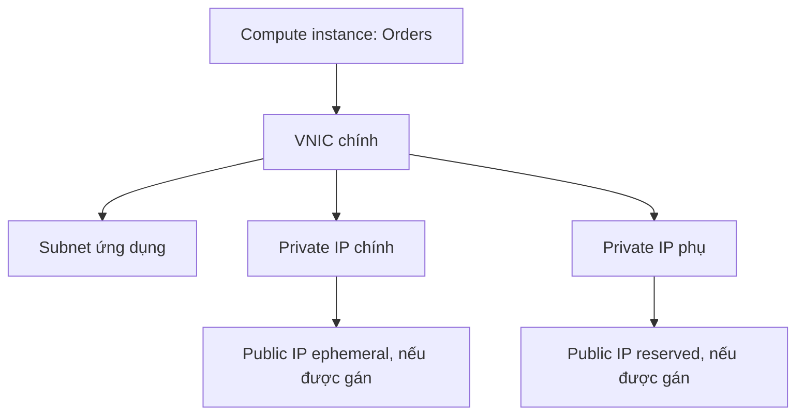

# VNIC, private IP, public IP và reserved public IP

## Mục tiêu và bối cảnh

Trong chương **Mạng Virtual Cloud Network** của module **CLOUD_PROVIDERS_ORACLE**, địa chỉ IP cần được hiểu cùng đối tượng mạng sở hữu nó. Khi một ứng dụng Java trên OCI Compute không nhận được kết nối, việc nhìn thấy public IP trong Console mới chỉ xác nhận một phần cấu hình.

Bài học sử dụng các địa chỉ IPv4 đơn lẻ để giải thích quan hệ giữa Compute instance, VNIC, private IP và public IP. Từ đó, bạn có thể chọn cách cấp địa chỉ phù hợp, kiểm tra vòng đời của chúng và chuẩn bị việc thay máy hoặc chuyển điểm phục vụ.

Sau bài học, bạn có thể:

- Phân biệt VNIC chính, VNIC phụ, private IP chính và private IP phụ.
- Giải thích public IP liên kết với private IP như thế nào.
- Chọn ephemeral hoặc reserved public IP theo vòng đời cần thiết.
- Kiểm tra các điều kiện để một dịch vụ nhận kết nối từ Internet.
- Đọc thông tin IP bằng OCI CLI và đối chiếu với cấu hình trong máy.
- Nhận diện giới hạn của việc chuyển IP khi thiết kế tính sẵn sàng.

## 1. Bốn khái niệm nằm ở những lớp khác nhau

| Khái niệm | Vai trò | Ví dụ trong một triển khai |
| --- | --- | --- |
| VNIC, Virtual Network Interface Card | Giao diện mạng ảo kết nối instance vào subnet | Giao diện của máy chạy Orders trong subnet ứng dụng |
| Private IP | Địa chỉ của đối tượng IP trên VNIC, thuộc không gian địa chỉ subnet | Địa chỉ ứng dụng dùng để gọi database nội bộ |
| Public IP | Đối tượng địa chỉ công khai được liên kết với một private IP phù hợp | Địa chỉ người dùng bên ngoài gọi đến máy |
| Reserved public IP | Một loại public IP có vòng đời độc lập với máy được gắn | Địa chỉ giữ lại để chuyển sang máy thay thế |

**Reserved public IP là một loại public IP**, không phải một lớp giao diện mạng mới. Hai loại public IP cần phân biệt trong bài là **ephemeral** và **reserved**.

Một instance có thể có nhiều VNIC; một VNIC có thể có nhiều private IP. Vì vậy, câu “IP của máy” chưa đủ rõ khi đang chẩn đoán lỗi hoặc viết tự động hóa. Cần xác định đúng VNIC và đúng đối tượng private IP.

### Quan hệ đối tượng



Sơ đồ thể hiện một cấu hình minh họa: public IP được gán vào **đối tượng private IP** liên kết với VNIC. Một reserved public IP cũng có thể gán vào private IP chính. [Tham khảo Public IP Addresses](https://docs.oracle.com/en-us/iaas/Content/Network/Tasks/managingpublicIPs.htm).

Không thể lấy một public IP bất kỳ rồi tự nhập vào giao diện hệ điều hành để thay cho việc gán đối tượng trong OCI. Trong mô hình này, địa chỉ private trên máy và liên kết public IP trong OCI cần khớp với cấu hình thực tế.

## 2. VNIC: giao diện của instance trong VCN

### 2.1. VNIC chính được tạo cùng instance

Khi khởi tạo Compute instance, OCI tạo và gắn primary VNIC vào subnet được chọn. Trong cấu hình IPv4 đang xét, VNIC nhận một primary private IP từ subnet. Bạn có thể chỉ định địa chỉ hợp lệ còn trống hoặc để OCI chọn.

Primary VNIC gắn với vòng đời instance và không thể được tháo như VNIC phụ. [Tham khảo mô tả Compute instance](https://docs.oracle.com/en-us/iaas/tools/oci-cli/latest/oci_cli_docs/cmdref/compute/instance.html).

Các thuộc tính cần nhận diện khi làm việc với một VNIC gồm:

- OCID của VNIC.
- Subnet chứa VNIC.
- MAC address để đối chiếu với giao diện trong hệ điều hành.
- Private IP chính và các private IP phụ.
- Những NSG áp dụng cho VNIC.
- Các thuộc tính ảnh hưởng đến đường đi của gói tin.

Đừng dựa duy nhất vào tên như `eth0` hoặc `ens3` trong tài liệu mẫu. Tên giao diện thực tế phụ thuộc image và cấu hình hệ điều hành; MAC address giúp đối chiếu chính xác hơn.

### 2.2. VNIC phụ dùng khi cần kết nối mạng riêng biệt

Secondary VNIC có thể kết nối instance vào subnet khác, kể cả subnet của VCN khác nếu đáp ứng các điều kiện hỗ trợ. Cần xét availability domain của instance và subnet; subnet regional không biến VNIC thành một tài nguyên có thể gắn vào máy ở region khác.

Secondary VNIC được tạo cùng thao tác gắn vào instance. Khi tháo, nó bị xóa; không tồn tại như một giao diện để dành rồi mang sang máy khác. Số VNIC hỗ trợ phụ thuộc shape. [Tham khảo Virtual Network Interface Cards](https://docs.oracle.com/en-us/iaas/Content/Network/Tasks/managingVNICs.htm).

Một tình huống có thể cần VNIC phụ là máy đóng vai trò thiết bị mạng giữa các vùng kết nối. Với ứng dụng Java thông thường, trước khi thêm VNIC, hãy xác định nhu cầu thực sự: cần thêm địa chỉ trong cùng subnet hay cần một kết nối sang subnet khác?

### 2.3. Thêm VNIC và thêm private IP là hai việc khác nhau

| Nhu cầu | Hướng thiết kế cần xem xét |
| --- | --- |
| Nhiều địa chỉ dịch vụ trong cùng subnet | Thêm secondary private IP trên VNIC hiện có |
| Kết nối sang subnet khác | Cân nhắc secondary VNIC |
| Tăng khả năng phục vụ khi một máy hỏng | Nhiều instance và cơ chế phân phối hoặc chuyển dịch vụ |
| Tăng băng thông | Đánh giá shape và giới hạn mạng; không suy rằng thêm VNIC tự tăng băng thông |

Nếu có nhiều giao diện, cần kiểm tra route trong hệ điều hành và đường trả về. Một kết nối đi vào VNIC A nhưng phản hồi đi ra VNIC B có thể gặp lỗi do định tuyến bất đối xứng hoặc các lớp kiểm soát liên quan.

Đây là lý do không nên thêm nhiều VNIC cùng subnet chỉ để “cho đủ IP” khi secondary private IP đáp ứng được nhu cầu với cấu hình đơn giản hơn.

## 3. Private IP chính và private IP phụ

### 3.1. “Chính” và “phụ” được xét riêng ở từng lớp

Một VNIC phụ vẫn có private IP chính của nó:

```text
Instance Orders
├── Primary VNIC, subnet 10.20.1.0/24
│   ├── Primary private IP:   10.20.1.10
│   └── Secondary private IP: 10.20.1.20
└── Secondary VNIC, subnet 10.20.2.0/24
    └── Primary private IP:   10.20.2.10
```

Các địa chỉ trong ví dụ chỉ minh họa cấu trúc, không phải địa chỉ được cấp cho một tenancy thực tế.

Primary private IP được cấp cùng VNIC. Đối với VNIC chính của instance, địa chỉ này giữ ổn định trong vòng đời máy. Việc một private IP là “phụ” không đồng nghĩa nó nằm trên VNIC phụ. [Tham khảo Private IP Addresses](https://docs.oracle.com/en-us/iaas/Content/Network/Tasks/managingIPaddresses.htm).

### 3.2. Private IP phục vụ giao tiếp nội bộ

Ứng dụng có thể dùng private IP để kết nối tới các máy trong mạng được định tuyến phù hợp, hoặc tới hệ thống doanh nghiệp qua kết nối riêng đã thiết lập. “Private” không đồng nghĩa mọi tài nguyên trong tenancy đều truy cập được.

Một kết nối từ Orders đến Oracle Database cần đồng thời có:

- Endpoint database đúng.
- Đường mạng đến endpoint và đường phản hồi.
- Rule mạng cho phép đúng giao thức và cổng.
- Dịch vụ database đang sẵn sàng.
- Thông tin xác thực và quyền database phù hợp.

Tương tự, IAM cho phép người dùng xem thông tin một VNIC không tự mở cổng mạng tới máy đó. Quyền quản trị tài nguyên và lưu lượng ứng dụng là các lớp riêng.

### 3.3. Secondary private IP cần cấu hình ở OCI và trong máy

Khi thêm secondary private IP, phải bảo đảm cả đối tượng phía OCI lẫn cấu hình hệ điều hành đều sẵn sàng sử dụng địa chỉ đó.

Trên Linux, lệnh thêm địa chỉ tạm thời chỉ thay đổi trạng thái hiện tại và có thể mất sau reboot. Cấu hình lâu dài phụ thuộc bản phân phối và công cụ quản lý mạng; Oracle hướng dẫn dùng cơ chế phù hợp như NetworkManager cho các phiên bản Oracle Linux liên quan. [Tham khảo cấu hình Linux cho secondary private IP](https://docs.oracle.com/en-us/iaas/Content/Network/Tasks/managingIPaddresses_topic-Linux_Details_about_Secondary_IP_Addresses.htm).

Để quan sát trước khi thay đổi, có thể dùng:

```bash
ip -br address
ip route
```

Đây là lệnh kiểm tra bên trong máy Linux. Không sao chép tên giao diện hoặc địa chỉ từ bài vào hệ thống thật mà chưa đối chiếu.

Tạo một địa chỉ bằng lệnh hệ điều hành nhưng chưa cấp nó cho VNIC trong OCI không phải là quy trình gán private IP hoàn chỉnh. Chiều ngược lại, Console đã có địa chỉ mà hệ điều hành chưa dùng đúng cũng có thể khiến dịch vụ không hoạt động.

### 3.4. Chuyển secondary private IP sang VNIC khác

Secondary private IP có thể được chuyển giữa các VNIC **trong cùng subnet** theo thao tác OCI hỗ trợ. Đây là khả năng chuyển đối tượng IP, khác với việc chuyển primary VNIC hoặc chuyển địa chỉ tự do giữa mọi subnet. [Tham khảo Moving a Secondary Private IP](https://docs.oracle.com/en-us/iaas/Content/Network/Tasks/private-ip-address-move-vnic.htm).

Ví dụ, hai máy A và B cùng có VNIC trong subnet `10.20.1.0/24`. Địa chỉ dịch vụ `10.20.1.20` có thể được thiết kế là secondary private IP, rồi chuyển sang máy B khi cần.

Quy trình ứng dụng vẫn phải giải quyết:

- Máy B đã có cấu hình mạng và dịch vụ tương ứng chưa?
- Dữ liệu của máy B có đúng và cập nhật không?
- Máy A đã ngừng phục vụ vai trò cũ chưa?
- Client có cần kết nối lại không?
- Có cơ chế kiểm tra sức khỏe và điều phối thao tác chuyển không?

Một địa chỉ chuyển được không tự tạo thành giải pháp failover hoàn chỉnh.

## 4. Public IP: địa chỉ công khai chưa đủ để dịch vụ truy cập được

### 4.1. Public subnet cho phép gán public IP

Với Compute trong mô hình đang xét, VNIC phải nằm trong public subnet để private IP của nó được gán public IP. Tuy nhiên, không phải mọi instance trong public subnet đều bắt buộc có public IP.

Một máy trong public subnet có thể chỉ dùng private IP nếu không được gán public IP. Vì vậy, hãy kiểm tra thuộc tính thực tế thay vì suy từ tên subnet. [Tham khảo Scenario A: Public Subnet](https://docs.oracle.com/en-us/iaas/Content/Network/Tasks/scenarioa.htm).

Nếu ứng dụng cần cơ sở dữ liệu Oracle nội bộ, một lựa chọn thiết kế là đặt tầng dữ liệu trong private subnet và chỉ cho phép kết nối từ tầng ứng dụng đã xác định. Không cần public IP cho database chỉ để ứng dụng trong mạng riêng gọi tới nó.

### 4.2. Các điều kiện cho đường Internet trực tiếp

Để client trên Internet gọi dịch vụ trên một Compute instance qua public IPv4, cần kiểm tra theo chuỗi:

```text
Client
  -> Public IP đang gán đúng đích
  -> Internet Gateway và route phù hợp
  -> Rule mạng cho phép
  -> Private IP trên VNIC
  -> Firewall trong hệ điều hành
  -> Tiến trình lắng nghe đúng địa chỉ và cổng
```

Một cấu hình định tuyến cơ bản thường có route `0.0.0.0/0` trỏ đến Internet Gateway cho lưu lượng ra tương ứng. Route không tự mở mọi cổng vào máy; rule mạng vẫn quyết định lưu lượng được phép. [Tham khảo Internet Gateway](https://docs.oracle.com/en-us/iaas/Content/Network/Tasks/managingIGs.htm).

Chuỗi trên dùng cho cấu hình đơn giản. Nếu hệ thống có firewall trung gian, route riêng cho tài nguyên hoặc cơ chế bảo vệ bổ sung, cần kiểm tra cả những thành phần đó.

Khi chẩn đoán, nên ghi rõ nguồn, đích, giao thức và cổng, ví dụ: “máy quản trị được phép kết nối TCP đến cổng ứng dụng trên public IP của Orders”. Câu “Internet không vào được” quá rộng để xác định nguyên nhân.

### 4.3. Public IP không thay thế kiểm soát truy cập

Có public IP không đồng nghĩa cổng SSH, RDP hoặc cổng ứng dụng đã mở. Cũng không đồng nghĩa dịch vụ có xác thực, mã hóa hay cấu hình production phù hợp.

Security list và NSG cần được kiểm tra cùng nhau. Đừng cho rằng một NSG hẹp tự phủ định rule cho phép rộng ở lớp khác. [Tham khảo Security Rules](https://docs.oracle.com/en-us/iaas/Content/Network/Concepts/securityrules.htm).

Trong bài thực hành, chỉ cho phép địa chỉ nguồn và cổng cần thiết. Với hệ thống thật, lựa chọn điểm vào còn phụ thuộc kiến trúc: client có thể gọi load balancer thay vì gọi thẳng từng máy ứng dụng.

### 4.4. Private subnet vẫn có thể khởi tạo kết nối ra ngoài

Một instance không có public IP vẫn có thể truy cập Internet qua NAT Gateway nếu route và các lớp kiểm soát cho phép. NAT Gateway phục vụ kết nối do phía private khởi tạo và lưu lượng phản hồi; nó không tự tạo điểm nhận kết nối mới từ Internet vào instance. [Tham khảo NAT Gateway Metrics và mô tả chức năng](https://docs.oracle.com/en-us/iaas/Content/Network/Reference/nat-gateway-metrics.htm).

Ví dụ:

- Máy ứng dụng gọi ra kho gói phần mềm qua NAT: có thể phù hợp.
- Client bên ngoài gọi API vào public IP của NAT để đến máy ứng dụng: không phải chức năng đó.
- Máy ứng dụng gọi database nội bộ: cần đường mạng riêng phù hợp, không cần gán public IP cho cả hai chỉ để chúng giao tiếp.

Nếu cần truy cập dịch vụ OCI như Object Storage, cũng phải phân biệt điểm kết nối dịch vụ, quyền IAM và lựa chọn đường mạng. Public IP của một Compute instance không đại diện cho mọi dịch vụ mà ứng dụng sử dụng.

## 5. Ephemeral và reserved public IP

### 5.1. So sánh ngắn

| Đặc điểm | Ephemeral public IP | Reserved public IP |
| --- | --- | --- |
| Private IP đích | Chỉ private IP chính của VNIC | Private IP chính hoặc phụ |
| Khi bỏ gán | Đối tượng bị xóa | Địa chỉ được giữ lại |
| Chuyển sang đích khác | Không chuyển được | Có thể gán lại trong cùng region |
| Mục đích điển hình | Máy thử nghiệm ngắn hạn | Điểm địa chỉ cần giữ qua thay máy |

Dừng instance không tự giải phóng ephemeral public IP; địa chỉ vẫn được gán khi instance ở trạng thái stopped. Ngoài ra, không thể chuyển một ephemeral public IP thành reserved mà giữ nguyên địa chỉ đó. [Tham khảo bảng đặc tính Public IP Addresses](https://docs.oracle.com/en-us/iaas/Content/Network/Tasks/managingpublicIPs.htm).

Thuật ngữ “tạm thời” ở đây mô tả vòng đời đối tượng. Không nên suy rằng mỗi lần reboot hoặc stop/start đều phải nhận địa chỉ mới.

### 5.2. Ephemeral phù hợp khi địa chỉ không cần được giữ độc lập

Ví dụ, một máy dev được tạo để kiểm tra ứng dụng rồi xóa sau buổi thực hành có thể dùng ephemeral public IP nếu thiết kế cho phép truy cập công khai.

Khi máy bị thay bằng một instance mới, đừng giả định địa chỉ cũ sẽ được cấp lại. Nếu DNS, script hoặc hệ thống đối tác ghi trực tiếp địa chỉ đó, quy trình thay máy phải cập nhật những phụ thuộc này.

Có thể gán ephemeral public IP cho private IP chính đã tồn tại nếu đáp ứng điều kiện; private IP đích không được đang có public IP khác. [Tham khảo Assigning an Ephemeral Public IP](https://docs.oracle.com/iaas/Content/Network/Tasks/assigning-ephemeral-public-existing-private-ip.htm).

### 5.3. Reserved tách địa chỉ khỏi vòng đời máy phục vụ

Bạn có thể tạo reserved public IP trước khi gán vào máy. Việc bỏ gán đưa nó trở lại nhóm địa chỉ reserved của tenancy, thay vì xóa đối tượng. [Tham khảo Creating a Reserved Public IP](https://docs.oracle.com/en-us/iaas/Content/Network/Tasks/reserved-public-ip-create.htm) và [Unassigning a Reserved Public IP](https://docs.oracle.com/en-us/iaas/Content/Network/Tasks/reserved-public-ip-unassign.htm).

Một kế hoạch thay máy có thể là:

```text
Trước thay đổi:
Reserved public IP -> Private IP của máy A -> Orders phiên bản hiện tại

Chuẩn bị:
Máy B có ứng dụng, cấu hình và dữ liệu cần thiết

Sau chuyển:
Reserved public IP -> Private IP của máy B -> Orders phiên bản mới
```

Reserved public IP của Compute có phạm vi regional. Khi thiết kế chuyển sang tài nguyên ở region khác, cần một phương án địa chỉ hoặc điểm vào khác phù hợp; không thể coi việc giữ IP trong một region là cơ chế chuyển region.

Một reserved public IP đang gán cho một private IP không đồng thời làm địa chỉ chung cho nhiều máy nhận cùng lưu lượng. Nếu cần phân phối request giữa nhiều backend, hãy thiết kế thành phần cân bằng tải hoặc điều phối thích hợp.

### 5.4. Bỏ gán và xóa là hai thao tác khác nhau

| Thao tác | Kết quả cần hiểu | Rủi ro vận hành |
| --- | --- | --- |
| Bỏ gán reserved public IP | Giữ đối tượng để gán lại | Điểm nhận lưu lượng bị gián đoạn nếu chưa có phương án thay thế |
| Xóa reserved public IP | Kết thúc việc giữ đối tượng địa chỉ | Không nên giả định có thể lấy lại đúng địa chỉ đã xóa |
| Bỏ gán ephemeral public IP | Địa chỉ ephemeral bị xóa | Không dùng thao tác này nếu đang kỳ vọng chuyển chính địa chỉ đó |

Khi dùng công cụ quản lý hạ tầng, cần xem kế hoạch thay đổi có đang thay thế hoặc xóa đối tượng reserved public IP không. Chỉ muốn thay Compute instance không có nghĩa bạn muốn hủy luôn địa chỉ được dành cho dịch vụ.

Một địa chỉ reserved còn giữ lại cũng cần chủ sở hữu và lý do tồn tại. Định kỳ rà soát những địa chỉ không còn gán, kiểm tra hạn mức và thông tin tính phí hiện hành trước khi lập dự toán. Không xem “chưa dùng” là bằng chứng rằng tài nguyên không cần quản lý.

## 6. Reserved public IP hỗ trợ chuyển đích, nhưng không tự bảo đảm sẵn sàng

### 6.1. Một kịch bản chuyển dịch vụ Orders

Giả sử public IP của Orders đang gắn vào private IP của máy A. Bạn muốn chuyển sang máy B.

Trước khi đổi liên kết, kiểm tra:

1. Máy B ở region phù hợp và VNIC của nó đáp ứng điều kiện gán public IP.
2. Đã chọn đúng đối tượng private IP của máy B.
3. Private IP đích chưa có public IP gây xung đột.
4. Route, NSG, security list và firewall máy B cho phép luồng mong muốn.
5. Ứng dụng đang chạy và có thể xử lý request kiểm tra.
6. Dữ liệu, cấu hình, secret và chứng chỉ phục vụ đúng môi trường.
7. Có phương án quay lại máy A nếu kiểm tra sau chuyển không đạt.

OCI hỗ trợ gán reserved public IP sang private IP khác; địa chỉ đích cần chưa có public IP đã gán. [Tham khảo Reassigning a Reserved Public IP](https://docs.oracle.com/en-us/iaas/Content/Network/Tasks/reserved-public-ip-reassign.htm).

### 6.2. Thành công của lệnh API chưa phải thành công của dịch vụ

Các thao tác gán, chuyển và bỏ gán reserved public IP là bất đồng bộ. Cần kiểm tra trạng thái đối tượng và đích liên kết sau thao tác. Việc bỏ liên kết cũ có thể thành công trong khi việc gán đích mới gặp lỗi. [Tham khảo OCI CLI public-ip update](https://docs.oracle.com/en-us/iaas/tools/oci-cli/latest/oci_cli_docs/cmdref/network/public-ip/update.html).

Sau khi OCI báo trạng thái phù hợp, vẫn cần gửi request thực tế từ vị trí client dự kiến. Một máy có IP đúng nhưng Java process chỉ lắng nghe localhost hoặc chưa kết nối được database vẫn không phục vụ được người dùng.

### 6.3. Giữ nguyên địa chỉ không giữ nguyên phiên kết nối

Khi chuyển đích, kết nối TCP hiện có có thể bị ngắt. IP không mang theo bộ nhớ ứng dụng, session cục bộ, file chưa đồng bộ hoặc trạng thái giao dịch.

Với Orders, cần quyết định:

- Session có lưu ở nơi dùng chung hoặc có thể tái tạo không?
- Request đang xử lý có được hoàn tất trước khi chuyển không?
- Client có cơ chế thử lại phù hợp và tránh tạo đơn hàng trùng không?
- Máy B có sử dụng cùng nguồn dữ liệu hợp lệ không?
- Ai phát hiện lỗi, quyết định chuyển và kiểm tra kết quả?

Không nên dùng một reserved public IP như bằng chứng duy nhất rằng kiến trúc đã có high availability.

### 6.4. Chuyển public IP và chuyển private IP là hai lựa chọn khác nhau

| Lựa chọn | Đối tượng được đổi | Điều kiện nổi bật |
| --- | --- | --- |
| Gán lại reserved public IP | Liên kết từ public IP sang private IP đích khác | Đích trong cùng region và đáp ứng điều kiện |
| Chuyển secondary private IP | VNIC sở hữu private IP phụ | Các VNIC trong cùng subnet |

Nếu một reserved public IP đang gắn với secondary private IP được chuyển bằng cơ chế được hỗ trợ, cần kiểm tra cả liên kết public IP sau chuyển. Quy trình phải xác nhận đối tượng thực tế, không chỉ kiểm tra chuỗi số địa chỉ.

Chọn cách nào còn phụ thuộc client dùng địa chỉ private hay public, cấu trúc subnet và cách ứng dụng giữ trạng thái.

## 7. Đọc thông tin VNIC và IP bằng OCI CLI

### 7.1. Lần theo đối tượng thay vì chỉ tìm một địa chỉ

Chuỗi tra cứu hữu ích:

```text
Instance OCID
  -> VNIC attachment
  -> VNIC OCID
  -> Private IP OCID
  -> Public IP OCID, nếu có
```

VNIC attachment mô tả việc gắn VNIC với instance. OCID của attachment và OCID của VNIC là hai giá trị khác nhau; không đưa nhầm attachment OCID vào tham số `--vnic-id`.

Các lệnh dưới đây chạy trên máy quản trị có OCI CLI và profile được cấu hình. Chúng chỉ đọc thông tin, không thay đổi tài nguyên:

```powershell
$targetRegion = '<OCI_REGION>'
$instanceCompartmentOcid = '<INSTANCE_COMPARTMENT_OCID>'
$instanceOcid = '<INSTANCE_OCID>'

oci compute vnic-attachment list --profile OCI_LAB --region $targetRegion --compartment-id $instanceCompartmentOcid --instance-id $instanceOcid --all
```

Trong kết quả, chọn attachment đang gắn với instance mong muốn rồi lấy trường `vnic-id`. OCI cung cấp lệnh liệt kê attachment để tìm các VNIC của instance. [Tham khảo Listing an Instance's VNICs](https://docs.oracle.com/en-us/iaas/Content/Network/Tasks/managingvnics_tasks-list.htm).

Tiếp tục:

```powershell
$vnicOcid = '<VNIC_OCID>'

oci network vnic get --profile OCI_LAB --region $targetRegion --vnic-id $vnicOcid
oci network private-ip list --profile OCI_LAB --region $targetRegion --vnic-id $vnicOcid --all
```

Danh sách private IP theo VNIC gồm cả địa chỉ chính và phụ. Khi chọn đích để gán public IP, lấy **OCID của private IP**, không lấy chuỗi địa chỉ hoặc OCID của VNIC. [Tham khảo OCI CLI private-ip list](https://docs.oracle.com/en-us/iaas/tools/oci-cli/latest/oci_cli_docs/cmdref/network/private-ip/list.html).

### 7.2. Tra public IP đang liên kết

```powershell
$privateIpOcid = '<PRIVATE_IP_OCID>'

oci network public-ip get --profile OCI_LAB --region $targetRegion --private-ip-id $privateIpOcid
```

Lệnh `get` hỗ trợ tra theo private IP OCID; cũng có thể tra một public IP đã biết bằng public IP OCID. [Tham khảo OCI CLI public-ip get](https://docs.oracle.com/en-us/iaas/tools/oci-cli/latest/oci_cli_docs/cmdref/network/public-ip/get.html).

Những trường cần đối chiếu gồm:

| Trường | Điều cần kiểm tra |
| --- | --- |
| `id` | Có đúng đối tượng public IP đang quản lý không |
| `ip-address` | Địa chỉ client đang dùng có khớp không |
| `lifetime` | Là `EPHEMERAL` hay `RESERVED` |
| `scope` | Phạm vi đối tượng có phù hợp kế hoạch chuyển không |
| `private-ip-id` | Đang gắn vào đúng private IP chưa |
| `lifecycle-state` | Thao tác đã hoàn tất hay đang chuyển trạng thái |

Mô hình PublicIp trong OCI SDK thể hiện riêng địa chỉ, lifetime, scope, đích liên kết và trạng thái. Đây là những thông tin khác nhau, cần kiểm tra cùng nhau. [Tham khảo PublicIp trong OCI Java SDK](https://docs.oracle.com/en-us/iaas/tools/java/latest/com/oracle/bmc/core/model/PublicIp.html).

Nếu lệnh không trả về thông tin mong muốn, kiểm tra region, quyền IAM, OCID và việc private IP có public IP hay không. Một lỗi API đơn lẻ chưa đủ để kết luận mạng của ứng dụng bị lỗi.

### 7.3. Kiểm tra phía hệ điều hành và dịch vụ Java

Bên trong máy Linux:

```bash
ip -br address
ip route
ss -lnt
```

Đối chiếu:

- Địa chỉ private cần dùng đã xuất hiện trên đúng giao diện chưa?
- Route đi ra có đúng với nguồn và đích đang kiểm tra không?
- Cổng ứng dụng đã ở trạng thái lắng nghe chưa?
- Ứng dụng bind vào localhost, một private IP cụ thể hay mọi giao diện phù hợp?

Nếu Java process chỉ lắng nghe `127.0.0.1:8080`, client ngoài máy không thể truy cập theo cách giống một dịch vụ đang lắng nghe trên private IP của VNIC. Cần cấu hình địa chỉ lắng nghe đúng với kiến trúc và framework đang dùng.

Có thể kiểm tra endpoint nội bộ do ứng dụng thực sự cung cấp:

```bash
curl --fail --show-error http://127.0.0.1:8080/health
```

`/health` chỉ là đường dẫn minh họa; ứng dụng cần có endpoint tương ứng hoặc bạn thay bằng endpoint kiểm tra đã biết. Localhost thành công mới chứng minh ứng dụng phản hồi cục bộ, chưa chứng minh client bên ngoài gọi được.

Hệ điều hành có thể chỉ hiển thị địa chỉ private của giao diện. Không xem việc không thấy public IP trong `ip address` là bằng chứng rằng liên kết public IP trong OCI chưa tồn tại.

## 8. Thực hành: tạo và chuyển reserved public IP trong khu vực thử nghiệm

### 8.1. Điều kiện

Chuẩn bị một khu vực thực hành được phép sử dụng:

- Hai instance A và B trong cùng region.
- VNIC đích nằm trong public subnet phù hợp.
- Các private IP đích được xác minh và chưa có public IP gây xung đột.
- Một dịch vụ kiểm tra đơn giản trên mỗi máy, trả về thông tin phân biệt A và B.
- Route, rule mạng và firewall cho phép nguồn kiểm thử kết nối.
- IAM cho phép đọc và quản lý những đối tượng cần thiết.
- Danh sách tài nguyên cần giữ hoặc dọn sau thực hành.

Không thực hiện bước chuyển trên địa chỉ đang phục vụ người dùng thật. Nếu đã có public IP ở đích, cần đánh giá tác động trước khi thay đổi nó; không xóa địa chỉ đang dùng chỉ để làm cho lệnh mẫu chạy được.

### 8.2. Tạo reserved public IP

Các lệnh trong phần này **thay đổi tài nguyên OCI** khi được người học thực thi. Chạy sau khi đã thay placeholder và kiểm tra profile, region, compartment.

```powershell
$targetRegion = '<OCI_REGION>'
$publicIpCompartmentOcid = '<PUBLIC_IP_COMPARTMENT_OCID>'

oci network public-ip create --profile OCI_LAB --region $targetRegion --compartment-id $publicIpCompartmentOcid --lifetime RESERVED --display-name 'orders-lab-public-ip'
```

Ghi lại OCID và địa chỉ trả về. Lệnh trên tạo reserved public IP mà chưa chỉ định private IP đích; việc gán có thể thực hiện sau. [Tham khảo OCI CLI public-ip create](https://docs.oracle.com/en-us/iaas/tools/oci-cli/latest/oci_cli_docs/cmdref/network/public-ip/create.html).

Đừng lấy `display-name` làm định danh duy nhất cho tự động hóa. Các thao tác tiếp theo sử dụng OCID đã xác nhận.

### 8.3. Gán vào private IP của máy A

```powershell
$reservedPublicIpOcid = '<RESERVED_PUBLIC_IP_OCID>'
$privateIpAOcid = '<PRIVATE_IP_A_OCID>'

oci network public-ip update --profile OCI_LAB --region $targetRegion --public-ip-id $reservedPublicIpOcid --private-ip-id $privateIpAOcid
oci network public-ip get --profile OCI_LAB --region $targetRegion --public-ip-id $reservedPublicIpOcid
```

Kiểm tra lại trạng thái và `private-ip-id` cho đến khi kết quả xác nhận đã gán đúng A. Sau đó, từ máy kiểm thử được phép, gọi địa chỉ public và xác nhận phản hồi từ A. [Tham khảo Assigning a Reserved Public IP](https://docs.oracle.com/en-us/iaas/Content/Network/Tasks/reserved-public-ip-assign.htm).

Không cần đổi cấu hình ứng dụng sang bind vào chuỗi public IP để hoàn tất thao tác này. Điều cần xác nhận là private IP, giao diện và địa chỉ lắng nghe phù hợp.

### 8.4. Chuyển sang private IP của máy B

Sau khi B đã phục vụ tốt qua đường kiểm tra nội bộ:

```powershell
$privateIpBOcid = '<PRIVATE_IP_B_OCID>'

oci network public-ip update --profile OCI_LAB --region $targetRegion --public-ip-id $reservedPublicIpOcid --private-ip-id $privateIpBOcid
oci network public-ip get --profile OCI_LAB --region $targetRegion --public-ip-id $reservedPublicIpOcid
```

Tiếp tục đọc trạng thái đến khi xác nhận liên kết với B đã hoàn tất. Nếu lỗi hoặc trạng thái không đạt, dừng quy trình chuyển và kiểm tra kết quả hiện tại trước khi quyết định quay lại.

Gửi **request mới** tới cùng địa chỉ public, xác nhận phản hồi từ B. Ghi nhận thời gian gián đoạn quan sát được và hành vi của các kết nối đang mở. Đừng suy kết quả từ một cửa sổ trình duyệt có thể đang dùng cache hoặc giữ phiên cũ.

### 8.5. Hồ sơ kết quả

| Thời điểm | Thông tin cần ghi |
| --- | --- |
| Trước gán | Public IP OCID, lifetime, trạng thái; private IP A và B |
| Sau gán A | Liên kết đến A, trạng thái cuối, phản hồi từ A |
| Sau chuyển B | Địa chỉ public vẫn giữ, liên kết đến B, phản hồi từ B |
| Khi có lỗi | Kết quả API, đối tượng thực tế đang gán, bước xử lý |
| Sau thực hành | Đối tượng nào được giữ, bỏ gán hoặc xóa theo kế hoạch |

Không đưa secret, private key hoặc token vào hồ sơ thực hành.

Nếu chỉ bỏ gán reserved public IP, đối tượng vẫn còn. Nếu mục tiêu là kết thúc thực hành và không cần giữ địa chỉ, thực hiện dọn dẹp theo danh sách đã xác nhận, đồng thời kiểm tra không còn DNS hoặc hệ thống nào phụ thuộc vào địa chỉ đó.

## 9. Chẩn đoán các tình huống thường gặp

| Triệu chứng | Giả thuyết cần kiểm tra | Bằng chứng nên thu thập |
| --- | --- | --- |
| Console có public IP nhưng request timeout | Route, gateway, rule mạng, firewall, đường trả về hoặc đích sai | Đối tượng IP, cấu hình tuyến, rule và kết quả từ vị trí client |
| Kết nối bị từ chối | Chưa có tiến trình lắng nghe hoặc có lớp chủ động từ chối | `ss -lnt`, log ứng dụng, cấu hình firewall |
| Localhost hoạt động nhưng private IP không hoạt động | Bind address hoặc firewall trong máy chưa phù hợp | Địa chỉ lắng nghe và thử từ máy khác |
| Private IP hoạt động nhưng public IP không hoạt động | Liên kết public IP hoặc đường Internet chưa đúng | Public IP OCID, đích private IP, gateway và route |
| Secondary IP xuất hiện trong OCI nhưng không dùng được | Cấu hình OS, rule hoặc route theo nguồn chưa đúng | Địa chỉ trên giao diện và bảng định tuyến |
| Sau reboot, secondary IP không còn trong OS | Cấu hình chỉ được thêm tạm thời | Cấu hình mạng lâu dài và trạng thái sau boot |
| Reserved IP đã chuyển nhưng ứng dụng vẫn lỗi | Gán chưa hoàn tất, dịch vụ B chưa sẵn sàng hoặc trạng thái ứng dụng thiếu | Lifecycle state, đích liên kết, request mới và log B |
| Không tìm thấy reserved IP dự kiến | Sai region, compartment, quyền hoặc đối tượng đã bị xóa | OCID trong hồ sơ và kết quả tra cứu đối chứng |

Các triệu chứng trên là gợi ý, không phải kết luận duy nhất. Ví dụ, timeout có thể do nhiều lớp; không nên mở rộng tất cả rule mạng chỉ để thử làm kết nối thành công.

Một cách làm hiệu quả là kiểm tra từ trong ra ngoài:

1. Tiến trình có phản hồi cục bộ không?
2. Private IP có đúng trên VNIC và trong máy không?
3. Client nội bộ được phép có gọi được không?
4. Public IP có trỏ đúng private IP không?
5. Đường Internet và các lớp cho phép có đúng không?
6. DNS có đang trả về đúng địa chỉ và client có dùng kết quả mới không?

Ping thành công hoặc thất bại không tự chứng minh cổng ứng dụng hoạt động hay bị chặn. Kiểm tra đúng giao thức và cổng mà ứng dụng sử dụng.

## 10. Lựa chọn địa chỉ theo nhu cầu ứng dụng

| Nhu cầu | Hướng lựa chọn |
| --- | --- |
| Ứng dụng gọi database nội bộ | Private IP hoặc tên dịch vụ nội bộ, kèm đường mạng và quyền phù hợp |
| Máy dev ngắn hạn cần truy cập trực tiếp từ ngoài | Cân nhắc ephemeral public IP trong phạm vi thực hành đã kiểm soát |
| Giữ một địa chỉ khi thay Compute instance | Cân nhắc reserved public IP và quy trình chuyển đích |
| Nhiều backend phục vụ cùng dịch vụ | Thiết kế điểm vào và cân bằng tải phù hợp |
| Máy private cần gọi ra Internet | Cân nhắc NAT Gateway thay vì gán public IP cho từng máy |
| Điểm dịch vụ private cần chuyển giữa hai máy cùng subnet | Cân nhắc secondary private IP cùng cơ chế điều phối |
| Dự phòng sang region khác | Thiết kế cơ chế chuyển điểm vào phù hợp với nhiều region |

Với ứng dụng production, nên đánh giá địa chỉ theo vai trò của dịch vụ, thay vì chỉ gắn một IP cố định vào từng máy. Một điểm vào ổn định cần đi cùng giám sát, khả năng khôi phục, quản lý cấu hình và kiểm soát dữ liệu.

Trong tự động hóa, quản lý reserved public IP như một đối tượng có vòng đời riêng nếu cần giữ nó qua các lần thay máy. Trước khi áp dụng kế hoạch, xem rõ đối tượng IP đang được giữ, chuyển liên kết hay bị xóa.

## 11. Câu hỏi tự kiểm tra

1. Private IP chính của VNIC phụ có phải là secondary private IP không?
2. Public IP của Compute được liên kết trực tiếp với đối tượng nào?
3. Một instance trong public subnet nhưng không có public IP có nhận kết nối Internet trực tiếp qua Internet Gateway theo mô hình này không?
4. Những lớp nào còn cần kiểm tra sau khi đã gán public IP?
5. Vì sao NAT Gateway không phải là điểm nhận API từ Internet vào một máy private?
6. Dừng instance có tự giải phóng ephemeral public IP không?
7. Có thể chuyển ephemeral public IP thành reserved và giữ nguyên địa chỉ không?
8. Chuyển secondary private IP và gán lại reserved public IP khác nhau ở phạm vi nào?
9. Tại sao cần đọc trạng thái sau lệnh chuyển reserved public IP?
10. Giữ nguyên địa chỉ public có bảo toàn session và dữ liệu của ứng dụng không?
11. Khi không thấy public IP trong danh sách địa chỉ của Linux, cần đối chiếu gì trước khi kết luận?
12. Khi thay máy bằng công cụ tự động hóa, làm thế nào để tránh xóa nhầm reserved public IP cần giữ?

Hiểu đúng đối tượng sở hữu và vòng đời địa chỉ giúp bạn chọn cách cấp IP phù hợp, lần theo lỗi kết nối và xây dựng quy trình chuyển dịch vụ có thể kiểm chứng trên OCI.
