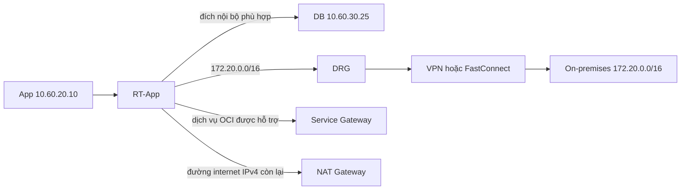

# Route tables và quy trình xác định đường đi gói tin

Trong chương **Mạng Virtual Cloud Network** của module **CLOUD_PROVIDERS_ORACLE**, route table giúp xác định next hop cho gói tin tại một điểm định tuyến. Muốn giải thích vì sao Compute truy cập được Object Storage, cơ sở dữ liệu Oracle hoặc mạng on-premises, cần xác định đúng bảng áp dụng, route được chọn và đường phản hồi.

Bài học xây dựng một quy trình phân tích từ nguồn đến đích, kết hợp định tuyến OCI với hệ điều hành, kiểm soát truy cập và công cụ quan sát. Các ví dụ hỗ trợ thiết kế hạ tầng có phân quyền, tự động hóa thay đổi mạng, duy trì tính sẵn sàng và kiểm soát chi phí đường truyền.

## Mục tiêu học tập

Sau bài này, bạn có thể:

- Đọc một route rule và giải thích destination, prefix và target.
- Xác định route table hiệu lực khi có cấu hình ở subnet, VNIC hoặc IP.
- Chọn route theo longest prefix match, kể cả khi có local route ngầm định.
- Theo dõi một luồng qua NAT Gateway, Service Gateway hoặc DRG theo cả hai chiều.
- Phân biệt thiếu route với lỗi security rule, hệ điều hành, DNS và ứng dụng.
- Thu thập bằng chứng trước khi thay đổi cấu hình định tuyến.

## 1. Route table trả lời câu hỏi nào?

Một route rule có thể đọc dưới dạng:

```text
Nếu địa chỉ đích thuộc tập địa chỉ này
→ chuyển gói tin tới target tương ứng tại điểm định tuyến hiện tại.
```

Ví dụ:

| Destination | Target minh họa | Ý nghĩa |
| --- | --- | --- |
| `172.20.0.0/16` | DRG | Chuyển traffic tới mạng này qua DRG |
| `0.0.0.0/0` | NAT Gateway | Đường IPv4 tổng quát cho traffic phù hợp đi qua NAT |
| Service CIDR label của dịch vụ OCI | Service Gateway | Đi tới tập endpoint được dịch vụ hỗ trợ |

Tên target trong các bảng của bài là nhãn dễ đọc. Khi cấu hình bằng API hoặc IaC, cần dùng định danh và kiểu target mà giao diện tương ứng yêu cầu; không thay OCID bằng một chuỗi như `DRG-ERP` chỉ vì nó là display name.

Một gói TCP có thể được mô tả bằng năm giá trị:

```text
IP nguồn, cổng nguồn, IP đích, cổng đích, giao thức
```

Ví dụ: `10.60.20.10:51000 → 172.20.8.40:1521/TCP`. Destination IP được dùng khi so khớp prefix; cổng 1521 và giao thức TCP còn cần cho security rule, firewall và ứng dụng. Cổng database thực tế phải lấy từ dịch vụ triển khai, không suy ra mọi Oracle Database đều dùng cấu hình ví dụ này.

Có đường định tuyến chưa đủ để kết nối thành công. Còn phải có đường về, các lớp kiểm soát cho phép và tiến trình đích sẵn sàng phục vụ.

## 2. Chọn đúng bảng trước khi chọn route

### 2.1. Route table của OCI khác bảng route trong máy

Một Compute instance có bảng route của hệ điều hành. Bảng đó quyết định interface, địa chỉ nguồn và gateway cục bộ được dùng. Sau khi gói đi qua VNIC vào mạng OCI, các cấu hình định tuyến của OCI tiếp tục quyết định đường đi.

Vì vậy, một lệnh xem route trong Linux không cho biết đầy đủ mọi quyết định của DRG hoặc NAT Gateway. Ngược lại, nhìn đúng route table trong Console cũng chưa chứng minh ứng dụng đã gửi gói qua đúng VNIC.

Trong máy có nhiều VNIC hoặc nhiều địa chỉ nguồn, ghi lại IP nguồn thực tế. Việc ứng dụng bind một địa chỉ khác có thể dẫn đến một bảng OCI khác được áp dụng.

### 2.2. Thứ tự chọn bảng cho traffic phát từ tài nguyên

OCI hỗ trợ per-resource routing. Thứ tự ưu tiên chọn bảng là:

```text
Route table gắn với IP nguồn
        ↓ nếu không có
Route table gắn với VNIC
        ↓ nếu không có
Route table của subnet
```

Chỉ một bảng trong chuỗi này được chọn; các bảng không được trộn lại. Nếu đã chọn bảng của IP, việc thiếu route trong bảng đó không khiến OCI tiếp tục tìm route trong bảng subnet. Tham khảo phần Per-resource Routing trong [VCN Route Tables](https://docs.oracle.com/en-us/iaas/Content/Network/Tasks/managingroutetables.htm).

Ví dụ riêng về lựa chọn bảng:

| Thành phần | Cấu hình |
| --- | --- |
| Subnet App | Dùng `RT-App`, có route tới on-premises |
| VNIC A | Gắn `RT-Restricted`, không có route tới on-premises |
| IP `10.60.20.10` trên VNIC A | Không gắn bảng riêng |

Traffic từ IP này dùng `RT-Restricted`. Một route đúng trong `RT-App` không sửa được vấn đề nếu bảng đó đang bị bỏ qua. Trước khi thêm rule, phải xác nhận bảng nào thực sự có hiệu lực.

### 2.3. Default route table khác default route

| Thuật ngữ | Ý nghĩa |
| --- | --- |
| Default route table | Bảng mặc định được VCN tạo; subnet có thể dùng nếu không chọn bảng khác |
| Default route IPv4 | Rule destination `0.0.0.0/0` |
| Default route IPv6 | Rule destination `::/0` |

Tên bảng có chữ `default` không bảo đảm đã có rule đi internet. Tương tự, một bảng tự tạo vẫn có thể chứa default route. Khi đọc cấu hình, kiểm tra rule và association thực tế thay vì suy luận từ display name.

## 3. Chọn route: prefix cụ thể nhất thắng

### 3.1. Longest prefix match

Với cùng một địa chỉ đích, có thể có nhiều prefix khớp. Prefix dài hơn mô tả tập địa chỉ nhỏ hơn và được ưu tiên.

Bảng minh họa độc lập sau giả định các target đã được chuẩn bị hợp lệ:

| Destination | Target |
| --- | --- |
| `0.0.0.0/0` | NAT Gateway |
| `172.20.0.0/16` | DRG |
| `172.20.8.0/24` | Private IP của appliance |
| `172.20.8.40/32` | DRG |

Kết quả suy luận từ bảng:

| IP đích | Các prefix khớp | Route được chọn |
| --- | --- | --- |
| `172.20.9.10` | `/0`, `/16` | `/16 → DRG` |
| `172.20.8.41` | `/0`, `/16`, `/24` | `/24 → appliance` |
| `172.20.8.40` | `/0`, `/16`, `/24`, `/32` | `/32 → DRG` |
| `198.51.100.40` | `/0` | `/0 → NAT Gateway` |

`198.51.100.40` là địa chỉ dùng cho minh họa tài liệu, không phải endpoint internet để thực hiện phép thử. Các dòng trên là bài phân tích prefix, chưa chứng minh target xử lý được traffic tới đích.

Một host route `/32` có thể làm một host đi khác cả mạng `/24`. Nếu `/24` vốn được dùng để buộc traffic qua kiểm tra bảo mật, host route trên có thể làm sai ý định đó. Khi rà soát thay đổi, kiểm tra cả các prefix cụ thể hơn.

Không đọc bảng theo quy tắc “dòng đầu tiên khớp thì dừng”. Thứ tự hiển thị của các rule không thay thế longest prefix match.

### 3.2. Local route ngầm định

VCN có local routing để chuyển traffic trong VCN mà không cần người dùng tạo từng rule. Các local route ngầm định không nhất thiết xuất hiện như những dòng do người dùng cấu hình.

Có thể tạo static route để thay đổi đường giữa các subnet. Khi prefix có cùng độ dài và cùng đích với local route, static route được ưu tiên theo quy tắc của OCI. Tuy nhiên, traffic tới IP trong chính subnet của VNIC nguồn được chuyển trực tiếp; không áp dụng cơ chế intra-subnet routing để ép nó qua một appliance. Xem phần Intra VCN Routing trong [VCN Route Tables](https://docs.oracle.com/en-us/iaas/Content/Network/Tasks/managingroutetables.htm).

Ví dụ trong VCN `10.60.0.0/16`:

- App `10.60.20.10` tới DB `10.60.30.25`: có đường local mặc định giữa hai subnet, nếu chưa cấu hình static route thay đổi đường đó.
- App `10.60.20.10` tới host `10.60.20.50` cùng subnet: không dùng thiết kế intra-VCN routing như một cách ép đường qua firewall ở subnet khác.
- Default route `/0` tới NAT không có nghĩa mọi traffic nội bộ đều ra NAT; phải xét local route và những route cụ thể hơn.

### 3.3. Không có route và target không hoạt động

Phân biệt hai trường hợp:

1. Không có route phù hợp cho đích ngoài phạm vi local: gói không có đường chuyển tiếp tại điểm đó.
2. Có route được chọn nhưng target hoặc chặng sau không xử lý được: đường vẫn thất bại.

Ví dụ, nếu rule `/24` được chọn để đi qua một VM firewall đang dừng, không coi rule `/16` là đường dự phòng tự động. Longest prefix match là quy tắc lựa chọn route, không phải một phép kiểm tra sức khỏe ứng dụng để tự tìm đường còn hoạt động.

Nếu cần HA cho appliance, phải có cơ chế dự phòng và chuyển target phù hợp, đồng thời kiểm tra việc phục hồi của các kết nối đang tồn tại.

## 4. Xây dựng mô hình thực hành

### 4.1. Địa chỉ và thành phần

Mô hình IPv4 minh họa:

| Thành phần | Địa chỉ hoặc phạm vi |
| --- | --- |
| VCN | `10.60.0.0/16` |
| Subnet Public | `10.60.10.0/24` |
| Subnet App private | `10.60.20.0/24` |
| Subnet DB private | `10.60.30.0/24` |
| Subnet Inspection, dành cho phần nâng cao | `10.60.40.0/24` |
| App | `10.60.20.10` |
| DB | `10.60.30.25` |
| Mạng on-premises | `172.20.0.0/16` |
| Máy đích on-premises | `172.20.8.40` |

Mô hình cơ bản không gắn route table riêng cho VNIC hoặc IP. Phần nâng cao sẽ thay đổi giả định này một cách có chủ đích.



Sơ đồ thể hiện đường dự kiến của mô hình, chưa thể hiện toàn bộ security rule, state của kết nối và đường phản hồi.

### 4.2. Những bảng được gán trong mô hình cơ bản

| Bảng | Gắn với | Route do người dùng cấu hình |
| --- | --- | --- |
| `RT-Public` | Subnet Public | `0.0.0.0/0 → IGW`; `172.20.0.0/16 → DRG` |
| `RT-App` | Subnet App | `0.0.0.0/0 → NAT`; `172.20.0.0/16 → DRG`; service CIDR label phù hợp `→ SGW` |
| `RT-DB` | Subnet DB | `172.20.0.0/16 → DRG`; service CIDR label phù hợp `→ SGW` |

Các bảng vẫn có hành vi local routing của VCN; bảng trên chỉ liệt kê rule do người dùng cấu hình. `RT-DB` được thiết kế không có default route đi internet IPv4. Muốn thêm đường cập nhật hoặc sao lưu, cần xác định endpoint và đường cần thiết trước.

Các route trong bài chỉ là một phần cấu hình. Gateway phải tồn tại và được cấu hình đúng; DRG cần attachment và routing; các lớp kiểm soát cùng dịch vụ đích phải đáp ứng yêu cầu.

## 5. Phân tích từng loại đường đi

### 5.1. App tới DB trong cùng VCN

Với mô hình cơ bản:

```text
10.60.20.10 → local routing của VCN → 10.60.30.25
```

Quy trình suy luận:

1. Ứng dụng chọn kết nối tới đúng IP và cổng của DB.
2. Hệ điều hành gửi qua interface và IP nguồn đã xác định.
3. Không có bảng riêng ở IP hoặc VNIC nên dùng `RT-App`.
4. Đích thuộc VCN; chưa có static route thay đường nội bộ nên dùng local routing.
5. Kiểm tra security rule, firewall máy và listener database.
6. Phân tích chiều DB về App theo cấu hình nguồn DB.

Khi DB không kết nối được, thêm `0.0.0.0/0 → NAT` vào `RT-App` thường không xử lý nguyên nhân của luồng nội bộ này. Trước hết, đối chiếu đường local, các route nội bộ tùy chỉnh và kiểm soát truy cập.

### 5.2. App private khởi tạo kết nối ra internet

Giả định đích là một endpoint IPv4 thực tế do người học được phép thử, không thuộc local VCN, mạng on-premises hoặc tập dịch vụ OCI đã chọn:

```text
App private → RT-App → NAT Gateway → endpoint internet
                       ← phản hồi của kết nối ←
```

NAT Gateway cho phép tài nguyên không có public IP khởi tạo kết nối ra internet và nhận phản hồi; nó không tạo một đường để client internet tùy ý mở kết nối mới vào App. Phải kiểm tra cả khả năng gateway đang cho phép traffic. Xem [NAT Gateway](https://docs.oracle.com/en-us/iaas/Content/Network/Tasks/NATgateway.htm).

Nếu subnet private chỉ có `0.0.0.0/0 → IGW`, không suy ra instance đã có khả năng ra internet trực tiếp. Cần đối chiếu loại subnet, địa chỉ IP, route và các điều kiện của đường IGW. Một rule không tự biến subnet private thành public.

### 5.3. App tới Object Storage qua Service Gateway

Đối với endpoint được hỗ trợ trong cùng region và thuộc service CIDR label đã cấu hình:

```text
App → route tới service CIDR → Service Gateway → dịch vụ OCI
```

Service Gateway dùng service CIDR label đại diện cho tập địa chỉ endpoint; nó không phải một rule so khớp hostname của mọi website Oracle. Gateway hỗ trợ các dịch vụ Oracle được liệt kê cho cùng region. Endpoint dịch vụ có địa chỉ public vẫn có thể được truy cập qua đường Service Gateway phù hợp mà không đi qua internet. Xem [Access to Oracle Services: Service Gateway](https://docs.oracle.com/en-us/iaas/Content/Network/Tasks/servicegateway.htm).

Khi `RT-App` có cả route Service Gateway và default route NAT, cần kiểm tra IP đích thực tế và phạm vi label thay vì kết luận traffic luôn đi NAT vì DNS trả về public IP.

Kết nối mạng tới endpoint cũng chưa xác nhận user hoặc principal được phép đọc bucket. Một phản hồi HTTP từ đúng endpoint giúp tách việc đã tới máy chủ HTTP khỏi việc yêu cầu API có hợp lệ hay được phân quyền hay không.

### 5.4. App tới on-premises qua DRG

Đường đi dự kiến:

```text
App → RT-App → attachment VCN của DRG
    → DRG route table áp dụng khi gói vào DRG
    → attachment kết nối hybrid → mạng on-premises → máy đích
```

Có hai loại bảng dễ bị nhầm:

| Bảng | Quyết định |
| --- | --- |
| VCN route table của nguồn | Chuyển traffic tới DRG hoặc target khác |
| DRG route table gắn với attachment đầu vào | Chọn attachment đầu ra trong DRG |
| VCN ingress route table của attachment VCN, nếu được cấu hình | Chọn đường khi traffic từ DRG đi vào VCN |

DRG thực hiện tra cứu bằng bảng gắn với attachment mà gói tin đi vào DRG. Route distribution có thể nhập các route động vào bảng. Một VCN attachment còn có cấu hình VCN ingress routing khác với DRG route table. Xem [Dynamic Routing Gateways](https://docs.oracle.com/en-us/iaas/Content/Network/Tasks/managingDRGs.htm).

Với App `10.60.20.10` kết nối tới `172.20.8.40`, ghi lại hai chiều:

| Chiều | Điểm phân tích | Điều phải xác nhận |
| --- | --- | --- |
| Đi | `RT-App` | `172.20.0.0/16` đi DRG, không bị route cụ thể hơn đổi đường |
| Đi | DRG, gói vào qua attachment VCN | Có route phù hợp tới attachment hybrid |
| Đi | Router và mạng on-premises | Có đường từ đầu kết nối tới máy `172.20.8.40` |
| Về | Máy đích và router on-premises | Có đường tới mạng nguồn `10.60.20.0/24` hoặc prefix bao phủ phù hợp |
| Về | DRG, gói vào qua attachment hybrid | Bảng của attachment này có đường tới attachment VCN |
| Về | VCN ingress routing và phần còn lại | Đưa traffic về đúng App, qua inspection nếu thiết kế yêu cầu |

Không dùng bảng DRG của attachment VCN để suy luận cả hai chiều một cách máy móc. Khi gói vào từ hybrid, bảng áp dụng có thể khác.

Tương tự, việc DRG đã nhận một prefix qua BGP chưa chứng minh `RT-App` có rule đưa traffic tới DRG. Cần kiểm tra cả hai lớp. Những ví dụ về mối liên hệ này được trình bày trong [Learn About Dynamic Routing Gateway Solutions](https://docs.oracle.com/en/solutions/learn-about-drg-solutions/index.html).

## 6. Quy trình xác định đường đi gói tin

Quy trình dưới đây là cách phân tích logic để kiểm tra từng điều kiện. Nó không mô tả thứ tự xử lý nội bộ của phần cứng mạng OCI.

### Bước 1: Cố định luồng cần kiểm tra

Ghi rõ:

```text
Thời điểm: mốc thử nghiệm và múi giờ
Nguồn: IP nguồn thực tế, VNIC, subnet, VCN, region
Đích: hostname và IP thực tế được sử dụng
Giao thức: TCP / UDP / ICMP hoặc loại khác
Cổng: cổng nguồn và cổng đích nếu có
Chiều: yêu cầu và phản hồi
Mong muốn: đường dự kiến, gồm điểm inspection nếu bắt buộc
```

Nếu bắt đầu bằng hostname, xác định kết quả DNS từ chính máy nguồn. Kiểm tra client đang dùng IPv4 hay IPv6 và có proxy hay không. Trường hợp ứng dụng kết nối tới proxy, chặng đầu tiên cần phân tích là tới proxy; không lấy IP máy chủ cuối làm đích của chặng đó.

### Bước 2: Xác định lựa chọn của hệ điều hành

Kiểm tra interface, IP nguồn, route cục bộ và policy routing nếu có. Đặc biệt chú ý máy nhiều VNIC, container, tunnel hoặc VPN cài trong máy.

Ví dụ trên Linux, chạy trong môi trường được phép kiểm tra:

```bash
ip -br address
ip route get 172.20.8.40
ip rule show
```

Những lệnh này giúp xác định quyết định ở máy nguồn. Kết quả không liệt kê đầy đủ đường qua các gateway ảo của OCI.

Trên Windows, có thể xem cấu hình và thử đúng cổng:

```powershell
Get-NetIPConfiguration
Get-NetRoute -AddressFamily IPv4
Test-NetConnection -ComputerName '172.20.8.40' -Port 1521 -InformationLevel Detailed
```

Chỉ dùng địa chỉ ví dụ nếu đó thực sự là đích trong lab của bạn. `TcpTestSucceeded=False` là dấu hiệu cần điều tra thêm; nó không xác định riêng lỗi route hay lỗi listener.

### Bước 3: Xác định association hiệu lực trong OCI

Lần lượt kiểm tra IP nguồn, VNIC và subnet. Ghi OCID bảng được chọn cùng lý do. Nếu hai máy cùng subnet có kết quả khác nhau, đây là một trong những điểm nên đối chiếu sớm.

Phân biệt việc không thấy bảng vì thiếu quyền đọc với việc tài nguyên không gắn bảng riêng. Không kết luận hai trường hợp này giống nhau.

### Bước 4: Lập danh sách route ứng viên

Đối với IP đích đã cố định:

1. Xét các rule cấu hình trong bảng hiệu lực.
2. Xét local routing của VCN khi phù hợp.
3. Xác định các prefix hoặc service destination có thể áp dụng.
4. Chọn route theo quy tắc tương ứng, ghi lại destination và target.
5. Nếu không có đường phù hợp, dừng tại đây và ghi thiếu điều kiện nào.

Không thêm default route trước khi biết vì sao các route hiện có không áp dụng. Với IPv6, xét riêng các prefix IPv6 và gateway hỗ trợ; rule `0.0.0.0/0` chỉ thuộc IPv4.

### Bước 5: Kiểm tra target và chặng tiếp theo

Đối chiếu target có đúng tài nguyên, đúng VCN hoặc attachment và đúng trạng thái cần thiết không. Nếu target là:

- **NAT hoặc IGW:** kiểm tra điều kiện của đường internet đang dùng.
- **Service Gateway:** kiểm tra endpoint, region và tập dịch vụ hỗ trợ.
- **DRG:** tiếp tục tra bảng của attachment đầu vào và đường hybrid hoặc peering.
- **Private IP của appliance:** kiểm tra VNIC forwarding, hệ điều hành, firewall và bảng áp dụng cho appliance.

Mỗi target chỉ là bước tiếp theo. Một rule trỏ tới DRG không cam kết mạng on-premises đã có đường tới đích.

### Bước 6: Đối chiếu các lớp cho phép traffic

Kiểm tra security list, NSG, các cơ chế bảo vệ bổ sung đang sử dụng, firewall hệ điều hành và policy trên appliance. Với kết nối TCP, kiểm tra cả dịch vụ có lắng nghe đúng địa chỉ/cổng và có chấp nhận client không.

Quyền IAM cho phép sửa route table khác với khả năng truyền gói giữa hai máy. Một người có thể xem hoặc cấu hình mạng nhưng không được cấp quyền gọi API dữ liệu của dịch vụ đích.

### Bước 7: Lặp lại cho chiều về

Đổi vai trò nguồn và đích tại từng chặng, đồng thời tính việc NAT hoặc proxy đã thay đổi thông tin kết nối. Kiểm tra các lớp stateful hoặc stateless theo cấu hình thực tế.

Đường về không nhất thiết dùng đúng các thiết bị như đường đi. Khi có firewall theo trạng thái, sự bất đối xứng có thể khiến kết nối thất bại hoặc bỏ qua điểm inspection dự kiến. Vì vậy, phải kiểm chứng yêu cầu đối xứng của kiến trúc, không chỉ kiểm tra từng route riêng lẻ.

### Bước 8: Thu thập bằng chứng và xác định kết luận còn thiếu

Với mỗi điểm, ghi rõ:

| Điểm | Bằng chứng cấu hình | Bằng chứng hoạt động |
| --- | --- | --- |
| Máy nguồn | Interface, IP và route cục bộ | Kết quả thử đúng giao thức/cổng |
| VCN | Association và rule hiệu lực | NPA, Flow Logs tại phạm vi đã bật |
| DRG/hybrid | Bảng theo attachment và route học được | Trạng thái kết nối và dữ liệu quan sát phù hợp |
| Appliance | Forwarding, policy và route | Log phiên hoặc bắt gói được phép |
| Máy đích | Listener và firewall | Log nhận kết nối hoặc phản hồi |

Nếu chưa có bằng chứng tại một chặng, ghi rõ điều đó. Không biến suy đoán “chắc gói đã tới DB” thành một kết luận vận hành.

## 7. Thu thập cấu hình bằng OCI CLI

Các lệnh dưới đây là ví dụ chỉ đọc dành cho người học. Giả định đã có profile `ORACLE_LAB` và quyền đọc đúng tài nguyên. Thay các placeholder bằng OCID thật:

```powershell
oci network subnet get --subnet-id 'REPLACE_SUBNET_OCID' --profile ORACLE_LAB
oci network vnic get --vnic-id 'REPLACE_VNIC_OCID' --profile ORACLE_LAB
oci network private-ip get --private-ip-id 'REPLACE_PRIVATE_IP_OCID' --profile ORACLE_LAB
oci network route-table get --rt-id 'REPLACE_EFFECTIVE_ROUTE_TABLE_OCID' --profile ORACLE_LAB
```

Mục tiêu của từng bước:

- `subnet get`: lấy association route table và thông tin subnet để đối chiếu.
- `vnic get`: kiểm tra VNIC thực sự của nguồn và cấu hình liên quan.
- `private-ip get`: kiểm tra đúng đối tượng IP, đặc biệt khi dùng địa chỉ phụ hoặc per-resource routing.
- `route-table get`: đọc bảng đã xác định là hiệu lực, không mặc định luôn dùng bảng subnet.

Đối chiếu cú pháp tại [Subnet Get](https://docs.oracle.com/en-us/iaas/tools/oci-cli/latest/oci_cli_docs/cmdref/network/subnet/get.html), [VNIC Get](https://docs.oracle.com/en-us/iaas/tools/oci-cli/latest/oci_cli_docs/cmdref/network/vnic/get.html), [Private IP Get](https://docs.oracle.com/en-us/iaas/tools/oci-cli/latest/oci_cli_docs/cmdref/network/private-ip/get.html) và [Route Table Get](https://docs.oracle.com/en-us/iaas/tools/oci-cli/latest/oci_cli_docs/cmdref/network/route-table/get.html).

Trong báo cáo chẩn đoán, giữ OCID cần đối chiếu và loại bỏ thông tin nhạy cảm không liên quan. Không cần chia sẻ private key hoặc file cấu hình xác thực của người chạy CLI.

## 8. Dùng công cụ phân tích và quan sát đúng mục đích

### 8.1. Network Path Analyzer

Network Path Analyzer phân tích cấu hình định tuyến và bảo mật để suy ra đường giữa nguồn và đích; nó không gửi traffic thực. Công cụ hữu ích để tìm điểm thiếu route hoặc điều kiện bảo mật không phù hợp. Kết quả hiển thị cũng phụ thuộc quyền xem các thực thể trên đường. Xem [Network Path Analyzer](https://docs.oracle.com/en-us/iaas/Content/Network/Concepts/path_analyzer.htm).

Quy trình đề xuất:

1. Chọn đúng IP/VNIC nguồn và IP đích.
2. Nhập đúng giao thức, cổng và thuộc tính endpoint của tình huống.
3. Phân tích cả chiều về khi cần.
4. Mở chi tiết từng hop để đối chiếu route và trạng thái bảo mật.
5. So sánh kết quả với phép thử thực tế và dữ liệu từ máy đích.

Kết quả đường cấu hình hợp lệ chưa chứng minh ứng dụng đang khỏe, listener đã mở hoặc tên miền được client phân giải như mong muốn. Kết hợp kết quả phân tích với bằng chứng hoạt động thay vì dùng nó thay thế mọi phép thử.

### 8.2. VCN Flow Logs

Flow Logs có thể ghi nhận traffic được chấp nhận hoặc từ chối theo các security rule của VCN tại phạm vi đã bật. Đối chiếu IP, cổng, giao thức, thời điểm và VNIC với luồng đang kiểm tra. Xem [Details for VCN Flow Logs](https://docs.oracle.com/en-us/iaas/Content/Logging/Reference/details_for_vcn_flow_logs.htm).

Khi đọc kết quả:

| Quan sát | Kết luận phù hợp |
| --- | --- |
| Có `REJECT` khớp luồng tại một điểm | Điều tra cấu hình bảo mật liên quan tại điểm quan sát |
| Có `ACCEPT` khớp luồng | Traffic được chấp nhận tại điểm đó; chưa chứng minh ứng dụng đích đã xử lý thành công |
| Không tìm thấy log | Kiểm tra phạm vi bật log, bộ lọc, thời gian và điều kiện thu thập trước khi kết luận không có gói |
| Có traffic đi nhưng chưa thấy phản hồi | Tiếp tục kiểm tra đích, đường về và các điểm quan sát khác |

Cần xét tỷ lệ thu thập đã cấu hình và những loại traffic không được ghi. Chỉ bật mức quan sát cần thiết cho phạm vi điều tra, quản lý quyền đọc và thời gian lưu để kiểm soát cả dữ liệu lẫn chi phí.

### 8.3. Ping và traceroute

Ping kiểm tra ICMP, không thay thế phép thử TCP tới cổng database hoặc HTTPS. Traceroute cũng không bảo đảm liệt kê mọi thành phần logic trong mạng ảo. Dấu `*` có thể liên quan việc không có phản hồi cho probe; riêng nó không xác định được một route table đã sai.

Một kết luận tốt nêu rõ probe nào thất bại và những điều kiện chưa được kiểm chứng. Ví dụ: “TCP tới cổng DB thất bại; NPA chỉ ra chặng DRG chưa có route về VCN” cụ thể hơn “mạng hỏng vì ping không được”.

## 9. Hai tình huống nâng cao

### 9.1. Cùng subnet nhưng một IP không tới on-premises

Giả định:

- Subnet App vẫn gắn `RT-App`, có `172.20.0.0/16 → DRG`.
- Một IP phụ của VNIC được gắn `RT-IP-ServicesOnly`.
- `RT-IP-ServicesOnly` chỉ có route tới Service Gateway, không có route tới on-premises hoặc default route.

Khi ứng dụng dùng IP phụ làm nguồn, tra cứu phải bắt đầu từ `RT-IP-ServicesOnly`. Việc sửa `RT-App` không thay đổi lựa chọn bảng đó. Sau khi xác định nguyên nhân, chọn sửa bảng IP hoặc bỏ association riêng theo thiết kế đã thống nhất.

Cần kiểm tra lại các luồng khác trước khi thay association: IP phụ có thể đang được giới hạn có chủ đích để phục vụ một tác vụ riêng.

### 9.2. Buộc App và DB qua appliance ở subnet riêng

Giả định có appliance với private IP `10.60.40.10` trong subnet Inspection và đã được chuẩn bị để chuyển tiếp. Bổ sung các rule minh họa:

| Bảng của nguồn | Destination | Target |
| --- | --- | --- |
| `RT-App` | `10.60.30.0/24` | Private IP của appliance |
| `RT-DB` | `10.60.20.0/24` | Private IP của appliance |
| Bảng hiệu lực của appliance | Đường tới App và DB | Local routing phù hợp, không đưa traffic quay lại chính appliance |

Đường dự kiến:

```text
App → appliance → DB
App ← appliance ← DB
```

Ở đây, các prefix `/24` tạo static route cụ thể hơn đường local của VCN `/16`. Hai subnet nguồn có cấu hình riêng để đường đi và đường về qua appliance.

Đối với appliance chuyển tiếp traffic, cần cấu hình VNIC bỏ source/destination check tại nơi cần forwarding và bật chức năng chuyển tiếp trong hệ điều hành. Đồng thời kiểm tra firewall, route và trạng thái của máy. Không tắt kiểm tra này trên toàn bộ VNIC chỉ để thử lỗi. Xem [Virtual Network Interface Cards: Source/Destination Check](https://docs.oracle.com/en-us/iaas/Content/Network/Tasks/managingVNICs.htm).

Trong cấu hình API, private IP target là đối tượng private IP có OCID; địa chỉ `10.60.40.10` trong bảng chỉ giúp minh họa. Target phải đáp ứng các yêu cầu của OCI, gồm quan hệ với VCN của route table.

Nếu DB và App nằm trong cùng subnet, không dùng sơ đồ intra-VCN routing này để khẳng định traffic giữa chúng đã bị ép qua appliance. Cần thiết kế phân đoạn và kiểm soát phù hợp yêu cầu.

Với traffic đi vào từ gateway, còn phải xét gateway ingress routing. Chỉ thay route table của subnet có thể chưa đủ để đưa traffic inbound qua điểm inspection. Khi triển khai kiểu transit, đối chiếu thêm [Transit Routing inside a hub VCN](https://docs.oracle.com/en-us/iaas/Content/Network/Tasks/transitrouting.htm).

## 10. Chẩn đoán theo triệu chứng

| Triệu chứng | Giả thuyết cần kiểm tra | Bằng chứng nên lấy |
| --- | --- | --- |
| Mọi traffic ngoài VCN đều thất bại | Không có route phù hợp, sai association hoặc gateway có vấn đề | Bảng hiệu lực và trạng thái target |
| Chỉ một IP phụ thất bại | IP dùng bảng riêng hoặc OS chọn đường khác | Đối tượng private IP và route trong máy |
| Chỉ một dải con đi sai | Có prefix cụ thể hơn | Danh sách route ứng viên cho đúng IP đích |
| Internet được, on-premises không được | Thiếu đường DRG/hybrid hoặc đường về | Hai bảng theo attachment và route on-premises |
| Một dịch vụ OCI được, endpoint khác không được | Khác phạm vi Service Gateway, region hoặc quyền API | IP đích, service label và phản hồi thực tế |
| TCP bắt đầu nhưng phiên không hoàn tất | Đường về, firewall theo trạng thái hoặc listener | Log phiên, đường hai chiều và log ứng dụng |
| Sau đổi default table, chỉ vài máy còn lỗi | Bảng riêng hoặc máy chọn VNIC khác | Association IP/VNIC và thông tin nguồn thực tế |
| Sau dừng appliance, luồng cụ thể mất kết nối | Route cụ thể vẫn trỏ tới target không chuyển tiếp được | Route được chọn và sức khỏe appliance |

Khi thấy prefix chồng lấn giữa VCN, on-premises hoặc VCN peering, rà soát lại kế hoạch địa chỉ và thiết kế kết nối. Không thêm hàng loạt route tổng quát để che xung đột mà chưa xác định cách phân biệt các đích.

## 11. Thay đổi route an toàn và có thể kiểm chứng

Một bảng có thể được nhiều tài nguyên sử dụng, nên thay rule có thể ảnh hưởng rộng hơn một máy đang điều tra. Trước khi thay đổi:

1. Ghi lại bảng, association, rule hiện tại và danh sách tài nguyên chịu tác động.
2. Nêu luồng nào cần đổi đường và luồng nào phải tiếp tục hoạt động.
3. Phân tích longest prefix match trước/sau, cả chiều đi và chiều về.
4. Đánh giá năng lực, độ sẵn sàng và quyền truy cập của target mới.
5. Chuẩn bị cách phục hồi association và rules nếu kết quả không đạt.
6. Kiểm tra thay đổi trong môi trường phù hợp rồi mới mở rộng phạm vi.
7. Thu thập kết quả sau thay đổi, cập nhật cấu hình IaC và hồ sơ vận hành.

Không coi việc xóa default route là đồng nghĩa với khóa mọi đường: local route, route cụ thể hơn hoặc bảng riêng vẫn có thể tạo đường khác. Tương tự, thêm default route không chứng minh mọi đích đã truy cập được.

Nếu thay đường qua appliance, NAT hoặc hybrid, đánh giá tác động lên các phiên đang tồn tại. Tính chi phí theo target, tài nguyên chuyển tiếp, truyền dữ liệu và log thực tế; lựa chọn route cũng cần phù hợp với yêu cầu hiệu năng và kiểm soát dữ liệu.

## 12. Bài thực hành phân tích và kết quả cần đạt

Trong một lab được chuẩn bị theo mô hình cơ bản, thực hiện lần lượt:

1. Xác định bảng hiệu lực của App bằng thông tin IP, VNIC và subnet.
2. Phân tích App tới DB bằng địa chỉ private, ghi route ứng viên và đường về.
3. Phân tích App tới on-premises qua DRG, ghi rõ bảng áp dụng cho mỗi attachment đầu vào.
4. Phân tích App tới một endpoint OCI được Service Gateway hỗ trợ.
5. Phân tích App tới một endpoint internet được phép thử qua NAT Gateway.
6. Trong phạm vi lab riêng, gắn bảng hạn chế cho một IP và quan sát tác động của việc không có fallback về bảng subnet.
7. Nếu có appliance, kiểm tra đường qua inspection theo cả hai chiều và cơ chế dự phòng đã thiết kế.

Mẫu ghi kết quả cho mỗi luồng:

| Thuộc tính | Nội dung cần ghi |
| --- | --- |
| Luồng | IP nguồn, IP đích, cổng, giao thức và thời điểm |
| Chọn bảng | IP/VNIC/subnet nào cung cấp bảng hiệu lực |
| Chọn route | Prefix hoặc service destination được chọn, target và lý do |
| Chặng tiếp theo | Bảng/attachment/thiết bị cần tiếp tục kiểm tra |
| Đường về | Route và điều kiện phản hồi |
| Bảo mật | Các lớp cho phép hoặc từ chối liên quan |
| Bằng chứng | Cấu hình, kết quả NPA, log và phép thử thực tế |
| Kết luận | Thành công, điểm lỗi đã xác định hoặc điều còn chưa đủ bằng chứng |

Mục tiêu là giải thích được quyết định tại từng điểm và chứng minh kết nối cần thiết hoạt động. Kỹ năng cốt lõi là luôn trả lời ba câu hỏi liên tiếp: **bảng nào đang áp dụng, route nào được chọn, và chặng tiếp theo cùng đường về đã được kiểm chứng chưa?**
