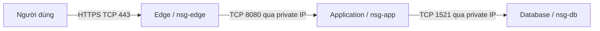

# Security Lists và Network Security Groups

## Mục tiêu bài học

Trong Oracle Cloud Infrastructure (OCI), route table xác định đường chuyển tiếp gói tin, còn security rules xác định lưu lượng nào được phép đi qua giao diện mạng của tài nguyên. Một VM có địa chỉ IP và đường đi đúng vẫn có thể không kết nối được nếu thiếu rule. Ngược lại, một rule mở rộng chưa chắc khiến dịch vụ truy cập được nếu route, hệ điều hành hoặc ứng dụng chưa đáp ứng.

Bài học thuộc chương **Mạng Virtual Cloud Network** của module **CLOUD_PROVIDERS_ORACLE**. Bạn sẽ phân biệt Security Lists và Network Security Groups (NSGs), giải thích cơ chế hợp các rule, chọn stateful hoặc stateless đúng mục đích và thiết kế kết nối giữa các tầng ứng dụng. Những ví dụ kết nối VCN, Compute và cơ sở dữ liệu Oracle giúp người học thực hành phân quyền mạng, giám sát và tự động hóa cấu hình OCI.

Các địa chỉ, tên nhóm và cổng dưới đây là minh họa. Chúng không mô tả một tenancy đang vận hành. Bài học tập trung vào security rules của Security Lists và NSGs; khi có firewall, Zero Trust Packet Routing hoặc thành phần trung gian khác, cần đánh giá thêm các lớp đó.

## 1. Hai cách gắn security rules vào tài nguyên

### 1.1. Security List gắn với subnet

Một **Security List** chứa các ingress rules và egress rules. Khi gắn danh sách vào subnet, các rule áp dụng cho mọi VNIC thuộc subnet đó, kể cả lưu lượng giữa tài nguyên bên trong VCN. Một Security List có thể được dùng cho nhiều subnet. [Oracle: Security Lists](https://docs.oracle.com/en-us/iaas/Content/Network/Concepts/securitylists.htm).

Ví dụ, subnet `application` chứa cả VM ứng dụng và VM chạy tác vụ nền. Nếu một Security List của subnet cho phép TCP 8080 từ một nguồn, tất cả VNIC trong subnet đều có quyền nhận loại lưu lượng đó ở lớp OCI security rules. Việc từng VM có dịch vụ thực sự lắng nghe cổng 8080 hay không là vấn đề khác.

Đổi một rule của Security List dùng chung vì nhu cầu của một VM có thể ảnh hưởng nhiều VM và nhiều subnet. Vì vậy, khi đọc cấu hình, cần xem cả danh sách subnet đang sử dụng Security List đó.

### 1.2. NSG gắn với nhóm VNIC có cùng nhu cầu mạng

Một **Network Security Group** tập hợp VNIC và security rules theo nhu cầu của tài nguyên, chẳng hạn nhóm ứng dụng hoặc nhóm cơ sở dữ liệu. Các VNIC của nhóm phải thuộc cùng VCN với NSG. NSG giúp tách yêu cầu bảo mật của ứng dụng khỏi cách chia subnet. [Oracle: Network Security Groups](https://docs.oracle.com/en-us/iaas/Content/Network/Concepts/networksecuritygroups.htm).

Ví dụ:

- `nsg-edge`: các VNIC do dịch vụ cân bằng tải hoặc tầng tiếp nhận lưu lượng sử dụng.
- `nsg-app`: VNIC của các Compute instances chạy ứng dụng.
- `nsg-db`: VNIC hoặc endpoint của dịch vụ cơ sở dữ liệu có hỗ trợ NSG.

Tên nhóm không quyết định hành vi. Một NSG tên `nsg-db-private` vẫn có thể chứa rule cho phép nguồn rất rộng nếu người vận hành cấu hình như vậy.

Việc gắn NSG thường được thực hiện qua tài nguyên sở hữu VNIC: cập nhật VNIC của Compute, hoặc cấu hình NSGs của dịch vụ được hỗ trợ. Với instance nhiều VNIC, phải kiểm tra đúng VNIC mang lưu lượng; gắn NSG ở primary VNIC không tự áp dụng cho mọi secondary VNIC. [Oracle: Security Rules — Comparison of Security Lists and Network Security Groups](https://docs.oracle.com/en-us/iaas/Content/Network/Concepts/securityrules.htm).

### 1.3. So sánh phạm vi thay đổi

| Tiêu chí | Security List | Network Security Group |
| --- | --- | --- |
| Đối tượng liên kết | Subnet | VNIC hoặc tài nguyên dịch vụ có hỗ trợ |
| Phạm vi tác động | Mọi VNIC trong các subnet đang sử dụng danh sách | Các VNIC đang thuộc nhóm |
| Cách tổ chức | Theo mạng con và nhu cầu chung | Theo vai trò ứng dụng hoặc nhóm tài nguyên |
| Nguồn/đích là NSG | Không hỗ trợ tham chiếu NSG theo cách này | Hỗ trợ NSG trong cùng VCN |
| Stateful/stateless | Chọn theo từng rule | Chọn theo từng rule |
| Trường hợp thuận tiện | Một nhu cầu nền tảng thực sự áp dụng chung cho subnet | Các tài nguyên cùng subnet có nhu cầu truy cập khác nhau |

Không suy ra rằng Security List luôn stateless hoặc NSG luôn stateful. Cả hai dùng cùng nguyên lý security rules; trạng thái được chọn cho từng rule.

## 2. Các rule được hợp lại, không tạo thành hai cửa kiểm tra nối tiếp

Đây là nguyên tắc quan trọng nhất khi kết hợp hai cơ chế. Với một VNIC, tập security rules áp dụng được hợp từ:

```text
Các rule của mọi Security List gắn với subnet của VNIC
                         hợp với
Các rule của mọi NSG mà VNIC đang thuộc
```

Lưu lượng được phép ở lớp Security Lists/NSGs nếu có rule phù hợp cho phép, hoặc là phản hồi của kết nối đang được theo dõi. Tài liệu VCN FAQ mô tả rõ quan hệ này là phép hợp, không phải yêu cầu đồng thời khớp một rule trong mỗi loại. [Oracle: Virtual Cloud Network FAQ](https://www.oracle.com/apac/cloud/networking/virtual-cloud-network/faq/).

### Ví dụ một NSG hẹp không thu hẹp được rule rộng ở subnet

Giả sử VNIC của database có hai nguồn rule:

| Nguồn rule | Ingress được cho phép |
| --- | --- |
| Security List của subnet | TCP 1521 từ toàn VCN `10.20.0.0/16` |
| `nsg-db` | TCP 1521 chỉ từ `nsg-app` |

Một VM khác trong VCN vẫn có thể đáp ứng rule của Security List dù không thuộc `nsg-app`. NSG hẹp không phủ định quyền đã được rule rộng cấp.

Muốn đạt mục tiêu chỉ nhận kết nối ứng dụng, cần tìm và xử lý **mọi rule rộng cùng áp dụng**, đồng thời kiểm tra đúng membership của các nhóm. Chỉ sửa `nsg-db` là chưa đủ.

Các rule thông thường ở đây là rule cho phép; không có thao tác thêm một rule `deny` vào NSG để ghi đè Security List. Một NSG trống cũng không xóa quyền được cấp từ Security List hay NSG khác.

Nguyên tắc hợp này áp dụng cho các cơ chế Security Lists/NSGs. Nó không loại bỏ kiểm tra của host firewall, firewall trung gian hay chính sách ZPR. Endpoint có ZPR security attributes còn cần đáp ứng ZPR policy tương ứng. [Oracle: Network Security Groups — ZPR Considerations](https://docs.oracle.com/en-us/iaas/Content/Network/Concepts/networksecuritygroups.htm).

## 3. Đọc một rule theo hướng của VNIC

**Ingress** là lưu lượng đi vào VNIC; **egress** là lưu lượng đi ra VNIC. Hướng luôn được xác định tại giao diện đang đánh giá, không phải theo cách gọi chung “đi vào hệ thống”.

Với luồng App → Database:

```text
App VNIC -- egress --> mạng VCN -- ingress --> Database VNIC
```

Cùng một gói tin khởi tạo kết nối cần được cho phép ở egress của App và ingress của Database. Khi cả hai đầu đều là tài nguyên OCI có security rules, phải đánh giá cả hai đầu.

### 3.1. Những trường cần xác định

| Thành phần | Câu hỏi khi đọc rule | Ví dụ |
| --- | --- | --- |
| Direction | Vào hay ra VNIC nào? | Ingress tại VNIC database |
| Source | Gói ingress đến từ đâu? | `nsg-app` hoặc một CIDR |
| Destination | Gói egress đi tới đâu? | `nsg-db` hoặc một CIDR |
| Protocol | Giao thức IP nào? | TCP, UDP, ICMP |
| Source port | Cổng gửi của phía khởi tạo hoặc phản hồi là gì? | Cổng tạm của client |
| Destination port | Dịch vụ đích nhận ở cổng nào? | TCP 1521 |
| Stateful/stateless | Có theo dõi kết nối để cho phép phản hồi không? | Stateful cho kết nối ứng dụng thông thường |
| ICMP type/code | Loại bản tin điều khiển nào cần đi qua? | Thông báo phục vụ Path MTU Discovery |

Trong API và Terraform, TCP thường được biểu diễn bằng protocol `"6"`, UDP là `"17"`. Nếu đã chọn TCP mà bỏ điều kiện cổng, phạm vi cho phép có thể bao gồm mọi cổng TCP; không hiểu mặc định đó là cổng của ứng dụng. [Oracle: Terraform NSG Security Rule Reference](https://docs.oracle.com/en-us/iaas/tools/terraform-provider-oci/latest/docs/r/core_network_security_group_security_rule.html).

### 3.2. Phân biệt source port với destination port

Giả sử App dùng cổng tạm 49152 để gọi Database cổng 1521:

```text
Gói khởi tạo: TCP 10.20.20.10:49152 → 10.20.30.15:1521
Gói phản hồi: TCP 10.20.30.15:1521 → 10.20.20.10:49152
```

Ingress rule của Database thường đặt **destination port 1521** và để source port theo nhu cầu client, thường là mọi source port. Đặt source port 1521 cho gói khởi tạo sẽ không khớp client đang gửi từ 49152.

Cổng 49152 trong ví dụ chỉ minh họa một kết nối. Khi viết rule stateless, phải xác định dải ephemeral port thực tế của client và các thành phần NAT liên quan; không lấy một cổng minh họa làm dải cố định cho mọi hệ điều hành.

## 4. Stateful và stateless: phản hồi được xử lý thế nào?

### 4.1. Stateful theo dõi kết nối

Rule stateful sử dụng connection tracking. Khi ingress được cho phép theo rule stateful, phản hồi tương ứng được cho phép đi ra; khi egress được cho phép theo rule stateful, phản hồi tương ứng được cho phép đi vào. Quyền phản hồi dựa trên kết nối được theo dõi, không mở quyền khởi tạo tùy ý theo chiều ngược lại. [Oracle: Security Rules — Stateful Compared to Stateless Rules](https://docs.oracle.com/en-us/iaas/Content/Network/Concepts/securityrules.htm).

Ví dụ App chủ động kết nối Database:

| VNIC | Rule cho gói khởi tạo | Xử lý phản hồi tương ứng |
| --- | --- | --- |
| App | Stateful egress đến Database TCP 1521 | Ingress phản hồi được connection tracking cho phép |
| Database | Stateful ingress từ App TCP 1521 | Egress phản hồi được connection tracking cho phép |

Không cần thêm ingress vào App để mở toàn bộ dải ephemeral chỉ nhằm nhận phản hồi của luồng stateful này. Cũng không cần mở egress của Database ra mọi nơi để trả lời kết nối đã được theo dõi.

Database vẫn chưa được quyền **khởi tạo một kết nối mới** đến dịch vụ khác trên App. Nếu có yêu cầu nghiệp vụ cho chiều đó, phải mô tả luồng khởi tạo riêng và thiết kế rules tương ứng.

### 4.2. Stateless cần mô tả đường đi của phản hồi

Rule stateless chỉ cho phép gói theo điều kiện của chính rule, không dựa vào connection tracking để tự cho phép phản hồi. Do đó, người thiết kế phải bổ sung rule cho chiều phản hồi khi cần. [Oracle: Terraform NSG Security Rule — Stateless](https://docs.oracle.com/en-us/iaas/tools/terraform-provider-oci/latest/docs/r/core_network_security_group_security_rule.html).

Nếu cả hai VNIC của ví dụ App–Database đều dùng stateless cho luồng này, cần kiểm tra bốn vị trí:

| Vị trí đánh giá | Source port | Destination port | Ý nghĩa |
| --- | --- | --- | --- |
| Egress tại App | Dải cổng tạm của client | 1521 | Gửi yêu cầu |
| Ingress tại Database | Dải cổng tạm của client | 1521 | Nhận yêu cầu |
| Egress tại Database | 1521 | Dải cổng tạm của client | Gửi phản hồi |
| Ingress tại App | 1521 | Dải cổng tạm của client | Nhận phản hồi |

Nguồn và đích IP/NSG cũng phải khớp từng chiều. Đây là bảng diễn giải luồng, chưa phải cấu hình hoàn chỉnh cho mọi loại dịch vụ.

### 4.3. Rule stateful chồng lấn rule stateless

Nếu cùng một luồng theo một hướng khớp cả rule stateful và stateless, rule stateless có ưu tiên và kết nối không được theo dõi theo rule stateful đó. Khi ấy phải có rule phù hợp cho chiều phản hồi. [Oracle: Security Rules — Stateful and Stateless Overlap](https://docs.oracle.com/en-us/iaas/Content/Network/Concepts/securityrules.htm).

Ví dụ subnet có stateless ingress TCP 443 rất rộng, còn NSG của web server có stateful ingress TCP 443 từ cùng nguồn. Không được kết luận rằng rule NSG đã bảo đảm phản hồi tự động. Cần rà lại sự chồng lấn và chọn mô hình nhất quán cho luồng.

Stateful thường dễ quản lý cho các kết nối ứng dụng thông thường. Với luồng có lưu lượng hoặc số kết nối rất lớn, hãy đánh giá connection tracking, shape và mô hình stateless phù hợp thay vì đổi trạng thái để thử khắc phục một lỗi chưa xác định.

## 5. Thiết kế ứng dụng ba tầng bằng NSGs

### 5.1. Phạm vi ví dụ

Giả sử VCN có CIDR `10.20.0.0/16`, chia thành:

| Tầng | Subnet minh họa | Nhóm mạng |
| --- | --- | --- |
| Edge | `10.20.10.0/24` | `nsg-edge` |
| Application | `10.20.20.0/24` | `nsg-app` |
| Database | `10.20.30.0/24` | `nsg-db` |

Edge nhận HTTPS từ người dùng rồi tạo kết nối riêng đến App. App tạo kết nối riêng đến Database bằng private IP. Trong ví dụ này, edge là thành phần kết thúc kết nối và chuyển tiếp yêu cầu ở tầng ứng dụng; không phải mọi kiểu load balancer hoặc đường mạng đều có cùng hành vi giữ địa chỉ nguồn.



Cổng 1521 là cổng listener giả định cho bài học. Dịch vụ cơ sở dữ liệu Oracle cụ thể có thể dùng endpoint, cổng hoặc mô hình truy cập khác; phải lấy từ cấu hình thực tế.

### 5.2. Ma trận luồng khởi tạo

Các rule trong bảng đều được giả định là stateful:

| Luồng | Nguồn được phép | Đích và cổng | Rule egress ở phía nguồn OCI | Rule ingress ở phía đích OCI |
| --- | --- | --- | --- | --- |
| Người dùng → Edge | Mạng khách hàng, hoặc internet nếu dịch vụ công khai | Edge TCP 443 | Theo môi trường nguồn | `nsg-edge` cho phép nguồn đã chọn đến 443 |
| Edge → App | `nsg-edge` | `nsg-app`, TCP 8080 | `nsg-edge` cho phép đến `nsg-app` cổng 8080 | `nsg-app` nhận từ `nsg-edge` cổng 8080 |
| App → Database | `nsg-app` | `nsg-db`, TCP 1521 | `nsg-app` cho phép đến `nsg-db` cổng 1521 | `nsg-db` nhận từ `nsg-app` cổng 1521 |

Mỗi hàng mô tả một kết nối mới. Kết nối HTTPS từ người dùng đến Edge không tự tạo quyền cho kết nối Edge → App; hai đoạn phải được cấu hình độc lập.

Nếu dịch vụ Edge thực hiện health check trên cổng khác, cần bổ sung đúng luồng health check đó. Nếu dùng cùng cổng backend, xác nhận rule hiện tại đã phù hợp thay vì thêm rule rộng.

### 5.3. Điều kiện để tham chiếu NSG có tác dụng

NSG dùng làm source của ingress hoặc destination của egress phải thuộc cùng VCN với NSG chứa rule. NSG có thể tham chiếu chính nó để kiểm soát kết nối giữa các VNIC trong nhóm. Xóa một NSG được rule khác tham chiếu có thể khiến rule đó không còn hợp lệ. [Oracle: Managing Security Rules for an NSG](https://docs.oracle.com/en-us/iaas/Content/Network/Concepts/manage-nsg-security-rules.htm).

Cần kiểm tra cả membership của VNIC nguồn lẫn VNIC đích. Chỉ tạo hai NSG và thêm rules mà chưa gắn các VNIC vào nhóm sẽ không đạt mục tiêu.

Ví dụ này dùng private IP giữa các tầng. Với hai VNIC cùng VCN giao tiếp qua public IP và đường qua internet gateway, không nên dùng tham chiếu NSG để suy luận địa chỉ nguồn/đích của luồng đó; tài liệu OCI yêu cầu dùng public IP phù hợp cho trường hợp này. [Oracle: Security Rules — Network Security Group as Source or Destination](https://docs.oracle.com/en-us/iaas/Content/Network/Concepts/securityrules.htm).

### 5.4. Các luồng vận hành phải được mô tả riêng

Ma trận ba tầng chưa bao phủ mọi nhu cầu của máy chủ. Cần xác định thêm những luồng thực sự sử dụng, chẳng hạn:

- Quản trị từ đường truy cập quản lý đã chọn đến đúng VNIC và cổng quản trị.
- Kết nối đến DNS tùy chỉnh, hệ thống giám sát hoặc máy chủ cập nhật nội bộ nếu có.
- Truy cập Object Storage hoặc dịch vụ OCI khác qua đường mạng đã thiết kế.
- Sao lưu, đồng bộ hoặc khôi phục cơ sở dữ liệu theo cấu hình dịch vụ.

Không mở egress ra mọi nơi chỉ vì chưa thống kê những phụ thuộc này. Ngược lại, việc bỏ sót phụ thuộc hợp lệ có thể gây lỗi cập nhật, giám sát hoặc sao lưu dù luồng ứng dụng chính vẫn hoạt động.

Một số lưu lượng tới dịch vụ nền tảng ở địa chỉ link-local có cơ chế xử lý riêng. Không áp dụng mô hình gói tin ứng dụng thông thường một cách máy móc cho toàn bộ dịch vụ nền tảng của OCI.

## 6. Security Lists dùng chung nên chứa gì?

Có thể tổ chức Security Lists cho nhu cầu nền tảng chung và NSGs cho luồng ứng dụng, miễn là phạm vi cho phép giữa chúng được kiểm soát rõ.

Một quy trình thiết kế phù hợp:

1. Liệt kê nhu cầu chung thật sự của mọi VNIC trong subnet.
2. Xác định rule nào được giữ ở Security List và ai chịu trách nhiệm với rule đó.
3. Đưa các quan hệ ứng dụng khác nhau vào NSGs tương ứng.
4. Đánh giá tập rule hợp trên từng VNIC để phát hiện quyền mở rộng ngoài ma trận.
5. Kiểm tra lại khi thêm Security List, thêm NSG hoặc thay đổi membership.

VCN có default Security List; nếu không chỉ định danh sách tùy chỉnh khi tạo subnet, subnet có thể sử dụng danh sách mặc định. NSG mới tạo không có sẵn bộ rule mặc định. Hãy đọc cấu hình thực tế sau khi tạo qua Console, wizard hoặc IaC thay vì suy ra từ tên “default”. [Oracle: Security Lists](https://docs.oracle.com/en-us/iaas/Content/Network/Concepts/securitylists.htm), [Oracle: Network Security Groups](https://docs.oracle.com/en-us/iaas/Content/Network/Concepts/networksecuritygroups.htm).

Đặc biệt, nếu Security List vẫn cho phép egress mọi giao thức đến mọi đích, việc thêm một NSG chỉ cho App gọi Database không biến egress của App thành giới hạn chỉ đến Database. Tập rule hợp vẫn chứa quyền egress rộng đó.

Tương tự, gắn hai NSG `nsg-app` và `nsg-admin` vào một VNIC sẽ cộng phạm vi cho phép của chúng. Quyền gắn hoặc thay đổi NSG membership vì vậy cũng là một phần của trách nhiệm quản trị bảo mật mạng.

## 7. Minh họa tự động hóa bằng Terraform

Đoạn HCL sau mô tả **hai rule cho kết nối mới App → Database**. Giả định hai NSG đã tồn tại trong cùng VCN và các VNIC đã được gắn đúng nhóm:

```hcl
variable "app_nsg_id" {
  type = string
}

variable "db_nsg_id" {
  type = string
}

resource "oci_core_network_security_group_security_rule" "app_to_db" {
  network_security_group_id = var.app_nsg_id
  direction                 = "EGRESS"
  protocol                  = "6"
  destination_type          = "NETWORK_SECURITY_GROUP"
  destination               = var.db_nsg_id
  stateless                 = false
  description               = "App initiates database connections"

  tcp_options {
    destination_port_range {
      min = 1521
      max = 1521
    }
  }
}

resource "oci_core_network_security_group_security_rule" "db_from_app" {
  network_security_group_id = var.db_nsg_id
  direction                 = "INGRESS"
  protocol                  = "6"
  source_type               = "NETWORK_SECURITY_GROUP"
  source                    = var.app_nsg_id
  stateless                 = false
  description               = "Database accepts application connections"

  tcp_options {
    destination_port_range {
      min = 1521
      max = 1521
    }
  }
}
```

`stateless = false` chọn stateful; hai giá trị min/max bằng nhau chỉ định một cổng. Ví dụ không giới hạn source port của client. Nguồn tham khảo về tên resource và các trường cấu hình là tài liệu provider OCI. [Oracle: Terraform NSG Security Rule Reference](https://docs.oracle.com/en-us/iaas/tools/terraform-provider-oci/latest/docs/r/core_network_security_group_security_rule.html).

Đây chưa phải cấu hình hạ tầng hoàn chỉnh: cần provider, thông tin xác thực phù hợp, VCN, subnet, route, tài nguyên dịch vụ, NSG membership và những rule vận hành khác. Hai rule này cũng không xóa rule rộng đang tồn tại ở Security Lists hoặc NSGs khác.

Khi quản lý bằng IaC, cần một nguồn cấu hình rõ ràng cho mỗi đối tượng. Tránh để nhiều nơi cùng thay thế danh sách rules của cùng Security List hoặc cùng quản lý bộ NSG IDs trên VNIC mà không phối hợp. Những thay đổi kiểu thay toàn bộ collection phải giữ lại các thành phần vẫn cần thiết.

## 8. Đọc lại cấu hình bằng Console và OCI CLI

### 8.1. Bắt đầu từ VNIC thực sự mang lưu lượng

Với Compute, tìm instance, mở VNIC đang dùng rồi xác định:

- Subnet ID và các Security List IDs gắn với subnet.
- Toàn bộ NSG IDs gắn với VNIC.
- Private IP/public IP và đường đi đang kiểm tra.
- VNIC phía đối tác nếu cả hai đầu ở trong OCI.

Sau đó đọc tất cả rules liên quan, không dừng ở nhóm có tên giống ứng dụng.

### 8.2. Ví dụ lệnh chỉ đọc

Những lệnh sau dành cho người học đã cấu hình OCI CLI và quyền đọc mạng phù hợp. Thay placeholder bằng OCID thực tế:

```powershell
$ociNetworkRegion = '<region-id>'
$ociVnicId = '<vnic-ocid>'
$ociSubnetId = '<subnet-ocid>'
$ociSecurityListId = '<security-list-ocid>'
$ociNsgId = '<network-security-group-ocid>'

oci --region $ociNetworkRegion network vnic get --vnic-id $ociVnicId
oci --region $ociNetworkRegion network subnet get --subnet-id $ociSubnetId
oci --region $ociNetworkRegion network security-list get --security-list-id $ociSecurityListId
oci --region $ociNetworkRegion network nsg rules list --nsg-id $ociNsgId --all
oci --region $ociNetworkRegion network nsg vnics list --nsg-id $ociNsgId --all
```

Lệnh đọc NSG rules và VNIC membership được mô tả trong hướng dẫn lấy chi tiết NSG. Với rules list, `--all` lấy đủ các trang thay vì chỉ dùng trang kết quả đầu tiên. [Oracle: Getting an NSG's Details](https://docs.oracle.com/en-us/iaas/Content/Network/Concepts/get-nsg.htm), [Oracle: OCI CLI NSG Rules List](https://docs.oracle.com/en-us/iaas/tools/oci-cli/latest/oci_cli_docs/cmdref/network/nsg/rules/list.html).

Nếu subnet có nhiều Security Lists hoặc VNIC có nhiều NSGs, lặp bước đọc cho từng ID. Ghi lại nguồn của từng rule để biết nơi phải sửa khi phát hiện quyền quá rộng.

Không cần quyền sửa hoặc xóa mạng để thực hiện những bước quan sát này. Khi cần thay đổi thật, quyền IAM phải phù hợp với đúng tài nguyên và trách nhiệm quản lý.

## 9. Kiểm chứng và xử lý sự cố theo từng lớp

### 9.1. Chuẩn hóa một tình huống kiểm tra

Trước khi mở thêm cổng, ghi lại:

```text
Nguồn: tài nguyên, VNIC, địa chỉ IP và NSGs
Đích: tài nguyên, VNIC, địa chỉ IP và NSGs
Giao thức: TCP, UDP hoặc ICMP
Cổng nguồn/đích hoặc ICMP type/code
Đường dự kiến: private nội bộ, peering, DRG, internet hoặc gateway khác
Thời điểm thử và kết quả quan sát
Kết nối mới hay kết nối được pool/tái sử dụng
```

Với App → Database, một kết nối TCP thành công đến 1521 chỉ chứng minh thiết lập TCP tại thời điểm thử. Nó chưa chứng minh đăng nhập database, TLS, quyền dữ liệu hoặc truy vấn nghiệp vụ đã hoạt động.

### 9.2. Thứ tự chẩn đoán

| Lớp kiểm tra | Câu hỏi cần trả lời |
| --- | --- |
| Tên và địa chỉ | DNS có trả địa chỉ đúng không? Có đang dùng private IP như thiết kế không? |
| Đường đi và đường về | Route/gateway/peering phù hợp không? Có thành phần chuyển đổi địa chỉ không? |
| Membership | Đúng VNIC đã thuộc đúng NSGs chưa? |
| Rule hiệu lực | Tất cả Security Lists và NSGs đang cho phép điều gì? |
| Trạng thái kết nối | Có rule stateless chồng lấn hoặc thiếu rule phản hồi không? |
| Hệ điều hành | Host firewall có cho phép và dịch vụ có lắng nghe trên đúng địa chỉ không? |
| Ứng dụng | TLS, xác thực và cấu hình ứng dụng có phù hợp không? |

Từ máy nguồn được phép kiểm tra, có thể dùng công cụ TCP như sau nếu môi trường đã cài sẵn:

```bash
nc -vz -w 3 10.20.30.15 1521
```

Trên VM đích do bạn quản lý, công cụ như `ss -lntp` giúp xác nhận listener TCP. Với dịch vụ database được quản lý, sử dụng thông tin endpoint và công cụ chẩn đoán dịch vụ tương ứng; không giả định có quyền vào hệ điều hành.

Ping dùng ICMP, không kiểm tra TCP 1521 hoặc TCP 443. Ping thất bại không đủ kết luận ứng dụng bị chặn, và ping thành công cũng không chứng minh cổng ứng dụng được cho phép.

### 9.3. Dùng Flow Logs và Network Path Analyzer

VCN Flow Logs cung cấp thông tin lưu lượng được chấp nhận hoặc từ chối theo security rules. Khi đọc log, đối chiếu đúng VNIC, khoảng thời gian, source/destination, giao thức và cổng. Một số lưu lượng nền tảng link-local không xuất hiện trong Flow Logs. [Oracle: Details for VCN Flow Logs](https://docs.oracle.com/en-us/iaas/Content/Logging/Reference/details_for_vcn_flow_logs.htm).

Một bản ghi ACCEPT không chứng minh dịch vụ đích đã trả lời thành công. Không có bản ghi cũng chưa chứng minh có rule chặn: cần kiểm tra phạm vi bật logging, capture filter và thời điểm thu thập.

Network Path Analyzer phân tích cấu hình routing và security để xác định đường đi và điểm cấu hình có thể chặn kết nối. Công cụ này không gửi lưu lượng thật; dùng kết quả cùng với kiểm tra listener, host firewall và kết nối thực tế. [Oracle: Network Path Analyzer](https://docs.oracle.com/en-us/iaas/Content/Network/Concepts/path_analyzer.htm).

### 9.4. ICMP và MTU là một nhu cầu riêng

Khi luồng stateless tới endpoint ngoài VCN có vấn đề truyền gói lớn, cần xem xét Path MTU Discovery. Với IPv4, hướng dẫn OCI nêu ingress ICMP type 3 code 4 để nhận thông báo cần phân mảnh; đây là nhu cầu khác với ICMP echo dùng cho ping. [Oracle: Security Rules — Path MTU Discovery](https://docs.oracle.com/en-us/iaas/Content/Network/Concepts/securityrules.htm).

Nếu VCN dùng IPv6, phải kiểm tra cả rules và đường đi IPv6. `0.0.0.0/0` chỉ mô tả IPv4; nó không thay thế `::/0` hoặc các prefix IPv6 cụ thể. ICMPv6 và thông báo Packet Too Big cũng cần được đánh giá theo thiết kế IPv6. [Oracle: Security Lists — IPv6 Rules](https://docs.oracle.com/en-us/iaas/Content/Network/Concepts/securitylists.htm).

## 10. Bài thực hành: giới hạn App gọi Database

### Phạm vi lab

Dùng hai VM hoặc hai tài nguyên lab phù hợp trong cùng VCN: một nguồn App và một đích có listener TCP đã biết. Có thể dùng dịch vụ TCP lab thay cho cài một cơ sở dữ liệu thật; cần ghi rõ đó là kiểm tra mạng. Dùng một nguồn kiểm tra khác khi muốn kiểm chứng truy cập trái ma trận.

Giữ đường quản trị cần thiết và ghi nhận cấu hình ban đầu trước khi thay đổi. Những thao tác sau dành cho môi trường lab được giao; không yêu cầu triển khai thêm tài nguyên production để hoàn thành bài học.

### Phần A — Quan sát trước khi thay đổi

1. Ghi VNIC, subnet, private IP và NSGs của App cùng Database.
2. Đọc mọi Security List gắn với hai subnet và mọi NSG của hai VNIC.
3. Xác định rule nào đang cho phép cổng listener từ phạm vi rộng hơn App.
4. Xác minh route và listener hoạt động độc lập với mục tiêu thu hẹp rules.
5. Lập ma trận kết nối mong muốn, gồm cả quản trị và các phụ thuộc cần giữ.

### Phần B — Cấu hình luồng tối thiểu

1. Tạo hoặc dùng `nsg-app` và `nsg-db` trong đúng VCN.
2. Gắn đúng VNIC vào từng nhóm.
3. Thêm stateful egress từ App đến `nsg-db` trên cổng listener.
4. Thêm stateful ingress tại Database từ `nsg-app` trên cùng cổng.
5. Xử lý các rule rộng còn lại trong phạm vi lab theo ma trận đã lập; chỉ giữ những quyền có mục đích rõ ràng.

### Phần C — Kiểm chứng cả chiều được phép và chiều cần chặn

| Phép thử | Điều kiện để kết quả có ý nghĩa | Kỳ vọng |
| --- | --- | --- |
| App khởi tạo đến Database đúng cổng | Route đúng, listener sẵn sàng | Kết nối được |
| Nguồn ngoài `nsg-app` gọi Database cùng cổng | Nguồn này có đường tới đích và đủ quyền egress để phép thử tới được lớp ingress đích | Không được ingress rules cho phép |
| Database khởi tạo một kết nối mới đến cổng lab trên App | App có listener riêng, đường đi có sẵn, không có rule cho chiều này | Không được phép nếu tập rules không cho phép |
| App gọi cổng khác không nằm trong ma trận | Có dịch vụ lab lắng nghe để tránh nhầm với cổng đóng | Không được phép bởi security rules |

Một kết nối thất bại do thiếu route hoặc không có listener không chứng minh NSG đã chặn đúng. Khi cần xác nhận nguyên nhân, kết hợp Flow Logs hoặc phân tích đường đi với dữ liệu ở hai đầu.

Thử bằng kết nối mới; tránh dùng một phiên đã được theo dõi hoặc pool đang tái sử dụng để đánh giá quyền khởi tạo mới. Không mặc định rằng sửa một rule là cơ chế chấm dứt tức thì mọi phiên đang tồn tại.

### Phần D — Quan sát tác động của phép hợp

Trong lab được kiểm soát, thêm tạm một rule rộng hơn cho cùng cổng tại Security List rồi thử lại từ nguồn không thuộc `nsg-app`. Giải thích vì sao NSG hẹp không còn bảo đảm mục tiêu ban đầu khi rule Security List đã cho phép. Sau đó gỡ rule minh họa, hoàn nguyên cấu hình theo trạng thái cần giữ và xác nhận lại kết quả.

Không cần chuyển sang stateless để hoàn thành phần này. Nếu thực hành stateless riêng, phải lập rõ các rule phản hồi và tránh để rule stateful/stateless chồng lấn làm sai kết luận.

## 11. Những kết luận cần giải thích được

| Nhận định thường gặp | Cách hiểu đúng |
| --- | --- |
| “NSG hẹp sẽ ghi đè Security List rộng” | Quyền cho phép được hợp; phải xử lý cả rule rộng đang áp dụng |
| “Security List là stateless” | Trạng thái được chọn theo từng rule ở cả hai cơ chế |
| “Cùng subnet hoặc cùng NSG thì tự thông nhau” | Vẫn phải có rules phù hợp và đường đi hợp lệ |
| “Đã mở ingress Database thì App chắc chắn gọi được” | Còn egress nguồn, routing, membership, host firewall và listener |
| “Stateful cho phép Database khởi tạo ngược lại” | Nó tự cho phép phản hồi tương ứng; kết nối mới theo chiều ngược là nhu cầu riêng |
| “Gắn NSG ở instance là xong mọi VNIC” | Phải xác định membership của từng VNIC liên quan |
| “TCP thành công nghĩa là database hoạt động đầy đủ” | Mới xác nhận lớp kết nối TCP, chưa xác nhận chức năng database |
| “Không có Flow Log nghĩa là không có lưu lượng” | Cần đánh giá phạm vi logging, bộ lọc và giới hạn quan sát |

Một thiết kế OCI có thể kiểm chứng bắt đầu từ ma trận luồng khởi tạo, ánh xạ từng luồng vào ingress/egress tại đúng VNIC và đánh giá toàn bộ tập rules được hợp. Security Lists phù hợp cho nhu cầu subnet dùng chung; NSGs giúp mô tả vai trò ứng dụng. Việc giữ rõ nguồn cấu hình, quan sát lưu lượng và kiểm tra cả các đường cần chặn giúp mạng vừa đáp ứng hoạt động triển khai, giám sát và khôi phục, vừa duy trì phạm vi truy cập đã định.