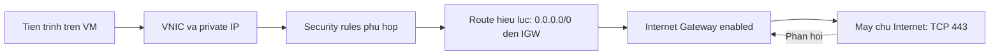

# Internet Gateway và truy cập Internet cho public subnet

Trong Oracle Cloud Infrastructure (OCI), **Internet Gateway (IGW)** kết nối một Virtual Cloud Network với Internet. Với IPv4, một Compute instance muốn giao tiếp trực tiếp qua IGW cần public IP, subnet cho phép public IP, route phù hợp và các lớp kiểm soát lưu lượng cho phép kết nối.

Vì vậy, việc tạo một subnet có nhãn “public” chưa chứng minh máy trong subnet đã truy cập được Internet. Tạo IGW cũng chưa đủ: gateway có thể chưa được bật, route table chưa được gắn đúng hoặc ứng dụng vẫn bị chặn bởi firewall trên hệ điều hành.

Bài học thuộc chương **Mạng Virtual Cloud Network**, tập trung vào đường truy cập IPv4 qua IGW. Phần cuối giải thích những điểm cần thay đổi khi sử dụng IPv6 và cách chọn kiến trúc phù hợp cho môi trường thực tế.

## 1. Vai trò và phạm vi của Internet Gateway

Internet Gateway là tài nguyên mạng của một VCN, hỗ trợ cả kết nối do tài nguyên trong VCN khởi tạo và kết nối từ Internet vào tài nguyên được công bố. IGW không tự mở mọi cổng và không tự cấp public IP cho instance.

Các thành phần có trách nhiệm khác nhau:

| Thành phần | Trách nhiệm |
| --- | --- |
| Public subnet | Cho phép VNIC trong subnet có public IPv4 |
| Public IP | Địa chỉ để tài nguyên giao tiếp trực tiếp với phía Internet theo cấu hình |
| Internet Gateway | Cung cấp đường kết nối giữa VCN và Internet |
| Route table | Chọn next hop cho địa chỉ đích |
| Security list và NSG | Cho phép loại lưu lượng tại phạm vi áp dụng |
| Firewall hệ điều hành | Kiểm soát lưu lượng bên trong máy |
| Tiến trình ứng dụng | Lắng nghe, xử lý request và áp dụng xác thực của ứng dụng |

IGW phục vụ tài nguyên thuộc VCN của nó. Không coi IGW của một VCN là đường Internet dùng chung mặc định cho VCN peering hoặc máy on-premises nối qua DRG. Kiến trúc egress tập trung cần được thiết kế theo khả năng định tuyến và thành phần chuyển tiếp phù hợp.

Oracle mô tả phạm vi và các điều kiện sử dụng trong [Internet Gateway](https://docs.oracle.com/en-us/iaas/Content/Network/Tasks/managingIGs.htm).

### 1.1. Public subnet khác instance có public IP

Public subnet cho phép gán public IPv4; nó không buộc mọi instance phải có public IPv4.

| Tình huống IPv4 | Có thể giao tiếp trực tiếp qua IGW? |
| --- | --- |
| Public subnet, có public IP, đủ route và rule | Có |
| Public subnet, không có public IP | Chưa đáp ứng điều kiện của đường trực tiếp qua IGW |
| Private subnet, chỉ có private IP | Không dùng mô hình trực tiếp này |
| Có public IP nhưng thiếu route hoặc bị chặn | Chưa hoạt động |

Để instance chỉ có private IP chủ động kết nối ra Internet, thường xem xét NAT Gateway hoặc một kiến trúc egress phù hợp. Không khắc phục bằng cách chỉ thêm route đến IGW.

Ý nghĩa public và private subnet được giải thích trong [Networking Overview](https://docs.oracle.com/en-us/iaas/Content/Network/Concepts/overview.htm).

## 2. Hiểu private IP và public IP của instance

### 2.1. Public IPv4 gắn với private IP object

Trong mô hình Compute thông thường, VNIC có private IP; public IP được gán cho private IP object liên quan đến VNIC. Ứng dụng trên máy thường sử dụng private IP khi bind socket.

Ví dụ địa chỉ minh họa:

```text
Private IPv4 của VM: 10.20.10.10
Public IPv4:        <PUBLIC_IPV4_DO_OCI_CAP>
Public subnet:      10.20.10.0/24
```

Không tự cấu hình public IPv4 được OCI cấp thành địa chỉ bổ sung trên card mạng của Linux. Nếu `ip addr` chỉ hiển thị private IP thì điều đó không chứng minh public IP chưa được gán; hãy kiểm tra assignment trong OCI.

Public IP phải gắn đúng private IP/VNIC mà bạn đang kiểm tra. Với máy nhiều VNIC hoặc nhiều địa chỉ, việc nhìn public IP của một interface rồi kiểm tra route từ interface khác có thể gây nhầm lẫn.

### 2.2. Ephemeral và reserved public IP

| Loại | Đặc điểm cần nhớ | Trường hợp sử dụng |
| --- | --- | --- |
| Ephemeral public IP | Có vòng đời gắn với tài nguyên hoặc assignment tương ứng | Máy thử nghiệm, tài nguyên không cần địa chỉ giữ lâu dài |
| Reserved public IP | Được giữ như một tài nguyên riêng, có thể gỡ và gán lại theo giới hạn dịch vụ | Nhu cầu giữ địa chỉ ổn định qua một số thay đổi tài nguyên |

Không mặc định rằng stop rồi start instance sẽ đổi ephemeral public IP. Ngược lại, khi unassign hoặc xóa tài nguyên liên quan, địa chỉ ephemeral có thể bị giải phóng và không được bảo đảm lấy lại.

Reserved IP giúp quản lý vòng đời địa chỉ, nhưng không thay thế load balancer, DNS hoặc thiết kế high availability. Tài liệu về assignment và vòng đời có tại [Public IP Addresses](https://docs.oracle.com/en-us/iaas/Content/Network/Tasks/managingpublicIPs.htm).

## 3. Luồng outbound và inbound

### 3.1. Instance chủ động ra Internet

Ví dụ VM thực hiện HTTPS đến một máy chủ Internet:



Sơ đồ là mô hình logic, không mô tả thứ tự xử lý nội bộ của mọi thiết bị OCI. Public IPv4 assignment, đường về và firewall hệ điều hành cũng phải đúng.

Nếu egress rule là stateful, phản hồi của kết nối được theo dõi và cho phép theo cơ chế connection tracking. Không cần mở inbound TCP 443 chỉ để nhận phản hồi cho một lệnh `curl https://...`.

Cổng 443 trong trường hợp này là **destination port của máy chủ từ xa**. Cổng nguồn của client thường là một cổng tạm thời.

### 3.2. Client Internet chủ động vào instance

Với một web server:

```text
Client Internet
    → Public IPv4 của instance, destination port 80 hoặc 443
    → IGW và đường mạng phù hợp
    → Security rules cho phép ingress
    → Firewall trên VM
    → Tiến trình web đang lắng nghe
```

Một kết nối outbound thành công không chứng minh inbound đã được mở. Inbound còn cần rule cho phép nguồn kết nối và một dịch vụ đang lắng nghe.

Ví dụ, VM tải được một trang HTTPS nhưng client không mở được website trên VM vì Nginx chưa chạy, cổng 80 chưa được cho phép hoặc client đang dùng nhầm private IP.

## 4. Route table: chọn đúng đường đi

### 4.1. Route mặc định IPv4 đến IGW

Cấu hình phổ biến cho public subnet:

| Thuộc tính | Giá trị |
| --- | --- |
| Destination type | CIDR block |
| Destination | `0.0.0.0/0` |
| Target type | Internet Gateway |
| Target | IGW thuộc đúng VCN |

`0.0.0.0/0` bao phủ toàn bộ địa chỉ IPv4. Trong route table, nó có nghĩa là dùng next hop này khi lựa chọn route phù hợp; nó không phải lệnh cho phép toàn bộ cổng.

Đừng nhầm hai cấu hình cùng có `0.0.0.0/0`:

- Destination CIDR trong route rule xác định địa chỉ đích và đường đi.
- Source hoặc destination CIDR trong security rule xác định phạm vi địa chỉ được phép truyền loại lưu lượng tương ứng.

### 4.2. Route table phải được sử dụng thực tế

Tạo một route table có rule đúng nhưng không gắn nó vào public subnet sẽ không thay đổi đường đi của subnet đó.

Trong mô hình cơ bản của bài lab, kiểm tra trực tiếp route table mà subnet tham chiếu. Nếu môi trường dùng per-resource routing, route table gắn với IP hoặc VNIC có thể được chọn thay route table ở subnet.

Khi có nhiều route khớp, route cụ thể hơn được ưu tiên theo cơ chế longest prefix match. Vì vậy, có route `0.0.0.0/0 → IGW` không chứng minh mọi lưu lượng đều đi IGW nếu còn route cụ thể hơn.

Các cơ chế này được mô tả trong [VCN Route Tables](https://docs.oracle.com/en-us/iaas/Content/Network/Tasks/managingroutetables.htm).

### 4.3. Route của Linux không hiển thị toàn bộ route của OCI

Lệnh `ip route` trên VM thường cho thấy default gateway cục bộ của subnet. Nó không hiển thị IGW dưới dạng một interface mà bạn phải tự thêm vào Linux.

Có thể tồn tại đồng thời:

- Route trong hệ điều hành để gửi gói ra VNIC.
- Route của OCI để chọn next hop ngoài subnet hoặc VCN.
- Các route nâng cao nếu môi trường có appliance, nhiều VNIC hoặc per-resource routing.

Không tự thay default route của hệ điều hành sang public IP hay OCID của IGW để sửa lỗi route table OCI.

## 5. Security rules và firewall

### 5.1. Security list và NSG có phạm vi khác nhau

Security list áp dụng cho các VNIC trong subnet liên quan. NSG áp dụng cho các VNIC hoặc tài nguyên là thành viên của nhóm.

Các allow rule trong những security list và NSG có liên quan được xem xét như một tập quyền cho phép. Một NSG chỉ cho SSH từ IP quản trị không tự thu hẹp rule SSH từ mọi nơi còn tồn tại trong security list.

Bởi vậy, khi kiểm tra phạm vi truy cập, cần xem toàn bộ các security list của subnet và các NSG của VNIC. Không kết luận máy đã được giới hạn chỉ từ một NSG có cấu hình đẹp.

Cơ chế và phạm vi áp dụng được Oracle mô tả trong [Security Rules](https://docs.oracle.com/en-us/iaas/Content/Network/Concepts/securityrules.htm).

### 5.2. Stateful và stateless

| Kiểu | Cách xử lý phản hồi |
| --- | --- |
| Stateful | Theo dõi kết nối; phản hồi phù hợp được cho phép theo trạng thái |
| Stateless | Không dùng connection tracking cho rule đó; cần thiết kế rule chiều về phù hợp |

Với lab cơ bản, dùng stateful để dễ hiểu việc client gửi request và nhận phản hồi. Không trộn rule stateful với stateless bao phủ cùng lưu lượng mà chưa hiểu cách OCI xử lý trường hợp chồng lấn.

Không mở toàn bộ inbound ephemeral ports chỉ để “chắc chắn nhận được HTTPS”. Cần xác định luồng khởi tạo ở phía nào và rule có stateful hay không.

### 5.3. Mẫu quyền cho bài lab

Giả sử:

- `<ADMIN_PUBLIC_IPV4>/32`: IP public thực tế của người quản trị.
- `<TEST_CLIENT_PUBLIC_IPV4>/32`: IP public thực tế của máy kiểm tra HTTP.
- VM cần tải gói cài đặt và gọi HTTPS ra Internet.

| Chiều | Phạm vi địa chỉ | Protocol, destination port | Mục đích |
| --- | --- | --- | --- |
| Ingress | IP quản trị `/32` | TCP 22 | SSH |
| Ingress | IP client kiểm tra `/32` | TCP 80 | HTTP thử nghiệm |
| Egress | Các đích cần thiết; có thể dùng `0.0.0.0/0` trong lab riêng | TCP 443 | HTTPS outbound |
| Egress | Các đích cần thiết; có thể dùng `0.0.0.0/0` trong lab riêng | TCP 80 | Kho gói hoặc HTTP nếu cần |

Các rule trên không phải danh sách đầy đủ cho mọi chức năng hệ thống. Giữ các rule nền cần thiết, chẳng hạn ICMP phục vụ chẩn đoán hoặc Path MTU Discovery theo hướng dẫn của OCI. Không xóa hàng loạt rule mặc định trên subnet đang được tài nguyên khác sử dụng.

Security rule theo CIDR/cổng không tương đương danh sách hostname được phép. Nếu cần chỉ cho truy cập các domain cụ thể, phải xem xét proxy, firewall hoặc cơ chế kiểm soát egress phù hợp.

### 5.4. Firewall trên máy và địa chỉ lắng nghe

OCI cho phép TCP 80 chưa bảo đảm Linux cho phép hoặc có tiến trình lắng nghe cổng 80.

Ví dụ:

- Dịch vụ bind `127.0.0.1:80`: chỉ nhận kết nối loopback.
- Dịch vụ bind `0.0.0.0:80`: nhận IPv4 trên các địa chỉ cục bộ theo cấu hình.
- Dịch vụ bind private IP đúng của VNIC: có thể nhận theo đường ánh xạ public IP nếu các lớp còn lại đúng.

Không bind trực tiếp public IPv4 như thể nó là địa chỉ local của hệ điều hành trong mô hình này.

## 6. Thực hành: thiết lập public subnet có Internet

Bài lab dùng một VCN riêng, IPv4 và VM Ubuntu. Không thực hiện thay đổi thử nghiệm trên route table dùng chung với production.

### 6.1. Chuẩn bị và sơ đồ tài nguyên

| Tài nguyên | Giá trị minh họa |
| --- | --- |
| VCN | `vcn-igw-lab`, CIDR `10.20.0.0/16` |
| Public subnet | `subnet-public-lab`, CIDR `10.20.10.0/24` |
| Route table | `rt-public-lab` |
| Internet Gateway | `igw-lab`, enabled |
| Compute | `vm-public-lab`, Ubuntu, có public IPv4 |
| Security rules | Rule riêng phục vụ lab, nguồn SSH và HTTP được giới hạn |

Các CIDR phải không chồng lấn với mạng mà bạn cần kết nối. Private IP của VM do OCI cấp hoặc được chọn trong dải hợp lệ; không bắt buộc phải là `10.20.10.10`.

Người thực hiện cần quyền tạo và quản lý tài nguyên mạng, Compute cùng các dependency trong compartment được giao. Nếu tenancy áp dụng Security Zones hoặc guardrail ngăn public subnet/public IP, phải dùng môi trường thực hành phù hợp với quy định đó.

### 6.2. Tạo VCN và public subnet

Trong OCI Console:

1. Chọn đúng region và compartment thực hành.
2. Tạo VCN `vcn-igw-lab` với CIDR được chọn.
3. Tạo subnet `subnet-public-lab`.
4. Chọn loại **public subnet**, cho phép public IPv4.
5. Chọn DHCP options và DNS resolver phù hợp; lab có thể dùng cấu hình DNS mặc định của VCN.
6. Ghi lại VCN OCID và subnet OCID.

Nếu dùng wizard tạo VCN kèm Internet connectivity, một số tài nguyên như gateway và route có thể đã được tạo. Kiểm tra tài nguyên thực tế trước khi tạo thêm hoặc sửa mặc định.

### 6.3. Tạo hoặc kiểm tra Internet Gateway

Trong VCN, mở phần Internet Gateways:

1. Tạo `igw-lab` nếu chưa có gateway phù hợp.
2. Xác nhận gateway thuộc đúng VCN.
3. Xác nhận trạng thái sử dụng là **enabled**.
4. Ghi lại IGW OCID.

Không tạo IGW trong một VCN khác rồi chọn theo tên gần giống. Tên hiển thị không thay thế OCID. Oracle trình bày các bước tại [Creating an Internet Gateway](https://docs.oracle.com/en-us/iaas/Content/Network/Tasks/create-ig.htm).

### 6.4. Cấu hình route cho public subnet

Tạo hoặc chọn `rt-public-lab`, rồi thêm:

```text
Destination: 0.0.0.0/0
Target type: Internet Gateway
Target:      igw-lab
```

Sau đó gắn route table này vào `subnet-public-lab`. Kiểm tra subnet đang tham chiếu đúng route table sau khi lưu.

Bài lab không dùng per-resource routing hoặc gateway ingress routing nâng cao. Nếu sử dụng lại tài nguyên có các cấu hình đó, phải kiểm tra chúng thay vì chỉ nhìn route ở subnet.

### 6.5. Cấu hình security rules

Dùng security list riêng cho lab hoặc một tập cấu hình đã được rà soát đầy đủ. Nếu thêm NSG, gắn NSG vào VNIC của instance.

Thực hiện:

1. Cho phép ingress SSH từ IP public quản trị thực tế `/32`.
2. Cho phép ingress HTTP TCP 80 từ IP public của client thử nghiệm `/32`.
3. Cho phép egress HTTPS và HTTP phục vụ bài lab.
4. Giữ những rule hạ tầng cần thiết.
5. Kiểm tra không còn một allow rule rộng ngoài dự kiến ở security list hoặc NSG khác.

IP của laptop khi nhìn trong mạng gia đình thường là private IP. Nếu laptop đi qua NAT hoặc VPN, rule ingress phải dùng địa chỉ public mà OCI nhìn thấy ở đường kết nối đó.

Khi chuyển sang mạng Wi-Fi khác hoặc đổi VPN, địa chỉ public có thể thay đổi. Cập nhật phạm vi cụ thể sau khi xác minh; không mở SSH từ `0.0.0.0/0` như bước xử lý mặc định.

### 6.6. Tạo VM và gán public IPv4

Khi tạo Ubuntu instance:

1. Chọn đúng VCN và public subnet.
2. Bật việc gán public IPv4, hoặc gán địa chỉ phù hợp sau khi tạo theo cơ chế dịch vụ.
3. Cung cấp SSH public key của người quản trị.
4. Chọn NSG nếu bài lab sử dụng NSG.
5. Chờ instance sẵn sàng.
6. Kiểm tra private IP, public IP, VNIC và subnet trên trang chi tiết.

Public subnet cho phép assignment, nhưng phải xác nhận instance thực sự đã có public IP. Không chỉ dựa vào lựa chọn mặc định của màn hình tạo máy.

Đăng nhập bằng SSH client và private key tương ứng:

```bash
ssh -i '<PRIVATE_KEY_PATH>' ubuntu@<INSTANCE_PUBLIC_IPV4>
```

Lệnh minh họa dùng Bash và user `ubuntu` của image Ubuntu phù hợp. Với image khác, user mặc định có thể khác.

## 7. Kiểm tra outbound, DNS và dịch vụ local

Các lệnh trong phần này chạy **bên trong Ubuntu VM**.

### 7.1. Xem địa chỉ và route của hệ điều hành

```bash
ip -4 addr
ip -4 route
```

Kết quả cần kiểm tra:

- VNIC có private IPv4 thuộc subnet.
- Có đường mặc định hoặc đường cần thiết để gói tin ra ngoài máy.
- Không có cấu hình thủ công đưa public IPv4 vào interface trái với mô hình OCI.

Kết quả này xác nhận một phần cấu hình guest OS; vẫn phải kiểm tra route table OCI.

### 7.2. Kiểm tra phân giải tên

```bash
getent ahostsv4 www.oracle.com
```

Nếu không trả được IPv4, kiểm tra DNS resolver, DHCP options, cấu hình guest OS hoặc proxy. Đừng tăng inbound HTTP chỉ để sửa lỗi phân giải tên.

Nếu môi trường dùng DNS tùy chỉnh, còn cần đường đến resolver và các rule tương ứng. Truy cập DNS cục bộ của VCN có cơ chế hạ tầng riêng; không suy ra mọi truy vấn DNS đều phải đi qua IGW.

### 7.3. Kiểm tra HTTPS outbound

```bash
curl -4 -I --connect-timeout 10 --max-time 30 https://www.oracle.com/
```

Tùy website và thời điểm, phản hồi có thể là 200, redirect hoặc một mã HTTP khác. Nhận được phản hồi HTTP hợp lệ sau quá trình TLS là bằng chứng kết nối đến endpoint đó đã đi qua các lớp cần thiết; không bắt buộc mọi endpoint phải trả 200.

Nếu môi trường có `HTTPS_PROXY`, lệnh có thể đi qua proxy. Muốn chứng minh đường IGW trực tiếp, xác nhận không sử dụng proxy trong thiết kế và trong cấu hình client thử nghiệm. Không in toàn bộ proxy URL ra log nếu có chứa credential.

Không dùng `curl -k` làm cách sửa mặc định cho lỗi TLS. Lỗi chứng chỉ có thể liên quan thời gian hệ thống, trust store, tên máy chủ hoặc thiết bị kiểm tra TLS.

### 7.4. Cài web server cho bước inbound

Trên Ubuntu VM của bài lab:

```bash
sudo apt-get update
sudo apt-get install -y nginx
sudo systemctl enable --now nginx
```

Kho gói có thể sử dụng HTTP hoặc HTTPS; egress phải phù hợp với endpoint thực tế. Nếu chỉ cho TCP 443 mà kho đang dùng HTTP 80, việc HTTPS đến Oracle thành công không chứng minh `apt-get` sẽ thành công.

Kiểm tra:

```bash
sudo systemctl status nginx --no-pager
sudo ss -lntp
curl -4 -I --connect-timeout 5 http://127.0.0.1/
```

Nếu localhost còn lỗi thì xử lý dịch vụ trước khi điều tra đường Internet inbound. Nếu Nginx chỉ lắng nghe loopback, cần sửa cấu hình lắng nghe phù hợp.

### 7.5. Kiểm tra firewall hệ điều hành

Nếu VM sử dụng UFW, xem trạng thái:

```bash
sudo ufw status verbose
```

Nếu UFW đang active và chưa cho phép HTTP từ client lab, thêm rule cụ thể:

```bash
sudo ufw allow from <TEST_CLIENT_PUBLIC_IPV4> to any port 80 proto tcp
```

Thay placeholder bằng địa chỉ thật, không kèm dấu ngoặc nhọn. Không cần bật UFW chỉ để chạy bài kiểm tra nếu image dùng một cơ chế firewall khác; hãy kiểm tra công cụ đang quản lý firewall thực tế.

Trước khi thay đổi quy tắc firewall, giữ đường SSH quản trị được cho phép. Không tắt toàn bộ firewall để thay cho việc xác định rule cần thiết.

## 8. Kiểm tra inbound từ bên ngoài OCI

Chạy từ **máy client bên ngoài VM**, có public IP nằm trong allowlist HTTP:

```bash
curl -4 -I --connect-timeout 10 --max-time 30 http://<INSTANCE_PUBLIC_IPV4>/
```

Dùng public IP thật của instance. Không dùng `10.20.10.x` từ một laptop không có đường private đến VCN.

Kết quả mong đợi là nhận phản hồi HTTP từ Nginx. Đây là HTTP với trang mặc định, phục vụ kiểm tra kết nối và không chứa dữ liệu nhạy cảm. Dịch vụ thực tế cần HTTPS, certificate hợp lệ và các biện pháp bảo vệ phù hợp.

### 8.1. Vì sao không chỉ kiểm tra từ chính VM?

Nếu VM truy cập localhost thành công, điều đó mới chứng minh dịch vụ local hoạt động. Nó không xác nhận:

- Public IP được gán đúng.
- IGW và đường mạng ngoài VCN hoạt động.
- Ingress rule cho phép client.
- Firewall hệ điều hành cho phép lưu lượng ngoài.

Kiểm tra từ một nguồn ngoài đã xác định giúp tách luồng inbound khỏi kết nối nội bộ.

### 8.2. Kiểm tra ngoài phạm vi cho phép

Nếu có một client thứ hai do bạn kiểm soát và có public IP ngoài allowlist, có thể thử cùng endpoint. Kết quả cần phù hợp với thiết kế hạn chế nguồn.

Phải xác nhận hai client thật sự có hai địa chỉ public khác nhau. Hai máy trong cùng mạng gia đình có thể đi qua cùng một NAT nên không tạo thành hai nguồn public khác nhau.

Nếu client ngoài allowlist vẫn vào được, kiểm tra các security list, NSG và rule firewall khác có thể cho phép phạm vi rộng hơn.

### 8.3. Bảng nghiệm thu

| Kiểm tra | Kết quả cần đạt |
| --- | --- |
| VM có public IPv4 đúng | Assignment khớp private IP/VNIC được kiểm tra |
| IGW đúng VCN và enabled | Được xác nhận trong cấu hình OCI |
| Route có hiệu lực | Luồng Internet sử dụng route đến IGW trong mô hình lab |
| DNS và HTTPS outbound | Phân giải tên, kết nối và nhận phản hồi |
| Nginx local | Dịch vụ chạy và lắng nghe đúng địa chỉ |
| HTTP từ client được phép | Thành công |
| Client ngoài allowlist | Không được truy cập theo thiết kế |
| SSH | Chỉ mở cho nguồn quản trị đã chọn |

## 9. Kiểm tra cấu hình OCI bằng CLI

Phần này chạy từ máy đã cài OCI CLI và có profile được cấp quyền đọc tài nguyên. Danh tính quản trị OCI CLI khác với SSH user bên trong VM.

Ví dụ Bash:

```bash
export LAB_REGION='<OCI_REGION>'
export LAB_IGW_OCID='<INTERNET_GATEWAY_OCID>'

oci network internet-gateway get \
  --ig-id "$LAB_IGW_OCID" \
  --region "$LAB_REGION" \
  --profile OCI_LAB
```

Kiểm tra gateway ID, VCN ID và trạng thái enabled từ phản hồi. Lệnh chỉ đọc thông tin, không tự thêm route hoặc bật gateway. Cú pháp được mô tả trong [OCI CLI — internet-gateway get](https://docs.oracle.com/en-us/iaas/tools/oci-cli/latest/oci_cli_docs/cmdref/network/internet-gateway/get.html).

Đối với những phần còn lại, đối chiếu Console hoặc API/CLI tương ứng:

- Subnet: public/private, VCN và route table được tham chiếu.
- VNIC/private IP: public IP assignment, NSG và per-resource routing nếu có.
- Route table: destination và target.
- Security lists/NSGs: toàn bộ rule liên quan.
- Gateway ingress routing: kiểm tra thêm nếu kiến trúc đã cấu hình tính năng này.

Nếu tự động hóa cập nhật route hoặc security rules, kiểm tra API đang thay toàn bộ danh sách hay chỉ thay một mục. Gửi một danh sách thiếu có thể làm mất rule đang dùng cho các luồng khác.

## 10. Chẩn đoán lỗi theo lớp

| Triệu chứng | Khả năng cần kiểm tra | Bước tiếp theo |
| --- | --- | --- |
| SSH đến public IP bị timeout | Sai IP, IGW/route, allowlist, firewall, VM chưa sẵn sàng | Xác minh từ public IP assignment đến cổng 22 và nguồn thực tế |
| HTTPS outbound timeout | Thiếu public IP, gateway disabled, route hoặc egress sai, proxy | Kiểm tra lần lượt điều kiện đường đi |
| `Could not resolve host` | DNS hoặc hostname | Kiểm tra resolver trước khi sửa HTTP rule |
| TLS certificate error | Trust store, thời gian, hostname, TLS inspection | Kiểm tra lớp TLS, không mở thêm cổng tùy ý |
| HTTP inbound timeout nhưng localhost thành công | Ingress rule, client IP, firewall hoặc public IP | Kiểm tra đường từ client và các rule có hiệu lực |
| `Connection refused` | Có thể không có listener hoặc một thành phần chủ động từ chối | Kiểm tra service, địa chỉ bind và log |
| Có HTTP 403/404 | Request đã đến một HTTP server nhưng bị xử lý ở lớp ứng dụng | Xác định đúng server, virtual host và cấu hình web |
| Ping thất bại nhưng HTTP thành công | ICMP không được cho phép hoặc bị hạn chế | Không coi ping là phép thử bắt buộc của HTTP |
| Chỉ một số đích thất bại | Route cụ thể hơn, DNS, rule theo đích hoặc endpoint remote | So sánh địa chỉ đích và route có hiệu lực |
| Đổi NSG nhưng vẫn truy cập rộng | Security list hoặc NSG khác còn allow rule | Rà soát tập rule cộng dồn |

### 10.1. Không dùng ping làm kết luận duy nhất

Ping dùng ICMP; HTTPS dùng TCP và TLS. Một endpoint có thể không trả lời ICMP nhưng vẫn phục vụ HTTPS bình thường.

Traceroute cũng có thể không hiển thị đầy đủ các bước trên mạng cloud. Kết hợp cấu hình route, kiểm tra cổng thực tế và bằng chứng log thay vì yêu cầu mọi hop phải trả lời.

### 10.2. Dùng log để xác định phạm vi

VCN Flow Logs có thể bổ sung thông tin về lưu lượng tại phạm vi được bật. Một bản ghi ACCEPT chưa chứng minh HTTP hoặc TLS thành công; log dịch vụ và log ứng dụng vẫn cần thiết.

OCI Audit giúp xác định các thay đổi quản trị được ghi nhận, chẳng hạn thay cấu hình route hoặc security rules. Nó không thay thế log request của Nginx.

Nếu thay IGW hoặc route có thể làm mất SSH, hãy thao tác bằng Console/API từ đường quản trị độc lập và chuẩn bị cấu hình khôi phục. Không dùng phiên SSH duy nhất làm công cụ sửa mọi lớp kết nối mà không tính đến việc tự cắt đường truy cập.

## 11. IPv6: kiểm tra như một đường riêng

Bài lab trước dùng `curl -4` để cố định IPv4. Khi bật IPv6, không áp dụng máy móc yêu cầu “public IPv4” cho đường IPv6.

Để giao tiếp Internet bằng IPv6, cần xem:

- VCN và subnet đã có cấu hình IPv6 phù hợp.
- VNIC có địa chỉ IPv6 được dùng cho kết nối.
- Loại prefix có thể định tuyến Internet, chẳng hạn GUA phù hợp; ULA không phải địa chỉ Internet.
- Subnet cho phép giao tiếp Internet theo cấu hình public/private.
- Route IPv6 phù hợp, thường `::/0 → IGW`.
- Security rules, firewall và listener hỗ trợ IPv6.

`0.0.0.0/0` không bao phủ IPv6. Một rule IPv4 hạn chế nguồn cũng không tự hạn chế đường IPv6.

Nếu website có cả bản ghi A và AAAA, client có thể chọn IPv6. Khi chẩn đoán, thử riêng từng họ địa chỉ để biết đường nào đang hoạt động; không lấy kết quả IPv4 để kết luận mọi truy cập Internet đã đúng.

Các điều kiện và phạm vi prefix được Oracle mô tả trong [IPv6 Addresses](https://docs.oracle.com/en-us/iaas/Content/Network/Concepts/ipv6.htm).

## 12. Thiết kế thực tế, chi phí và dọn lab

### 12.1. Chỉ công bố những thành phần cần thiết

Một kiến trúc ứng dụng phổ biến đặt public load balancer ở lớp tiếp nhận, còn application server và Oracle Database ở mạng private. Điều này giúp giảm số điểm được công bố trực tiếp và cho phép quản lý TLS cùng luồng vào rõ hơn.

Nếu VM chỉ cần cập nhật phần mềm hoặc gọi API ra Internet, cân nhắc đặt private và sử dụng NAT Gateway hoặc cơ chế egress đã thiết kế. Nếu truy cập các Oracle services được hỗ trợ, xem xét Service Gateway theo endpoint và region.

Reserved IP và DNS giúp quản lý địa chỉ nhưng một VM duy nhất vẫn là một điểm lỗi. Tính sẵn sàng cần được thiết kế ở lớp Compute, cân bằng tải, dữ liệu và triển khai ứng dụng.

### 12.2. Kiểm soát chi phí theo tài nguyên và lưu lượng

Theo dõi Compute, boot volume, public IP theo chính sách giá áp dụng, lưu lượng truyền dữ liệu và log được bật trong bài thực hành. Không suy ra toàn bộ mô hình miễn phí chỉ vì một tài nguyên gateway không phải phần chi phí chính.

Stop instance không đồng nghĩa mọi tài nguyên liên quan đã bị xóa. Boot volume, địa chỉ được giữ riêng hoặc các tài nguyên khác có thể vẫn tồn tại và cần được kiểm tra theo cách tính phí thực tế.

### 12.3. Dọn tài nguyên theo quan hệ phụ thuộc

Sau khi hoàn thành:

1. Gỡ các rule HTTP và SSH thử nghiệm không cần giữ.
2. Xóa hoặc kết thúc VM lab theo nhu cầu, xử lý boot volume và dữ liệu còn lại.
3. Giải phóng reserved public IP nếu đã tạo riêng và không cần sử dụng.
4. Gỡ những route đang trỏ đến IGW trước khi xóa gateway.
5. Xóa subnet, route table, security list/NSG riêng và VCN khi không còn dependency.
6. Kiểm tra tài nguyên log và các thành phần được wizard tạo thêm.

Chỉ dọn tài nguyên của bài lab. Nếu IGW đang phục vụ nhiều public subnet, xóa hoặc disable nó có thể ảnh hưởng đồng thời nhiều workload.

Khi nghiệm thu, hãy chứng minh riêng assignment của địa chỉ, đường route, quyền truyền lưu lượng và trạng thái ứng dụng. Bốn phần đó giúp giải thích vì sao một public subnet có hoặc chưa có khả năng truy cập Internet qua IGW.
