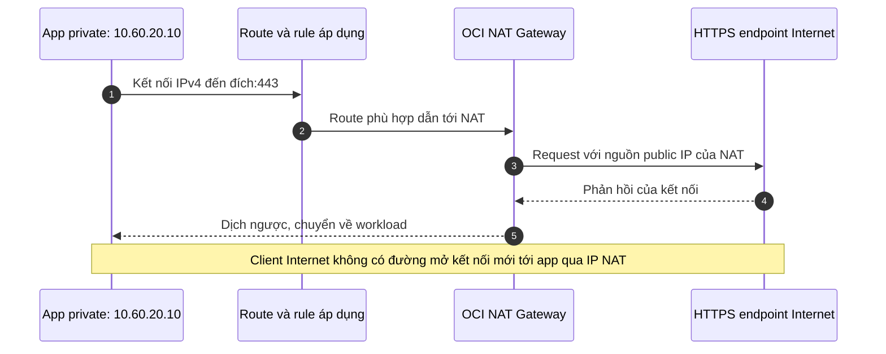

# NAT Gateway và kết nối đi ra từ private subnet

Một máy chủ ứng dụng trong private subnet thường không cần nhận kết nối trực tiếp từ Internet, nhưng vẫn có thể cần tải bản vá, lấy thư viện hoặc gọi API của đối tác. Trong Oracle Cloud Infrastructure (OCI), NAT Gateway cung cấp đường Internet IPv4 cho các kết nối do workload khởi tạo mà không cần gán public IPv4 cho từng máy chủ.

Trong chương **Mạng Virtual Cloud Network**, bài học này đi từ cơ chế dịch địa chỉ đến cấu hình route, kiểm soát lưu lượng và kiểm chứng kết nối. Những kiến thức này giúp bạn vận hành Compute, ứng dụng và các thành phần liên quan đến cơ sở dữ liệu Oracle trong mạng private, đồng thời quản lý quyền thay đổi hạ tầng, giám sát và chi phí.

Sau bài học, bạn có thể:

- Giải thích chiều khởi tạo kết nối và lưu lượng phản hồi qua NAT Gateway.
- Phân biệt NAT Gateway với Internet Gateway, Service Gateway và proxy.
- Thiết kế route và security rules cho private workload cần Internet IPv4.
- Kiểm chứng đường đi bằng cấu hình OCI, yêu cầu từ workload và bằng chứng phía đích.
- Khoanh vùng lỗi DNS, route, gateway, firewall, TLS và cạn tài nguyên kết nối.

## 1. NAT Gateway giải quyết vấn đề gì?

Giả sử instance `app-01` có private IPv4 `10.60.20.10` trong một private subnet. Ứng dụng cần gọi dịch vụ HTTPS trên Internet. Máy chủ không có public IPv4 và không cần mở cổng để Internet kết nối vào nó.

Địa chỉ private của instance không được dùng làm địa chỉ nguồn định tuyến công khai trên Internet. NAT Gateway thực hiện dịch địa chỉ nguồn khi chuyển lưu lượng ra ngoài và giữ thông tin ánh xạ để đưa phản hồi về đúng workload.

```text
Trước khi qua NAT:
    Nguồn: 10.60.20.10:<cổng nguồn>
    Đích:  <IPv4 dịch vụ Internet>:443

Sau khi qua NAT:
    Nguồn: <public IPv4 của NAT Gateway>:<cổng đã ánh xạ>
    Đích:  <IPv4 dịch vụ Internet>:443
```

Phía dịch vụ Internet nhìn thấy public IP của NAT Gateway, không phải private IP của instance. Khi phản hồi quay về, gateway dùng trạng thái ánh xạ để đưa lưu lượng đến bên đã khởi tạo kết nối. Đây là hành vi cơ bản được Oracle mô tả trong [NAT Gateway](https://docs.oracle.com/en-us/iaas/Content/Network/Tasks/NATgateway.htm).

Các cổng trong ví dụ chỉ minh họa cơ chế. Không nên giả định cổng nguồn luôn giữ nguyên sau dịch địa chỉ hoặc một public IP chỉ đại diện cho một máy chủ.

### Chiều kết nối là điểm quan trọng nhất

| Tình huống | NAT Gateway có đáp ứng mô hình này không? |
| --- | --- |
| App private mở kết nối HTTPS ra Internet | Có, nếu cấu hình và đích cho phép |
| Internet gửi phản hồi cho kết nối app đã khởi tạo | Có, theo trạng thái kết nối/ánh xạ phù hợp |
| Một client Internet mở kết nối mới đến app private qua IP NAT | Không phải chức năng của NAT Gateway |
| Đối tác gọi webhook trực tiếp vào app private qua NAT | Không |
| Quản trị viên SSH từ Internet vào app qua IP NAT | Không |

NAT Gateway không cung cấp port forwarding để công khai một cổng backend private. Nếu cần nhận webhook hoặc phục vụ người dùng Internet, hãy thiết kế điểm vào phù hợp, chẳng hạn frontend/load balancer hoặc API Gateway theo khả năng dịch vụ, cùng xác thực và rule cần thiết.

Một ứng dụng cũng có thể tự thiết lập kênh kết nối dài ra bên ngoài. Dữ liệu truyền qua kênh đó vẫn thuộc kết nối do ứng dụng khởi tạo; vì vậy, “không nhận kết nối mới trực tiếp từ Internet” không đồng nghĩa với kiểm soát được mọi dữ liệu đi ra hoặc đi vào ứng dụng.

## 2. NAT Gateway là tài nguyên của VCN

OCI NAT Gateway là dịch vụ mạng được quản lý, không phải một Compute instance mà bạn phải cài phần mềm NAT. Nó gắn với một VCN; các subnet cần sử dụng gateway phải có đường đi phù hợp.

Trong mô hình cơ bản:

```text
VCN trong một region
├── Private subnet app-a ─┐
├── Private subnet app-b ─┼──> NAT Gateway ──> Internet
└── Private subnet data ──┘    nếu từng subnet được cho phép sử dụng
```

Không cần tạo một public subnet chỉ để “đặt NAT Gateway vào đó”. Cũng không cần gán public IP của gateway lên card mạng của instance. Hệ điều hành workload tiếp tục sử dụng địa chỉ private của nó.

NAT Gateway là một đường truy cập Internet riêng của dịch vụ OCI; không cần tạo thêm Internet Gateway chỉ để nối tiếp sau NAT Gateway trong mô hình này. Nếu VCN có frontend public, Internet Gateway phục vụ đường public đó là một thành phần riêng.

Gateway có tính sẵn sàng cao do dịch vụ cung cấp. Tuy nhiên, ứng dụng vẫn có thể mất kết nối khi route sai, gateway bị block, rule không phù hợp hoặc đích Internet gặp sự cố. Tính sẵn sàng của gateway không bảo đảm mọi phụ thuộc bên ngoài hoạt động liên tục.

### Không mặc định dùng chung qua peering

Peering giữa hai VCN không tự biến NAT Gateway của VCN này thành gateway Internet dùng trực tiếp cho mọi tài nguyên của VCN kia. Kiến trúc egress tập trung qua hub cần thiết kế được hỗ trợ, có thể liên quan firewall hoặc network virtual appliance và route hai chiều. Oracle giải thích điểm này trong [Learn OCI Network Firewall with Examples](https://docs.oracle.com/en-us/iaas/Content/Resources/Assets/whitepapers/learn-oci-network-firewall-with-examples.pdf).

Bài thực hành chỉ xét workload và NAT Gateway trong cùng VCN, không xây dựng transit egress nhiều VCN.

## 3. Chọn đúng công cụ cho nhu cầu kết nối

| Thành phần | Nhu cầu chính | Điểm cần phân biệt |
| --- | --- | --- |
| NAT Gateway | Workload không có public IPv4 khởi tạo kết nối Internet IPv4 | Không là điểm nhận kết nối mới vào workload |
| Internet Gateway | Giao tiếp Internet trực tiếp của tài nguyên có cấu hình public phù hợp | Cần public IP, route và rule tương ứng trong mô hình IPv4 |
| Service Gateway | Truy cập riêng đến Oracle service được hỗ trợ trong region | Không phải đường Internet tổng quát |
| Proxy hoặc firewall phù hợp | Kiểm soát theo chính sách chi tiết hơn, tùy sản phẩm | Có thể thêm xác thực, lọc và kiểm tra ở lớp khác |
| VPN/FastConnect và DRG | Kết nối private tới mạng doanh nghiệp theo thiết kế | Không đồng nghĩa với NAT Internet |

Ví dụ, app gọi API Internet của đối tác có thể cần NAT. App đọc Object Storage thuộc phạm vi Service Gateway có thể sử dụng Service Gateway thay vì đi Internet. App gọi database private trong VCN không cần vòng qua NAT.

Oracle mô tả đường truy cập trực tiếp tại [Internet Gateway](https://docs.oracle.com/en-us/iaas/Content/Network/Tasks/managingIGs.htm), còn phạm vi private đến Oracle Services Network được mô tả tại [Service Gateway](https://docs.oracle.com/en-us/iaas/Content/Network/Tasks/servicegateway.htm).

### NAT không thay thế lớp bảo vệ ứng dụng

Dịch địa chỉ không tự mã hóa dữ liệu, kiểm tra hostname, xác thực người gọi hoặc cấp quyền IAM. Workload gọi HTTPS vẫn cần xác minh chứng thư và danh tính endpoint. Request đến dịch vụ OCI vẫn cần cơ chế xác thực và policy phù hợp.

Nếu yêu cầu là “chỉ được gọi hai tên miền đối tác”, một route NAT cùng rule TCP 443 đến `0.0.0.0/0` chưa đáp ứng yêu cầu đó. Rule này cho phép một phạm vi IPv4 và cổng, không phải danh sách hostname. Hãy chọn cơ chế kiểm soát egress có khả năng phù hợp và quản lý cả DNS, proxy, firewall nếu kiến trúc sử dụng.

## 4. Route đưa lưu lượng đến NAT Gateway

Tạo NAT Gateway chưa làm mọi subnet tự có Internet. Với mô hình route cấp subnet, route table đang liên kết với private subnet cần chứa rule tương ứng.

Ví dụ:

```text
Route table: rt-app-egress
Destination type: CIDR block
Destination: 0.0.0.0/0
Target type: NAT Gateway
Target: nat-app-egress
```

`0.0.0.0/0` khớp mọi đích IPv4, nhưng không có nghĩa tất cả lưu lượng sẽ luôn đi qua NAT. Phải xét cả route cụ thể hơn và định tuyến thực sự áp dụng. Cơ chế route VCN được mô tả trong [VCN Route Tables](https://docs.oracle.com/en-us/iaas/Content/Network/Tasks/managingroutetables.htm).

Một bảng route có thể gồm:

| Đích | Target | Mục đích |
| --- | --- | --- |
| Mạng doanh nghiệp được khai báo | DRG | Giao tiếp với on-premises |
| Service CIDR label được chọn | Service Gateway | Oracle service được hỗ trợ |
| `0.0.0.0/0` | NAT Gateway | Đường Internet IPv4 còn lại |

Không thêm default route đến NAT vào mọi subnet theo thói quen. Một subnet database không có nhu cầu Internet tổng quát có thể chỉ cần các đích dịch vụ và vận hành đã xác định.

### Kiểm tra đúng route table và cả chiều trả về

Những lỗi dễ gặp gồm sửa nhầm route table không gắn với subnet, chọn nhầm gateway hoặc không tính đến định tuyến riêng theo tài nguyên. Ghi lại OCID và quan hệ liên kết để kiểm chứng thay vì chỉ nhìn display name.

Nếu có route table liên kết với NAT Gateway cho ingress routing, lưu lượng phản hồi có thể được đưa qua một thành phần trung gian trước khi đến workload. Khi kiến trúc có firewall, kiểm tra cả đường đi lẫn đường về; route một chiều đúng chưa chứng minh phiên kết nối hoạt động.

## 5. Security rules, DNS và hệ điều hành

Route quyết định hướng chuyển gói tin. Security rules và các lớp bảo vệ khác quyết định lưu lượng có được phép đi qua hay không.

### Egress cho đúng nhu cầu

Ví dụ workload chỉ cần HTTPS tới một tập đích được quản lý, rule egress cần phản ánh giao thức, cổng và phạm vi đích đó. Nếu tạm dùng `0.0.0.0/0` TCP 443 trong một lab được duyệt, hãy hiểu đây là phạm vi IPv4 rộng, không phải lọc theo ứng dụng.

Security lists và NSG có thể cùng áp dụng. Cần kiểm tra toàn bộ rule cho phép; một NSG hẹp không tự gỡ quyền rộng đã có ở security list. Với endpoint có kiểm soát ZPR, còn phải đáp ứng chính sách tương ứng. Tham khảo [Security Rules](https://docs.oracle.com/en-us/iaas/Content/Network/Concepts/securityrules.htm).

Với rule stateful phù hợp, phản hồi của kết nối được theo dõi theo trạng thái. Không cần mở một ingress Internet rộng chỉ để nhận phản hồi HTTPS của kết nối đó. Nếu dùng stateless, cần thiết kế rule hai chiều phù hợp với giao thức và cổng; không áp dụng nguyên cách lập luận của stateful.

### DNS là một chặng riêng

Trước khi kết nối tới một hostname, workload cần phân giải được tên bằng resolver đã cấu hình. Resolver có thể là dịch vụ VCN hoặc hệ thống DNS riêng, với đường đi và rule tương ứng.

DNS lỗi không được sửa bằng cách chỉ thêm default route NAT. Ngược lại, phân giải tên thành công chưa chứng minh TCP 443 đã thông. Khi điều tra, tách lần lượt DNS, kết nối IP/TCP, TLS và response ứng dụng.

### Firewall và chính sách của máy chủ vẫn có hiệu lực

Firewall hệ điều hành, cấu hình proxy, biến môi trường của ứng dụng hoặc phần mềm bảo vệ endpoint có thể chặn hoặc đổi đường đi. Một request qua proxy không phải phép thử trực tiếp đường NAT của máy chủ đến endpoint, dù đều trả về HTTP thành công.

## 6. Public IP của gateway và yêu cầu allowlist

Một số đối tác chỉ nhận request từ public IP đã được phê duyệt. Khi nhiều workload dùng cùng NAT Gateway, đối tác thường nhìn thấy cùng địa chỉ nguồn public của gateway.

Điều này giúp quản lý allowlist, nhưng không định danh riêng từng workload. Bên trong hệ thống vẫn cần tài khoản dịch vụ, token hoặc cơ chế xác thực phù hợp để phân biệt ứng dụng và kiểm soát quyền.

Khi tạo gateway, OCI hỗ trợ lựa chọn public IP theo khả năng hiện hành, bao gồm reserved hoặc ephemeral. Cần chọn và quản lý vòng đời đúng với yêu cầu giữ địa chỉ. Oracle trình bày các lựa chọn ở [Creating a NAT Gateway](https://docs.oracle.com/en-us/iaas/Content/Network/Tasks/nat-create.htm) và [Public IP Addresses](https://docs.oracle.com/en-us/iaas/Content/Network/Tasks/managingpublicIPs.htm).

Ví dụ, nếu pipeline xóa gateway cũ rồi tạo gateway mới, đừng mặc định địa chỉ nguồn mà đối tác thấy vẫn như cũ. Cần kiểm tra phương án sử dụng public IP, khả năng giữ/gán lại theo dịch vụ và cập nhật allowlist trước khi chuyển lưu lượng.

Một bản ghi egress tối thiểu nên có:

| Thông tin | Mục đích |
| --- | --- |
| NAT Gateway OCID và VCN OCID | Xác định gateway chính xác |
| Public IPv4 đang sử dụng | Đối chiếu allowlist và log phía đích |
| Các subnet/route table phụ thuộc | Biết phạm vi ảnh hưởng khi thay đổi |
| Đối tác và ứng dụng sử dụng | Phối hợp thay đổi địa chỉ |
| Chủ sở hữu và người duyệt | Quản lý thay đổi hạ tầng |

## 7. Thiết kế lab: một private subnet gọi HTTPS ra ngoài

Bài thực hành mô tả thao tác cho người học trong môi trường được cấp phép. Bài viết không tạo tài nguyên hoặc chạy lệnh vào một tenancy thật.

### 7.1. Phạm vi minh họa

| Thành phần | Giá trị minh họa |
| --- | --- |
| VCN | `vcn-egress-lab`, CIDR `10.60.0.0/16` |
| Subnet | `subnet-app-private`, regional private, CIDR `10.60.20.0/24` |
| Workload | Một Compute lab đã được chuẩn bị, chỉ có private IPv4 |
| Route table | `rt-app-egress` |
| NAT Gateway | `nat-app-egress` |
| Đích thử | HTTPS endpoint được tổ chức cho phép |
| Quản trị workload | Một đường private hoặc dịch vụ quản trị đã có sẵn |

Không cần dựng một database mới để kiểm tra NAT. Nếu chưa có Compute lab, việc cấp phát Compute cần được quản lý trong phạm vi thực hành riêng, gồm shape, image, quyền và chi phí.

Đường quản trị vào máy phải độc lập với giả định NAT là điểm vào. Có thể dùng VPN/FastConnect, OCI Bastion hoặc phương án được môi trường hỗ trợ và phê duyệt. NAT Gateway không phải máy bastion.

### 7.2. Sơ đồ kết nối



Sơ đồ bỏ qua các chi tiết thiết lập TCP/TLS để tập trung vào chiều khởi tạo. Cần kiểm tra riêng các lớp này khi có lỗi.

### 7.3. Chuẩn bị IAM và ràng buộc quản trị

Người cấu hình cần quyền quản lý gateway và route table trong phạm vi được giao. Người kiểm tra có thể chỉ cần quyền đọc các tài nguyên mạng và metrics tương ứng. Workload không cần được cấp quyền quản trị gateway chỉ để gửi lưu lượng qua NAT.

Nếu môi trường có Security Zone hoặc chính sách quản trị khác, việc tạo gateway có thể bị hạn chế. Một số recipe có policy cấm NAT Gateway; xem [Security Zone Policies](https://docs.oracle.com/en-us/iaas/Content/security-zone/using/security-zone-policies.htm). Không nới ràng buộc quản trị chỉ vì giao diện tạo tài nguyên báo lỗi.

### 7.4. Thứ tự cấu hình

1. Xác minh private subnet, VNIC và địa chỉ của workload; ghi route table đang áp dụng.
2. Tạo hoặc chọn NAT Gateway của đúng VCN, compartment và region; xác nhận public IP theo thiết kế.
3. Xác nhận gateway cho phép lưu lượng, không ở trạng thái block.
4. Thêm route tới NAT trong route table của subnet cần egress.
5. Kiểm tra egress và cơ chế stateful/stateless của rule, cùng DNS và firewall hệ điều hành.
6. Thử một request IPv4 từ chính workload đến endpoint được phép.
7. Đối chiếu public IP nguồn và bằng chứng giám sát.

Khi sửa route table có sẵn, giữ đầy đủ các route đang cần cho on-premises, dịch vụ Oracle hoặc kết nối khác. Một lệnh cập nhật thay cả danh sách route mà chỉ giữ default route NAT có thể làm mất những đường đi đang hoạt động.

## 8. Đọc cấu hình bằng OCI CLI

Các lệnh dưới đây là lệnh đọc, dùng với OCI CLI đã được cài và cấu hình. Chúng không tự tạo gateway hoặc thay route table.

Ví dụ PowerShell:

```powershell
$ociNetworkProfile = 'OCI_EGRESS_LAB'
$ociAuthMode = 'security_token'
$targetRegion = '<region-id>'
$natGatewayOcid = '<ocid-nat-gateway>'
$privateSubnetOcid = '<ocid-private-subnet>'
$routeTableOcid = '<ocid-route-table-dang-ap-dung>'
```

Thay các placeholder. `security_token` chỉ là ví dụ nếu profile đã có session token hợp lệ; chọn cơ chế xác thực tương ứng với profile thực tế.

### 8.1. Đọc gateway

```powershell
oci network nat-gateway get --nat-gateway-id $natGatewayOcid --region $targetRegion --profile $ociNetworkProfile --auth $ociAuthMode
```

Đối chiếu ít nhất các thông tin: ID gateway, VCN, lifecycle state, public IP và cờ block traffic. Tham khảo [nat-gateway get](https://docs.oracle.com/en-us/iaas/tools/oci-cli/latest/oci_cli_docs/cmdref/network/nat-gateway/get.html).

Ví dụ trích đoạn minh họa, không phải kết quả chạy thực tế:

```json
{
  "lifecycle-state": "AVAILABLE",
  "block-traffic": false,
  "nat-ip": "203.0.113.10"
}
```

`203.0.113.10` là địa chỉ dành cho tài liệu minh họa, không phải IP NAT để cấu hình vào môi trường thật. Lifecycle state sẵn sàng chưa thay cho việc kiểm tra `block-traffic` và đường đi.

### 8.2. Đọc subnet và route table

```powershell
oci network subnet get --subnet-id $privateSubnetOcid --region $targetRegion --profile $ociNetworkProfile --auth $ociAuthMode
oci network route-table get --rt-id $routeTableOcid --region $targetRegion --profile $ociNetworkProfile --auth $ociAuthMode
```

Lấy route table ID từ cấu hình đang áp dụng, không từ tên mà bạn nhớ. Trong kiến trúc có định tuyến theo tài nguyên, cần kiểm tra thêm override liên quan.

Lệnh [route-table get](https://docs.oracle.com/en-us/iaas/tools/oci-cli/latest/oci_cli_docs/cmdref/network/route-table/get.html) cho phép đối chiếu toàn bộ route rules. Một rule IPv4 NAT thường có destination `0.0.0.0/0`, destination type `CIDR_BLOCK` và network entity ID là OCID của NAT Gateway đã chọn.

Kiểm tra cả route cụ thể hơn. Nếu endpoint nằm trong một phạm vi đang được định tuyến về DRG hoặc một firewall, request có thể không đi trực tiếp theo default route NAT.

## 9. Kiểm chứng từ workload và endpoint

### 9.1. Chạy phép thử đúng nơi

Lệnh kiểm tra phải chạy trên workload trong private subnet. Chạy trên laptop hoặc Cloud Shell với đường mạng khác không chứng minh được egress của instance lab.

Xác nhận workload không sử dụng proxy ngoài dự kiến và phép thử chọn IPv4. Với một máy Linux có sẵn công cụ phù hợp, có thể dùng:

```bash
getent ahostsv4 example.com
curl -4 --head --connect-timeout 5 --max-time 20 https://example.com
```

`example.com` là ví dụ hostname công khai. Trong môi trường thực tế, thay bằng endpoint HTTPS được tổ chức cho phép, hỗ trợ kiểu request thử và có thể thu thập bằng chứng. Không cài thêm phần mềm qua Internet chỉ để kiểm tra Internet nếu môi trường đã có cách kiểm tra khác.

### 9.2. Đọc kết quả theo từng lớp

| Quan sát | Điều có thể kết luận | Chưa thể kết luận |
| --- | --- | --- |
| Phân giải được IPv4 | Resolver trả được địa chỉ | TCP/TLS và NAT đã hoạt động |
| Thiết lập được TCP/TLS đến đúng endpoint | Một đường kết nối tới đích hoạt động | Chắc chắn đã dùng gateway dự kiến |
| Nhận response HTTP, kể cả mã lỗi ứng dụng | Request đã tới một HTTP endpoint theo phiên đó | Quyền ứng dụng hoặc nội dung nghiệp vụ đúng |
| Log đích thấy public IP của NAT dự kiến | Đường nguồn egress khớp bằng chứng đó | Mọi workload và mọi đích đều có cùng đường đi |
| Metrics gateway tăng cùng lúc phép thử | Có hoạt động qua gateway trong khoảng đó | Mọi gói thuộc riêng request đang thử |

Một response HTTP `403` hoặc `401` không nên được xem ngay là NAT hỏng. Có thể đường mạng đã thông nhưng endpoint từ chối xác thực, nguồn IP hoặc quyền ứng dụng. Cần kết hợp chứng thư TLS, hostname, response và log để xác định request đến đúng đích.

### 9.3. Xác nhận địa chỉ nguồn

Ưu tiên log của endpoint do tổ chức/đối tác kiểm soát. Đối chiếu IP nguồn, thời gian và định danh request thử. Nhiều instance dùng chung gateway có thể có cùng IP nguồn nên cần thêm thông tin tương quan.

Nếu dùng dịch vụ bên ngoài để hiển thị IP, chỉ sử dụng dịch vụ được phép và hiểu dữ liệu nào được gửi. Một phép thử nhỏ với endpoint kiểm soát được thường cho bằng chứng tốt hơn một website công khai bất kỳ.

Không dùng `ping` làm bằng chứng duy nhất: ICMP có thể bị chặn trong khi HTTPS vẫn hoạt động. Cũng không tắt kiểm tra TLS để coi kết nối là thành công.

### 9.4. Kiểm tra ranh giới và khôi phục

Kiểm tra một đích/cổng ngoài phạm vi được phép bằng phương pháp đã thống nhất, không quét mạng Internet. Xác minh workload vẫn không có public IPv4 và đường vào quản trị vẫn đúng thiết kế.

Nếu cần thử block traffic của gateway, chỉ làm trên lab biệt lập có quyền và kế hoạch phục hồi. Gateway có thể được nhiều subnet dùng chung; block traffic là thao tác ảnh hưởng diện rộng. Không xóa gateway dùng chung để kiểm tra lỗi.

## 10. Giám sát NAT Gateway

OCI cung cấp metrics trong namespace `oci_nat_gateway`. Một số tín hiệu hữu ích:

| Metric/dimension | Cách sử dụng |
| --- | --- |
| `BytesToNATgw` | Theo dõi byte từ tài nguyên OCI tới gateway |
| `BytesFromNATgw` | Theo dõi byte từ gateway về tài nguyên OCI |
| `DropsToNATgw` | Theo dõi gói bị gateway loại bỏ |
| `dropType = noPorts` | Khoanh vùng dấu hiệu hết cổng NAT |
| `dropType = throttle` | Khoanh vùng dấu hiệu throttling |
| `highPortUsageWatermark` | Tín hiệu dạng nhị phân về ngưỡng sử dụng cổng, không phải phần trăm trực tiếp |

Đối chiếu tên và định nghĩa hiện hành tại [NAT Gateway Metrics](https://docs.oracle.com/en-us/iaas/Content/Network/Reference/nat-gateway-metrics.htm). Chọn đúng `resourceId`, khoảng thời gian và region khi đọc dữ liệu.

### Dùng nhiều nguồn bằng chứng

Gateway metrics là dữ liệu tổng hợp. Để điều tra một sự cố ứng dụng, kết hợp với:

- Log ứng dụng: DNS, timeout, lỗi TLS, response và lần retry.
- Log endpoint/đối tác: nguồn IP quan sát được và kết quả xử lý.
- VCN Flow Logs nếu được bật: luồng, địa chỉ, cổng và kết quả theo phạm vi ghi nhận.
- Audit và lịch sử thay đổi: ai sửa route, gateway hoặc rule vào thời điểm nào.
- Cấu hình thực tế của subnet, VNIC, proxy và các thành phần trung gian.

Ví dụ, request timeout nhưng metrics gateway không có thay đổi tương ứng có thể gợi ý sai route hoặc request chưa đến gateway. Tuy nhiên, với lưu lượng nền và độ phân giải metrics, chưa thể kết luận chỉ từ một biểu đồ phẳng.

Cảnh báo nên kết hợp dấu hiệu lỗi với tác động: drops tăng cùng tỷ lệ lỗi của ứng dụng, hoặc đích quan trọng mất kết nối trong nhiều lần kiểm tra. Không dùng một ngưỡng byte cố định để mặc định kết luận mọi workload đang khỏe.

### Dấu hiệu áp lực kết nối

Nhiều workload có thể chia sẻ public IP và tài nguyên NAT. Một ứng dụng liên tục mở kết nối ngắn hoặc retry đồng loạt có thể tạo áp lực khác với ứng dụng sử dụng connection pool hợp lý.

Khi có dấu hiệu hết cổng hoặc throttling, đối chiếu metric, đích gọi, lượng kết nối đồng thời và hành vi retry. Xem giới hạn hiện hành của dịch vụ; không suy ra công suất vô hạn vì gateway được quản lý.

Các hướng cải thiện cần được đánh giá theo ứng dụng: tái sử dụng kết nối, giới hạn concurrency, backoff có giới hạn và tránh retry đồng loạt. Việc tăng instance ứng dụng mà không xét lưu lượng egress có thể làm áp lực kết nối cao hơn.

## 11. Xử lý lỗi theo từng chặng

| Triệu chứng | Kiểm tra đầu tiên | Hướng khoanh vùng |
| --- | --- | --- |
| Không phân giải được hostname | Resolver, DHCP/DNS và đường tới DNS | Sửa lớp phân giải tên trước khi sửa NAT |
| Phân giải được nhưng kết nối IPv4 timeout | Route thực sự áp dụng, gateway, egress | Đối chiếu lưu lượng tại từng chặng |
| Gateway sẵn sàng nhưng mọi egress phụ thuộc nó đều ngừng | `block-traffic` và thay đổi gần nhất | Lifecycle state không đủ để xác nhận traffic được phép |
| Chỉ một subnet bị lỗi | Route table, rule và override của subnet đó | Không thay gateway chung ngay lập tức |
| Chỉ một endpoint bị lỗi | Route cụ thể hơn, allowlist, dịch vụ đích | Kiểm tra IP đích và log phía đối tác |
| HTTPS lỗi chứng thư | Hostname, trust store, thời gian và proxy TLS | Không bỏ kiểm tra chứng thư để “sửa NAT” |
| Nhận HTTP từ chối | Quyền ứng dụng, token, nguồn IP | Tách lỗi dịch vụ khỏi lỗi kết nối |
| Lỗi xuất hiện khi tăng tải | Drops, cổng NAT, concurrency và retry | Đánh giá áp lực và giới hạn dịch vụ |
| IPv4 thành công, IPv6 thất bại | Stack được chọn, route và gateway IPv6 | Không coi NAT IPv4 là đường IPv6 |
| Thay route xong mất kết nối doanh nghiệp | Các route cũ có còn không | Khôi phục cấu hình phù hợp, kiểm tra toàn bộ bảng |

### Block Traffic có thể chặn dù route và rule vẫn đúng

OCI cho phép block hoặc allow traffic của NAT Gateway. Khi bị block, gateway ngăn lưu lượng qua nó dù route và security rules vẫn tồn tại. Đây là một thuộc tính cần kiểm tra riêng, như mô tả trong [Blocking or Allowing Traffic for a NAT Gateway](https://docs.oracle.com/en-us/iaas/Content/Network/Tasks/nat-block.htm).

Một thao tác block có thể ảnh hưởng nhiều ứng dụng dùng chung gateway. Khi phục hồi, dùng quyền thay đổi phù hợp và xác định vì sao gateway bị block; không mặc định thao tác trước đó là lỗi vận hành.

### Một tình huống điều tra minh họa

Sau khi đối tác thay allowlist, app bắt đầu nhận HTTP `403`. DNS vẫn hoạt động, TLS xác minh được và endpoint có response.

Nhóm vận hành kiểm tra log đối tác, thấy nguồn là public IP của gateway mới được tạo lại trong đợt triển khai. Allowlist vẫn giữ IP cũ. Nguyên nhân là vòng đời IP và cấu hình phía đối tác, không phải private subnet thiếu ingress.

Cách xử lý là phối hợp sửa allowlist hoặc phương án địa chỉ nguồn theo thiết kế đã được duyệt, rồi thử lại request từ chính workload. Mở ingress toàn Internet hoặc gán public IP cho app không giải thích và không sửa đúng nguyên nhân này.

## 12. IPv6 và các đường truy cập dữ liệu

### NAT trong bài là đường Internet IPv4

Các ví dụ `0.0.0.0/0`, public IPv4 và `curl -4` có chủ đích để kiểm tra IPv4. Không thay bằng `::/0` rồi chọn NAT Gateway với kỳ vọng nó trở thành đường IPv6 tương đương.

OCI có tập gateway và quy tắc riêng cho IPv6; NAT Gateway không nằm trong các gateway IPv6 được tài liệu liệt kê. Khi dùng dual-stack, kiểm tra cả DNS A/AAAA, lựa chọn địa chỉ của client, route, public/private và rule IPv6. Tham khảo [IPv6 Addresses](https://docs.oracle.com/en-us/iaas/Content/Network/Concepts/ipv6.htm).

### Không đưa mọi lưu lượng Oracle qua NAT

Nếu workload cần truy cập một Oracle service trong region được Service Gateway hỗ trợ, có thể thiết kế route riêng đến dịch vụ đó. NAT vẫn phục vụ các endpoint Internet khác khi được phép.

Tương tự, ứng dụng kết nối database bằng private endpoint trong VCN cần đường private, rule và thông tin xác thực database phù hợp. Việc có NAT không tự cấp quyền SQL, mở listener hoặc khắc phục endpoint database sai.

Với backup hoặc công cụ quản lý database, xác định chính xác dịch vụ cần gọi và cách truy cập được hỗ trợ. Không mặc định mọi tác vụ Oracle đều cần Internet tổng quát, cũng không mặc định mọi endpoint Oracle đều thuộc phạm vi Service Gateway.

## 13. Vận hành, tự động hóa và kiểm soát chi phí

### Quản lý thay đổi theo phụ thuộc

Khi đưa cấu hình vào công cụ tự động hóa, mô tả rõ gateway thuộc VCN nào, public IP được quản lý thế nào, route table nào dùng nó và nhóm nào sở hữu các ứng dụng phụ thuộc.

Kế hoạch thay đổi cần trả lời:

1. Gateway sẽ được cập nhật hay bị thay thế?
2. Public IP có thay đổi không, và đối tác nào đang dùng allowlist?
3. Các route hiện có có được giữ nguyên theo yêu cầu không?
4. Luồng nào sẽ được thử sau triển khai và cách phục hồi là gì?
5. Có gateway/subnet dùng chung khiến phạm vi ảnh hưởng rộng hơn dự kiến không?

Không coi việc cấu hình được tạo thành công là bằng chứng Internet egress đã hoạt động. Bổ sung phép kiểm tra từ workload với endpoint kiểm soát được và đối chiếu cấu hình đọc lại.

### Tính sẵn sàng của toàn bộ đường đi

Dịch vụ gateway có HA không thay thế thiết kế chịu lỗi của ứng dụng. Vẫn cần timeout hợp lý, giới hạn retry, xử lý khi đối tác không sẵn sàng và giám sát luồng quan trọng.

Nếu cần phân tách miền ảnh hưởng hoặc địa chỉ nguồn giữa các nhóm workload, đánh giá cấu trúc VCN, subnet, route và gateway theo giới hạn hiện hành. Không sao chép quy tắc “mỗi AD bắt buộc một NAT Gateway” từ nền tảng khác sang OCI.

### Đánh giá chi phí trên toàn hệ thống

Kiểm tra bảng giá, điều khoản và hạn mức thực tế cho dịch vụ mạng, lưu lượng, Compute, log và các thành phần kiểm soát egress. Bài học không giả định một mức phí cố định hoặc áp mô hình tính phí của nhà cung cấp khác.

Theo dõi lưu lượng do tải bản vá lặp lại, tải image/thư viện, retry hoặc đồng bộ dữ liệu không cần thiết. Một tác vụ lỗi liên tục có thể vừa gây tải vừa phát sinh lưu lượng mà chỉ nhìn số lượng instance khó nhận ra.

Trong lab, ưu tiên tài nguyên đã có, request nhỏ và thời gian thử giới hạn. Khi kết thúc, rà soát tài nguyên được tạo riêng cho lab, route tham chiếu và public IP được giữ lại. Chỉ dọn tài nguyên thuộc phạm vi được giao; gateway dùng chung không phải tài nguyên có thể xóa chỉ vì một bài thử đã xong.

## 14. Tiêu chí hoàn thành và tự kiểm tra

Một kết quả thực hành đầy đủ cần có:

| Tiêu chí | Bằng chứng |
| --- | --- |
| Workload private | VNIC không có public IPv4, subnet đúng thiết kế |
| Route đúng | Rule và liên kết route table dẫn đến NAT cho đích thử |
| Gateway hoạt động | Đúng VCN, region, public IP và không block |
| Rule phù hợp | Egress/response, DNS và các lớp kiểm soát được xác nhận |
| Request thành công | Được thực hiện từ chính workload qua IPv4 |
| Đường đi được chứng minh | Public IP nguồn và dữ liệu tương quan phù hợp |
| Ranh giới rõ ràng | Không có giả định NAT cung cấp đường vào mới cho Internet |
| Vận hành có kiểm soát | Chủ sở hữu, giám sát, phụ thuộc và phương án phục hồi được ghi nhận |

Các câu hỏi tự kiểm tra:

1. **Vì sao instance không cần public IPv4 để gọi Internet qua NAT?**  
   Gateway dịch nguồn sang public IP của nó và chuyển phản hồi theo ánh xạ về workload đã khởi tạo kết nối.

2. **Đối tác có gọi webhook vào app private qua IP NAT được không?**  
   Không theo chức năng NAT Gateway này. Cần thiết kế điểm vào hoặc cơ chế nhận sự kiện phù hợp riêng.

3. **Tạo gateway xong nhưng app vẫn timeout, bước nào dễ bị bỏ sót?**  
   Route table thực sự áp dụng, egress, DNS, firewall máy chủ hoặc cờ block traffic.

4. **Rule TCP 443 tới `0.0.0.0/0` có giới hạn theo tên miền không?**  
   Không. Nó mô tả giao thức/cổng và phạm vi IPv4, chưa phải chính sách hostname.

5. **Vì sao HTTP `403` chưa chứng minh NAT bị lỗi?**  
   Request có thể đã tới endpoint và bị từ chối ở lớp ứng dụng, xác thực hoặc allowlist.

6. **Vì sao NAT metrics tăng chưa chứng minh một request cụ thể đã đi đúng đường?**  
   Metrics là dữ liệu tổng hợp của gateway; cần tương quan thời gian, IP nguồn và log request.

7. **NAT Gateway có tự cho phép đọc object hoặc đăng nhập Oracle Database không?**  
   Không. Đường mạng, IAM, xác thực dịch vụ và quyền trong database cần được cấu hình riêng.

Khi lựa chọn NAT Gateway, hãy mô tả cụ thể workload nào được gọi đích nào, route nào được áp dụng và bằng chứng nào xác nhận đường đi. Nhờ đó, kết nối đi ra từ private subnet có thể được triển khai, giám sát và sửa lỗi mà không làm mờ ranh giới truy cập của hệ thống.
