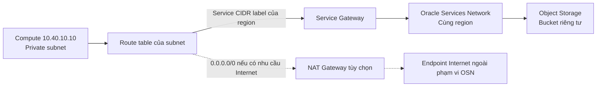

# Service Gateway và truy cập dịch vụ Oracle qua mạng riêng

Một ứng dụng chạy trong private subnet có thể cần đọc tệp từ Object Storage hoặc gửi dữ liệu tới một dịch vụ OCI mà không được cấp public IP. Service Gateway cung cấp đường truy cập riêng từ Virtual Cloud Network (VCN) tới các dịch vụ được hỗ trợ trong Oracle Services Network (OSN), giúp thiết kế mạng phục vụ ứng dụng và tác vụ cơ sở dữ liệu Oracle có ranh giới truy cập rõ ràng.

Trong module **CLOUD_PROVIDERS_ORACLE**, bài này nối kiến thức VCN với IAM, Compute, lưu trữ và vận hành hạ tầng: chọn đúng đường mạng, giới hạn quyền đọc dữ liệu, tự động hóa cấu hình và thu thập bằng chứng khi có sự cố.

Sau bài học, người học có thể:

- Giải thích vì sao endpoint phân giải ra địa chỉ công cộng vẫn có thể được truy cập qua đường riêng.
- Cấu hình Service Gateway, route table và quy tắc bảo mật nhất quán.
- Dùng instance principal để kiểm tra truy cập một bucket mà không phân phối API key cho máy ảo.
- Phân biệt lỗi kết nối, lỗi xác thực và lỗi phân quyền; thiết kế phép thử chứng minh đường đi của lưu lượng.

## 1. Service Gateway giải quyết vấn đề nào?

Service Gateway là tài nguyên mạng cấp vùng, gắn với một VCN, cho phép workload truy cập các dịch vụ Oracle được hỗ trợ **trong cùng region** qua mạng Oracle. Workload có thể chỉ sử dụng private IP; đường truy cập này không cần Internet Gateway hoặc NAT Gateway. Một gateway có thể phục vụ nhiều subnet nếu các route và quy tắc bảo mật cho phép. Kết nối được khởi tạo từ phía workload; gateway không mở đường cho dịch vụ Oracle tùy ý khởi tạo kết nối vào máy ảo. [Tổng quan Service Gateway của Oracle](https://docs.oracle.com/en-us/iaas/Content/Network/Tasks/servicegateway.htm).

Ba khái niệm cần tách biệt:

| Khái niệm | Câu hỏi cần trả lời |
| --- | --- |
| Đường truy cập riêng | Gói tin đi qua hạ tầng nào? |
| Endpoint của dịch vụ | Ứng dụng gọi hostname và địa chỉ nào? |
| Quyền truy cập dữ liệu | Danh tính nào được phép thực hiện thao tác nào? |

Bật gateway mới giải quyết một phần bài toán đường mạng. Nó không tự cấp quyền đọc bucket, không thay chứng chỉ TLS và không lựa chọn bucket thay cho ứng dụng.

## 2. Kiến trúc mẫu và luồng yêu cầu

Xét môi trường lab sau, tất cả tài nguyên dịch vụ đích đều ở region `ap-singapore-1`:

| Thành phần | Giá trị minh họa |
| --- | --- |
| Compartment lab | `OciSgwLab` |
| VCN | `vcn-sgw-lab`, CIDR `10.40.0.0/16` |
| Regional private subnet | `subnet-app-private`, CIDR `10.40.10.0/24` |
| Compute | `vm-sgw-test`, private IP minh họa `10.40.10.10`, không có public IP |
| Service Gateway | `sgw-sgw-lab` |
| Route table cho subnet | `rt-app-private` |
| Bucket riêng tư | `oci-sgw-lab`, hoặc một tên riêng phù hợp namespace của bạn |
| Object đã chuẩn bị | `samples/hello.txt` |



Luồng đọc tệp được phân tích theo các bước:

1. Ứng dụng chọn hostname Object Storage cho region cần dùng.
2. DNS phân giải hostname thành địa chỉ endpoint.
3. Route có đích phù hợp đưa lưu lượng tới Service Gateway.
4. Quy tắc bảo mật phải cho phép kết nối; TCP và TLS được thiết lập.
5. Object Storage xác thực yêu cầu đã ký rồi kiểm tra quyền IAM.
6. Nếu được phép, dữ liệu trả về trên kết nối đã được thiết lập.

### Endpoint công cộng và đường truyền riêng

Một kết quả DNS là public IP chưa đủ để kết luận lưu lượng đi qua Internet. Service Gateway định tuyến tới các dải địa chỉ dịch vụ được Oracle quản lý; nó không tạo một private IP mới trong subnet cho từng bucket. Tiếp tục dùng hostname dịch vụ để bảo toàn cách kiểm tra chứng chỉ TLS. Không thay hostname bằng một IP cố định chỉ vì muốn làm cho kết nối trông giống kết nối nội bộ.

Nếu dịch vụ cung cấp **private endpoint**, đó là cơ chế cấu hình endpoint riêng cần được đánh giá theo tài liệu dịch vụ. Trong bài này, mô hình đang xét là truy cập endpoint OSN qua Service Gateway.

## 3. Chọn service CIDR label

Service CIDR label là nhãn đại diện cho các dải địa chỉ dịch vụ theo region. Hai lựa chọn phổ biến là:

| Nhãn hiển thị | Phạm vi lựa chọn |
| --- | --- |
| `OCI <region> Object Storage` | Object Storage trong region tương ứng |
| `All <region> Services in Oracle Services Network` | Các dịch vụ được OSN hỗ trợ trong region đó |

Một gateway chỉ bật một trong hai nhãn này; một route table cũng không được có hai route riêng tương ứng cả hai nhãn. Gateway bật `All ...` có thể nhận route chỉ tới Object Storage. Chiều ngược lại không hợp lệ cho các dịch vụ ngoài Object Storage: gateway bật Object Storage không thể phục vụ đầy đủ route `All ...`. [Quy tắc lựa chọn service CIDR label](https://docs.oracle.com/en-us/iaas/Content/Network/Tasks/attach-sgw.htm).

`All ...` vẫn có phạm vi cụ thể. Đừng suy từ tên nhãn rằng mọi website Oracle, mọi endpoint của mọi dịch vụ hoặc mọi region đều được bao phủ. Khi yêu cầu mở rộng sang một dịch vụ khác, hãy xác minh endpoint thực tế và phạm vi hỗ trợ trước khi sửa cấu hình.

### Phân biệt Service OCID và nhãn định tuyến

Đối tượng `Service` có các thuộc tính phục vụ những mục đích khác nhau:

| Thuộc tính | Dùng để làm gì? |
| --- | --- |
| `id` | Chọn dịch vụ được bật trên gateway |
| `cidr_block` trong Terraform, `cidr-block` trong JSON CLI | Chỉ định đích cho route hoặc quy tắc bảo mật loại service |
| `name` | Hiển thị, hỗ trợ nhận diện lựa chọn |

Lấy thông tin theo region đang triển khai, tránh chép OCID từ môi trường khác hoặc chọn phần tử đầu tiên của danh sách mà chưa xác định phạm vi. [Thuộc tính của data source `oci_core_services`](https://docs.oracle.com/en-us/iaas/tools/terraform-provider-oci/latest/docs/d/core_services.html).

## 4. Cấu hình route table đúng nơi

Với mô hình subnet thông thường, route table gắn với subnet quyết định đường ra ngoài VCN. Tạo gateway mà chưa thêm route vào bảng đang thực sự được subnet sử dụng sẽ chưa đưa được lưu lượng qua gateway. Nếu môi trường có cấu hình route riêng trên VNIC hoặc IP, cần kiểm tra bảng có hiệu lực cho nguồn đó. [Cơ chế VCN Route Tables](https://docs.oracle.com/en-us/iaas/Content/Network/Tasks/managingroutetables.htm).

Ví dụ `rt-app-private` có thể chứa:

| Loại đích | Destination | Target | Khi nào cần? |
| --- | --- | --- | --- |
| Service | Nhãn OSN đã chọn cho region | `sgw-sgw-lab` | Truy cập dịch vụ thuộc phạm vi nhãn |
| CIDR | `0.0.0.0/0` | NAT Gateway | Chỉ khi workload cần endpoint Internet khác |

Bài lab ban đầu chỉ cần route service. Không thêm default route để làm cho một phép thử đang lỗi chuyển sang đường Internet mà chưa hiểu nguyên nhân.

Ba giá trị phải khớp nhau khi khai báo route:

```text
destination_type  = SERVICE_CIDR_BLOCK
 destination     = <service CIDR label lấy từ API của region>
network_entity_id = <OCID của Service Gateway trong VCN>
```

Dòng `destination` là nhãn dịch vụ, không phải Service OCID, VCN CIDR hay IP hiện tại của một lần phân giải DNS. Khi có NAT Gateway, route service xử lý các đích nằm trong phạm vi của nó; default route phục vụ phần còn lại theo cơ chế chọn route của OCI.

### Tránh sao chép sang public subnet một cách máy móc

OCI không hỗ trợ đồng thời route tới Internet Gateway và route `All <region> Services in Oracle Services Network` tới Service Gateway trong cùng route table. Tổ hợp này có thể gây định tuyến bất đối xứng khi dịch vụ Oracle khởi tạo kết nối tới public instance. Với public subnet cần Internet Gateway, Oracle hướng dẫn dùng route Object Storage tới Service Gateway nếu cần. Giới hạn này khác với mô hình private subnet dùng NAT Gateway. [Known Issues for Networking](https://docs.oracle.com/en-us/iaas/Content/Network/Reference/known_issues_for_networking.htm).

## 5. Quy tắc bảo mật và DNS

Đối với bài lab HTTPS, cấu hình quy tắc egress dạng stateful:

| Thuộc tính | Giá trị |
| --- | --- |
| Direction | Egress |
| Stateless | Không chọn |
| Destination type | Service |
| Destination service | Nhãn tương ứng với lưu lượng cần dùng |
| Protocol | TCP |
| Source port | Tất cả cổng nguồn |
| Destination port | `443` |

Kết nối stateful cho phép lưu lượng phản hồi thuộc kết nối đã được theo dõi. Nếu dùng stateless, phải thiết kế quy tắc chiều về phù hợp; cổng đích phía client thường là cổng tạm thời, không phải luôn `443`. Hãy rà cả Security Lists và NSGs gắn với VNIC: các allow rule của chúng được cộng gộp, nên một rule egress rộng ở nơi khác có thể làm mất ý nghĩa giới hạn của rule mới. [Security Rules và connection tracking](https://docs.oracle.com/en-us/iaas/Content/Network/Concepts/securityrules.htm).

Trong lab, có thể dùng một security list riêng cho subnet để cấu hình destination loại Service; vẫn cần xem toàn bộ NSG liên quan và firewall của hệ điều hành. Không mở ingress từ Internet chỉ để nhận phản hồi cho một kết nối HTTPS stateful.

DNS cần được kiểm tra độc lập. Với resolver tùy chỉnh, xác minh forwarding cho hostname dịch vụ vẫn hoạt động. Một gateway hoạt động không sửa được lỗi DNS, sai hostname, proxy ứng dụng hoặc thiếu CA tin cậy. Nếu ứng dụng đi qua proxy, đường mạng của proxy mới quyết định chặng kết nối tới dịch vụ.

## 6. IAM: đường mạng tới được chưa có nghĩa là đọc được dữ liệu

Dùng instance principal giúp máy ảo gọi API bằng danh tính của chính nó. Dynamic group xác định những instance được áp dụng policy; workload sử dụng cơ chế ký yêu cầu của CLI hoặc SDK. Không cần đặt API private key của một người dùng trên VM. [Calling Services from an Instance](https://docs.oracle.com/en-us/iaas/Content/Identity/Tasks/callingservicesfrominstances.htm).

Ví dụ dynamic group `OciSgwLabReaders` chỉ nhận VM lab:

```text
instance.id = '<OCID_CUA_VM_LAB>'
```

Policy đọc object trong bucket đã chuẩn bị:

```text
Allow dynamic-group OciSgwLabReaders to read objects in compartment OciSgwLab where target.bucket.name='oci-sgw-lab'
```

Thay placeholder và tên tài nguyên bằng giá trị môi trường. Người chuẩn bị lab tạo bucket, nạp object và cung cấp namespace trước; VM chỉ đọc dữ liệu. Policy này không cấp quyền tạo gateway, sửa mạng, tạo bucket hoặc ghi object. Cú pháp điều kiện theo tên bucket giúp giới hạn phạm vi resource thay vì cấp `manage object-family in tenancy`. [Quản lý quyền trên Object Storage objects](https://docs.oracle.com/en-us/iaas/Content/Object/Tasks/managingobjects.htm).

Nhóm vận hành mạng và danh tính workload có trách nhiệm khác nhau. Người cấu hình gateway cần quyền quản trị mạng phù hợp với compartment và VCN; VM không cần các quyền đó để đọc tệp. Thay đổi quyền của người cấu hình không tự thay đổi quyền của instance principal.

### Giới hạn nguồn bằng Network Source

Nếu yêu cầu là chỉ chấp nhận truy cập từ subnet lab qua đường VCN được cho phép, tạo Network Source `oci-sgw-lab-source` với:

- Network type: Virtual Cloud Network.
- VCN OCID: VCN lab.
- IP range trong VCN: `10.40.10.0/24`.

Sau đó dùng điều kiện nguồn trong policy:

```text
Allow dynamic-group OciSgwLabReaders to read objects in compartment OciSgwLab where all {target.bucket.name='oci-sgw-lab', request.networkSource.name='oci-sgw-lab-source'}
```

Network Source mô tả nguồn yêu cầu, không phải đích route. Nó không thay thế các quy tắc gói tin hoặc TLS. [Cấu hình Network Sources và điều kiện IAM](https://docs.oracle.com/en-us/iaas/Content/Identity/Tasks/managingnetworksources.htm).

Các policy `Allow` có thể cùng cấp quyền. Một statement có điều kiện chưa đủ để bảo đảm hạn chế nguồn nếu vẫn tồn tại statement rộng hơn áp dụng cho cùng principal. Trong môi trường lab, kiểm tra toàn bộ quyền hiệu lực của dynamic group; không duy trì cả policy không điều kiện lẫn policy có điều kiện rồi kỳ vọng statement sau thu hẹp statement trước.

## 7. Thực hành qua Console

### 7.1. Chuẩn bị môi trường kiểm thử

Chuẩn bị VM trong private subnet, bucket riêng tư và object mẫu cùng region. Cài sẵn OCI CLI, công cụ DNS và TLS trước khi cô lập đường Internet. Kết nối quản trị bằng phương án đã được tổ chức cho phép, chẳng hạn OCI Bastion hoặc đường mạng quản trị riêng; không dùng Service Gateway để thay cho kênh SSH.

Ghi nhận region, VCN OCID, subnet OCID, bảng route hiệu lực, gateway OCID, namespace và tên bucket. Xác minh VM không có public IP, không có proxy chuyển tiếp và không có đường Internet khác qua NAT, DRG hay thiết bị mạng trong lab kiểm chứng.

### 7.2. Tạo gateway

Trong chi tiết VCN, mở **Service Gateways**, chọn **Create Service Gateway**, đặt tên và compartment. Với bài đọc bucket, chọn nhãn Object Storage của đúng region. Có thể dùng nhãn `All ...` khi lab còn kiểm tra những dịch vụ OSN khác.

Phần liên kết route table ngay trên gateway dành cho tình huống transit routing; bài toán VM trong VCN chưa cần cấu hình phần này. Sau khi tạo, xác minh gateway cho phép lưu lượng và nhãn đã được bật. [Tạo Service Gateway](https://docs.oracle.com/en-us/iaas/Content/Network/Tasks/create-sgw.htm).

### 7.3. Hoàn thiện đường truy cập

1. Mở `rt-app-private`, thêm route đích Service với nhãn đã chọn và target `sgw-sgw-lab`.
2. Xác minh `subnet-app-private` đang dùng đúng bảng này.
3. Thêm egress stateful TCP `443` tới nhãn service trong security list lab; rà soát các allow rule khác.
4. Xác nhận DNS và firewall hệ điều hành cho phép yêu cầu cần thử.
5. Gắn danh tính VM vào dynamic group và áp dụng policy đọc bucket; chờ thay đổi IAM có hiệu lực trước khi kết luận phép thử thất bại.

Giữ bucket riêng tư trong toàn bộ lab để phép thử thực sự kiểm tra cơ chế ký yêu cầu và quyền IAM đã thiết kế.

## 8. Kiểm thử từ Compute instance

Các lệnh dưới đây là ví dụ cho shell Bash trên VM Linux; chúng không chạy trên máy của người đọc một cách tự động. Thay namespace, bucket và region bằng thông tin của lab. Namespace nên được người chuẩn bị lab cung cấp để tránh kéo thêm quyền chỉ nhằm khám phá thông tin.

### 8.1. Kiểm tra DNS và TCP/TLS

```bash
REGION='ap-singapore-1'
OS_HOST="objectstorage.${REGION}.oraclecloud.com"

getent ahostsv4 "$OS_HOST"
curl --noproxy '*' -4 -I --connect-timeout 5 --max-time 15 "https://${OS_HOST}/"
```

Không kỳ vọng `curl` không ký yêu cầu sẽ đọc được object riêng tư. Một phản hồi HTTP lỗi vẫn có thể cho thấy TCP/TLS tới endpoint đã hoàn tất; hãy kiểm tra chứng chỉ, header và nội dung lỗi để biết bên nào trả lời. Ngược lại, timeout chưa đủ chỉ ra nguyên nhân là IAM.

`--noproxy '*'` loại proxy khỏi phép thử `curl` này. Với OCI CLI và workload thật, vẫn phải kiểm tra các biến môi trường proxy và cấu hình tương ứng. `-4` giúp phép thử tập trung vào cấu hình IPv4 đã mô tả; bài lab chưa chứng minh đường IPv6.

### 8.2. Gọi API đã ký bằng instance principal

```bash
REGION='ap-singapore-1'
OS_NAMESPACE='<NAMESPACE_CUA_TENANCY>'
LAB_BUCKET='oci-sgw-lab'

oci os object list \
  --namespace-name "$OS_NAMESPACE" \
  --bucket-name "$LAB_BUCKET" \
  --region "$REGION" \
  --auth instance_principal \
  --limit 10

oci os object get \
  --namespace-name "$OS_NAMESPACE" \
  --bucket-name "$LAB_BUCKET" \
  --name 'samples/hello.txt' \
  --file /tmp/sgw-lab-hello.txt \
  --region "$REGION" \
  --auth instance_principal
```

Kết quả mong đợi là danh sách chứa object đã chuẩn bị và lệnh tải đọc được nội dung mẫu. Nếu bucket rỗng, danh sách rỗng có thể là kết quả hợp lệ; nó không chứng minh đã đọc nội dung object. `--namespace-name` chỉ định namespace trực tiếp, còn `--limit` giới hạn số object trả về. [Tham số lệnh liệt kê object](https://docs.oracle.com/en-us/iaas/tools/oci-cli/latest/oci_cli_docs/cmdref/os/object/list.html).

Đây là dữ liệu thử; chỉ tải tới đường dẫn phù hợp và chưa có tệp quan trọng. Nếu quá trình lấy token instance principal lỗi trước khi gọi Object Storage, kiểm tra luồng xác thực đó riêng với đường truyền dữ liệu.

### 8.3. Chứng minh yêu cầu sử dụng Service Gateway

Một lệnh thành công chỉ chứng minh có một đường kết nối hoạt động. Để kiểm chứng đường Service Gateway, dùng môi trường lab riêng:

| Trạng thái lab | Kết quả dự kiến |
| --- | --- |
| Chỉ có đường service, gateway cho phép, rule và IAM hợp lệ | Lệnh đọc thành công |
| Giữ cấu hình trên nhưng block gateway | Kết nối mới qua gateway không hoàn tất |
| Cho phép gateway trở lại | Lệnh đọc mới thành công trở lại |
| Giữ đường mạng nhưng dùng principal không có quyền đọc | API trả lỗi quyền hoặc che giấu resource theo cơ chế dịch vụ |

OCI có thao tác block/allow lưu lượng gateway mà không cần xóa tài nguyên. Chỉ thực hiện phép thử này trên gateway lab không phục vụ workload khác, ghi nhận trạng thái ban đầu và khôi phục ngay sau thử. [Điều khiển lưu lượng Service Gateway](https://docs.oracle.com/en-us/iaas/Content/Network/Tasks/sgw-traffic.htm).

Nếu lệnh vẫn thành công khi đã block, kiểm tra đường dự phòng, proxy, endpoint thực tế và việc lệnh có phát sinh kết nối mới hay không. Không dùng kết quả `ping` hay một chặng `traceroute` làm bằng chứng duy nhất cho đường dịch vụ được quản lý.

## 9. Tự động hóa bằng Terraform

Ví dụ sau là phần cấu hình mạng cho **VCN lab đã tồn tại**, giả định VCN chưa có Service Gateway cần tái sử dụng. Provider OCI đã được xác thực và chọn đúng region. Người đọc tự cung cấp `compartment_id`, `vcn_id` và chuỗi `service_cidr_label` lấy từ danh sách dịch vụ của region.

```hcl
variable "compartment_id" {
  type = string
}

variable "vcn_id" {
  type = string
}

variable "service_cidr_label" {
  type = string
}

data "oci_core_services" "regional" {}

locals {
  selected_service = one([
    for service in data.oci_core_services.regional.services : service
    if service.cidr_block == var.service_cidr_label
  ])
}

resource "oci_core_service_gateway" "lab" {
  compartment_id = var.compartment_id
  vcn_id         = var.vcn_id
  display_name   = "sgw-sgw-lab"

  services {
    service_id = local.selected_service.id
  }
}

resource "oci_core_route_table" "private_app" {
  compartment_id = var.compartment_id
  vcn_id         = var.vcn_id
  display_name   = "rt-app-private"

  route_rules {
    destination_type  = "SERVICE_CIDR_BLOCK"
    destination       = local.selected_service.cidr_block
    network_entity_id = oci_core_service_gateway.lab.id
  }
}
```

Gateway dùng `service_id`, còn route dùng `cidr_block` của cùng lựa chọn. Không gán `route_table_id` trên gateway cho bài toán subnet đơn giản này. [Resource Service Gateway](https://docs.oracle.com/en-us/iaas/tools/terraform-provider-oci/latest/docs/r/core_service_gateway.html), [resource Route Table](https://docs.oracle.com/en-us/iaas/tools/terraform-provider-oci/latest/docs/r/core_route_table.html).

Đoạn mã tạo gateway và bảng route; nó chưa gắn bảng vào subnet, chưa tạo security rules và chưa cấp IAM. Trong tài nguyên subnet mà cấu hình Terraform của bạn đang quản lý, đặt `route_table_id` bằng `oci_core_route_table.private_app.id`. Hoàn thiện các phần còn lại trước khi coi đường truy cập đã sẵn sàng.

`one(...)` giúp tránh chọn một dịch vụ theo thứ tự trả về. Nếu nhãn không khớp, kết quả không tạo được thuộc tính cần dùng và kế hoạch phải được sửa bằng nhãn đúng; không tự chuyển sang dịch vụ khác. Nếu gateway hoặc route table đã tồn tại, đưa tài nguyên vào quy trình quản lý state phù hợp trước khi thay đổi. Khi cập nhật bảng đang dùng, kiểm tra toàn bộ route trong plan để tránh xóa đường quản trị hoặc đường ứng dụng khác.

## 10. Mở rộng tới on-premises

Với nhu cầu backup từ trung tâm dữ liệu, mô hình khái quát là:

```text
On-premises
  -> FastConnect private virtual circuit hoặc Site-to-Site VPN
  -> DRG
  -> VCN làm transit
  -> Service Gateway
  -> Dịch vụ OSN cùng region
```

Ngoài kết nối DRG, phải cấu hình route chiều đi từ DRG attachment tới Service Gateway và route chiều về từ Service Gateway tới DRG cho CIDR on-premises. Thiết bị biên cũng cần chọn đúng đường tới các dải dịch vụ. Đây là tình huống cần phân biệt bảng route của subnet với bảng route gắn gateway hoặc attachment. [Private Access to Oracle Services](https://docs.oracle.com/en-us/iaas/Content/Network/Tasks/transitroutingoracleservices.htm).

Không suy rằng chỉ cần peering hai VCN là workload ở VCN thứ hai tự dùng được gateway của VCN thứ nhất. Mô hình chia sẻ đường dịch vụ qua hub cần thiết kế transit và kiểm tra giới hạn tương ứng; trong bài lab này, VM và gateway nằm trong cùng VCN.

## 11. Chẩn đoán theo lớp lỗi

Bắt đầu bằng một yêu cầu đọc nhỏ tới đúng bucket và ghi lại thời điểm, principal, region, hostname và mã request nếu có. Giữ các điều kiện còn lại ổn định khi đổi một cấu hình để phép thử cho biết điều gì đã làm thay đổi kết quả.

| Dấu hiệu | Nhóm nguyên nhân cần kiểm tra | Bằng chứng nên lấy |
| --- | --- | --- |
| Không phân giải được hostname | Sai tên, resolver hoặc DNS forwarding | Kết quả DNS và cấu hình resolver |
| Timeout trước phản hồi HTTP | Route, nhãn service, gateway bị block, security rule, firewall hoặc proxy | Bảng route hiệu lực, trạng thái gateway, flow log |
| Lỗi TLS | CA, hostname, đồng hồ hoặc proxy chặn TLS | Thông báo chứng chỉ và endpoint thực tế |
| Lỗi lấy token instance principal | Luồng xác thực chưa hoàn tất | Lỗi CLI đã loại dữ liệu nhạy cảm, danh tính VM |
| `401`/`NotAuthenticated` | Chữ ký, credential hoặc thời gian | Cấu hình auth và thời gian hệ thống |
| `403`/`NotAuthorized` | Quyền principal, điều kiện nguồn hoặc chính sách dịch vụ | Dynamic group, policy hiệu lực, Network Source |
| `404`/`NotAuthorizedOrNotFound` | Tên, namespace, region hoặc quyền bị che giấu | Đối chiếu resource và policy; không kết luận ngay rằng bucket không tồn tại |
| Object Storage chạy được nhưng tải gói ngoài Internet thất bại | Endpoint tải gói nằm ngoài phạm vi đường service | URL cuối sau redirect và nhu cầu đường Internet |

Một số repository Oracle có endpoint theo region; hostname tổng quát hoặc redirect có thể đưa yêu cầu sang đích khác. Kiểm tra URL thực tế trước khi mở rộng egress. Một thành công với Object Storage chưa kiểm chứng mọi dependency của ứng dụng.

### Dùng log đúng mục đích

VCN Flow Logs cung cấp metadata về lưu lượng và quyết định `ACCEPT`/`REJECT` của quy tắc mạng. Đối chiếu nguồn, đích, cổng và thời gian để hỗ trợ điều tra. `ACCEPT` không chứng minh IAM cho phép đọc object và cũng không tự chứng minh toàn bộ đường đi qua gateway. Flow logs có thể không ghi một số lưu lượng link-local như DNS nội bộ; bản ghi cũng có trạng thái liên quan tới việc thu thập dữ liệu. [Chi tiết VCN Flow Logs](https://docs.oracle.com/en-us/iaas/Content/Logging/Reference/details_for_vcn_flow_logs.htm).

Kết hợp log mạng với lỗi CLI, log ứng dụng và log dịch vụ đang được bật. Khi chia sẻ bằng chứng, loại token, khóa, header xác thực và nội dung dữ liệu nhạy cảm; giữ request ID để việc đối chiếu còn hữu ích.

## 12. Vận hành, tính sẵn sàng và chi phí

Đối với vận hành, mục tiêu là theo dõi khả năng thực hiện thao tác nghiệp vụ. Có thể đặt phép thử định kỳ đọc một object nhỏ, đo thời gian và phân loại lỗi. Dùng object riêng, principal chỉ đọc và ngưỡng cảnh báo có xét lỗi tạm thời; việc gửi cảnh báo phải theo kênh vận hành của hệ thống.

Gateway có phạm vi region; thiết kế dự phòng liên vùng cần chuẩn bị độc lập đường mạng, endpoint, quyền và bản sao dữ liệu ở vùng dự phòng. Khi ứng dụng chuyển region, chỉ sửa hostname chưa bảo đảm các phần còn lại đã sẵn sàng.

Khi đổi nhãn từ Object Storage sang `All ...` hoặc ngược lại, cập nhật gateway, các route liên quan và security rules có dùng nhãn theo trình tự được Oracle hướng dẫn. Đừng xóa rồi tạo lại gateway chỉ để đổi lựa chọn; cách đó làm gián đoạn các kết nối phụ thuộc. [Chuyển service CIDR label](https://docs.oracle.com/en-us/iaas/Content/Network/Tasks/service-gateway_management.htm).

Oracle nêu Service Gateway được cung cấp miễn phí; toàn bộ workload vẫn cần được dự toán theo các tài nguyên và dịch vụ sử dụng. [FAQ Virtual Cloud Network](https://www.oracle.com/bz/cloud/networking/virtual-cloud-network/faq/).

Với lab, theo dõi VM, boot volume, object, request và dung lượng log theo bảng giá áp dụng. Đặt thời hạn giữ dữ liệu thử, tag tài nguyên và ngân sách phù hợp. Việc bỏ NAT khỏi đường tới Object Storage không thay cho kiểm kê dependency: ứng dụng vẫn có thể cần tải bản vá hoặc truy cập dịch vụ ngoài OSN qua một đường được phê duyệt.

## 13. Bài thực hành tự kiểm chứng

Thực hiện trong môi trường riêng và ghi kết quả trực tiếp vào biên bản lab của bạn:

1. Dựng đường đọc `samples/hello.txt` từ VM không public IP bằng instance principal.
2. Ghi lại gateway, route table hiệu lực, nhãn service, egress rule và policy đã dùng.
3. Chứng minh thành công khi gateway mở, thất bại với kết nối mới khi gateway bị block, rồi thành công sau khi khôi phục.
4. Giữ đường mạng hoạt động, thay bằng principal không có quyền để quan sát sự khác biệt với timeout.
5. Thêm điều kiện Network Source, kiểm tra quyền hiệu lực không có statement rộng hơn làm mất giới hạn nguồn.
6. Mô tả những thay đổi cần thiết nếu chương trình backup phải gửi dữ liệu sang một region khác.

Một lời giải đạt yêu cầu phải chỉ ra cả đường đi của gói tin lẫn danh tính được dịch vụ cho phép. Các câu “có gateway nên bucket đã riêng tư” hoặc “DNS ra public IP nên chắc chắn đi Internet” chưa giải thích được mô hình hoạt động.

Sau lab, khôi phục trạng thái gateway trước khi rời môi trường; xóa hoặc thu hồi tài nguyên thử theo phạm vi bạn quản lý. Nếu xóa gateway, gỡ các route đang dùng gateway làm target trước. Kiểm tra cả volume, object, log và policy lab để tránh để lại dữ liệu, quyền hoặc tài nguyên không còn cần thiết.