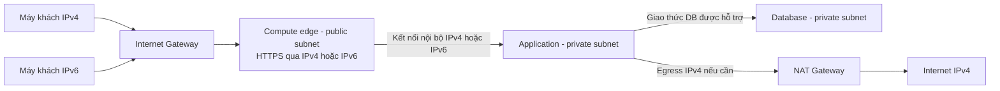

# IPv6 trong VCN và thiết kế mạng dual stack

## 1. Mục tiêu và bối cảnh

Trong chương **Mạng Virtual Cloud Network** của module Oracle Cloud Infrastructure (OCI), IPv6 giúp mở rộng khả năng kết nối mà vẫn giữ IPv4 cho các hệ thống hiện hữu. Một thiết kế dual stack chỉ hoàn chỉnh khi địa chỉ, định tuyến, kiểm soát truy cập, hệ điều hành, ứng dụng và DNS cùng hoạt động theo chủ đích.

Sau bài học, bạn có thể:

- Lập kế hoạch địa chỉ IPv4/IPv6 cho các tầng mạng trong một VCN.
- Phân biệt việc được cấp IPv6 với việc được phép kết nối Internet.
- Thiết kế route và quy tắc bảo mật riêng cho từng họ địa chỉ.
- Triển khai từng bước, kiểm thử độc lập IPv4/IPv6 và xử lý lỗi có hệ thống.
- Đưa thay đổi vào quy trình phân quyền, tự động hóa, giám sát và kiểm soát chi phí.

Phạm vi thực hành là VCN có các subnet dual stack và Compute instance. Không giả định mọi dịch vụ cơ sở dữ liệu, lưu trữ, load balancer hoặc công cụ giám sát của OCI đều có cùng khả năng IPv6. Cần xác nhận khả năng của từng dịch vụ trước khi mở rộng kiến trúc.

## 2. Dual stack thực sự có nghĩa gì?

Dual stack là vận hành IPv4 và IPv6 song song. Một dịch vụ có thể được truy cập bằng địa chỉ IPv4 hoặc IPv6, tùy DNS, khả năng mạng của máy khách và cách ứng dụng chọn kết nối.

Ví dụ, tên miền của một API có thể có cả hai bản ghi:

```text
api.example.com.  300  IN  A     203.0.113.10
api.example.com.  300  IN  AAAA  2001:db8:42:1000::10
```

Đây là dữ liệu minh họa. Tên miền và các địa chỉ phải được thay bằng tài nguyên bạn quản lý khi thực hành.

Hai kết nối tới cùng API có thể đi theo hai đường:

```text
Máy khách IPv4 -> địa chỉ IPv4 công khai -> dịch vụ HTTPS
Máy khách IPv6 -> địa chỉ IPv6 GUA      -> dịch vụ HTTPS
```

Bật IPv6 cho VCN chưa đủ để tạo đường thứ hai. Cần kiểm tra ba cấp cấu hình:

| Cấp | Điều cần có | Điều chưa thể suy ra |
| --- | --- | --- |
| VCN | Prefix IPv6 đã được gán | Mọi subnet đều có IPv6 |
| Subnet | Prefix phù hợp và thuộc tính public/private đúng | Mọi VNIC đã có IPv6 |
| VNIC và máy chủ | Địa chỉ đã được cấp, OS nhận cấu hình | Dịch vụ đã lắng nghe và firewall cho phép |

OCI cho phép bổ sung IPv6 vào VCN hiện có. Vì vậy, có thể chuyển đổi theo từng subnet và workload, thay vì thay toàn bộ mạng cùng lúc. [Oracle: Networking Overview](https://docs.oracle.com/en-us/iaas/Content/Network/Concepts/overview.htm)

Dual stack không tự biến gói tin IPv6 thành IPv4. Một ứng dụng có thể tiếp nhận IPv6 rồi tạo một kết nối IPv4 mới tới backend; đó là hai phiên kết nối do ứng dụng trung gian quản lý. NAT64/DNS64 là cơ chế chuyển đổi riêng, cần được thiết kế riêng nếu có nhu cầu.

## 3. Đọc địa chỉ và lập kế hoạch prefix

### 3.1. Những ký hiệu cần nhận biết

IPv6 dùng địa chỉ 128 bit, thường biểu diễn bằng tám nhóm số thập lục phân. Có thể bỏ các số 0 đầu nhóm; ký hiệu rút gọn liên tiếp các nhóm 0 là `::` và chỉ xuất hiện một lần trong một địa chỉ.

```text
2001:0db8:0042:1000:0000:0000:0000:0010
2001:db8:42:1000::10
```

Hai cách viết trên biểu diễn cùng một địa chỉ. Không so sánh địa chỉ bằng chuỗi ký tự thô trong công cụ quản trị hoặc hệ thống phân tích log; hãy phân tích chúng bằng thư viện địa chỉ mạng.

| Ký hiệu | Ý nghĩa khi thiết kế |
| --- | --- |
| Prefix `/56` | Khối địa chỉ dùng làm ví dụ cho VCN |
| Prefix `/64` | Khối địa chỉ cho một subnet IPv6 trong OCI |
| Địa chỉ `/128` | Chính xác một địa chỉ IPv6 |
| `::/0` | Tất cả đích IPv6, thường dùng cho default route |
| `::1` | Loopback IPv6 của chính máy |
| `fe80::/10` | Địa chỉ link-local, không thay thế địa chỉ kết nối liên mạng |
| `2001:db8::/32` | Dải dành cho tài liệu, không dùng triển khai thực |

Dải tài liệu giúp ví dụ không trỏ nhầm tới hệ thống của tổ chức khác. Mọi địa chỉ `2001:db8:...` trong bài đều cần được thay bằng prefix thực tế. [RFC 3849: IPv6 Address Prefix Reserved for Documentation](https://datatracker.ietf.org/doc/html/rfc3849.txt)

### 3.2. Từ VCN xuống subnet

Với phương án Oracle cấp GUA, VCN nhận prefix `/56`; subnet IPv6 dùng `/64`. Một `/56` có thể chia về mặt địa chỉ thành:

```text
2^(64 - 56) = 256 khối /64
```

Đây là phép tính không gian địa chỉ, không phải cam kết về số subnet được phép tạo trong tenancy. Giới hạn dịch vụ và quota vẫn áp dụng. [Oracle: Networking Overview](https://docs.oracle.com/en-us/iaas/Content/Network/Concepts/overview.htm)

Ví dụ lập kế hoạch:

```text
VCN:                  2001:db8:42:1000::/56

edge-public:          2001:db8:42:1000::/64
application-private:  2001:db8:42:1010::/64
database-private:     2001:db8:42:1020::/64
```

Với prefix `/56` này, nhóm thứ tư của các subnet nằm trong khoảng `1000` đến `10ff`. Các số `1000`, `1010`, `1020` là số thập lục phân, được chọn để dễ nhận diện vai trò.

Lưu bản đồ cấp phát theo môi trường, vùng và chức năng. Không dùng cùng một prefix cho hai mạng sẽ kết nối qua peering, VPN hoặc FastConnect. Dự trù phần còn lại cho subnet mới, thay vì cấp phát rải rác không có quy ước.

### 3.3. Chọn loại prefix

OCI có các phương án Oracle cấp GUA, BYOIPv6 và ULA:

| Phương án | Mục đích trong thiết kế |
| --- | --- |
| Oracle cấp GUA | Cần địa chỉ có khả năng định tuyến Internet, triển khai thuận tiện |
| BYOIPv6 | Tổ chức quản lý khối địa chỉ riêng và có quy trình đưa khối đó vào OCI |
| ULA | Kết nối nội bộ; không được định tuyến trên Internet |

GUA không đồng nghĩa cổng dịch vụ đang mở. Đặc biệt, tài nguyên trong subnet private không được giao tiếp IPv6 trực tiếp với Internet kể cả được cấp GUA. Khả năng truy cập còn phụ thuộc loại subnet, route và các lớp bảo mật. [Oracle: IPv6 Addresses](https://docs.oracle.com/en-us/iaas/Content/Network/Concepts/ipv6.htm)

## 4. Ví dụ kiến trúc ba tầng

Giả sử một ứng dụng có tầng tiếp nhận HTTPS, tầng xử lý nghiệp vụ và cơ sở dữ liệu. Ta chọn VCN `10.42.0.0/16` và prefix IPv6 minh họa `2001:db8:42:1000::/56`.

| Tầng | IPv4 subnet | IPv6 subnet | Loại subnet | Vai trò |
| --- | --- | --- | --- | --- |
| Edge | `10.42.10.0/24` | `2001:db8:42:1000::/64` | Public | Nhận HTTPS từ Internet |
| Application | `10.42.20.0/24` | `2001:db8:42:1010::/64` | Private | Xử lý yêu cầu nội bộ |
| Database | `10.42.30.0/24` | `2001:db8:42:1020::/64` | Private | Dành không gian mạng cho tầng dữ liệu |

Một Compute instance ở edge có thể dùng IPv4 private `10.42.10.10`, một IPv4 public được OCI cấp và IPv6 GUA được cấp trên VNIC. Không cấu hình địa chỉ IPv4 public minh họa `203.0.113.10` trực tiếp vào NIC của máy.



Trong bài lab, dùng Compute edge để kiểm soát rõ địa chỉ và listener. Khi thay bằng dịch vụ load balancer, phải kiểm tra loại frontend, listener, backend, health check và hỗ trợ IPv6 của sản phẩm được chọn.

Việc subnet database có prefix IPv6 chỉ chuẩn bị khả năng của mạng. Nó không xác nhận DB System hoặc dịch vụ Oracle Database cụ thể có endpoint IPv6 phù hợp. Có thể vận hành frontend dual stack trong khi backend và database vẫn dùng IPv4.

Một địa chỉ cụ thể cho mỗi tầng, nếu đã được OCI cấp cho đúng VNIC, có thể là:

```text
edge: 10.42.10.10 và 2001:db8:42:1000::10
app:  10.42.20.10 và 2001:db8:42:1010::10
```

Không tự chọn một địa chỉ rồi chỉ chạy lệnh thêm địa chỉ trong OS. Địa chỉ dùng cho workload cần được cấp và quản lý đúng trên phía OCI.

## 5. Thiết kế định tuyến theo từng họ địa chỉ

### 5.1. Route public subnet

Hai default route độc lập được dùng cho edge:

| Đích | Target | Tác dụng |
| --- | --- | --- |
| `0.0.0.0/0` | Internet Gateway | Đường Internet IPv4 cho tài nguyên đủ điều kiện |
| `::/0` | Internet Gateway | Đường Internet IPv6 cho tài nguyên đủ điều kiện |

Có route không có nghĩa có quyền truy cập. Instance vẫn cần địa chỉ phù hợp, subnet đúng loại, quy tắc bảo mật và listener hoạt động.

OCI có local routing cho lưu lượng trong VCN. Trong kiến trúc đơn giản của bài, không cần thêm default route chỉ để edge nói chuyện với app. Nếu đã triển khai firewall trung gian hoặc routing tùy biến, cần kiểm tra đường thực tế thay vì áp dụng giả định này. Route cụ thể hơn được ưu tiên so với route rộng hơn. [Oracle: VCN Route Tables](https://docs.oracle.com/en-us/iaas/Content/Network/Tasks/managingroutetables.htm)

### 5.2. Route private subnet

Với tầng app trong ví dụ:

| Đích hoặc nhu cầu | Phương án |
| --- | --- |
| Giao tiếp với edge trong VCN | Local routing và các quy tắc bảo mật tương ứng |
| Tải cập nhật từ Internet qua IPv4 | `0.0.0.0/0` tới NAT Gateway, nếu có nhu cầu |
| Truy cập mạng doanh nghiệp bằng IPv6 | Prefix doanh nghiệp tới DRG và cấu hình đường về |
| Internet IPv6 trực tiếp | Không đưa vào thiết kế private subnet này |

Không sao chép route IPv4 rồi thay đích bằng `::/0` nhưng giữ target NAT Gateway. NAT Gateway và Service Gateway không nằm trong các gateway OCI hỗ trợ lưu lượng IPv6; Internet Gateway, DRG và LPG có hỗ trợ. Với kết nối doanh nghiệp, FastConnect hoặc Site-to-Site VPN vẫn cần được cấu hình IPv6 tương ứng. [Oracle: IPv6 Addresses](https://docs.oracle.com/en-us/iaas/Content/Network/Concepts/ipv6.htm)

Nếu private workload cần gọi một API bên ngoài, có thể giữ đường ra IPv4 trong giai đoạn chuyển đổi. Nếu yêu cầu bắt buộc là IPv6, cần thiết kế lại đường egress được kiểm soát, chẳng hạn qua proxy phù hợp; không coi việc thêm route là đã giải quyết yêu cầu.

### 5.3. Route trong OCI và route trong OS

Route table của VCN và bảng định tuyến của máy chủ là hai lớp khác nhau. Cấu hình đúng ở OCI chưa chứng minh OS đã có địa chỉ và đường đi phù hợp.

Trên Linux:

```bash
ip -4 address show
ip -6 address show
ip -4 route show
ip -6 route show
```

Cần thấy IPv6 được cấp cho VNIC xuất hiện trên interface tương ứng. Chỉ thấy địa chỉ `fe80::...` chưa chứng minh máy đã nhận địa chỉ dùng để kết nối ngoài liên kết.

OCI hỗ trợ OS nhận địa chỉ thông qua DHCPv6. Với instance đang chạy, thời điểm nhận địa chỉ phụ thuộc chu kỳ DHCPv6 và cấu hình image. Hãy sử dụng cơ chế quản lý mạng của image để nhận lại cấu hình khi cần, tránh thêm địa chỉ tạm thời làm sai lệch trạng thái quản lý. [Oracle: Virtual Cloud Network FAQ](https://www.oracle.com/cloud/networking/virtual-cloud-network/faq/)

## 6. Bảo mật dual stack

### 6.1. Viết chính sách theo ý định truy cập

Bắt đầu bằng câu hỏi “ai được gọi dịch vụ nào”, sau đó biểu diễn riêng cho IPv4 và IPv6.

Ví dụ edge cung cấp HTTPS công khai:

| Chiều | Nguồn hoặc đích | Giao thức | Cổng đích | Mục đích |
| --- | --- | --- | --- | --- |
| Ingress | `0.0.0.0/0` | TCP | 443 | HTTPS IPv4 công khai |
| Ingress | `::/0` | TCP | 443 | HTTPS IPv6 công khai |
| Ingress | CIDR IPv4 quản trị | TCP | 22 | SSH từ mạng quản trị |
| Ingress | Prefix IPv6 quản trị | TCP | 22 | SSH IPv6 nếu thực sự cần |
| Egress | `10.42.20.10/32` | TCP | 8080 | Edge gọi app qua IPv4 |
| Egress | `2001:db8:42:1010::10/128` | TCP | 8080 | Edge gọi app qua IPv6 nếu dùng |

Hai dòng egress cuối là hai lựa chọn hoặc hai đường được phép có chủ đích, không buộc ứng dụng phải dùng cả hai. App cần có ingress tương ứng từ edge; firewall trong OS của cả hai bên cũng phải phù hợp.

Nếu API chỉ dành cho đối tác, thay các nguồn toàn Internet bằng dải địa chỉ đối tác. Không mở SSH từ `::/0` chỉ vì đã giới hạn SSH IPv4.

Với TCP stateful, lưu lượng phản hồi của kết nối đã được theo dõi được xử lý theo trạng thái. Khi dùng stateless, phải thiết kế cả chiều đi lẫn chiều về, kể cả cổng tạm thời của client. Tránh trộn hai loại rule cho cùng lưu lượng nếu chưa hiểu cách chúng tương tác.

### 6.2. NSG và security list không phải hai lớp deny nối tiếp

Security list áp dụng theo subnet; NSG gom các VNIC theo vai trò bảo mật. Khi dùng cùng nhau, các allow rule của NSG và security list có hiệu lực cộng gộp. Một NSG hẹp không thu hẹp được rule rộng vẫn tồn tại trong security list. Firewall của OS là một lớp kiểm tra bổ sung. [Oracle: Security Rules](https://docs.oracle.com/en-us/iaas/Content/Network/Concepts/securityrules.htm)

Vì vậy, khi kiểm tra việc SSH đã được giới hạn hay chưa, cần rà tất cả security list liên kết subnet và NSG gắn VNIC. Không chỉ kiểm tra NSG vừa tạo.

Phạm vi ví dụ là mạng dùng NSG và security list. Nếu môi trường có thêm Zero Trust Packet Routing hoặc thiết bị firewall, chính sách ở những lớp đó cũng phải cho phép đường kết nối dự kiến.

### 6.3. Không chặn ICMPv6 một cách máy móc

ICMPv6 hỗ trợ hoạt động của IPv6, không chỉ phục vụ ping. Lọc toàn bộ ICMPv6 có thể làm đường mạng hoạt động không ổn định dù một số kết nối nhỏ vẫn thành công. Cần xây dựng chính sách cho thông điệp lỗi và thông điệp điều khiển thích hợp với vị trí firewall. [RFC 4890: Recommendations for Filtering ICMPv6 Messages in Firewalls](https://www.rfc-editor.org/rfc/rfc4890.txt)

Một thông điệp quan trọng là **Packet Too Big**, ICMPv6 type 2, code 0. Router trên đường đi thông báo gói tin vượt MTU để phía gửi điều chỉnh kích thước; router IPv6 không phân mảnh gói tin thay cho nguồn gửi. Nếu thông báo bị chặn, có thể xuất hiện hiện tượng kết nối được nhưng tải dữ liệu lớn bị treo. [RFC 8201: Path MTU Discovery for IP version 6](https://www.rfc-editor.org/info/rfc8201/)

Trong OCI, giao thức ICMPv6 có số 58. Đừng nhầm nó với ICMP của IPv4 có số 1. Khi định nghĩa rule, phân biệt protocol với type/code.

Nếu cho phép ping phục vụ chẩn đoán, giới hạn nguồn và thời gian theo nhu cầu. Ping thành công không thay thế việc kiểm tra TCP, TLS và endpoint nghiệp vụ.

## 7. DNS và ứng dụng: công bố IPv6 đúng thời điểm

### 7.1. Bản ghi A và AAAA

A mang địa chỉ IPv4; AAAA mang địa chỉ IPv6. Việc có AAAA là lời công bố rằng dịch vụ có thể được tiếp cận bằng IPv6, nên chỉ thêm sau khi đường IPv6 đã vượt kiểm thử.

Trình tự triển khai đề xuất:

1. Giữ bản ghi A và đường IPv4 đang hoạt động.
2. Hoàn thiện địa chỉ, route, security rule và listener IPv6.
3. Kiểm thử IPv6 bằng địa chỉ đã chọn, giữ hostname để kiểm tra TLS.
4. Công bố AAAA cho tên thử nghiệm trước, rồi mới cho tên chính.
5. Theo dõi lỗi, độ trễ và tỷ lệ lưu lượng theo từng họ địa chỉ.

Một số client dùng Happy Eyeballs để thử các khả năng kết nối và giảm thời gian chờ khi một đường gặp lỗi. Cơ chế dự phòng có thể khiến người vận hành không nhận ra IPv6 đang hỏng nếu chỉ thử mở trang trong trình duyệt. [RFC 8305: Happy Eyeballs Version 2](https://www.rfc-editor.org/rfc/rfc8305.txt)

### 7.2. Listener, TLS và dữ liệu ứng dụng

Dịch vụ chỉ bind `0.0.0.0:443` chưa chắc tiếp nhận IPv6. Cũng không nên mặc định một listener `[::]:443` sẽ xử lý được cả hai họ địa chỉ trên mọi OS và runtime.

```bash
ss -lntp
```

Kiểm tra cấu hình listener của chính ứng dụng và thử kết nối riêng từng họ địa chỉ. Với TLS, chứng thư vẫn cần hợp lệ cho hostname được truy cập; đừng bỏ xác minh chứng thư để che lỗi kiểm thử.

Rà soát thêm các thành phần thường bỏ sót:

- Allowlist, rate limit và hệ thống phát hiện gian lận có chấp nhận IPv6 không?
- Log có giữ đủ địa chỉ và phân biệt địa chỉ với cổng không?
- Database hoặc công cụ phân tích có trường dữ liệu đủ cho IPv6 không?
- Callback, webhook và API đối tác có đường kết nối phù hợp không?
- Health check có đang kiểm tra đúng họ địa chỉ mà người dùng sẽ sử dụng không?

Trong URL chứa IPv6 trực tiếp, dùng dấu ngoặc vuông quanh địa chỉ để phân biệt với dấu hai chấm trước cổng:

```text
http://[2001:db8:42:1000::10]:8080/health
```

## 8. Thực hành: bổ sung IPv6 mà vẫn giữ IPv4

### 8.1. Điều kiện chuẩn bị

Dùng compartment lab tách biệt, có quyền quản lý đúng các tài nguyên mạng và quyền gắn địa chỉ vào VNIC Compute được chọn. Quyền chỉnh VCN không tự đồng nghĩa có quyền thay cấu hình của mọi instance hoặc dịch vụ liên quan.

Chuẩn bị:

- VCN và một public subnet cho edge, một private subnet cho app.
- Compute image hỗ trợ IPv6 và cơ chế quản lý mạng đã được xác định.
- Một dịch vụ HTTPS có chứng thư hợp lệ trên edge, cung cấp `/health`.
- Máy kiểm thử có đường IPv4 và IPv6 thực sự hoạt động.
- Một hostname bạn kiểm soát nếu thử công bố A/AAAA.
- Baseline kết nối IPv4 trước thay đổi.

Trong ví dụ, `/health` chỉ cần trả HTTP 200 với một nội dung ngắn đã biết. Nếu chưa có tầng app hoặc database, có thể kiểm thử đường mạng edge trước; không tạo database chỉ để kiểm chứng IPv6 của VCN.

### 8.2. Các bước cấu hình

1. **Ghi nhận trạng thái ban đầu.** Lưu trong hồ sơ thay đổi các OCID, địa chỉ, route, security rule và kết quả truy cập IPv4. Xác nhận đang chọn đúng region và compartment.
2. **Bổ sung prefix cho VCN.** Chọn phương án Oracle cấp GUA cho lab có truy cập Internet. Ghi lại prefix thực được cấp.
3. **Gán prefix subnet.** Chọn các `/64` nằm trong prefix VCN, không trùng nhau. Giữ edge là public, app là private.
4. **Cấp IPv6 cho VNIC.** Dùng địa chỉ OCI cấp hoặc địa chỉ hợp lệ được chỉ định qua OCI. Ghi rõ địa chỉ thuộc VNIC và subnet nào.
5. **Kiểm tra OS.** Đảm bảo image nhận địa chỉ và route. Nếu chưa có, kiểm tra quản lý mạng và DHCPv6 trước khi thay firewall.
6. **Bổ sung route.** Thêm `::/0` tới Internet Gateway cho edge khi cần Internet IPv6. Không thêm đường đó vào private subnet để thử vượt hạn chế loại subnet.
7. **Bổ sung bảo mật.** Thêm rule IPv6 theo ma trận đã thiết kế, kiểm tra cả security list và NSG. Giữ ICMPv6 cần thiết và firewall OS phù hợp.
8. **Kiểm tra listener và TLS.** Dịch vụ phải tiếp nhận kết nối IPv6 và trả đúng endpoint.
9. **Kiểm thử trước DNS.** Dùng tùy chọn ép địa chỉ của client. Chỉ thêm AAAA sau khi các phép thử bắt buộc đạt.
10. **Theo dõi và ghi nhận.** So sánh với baseline IPv4; xác nhận không mở thêm cổng ngoài dự kiến.

Tên mục trong Console có thể thay đổi; các đối tượng cần kiểm tra vẫn là VCN, subnet, VNIC/IP, route table, gateway và security rule.

### 8.3. Kiểm tra trên máy chủ

Các lệnh dưới đây là ví dụ cho Linux, không phải lệnh được chạy tự động bởi bài học:

```bash
ip -4 address show
ip -6 address show scope global
ip -4 route show
ip -6 route show
ss -lntp
```

Đối chiếu địa chỉ với VNIC trên OCI. Nếu máy có nhiều NIC hoặc nhiều địa chỉ, xác nhận interface và source address mà ứng dụng thực sự sử dụng.

Kiểm tra quyết định định tuyến tới một peer nội bộ:

```bash
# Thay địa chỉ minh họa bằng IPv6 thực của app.
ip -6 route get 2001:db8:42:1010::10
```

Lệnh này cho biết lựa chọn đường đi của OS; nó không chứng minh NSG, firewall hay dịch vụ phía đích đã cho phép.

### 8.4. Kiểm thử từ máy khách

Trong các ví dụ sau, thay `api.example.com`, IPv4 và IPv6 bằng hostname và địa chỉ thực của edge. Chạy trên máy có công cụ tương ứng và kết nối IPv6 độc lập đã được xác nhận.

```bash
dig +short A api.example.com
dig +short AAAA api.example.com

curl --noproxy '*' -4 --connect-timeout 5 --max-time 15 \
  https://api.example.com/health

curl --noproxy '*' -6 --connect-timeout 5 --max-time 15 \
  https://api.example.com/health
```

`--noproxy '*'` giúp phép thử đường trực tiếp không vô tình đi qua proxy HTTP được cấu hình trong môi trường. Nếu kiến trúc yêu cầu proxy, cần có phép thử riêng cho đường qua proxy.

Trước khi công bố AAAA, dùng địa chỉ ép sẵn nhưng giữ hostname cho HTTP Host và TLS SNI:

```bash
curl --noproxy '*' -6 \
  --resolve 'api.example.com:443:[2001:db8:42:1000::10]' \
  --connect-timeout 5 --max-time 15 \
  https://api.example.com/health
```

Phép thử đạt khi bắt tay TLS hợp lệ, nhận HTTP 200 và nội dung `/health` đúng kỳ vọng. Không dùng `-k` làm tiêu chí nghiệm thu.

Nếu cần đo địa chỉ kết nối thực tế và thời gian:

```bash
curl --noproxy '*' -6 -sS -o /dev/null \
  --connect-timeout 5 --max-time 15 \
  -w 'remote=%{remote_ip} status=%{http_code} total=%{time_total}\n' \
  https://api.example.com/health
```

Kết quả bình thường của một lệnh `curl` không ép họ địa chỉ không đủ để kết luận cả hai đường đều hoạt động.

## 9. Ma trận nghiệm thu

Thực hiện cả phép thử được phép và phép thử phải bị từ chối, trên các tài nguyên lab thuộc quyền quản lý của bạn.

| Phép thử | Nguồn thử | Kỳ vọng |
| --- | --- | --- |
| HTTPS IPv4 tới edge | Máy ngoài có IPv4 | Thành công như baseline |
| HTTPS IPv6 tới edge | Máy ngoài có IPv6 | Thành công, TLS và nội dung đúng |
| Edge gọi app qua IPv4 | Edge | Thành công nếu đường này được chọn |
| Edge gọi app qua IPv6 | Edge | Thành công nếu đã triển khai đường này |
| SSH IPv6 tới edge | Mạng quản trị được phép | Thành công nếu có yêu cầu SSH IPv6 |
| SSH IPv6 tới edge | Nguồn không được phép | Không thiết lập được phiên |
| Truy cập trực tiếp app private từ Internet IPv6 | Máy ngoài | Không thành công |
| Tải dữ liệu đủ lớn qua IPv6 | Máy ngoài có IPv6 | Không treo do vấn đề MTU |
| Truy vấn A và AAAA | Resolver của máy khách | Trả đúng địa chỉ đã công bố |

Với phép thử tải lớn, dùng một endpoint thử nghiệm có payload đã biết và được phép tải. `/health` quá nhỏ nên không đại diện cho mọi vấn đề MTU.

Không ghi “IPv6 lỗi” nếu chính máy kiểm thử không có default route IPv6 hoặc ISP không cung cấp IPv6. Luôn phân biệt lỗi của client, mạng trung gian và phía OCI.

## 10. Chẩn đoán theo lớp

| Hiện tượng | Khả năng cần kiểm tra | Bước tiếp theo |
| --- | --- | --- |
| VCN có prefix nhưng OS chỉ có `fe80::...` | Subnet, cấp phát VNIC, DHCPv6 hoặc image chưa phù hợp | Đối chiếu từ VCN xuống VNIC rồi tới OS |
| IPv4 tốt, IPv6 timeout | Thiếu route IPv6, rule IPv6, listener hoặc client IPv6 | Kiểm tra độc lập từng lớp |
| Chỉ lỗi theo hostname | AAAA sai, DNS cache hoặc đường qua proxy | So sánh DNS với phép thử `--resolve` |
| TCP trả lỗi từ chối kết nối | Không có listener hoặc firewall chủ động reject | Xem socket lắng nghe và log tại đích |
| TLS báo sai hostname/chứng thư | Kiểm thử bằng IP hoặc cấu hình virtual host không đúng | Giữ hostname và xác minh SNI/chứng thư |
| Response nhỏ được, response lớn treo | MTU hoặc ICMPv6 bị chặn | Kiểm tra Packet Too Big và đường truyền |
| SSH vẫn vào được từ nguồn ngoài allowlist | Security list hoặc NSG khác còn rule rộng | Kiểm tra toàn bộ tập allow rule hiệu lực |
| IPv6 nội bộ tốt nhưng app private không ra Internet IPv6 | Kiến trúc không có đường egress phù hợp | Đối chiếu yêu cầu với loại subnet, không tự mở rộng ingress |
| Trình duyệt dùng được nhưng kiểm thử ép IPv6 thất bại | Client đang dự phòng về IPv4 | Sửa đường IPv6 trước khi coi triển khai hoàn tất |

Khi cần quan sát sâu hơn, có thể bắt gói trên đúng interface với quyền phù hợp:

```bash
sudo tcpdump -n -i any 'ip6 and tcp port 443'
sudo tcpdump -n -i any 'icmp6'
```

Nếu gói SYN tới máy mà không có phản hồi, kiểm tra firewall OS, listener và route về. Nếu không thấy gói, tiếp tục điều tra phía trước máy; điều đó chưa đủ để quy lỗi chắc chắn cho một NSG.

Không tắt toàn bộ firewall hoặc mở mọi cổng để chẩn đoán. Mỗi thay đổi nên có phạm vi nhỏ, mục đích rõ và kết quả quan sát được.

## 11. Giám sát, tự động hóa và kiểm soát chi phí

### 11.1. Quan sát riêng hai họ địa chỉ

Duy trì probe ép IPv4 và probe ép IPv6 cho cùng endpoint. Theo dõi tỷ lệ thành công, thời gian TLS, thời gian phản hồi và mã trạng thái theo từng đường.

Log ứng dụng cần giữ địa chỉ nguồn ở định dạng không bị cắt ngắn, thời điểm, request ID và thông tin proxy đáng tin cậy nếu có. Đừng tự động tin mọi header chuyển tiếp do client gửi.

Khi thay đổi mạng, kiểm tra Audit để biết ai sửa route, gateway hoặc security rule. Các chỉ số VNIC giúp điều tra gói bị loại do bảo mật, nhưng không thay thế phép thử endpoint. [Oracle: Securing Networking](https://docs.oracle.com/en-us/iaas/Content/Security/Reference/networking_security.htm), [Oracle: Security Rules](https://docs.oracle.com/en-us/iaas/Content/Network/Concepts/securityrules.htm)

Nếu sử dụng flow log hay công cụ phân tích mạng, xác nhận dữ liệu và bộ lọc của công cụ thực sự bao phủ IPv6 trong cấu hình đang dùng.

### 11.2. Đưa vào hạ tầng dưới dạng mã

Khi tự động hóa bằng công cụ quản lý hạ tầng, biểu diễn riêng:

- Prefix VCN và phân bổ `/64` cho subnet.
- Địa chỉ IPv6 trên VNIC khi cần quản lý tường minh.
- Route IPv4, route IPv6 và gateway đích.
- Rule IPv4/IPv6 theo vai trò, kèm ICMPv6 cần thiết.
- Bản ghi A/AAAA và phép thử trước khi công bố AAAA.

Dùng prefix thực do OCI cấp làm đầu vào cho các tài nguyên phụ thuộc; không chép dải tài liệu vào cấu hình triển khai. Xem bản kế hoạch thay đổi để tránh vô tình thay thế subnet, VNIC hoặc dịch vụ đang chạy.

Quy trình phát hành nên kiểm tra IPv4 sau mỗi thay đổi liên quan IPv6. Một thay đổi chỉ thêm IPv6 vẫn có thể sửa nhầm một danh sách route hoặc tập rule đang dùng chung.

### 11.3. Tính sẵn sàng và chi phí

Dual stack thêm lựa chọn đường kết nối, nhưng không loại bỏ điểm lỗi đơn. Một Compute edge duy nhất vẫn có thể hỏng và làm gián đoạn cả IPv4 lẫn IPv6. Nếu cần tính sẵn sàng cao, thiết kế nhiều instance, miền lỗi phù hợp và cơ chế cân bằng tải đã được xác minh hỗ trợ yêu cầu.

Không mặc định IPv6 làm toàn bộ kiến trúc rẻ hơn. Chi phí còn đến từ Compute, lưu lượng ra, load balancer, VPN/FastConnect, dung lượng log và thời gian vận hành.

Trong lab, tái sử dụng workload phù hợp, đặt ngân sách/cảnh báo và dọn tài nguyên sau thực hành. Không cần tạo thêm DB System chỉ để thử đường IPv6 giữa hai Compute instance.

## 12. Triển khai theo giai đoạn và quay lui

Một lộ trình ít thay đổi đồng thời là:

1. Chọn một workload có phạm vi nhỏ, xác nhận baseline IPv4.
2. Bổ sung IPv6 tới VNIC và listener nhưng chưa công bố AAAA.
3. Kiểm thử ép địa chỉ, bảo mật và payload lớn.
4. Công bố AAAA trên hostname thử nghiệm, theo dõi từ mạng ngoài.
5. Công bố cho hostname chính khi các tiêu chí đã đạt.
6. Mở rộng dần, giữ các phụ thuộc chưa hỗ trợ IPv6 trên IPv4.

Nếu phát hiện lỗi sau công bố, có thể rút AAAA và giữ A để hướng các lần phân giải mới về đường IPv4. Tuy nhiên, DNS cache và các kết nối đã mở không mất ngay; cần tính thời gian TTL và tiếp tục xử lý nguyên nhân gốc.

Đừng xóa lập tức IPv6 khỏi VNIC hoặc subnet khi vẫn có client có thể đang dùng địa chỉ đã cache. Chuẩn bị thời gian chuyển tiếp và xác nhận ảnh hưởng của thao tác trước khi thu hồi tài nguyên.

Khi dọn lab, thu hồi bản ghi DNS trước theo kế hoạch, kết thúc workload không còn dùng, rồi tháo các phụ thuộc địa chỉ, route và gateway theo thứ tự mà OCI cho phép. Không xóa các tài nguyên mạng dùng chung với bài thực hành khác.

## 13. Tự kiểm tra thiết kế

Trước khi coi một workload đã vận hành dual stack, hãy tự giải thích được:

- Prefix của VCN, subnet và địa chỉ VNIC liên hệ với nhau thế nào?
- Tại sao một GUA trong private subnet không tạo truy cập Internet IPv6 trực tiếp?
- Default route IPv4 và IPv6 đang trỏ tới đâu, và đường về được bảo đảm ra sao?
- Có rule rộng nào trong security list làm vô hiệu ý định giới hạn bằng NSG không?
- OS và ứng dụng có thực sự tiếp nhận IPv6, hay chỉ OCI đã được cấp địa chỉ?
- AAAA được công bố sau những phép thử nào?
- Làm sao nhận ra IPv6 hỏng khi client vẫn truy cập được qua IPv4?
- Kế hoạch rút AAAA, theo dõi cache và giữ đường IPv4 được thực hiện thế nào?

Một thiết kế có thể trả lời những câu hỏi này bằng cấu hình và kết quả kiểm thử cụ thể sẽ dễ triển khai, vận hành và mở rộng hơn việc chỉ đánh dấu bật IPv6 trong VCN.

