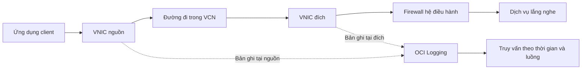

# VCN Flow Logs và phân tích lưu lượng bị chặn

Trong chương **Mạng Virtual Cloud Network** của module Oracle Cloud Infrastructure (OCI), bài học này giải quyết một tình huống vận hành thường gặp: ứng dụng không kết nối được tới một endpoint, nhưng người vận hành chưa biết gói tin bị chặn ở đâu. VCN Flow Logs cung cấp bằng chứng về lưu lượng tại VNIC để thu hẹp phạm vi điều tra trước khi sửa cấu hình mạng.

Ví dụ xuyên suốt là máy ứng dụng kết nối tới một endpoint nội bộ qua TCP 1521, cổng thường dùng cho Oracle Net Listener. Cách phân tích cũng áp dụng cho SSH, HTTPS và các dịch vụ TCP khác. Thông tin về tenancy, compartment và IAM giúp xác định ai được bật hoặc đọc log; thông tin VCN và Compute giúp tìm đúng interface; dữ liệu quan sát giúp kiểm chứng thay đổi, kiểm soát chi phí và hỗ trợ xử lý sự cố trên nhiều node.

## 1. Kết quả cần đạt

Sau bài học, người học có thể:

- Chọn điểm bật flow log phù hợp với một kết nối cần điều tra.
- Phân biệt kết quả xét security rule với trạng thái thu thập dữ liệu.
- Tra cứu hai chiều của một luồng bằng địa chỉ, cổng, giao thức, VNIC và thời gian.
- Dùng bằng chứng để quyết định kiểm tra NSG, security list, định tuyến, firewall hệ điều hành hay dịch vụ.
- Kiểm chứng một thay đổi quyền mạng bằng lần kết nối mới và lưu lại kết quả trước/sau.
- Đề xuất phạm vi thu thập và cảnh báo phù hợp với mức quan trọng của workload.

Kiến thức nền cần có là CIDR, TCP, cổng nguồn/cổng đích, ingress/egress, subnet, VNIC, NSG và security list. Không cần triển khai cơ sở dữ liệu thật để thực hiện lab của bài.

## 2. Flow log đặt quan sát ở đâu?

Một tài nguyên kết nối vào VCN thông qua VNIC. Flow log mô tả lưu lượng được quan sát tại VNIC, theo một chiều và một cửa sổ thu thập. Có thể bật theo VCN, subnet hoặc tài nguyên/VNIC cụ thể; việc lưu trữ và tìm kiếm sử dụng OCI Logging. [Tổng quan VCN Flow Logs của Oracle](https://docs.oracle.com/en-us/iaas/Content/Network/Concepts/vcn-flow-logs.htm).



Hãy tách ba câu hỏi khi đọc bằng chứng:

1. **Đã nhìn thấy gì?** Có bản ghi nào khớp lần thử trên VNIC đang xét?
2. **Security rule xử lý ra sao?** Bản ghi có `action` là `ACCEPT` hay `REJECT`?
3. **Yêu cầu nghiệp vụ thành công chưa?** Client có nhận phản hồi mong đợi từ dịch vụ?

Ba câu hỏi này tạo thành các bước điều tra liên tiếp. Ví dụ, thấy `ACCEPT` tại VNIC đích mới cung cấp cơ sở để chuyển sang kiểm tra firewall trong máy và tiến trình server. Nó chưa đủ để kết luận Oracle Database đã sẵn sàng nhận phiên đăng nhập.

Flow log không chứa nội dung câu SQL, HTTP body hoặc payload của ứng dụng. Khi cần hiểu chính xác phản hồi ở tầng ứng dụng, kết hợp log của dịch vụ và kết quả client; khi cần chi tiết gói tin, cân nhắc công cụ bắt gói hoặc VTAP trong phạm vi được phép.

## 3. Phân biệt ba loại quyết định

### 3.1. `ACCEPT` và `REJECT`

`data.action` phản ánh lưu lượng được chấp nhận hoặc từ chối bởi security rules ở điểm quan sát. Dùng nó để điều tra security list và NSG áp dụng cho VNIC. Một bản ghi không cung cấp sẵn OCID của rule cần sửa. [Cơ chế sử dụng flow log để điều tra security rules](https://docs.oracle.com/en-us/iaas/Content/Network/Concepts/vcn-flow-logs.htm).

Với một luồng mong đợi:

- `REJECT`: kiểm tra đúng chiều, tập rule đang áp dụng và đặc điểm thực tế của gói tin.
- `ACCEPT`: tiếp tục kiểm tra phần còn lại của đường đi, chiều phản hồi, hệ điều hành và dịch vụ.
- Không có bản ghi phù hợp: kiểm tra cả đường đi của gói tin lẫn phạm vi quan sát trước khi đưa ra kết luận.

Một đợt `REJECT` từ nguồn lạ vào cổng quản trị có thể là cơ chế bảo vệ đang làm đúng nhiệm vụ. Tính chất sự cố phụ thuộc vào việc lưu lượng đó có được phép theo thiết kế hay không.

### 3.2. Trạng thái thu thập `OK`, `NODATA`, `SKIPDATA`

| `data.status` | Ý nghĩa khi đọc log |
| --- | --- |
| `OK` | Bản ghi lưu lượng thông thường |
| `NODATA` | Không ghi nhận lưu lượng trong cửa sổ thu thập |
| `SKIPDATA` | Có dữ liệu bị bỏ qua do vấn đề hệ thống hoặc năng lực thu thập |

Với `NODATA` và `SKIPDATA`, nhiều trường lưu lượng có thể là `null`. Chúng không tương đương `REJECT`; thiếu dữ liệu cũng không chứng minh endpoint truy cập được. [Trạng thái cửa sổ thu thập](https://docs.oracle.com/en-us/iaas/Content/Logging/Reference/details_for_vcn_flow_logs.htm).

### 3.3. Include/Exclude của capture filter

Capture filter chọn dữ liệu đưa vào log. Security rule quyết định lưu lượng được phép đi qua. Vì vậy, thêm Include vào capture filter không mở cổng dịch vụ; thêm Exclude chỉ làm thay đổi bằng chứng được thu thập.

Capture filter có sampling rate và các rule xét theo thứ tự; rule khớp đầu tiên quyết định việc Include/Exclude. Lưu lượng không khớp rule nào không được đưa vào log. Thay đổi filter dùng chung ảnh hưởng các cấu hình flow log đang tham chiếu nó. [Capture Filters](https://docs.oracle.com/en-us/iaas/Content/Network/Concepts/capture-filters.htm).

Ví dụ tự thiết kế cho một đợt chẩn đoán IPv4:

| Thứ tự | Hành động | Điều kiện |
| --- | --- | --- |
| 1 | Include | Nguồn `10.20.1.10/32`, đích `10.20.2.20/32`, TCP, cổng đích 1521 |
| 2 | Include | Nguồn `10.20.2.20/32`, đích `10.20.1.10/32`, TCP, cổng nguồn 1521 |

Chọn chiều phù hợp trên từng VNIC, hoặc cả hai chiều nếu cấu hình hỗ trợ và cần thiết. Đặt sampling 100% cho phạm vi nhỏ, trong thời gian lab. Chỉ Include chiều yêu cầu sẽ làm thiếu bằng chứng về chiều phản hồi. Nếu thêm rule Include rộng ở đầu, những rule Exclude phía sau có thể không còn tác dụng.

## 4. Chuẩn bị và bật đúng phạm vi

### 4.1. Phân quyền và xác định tài nguyên

Ghi nhận region, compartment chứa workload, compartment chứa log group và OCID hai VNIC. Không giả định log group nằm cùng compartment với máy Compute.

Người chỉ điều tra cần quyền đọc log group và nội dung log. Người cấu hình cần thêm quyền quản lý tài nguyên log và quyền mạng phù hợp với điểm bật. Quyền đọc log không mặc nhiên cho phép sửa NSG. Tham khảo [quyền tìm kiếm log](https://docs.oracle.com/en-us/iaas/Content/Logging/Concepts/searchinglogs.htm) và [quyền quản lý flow log](https://docs.oracle.com/en-us/iaas/Content/Logging/Task/managinglogs.htm).

Trong tổ chức, có thể giao vai trò đọc log cho nhóm vận hành và giao việc thay đổi rule cho nhóm quản trị mạng. Phân tách này giúp bản ghi điều tra có thể được chia sẻ mà không mở rộng quyền thay đổi hạ tầng.

### 4.2. Trình tự trên Console

1. Mở **Networking → Network Command Center → Flow logs** và chọn compartment phù hợp.
2. Chọn **Enable flow logs**, đặt tên dễ truy vết, ví dụ `flow-app-db-investigation`.
3. Chọn log group đích đã được phân quyền cho người điều tra.
4. Chọn hoặc tạo **Flow log capture filter** bao phủ cả yêu cầu và phản hồi của bài lab.
5. Thêm enablement points: ưu tiên hai VNIC cần điều tra; có thể dùng hai subnet nếu cần quan sát nhiều node.
6. Xem lại cấu hình và bật flow logs.
7. Tạo lưu lượng thử sau khi bật; vào Logging để kiểm tra dữ liệu xuất hiện trước khi bắt đầu phân tích.

Các lựa chọn enablement point và trình tự tạo được Oracle mô tả tại [Enabling Flow Logs](https://docs.oracle.com/en-us/iaas/Content/Network/Tasks/vcn-flow-logs-enable.htm). VCN/subnet là phạm vi thuận tiện khi cần bao phủ nhiều VNIC; dùng VNIC cụ thể giúp một đợt điều tra có phạm vi rõ ràng hơn.

Đặt tên theo mục đích và chủ sở hữu thay vì chỉ dùng tên máy. Một cấu hình chẩn đoán nên có thời điểm kết thúc dự kiến để người tiếp quản biết khi nào cần đánh giá lại phạm vi thu thập.

## 5. Đọc một bản ghi có ích

Những trường thường dùng nhất:

| Trường | Dùng để xác định |
| --- | --- |
| `data.sourceAddress`, `data.destinationAddress` | Cặp IP |
| `data.sourcePort`, `data.destinationPort` | Cặp cổng |
| `data.protocol` | Mã giao thức, ví dụ TCP là 6 |
| `data.action`, `data.status` | Quyết định và chất lượng thu thập |
| `data.packets`, `data.bytesOut` | Số gói, byte trong bản ghi |
| `data.startTime`, `data.endTime` | Cửa sổ thời gian, epoch giây |
| `oracle.vnicocid` | Interface quan sát |

`flowid` là giá trị băm từ đặc điểm luồng; nên ghép thêm VNIC và thời gian khi điều tra. Một số lưu lượng hạ tầng link-local như DNS/DHCP của VCN và ARP không có trong flow logs. Với kết nối qua public IP của Compute, các trường địa chỉ có thể phản ánh private IP tương ứng. [Schema và giới hạn bản ghi](https://docs.oracle.com/en-us/iaas/Content/Logging/Reference/details_for_vcn_flow_logs.htm).

Đoạn dưới là **dữ liệu minh họa tự tạo**, chỉ trích các trường cần học; OCID và `flowid` là placeholder, không phải dữ liệu lấy từ tenancy:

```json
{
  "data": {
    "action": "REJECT",
    "status": "OK",
    "sourceAddress": "10.20.1.10",
    "destinationAddress": "10.20.2.20",
    "sourcePort": 43018,
    "destinationPort": 1521,
    "protocol": 6,
    "packets": 3,
    "bytesOut": 180,
    "startTime": 1795168800,
    "endTime": 1795168810,
    "flowid": "DEMO_FLOW_HASH"
  },
  "oracle": {
    "vnicocid": "DESTINATION_VNIC_OCID"
  }
}
```

Suy luận cho ví dụ này: ở VNIC đích đang xét có lưu lượng từ client tới cổng 1521 bị security rules từ chối. Cần đối chiếu cấu hình thực tế để tìm thiếu rule hay gắn sai NSG. Con số ba gói cũng có thể liên quan đến các lần truyền lại; bản ghi không đủ để xác định ba yêu cầu nghiệp vụ độc lập.

Đừng đọc `bytesOut` như một nhãn chiều egress. Khi dựng chiều luồng, dùng IP nguồn/đích và VNIC quan sát. Ví dụ `10.20.1.10:43018 → 10.20.2.20:1521` là yêu cầu; phản hồi dùng `10.20.2.20:1521 → 10.20.1.10:43018`.

Thời điểm sự cố phải được ghi kèm múi giờ. Chẳng hạn, `17:00 +07:00` tương ứng `10:00Z`. Khi đối chiếu, mở rộng khoảng tìm kiếm quanh lần thử để tính đến cửa sổ tổng hợp và thời gian dữ liệu đến Logging.

## 6. Truy vấn trong OCI Logging

Trong **Logging → Search**, chọn đúng region, log group, log và khoảng thời gian. Những truy vấn dưới dùng **Logging Search Advanced mode**; thay `COMPARTMENT_OCID`, `LOG_GROUP_OCID`, `LOG_OCID` bằng giá trị thật, không giữ nguyên placeholder. Chọn log cụ thể giúp tránh trộn schema với log của dịch vụ khác.

Cấu trúc `search`, `where`, `select`, `summarize` và `sort by` tuân theo [Logging Query Language Specification](https://docs.oracle.com/en-us/iaas/Content/Logging/Reference/query_language_specification.htm).

### 6.1. Tìm lưu lượng bị chặn

```text
search "COMPARTMENT_OCID/LOG_GROUP_OCID/LOG_OCID"
| where data.status = 'OK' and data.action = 'REJECT'
| sort by datetime desc
```

Kiểm tra một dòng JSON thô trước khi thêm điều kiện: trường IP là chuỗi, cổng/giao thức là số, tên trường phân biệt hoa thường. Khoảng thời gian được chọn trên giao diện Search.

### 6.2. Thu hẹp đúng kết nối và điểm quan sát

```text
search "COMPARTMENT_OCID/LOG_GROUP_OCID/LOG_OCID"
| where data.status = 'OK'
  and data.sourceAddress = '10.20.1.10'
  and data.destinationAddress = '10.20.2.20'
  and data.destinationPort = 1521
  and data.protocol = 6
  and oracle.vnicocid = 'DESTINATION_VNIC_OCID'
| sort by datetime desc
```

Chưa lọc `REJECT` ở truy vấn này để có thể thấy cả kết quả trước và sau thay đổi. Cổng nguồn ở lần thử mới có thể khác 43018; chỉ thêm điều kiện cổng nguồn khi đã xác định chính xác lần thử cần đối chiếu.

### 6.3. Xem chiều phản hồi

```text
search "COMPARTMENT_OCID/LOG_GROUP_OCID/LOG_OCID"
| where data.status = 'OK'
  and data.sourceAddress = '10.20.2.20'
  and data.destinationAddress = '10.20.1.10'
  and data.sourcePort = 1521
  and data.protocol = 6
| sort by datetime desc
```

Nếu hai VNIC ghi vào hai log khác nhau, thay phạm vi tìm kiếm tương ứng hoặc chọn cả hai log. So sánh bằng cùng cửa sổ thời gian; không ghép phản hồi của một lần thử khác chỉ vì trùng cặp IP.

### 6.4. Nhóm các nguồn bị từ chối

```text
search "COMPARTMENT_OCID/LOG_GROUP_OCID/LOG_OCID"
| where data.status = 'OK' and data.action = 'REJECT'
| summarize count(data.action) as records
  by data.sourceAddress, data.destinationAddress, data.destinationPort
| sort by records desc
```

Kết quả cho biết nhóm nào có nhiều **bản ghi** bị từ chối để ưu tiên điều tra. Không đặt tên cột là số kết nối hoặc số request. Một flow kéo dài có thể xuất hiện qua nhiều cửa sổ; cùng lưu lượng còn có thể được thấy ở nhiều VNIC. [Lưu ý phân tích VCN Flow của Oracle](https://docs.oracle.com/en-us/iaas/log-analytics/doc/vcn-flow.html).

### 6.5. Kiểm tra khoảng trống thu thập

```text
search "COMPARTMENT_OCID/LOG_GROUP_OCID/LOG_OCID"
| where data.status = 'NODATA' or data.status = 'SKIPDATA'
| sort by datetime desc
```

Lưu riêng truy vấn này với truy vấn `REJECT`. Nếu gộp chúng thành một chỉ số “lỗi mạng”, người trực khó biết cần sửa security rule hay kiểm tra chất lượng dữ liệu quan sát.

## 7. Quy trình điều tra một kết nối lỗi

### Bước 1: Viết lại yêu cầu mong đợi

Một mô tả tốt là: “Lúc 17:00 +07:00, Compute `app-01`, IP `10.20.1.10`, tạo kết nối TCP mới tới `10.20.2.20:1521`; kết quả timeout.” Ghi thêm IP đích thực tế nếu client dùng DNS, OCID VNIC và số lần thử. Mô tả “database không chạy” chưa phân biệt được lỗi mạng, listener và lỗi đăng nhập.

### Bước 2: Xác minh khả năng quan sát

Kiểm tra log đã bật trước lần thử, đúng enablement point, filter bao phủ đúng chiều, sampling phù hợp, quyền đọc và khoảng thời gian tìm kiếm. Tạo một lần thử có thời gian rõ ràng để đối chiếu. Không có log lịch sử trước khi bật không thể được khôi phục bằng cách nới rộng truy vấn. [Điều kiện tìm kiếm dữ liệu đã ingest](https://docs.oracle.com/en-us/iaas/Content/Logging/Concepts/searchinglogs.htm).

### Bước 3: Dùng bảng quyết định

| Bằng chứng của lần thử | Hướng kiểm tra tiếp |
| --- | --- |
| `REJECT` tại VNIC nguồn, yêu cầu đi ra | Egress của VNIC nguồn |
| `ACCEPT` ở nguồn, `REJECT` tại VNIC đích | Ingress của VNIC đích |
| `ACCEPT` ở đích nhưng client vẫn timeout | Firewall trong máy, listener, phản hồi và đường về |
| Chỉ có bản ghi chiều yêu cầu | Kiểm tra filter chiều về, phản hồi từ server và đường về |
| Không thấy cả hai phía | Điểm bật, filter, thời gian, IP đích và đường đi trước VNIC |
| Có `SKIPDATA` trong khoảng sự cố | Bổ sung VNIC metrics, log hệ điều hành và lần thử khác |

Bảng này là phương pháp khoanh vùng đề xuất. Mỗi hàng là hướng điều tra, chưa phải kết luận tự động về nguyên nhân gốc.

### Bước 4: Đối chiếu rule đang thực sự áp dụng

Tập allow rule của security lists và NSGs áp dụng cho một VNIC được kết hợp theo phép hợp. Không có yêu cầu mỗi NSG và mỗi security list đều phải chứa cùng một allow rule. Rule stateful theo dõi kết nối và cho phép lưu lượng phản hồi; stateless cần cho phép chiều về thích hợp. Khi rule stateful và stateless cùng khớp một chiều lưu lượng, stateless được ưu tiên. [Security Rules](https://docs.oracle.com/en-us/iaas/Content/Network/Concepts/securityrules.htm).

Dùng các câu hỏi cụ thể để đối chiếu:

- NSG có gắn vào đúng VNIC đang xuất hiện trong log không?
- CIDR nguồn có chứa IP mà server thực sự nhìn thấy không?
- Rule đang cho ingress hay egress?
- Có nhầm cổng nguồn tạm thời của client với cổng đích 1521 không?
- Có allow rule rộng trong security list khiến việc bỏ một rule ở NSG không tạo ra `REJECT` như dự kiến không?
- Nếu đường đi qua NAT hoặc proxy, tuple ở đoạn quan sát có khác tuple do client ban đầu tạo không?

Nếu endpoint sử dụng Zero Trust Packet Routing, cần đối chiếu chính sách ZPR tương ứng cùng với security rules. Với topology qua firewall tập trung hoặc thiết bị trung gian, thu thập thêm bằng chứng tại thiết bị đó; flow log ở VNIC không tự thay thế log của toàn bộ đường đi.

### Bước 5: Đối chiếu phía máy và dịch vụ

Khi VNIC đích đã `ACCEPT`, kiểm tra server có bind đúng địa chỉ/cổng, firewall hệ điều hành có cho phép và client có dùng đúng endpoint không. Ví dụ trên máy Linux được phép kiểm tra:

```bash
ss -lntp 'sport = :1521'
```

Lệnh cho biết có socket lắng nghe hay không; nó không xác nhận cấu hình Oracle service name, tài khoản hoặc TLS. Một socket chỉ bind `127.0.0.1` cũng không đáp ứng kết nối tới private IP của máy.

Với Oracle Database thật, thành công ở TCP chỉ là một mốc. Tiếp tục kiểm tra Oracle Net Listener, service đăng ký và kết quả kết nối của client Oracle. Không mở thêm cổng mạng để xử lý lỗi xác thực sau khi đã kết nối được tới listener.

### Bước 6: Sửa nhỏ và kiểm chứng

Thay đổi một nguyên nhân đã có bằng chứng, ghi lại trước/sau và tạo kết nối mới. Khi có nhiều thay đổi cùng lúc, khó xác định điều gì làm kết quả thay đổi. Sau khi sửa, kiểm tra cả lưu lượng cần được phép và một lưu lượng vẫn phải bị chặn theo thiết kế.

## 8. Lab: thiếu ingress TCP 1521

### 8.1. Topology và điều kiện

Dùng hai máy Compute Linux trong môi trường lab thuộc cùng VCN `10.20.0.0/16`, liên lạc bằng private IP:

| Thành phần | Địa chỉ và vai trò |
| --- | --- |
| `app-01` | `10.20.1.10`, subnet `10.20.1.0/24`, tạo kết nối |
| `db-probe` | `10.20.2.20`, subnet `10.20.2.0/24`, chạy listener TCP mô phỏng |
| `nsg-app` | Gắn vào VNIC nguồn, cho phép egress TCP tới đích 1521 |
| `nsg-db-probe` | Gắn vào VNIC đích, ban đầu chưa cho ingress từ client tới 1521 |

Lab giả định không dùng ZPR hay firewall trung gian; đường nội bộ VCN đã hoạt động. Kiểm tra toàn bộ security lists và NSGs liên quan để chắc chắn chưa có allow rule khác cho luồng cần chặn. Chỉ điều chỉnh rule của tài nguyên lab, giữ được đường quản trị vào máy.

Cần có `ncat` trên hai máy. Firewall hệ điều hành của `db-probe` phải được chuẩn bị để cho TCP 1521 từ client lab; nếu chưa, xử lý điều kiện này trước để tránh đưa hai nguyên nhân lỗi vào cùng một bài thử. Không triển khai Oracle Database thật trong lab này.

### 8.2. Chuẩn bị endpoint và log

Trên `db-probe`, mở listener TCP mô phỏng và giữ terminal hoạt động:

```bash
ncat --listen --keep-open 10.20.2.20 1521
```

Trong terminal khác trên cùng máy:

```bash
ss -lntp 'sport = :1521'
```

Bật flow logs tại hai VNIC với capture filter bao phủ hai chiều đã mô tả. Ghi nhận VNIC OCID, log OCID và thời điểm bắt đầu. Các lệnh trong phần lab là hướng dẫn chạy trên hai máy lab, không phải trên máy đang soạn tài liệu.

### 8.3. Tạo lỗi có kiểm soát

Trên `app-01`:

```bash
date -u '+%Y-%m-%dT%H:%M:%SZ'
ncat -vz -w 3 10.20.2.20 1521
```

Kỳ vọng kết nối không thành công vì thiếu ingress ở đích. Sau khi log được ingest, tìm tuple tương ứng và OCID VNIC đích. Kỳ vọng bằng chứng chính là `status=OK`, `action=REJECT`, nguồn `10.20.1.10`, đích `10.20.2.20`, cổng đích 1521.

Nếu không thấy bằng chứng này, quay lại kiểm tra phạm vi thu thập và cấu hình thực tế. Không tự điền kết quả kỳ vọng vào báo cáo như kết quả đã quan sát.

### 8.4. Sửa đúng phạm vi

Thêm một rule vào `nsg-db-probe`:

| Thuộc tính | Giá trị lab |
| --- | --- |
| Direction | Ingress |
| Stateful | Có |
| Source type | CIDR |
| Source CIDR | `10.20.1.10/32` |
| Protocol | TCP |
| Source port | Tất cả |
| Destination port | 1521 |

CIDR `/32` làm thay đổi nhỏ và dễ kiểm chứng trong lab. Với ứng dụng có nhiều instance thay đổi địa chỉ, có thể thiết kế rule tham chiếu NSG nguồn khi phù hợp, thay vì duy trì thủ công từng `/32`.

Tạo **lần kết nối mới** từ `app-01`, ghi thời gian và tra log lại. Kỳ vọng TCP kết nối thành công và xuất hiện `ACCEPT` tương ứng. Không dùng việc kết nối TCP thành công tới listener mô phỏng để báo rằng Oracle Database đã hoạt động.

### 8.5. Đối chứng và hoàn tất lab

Nếu có client lab thứ ba, giữ client đó ngoài nguồn được phép và thử cùng cổng: kết quả nên tiếp tục bị chặn. Nếu không có, ghi rõ chưa thực hiện đối chứng nguồn ngoài phạm vi; không thay thế bằng kết quả đo ở client đã được cho phép.

Báo cáo lab cần điền dữ liệu thực tế:

| Lần thử | Thời gian UTC | Tuple/VNIC | Kết quả client | Bằng chứng log |
| --- | --- | --- | --- | --- |
| Trước thay đổi | Điền khi chạy | Điền khi chạy | Điền khi chạy | Điền khi chạy |
| Sau thay đổi | Điền khi chạy | Điền khi chạy | Điền khi chạy | Điền khi chạy |
| Đối chứng nếu có | Điền khi chạy | Điền khi chạy | Điền khi chạy | Điền khi chạy |

Khi hoàn thành, dừng `ncat` bằng `Ctrl+C`, hoàn nguyên rule lab và đánh giá lại cấu hình thu thập. Chỉ gỡ các tài nguyên được tạo riêng cho lab; lưu bằng chứng cần giữ theo quy định của môi trường học tập.

## 9. Giám sát và kiểm soát chi phí

Đối với workload nhiều node, phân tách kết quả theo VNIC và endpoint trước khi tổng hợp. Một node lỗi ingress có thể bị che khuất trong tổng lưu lượng `ACCEPT` của toàn ứng dụng. Khi failover, cần biết VNIC đích mới đã nằm trong phạm vi quan sát hay chưa.

Một phương án cảnh báo là dùng **Connector Hub** nhận flow logs từ Logging, lọc `data.action = 'REJECT'`, chuyển sang metric trong Monitoring rồi đặt alarm và kênh thông báo. Đây là mô hình được minh họa trong [Scenario: Alarming on Log Data](https://docs.oracle.com/en-us/iaas/Content/connector-hub/alarmlogs.htm).

Nên giới hạn cảnh báo vào tuple nghiệp vụ hoặc nhóm endpoint quan trọng. Ngưỡng cần dựa trên mức nền và tình trạng dịch vụ: ba bản ghi `REJECT` của bài thử không đủ để đặt ngưỡng áp dụng cho toàn tenancy. Theo dõi cả khoảng trống dữ liệu để tránh hiểu việc log ngừng đến là lưu lượng bị chặn đã biến mất.

Một cấu hình vận hành có thể gồm:

- Thu thập ổn định tại subnet của dịch vụ quan trọng, với phạm vi và thời gian giữ được chủ sở hữu phê duyệt.
- Một filter riêng, hẹp, sampling 100% trong thời gian điều tra kết nối cụ thể.
- Truy vấn đã lưu cho kết nối ứng dụng–cơ sở dữ liệu và cho `SKIPDATA`.
- Chủ sở hữu, thời điểm đánh giá lại và cách kết thúc cấu hình chẩn đoán.

Chi phí cần tính cho lượng log ingest/lưu giữ và các dịch vụ bổ sung nếu dùng như Log Analytics hoặc lưu trữ xuất ngoài. Sampling thấp giúp giảm lượng dữ liệu nhưng làm yếu bằng chứng về các lần thử hiếm. Tránh suy ra tổng số request thực tế bằng cách nhân cơ học số bản ghi với nghịch đảo sampling rate.

Lịch sử thay đổi cấu hình nên được đối chiếu qua Audit khi cần biết ai sửa mạng hoặc tắt log. Flow logs cung cấp bằng chứng lưu lượng; hồ sơ thay đổi giúp đặt bằng chứng đó vào đúng bối cảnh vận hành. IP, OCID và topology trong log cũng cần được phân quyền đọc theo nhu cầu công việc.

## 10. Các lỗi diễn giải cần tránh

| Diễn giải vội | Cách kiểm tra có căn cứ |
| --- | --- |
| “Có `REJECT` thì phải mở cổng” | Xác định lưu lượng có được phép theo thiết kế không |
| “`ACCEPT` chứng minh ứng dụng hoạt động” | Kiểm tra thêm TCP, dịch vụ và phản hồi nghiệp vụ |
| “Không có log tức là không có gói tin” | Kiểm tra filter, sampling, điểm bật và thời gian |
| “Thiếu allow ở một NSG là chắc chắn bị chặn” | Xét toàn bộ tập rule áp dụng cho VNIC |
| “`count` chính là số kết nối” | Ghi rõ đang đếm bản ghi, không suy diễn request |
| “Cổng 1521 phải đặt ở cả source và destination” | Client thường dùng cổng nguồn tạm thời |
| “Mở toàn bộ CIDR giúp kết luận nhanh hơn” | Thử thay đổi nhỏ gắn với tuple đã quan sát |

Khi đóng một điều tra, hồ sơ nên đủ để người khác tái lập: tuple, VNIC, thời điểm, truy vấn, kết quả client, bản ghi trước/sau, rule đã sửa và kết quả đối chứng. Chỉ kết luận nguyên nhân gốc khi các bằng chứng thực tế nối được thay đổi cấu hình với sự thay đổi hành vi kết nối.
