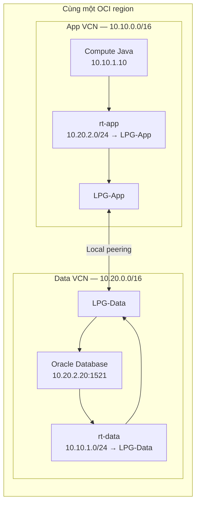

# Local Peering Gateway và kết nối VCN trong cùng region

## Mục tiêu và bối cảnh

Trong chương **Kết nối lai và liên vùng** của module **CLOUD_PROVIDERS_ORACLE**, bài này tập trung vào một nền tảng của mạng OCI: cho tài nguyên trong hai Virtual Cloud Network (VCN) thuộc cùng region giao tiếp qua địa chỉ IP riêng bằng Local Peering Gateway (LPG).

Một hệ thống có thể tách tầng ứng dụng và tầng dữ liệu vào hai VCN để giao trách nhiệm cho hai nhóm khác nhau. Chẳng hạn, ứng dụng Java trên OCI Compute cần gọi Oracle Database bằng địa chỉ riêng, trong khi nhóm cơ sở dữ liệu quản lý độc lập mạng và quyền truy cập. LPG cung cấp đường kết nối; IAM, route table và security rule quyết định ai được thiết lập đường đó và luồng nào thực sự đi qua.

Sau bài này, người học có thể:

- Nhận diện điều kiện để thiết lập local peering.
- Thiết kế cặp LPG và route hai chiều giữa hai VCN.
- Phân biệt quyền IAM với quyền truy cập ở mức gói tin.
- Thực hành một luồng ứng dụng đến cơ sở dữ liệu có phạm vi truy cập rõ ràng.
- Chẩn đoán lỗi theo từng lớp và lựa chọn LPG hoặc DRG phù hợp.

## 1. Local peering giải quyết vấn đề gì?

VCN là mạng ảo có không gian địa chỉ, subnet, định tuyến và các cơ chế bảo vệ riêng. Hai VCN cùng tenancy, cùng compartment hoặc cùng region không vì thế mà tự có đường liên lạc với nhau.

**Local peering** nối hai VCN trong cùng region để tài nguyên sử dụng IP riêng, không cần đưa luồng liên VCN ra Internet hoặc vòng qua mạng tại chỗ. Hai VCN có thể thuộc cùng tenancy hoặc khác tenancy. Với LPG, mỗi bên tạo một gateway rồi thiết lập kết nối giữa hai gateway. [Tổng quan local peering bằng LPG của Oracle](https://docs.oracle.com/en-us/iaas/Content/Network/Tasks/localVCNpeering.htm).

Cần hiểu riêng ba loại đối tượng:

| Đối tượng | Câu hỏi mà đối tượng trả lời |
| --- | --- |
| LPG và peering connection | Hai mạng có quan hệ kết nối nào? |
| Route rule | Gói tin đến một dải đích được gửi qua đâu? |
| Security rule | Luồng với nguồn, đích, giao thức và cổng này có được cho phép? |

Ví dụ, trạng thái peering đã thiết lập chỉ xác nhận quan hệ gateway. Nó chưa chứng minh ứng dụng Java có thể mở kết nối đến database listener.

### LPG trong kiến trúc OCI

LPG phục vụ kết nối giữa các VCN trong cùng region. Khi cần kết nối khác region, phải chọn kiến trúc khác, thường có DRG và remote peering. Khi cần nhiều VCN cùng kết nối qua một điểm định tuyến, upgraded DRG là lựa chọn cần xem xét thay cho việc liên tục bổ sung cặp LPG. [Các hình thức VCN peering](https://docs.oracle.com/en-us/iaas/Content/Network/Tasks/VCNpeering.htm), [kết nối nội vùng qua upgraded DRG](https://docs.oracle.com/en-us/iaas/Content/Network/Tasks/scenario_d.htm).

Bài thực hành dưới đây chỉ cần hai VCN và một cặp LPG. Không cần tạo FastConnect, VPN hoặc DRG để hoàn thành mô hình này.

## 2. Mô hình thực hành: ứng dụng Java truy cập Oracle Database

Giả sử một tenancy có hai compartment: `AppLab` và `DataLab`. Nhóm ứng dụng sở hữu App VCN; nhóm dữ liệu sở hữu Data VCN. Hai VCN được tạo trong cùng một region đã chọn cho bài thực hành.

| Thành phần | App VCN | Data VCN |
| --- | --- | --- |
| Tên VCN | `app-vcn` | `data-vcn` |
| CIDR IPv4 của VCN | `10.10.0.0/16` | `10.20.0.0/16` |
| Subnet tham gia kiểm thử | `10.10.1.0/24` | `10.20.2.0/24` |
| Tài nguyên minh họa | Compute chạy ứng dụng Java | Máy chủ chạy Oracle Database |
| IP riêng minh họa | `10.10.1.10` | `10.20.2.20` |
| LPG | `lpg-app-data` | `lpg-data-app` |
| Route table của subnet | `rt-app` | `rt-data` |

Các địa chỉ trên là giá trị thiết kế cho bài học. Khi thực hành, dùng IP thực tế đã được cấp cho VNIC; không giả định máy chủ tự nhận đúng địa chỉ minh họa.

Luồng được yêu cầu là:

```text
Nguồn:       10.10.1.10, cổng TCP tạm thời do máy khách chọn
Đích:        10.20.2.20, TCP 1521
Khởi tạo:    máy ứng dụng
Phản hồi:    máy cơ sở dữ liệu về đúng phiên đã khởi tạo
```

TCP 1521 là cổng listener giả định trong ví dụ, không phải cổng bắt buộc cho mọi dịch vụ Oracle Database. Với database thực tế, lấy endpoint, cổng và yêu cầu TLS từ cấu hình dịch vụ. Nếu chỉ muốn kiểm tra mạng, có thể dùng một dịch vụ TCP thử nghiệm trong Data VCN trước khi triển khai cơ sở dữ liệu.



Sơ đồ thể hiện cả đường gửi yêu cầu và đường về. Những route trong sơ đồ gắn với subnet của tài nguyên, không phải yêu cầu gắn route table trực tiếp lên LPG.

## 3. Điều kiện đầu vào cần chốt

### 3.1. Cùng region và CIDR không chồng lấn

Hai VCN tham gia peering phải cùng region và có các CIDR không chồng lấn. Nếu VCN có nhiều CIDR, kiểm tra toàn bộ tập địa chỉ thay vì chỉ CIDR đang dùng cho hai máy kiểm thử.

Ví dụ:

| VCN A | VCN B | Nhận xét |
| --- | --- | --- |
| `10.10.0.0/16` | `10.20.0.0/16` | Không chồng lấn |
| `10.10.0.0/16` | `10.10.2.0/24` | B nằm trong A, không phù hợp |
| `10.10.0.0/16` | `10.10.0.0/16` | Trùng hoàn toàn |

Chỉ việc đặt hai máy ở hai subnet khác nhau không giải quyết được việc CIDR của hai VCN chồng lấn. Nên quy hoạch địa chỉ trước, đồng thời dành khoảng trống cho VCN bổ sung và mạng tại chỗ.

### 3.2. Mỗi phía có một LPG cho quan hệ này

Thiết kế đặt `lpg-app-data` trong App VCN và `lpg-data-app` trong Data VCN. Một LPG phục vụ một quan hệ peering; khi App VCN cần peer trực tiếp với VCN thứ ba, thiết kế thêm một LPG riêng ở mỗi phía của quan hệ mới.

### 3.3. Tài khoản thực hiện có đủ quyền

Cần quyền xem đúng VCN, tạo LPG, thiết lập peering, sửa route table và sửa các đối tượng bảo mật liên quan. Tạo được LPG không có nghĩa tài khoản đã có mọi quyền còn lại.

Bảng phân công cho bài thực hành:

| Công việc | Người chịu trách nhiệm |
| --- | --- |
| Xác nhận CIDR, region và luồng TCP cần thiết | Hai nhóm cùng thống nhất |
| Tạo LPG tại App VCN | Quản trị mạng phía App |
| Tạo LPG tại Data VCN | Quản trị mạng phía Data |
| Thực hiện yêu cầu kết nối | Bên được chỉ định là requestor |
| Cho phép yêu cầu ở phạm vi phía nhận | Bên acceptor |
| Cấu hình route và security rule | Mỗi nhóm phụ trách VCN của mình |
| Kiểm thử database listener | Nhóm dữ liệu phối hợp nhóm ứng dụng |

Requestor và acceptor là vai trò khi thiết lập quan hệ. Sau khi peering hoạt động, vai trò đó không biến kết nối thành một đường dữ liệu chỉ cho phép một chiều. [Quy trình tạo LPG](https://docs.oracle.com/en-us/iaas/Content/Network/Tasks/create-lpg.htm), [yêu cầu quyền cho thao tác connect](https://docs.oracle.com/en-us/iaas/tools/oci-cli/latest/oci_cli_docs/cmdref/network/local-peering-gateway/connect.html).

## 4. Phân quyền IAM và ranh giới giữa hai nhóm

IAM điều khiển các thao tác quản trị OCI. Security rule điều khiển luồng dữ liệu qua VNIC. Hai lớp này cần được thiết kế riêng.

Trong mô hình ví dụ:

- Nhóm App cần quản lý phần mạng của `AppLab`.
- Nhóm Data cần quản lý phần mạng của `DataLab`.
- Bên requestor cần quyền thiết lập quan hệ với LPG phía acceptor theo chính sách được hai bên thống nhất.
- Người phát triển ứng dụng không cần quyền quản trị toàn tenancy chỉ để ứng dụng sử dụng kết nối đã có.

Khi dùng cùng tenancy, xác định rõ group, compartment và quyền cần thiết. Với khác tenancy, hai quản trị viên phải phối hợp các chính sách liên tenancy và trao đổi đúng OCID. Không suy ra rằng biết OCID của LPG phía kia là đủ để kết nối.

Bài này không đưa một policy tổng quát để sao chép cho mọi tổ chức: vị trí policy, group, identity domain và phạm vi compartment phụ thuộc cấu trúc IAM thực tế. Người học cần đối chiếu quyền tạo LPG với quyền kết nối LPG, sau đó nhờ quản trị viên áp dụng phạm vi phù hợp theo [hướng dẫn IAM khi tạo LPG](https://docs.oracle.com/en-us/iaas/Content/Network/Tasks/create-lpg.htm).

Một kết quả cần ghi nhận khi kiểm tra IAM là: người vận hành thực hiện được đúng các thao tác của bài trong hai compartment dự kiến, còn ứng dụng kết nối database bằng danh tính và thông tin xác thực của database. IAM cho phép tạo đường mạng không tự cấp tài khoản cơ sở dữ liệu.

## 5. Thiết kế định tuyến hai chiều

### 5.1. Route của App subnet

Giả sử chỉ Data subnet `10.20.2.0/24` cần được truy cập. Thêm vào `rt-app`:

| Destination CIDR | Target type | Target |
| --- | --- | --- |
| `10.20.2.0/24` | Local Peering Gateway | `lpg-app-data` |

### 5.2. Route của Data subnet

Để gói trả lời về được App subnet, thêm vào `rt-data`:

| Destination CIDR | Target type | Target |
| --- | --- | --- |
| `10.10.1.0/24` | Local Peering Gateway | `lpg-data-app` |

OCI dùng destination CIDR và gateway đích để xác định đường đi. Vì vậy, khi tạo rule, phải chọn LPG thuộc VCN đang cấu hình; không lấy OCID LPG của VCN bên kia làm target tại subnet nguồn. [Route table và route rule trong OCI](https://docs.oracle.com/en-us/iaas/Content/Network/Tasks/managingroutetables_topic-working.htm).

Đường đi dự kiến:

```text
10.10.1.10
  → route table của App subnet
  → lpg-app-data
  → quan hệ local peering
  → lpg-data-app
  → 10.20.2.20

Gói trả lời:
10.20.2.20
  → route table của Data subnet
  → lpg-data-app
  → quan hệ local peering
  → lpg-app-data
  → 10.10.1.10
```

### 5.3. Vì sao cần kiểm tra association?

Tên `rt-app` không chứng minh App subnet đang dùng bảng đó. Nếu subnet đang gắn với một route table khác, việc sửa `rt-app` sẽ không tạo ra hành vi mong muốn.

Trong bài thực hành, kiểm tra trực tiếp association của từng subnet. Mô hình giả định không có route table riêng ở VNIC hoặc private IP và không có đường qua thiết bị kiểm tra trung gian; nếu môi trường thật có các cấu hình này, cần xác định bảng định tuyến có hiệu lực cho đúng nguồn.

### 5.4. Route rộng và route hẹp

Có thể thiết kế route đến toàn bộ peer VCN, chẳng hạn `10.20.0.0/16`, hoặc chỉ subnet đích như ví dụ. Lựa chọn phải phản ánh phạm vi kết nối cần duy trì.

Route đến subnet hẹp giúp thể hiện rõ ý định của bài, nhưng vẫn phải có security rule giới hạn dịch vụ. Một route đến `10.20.2.0/24` không đồng nghĩa chỉ TCP 1521 được đi.

Nếu bảng đã có default route `0.0.0.0/0` đến gateway khác, kiểm tra các route cụ thể hơn cho peer subnet. Không thay default route bằng LPG để thử sửa mọi lỗi kết nối. Với mô hình hai VCN này, đích cần định tuyến đã biết rõ.

### 5.5. Route table gắn trực tiếp vào LPG

Giao diện có thể cho phép chọn route table khi tạo LPG. Đó là cấu hình cho các kịch bản định tuyến nâng cao, như transit routing. Với bài kết nối trực tiếp App subnet đến Data subnet, để tùy chọn này không được gán; cấu hình route ở các subnet như trên. [Tùy chọn route table khi tạo LPG](https://docs.oracle.com/en-us/iaas/Content/Network/Tasks/create-lpg.htm).

## 6. Cho phép đúng luồng ở tầng bảo mật

Giả sử dùng hai NSG:

- `nsg-app-db-client` gắn vào VNIC máy App.
- `nsg-db-listener` gắn vào VNIC máy Data.

Ví dụ dùng **stateful rule** cho phiên TCP do App khởi tạo:

| Phía | Hướng | Nguồn hoặc đích | Giao thức | Source port | Destination port |
| --- | --- | --- | --- | --- | --- |
| App | Egress | Đích `10.20.2.20/32` | TCP | All | 1521 |
| Data | Ingress | Nguồn `10.10.1.10/32` | TCP | All | 1521 |

Source port để `All` vì máy khách thường chọn cổng tạm thời. Nếu chỉ mở rộng cho một nhóm máy ứng dụng, có thể đổi CIDR nguồn thành App subnet sau khi thống nhất phạm vi.

Với phiên được theo dõi statefully, traffic phản hồi tương ứng được xử lý theo trạng thái kết nối. Route về vẫn phải tồn tại. Nếu dùng stateless rule hoặc có rule stateless trùng luồng, phải thiết kế riêng chiều phản hồi và cổng tạm thời; không áp dụng nguyên giả định stateful của ví dụ. [Cách hoạt động của security rule](https://docs.oracle.com/en-us/iaas/Content/Network/Concepts/securityrules.htm).

### Các điểm dễ nhầm

**Không dùng NSG bên kia VCN làm tham chiếu trực tiếp.** Với peering giữa hai VCN, sử dụng CIDR phù hợp trong các rule minh họa. NSG dùng để tham chiếu trong rule phải thuộc cùng VCN với NSG đang cấu hình. [Quy tắc NSG trong local peering](https://docs.oracle.com/en-us/iaas/Content/Network/Tasks/localVCNpeering.htm).

**Rule hẹp mới thêm không vô hiệu hóa rule rộng đang có.** Kiểm tra toàn bộ security list của subnet và các NSG áp dụng lên VNIC. Nếu một rule hiện hữu vẫn cho phép TCP từ một dải rộng hơn, thêm rule `/32` chưa khiến quyền tổng thể thu hẹp lại. Security list và NSG là các tập quy tắc cho phép; không vận hành như chuỗi rule có một lệnh deny ở cuối. [Security list và NSG khi dùng đồng thời](https://docs.oracle.com/en-us/iaas/Content/Network/Concepts/securityrules.htm).

**Hệ điều hành và dịch vụ vẫn có thể từ chối.** Ngoài cấu hình OCI, cần kiểm tra firewall của máy Data, listener có lắng nghe trên địa chỉ phù hợp và tài khoản database có quyền đăng nhập. Mở được TCP chưa có nghĩa truy vấn SQL sẽ thành công.

Nếu tài nguyên có áp dụng Zero Trust Packet Routing, luồng còn phải thỏa chính sách ZPR. Bài thực hành cơ bản giả định không gắn thuộc tính ZPR lên hai endpoint. [Quan hệ giữa ZPR và security rule](https://docs.oracle.com/en-us/iaas/Content/Network/Concepts/securityrules.htm).

## 7. Thực hành thiết lập bằng Console

### Bước 1: Ghi lại cấu hình và xác định nguồn kiểm thử

Xác nhận hai VCN đúng region, CIDR không trùng, IP riêng của hai máy, subnet và route table liên quan. Chọn bên App làm requestor và bên Data làm acceptor.

Chuẩn bị cách đăng nhập vào máy App, chẳng hạn OCI Bastion đã được cấp quyền hoặc một kênh quản trị riêng có sẵn. Không cần thêm public IP cho database chỉ để kiểm thử peering.

### Bước 2: Tạo hai LPG

Trong phần Networking, mở App VCN, tìm Local Peering Gateways và tạo `lpg-app-data`. Kiểm tra đúng compartment và VCN trước khi tạo.

Làm tương tự tại Data VCN để tạo `lpg-data-app`. Không chọn route table association cho bài cơ bản này. Lưu OCID của từng LPG để hai bên nhận diện đúng tài nguyên. [Các bước tạo LPG trên Console](https://docs.oracle.com/en-us/iaas/Content/Network/Tasks/create-lpg.htm).

### Bước 3: Thiết lập peering

Từ LPG phía App, thực hiện thao tác thiết lập kết nối và chỉ định LPG phía Data bằng phương thức mà Console cung cấp. Bên acceptor phải chuẩn bị quyền IAM phù hợp trước đó.

Sau thao tác, kiểm tra trạng thái peering của cả hai LPG. Nếu request bị từ chối, xử lý IAM, region hoặc OCID trước; chưa cần thay đổi cổng database.

### Bước 4: Thêm route vào đúng hai subnet

Áp dụng hai rule trong mục 5, đồng thời giữ lại các route đang phục vụ nhu cầu khác của subnet. Với subnet dùng chung cho nhiều tài nguyên, đánh giá ảnh hưởng của từng rule mới trước khi lưu.

### Bước 5: Cấu hình security rule và dịch vụ đích

Áp dụng các rule stateful trong mục 6. Kiểm tra các rule hiện có để bảo đảm luồng được mở đúng phạm vi mong muốn.

Trên máy Data, xác nhận dịch vụ đã chạy và firewall hệ điều hành cho phép nguồn App. Với Oracle Database, kiểm tra listener và service name thực tế.

### Bước 6: Kiểm thử từ đúng máy App

Dùng IP riêng của máy Data và đúng cổng dịch vụ. Thử nghiệm từ laptop cá nhân không chứng minh local peering hoạt động nếu laptop chưa có đường vào App VCN.

Khi kiểm tra thành công, ghi lại: nguồn, đích, cổng, thời điểm, route table đã dùng và trạng thái hai LPG. Đây là bằng chứng cụ thể hơn một ảnh trạng thái gateway.

## 8. Minh họa tự động hóa bằng OCI CLI

Đoạn dưới dành cho **PowerShell có OCI CLI đã cài đặt và cấu hình xác thực**. Đây là lệnh mẫu để người học thực hiện trong môi trường lab; thay toàn bộ giá trị placeholder trước khi chạy. Hai VCN đã tồn tại, profile đã có quyền phù hợp và hai LPG của ví dụ chưa được tạo.

```powershell
$ociRegion = '<region-cua-hai-VCN>'
$appCompartmentId = '<ocid-compartment-app>'
$dataCompartmentId = '<ocid-compartment-data>'
$appVcnId = '<ocid-vcn-app>'
$dataVcnId = '<ocid-vcn-data>'

$appLpgId = oci network local-peering-gateway create `
    --region $ociRegion `
    --compartment-id $appCompartmentId `
    --vcn-id $appVcnId `
    --display-name 'lpg-app-data' `
    --query 'data.id' --raw-output

if ($LASTEXITCODE -ne 0) {
    throw 'Khong tao duoc LPG phia App.'
}

$dataLpgId = oci network local-peering-gateway create `
    --region $ociRegion `
    --compartment-id $dataCompartmentId `
    --vcn-id $dataVcnId `
    --display-name 'lpg-data-app' `
    --query 'data.id' --raw-output

if ($LASTEXITCODE -ne 0) {
    throw 'Khong tao duoc LPG phia Data.'
}

oci network local-peering-gateway connect `
    --region $ociRegion `
    --local-peering-gateway-id $appLpgId `
    --peer-id $dataLpgId

if ($LASTEXITCODE -ne 0) {
    throw 'Khong thiet lap duoc peering.'
}

oci network local-peering-gateway get `
    --region $ociRegion `
    --local-peering-gateway-id $appLpgId

oci network local-peering-gateway get `
    --region $ociRegion `
    --local-peering-gateway-id $dataLpgId
```

Lệnh `connect` dùng LPG phía requestor ở `--local-peering-gateway-id` và LPG phía acceptor ở `--peer-id`. [Tham chiếu lệnh connect](https://docs.oracle.com/en-us/iaas/tools/oci-cli/latest/oci_cli_docs/cmdref/network/local-peering-gateway/connect.html).

Script mẫu giả định một danh tính có đủ quyền tại cả hai compartment. Trong mô hình hai nhóm quản trị độc lập, mỗi nhóm tự tạo LPG của mình bằng danh tính phù hợp rồi trao đổi OCID; requestor thực hiện bước kết nối.

CLI chỉ giúp tự động hóa thao tác, không bỏ qua IAM. Đoạn lệnh cũng chưa cấu hình route và security rule. Đọc kết quả của cả hai gateway trước khi tiếp tục kiểm thử dữ liệu.

Nếu triển khai bằng Terraform hoặc công cụ khác, quản lý đủ các phần: hai LPG, quan hệ peering, route và security rule. Lần chạy lại phải nhận diện tài nguyên đã có; việc cứ tạo LPG mới với cùng display name không tạo ra tính lặp lại an toàn.

## 9. Kiểm thử và diễn giải kết quả

### 9.1. Kiểm tra listener trên máy Data

Nếu máy đích chạy Linux, người có quyền quản trị có thể kiểm tra:

```bash
ss -lnt | grep ':1521'
```

Lệnh này xác nhận có socket lắng nghe phù hợp với bộ lọc, chưa chứng minh đường từ App đến Data hoạt động. Kiểm tra địa chỉ bind: listener chỉ bind loopback sẽ không phục vụ kết nối qua IP riêng của máy.

### 9.2. Kiểm tra TCP từ máy App

Với Linux có netcat:

```bash
nc -vz -w 3 10.20.2.20 1521
```

Với máy nguồn Windows:

```powershell
Test-NetConnection -ComputerName 10.20.2.20 -Port 1521
```

Kết nối TCP thành công cho thấy đường đi và dịch vụ đã cho phép bắt tay TCP tại thời điểm thử. Nếu dùng JDBC, tiếp tục kiểm tra đăng nhập và một truy vấn nhỏ bằng tài khoản lab được cấp quyền.

Ví dụ URL JDBC cho listener TCP thông thường:

```text
jdbc:oracle:thin:@//10.20.2.20:1521/<service_name_thuc_te>
```

URL trên dùng để minh họa địa chỉ riêng trong connection string. Với TCPS, wallet hoặc dịch vụ database được quản lý có chuỗi kết nối riêng, dùng cấu hình do dịch vụ cung cấp và không đưa mật khẩu vào log.

### 9.3. Phân biệt trạng thái lỗi

| Kết quả quan sát | Giả thuyết cần kiểm tra tiếp |
| --- | --- |
| Không thiết lập được peering | Quyền requestor/acceptor, region, OCID, trạng thái LPG |
| TCP timeout | Route hai chiều, rule OCI, firewall máy đích, endpoint có đang hoạt động |
| TCP connection refused | Dịch vụ không lắng nghe hoặc một thành phần đang chủ động từ chối |
| TCP thành công nhưng JDBC thất bại | Service name, tài khoản, cấu hình TLS và yêu cầu của database |
| Dùng IP được nhưng hostname thất bại | DNS và cấu hình resolver |
| ICMP thất bại nhưng TCP thành công | ICMP có thể chưa được cho phép; chưa đủ cơ sở kết luận peering hỏng |

Mỗi quan sát là một dấu hiệu thu hẹp phạm vi, không phải kết luận tuyệt đối. Ví dụ, timeout không chứng minh chỉ có security rule sai.

### 9.4. Dùng capture khi cần

Nếu được cấp quyền trên máy Data:

```bash
sudo tcpdump -ni any 'host 10.10.1.10 and tcp port 1521'
```

Có thể diễn giải theo hướng:

- Không thấy SYN: kiểm tra đường nguồn đến đích và các lớp lọc trước khi gói đến máy.
- Thấy SYN nhưng không thấy SYN-ACK: kiểm tra dịch vụ và firewall máy Data.
- Thấy SYN-ACK rời máy Data nhưng nguồn vẫn timeout: tập trung vào đường về hoặc cấu hình phía nguồn.
- Hoàn tất bắt tay rồi có lỗi: kiểm tra giao thức ứng dụng và database.

Kết hợp capture với thông tin route, rule và thời điểm kiểm thử. Khi dịch vụ được quản lý không cho phép truy cập hệ điều hành, dùng công cụ chẩn đoán và log mà dịch vụ hỗ trợ.

## 10. DNS là một phần cấu hình riêng

Peering cung cấp đường mạng; việc phân giải tên giữa hai VCN cần được thiết kế thêm. Không giả định rằng tên nội bộ của Data VCN sẽ tự được máy App phân giải ngay sau khi nối LPG.

OCI có resolver và các cơ chế private DNS. Tùy cách tổ chức tên miền, có thể cần chia sẻ private view hoặc cấu hình resolver endpoint và forwarding phù hợp. [DNS trong VCN](https://docs.oracle.com/en-us/iaas/Content/Network/Concepts/dns.htm).

Trình tự xử lý ví dụ:

1. Thử TCP đến `10.20.2.20` trước để xác nhận đường IP.
2. Tra cứu hostname database từ chính máy App.
3. So sánh IP trả về với endpoint dự kiến.
4. Nếu cần forwarding, kiểm tra đường đến DNS endpoint và rule cho truy vấn DNS.
5. Chuyển connection string sang hostname sau khi cả phân giải tên và kết nối TCP đều đạt.

Không dùng sửa file hosts trên một máy làm kết luận rằng thiết kế DNS dùng chung đã hoàn tất. Nó có thể hỗ trợ kiểm thử tạm thời nhưng không kiểm chứng resolver của hệ thống.

## 11. Giới hạn kiến trúc cần nhớ

### 11.1. Quan hệ peering không tự tạo tính bắc cầu

Giả sử App VCN peer với Shared VCN, và Shared VCN peer với Data VCN:

```text
App VCN ← LPG → Shared VCN ← LPG → Data VCN
```

Không suy ra App tự có đường đến Data qua hai quan hệ đó. Với yêu cầu ba mạng cùng giao tiếp, cần thiết kế kết nối trực tiếp phù hợp hoặc kiến trúc định tuyến tập trung có chủ đích. Khi dùng DRG, vẫn phải cấu hình đúng attachment, route và security rule.

Để ước lượng độ phức tạp, nếu mọi cặp trong `n` VCN đều phải peer trực tiếp thì số quan hệ là:

```text
n × (n - 1) / 2
```

Bốn VCN tạo sáu quan hệ, tương ứng mười hai LPG trong thiết kế mỗi quan hệ có hai gateway. Đây là phép đếm của mô hình full mesh, không phải khuyến nghị triển khai hay cam kết về quota.

### 11.2. Không dùng Internet Gateway của peer như đường Internet mặc định

Không thiết kế bài này bằng cách đặt `0.0.0.0/0` đến LPG và kỳ vọng máy App dùng Internet Gateway của Data VCN. Nhu cầu egress Internet hoặc kiểm tra tập trung cần một kiến trúc được hỗ trợ và xem xét riêng.

### 11.3. Transit routing cần thiết kế bổ sung

Có kịch bản đưa lưu lượng từ VCN qua một hub đến mạng tại chỗ bằng VPN hoặc FastConnect. Đó là transit routing với các bảng định tuyến bổ sung; việc có cặp LPG đơn thuần chưa tạo ra toàn bộ đường này. [Phạm vi và các tình huống nâng cao của LPG](https://docs.oracle.com/en-us/iaas/Content/Network/Tasks/localVCNpeering.htm).

### 11.4. Khi nào cân nhắc upgraded DRG?

| Nhu cầu thiết kế | Hướng xem xét |
| --- | --- |
| Hai VCN, kết nối trực tiếp, phạm vi nhỏ | Cặp LPG là mô hình rõ ràng để học và vận hành |
| Nhiều VCN cần được định tuyến tập trung | Đánh giá upgraded DRG và chính sách route |
| Kết nối liên vùng | Đánh giá kiến trúc DRG và remote peering |
| Nhiều mạng lai cùng dùng VPN hoặc FastConnect | Đánh giá toàn bộ topology, đường dự phòng và phân đoạn |

Oracle duy trì hướng dẫn kết nối nhiều VCN qua upgraded DRG. Người thiết kế nên so sánh kiến trúc đó với số lượng quan hệ và yêu cầu vận hành thực tế, thay vì chọn LPG chỉ vì kết nối đầu tiên dễ tạo. [Local peering qua upgraded DRG](https://docs.oracle.com/en-us/iaas/Content/Network/Tasks/scenario_d.htm).

## 12. Vận hành, tính sẵn sàng và chi phí

### Phân tách sự cố mạng khỏi sự cố dịch vụ

Ứng dụng vẫn có thể mất kết nối do Compute dừng, listener lỗi, thay đổi route, thay đổi rule hoặc DNS sai dù quan hệ LPG còn hoạt động. Tính sẵn sàng của hệ thống còn phụ thuộc phương án dự phòng của ứng dụng và database.

Trong ví dụ, một bài kiểm tra định kỳ có thể chạy từ App subnet, ghi lại thời gian mở TCP và kết quả một truy vấn đơn giản. Chỉ cảnh báo TCP thất bại chưa đủ xác định nguyên nhân; cần đối chiếu với tình trạng tài nguyên và lịch sử thay đổi.

### Giám sát và quản lý thay đổi

Khi môi trường hỗ trợ, dùng VCN Flow Logs để có thêm bằng chứng về luồng tại các điểm được thu thập, cùng OCI Audit để kiểm tra các thao tác quản trị liên quan. Chọn phạm vi và thời gian lưu phù hợp; tránh để log chứa thông tin xác thực.

Trước một thay đổi route hoặc rule, ghi nhận cấu hình cũ và chuẩn bị thao tác khôi phục cụ thể. Nếu cần chặn một luồng, xác định tất cả rule đang cho phép luồng đó; xóa một rule hẹp sẽ không có tác dụng mong muốn nếu rule rộng còn tồn tại.

### Bảo vệ dữ liệu

Đường truyền IP riêng giúp tránh yêu cầu công khai endpoint database. Nó không thay thế xác thực, phân quyền database hoặc cấu hình mã hóa theo yêu cầu ứng dụng. Với dữ liệu nhạy cảm, thiết lập TLS hoặc TCPS phù hợp và kiểm tra chứng chỉ tại máy khách.

### Kiểm soát chi phí của bài thực hành

Không kết luận toàn bộ mô hình không phát sinh chi phí chỉ vì dùng địa chỉ riêng. Lập danh sách tài nguyên gồm Compute, boot volume, database, lưu trữ và log; đối chiếu bảng giá, quota và ngân sách của tenancy trước khi tạo.

Dùng database có sẵn được phép thử nghiệm hoặc dịch vụ TCP nhẹ nếu mục tiêu chỉ là kiểm tra mạng. Đặt tag chủ sở hữu, mục đích và thời hạn cho tài nguyên lab. Sau khi hoàn thành, thu hồi các tài nguyên không còn cần dùng theo đúng phạm vi được cấp phép.

## 13. Bài tập thực hành và kết quả cần đạt

Thực hiện trên môi trường lab của mình:

1. Chuẩn bị hai VCN có CIDR như mô hình hoặc một cặp CIDR không chồng lấn khác.
2. Tạo cặp LPG và thiết lập peering bằng quyền đã cấp.
3. Cấu hình route hai chiều ở đúng subnet.
4. Cho phép luồng TCP từ máy App đến đúng listener ở Data.
5. Kiểm tra TCP và, nếu có database, đăng nhập bằng tài khoản lab.
6. Thử một cổng không được cho phép trong cấu hình lab để kiểm tra phạm vi quyền.
7. Trong thời gian được phép thử lỗi, tạm bỏ route về, quan sát kết quả, rồi khôi phục.
8. Kiểm tra riêng phân giải hostname và giải thích khác biệt với thử bằng IP.

Không thử xóa route hoặc thay rule trên subnet dùng chung của production để thực hiện bài tập.

Bảng ghi nhận kết quả gợi ý:

| Nội dung | Bằng chứng cần có |
| --- | --- |
| Danh tính tài nguyên | Region, OCID VCN và LPG, subnet, IP thực tế |
| Quan hệ peering | Trạng thái của cả hai LPG |
| Đường đi và đường về | Destination CIDR, target LPG, association của hai subnet |
| Phạm vi bảo mật | Rule có hiệu lực tại hai VNIC và firewall máy chủ |
| Kết nối dịch vụ | Kết quả TCP và kết quả đăng nhập database nếu áp dụng |
| DNS | Tên được hỏi, IP trả về và resolver dùng để truy vấn |
| Khôi phục sau thử lỗi | Route và rule đã trở về cấu hình dự kiến |

Khi dọn lab, gỡ các route và rule đã thêm cho kết nối trước khi xóa gateway liên quan, đồng thời kiểm tra không còn người dùng khác phụ thuộc tài nguyên. Không xóa VCN, subnet, database hoặc rule dùng chung chỉ vì chúng xuất hiện trong mô hình.

## 14. Điểm cần ghi nhớ

Một kết nối LPG sử dụng được cần đồng thời có **cặp gateway đã kết nối, route đúng hai chiều, security rule phù hợp và dịch vụ đích hoạt động**. IAM cho phép người vận hành tạo và quản lý các thành phần này; quyền truy cập database và DNS cần cấu hình riêng.

Với hệ thống Oracle trên OCI, giá trị của thiết kế nằm ở khả năng nối ứng dụng đến dữ liệu qua địa chỉ riêng, giữ trách nhiệm quản trị rõ ràng và có bằng chứng kiểm thử cụ thể. Khi topology mở rộng, đánh giá lại LPG, DRG, phân đoạn mạng và phương án vận hành trước khi bổ sung các quan hệ peering tiếp theo.