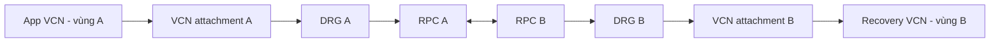
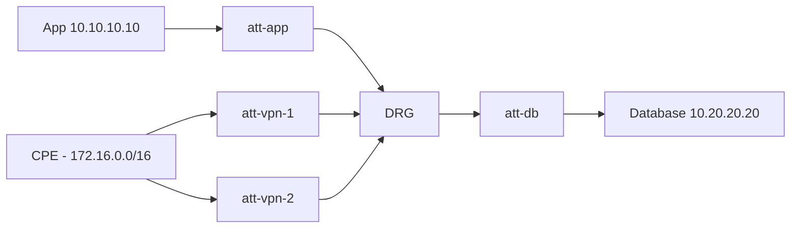

# Dynamic Routing Gateway và các loại attachment

Trong chương **Kết nối lai và liên vùng** của module **Oracle Cloud Infrastructure (CLOUD_PROVIDERS_ORACLE)**, Dynamic Routing Gateway là thành phần giúp ghép các mạng riêng thành một kiến trúc có thể vận hành. Một ứng dụng trên OCI Compute có thể cần truy cập cơ sở dữ liệu Oracle trong VCN khác, gọi dịch vụ tại trung tâm dữ liệu hoặc trao đổi dữ liệu với vùng dự phòng. Thiết kế kết nối phải đồng thời đáp ứng phân quyền, bảo mật, khả năng quan sát và yêu cầu sẵn sàng.

Bài học giải thích attachment nào phục vụ từng nhu cầu, cách xác định bảng route được dùng và cách dựng một mô hình thực hành có đường đi, đường về rõ ràng.

## 1. Mục tiêu và kiến thức cần có

Sau bài học, người học có thể:

- Chọn attachment phù hợp cho VCN, Site-to-Site VPN, FastConnect và kết nối giữa các DRG.
- Phân biệt DRG route table, route table của subnet và VCN ingress route table.
- Lần theo một gói tin qua attachment đầu vào, bảng route và attachment đầu ra.
- Thiết kế route cho App VCN, Database VCN và mạng tại chỗ mà không phụ thuộc vào cấu hình mặc định.
- Kiểm tra attachment, route, bảo mật và khả năng chuyển sang kết nối dự phòng bằng bằng chứng cụ thể.

Người học cần biết CIDR, private IP, subnet, VCN, compartment, NSG và ý nghĩa cơ bản của BGP. Các ví dụ sử dụng IPv4, DRG có tính năng nâng cấp và địa chỉ giả định không trùng nhau. Những tên như `att-app` là tên quy ước trong bài; khi thao tác thực tế phải dùng OCID tương ứng.

## 2. DRG và attachment là hai đối tượng khác nhau

**Dynamic Routing Gateway (DRG)** là bộ định tuyến ảo phục vụ kết nối mạng riêng. **Attachment** biểu diễn điểm gắn một tài nguyên mạng vào DRG. Một DRG có thể có nhiều attachment; mỗi attachment có định danh riêng và thông tin về mạng được gắn. Mô hình này cho phép quản lý một trung tâm định tuyến thay vì ghép từng cặp mạng riêng lẻ. [Nguồn: OCI CLI — DRG](https://docs.oracle.com/en-us/iaas/tools/oci-cli/latest/oci_cli_docs/cmdref/network/drg.html).

Có thể đọc kiến trúc từ trái sang phải như sau:

```text
Mạng nguồn
    |
attachment đầu vào
    |
DRG: tra cứu bảng route áp dụng cho đầu vào
    |
attachment đầu ra
    |
Mạng đích
```

Ba câu hỏi cần trả lời khi thiết kế:

1. Mạng nào cần tham gia kết nối?
2. Gói tin từ mạng đó được phép có đường tới những mạng nào?
3. Thành phần nào kiểm soát giao thức, cổng và quyền sử dụng ứng dụng?

Ví dụ, gắn Database VCN vào DRG mới tạo ra một điểm nối. Nhóm vận hành vẫn phải xác định route tới subnet cơ sở dữ liệu, route trả lời, quy tắc mạng và quyền truy cập Oracle Database. Không thể suy ra tất cả điều kiện đó từ trạng thái attachment.

## 3. Bản đồ các loại attachment

OCI định nghĩa các loại attachment sau. Cột “tình huống” là cách lựa chọn trong bài học, không phải danh sách mọi kiến trúc có thể triển khai.

| Loại trong API | Tài nguyên liên quan | Tình huống điển hình |
| --- | --- | --- |
| `VCN` | Virtual Cloud Network | Gắn mạng ứng dụng hoặc cơ sở dữ liệu |
| `IPSEC_TUNNEL` | Tunnel của Site-to-Site VPN | Kết nối mạng tại chỗ qua VPN |
| `VIRTUAL_CIRCUIT` | FastConnect virtual circuit | Kết nối riêng phục vụ private peering |
| `REMOTE_PEERING_CONNECTION` | Remote Peering Connection, viết tắt RPC | Nối hai DRG, thường để liên vùng |
| `LOOPBACK` | Thành phần của IPSec over FastConnect | Hỗ trợ đường đi của lưu lượng VPN trên FastConnect |

DRG có phạm vi vùng. VCN gắn trực tiếp phải ở cùng vùng với DRG; kiến trúc liên vùng sử dụng DRG tại mỗi vùng và RPC nối chúng. Một VCN chỉ gắn với một DRG tại một thời điểm, trong khi một DRG có thể gắn nhiều VCN. [Nguồn: Dynamic Routing Gateways](https://docs.oracle.com/en-us/iaas/Content/Network/Tasks/managingDRGs.htm).

“Cross-tenancy” mô tả quan hệ sở hữu giữa các bên. Không nên xem đây là một giá trị attachment type thứ sáu trong bảng trên. Khi kiểm kê, cần quan sát cả loại mạng lẫn tenancy sở hữu. Console có thể trình bày các attachment khác tenancy trong một nhóm riêng. [Nguồn: Getting a List of DRG Attachments](https://docs.oracle.com/en-us/iaas/Content/Network/Tasks/drg-get-all-drg-attachments.htm).

### 3.1. VCN attachment: điểm vào của mạng ứng dụng

VCN attachment được tạo trực tiếp để gắn VCN vào DRG. VCN và DRG có thể thuộc các compartment khác nhau; attachment nằm trong compartment của VCN. Có thể gắn VCN từ tenancy khác nếu hai phía cấu hình IAM phù hợp. Sau khi gắn, vẫn cần route từ subnet tới DRG. [Nguồn: Attaching a DRG to a VCN](https://docs.oracle.com/en-us/iaas/Content/Network/Tasks/drg-create-attachment.htm).

Ví dụ sử dụng:

```text
App VCN                  DRG                  Database VCN
10.10.0.0/16 -- att-app -- + -- att-db -- 10.20.0.0/16
```

Thiết kế này phù hợp khi đội ứng dụng và đội cơ sở dữ liệu quản lý các mạng riêng. Người thiết kế cần lập bảng luồng mong muốn trước khi bật kết nối:

| Nguồn | Đích | Nhu cầu |
| --- | --- | --- |
| App subnet | Database subnet | Kết nối listener cơ sở dữ liệu |
| Mạng quản trị tại chỗ | Máy chủ cơ sở dữ liệu | Tác vụ vận hành đã được phê duyệt |
| Mạng thử nghiệm | Database subnet | Không có nhu cầu trong ví dụ |

Việc chọn compartment hỗ trợ phân quyền quản lý tài nguyên. Quy tắc cho phép một phiên TCP cụ thể phải được thiết kế riêng.

### 3.2. IPSec tunnel attachment: kết nối Site-to-Site VPN

Một IPSec connection hiện được tạo với hai tunnel dự phòng; mỗi tunnel tương ứng với attachment của nó trên DRG. CPE là thiết bị đầu cuối phía khách hàng; CPE object trong OCI là đối tượng mô tả thiết bị đó. Từng tunnel có thể dùng BGP hoặc định tuyến tĩnh theo cấu hình hỗ trợ. Nên cấu hình cả hai tunnel thay vì chỉ dùng một. [Nguồn: Site-to-Site VPN Overview](https://docs.oracle.com/en-us/iaas/Content/Network/Tasks/overviewIPsec.htm).

```text
                       tunnel 1 -- att-vpn-1
Mạng tại chỗ -- CPE ====                     ==== DRG
                       tunnel 2 -- att-vpn-2
```

Trong ví dụ doanh nghiệp, VPN có thể là bước đầu để thử kết nối ứng dụng với dịch vụ nội bộ. Nhóm mạng cần ghi nhận riêng:

- Tunnel nào đã thiết lập IPSec.
- Tunnel nào đã thiết lập BGP nếu sử dụng BGP.
- Prefix nào thực sự được học qua từng tunnel.
- Tuyến nào đang được dùng để chuyển tiếp.
- Kết quả kết nối ứng dụng khi một tunnel bị gián đoạn.

Định tuyến tĩnh cấu hình trên IPSec connection không đồng nghĩa với việc tự thêm static route trong DRG route table có next hop là tunnel. Hai nơi cấu hình có vai trò khác nhau.

### 3.3. Virtual circuit attachment: kết nối FastConnect

FastConnect cung cấp kết nối riêng giữa mạng khách hàng và OCI. Với nhu cầu truy cập private IP trong VCN, bài học sử dụng private virtual circuit gắn vào DRG. Không nên lấy mô hình này để suy ra rằng mọi kiểu FastConnect đều gắn vào DRG theo cùng cách. [Nguồn: FastConnect](https://docs.oracle.com/en-us/iaas/Content/Network/Concepts/fastconnect.htm).

```text
Mạng tại chỗ -- mạng nhà cung cấp/cross-connect
              -- private virtual circuit -- att-fc -- DRG
```

Trong thiết kế cho hệ thống nghiệp vụ, FastConnect thường được cân nhắc khi cần đường kết nối có năng lực và đặc tính vận hành phù hợp với tải. Việc quyết định cần dựa trên đo đạc: lưu lượng giờ cao điểm, thời gian truyền dữ liệu, độ trễ ứng dụng, ngân sách và phương án khi đường truyền hỏng.

Một virtual circuit là tài nguyên logic. Khi đánh giá dự phòng, hãy hỏi cả về tuyến vật lý, thiết bị biên và mạng nhà cung cấp; chỉ đếm số attachment sẽ thiếu thông tin quan trọng.

### 3.4. RPC attachment: nối hai DRG

Remote Peering Connection được tạo trên mỗi DRG, sau đó hai RPC được kết nối. Kiến trúc này hỗ trợ DRG ở các vùng khác nhau, hoặc hai DRG cùng vùng. Các mạng tham gia cần kế hoạch CIDR không chồng lấn, route hai phía và quy tắc bảo mật phù hợp. Có thể triển khai cùng hoặc khác tenancy. [Nguồn: Remote VCN Peering through an Upgraded DRG](https://docs.oracle.com/en-us/iaas/Content/Network/Tasks/scenario_e.htm).



Trong ví dụ khôi phục sau sự cố, RPC chỉ giải quyết một phần của kết nối mạng. Người vận hành vẫn cần xác định máy chủ đích, cơ chế đồng bộ dữ liệu, độ trễ chấp nhận được và quy trình chuyển ứng dụng sang vùng dự phòng.

Hãy tách ba trạng thái khi nghiệm thu: hai RPC đã kết nối, route tới subnet đích đã có và ứng dụng thực sự trao đổi dữ liệu được. Mỗi trạng thái cần bằng chứng riêng.

### 3.5. Loopback attachment: hỗ trợ IPSec over FastConnect

FastConnect riêng tư không đồng nghĩa với việc tự có mã hóa IPSec. Với IPSec over FastConnect, loopback attachment hỗ trợ đầu cuối VPN phía Oracle và đường chuyển tiếp giữa virtual circuit với tunnel. Oracle quản lý routing của loopback; quản trị viên tenancy không tự cấu hình route của nó. Attachment virtual circuit và tunnel trong mô hình này phải sử dụng các DRG route table, import distribution khác nhau. [Nguồn: FastConnect Security](https://docs.oracle.com/en-us/iaas/Content/Network/Concepts/fastconnectsecurity.htm).

Đường đi giản lược theo tài liệu Oracle:

```text
Gói đã mã hóa từ CPE
  -> VIRTUAL_CIRCUIT attachment
  -> LOOPBACK attachment
  -> IPSEC_TUNNEL attachment: kết thúc IPSec, giải mã
  -> VCN attachment
  -> đích trong VCN
```

Khi đọc sơ đồ, cần phân biệt đường vận chuyển gói đã mã hóa với đường của gói ứng dụng sau giải mã. Loopback phục vụ cơ chế này; không dùng nó như một attachment tùy ý để nối các mạng.

### 3.6. Vòng đời tài nguyên và vòng đời attachment

Không tạo mọi attachment theo cùng một thao tác:

| Loại | Cách quản lý ở mức tài nguyên |
| --- | --- |
| VCN | Tạo hoặc gỡ VCN attachment trực tiếp |
| IPSec tunnel | Quản lý IPSec connection và các tunnel liên quan |
| Virtual circuit | Quản lý FastConnect virtual circuit |
| RPC | Quản lý Remote Peering Connection |
| Loopback | Theo quy trình IPSec over FastConnect do OCI quản lý |

OCI không cho tạo hoặc xóa trực tiếp attachment RPC, IPSec tunnel và virtual circuit như VCN attachment. Static route trong DRG route table cũng không được đặt next hop là attachment IPSec tunnel hoặc virtual circuit. [Nguồn: DRG Management](https://docs.oracle.com/en-us/iaas/Content/Network/Tasks/manage-drg.htm).

Vì vậy, một bản kê triển khai cần lưu cả OCID tài nguyên mạng và OCID attachment. Nếu chỉ ghi tên hiển thị, người vận hành dễ chọn nhầm đối tượng khi kiểm tra hoặc thay đổi.

## 4. Bảng route được chọn theo attachment đầu vào

Mỗi attachment liên kết với một DRG route table. Khi gói tin đi vào DRG, chính bảng gắn với **attachment đầu vào** quyết định attachment đầu ra. Cùng một attachment có thể cung cấp route cho nhiều bảng nếu import distribution của từng bảng cho phép. [Nguồn: OCI CLI — DRG route table](https://docs.oracle.com/en-us/iaas/tools/oci-cli/latest/oci_cli_docs/cmdref/network/drg-route-table.html).

Giả sử:

```text
att-app  -> RT-FROM-APP
att-db   -> RT-FROM-DB
att-vpn  -> RT-FROM-ONPREM
```

Khi App gửi tới Database, hãy mở `RT-FROM-APP` để tìm route đích Database. Khi Database trả lời, hãy mở `RT-FROM-DB` để tìm route đích App.

Một sai lầm phổ biến là kiểm tra bảng của attachment đích rồi kết luận “đã có route”. Cách kiểm tra đó chưa trả lời gói tin từ nguồn sẽ được xử lý ra sao.

### 4.1. Ba vị trí route cần phân biệt

| Vị trí | Thời điểm được xét trong mô hình |
| --- | --- |
| VCN route table dùng cho lưu lượng từ workload | Quyết định đưa gói từ VCN tới DRG |
| DRG route table gắn với attachment đầu vào | Quyết định chuyển gói sang attachment nào |
| VCN ingress route table liên kết với VCN attachment, nếu cấu hình | Điều khiển đường đi khi gói từ DRG vào VCN |

VCN attachment có liên hệ với cả bảng phía DRG lẫn bảng phía VCN. Nếu không cấu hình VCN ingress route table riêng, có định tuyến ngầm tới các subnet của VCN. DRG mới tạo có các bảng và import distribution mặc định; cần kiểm tra cấu hình thực tế thay vì đoán từ tên bảng. [Nguồn: Working with DRG Route Tables](https://docs.oracle.com/en-us/iaas/Content/Network/Tasks/managingDRGs.htm).

Bài thực hành dưới đây dùng route table của subnet cho workload và không chèn thiết bị kiểm tra lưu lượng. Nếu môi trường có route table riêng trên VNIC hoặc IP, phải kiểm tra bảng có hiệu lực ở cấp đó. OCI hỗ trợ ưu tiên bảng trên IP, rồi VNIC, rồi subnet. [Nguồn: VCN Route Tables](https://docs.oracle.com/en-us/iaas/Content/Network/Tasks/managingroutetables.htm).

### 4.2. Import distribution và quảng bá route

Import route distribution là tập quy tắc chọn nguồn route cho một DRG route table. Có thể chọn theo attachment cụ thể, loại attachment hoặc tất cả. OCI cho tạo thêm import distribution; export distribution sử dụng cơ chế mặc định do dịch vụ cung cấp. [Nguồn: Creating an Import Route Distribution](https://docs.oracle.com/en-us/iaas/Content/Network/Tasks/drg-rd-create.htm).

Ví dụ thiết kế của bài:

```text
RT-FROM-APP
  import từ att-db
  import từ att-vpn-1
  import từ att-vpn-2

RT-FROM-DB
  import từ att-app
  import từ att-vpn-1
  import từ att-vpn-2

RT-FROM-ONPREM
  import từ att-app
  import từ att-db
```

Cách đọc:

- App cần học đường tới Database và mạng tại chỗ.
- Database cần đường trả lời App, đồng thời có đường tới mạng tại chỗ.
- Gói vào từ VPN cần đường tới App và Database.

Đây là một lựa chọn cho tình huống minh họa. Nếu thêm VCN thử nghiệm, nhóm triển khai phải quyết định nó được xuất hiện trong bảng nào. Quy tắc chọn một attachment cụ thể giúp việc rà soát danh sách mạng dễ hơn khi số mạng còn nhỏ.

Không diễn giải import distribution thành bộ lọc TCP. Việc route `10.20.20.0/24` xuất hiện trong bảng không cho biết cổng 1521 hay 443 có được phép hay không.

## 5. Thực hành: App, Database và mạng tại chỗ

### 5.1. Phạm vi và địa chỉ

Mô hình giả định có:

| Thành phần | Dải địa chỉ | Attachment quy ước |
| --- | --- | --- |
| App VCN | `10.10.0.0/16` | `att-app` |
| App subnet | `10.10.10.0/24` | Đi qua `att-app` |
| Database VCN | `10.20.0.0/16` | `att-db` |
| Database subnet | `10.20.20.0/24` | Đi qua `att-db` |
| Mạng tại chỗ | `172.16.0.0/16` | `att-vpn-1`, `att-vpn-2` |

Máy App có IP `10.10.10.10`; máy cơ sở dữ liệu có IP `10.20.20.20`. Giả sử listener Oracle Database đã được cấu hình trên TCP 1521. Một dịch vụ nội bộ tại chỗ có IP `172.16.40.10`, lắng nghe TCP 443.



Các mũi tên minh họa điểm nối. Bảng route và quy tắc bảo mật vẫn phải được cấu hình cho cả hai chiều.

Luồng cần nghiệm thu:

| Luồng | Kỳ vọng |
| --- | --- |
| App tới Database TCP 1521 | Kết nối được |
| App tới dịch vụ tại chỗ TCP 443 | Kết nối được |
| Máy quản trị được chọn tại chỗ tới Database TCP 1521 | Kết nối được theo phạm vi đã cấp |
| App tới cổng chưa cấp trên Database | Không được phép |

### 5.2. Chuẩn bị quyền và trách nhiệm

Đề xuất phân công cho bài thực hành:

- Nhóm mạng quản lý DRG, attachment, route và kết nối VPN.
- Nhóm ứng dụng xác nhận IP nguồn, giao thức và yêu cầu kết nối.
- Nhóm cơ sở dữ liệu xác nhận listener, tài khoản và phạm vi quản trị.
- Người phụ trách chi phí ghi nhận tài nguyên được tạo và thời gian cần giữ.

IAM điều khiển khả năng tạo, sửa tài nguyên. Với kết nối khác tenancy, các bên phải có chính sách tương ứng; những câu lệnh `Define`, `Endorse`, `Admit` phối hợp để xác lập quyền qua ranh giới tenancy. Việc gỡ quyền tạo peering không tự động hủy peering đã tồn tại. [Nguồn: IAM Policies for Routing Between VCNs](https://docs.oracle.com/en-us/iaas/Content/Network/Tasks/drg-iam.htm).

Trong bài thực hành một tenancy, nên giới hạn quyền vào các compartment được chọn. Nếu hai VCN khác compartment, hãy kiểm tra quyền ở cả vị trí DRG và VCN trước khi kết luận tài nguyên bị thiếu.

### 5.3. Trình tự dựng mô hình

1. **Lập kế hoạch địa chỉ.** Xác nhận App, Database và mạng tại chỗ không trùng CIDR. Ghi rõ subnet chứa từng máy dùng để thử.
2. **Chuẩn bị VCN và workload.** Tạo hoặc chọn đúng hai VCN, subnet và các máy kiểm tra. Xác nhận listener trên máy đích hoạt động.
3. **Tạo DRG.** Đặt tên dễ nhận biết, chọn compartment mạng và ghi OCID.
4. **Tạo các bảng riêng.** Chuẩn bị `RT-FROM-APP`, `RT-FROM-DB`, `RT-FROM-ONPREM` theo mô hình.
5. **Tạo VCN attachment.** Gắn App VCN, Database VCN và chọn bảng DRG tương ứng. Đợi attachment sẵn sàng.
6. **Dựng VPN.** Tạo CPE object, IPSec connection và cấu hình hai tunnel với đội mạng tại chỗ. Ví dụ này sử dụng BGP.
7. **Gắn bảng cho các tunnel.** Cả hai VPN attachment sử dụng `RT-FROM-ONPREM` trong thiết kế này.
8. **Cấu hình import distribution.** Dùng danh sách nguồn ở mục 4.2; kiểm tra các route được nhập thực tế.
9. **Bổ sung route phía workload và tại chỗ.** Dùng các bảng ở mục tiếp theo.
10. **Cấp quy tắc bảo mật theo luồng.** Thử từng luồng, lưu kết quả rồi kiểm tra trường hợp dự phòng.

Các bước mô tả thao tác trong môi trường thực hành. Không thay bảng của một attachment đang phục vụ hệ thống thật chỉ để tái hiện ví dụ.

### 5.4. Route từ các subnet

Route table dùng cho App subnet:

| Destination | Target |
| --- | --- |
| `10.20.20.0/24` | DRG |
| `172.16.0.0/16` | DRG |

Route table dùng cho Database subnet:

| Destination | Target |
| --- | --- |
| `10.10.10.0/24` | DRG |
| `172.16.0.0/16` | DRG |

Phía mạng tại chỗ cần đường tới `10.10.10.0/24` và `10.20.20.0/24` qua kết nối OCI. Với BGP, phải xác nhận các prefix đã được nhận và được chọn sử dụng tại CPE.

Ví dụ cố ý định tuyến tới subnet thay vì toàn bộ VCN. Nếu bổ sung subnet mới, cần cập nhật thiết kế; không giả định subnet mới đã có quyền hoặc đã có đường đi.

### 5.5. Route kỳ vọng bên trong DRG

Kết quả mong đợi của thiết kế, sau khi import đã hoạt động:

| Bảng | Destination | Next hop kỳ vọng |
| --- | --- | --- |
| `RT-FROM-APP` | `10.20.20.0/24` | `att-db` |
| `RT-FROM-APP` | `172.16.0.0/16` | Tunnel VPN được chọn |
| `RT-FROM-DB` | `10.10.10.0/24` | `att-app` |
| `RT-FROM-DB` | `172.16.0.0/16` | Tunnel VPN được chọn |
| `RT-FROM-ONPREM` | `10.10.10.0/24` | `att-app` |
| `RT-FROM-ONPREM` | `10.20.20.0/24` | `att-db` |

Đây là bảng kiểm kết quả, không phải danh sách static route cần nhập. Đặc biệt, route mạng tại chỗ trong ví dụ được học qua VPN; không tự tạo static route với next hop tunnel.

Nếu cùng prefix xuất hiện qua hai tunnel, hãy kiểm tra route thực sự được chọn và cấu hình multipath nếu có. Bài thực hành cơ bản không yêu cầu cân bằng tải; yêu cầu là kết nối vẫn hoạt động khi mất một tunnel theo phương án đã chuẩn bị.

### 5.6. Lần theo kết nối App tới Database

Gói yêu cầu:

```text
Nguồn: 10.10.10.10
Đích: 10.20.20.20:1521

App
 -> route 10.20.20.0/24 trong bảng dùng cho App subnet
 -> DRG qua att-app
 -> RT-FROM-APP
 -> route tới 10.20.20.0/24, next hop att-db
 -> Database VCN
 -> máy Database
```

Gói trả lời:

```text
Database
 -> route 10.10.10.0/24 trong bảng dùng cho Database subnet
 -> DRG qua att-db
 -> RT-FROM-DB
 -> route tới 10.10.10.0/24, next hop att-app
 -> App VCN
 -> máy App
```

Nếu kết nối bị timeout, cần ghi lại nguồn, đích, cổng và thời điểm kiểm tra. Một kết quả “ping được” chưa chứng minh listener cơ sở dữ liệu hoạt động. Ngược lại, ping thất bại cũng chưa đủ để kết luận route sai nếu ICMP không được cấp.

Một cách thử từ máy Windows có công cụ tương ứng:

```powershell
Test-NetConnection -ComputerName 10.20.20.20 -Port 1521
Test-NetConnection -ComputerName 172.16.40.10 -Port 443
```

Đây là kiểm tra kết nối TCP. Để xác nhận ứng dụng hoàn chỉnh, cần tiếp tục dùng client phù hợp và tài khoản được phép.

### 5.7. Tách điều kiện route và điều kiện bảo mật

Đối với kết nối App tới Database, bằng chứng nên bao gồm:

| Điều kiện | Bằng chứng cần có |
| --- | --- |
| Nguồn đưa gói tới DRG | Bảng route có hiệu lực cho App |
| DRG chọn đúng Database attachment | Route trong `RT-FROM-APP` |
| Chiều về chọn đúng App attachment | Route trong `RT-FROM-DB` và phía Database |
| Chính sách mạng cho phép TCP 1521 | Quy tắc áp dụng tại nguồn, đích |
| Máy đích có dịch vụ | Listener và firewall hệ điều hành |
| Ứng dụng được sử dụng dịch vụ | Kết quả xác thực và thao tác hợp lệ |

Trong một mô hình sử dụng quy tắc stateful, hãy cấu hình luồng khởi tạo theo chính sách mong muốn và hiểu cơ chế theo dõi kết nối. Với quy tắc stateless, cần thiết kế rõ lưu lượng phản hồi. Tránh thêm một quy tắc rộng chỉ để che lấp việc chưa xác định được điểm lỗi.

## 6. Đọc cấu hình bằng OCI CLI

Các lệnh dưới đây chỉ đọc tài nguyên. Giả định OCI CLI đã được cài đặt, cấu hình xác thực và chọn region phù hợp. Các chuỗi có dấu ba chấm là placeholder, phải thay bằng OCID thật.

```powershell
$drgOcid = 'ocid1.drg.oc1...'
$vcnCompartmentOcid = 'ocid1.compartment.oc1...'
$attachmentOcid = 'ocid1.drgattachment.oc1...'
$routeTableOcid = 'ocid1.drgroutetable.oc1...'

oci network drg get --drg-id $drgOcid
oci network drg-attachment list --compartment-id $vcnCompartmentOcid --drg-id $drgOcid --all
oci network drg-attachment get --drg-attachment-id $attachmentOcid
oci network drg-route-table list --drg-id $drgOcid --all
oci network drg-route-rule list --drg-route-table-id $routeTableOcid --all
```

Lệnh liệt kê attachment có bộ lọc compartment. Nếu VCN hoặc tài nguyên kết nối nằm trong compartment khác, cần kiểm tra đúng compartment đó; danh sách rỗng trong một phạm vi chưa chứng minh toàn bộ DRG không có attachment. [Nguồn: Listing DRG Attachments](https://docs.oracle.com/en-us/iaas/Content/Network/Tasks/drg-list-attachment.htm).

Dùng chi tiết của attachment để đối chiếu bảng route liên kết. Tên hiển thị giúp nhận biết, còn OCID là giá trị để đối chiếu chính xác. [Nguồn: Getting a DRG Attachment’s Details](https://docs.oracle.com/en-us/iaas/Content/Network/Tasks/drg-get-attachment.htm).

Lệnh liệt kê route table trả về các bảng, không thay thế việc liệt kê route bên trong từng bảng. [Nguồn: OCI CLI — List DRG Route Tables](https://docs.oracle.com/en-us/iaas/tools/oci-cli/latest/oci_cli_docs/cmdref/network/drg-route-table/list.html).

Khi đọc route, đối chiếu destination, loại route, next-hop attachment và trạng thái xung đột nếu có. Thực hiện cho cả bảng dùng ở chiều yêu cầu lẫn chiều trả lời. [Nguồn: OCI CLI — List DRG Route Rules](https://docs.oracle.com/en-us/iaas/tools/oci-cli/latest/oci_cli_docs/cmdref/network/drg-route-rule/list.html).

Trong tự động hóa, nên lưu quan hệ khai báo giữa DRG, các bảng, import distribution và attachment trong công cụ hạ tầng của đội. Trước khi áp dụng thay đổi, kiểm tra xem một bảng được bao nhiêu attachment sử dụng: sửa một bảng dùng chung có thể tác động nhiều luồng.

## 7. Mở rộng sang một vùng dự phòng

Giả sử bổ sung Recovery VCN với subnet `10.30.30.0/24` ở vùng B. Trình tự thiết kế tiếp theo:

1. Chuẩn bị DRG B và VCN attachment cho Recovery VCN.
2. Tạo RPC A trên DRG A, RPC B trên DRG B và kết nối hai phía.
3. Cho bảng của App ở DRG A học prefix Recovery từ RPC A.
4. Cho bảng áp dụng với gói vào RPC B ở DRG B có đường tới Recovery VCN.
5. Thiết kế chiều về: Recovery cần đường tới App, và phía A cần đường từ RPC A tới App attachment.
6. Cập nhật bảng dùng cho workload ở cả hai VCN và quy tắc bảo mật.
7. Đo kết nối ứng dụng, lưu lượng đồng bộ và thời gian phản hồi.

Đây là phần mở rộng của ví dụ, không phải suy luận rằng kết nối hai RPC sẽ tự đáp ứng toàn bộ chính sách.

Có thể dùng bảng kiểm riêng để tránh nhầm hướng:

| Chiều | Điểm tra cứu tại vùng A | Điểm tra cứu tại vùng B |
| --- | --- | --- |
| App tới Recovery | Bảng gắn `att-app` | Bảng gắn RPC B |
| Recovery tới App | Bảng gắn RPC A | Bảng gắn Recovery VCN attachment |

Nếu mạng tại chỗ cũng cần tới Recovery, đó là một yêu cầu bổ sung. Cần kiểm tra cả route qua VPN ở A, route qua RPC, route tại B và route được biết ở CPE. Không dùng kết quả App tới Recovery để thay cho bài kiểm tra mạng tại chỗ tới Recovery.

## 8. Vận hành, dự phòng và chi phí

### 8.1. Dự phòng phải được chứng minh từ đầu tới cuối

Với FastConnect, mức dự phòng phụ thuộc mô hình nhà cung cấp và đường vật lý. Oracle mô tả riêng trường hợp đối tác L2, L3 và kết nối trực tiếp; một virtual circuit qua đối tác L3 có thể đã có dự phòng giữa đối tác và Oracle, nhưng không bảo đảm phần từ khách hàng tới đối tác. VPN dự phòng cho FastConnect nên dùng route-based VPN với BGP. [Nguồn: FastConnect Redundancy Best Practices](https://docs.oracle.com/en-us/iaas/Content/Network/Concepts/fastconnectresiliency.htm).

Đối với bài thực hành, lập một phép thử có kiểm soát:

1. Ghi tuyến đang dùng và kết quả một kết nối TCP mới.
2. Làm gián đoạn một tunnel theo kế hoạch của môi trường thử nghiệm.
3. Quan sát thay đổi route và thử lại kết nối mới.
4. Ghi thời gian mất kết nối, thời gian hồi phục và tình trạng phiên cũ.
5. Khôi phục tunnel, xác nhận mô hình trở về trạng thái mong muốn.

Không đồng nhất “route đã chuyển” với “mọi phiên đang mở đều giữ nguyên”. Tiêu chí ứng dụng cần nêu rõ khả năng kết nối lại, thời gian chấp nhận gián đoạn và cách ghi nhận lỗi.

### 8.2. Quan sát theo từng lớp

Một bản ghi vận hành hữu ích nên liên kết được:

```text
Thời điểm
 -> luồng nguồn/đích/cổng
 -> attachment đầu vào
 -> bảng route có hiệu lực
 -> next hop được chọn
 -> trạng thái tunnel/circuit/RPC liên quan
 -> kết quả tại ứng dụng
```

Nên cảnh báo theo tác động: mất một đường dự phòng, không còn đường tới một prefix quan trọng hoặc kết nối nghiệp vụ thất bại. Việc một tài nguyên vẫn tồn tại trong Console chưa phản ánh được chất lượng kết nối.

### 8.3. Kiểm soát chi phí trong thiết kế

Không ước lượng chi phí chỉ từ số DRG. Với phương án đề xuất, hãy tách:

- Workload Compute và Database dùng để kiểm tra.
- FastConnect, dịch vụ nhà cung cấp và đường truyền phía khách hàng nếu có.
- Lưu lượng trao đổi giữa vùng, đặc biệt khi đồng bộ dữ liệu thường xuyên.
- Công cụ và dữ liệu phục vụ giám sát.
- Tài nguyên giữ lại sau buổi thực hành.

Ví dụ, nếu mục tiêu chỉ là học cách gắn VCN và chọn bảng route, có thể hoàn thành phần đó trong một vùng trước. Chỉ bổ sung VPN, FastConnect hoặc vùng thứ hai khi cần kiểm tra đúng tính năng tương ứng. Bảng dự toán nên dựa trên mô hình triển khai và đơn giá được xác nhận tại thời điểm thực hiện.

## 9. Khoanh vùng lỗi theo bằng chứng

Bảng dưới đây là trình tự chẩn đoán đề xuất cho mô hình trong bài.

| Hiện tượng | Giả thuyết cần kiểm tra | Bằng chứng tiếp theo |
| --- | --- | --- |
| VCN attachment sẵn sàng nhưng App không tới Database | Workload chưa đưa gói tới DRG | Bảng route có hiệu lực của App |
| Có route trong DRG nhưng vẫn timeout | Đang xem nhầm bảng đầu vào | Attachment nơi gói thực sự đi vào |
| VPN báo up nhưng không tới mạng tại chỗ | Route chưa được học, nhập hoặc chọn | BGP và route trong bảng của App |
| Một chiều hoạt động, chiều còn lại lỗi | Thiếu route trả lời hoặc có kiểm soát mạng khác | Lần theo chiều về từng chặng |
| Sau khi đổi import distribution bị mất kết nối | Prefix cần thiết không còn trong bảng | Danh sách route trước và sau |
| RPC đã kết nối nhưng workload hai vùng không liên lạc | Thiếu route ở một VCN hoặc DRG | Kiểm tra cả hai bảng đầu vào ở hai vùng |
| TCP mở được nhưng client Database lỗi | Vấn đề listener, service hoặc quyền ứng dụng | Log và kết quả từ client Database |
| Nhiều attachment nhưng cùng mất kết nối | Có thành phần chung trên đường đi | Sơ đồ vật lý, CPE và mạng nhà cung cấp |

Khi xử lý, thay đổi từng giả thuyết có bằng chứng. Nếu mở rộng CIDR, đổi bảng route và mở cổng cùng lúc, kết quả khôi phục sẽ khó giải thích và khó duy trì.

## 10. Dấu hiệu đã hiểu đúng mô hình

Một bản triển khai có thể giải thích được khi người thực hiện chỉ ra:

- Vì sao mỗi mạng sử dụng đúng loại attachment đó.
- Bảng nào xử lý gói tin tại mỗi lần đi vào DRG.
- Route nào đưa gói tới đích và route nào đưa phản hồi về nguồn.
- Điều kiện mạng và điều kiện ứng dụng được kiểm tra bằng cách nào.
- Thành phần nào dự phòng cho lỗi nào, với kết quả thử cụ thể.
- Tài nguyên nào cần giữ, theo dõi hoặc thu hồi sau thực hành.

Với luồng App tới Oracle Database trong ví dụ, câu trả lời phải nối được cả chuỗi: route của workload, `att-app`, `RT-FROM-APP`, `att-db`, mạng Database và chiều trả lời. Khả năng diễn giải chuỗi đó là nền tảng để mở rộng sang kết nối lai, nhiều tenancy và nhiều vùng.