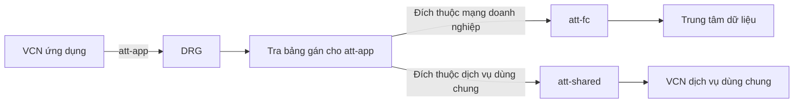
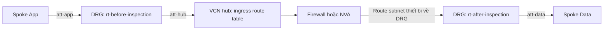
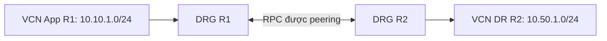

# DRG route tables, route distributions và transit routing

## 1. Mục tiêu và bối cảnh

Trong chương **Kết nối lai và liên vùng** của module **CLOUD_PROVIDERS_ORACLE**, bài học này giải thích cách điều khiển đường đi của gói tin qua Dynamic Routing Gateway (DRG) trên Oracle Cloud Infrastructure (OCI). Khi một tenancy có nhiều VCN, kết nối trung tâm dữ liệu và môi trường dự phòng tại region khác, việc tạo attachment mới chỉ cung cấp điểm kết nối. Bạn còn phải xác định mạng nào được học route của mạng nào và gói tin đến DRG sẽ được chuyển tiếp qua attachment nào.

Một tình huống điển hình là ứng dụng chạy trên OCI Compute cần truy cập Oracle Database tại trung tâm dữ liệu, đồng thời dùng dịch vụ dùng chung trong một VCN riêng. Đội mạng muốn giữ môi trường ứng dụng và môi trường dữ liệu tách biệt, cho phép đúng các kết nối cần thiết và có thể buộc lưu lượng qua firewall. DRG route tables và route distributions giúp diễn đạt phần định tuyến của yêu cầu đó; IAM và các lớp bảo mật tiếp tục kiểm soát quyền thay đổi cấu hình và quyền truy cập dịch vụ.

Sau bài này, bạn có thể:

- Phân biệt DRG route table, VCN subnet route table và VCN ingress route table gắn với DRG attachment.
- Giải thích import/export route distribution thuộc mặt phẳng điều khiển nào.
- Lập bảng route cho mô hình kết nối lai và mô hình hub–spoke có phân tách.
- Theo dõi cả chiều đi lẫn chiều về, kể cả khi cần đi qua thiết bị kiểm tra lưu lượng.
- Chuẩn bị cấu hình, quan sát và hoàn tác thay đổi định tuyến có kiểm soát.

Bài sử dụng **upgraded DRG**, IPv4 và các CIDR không chồng lấn. Người học nên biết CIDR, subnet, VCN, NSG, Site-to-Site VPN và FastConnect ở mức khái niệm. Ví dụ dùng địa chỉ minh họa; không chứa OCID, khóa hay tài nguyên thật.

## 2. Mô hình tư duy: bảng route được chọn từ attachment đi vào

### 2.1. Attachment là điểm nối mạng với DRG

DRG là bộ định tuyến ảo. Các attachment thường gặp trong bài gồm:

| Loại attachment | Mạng hoặc kết nối liên quan | Ví dụ tên trong thiết kế |
| --- | --- | --- |
| `VCN` | Một VCN trong region | `att-app`, `att-shared` |
| `IPSEC_TUNNEL` | Một tunnel của Site-to-Site VPN | `att-vpn-1` |
| `VIRTUAL_CIRCUIT` | Một private virtual circuit FastConnect | `att-fc` |
| `REMOTE_PEERING_CONNECTION` | Kết nối với DRG khác qua RPC | `att-rpc-r2` |

Mỗi attachment được gán một DRG route table. Nhiều attachment có thể dùng chung một bảng khi có cùng chính sách chuyển tiếp. Khi gói tin đi vào DRG qua attachment A, DRG tra **bảng gán cho A**, chọn next-hop attachment theo địa chỉ đích rồi chuyển tiếp. Chiều phản hồi bắt đầu từ attachment khác và có thể dùng bảng khác. Cơ chế này được mô tả trong [tài liệu tổng quan DRG của Oracle](https://docs.oracle.com/en-us/iaas/Content/Network/Tasks/managingDRGs.htm).



Để phân tích một gói tin, luôn ghi đủ ba thông tin: **đi vào bằng attachment nào, tra bảng nào, ra bằng attachment nào**. Tên bảng chứa chữ “app” không tự tạo liên kết với ứng dụng; cấu hình assignment mới quyết định bảng được sử dụng.

### 2.2. Ba loại bảng dễ bị nhầm

| Thành phần | Vị trí và phạm vi | Quyết định chính | Ví dụ |
| --- | --- | --- | --- |
| VCN subnet route table | Trong VCN, gắn với subnet trong mô hình cơ bản | Gửi lưu lượng từ subnet đến gateway nào | `172.20.0.0/16 → DRG` |
| DRG route table | Trong DRG, gán cho attachment | Gói vừa vào DRG sẽ ra qua attachment nào | `172.20.0.0/16 → att-fc` |
| VCN ingress route table trên DRG attachment | Bảng thuộc VCN, dùng cho lưu lượng từ DRG đi vào VCN | Chuyển tiếp trong VCN, ví dụ đến private IP của firewall | `10.20.1.0/24 → private IP firewall` |

Hai bảng đầu có thể cùng chứa destination CIDR nhưng target khác loại: subnet chọn **DRG**, còn DRG chọn **attachment**. Bảng ingress của VCN lại có nhiệm vụ dẫn lưu lượng đã rời DRG đến next hop trong VCN. Việc gán bảng ingress đặc biệt phục vụ các tình huống transit qua hub; xem [hướng dẫn VCN route tables và DRG attachment](https://docs.oracle.com/en-us/iaas/Content/Network/Tasks/managingroutetables_topic-working.htm).

Ví dụ: VM `10.10.1.10` muốn đến máy chủ `172.20.10.25`. Nếu subnet thiếu route đến DRG, bảng DRG đúng cũng không giúp gói đến được DRG. Nếu subnet đúng nhưng bảng gán cho `att-app` thiếu route doanh nghiệp, gói đã đến DRG vẫn không có đường đi tiếp. Hai lỗi có cùng biểu hiện timeout nhưng xảy ra tại hai điểm khác nhau.

### 2.3. Control plane và data plane

**Control plane** xây dựng thông tin đường đi: học prefix từ kết nối, nhập route vào bảng và quảng bá route ra bên ngoài. **Data plane** sử dụng bảng đã hình thành để chuyển gói thực tế.

Một import distribution được tạo thành công chưa chứng minh kết nối ứng dụng hoạt động. Tương tự, phiên BGP ở trạng thái established mới cho thấy kênh trao đổi route tồn tại; còn phải kiểm tra prefix nhận được, bảng nhận prefix và đường phản hồi. Phân biệt hai lớp này giúp tránh sửa NSG khi lỗi thực tế là route chưa được nhập.

## 3. DRG route tables: thành phần và chọn đường

### 3.1. Đọc một route rule

Một route cần được đọc cùng ngữ cảnh bảng chứa nó:

| Bảng | Destination | Next hop | Kiểu | Ý nghĩa |
| --- | --- | --- | --- | --- |
| `rt-from-app` | `172.20.0.0/16` | `att-fc` | Dynamic | Lưu lượng đi vào DRG từ ứng dụng có đường về doanh nghiệp |
| `rt-from-app` | `10.30.1.0/24` | `att-shared` | Dynamic | Ứng dụng có đường đến subnet dịch vụ dùng chung |
| `rt-inspect` | `0.0.0.0/0` | `att-hub` | Static | Những đích chưa có route cụ thể hơn được chuyển qua hub |

Route **dynamic** được nhập từ attachment; route **static** do người vận hành khai báo trong DRG route table. Các target static không bao gồm IPSec tunnel hay FastConnect virtual circuit. Để có đường đến các attachment đó, sử dụng route được nhập theo cơ chế kết nối tương ứng; không tạo static rule trỏ trực tiếp vào chúng. Xem [các giới hạn quản lý DRG](https://docs.oracle.com/en-us/iaas/Content/Network/Tasks/manage-drg.htm).

Cũng cần phân biệt “VPN cấu hình static routing” với “static route rule trong DRG route table”. Đây là hai vị trí cấu hình khác nhau; không thể suy kiểu rule trong DRG chỉ từ tên chế độ VPN.

### 3.2. Longest prefix match trước khi so route cùng prefix

Với địa chỉ đích cụ thể, prefix dài hơn khớp chính xác hơn. Ví dụ có hai route:

```text
0.0.0.0/0       → att-hub       (static)
10.20.1.0/24    → att-data      (dynamic)
```

Gói đến `10.20.1.25` khớp `/24` và sẽ đi qua `att-data`. Default route static không thắng route dynamic cụ thể hơn. Quy tắc ưu tiên static chỉ có ý nghĩa khi giải quyết các route **cùng destination prefix**. Đây là điểm quan trọng khi buộc lưu lượng qua firewall; [VCN FAQ của Oracle](https://www.oracle.com/cloud/networking/virtual-cloud-network/faq/) giải thích longest prefix match và xung đột route trong DRG.

Khi nhiều route có cùng CIDR, DRG còn xét kiểu static/dynamic, AS path và nguồn route theo cơ chế xử lý xung đột. Không dùng priority của distribution để “ép” một đường FastConnect thắng VPN. Khi cần thay đổi đường ưu tiên, phải xem thuộc tính route thực tế và chính sách BGP liên quan. Phần [route preference trong hướng dẫn giải pháp DRG](https://docs.oracle.com/en/solutions/learn-about-drg-solutions/index.html) trình bày các yếu tố này.

### 3.3. Không đồng nhất attachment với prefix được quảng bá

Một VCN `10.10.0.0/16` có subnet `10.10.1.0/24` không nhất thiết tạo route `/16` trong DRG. Với cấu hình quảng bá subnet CIDR, bảng sẽ học prefix subnet; khi chọn VCN CIDR, tập prefix thay đổi. Ví dụ trong bài dùng `/24` cho các workload subnet để biểu đạt rõ đích thực tế. Khi triển khai, hãy đọc danh sách route đang có thay vì suy prefix từ tên VCN. Lựa chọn VCN route type được mô tả trong [hướng dẫn tạo VCN attachment](https://docs.oracle.com/en-us/iaas/Content/Network/Tasks/drg-create-attachment.htm).

## 4. Route distributions: học route có chủ đích

### 4.1. Import distribution được gắn vào route table

Import route distribution quyết định route từ attachment nào được đưa vào một DRG route table. Quan hệ cần ghi nhớ:

```text
Attachment nguồn cung cấp route
    → import distribution chấp nhận nguồn
    → route xuất hiện trong DRG route table đích
    → bảng đích được gán cho attachment nhận lưu lượng
```

Giả sử muốn gói đi vào từ `att-app` có thể đến shared services. Ta gắn distribution chấp nhận nguồn `att-shared` vào `rt-from-app`, rồi gán `rt-from-app` cho `att-app`. Không gán distribution vào `att-shared` và mong mọi attachment tự nhìn thấy shared services. Việc tạo distribution và gán nó vào bảng là hai bước riêng; xem [Creating an Import Route Distribution](https://docs.oracle.com/en-us/iaas/Content/Network/Tasks/drg-rd-create.htm).

### 4.2. Statement, match và priority

Các cách match thường dùng gồm:

| Cách match | Phạm vi | Khi phù hợp |
| --- | --- | --- |
| Một attachment cụ thể | Route đi qua attachment có OCID được chọn | Tách ứng dụng, dữ liệu và shared services rõ ràng |
| Một loại attachment | Tất cả attachment của loại được chọn trên DRG | Chính sách có chủ đích cho toàn bộ VCN hoặc toàn bộ kết nối VPN |
| Match all | Mọi nguồn phù hợp trong phạm vi phân phối | Môi trường thử nghiệm hoặc miền định tuyến được phép chia sẻ rộng |

Statement được xét theo priority tăng dần; số nhỏ được xét trước. Nếu một statement có nhiều điều kiện match, các điều kiện đó đều phải thỏa. Priority là thứ tự đánh giá chính sách nhập route, không phải administrative distance, BGP local preference hay trọng số chia tải. Tham khảo [Adding a Route Distribution Statement](https://docs.oracle.com/en-us/iaas/Content/Network/Tasks/drg-rds-add.htm).

Các match này dựa trên nguồn attachment, không phải bộ lọc tùy ý theo CIDR, cổng TCP hay danh tính người dùng. Muốn chỉ mở Oracle Database cho một nhóm máy, cần kết hợp thiết kế prefix/route phù hợp với NSG, firewall và xác thực cơ sở dữ liệu. Chấp nhận route của một attachment không có nghĩa là chỉ cho phép một dịch vụ trên mạng đó.

### 4.3. Export distribution đi theo attachment

Export distribution điều khiển việc quảng bá route ra attachment hỗ trợ export. OCI có export distribution tự sinh; người dùng không tạo một export distribution tùy biến như khi tạo import distribution. VCN attachment không nhận dynamic route export để tự điền bảng route của subnet. Bảng subnet vẫn cần các rule tĩnh trỏ đến DRG. Mô hình import/export được trình bày trong [OCI CLI: drg-route-distribution](https://docs.oracle.com/en-us/iaas/tools/oci-cli/latest/oci_cli_docs/cmdref/network/drg-route-distribution.html).

Trong thiết kế cho CPE, cần kiểm tra đồng thời bảng gán cho attachment kết nối doanh nghiệp và những route thực sự được quảng bá ra kết nối. Có route trong một bảng của `att-app` không chứng minh CPE đã học route đó. Export cũng chịu giới hạn của nền tảng, vì vậy không suy rằng mọi prefix hiện trong mọi bảng đều được truyền ra mọi kết nối.

### 4.4. Cẩn trọng với cấu hình mặc định

DRG có các bảng và distribution tự sinh. Cấu hình mặc định dành cho VCN có thể tạo khả năng học route rộng hơn mô hình phân tách mà bạn muốn. Đối với môi trường thật, nên định nghĩa bảng theo chính sách và kiểm tra assignment của từng attachment. Oracle cũng khuyến nghị dùng bảng cụ thể theo nhu cầu trong [hướng dẫn thiết kế VCN và route tables](https://docs.oracle.com/en/solutions/oci-best-practices-networking/identify-vcn-topology-and-specifications1.html).

Đổi bảng mặc định cho một loại attachment chỉ ảnh hưởng việc gán mặc định cho attachment tạo sau đó; attachment đang tồn tại giữ assignment hiện tại. Vì vậy, “đã đổi default” không phải bằng chứng hệ thống cũ đã chuyển sang chính sách mới. Xem [Changing Route Table Assignment Defaults](https://docs.oracle.com/en-us/iaas/Content/Network/Tasks/drg-rt-default-assignment.htm).

## 5. Ví dụ phân tách: ứng dụng, dữ liệu và shared services

### 5.1. Topology và mục đích

Giả sử region R1 có DRG `drg-r1` và các mạng sau:

| Mạng | CIDR VCN hoặc mạng doanh nghiệp | Subnet được dùng | Attachment |
| --- | --- | --- | --- |
| VCN ứng dụng | `10.10.0.0/16` | `10.10.1.0/24` | `att-app` |
| VCN dữ liệu | `10.20.0.0/16` | `10.20.1.0/24` | `att-data` |
| VCN shared services | `10.30.0.0/16` | `10.30.1.0/24` | `att-shared` |
| Trung tâm dữ liệu | `172.20.0.0/16` | Máy thử `172.20.10.25` | `att-fc` hoặc các attachment VPN |

Yêu cầu của ví dụ: ứng dụng và dữ liệu truy cập được shared services; doanh nghiệp truy cập cả ba subnet phục vụ vận hành; ứng dụng và dữ liệu chưa có đường trực tiếp qua DRG. Đây là chính sách kết nối ở lớp mạng, độc lập với việc cấp phép một cổng dịch vụ cụ thể.

### 5.2. Ma trận cấu hình

| Attachment đi vào DRG | Bảng được gán | Các nguồn được import |
| --- | --- | --- |
| `att-app` | `rt-from-app` | `att-shared`, attachment kết nối doanh nghiệp |
| `att-data` | `rt-from-data` | `att-shared`, attachment kết nối doanh nghiệp |
| `att-shared` | `rt-from-shared` | `att-app`, `att-data`, attachment kết nối doanh nghiệp |
| Attachment kết nối doanh nghiệp | `rt-from-onprem` | `att-app`, `att-data`, `att-shared` |

Nếu dùng VPN có hai tunnel, mỗi tunnel có attachment riêng. Đưa đủ attachment cần thiết vào chính sách, không đại diện cả VPN bằng một OCID tunnel duy nhất. Nếu thêm VPN dự phòng cho FastConnect, các bảng phục vụ đường về doanh nghiệp phải học được prefix qua cả nguồn dự phòng phù hợp.

Các route hiệu lực chính trong `rt-from-app`:

```text
10.30.1.0/24    → att-shared
172.20.0.0/16   → attachment đường doanh nghiệp được chọn
```

Bảng này không có `10.20.1.0/24` và không có default route cho phép đi vòng qua miền khác. Đồng thời, subnet ứng dụng cần rule đến các mạng được phép với target DRG; subnet shared services cần route phản hồi đến `10.10.1.0/24` với target DRG.

### 5.3. Theo dõi kết nối hai chiều

Với luồng `10.10.1.10 → 10.30.1.20:443`:

1. Route table của subnet ứng dụng khớp `10.30.1.0/24 → DRG`.
2. Gói vào DRG qua `att-app`, nên dùng `rt-from-app`.
3. Route trong bảng chọn `att-shared`; gói đến VCN shared services.
4. Dịch vụ phản hồi đến `10.10.1.10`; subnet shared services gửi phản hồi về DRG.
5. Phản hồi vào qua `att-shared`, nên dùng `rt-from-shared`.
6. Route `10.10.1.0/24 → att-app` đưa phản hồi về ứng dụng.

Nếu bước 5 thiếu route, phía ứng dụng vẫn nhìn thấy timeout dù gói yêu cầu đã đến máy shared services. Cần quan sát hai đầu để nhận ra lỗi một chiều.

### 5.4. Giới hạn của việc tách bằng route

Không import route trực tiếp giúp hạn chế đường đi trong DRG, nhưng không chứng minh toàn bộ hệ thống đã cách ly. Cần kiểm tra default route, đường qua firewall/proxy, kết nối peering khác và khả năng chuyển tiếp ở mạng doanh nghiệp. Một đường gián tiếp có thể phá giả định phân tách. NSG hoặc firewall tiếp tục phải diễn đạt chính sách truy cập dịch vụ; IAM giới hạn ai được sửa bảng và distribution.

## 6. Thực hành cấu hình một quan hệ import và assignment

### 6.1. Chuẩn bị môi trường lab

Phần này minh họa cách tạo `rt-from-app` trong ma trận ở trên. Trước khi làm trên OCI, chuẩn bị:

- DRG và các attachment đã tồn tại, có trạng thái sẵn sàng.
- OCID chính xác của DRG, `att-app`, `att-shared` và attachment kết nối doanh nghiệp.
- Quyền IAM cần thiết để đọc các attachment, tạo bảng/distribution và cập nhật assignment trong các compartment liên quan.
- Một tài khoản vận hành riêng cho lab, route subnet và security rules giới hạn ở các prefix/cổng thử nghiệm.
- Bản ghi assignment cũ để có thể hoàn tác; kênh quản trị không phụ thuộc hoàn toàn vào đường sắp thay đổi.

Không cấp `manage all-resources in tenancy` chỉ để vượt qua lỗi quyền. Nếu tài nguyên thuộc các compartment hoặc tenancy khác nhau, xác định đúng phạm vi và chính sách cộng tác trước khi thay đổi. Tạo bảng mới chưa gán thường ít ảnh hưởng hơn sửa trực tiếp một distribution đang dùng chung cho nhiều bảng.

Các lệnh dưới đây là **ví dụ để người học chạy trong Bash có OCI CLI được cấu hình**. Chúng không tạo DRG, VCN, VPN hay FastConnect và không tự mở security rules. Thay mọi giá trị minh họa bằng OCID thật của môi trường lab; không đưa private key vào câu lệnh hoặc tài liệu.

### 6.2. Lưu assignment hiện tại và xác nhận attachment

```bash
set -euo pipefail

REGION='ap-singapore-1'
DRG_ID='ocid1.drg.oc1.ap-singapore-1.REPLACE_ME'
APP_ATTACHMENT_ID='ocid1.drgattachment.oc1.ap-singapore-1.REPLACE_APP'
SHARED_ATTACHMENT_ID='ocid1.drgattachment.oc1.ap-singapore-1.REPLACE_SHARED'
ONPREM_ATTACHMENT_ID='ocid1.drgattachment.oc1.ap-singapore-1.REPLACE_ONPREM'

oci network drg-attachment get \
  --region "$REGION" \
  --drg-attachment-id "$APP_ATTACHMENT_ID"

OLD_APP_ROUTE_TABLE_ID=$(oci network drg-attachment get \
  --region "$REGION" \
  --drg-attachment-id "$APP_ATTACHMENT_ID" \
  --query 'data."drg-route-table-id"' \
  --raw-output)

printf '%s\n' "$OLD_APP_ROUTE_TABLE_ID"
```

Kiểm tra attachment trả về đúng DRG, đúng VCN và đúng trạng thái trước khi tiếp tục. Tên hiển thị có thể trùng; OCID mới là định danh để đối chiếu. Ghi nhận bảng cũ trong hồ sơ thay đổi của môi trường thực hành.

### 6.3. Tạo import distribution

```bash
APP_IMPORT_ID=$(oci network drg-route-distribution create \
  --region "$REGION" \
  --drg-id "$DRG_ID" \
  --distribution-type IMPORT \
  --display-name 'import-shared-and-onprem-for-app' \
  --query 'data.id' \
  --raw-output)
```

CLI tạo distribution với loại `IMPORT`; xem [tham số drg-route-distribution create](https://docs.oracle.com/en-us/iaas/tools/oci-cli/latest/oci_cli_docs/cmdref/network/drg-route-distribution/create.html). Distribution vừa tạo chưa tự thêm route vào bảng đang sử dụng.

Thêm hai statement chấp nhận nguồn từ shared services và đường doanh nghiệp. JSON được truyền trực tiếp, không cần tạo file trung gian:

```bash
APP_IMPORT_STATEMENTS=$(printf '[{"action":"ACCEPT","priority":10,"matchCriteria":[{"matchType":"DRG_ATTACHMENT_ID","drgAttachmentId":"%s"}]},{"action":"ACCEPT","priority":20,"matchCriteria":[{"matchType":"DRG_ATTACHMENT_ID","drgAttachmentId":"%s"}]}]' \
  "$SHARED_ATTACHMENT_ID" "$ONPREM_ATTACHMENT_ID")

oci network drg-route-distribution-statement add \
  --region "$REGION" \
  --route-distribution-id "$APP_IMPORT_ID" \
  --statements "$APP_IMPORT_STATEMENTS"
```

Cú pháp `--statements` nhận một mảng JSON theo [OCI CLI: add distribution statements](https://docs.oracle.com/en-us/iaas/tools/oci-cli/latest/oci_cli_docs/cmdref/network/drg-route-distribution-statement/add.html). Với kết nối dự phòng, thêm statement cho attachment dự phòng phù hợp; không coi statement priority `10` và `20` là lựa chọn đường chính và đường phụ.

### 6.4. Tạo bảng và xem các route đã nhập

```bash
APP_ROUTE_TABLE_ID=$(oci network drg-route-table create \
  --region "$REGION" \
  --drg-id "$DRG_ID" \
  --display-name 'rt-from-app' \
  --import-route-distribution-id "$APP_IMPORT_ID" \
  --wait-for-state AVAILABLE \
  --query 'data.id' \
  --raw-output)

oci network drg-route-rule list \
  --region "$REGION" \
  --drg-route-table-id "$APP_ROUTE_TABLE_ID" \
  --all
```

Lệnh tạo bảng liên kết import distribution qua `--import-route-distribution-id`; xem [OCI CLI: drg-route-table create](https://docs.oracle.com/en-us/iaas/tools/oci-cli/latest/oci_cli_docs/cmdref/network/drg-route-table/create.html). Kiểm tra prefix shared services, prefix doanh nghiệp, next-hop attachment và dấu hiệu conflict. Route có thể cần thời gian hội tụ sau khi nguồn hoặc chính sách thay đổi; đừng tiếp tục chỉ vì lệnh tạo tài nguyên đã trả thành công.

Đầu ra mong đợi về mặt thiết kế là route đến `10.30.1.0/24` và `172.20.0.0/16`, với nguồn và next hop tương ứng. Nếu doanh nghiệp không quảng bá `/16` mà chỉ quảng bá các subnet cụ thể, đầu ra phải phản ánh đúng những prefix thực nhận. Không tự thêm default route để che sự khác biệt.

### 6.5. Chuẩn bị chiều về rồi chuyển assignment

Trước khi gán bảng mới cho ứng dụng, hoàn thành các bảng còn lại theo ma trận: `rt-from-shared` phải có đường về ứng dụng, `rt-from-onprem` phải có route đến subnet ứng dụng, và subnet route tables phải gửi đúng prefix đến DRG. Kiểm tra route được quảng bá trên CPE nếu thử kết nối doanh nghiệp.

Sau đó mới chuyển `att-app`:

```bash
oci network drg-attachment update \
  --region "$REGION" \
  --drg-attachment-id "$APP_ATTACHMENT_ID" \
  --drg-route-table-id "$APP_ROUTE_TABLE_ID"

oci network drg-attachment get \
  --region "$REGION" \
  --drg-attachment-id "$APP_ATTACHMENT_ID"
```

Tham số `--drg-route-table-id` đổi bảng trong DRG; tham số `--route-table-id` thuộc ngữ cảnh bảng VCN cho lưu lượng đi vào VCN. Không hoán đổi hai OCID này. Phân biệt đó được ghi rõ trong [OCI CLI: drg-attachment update](https://docs.oracle.com/en-us/iaas/tools/oci-cli/latest/oci_cli_docs/cmdref/network/drg-attachment/update.html).

Một lần chạy lại các lệnh `create` có thể tạo thêm tài nguyên có tên trùng. Trong vận hành hoặc IaC, giữ OCID và trạng thái tài nguyên, so sánh thay đổi trước khi áp dụng; không coi đoạn lệnh minh họa này là một script idempotent hoàn chỉnh.

### 6.6. Xác nhận kết nối và hoàn tác

Trên máy ứng dụng trong lab, thử cổng đã chuẩn bị ở shared services:

```bash
nc -vz -w 5 10.30.1.20 443
```

Nếu thử Oracle Database ở trung tâm dữ liệu, dùng đúng địa chỉ và cổng listener của lab, chẳng hạn `172.20.10.25:1521`. TCP kết nối được mới chứng minh listener có thể tiếp cận; vẫn cần kiểm tra TLS, tài khoản, service name và quyền của phiên cơ sở dữ liệu theo cấu hình dịch vụ.

Đối với đường app → data bị cấm, chỉ dùng một dịch vụ thử nghiệm đã biết đang hoạt động để đánh giá. Timeout đến máy không có listener không chứng minh route đã cách ly đúng. Kết hợp kết quả kết nối với bảng route, flow logs và log của máy đích.

Nếu thay đổi làm hỏng đường cần giữ, có thể trả `att-app` về bảng cũ đã ghi nhận:

```bash
oci network drg-attachment update \
  --region "$REGION" \
  --drg-attachment-id "$APP_ATTACHMENT_ID" \
  --drg-route-table-id "$OLD_APP_ROUTE_TABLE_ID"
```

Hoàn tác assignment không tự hoàn tác các sửa đổi khác ở subnet, NSG, CPE hoặc bảng dùng chung. Hồ sơ thay đổi phải liệt kê từng đối tượng đã sửa và trạng thái trước đó.

## 7. Transit routing qua hub có firewall

### 7.1. DRG làm hub không đồng nghĩa gói đã qua firewall

Nối nhiều VCN vào cùng DRG có thể tạo đường spoke → DRG → spoke. Nếu có một VCN tên `hub-security` gắn cùng DRG nhưng route chọn trực tiếp attachment spoke đích, firewall trong hub không nằm trên đường đi. Muốn kiểm tra tập trung, thiết kế phải đưa gói vào VCN hub, qua thiết bị kiểm tra rồi mới quay lại DRG.

Ví dụ thêm VCN hub `10.40.0.0/16`, có subnet thiết bị `10.40.1.0/24` và private IP forwarding `10.40.1.10`. Phần này là phương án kiến trúc riêng: thay thế chính sách direct-routing ở các luồng cần kiểm tra, không áp dụng chồng lên bảng `rt-from-app` rồi mặc định mọi thứ sẽ hoạt động.



Hai nút DRG trong sơ đồ biểu diễn **hai lần đi qua cùng một DRG**. Lần đầu dùng bảng gán cho spoke; lần sau dùng bảng gán cho `att-hub`. Mô hình này được minh họa trong [Routing traffic through a central network virtual appliance](https://docs.oracle.com/en-us/iaas/Content/Network/Tasks/scenario_g.htm).

### 7.2. Các lớp route phải phối hợp

| Vị trí | Chính sách minh họa cho app → data |
| --- | --- |
| Subnet ứng dụng | `10.20.1.0/24 → DRG` |
| DRG table gán cho `att-app` | `10.20.1.0/24 → att-hub` bằng static rule, hoặc một default route có phạm vi được thiết kế phù hợp |
| VCN ingress table gắn với `att-hub` | `10.20.1.0/24 → private IP 10.40.1.10` |
| Subnet/VNIC egress routing của thiết bị | `10.20.1.0/24 → DRG` theo thiết kế NVA |
| DRG table gán cho `att-hub` | `10.20.1.0/24 → att-data` qua route được nhập từ spoke dữ liệu |

Bảng trước kiểm tra không được nhập route trực tiếp đến spoke đích làm vượt qua đường kiểm tra. Bảng sau kiểm tra mới học các route spoke cần chuyển tiếp. Trong thực tế có thể chọn default route hướng hub, nhưng phải kiểm tra mọi route cụ thể hơn; `/24 → att-data` vẫn thắng `/0 → att-hub`.

Với NVA tự quản lý trên Compute, phải cấu hình IP forwarding, điều kiện chuyển tiếp của VNIC như skip source/destination check khi cần, hệ điều hành và security rules theo yêu cầu thiết bị. Với firewall được quản lý, dùng endpoint và hướng dẫn HA của dịch vụ tương ứng. Một route trỏ đến private IP chỉ chọn next hop, không tự biến VM đó thành router.

### 7.3. Đường về phải đi qua miền kiểm tra tương ứng

Với luồng data phản hồi app, `att-data` cần bảng trước kiểm tra đưa đích `10.10.1.0/24` vào hub. Bảng ingress hub đưa gói đến firewall; sau khi được cho phép, gói quay lại DRG qua `att-hub` và bảng sau kiểm tra chọn `att-app`.

Nếu chiều đi qua firewall nhưng chiều về đi trực tiếp, thiết bị có trạng thái có thể không nhìn thấy đầy đủ phiên và loại bỏ lưu lượng. Với cụm HA nhiều thiết bị, cần xác nhận cơ chế đối xứng hoặc đồng bộ trạng thái do sản phẩm hỗ trợ. Chỉ tạo hai VM firewall không đủ để bảo đảm một phiên đi và về đúng thiết bị.

### 7.4. Hai lỗi thiết kế điển hình

**Bỏ qua firewall:** `rt-before-inspection` có cả `/0 → att-hub` và `/24 → att-data`. Gói đến data chọn `/24`. Cách xử lý là sửa tập route của bảng trước kiểm tra theo chính sách inspection, rồi xác nhận lại prefix hiệu lực.

**Vòng lặp:** `att-hub` cũng dùng bảng có default route hướng lại hub, thiếu route spoke cụ thể. Gói đã kiểm tra quay về DRG lại bị đưa vào hub. Cách xử lý là phân biệt bảng trước và sau kiểm tra, đồng thời kiểm tra route có hiệu lực ở từng lần gói quay lại DRG. Không sửa vòng lặp bằng cách tăng TTL.

Nếu muốn đưa lưu lượng doanh nghiệp → spoke qua firewall, attachment kết nối doanh nghiệp cũng cần chính sách trước kiểm tra và quảng bá route phù hợp cho CPE. Cấu hình dành riêng cho spoke-to-spoke không tự bảo vệ các luồng đi vào từ FastConnect hoặc VPN.

## 8. Mở rộng sang region khác qua RPC

DRG là tài nguyên theo region. Để VCN ở R1 kết nối VCN ở R2, mô hình thông dụng là DRG ở mỗi region và một RPC ở mỗi phía, sau đó thiết lập peering giữa hai RPC. Đây là kết nối giữa các DRG; không gắn trực tiếp VCN R2 vào DRG R1. Xem [Remote VCN Peering through an Upgraded DRG](https://docs.oracle.com/en-us/iaas/Content/Network/Tasks/scenario_e.htm).



Một ma trận tối thiểu cho app R1 ↔ DR R2:

| DRG | Attachment đi vào | Bảng cần biết đích nào | Nguồn route cần nhập |
| --- | --- | --- | --- |
| R1 | `att-app-r1` | `10.50.1.0/24` | RPC phía R1 |
| R1 | RPC phía R1 | `10.10.1.0/24` | Attachment VCN app R1 |
| R2 | RPC phía R2 | `10.50.1.0/24` | Attachment VCN DR R2 |
| R2 | `att-dr-r2` | `10.10.1.0/24` | RPC phía R2 |

Subnet app R1 và subnet DR R2 vẫn cần route tương ứng đến DRG của region mình. Kiểm tra cả bảng gán cho VCN attachment, bảng gán cho RPC attachment và trạng thái peering. Peering thành công không tự xác nhận đủ route hai chiều hoặc đủ security rules.

Khi mở rộng đường doanh nghiệp từ R1 đến R2, phải đưa route mạng R2 vào đúng bảng phục vụ attachment doanh nghiệp ở R1, đồng thời có route quay về doanh nghiệp qua RPC ở phía R2. Không sao chép nguyên chính sách VCN toàn quyền nếu region dự phòng chỉ cần một số subnet dữ liệu.

Không dùng DRG như một WAN router trung chuyển tùy ý giữa hai site doanh nghiệp. Route có nguồn IPSec hoặc virtual circuit không được quảng bá sang attachment IPSec/virtual circuit khác theo giới hạn DRG, và luồng đi vào từ những loại attachment này không được đi ra một attachment cùng nhóm như một đường on-premises-to-on-premises. Việc nối nhiều DRG bằng RPC không phải cách bỏ qua giới hạn đó; các giới hạn nguồn route và propagation vẫn phải được xét. Đối chiếu [phần route propagation restrictions](https://docs.oracle.com/en-us/iaas/Content/Network/Tasks/managingDRGs.htm) trước khi thiết kế mạng transit nhiều site.

Đối với Oracle Database nhân bản liên vùng, DRG chỉ cung cấp phần kết nối IP. Tính sẵn sàng còn phụ thuộc cơ chế replication, độ trễ, băng thông, DNS, cấu hình listener và quy trình chuyển vai trò của cơ sở dữ liệu. Bài kiểm tra mạng cần được tách khỏi bài kiểm tra chuyển đổi dịch vụ để xác định chính xác tầng gây lỗi.

## 9. Chẩn đoán theo đường đi của một gói tin

### 9.1. Ghi rõ giả thuyết trước khi sửa

Với mỗi luồng bị lỗi, ghi lại:

```text
Nguồn:               10.10.1.10
Đích và dịch vụ:      172.20.10.25:1521/TCP
Attachment đi vào:    att-app
Bảng DRG dự kiến:     rt-from-app
Next hop dự kiến:     att-fc hoặc attachment VPN đang được chọn
Attachment chiều về:  attachment doanh nghiệp tương ứng
Bảng chiều về:        rt-from-onprem
```

Sau đó kiểm tra lần lượt: route subnet nguồn → attachment đi vào → bảng được gán → route thực tế → next hop → route phía đích → security rules → listener. Khi có hub kiểm tra, chèn hai lần tra DRG và các bước chuyển tiếp qua thiết bị vào chuỗi này.

### 9.2. Các triệu chứng và điểm kiểm tra

| Triệu chứng | Giả thuyết cần kiểm tra | Bằng chứng phù hợp |
| --- | --- | --- |
| Không thấy prefix doanh nghiệp trong bảng ứng dụng | Sai nguồn import, nguồn không quảng bá hoặc phiên kết nối chưa học route | Statement, attachment OCID, danh sách prefix nhận được |
| Prefix có trong một bảng nhưng kết nối vẫn lỗi | Attachment đi vào đang gán bảng khác | Chi tiết `drg-route-table-id` của attachment |
| Yêu cầu đến đích nhưng phía nguồn timeout | Thiếu đường về hoặc bị chặn chiều phản hồi | Route phía đích/CPE, log hai đầu, flow logs |
| Spoke vẫn đến được spoke dù cần qua firewall | Có route trực tiếp cụ thể hơn hoặc đường vòng | Route hiệu lực, log firewall, các peering/default route |
| Mất kết nối sau khi thêm một VCN | Route mới được học quá rộng hoặc có prefix chồng lấn | Danh sách route trước/sau, nguồn route và conflict |
| Lưu lượng lặp giữa hub và DRG | Sai bảng trên `att-hub` hoặc thiếu route sau kiểm tra | Assignment, prefix đích trong bảng sau kiểm tra |
| Ping thành công nhưng kết nối dịch vụ thất bại | Cổng dịch vụ, listener, firewall hoặc MTU không phù hợp | Thử TCP đúng cổng, log ứng dụng, đo kích thước gói |
| Dự phòng VPN tồn tại nhưng không được dùng khi FastConnect lỗi | Thiếu import nguồn dự phòng hoặc chưa có prefix dự phòng | Route thực nhận qua từng attachment và kết quả thử failover |

Để đọc route đã nhập và route static, có thể dùng lệnh sau; `--all` tránh bỏ sót các trang kết quả:

```bash
oci network drg-route-rule list \
  --region "$REGION" \
  --drg-route-table-id "$APP_ROUTE_TABLE_ID" \
  --all

oci network drg-route-distribution-statement list \
  --region "$REGION" \
  --route-distribution-id "$APP_IMPORT_ID" \
  --all
```

Đọc route hiệu lực trong bảng là bước xác nhận quan trọng hơn chỉ nhìn cấu hình distribution. [Hướng dẫn liệt kê DRG route rules](https://docs.oracle.com/en-us/iaas/Content/Network/Tasks/drg-rtrule-list.htm) mô tả mục đích đối chiếu route và next hop; [CLI list route rules](https://docs.oracle.com/en-us/iaas/tools/oci-cli/latest/oci_cli_docs/cmdref/network/drg-route-rule/list.html) cung cấp tham số phân trang.

### 9.3. Metric và log hỗ trợ kết luận

Upgraded DRG cung cấp metric namespace `oci_dynamic_routing_gateway`. Có thể quan sát byte, packet và packet drop theo attachment; các dimension như `resourceId`, `drgRouteTableId`, `attachmentType` giúp khoanh vùng. Với drop, `dropType=noRoute` là dấu hiệu DRG không tìm được route phù hợp; cần đọc cùng hướng lưu lượng và bảng của attachment liên quan. Tham khảo [DRG Metrics](https://docs.oracle.com/en-us/iaas/Content/Network/Reference/drgmetrics.htm).

Nên kết hợp ba nguồn bằng chứng: trạng thái định tuyến, quan sát packet/flow, và kiểm tra dịch vụ thực tế. Traceroute có thể thiếu hop do cách xử lý ICMP hoặc hạ tầng ảo; không xem danh sách hop vắng firewall là bằng chứng duy nhất rằng firewall bị bỏ qua. Ngược lại, TCP thành công cũng không chứng minh luồng đã đi qua điểm kiểm tra bắt buộc; cần log phù hợp của thiết bị.

## 10. Vận hành, tính sẵn sàng và chi phí

### 10.1. Giới hạn phạm vi thay đổi

Một distribution có thể được dùng bởi nhiều bảng; một bảng có thể được nhiều attachment dùng chung. Sửa một statement vì lỗi của ứng dụng A có thể thay đổi đường đi của ứng dụng B. Trước khi áp dụng, lập danh sách các bảng dùng distribution và các attachment gán những bảng đó. Với thay đổi lớn, chuẩn bị bảng mới, xem route kết quả rồi chuyển từng nhóm attachment theo thứ tự đã thống nhất.

Khi dùng Terraform hoặc công cụ IaC khác, khai báo rõ quan hệ DRG → attachment, distribution → statements, table → import distribution và attachment → table. Kế hoạch thay đổi phải thể hiện được assignment và các nguồn import, thay vì chỉ cho thấy tên tài nguyên mới. Không quản lý cùng một đối tượng đồng thời bằng nhiều state hoặc vừa tự động hóa vừa sửa Console mà thiếu cơ chế đối chiếu.

IAM kiểm soát ai được thực hiện các thay đổi này. Việc đặt VCN ở compartment khác hỗ trợ phân quyền quản trị nhưng không tự tạo chính sách chặn luồng mạng; phải cấu hình route và security rules phù hợp.

### 10.2. Thiết kế và thử đường dự phòng

Có FastConnect và VPN chưa đủ để kết luận hệ thống chịu lỗi. Cần xác nhận prefix doanh nghiệp hiện diện qua nguồn dự phòng, các bảng cần thiết nhập nguồn đó, CPE có route về và firewall tiếp tục xử lý phiên phù hợp sau khi đổi đường.

ECMP áp dụng cho những đường đủ điều kiện theo cấu hình DRG, loại kết nối và thuộc tính route. Không mặc định một FastConnect và một VPN sẽ được gộp băng thông. Kiểm tra route preference, khả năng hội tụ và yêu cầu đối xứng trước khi chọn active/active hay active/standby. Với luồng cơ sở dữ liệu, ghi nhận cả thời gian khôi phục mạng lẫn khả năng tái kết nối của ứng dụng.

Trong lab, chỉ thử ngắt đường theo một kịch bản đã chuẩn bị: ghi baseline, làm mất một đường thử nghiệm, quan sát việc rút/chọn route, thử lại dịch vụ, khôi phục và kiểm tra trạng thái sau phục hồi. Không đánh giá failover chỉ bằng việc tunnel hoặc circuit dự phòng có trạng thái up.

### 10.3. Tính chi phí theo toàn bộ đường đi

Khi dự toán, liệt kê kết nối doanh nghiệp, truyền dữ liệu liên vùng, firewall/NVA, Compute và lưu trữ phục vụ thiết bị, log và giám sát. Đối chiếu đơn giá hiện hành theo region, dịch vụ và nhà cung cấp kết nối; bài này không giả định toàn bộ topology nằm trong mức miễn phí.

Với nhân bản cơ sở dữ liệu, ước lượng lưu lượng bình thường, lần đồng bộ ban đầu và giai đoạn phục hồi sau gián đoạn. Các giai đoạn này có thể tạo nhu cầu khác nhau về băng thông và log. Giới hạn thời gian lab, lưu lượng thử và vòng đời tài nguyên giúp tránh duy trì thiết bị hoặc đường kết nối không còn dùng.

## 11. Tiêu chí hoàn thành bài thực hành

Một cấu hình được coi là đạt mục đích của bài khi người học cung cấp được các bằng chứng sau:

| Mục cần chứng minh | Bằng chứng mong đợi |
| --- | --- |
| Assignment đúng | OCID attachment, OCID bảng và lý do chọn bảng khớp ma trận |
| Import đúng phạm vi | Statement nguồn và route thực nhận đến đúng prefix |
| Kết nối được phép | TCP đến đúng dịch vụ thành công, có đường phản hồi |
| Phân tách được giữ | Không có route trực tiếp hoặc đường vòng ngoài thiết kế; kiểm tra dịch vụ bị cấm có bằng chứng hỗ trợ |
| Inspection đúng khi áp dụng | Log thiết bị ghi nhận cả chiều cần kiểm tra, không bị route cụ thể hơn bỏ qua |
| Liên vùng đúng khi áp dụng | Bảng và route ở cả hai DRG/RPC, route subnet và kiểm tra dịch vụ hai chiều |
| Có thể hoàn tác | Biết assignment và cấu hình cũ, đã xác định các đối tượng bị ảnh hưởng |

Điểm cốt lõi là đọc định tuyến từ **attachment đi vào**, kiểm soát **nguồn route được nhập vào bảng**, rồi chứng minh **đường đi và đường về**. Cách tiếp cận này giúp thiết kế mạng OCI phục vụ ứng dụng và Oracle Database có phân quyền rõ ràng, quan sát được và có thể mở rộng sang kết nối lai, inspection tập trung hoặc region dự phòng.
