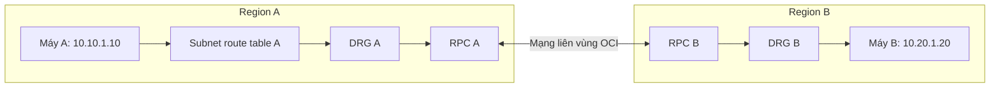

# Remote peering giữa các region

Trong chương **Kết nối lai và liên vùng** của module `CLOUD_PROVIDERS_ORACLE`, bài học này xây dựng kết nối mạng riêng giữa hai region của Oracle Cloud Infrastructure (OCI). Ta kết hợp tenancy, compartment và IAM với VCN, Compute và định tuyến DRG để tạo nền tảng cho ứng dụng hoặc cơ sở dữ liệu Oracle hoạt động ở nhiều region. Ví dụ thực hành dùng hai máy thử nghiệm; sau đó mới áp dụng cách kiểm tra tương tự cho luồng ứng dụng, sao chép dữ liệu và khôi phục sau thảm họa.

## 1. Mục tiêu và kiến thức đầu vào

Sau bài học, người học có thể:

- Giải thích quan hệ giữa VCN, Dynamic Routing Gateway (DRG), DRG attachment và Remote Peering Connection (RPC).
- Lập kế hoạch CIDR, quyền IAM và bảng định tuyến cho hai region.
- Thiết lập một cặp RPC, kiểm tra đường đi và đường về bằng địa chỉ IP riêng.
- Phân biệt lỗi kết nối peering, lỗi định tuyến, lỗi security rule và lỗi dịch vụ.
- Đánh giá ảnh hưởng của độ trễ, truyền dữ liệu liên vùng và sự cố region đến thiết kế.

Cần biết subnet, CIDR, route table, security list và Network Security Group (NSG). Phần thực hành giả định người học có quyền tạo tài nguyên mạng trong một tenancy thử nghiệm đã đăng ký hai region, cùng cách truy cập quản trị vào máy ảo bằng Bastion hoặc một đường quản trị được phê duyệt. Các lệnh OCI CLI và Linux trong bài là ví dụ để người học thực hiện trong môi trường của mình.

## 2. Remote peering giải quyết việc gì?

Remote peering cho phép tài nguyên ở hai VCN khác region trao đổi bằng IP riêng qua mạng của OCI. Luồng đó không phải đi vòng qua Internet hay trung tâm dữ liệu tại chỗ. Thiết kế tiêu biểu gồm một DRG tại mỗi region, một RPC trên mỗi DRG và quan hệ kết nối giữa hai RPC. Hai phía có thể thuộc cùng tenancy hoặc các tenancy khác nhau. Bài học dùng DRG hiện đại, thường được gọi là upgraded DRG. [Oracle: Remote VCN Peering through an Upgraded DRG](https://docs.oracle.com/en-us/iaas/Content/Network/Tasks/scenario_e.htm).

| Nhu cầu ví dụ | Vai trò của remote peering | Phần phải thiết kế thêm |
|---|---|---|
| Ứng dụng region A gọi dịch vụ riêng ở B | Cung cấp đường mạng giữa các địa chỉ riêng | Xác thực, TLS, timeout và quyền ứng dụng |
| Môi trường dự phòng cho Oracle Database | Cung cấp đường truyền cho luồng cơ sở dữ liệu được chọn | Cấu hình Data Guard hoặc cơ chế sao chép phù hợp |
| Chuyển dữ liệu theo lô giữa hai vùng | Cho phép máy xử lý kết nối đến máy nhận | Lịch truyền, kiểm tra dữ liệu và ngân sách |
| On-premises cần đến workload ở region B qua A | Có thể là một đoạn trong kiến trúc transit | Route từ on-premises, DRG và đường về xuyên suốt |

Peering chỉ cung cấp một thành phần của kiến trúc. Nếu ứng dụng region A vẫn phụ thuộc duy nhất vào cơ sở dữ liệu hoặc hệ thống xác thực ở A, việc tạo thêm VCN tại B chưa đủ để khôi phục dịch vụ khi A gặp sự cố.

## 3. Hiểu các thành phần qua đường đi của gói tin

| Thành phần | Nhiệm vụ trong ví dụ |
|---|---|
| VCN A và VCN B | Không gian mạng riêng của hai vùng |
| Subnet route table | Gửi lưu lượng đến subnet bên kia về DRG của vùng hiện tại |
| VCN attachment | Nối VCN với DRG |
| DRG route table | Chọn attachment tiếp theo khi gói tin đi vào DRG |
| RPC và RPC attachment | Đầu nối peering trên DRG và attachment tương ứng |
| NSG, security list | Cho phép các luồng được xác định theo nguồn, đích, giao thức và cổng |
| IAM policy | Cho phép chủ thể quản trị tạo hoặc sửa cấu hình mạng |

IAM kiểm soát thao tác quản trị; security rule kiểm soát lưu lượng. Có quyền tạo RPC không làm một cổng ứng dụng tự mở.



Sơ đồ thể hiện đường đi A đến B; lưu lượng trả lời cần đường định tuyến tương ứng theo chiều ngược lại. Các bước kiểm tra bên dưới sẽ theo đúng thứ tự này thay vì chỉ nhìn trạng thái RPC.

## 4. Thiết kế lab và kế hoạch địa chỉ

Dùng một tenancy và hai compartment để thấy rõ phạm vi phân quyền. Tên, địa chỉ và các cổng trong bảng là quy ước của lab, không phải giá trị OCI tự cấp.

| Thuộc tính | Region A | Region B |
|---|---|---|
| Region | `ap-singapore-1` | `ap-tokyo-1` |
| Compartment | `NetSingapore` | `NetTokyo` |
| VCN | `vcn-sg`, `10.10.0.0/16` | `vcn-tokyo`, `10.20.0.0/16` |
| Subnet thử nghiệm | `10.10.1.0/24` | `10.20.1.0/24` |
| IP máy thử nghiệm | `10.10.1.10` | `10.20.1.20` |
| DRG | `drg-sg` | `drg-tokyo` |
| RPC | `rpc-sg-to-tokyo` | `rpc-tokyo-to-sg` |
| Vai trò thiết lập | Requestor | Acceptor |

Luồng đầu tiên cần mở là `10.10.1.10 → 10.20.1.20:8080/TCP`. Chỉ route hai subnet thử nghiệm; chưa cần cấp kết nối cho toàn bộ hai dải `/16`.

Trước khi tạo tài nguyên, đối chiếu địa chỉ với mạng on-premises, các VCN đang kết nối và các vùng dự kiến mở rộng. Với kiến trúc đơn giản của bài, các dải phải không chồng lấn. Đừng xem việc API chấp nhận cấu hình trùng địa chỉ là bằng chứng rằng định tuyến sẽ đúng. [Oracle: Access to Other VCNs — Peering](https://docs.oracle.com/en-us/iaas/Content/Network/Tasks/VCNpeering.htm).

Ví dụ, nếu cả hai máy đều được đặt ở `10.10.1.0/24`, gói tin đến `10.10.1.20` không còn biểu diễn rõ máy thuộc region nào. Tạo RPC không giải quyết được sự nhập nhằng địa chỉ đó. Với lab mới, chọn lại CIDR trước khi triển khai dễ hơn việc xử lý xung đột khi ứng dụng đã hoạt động.

## 5. Chuẩn bị IAM và thỏa thuận hai phía

**Requestor** thực hiện thao tác kết nối; **acceptor** cho phép requestor kết nối đến RPC của mình. Vai trò này dùng khi thiết lập, không quyết định chiều truyền dữ liệu.

Trong cùng tenancy, ví dụ nhóm `PeeringOperators` được cấp:

```text
Allow group PeeringOperators to manage remote-peering-from in compartment NetSingapore
Allow group PeeringOperators to manage remote-peering-to in compartment NetTokyo
```

Hai quyền trên phục vụ thiết lập peering. Người tạo DRG, RPC, attachment, route table và NSG vẫn cần quyền quản trị tài nguyên tương ứng. Điều chỉnh tên nhóm theo identity domain của tenancy khi cần.

Với hai tenancy, cần chính sách `Define`/`Endorse` phía requestor và `Define`/`Admit` phía acceptor, xác định đúng tenancy OCID, group OCID và phạm vi compartment. Chính sách một phía chưa đủ. Xóa quyền IAM thiết lập peering cũng không tự ngắt kết nối đã tồn tại. [Oracle: IAM Policies for Routing Between VCNs](https://docs.oracle.com/en-us/iaas/Content/Network/Tasks/drg-iam.htm).

Bảng bàn giao cấu hình nên ghi rõ region, compartment, VCN CIDR, subnet được phép, RPC OCID, người phụ trách và luồng cần mở. Khi khác tenancy, bổ sung tenancy OCID và group OCID dùng trong chính sách. OCID của RPC đích cần được phân biệt với OCID của DRG hoặc VCN.

## 6. Chuẩn bị VCN, DRG và RPC

Thực hiện các bước dưới đây ở cả hai region, luôn kiểm tra bộ chọn region và compartment trước mỗi thao tác:

1. Tạo VCN với CIDR theo bảng lab; tạo subnet riêng cho máy thử nghiệm.
2. Tạo một máy Compute trong mỗi subnet, không gán public IP cho luồng thử nghiệm. Ghi lại IP thực tế nếu khác địa chỉ minh họa.
3. Tạo DRG trong compartment mạng của vùng và tạo VCN attachment nối DRG đó với VCN địa phương.
4. Mở trang DRG, tìm danh sách remote peering connection attachments rồi tạo RPC trong compartment đã chọn.
5. Ghi lại OCID của RPC, attachment và DRG; phía B cung cấp RPC OCID cùng region B cho phía A.

Tạo RPC cũng tạo attachment tương ứng trên DRG; không cần tự tạo thêm một RPC attachment độc lập cho cùng RPC. Việc tạo RPC cần quyền với RPC và DRG liên quan. [Oracle: Creating a Remote Peering Connection](https://docs.oracle.com/en-us/iaas/Content/Network/Tasks/drg-rpc-create.htm).

Nếu dùng môi trường đã tồn tại, kiểm tra phiên bản DRG và các kết nối VPN/FastConnect trước khi thay đổi. Việc nâng cấp DRG là thay đổi hạ tầng riêng cần được lập kế hoạch; không coi đó là thao tác mặc định của lab.

## 7. Kết nối hai RPC và kiểm tra trạng thái

Từ RPC A, chọn thao tác **Establish Connection**, nhập region B và OCID của RPC B. Tenancy phải đăng ký region cần dùng; với hai tenancy, phối hợp đăng ký và quyền hai phía trước khi kết nối. Theo dõi trạng thái peering đến `PEERED`. Đây là trạng thái của quan hệ RPC, chưa chứng minh rằng route, security rule và dịch vụ đã sẵn sàng. [Oracle: Connecting Two Remote Peering Connections](https://docs.oracle.com/en-us/iaas/Content/Network/Tasks/drg-rpc-connect.htm).

Có thể thực hiện phần tạo và kết nối bằng OCI CLI. Ví dụ Bash sau giả định CLI đã được cài đặt, cấu hình xác thực và có quyền thích hợp. Thay bốn OCID trước khi chạy; các biến chỉ phục vụ phiên shell lab.

```bash
REGION_A='ap-singapore-1'
REGION_B='ap-tokyo-1'
COMPARTMENT_A_ID='<ocid-compartment-NetSingapore>'
COMPARTMENT_B_ID='<ocid-compartment-NetTokyo>'
DRG_A_ID='<ocid-drg-sg>'
DRG_B_ID='<ocid-drg-tokyo>'

RPC_A_ID=$(oci --region "$REGION_A" network remote-peering-connection create \
  --compartment-id "$COMPARTMENT_A_ID" \
  --drg-id "$DRG_A_ID" \
  --display-name 'rpc-sg-to-tokyo' \
  --query 'data.id' --raw-output)

RPC_B_ID=$(oci --region "$REGION_B" network remote-peering-connection create \
  --compartment-id "$COMPARTMENT_B_ID" \
  --drg-id "$DRG_B_ID" \
  --display-name 'rpc-tokyo-to-sg' \
  --query 'data.id' --raw-output)

# Kiểm tra hai RPC đã tạo thành công và sẵn sàng trước khi kết nối.
oci --region "$REGION_A" network remote-peering-connection get \
  --remote-peering-connection-id "$RPC_A_ID"
oci --region "$REGION_B" network remote-peering-connection get \
  --remote-peering-connection-id "$RPC_B_ID"

oci --region "$REGION_A" network remote-peering-connection connect \
  --remote-peering-connection-id "$RPC_A_ID" \
  --peer-id "$RPC_B_ID" \
  --peer-region-name "$REGION_B"

# Đọc lại ở cả hai vùng; chờ thao tác bất đồng bộ hoàn tất nếu cần.
oci --region "$REGION_A" network remote-peering-connection get \
  --remote-peering-connection-id "$RPC_A_ID"
oci --region "$REGION_B" network remote-peering-connection get \
  --remote-peering-connection-id "$RPC_B_ID"
```

Kiểm tra trường `peering-status` là `PEERED`, đồng thời xác nhận đúng peer OCID và region. `lifecycle-state` và `peering-status` mô tả hai khía cạnh khác nhau; chỉ thấy tài nguyên ở trạng thái khả dụng chưa đủ kết luận kết nối đã hình thành.

Nếu đã tạo RPC bằng Console, dùng OCID hiện có và bỏ qua hai lệnh `create`. Các lệnh tạo tài nguyên không phải thao tác chạy lại tùy ý: một script vận hành cần lưu hoặc tra cứu OCID, kiểm tra lỗi từng bước và đọc trạng thái hiện có trước khi quyết định tạo mới.

## 8. Cấu hình route ở subnet và trong DRG

### 8.1. Route table của subnet

Thêm các rule sau vào đúng route table mà subnet thử nghiệm đang sử dụng:

| Route table | Destination CIDR | Target |
|---|---|---|
| Subnet `10.10.1.0/24` tại A | `10.20.1.0/24` | DRG A |
| Subnet `10.20.1.0/24` tại B | `10.10.1.0/24` | DRG B |

Target tại đây là DRG trong region hiện tại. Đừng đặt RPC bên kia làm target của subnet route table. Nếu nhiều subnet cần liên lạc, kiểm tra từng liên kết subnet–route table; sửa một bảng không tự sửa các bảng còn lại.

Route table chọn đường theo đích; nó không biểu diễn yêu cầu như “chỉ cho phép cổng 8080”. Dùng security rule để giới hạn giao thức và cổng. Một route đến `/24` cũng không cấp quyền truy cập ứng dụng cho mọi máy trong `/24`. [Oracle: VCN Route Tables](https://docs.oracle.com/en-us/iaas/Content/Network/Tasks/managingroutetables.htm).

### 8.2. Route table gắn với attachment của DRG

Một gói tin đi vào DRG dùng route table gắn với **attachment đầu vào**. Vì vậy, hãy kiểm tra cả bảng của VCN attachment và bảng của RPC attachment. Route có thể được học động qua import route distribution; RPC trao đổi route giữa hai DRG. Việc gắn bảng, cấu hình import/export và các route thực tế phải phù hợp với nhau. [Oracle: Dynamic Routing Gateways](https://docs.oracle.com/en-us/iaas/Content/Network/Tasks/managingDRGs.htm).

Với địa chỉ lab, kết quả cần quan sát là:

| DRG | Attachment đầu vào | Route đến subnet | Next hop cần thấy |
|---|---|---|---|
| A | VCN attachment A | `10.20.1.0/24` | RPC attachment A |
| B | RPC attachment B | `10.20.1.0/24` | VCN attachment B |
| B | VCN attachment B | `10.10.1.0/24` | RPC attachment B |
| A | RPC attachment A | `10.10.1.0/24` | VCN attachment A |

Bảng này mô tả đường hiệu lực cần đạt, không yêu cầu tạo bốn static route nếu các route động đã đáp ứng. Nếu DRG quảng bá VCN CIDR thay cho subnet CIDR theo cấu hình attachment, một route bao phủ chính xác đích cũng có thể đáp ứng; kiểm tra các route cụ thể hơn và xung đột trước khi kết luận.

Với DRG mới dùng cấu hình mặc định, bắt đầu bằng việc kiểm tra những route đã được học. Với DRG dùng bảng tùy chỉnh, trả lời lần lượt:

1. VCN attachment đang dùng bảng nào khi nhận gói từ VCN?
2. Bảng đó có route đến subnet bên kia qua RPC không?
3. RPC attachment ở đầu nhận đang dùng bảng nào?
4. Bảng ở đầu nhận có route đến VCN địa phương không?
5. Các điều kiện tương tự có đúng cho chiều trả lời không?

Ví dụ lỗi: A gửi được gói tới B, nhưng subnet B không có route `10.10.1.0/24 → DRG B`. B không thể hoàn tất phiên TCP dù NSG ingress tại B đã cho phép yêu cầu. Thêm nhiều rule ingress tại B sẽ không sửa được đường về bị thiếu.

### 8.3. Mở rộng sang mạng lai hoặc nhiều VCN

Nếu on-premises nối tới DRG A qua FastConnect hoặc VPN, kết nối đến subnet B còn cần route và quảng bá prefix cho toàn bộ đường on-premises–A–B. Hãy lập bảng attachment đầu vào và next hop cho từng đoạn, rồi làm tương tự cho chiều về.

Với nhiều spoke VCN, các DRG hiện đại có thể tham gia thiết kế transit. Tuy nhiên, chỉ ghép thêm một cặp peering chưa mô tả đủ chính sách định tuyến của một hub. Không suy ra rằng A nối B và B nối C thì A đã truy cập được C; cần thiết kế topology, giới hạn propagation, bảng route và quyền lưu lượng cụ thể cho cả đường đi.

## 9. Mở đúng luồng và kiểm soát phạm vi truy cập

Cho thử nghiệm A khởi tạo TCP đến B, đặt hai rule minh họa:

| Vị trí | Hướng | Nguồn hoặc đích từ xa | Giao thức | Source port | Destination port | Kiểu |
|---|---|---|---|---|---|---|
| NSG gắn với VNIC A | Egress | Đích `10.20.1.20/32` | TCP | All | 8080 | Stateful |
| NSG gắn với VNIC B | Ingress | Nguồn `10.10.1.10/32` | TCP | All | 8080 | Stateful |

Source port của client thường là cổng tạm thời, nên không đặt bằng 8080. Dùng `/32` trong lab để giữ phạm vi hẹp; khi triển khai dịch vụ thật, chọn phạm vi nguồn theo thiết kế của workload.

Stateful rule theo dõi phiên và tự cho phép phản hồi phù hợp; nó không tạo route về. Với stateless rule, cần cho phép rõ luồng trả lời tương ứng. Security list và NSG có tính cho phép cộng dồn: thêm NSG hẹp không thu hồi một quyền rộng đã tồn tại ở rule khác. Kiểm tra cả firewall hệ điều hành và địa chỉ mà tiến trình đang lắng nghe. [Oracle: Security Rules](https://docs.oracle.com/en-us/iaas/Content/Network/Concepts/securityrules.htm).

Nếu dùng Zero Trust Packet Routing (ZPR), kiểm tra thêm chính sách ZPR áp dụng cho tài nguyên. Không coi hai rule NSG trên là toàn bộ chính sách truy cập của mọi tenancy.

Khi cần B chủ động khởi tạo kết nối đến A, bổ sung cặp egress/ingress tương ứng cho luồng mới. Điều này khác với lưu lượng B trả lời một phiên do A khởi tạo.

Liên kết backbone giữa các region được OCI bảo vệ bằng MACsec. Với yêu cầu xác thực đầu cuối và bảo vệ phiên ứng dụng, tiếp tục cấu hình TLS, mTLS hoặc cơ chế bảo mật cơ sở dữ liệu phù hợp. [Oracle: VCN FAQ — Remote peering encryption](https://www.oracle.com/cloud/networking/virtual-cloud-network/faq/).

## 10. Kiểm thử theo từng lớp

### 10.1. Chuẩn bị một dịch vụ thử nghiệm

Dùng một dịch vụ TCP đã có tại B, hoặc chuẩn bị TCP echo bằng Ncat trên máy Linux thử nghiệm có cài `ncat`. Ví dụ sau lắng nghe trên IP riêng của B, cổng 8080 và gửi lại dữ liệu nhận được:

```bash
# Chạy trên máy B trong phiên terminal riêng của lab.
ncat --listen --keep-open --exec /usr/bin/cat 10.20.1.20 8080
```

Nếu IP thực tế khác ví dụ, thay địa chỉ ở mọi bước. Chỉ mở cổng 8080 cho IP nguồn A tại lớp mạng và firewall hệ điều hành theo chính sách lab. Dừng tiến trình bằng Ctrl+C sau thử nghiệm.

Tại B, ở terminal quản trị thứ hai, kiểm tra listener:

```bash
ss -lnt | grep ':8080'
```

Một tiến trình chỉ bind vào `127.0.0.1` sẽ không nhận kết nối tới IP riêng của VNIC. Kiểm tra listener trước giúp tránh nhầm lỗi dịch vụ thành lỗi RPC.

### 10.2. Kiểm tra từ nguồn thực tế

Tại máy A:

```bash
# Kiểm tra bắt tay TCP và đường phản hồi.
ncat -v -z -w 5 10.20.1.20 8080

# Thử trao đổi dữ liệu; nhập một dòng, quan sát dòng được echo, rồi Ctrl+C.
ncat 10.20.1.20 8080
```

Nếu lệnh đầu thành công và dữ liệu được echo, đã có bằng chứng về luồng A đến B và phản hồi B về A cho phiên đó. Chưa thể từ đây kết luận B được phép chủ động mở một phiên mới đến A.

Có thể dùng `ping` sau khi cho phép ICMP cần thiết, nhưng không dùng kết quả ping làm tiêu chí duy nhất. ICMP bị chặn vẫn có thể đi kèm một dịch vụ TCP hoạt động bình thường.

Với dịch vụ HTTP/TLS hoặc Oracle Database thật, thực hiện thêm kiểm tra ở giao thức tương ứng: gọi health endpoint, xác thực chứng thư và hostname, hoặc kết nối database bằng service name và tài khoản thử nghiệm. TCP thông chưa chứng minh đăng nhập thành công, quyền truy vấn đúng hay cơ chế sao chép đã hoạt động.

### 10.3. Tiêu chí hoàn thành lab

| Hạng mục | Bằng chứng cần lưu trong biên bản lab |
|---|---|
| Quan hệ peering | Hai RPC đúng cặp, đúng region, `peering-status = PEERED` |
| Định tuyến subnet | Hai route từ subnet thử nghiệm đến DRG địa phương |
| Định tuyến DRG | Route hiệu lực đến từng subnet qua attachment thích hợp |
| Lưu lượng cho phép | Bắt tay TCP và trao đổi dữ liệu từ A tới B thành công |
| Giới hạn truy cập | Luồng ngoài phạm vi thiết kế bị chặn khi không có rule rộng khác cho phép |
| Dịch vụ | Listener, firewall và kiểm tra ứng dụng phù hợp đều đúng |

Để kiểm tra giới hạn truy cập có ý nghĩa, chọn một dịch vụ thử nghiệm khác đã xác nhận đang lắng nghe tại B nhưng không được cấp quyền từ A. Một cổng không có listener vốn đã không phục vụ kết nối, nên không phải bằng chứng đủ mạnh cho việc NSG đang chặn đúng.

## 11. DNS riêng giữa hai region

Thử IP trước, rồi mới kiểm tra tên miền. Có đường peering không đồng nghĩa hostname nội bộ của VCN bên kia tự phân giải được.

Với phân giải xuyên region, một cách triển khai là tạo listening endpoint của resolver tại B, forwarding endpoint tại A và rule chuyển tiếp zone cần thiết từ A tới địa chỉ listener B. Nếu cần hai chiều, thiết kế tương ứng ở cả hai vùng. Bảo đảm route và security rule cho DNS, gồm UDP/TCP 53 theo vai trò endpoint. Việc gắn private view trực tiếp giữa các resolver là cơ chế chia sẻ trong cùng region; không áp dụng máy móc cho hai region. [Oracle: Private DNS](https://docs.oracle.com/en-us/iaas/Content/DNS/Tasks/privatedns.htm).

Ví dụ, ứng dụng A gọi `orders-b.internal.example`. Nếu TCP tới IP B thành công nhưng tên này không phân giải, hãy kiểm tra zone, record, forwarding rule và resolver endpoint trước khi thay route của luồng ứng dụng.

## 12. Giám sát và xử lý sự cố

Bật VCN Flow Logs ở phạm vi cần quan sát và chọn capture filter phù hợp. Đối chiếu địa chỉ nguồn/đích, cổng, giao thức, thời điểm và kết quả chấp nhận hoặc từ chối tại các điểm quan sát. Một bản ghi được chấp nhận ở một phía chưa chứng minh ứng dụng đã trả lời thành công. [Oracle: Troubleshoot Basic Network Issues](https://docs.oracle.com/en/learn/oci-ntw-troubleshoot-1/index.html).

Network Path Analyzer phân tích cấu hình mạng, bổ trợ cho việc kiểm thử từ máy thật. Với đường cross-region qua RPC, Oracle liệt kê trường hợp kết quả `Indeterminate` và hướng dẫn tách phân tích thành hai phần, một cho mỗi region. Vì vậy, không diễn giải `Indeterminate` là kết luận RPC hỏng. [Oracle: Network Path Analyzer](https://docs.oracle.com/en-us/iaas/Content/Network/Concepts/path_analyzer.htm).

| Triệu chứng | Điểm cần kiểm tra trước | Hướng xử lý |
|---|---|---|
| Không tạo được RPC | Quyền với RPC/DRG, compartment và region hiện tại | Sửa đúng quyền hoặc phạm vi tài nguyên |
| Lệnh connect bị từ chối | Requestor/acceptor, quyền from/to, OCID RPC đích | Đối chiếu IAM và dữ liệu bàn giao |
| Chưa `PEERED` | Đúng cặp RPC, region đích, tài nguyên phía đối tác | Đọc trạng thái cả hai RPC và lỗi thao tác |
| `PEERED` nhưng TCP timeout | Route subnet, bảng DRG của attachment đầu vào, security rule | Theo gói tin A đến B rồi kiểm tra chiều về |
| TCP báo connection refused | Listener và firewall có chủ động từ chối hay không | Kiểm tra dịch vụ, bind address và log trên máy B |
| Có gói SYN tới B nhưng A không hoàn tất kết nối | B có phát SYN-ACK không, route về, rule phản hồi | Tách lỗi phản hồi tại B khỏi lỗi đường về |
| IP thông nhưng hostname lỗi | DNS resolver, zone và forwarding | Kiểm tra DNS riêng thay vì mở rộng cổng ứng dụng |
| Giao dịch nhỏ được, truyền lớn lỗi | MTU, Path MTU Discovery, firewall và timeout | Đo đường truyền thực tế, kiểm tra thông báo ICMP cần thiết |
| Kết nối được nhưng chậm | RTT, số lượt gọi tuần tự, giới hạn máy và khối lượng truyền | Đo ở lớp mạng và ứng dụng trước khi đổi kiến trúc |

Khi chẩn đoán, ghi lại một luồng cụ thể, chẳng hạn nguồn `10.10.1.10`, đích `10.20.1.20`, TCP/8080 và thời điểm thử. Mô tả này giúp hai nhóm vận hành tìm cùng một phiên trong log thay vì đối chiếu các thử nghiệm khác nhau.

## 13. Độ trễ, tính sẵn sàng và chi phí

### Độ trễ và thiết kế ứng dụng

Dùng thông tin độ trễ liên vùng làm điểm tham khảo, sau đó đo từ workload thực tế. OCI cung cấp công cụ quan sát độ trễ giữa các region cùng các công cụ giám sát mạng khác. [Oracle: Network Monitoring, Observability, and Management](https://docs.oracle.com/en/solutions/oci-network-deployment/learn-network-monitoring-observability-and-management1.html).

Giả sử phép đo của lab cho RTT là 70 ms. Một request phải thực hiện 15 lần gọi liên vùng tuần tự sẽ có khoảng `15 × 70 ms = 1.050 ms` thời gian chờ mạng, trước khi tính xử lý nghiệp vụ và các chi phí giao thức khác. Đây là phép tính minh họa, không phải cam kết độ trễ cho cặp Singapore–Tokyo.

Từ đó có thể cân nhắc gom truy vấn, xử lý theo lô, cache dữ liệu phù hợp hoặc đặt dịch vụ phụ thuộc gần nơi xử lý. Với sao chép cơ sở dữ liệu, phải đánh giá độ trễ cùng chế độ đồng bộ/bất đồng bộ và mục tiêu mất dữ liệu cho phép.

### Tính sẵn sàng và khôi phục

Coi mất kết nối liên vùng và mất một region là hai tình huống cần diễn tập. Mỗi workload cần xác định rõ timeout, retry có giới hạn, hành vi khi không gọi được dịch vụ ở xa và điều kiện chuyển vùng.

Ví dụ ứng dụng nhận đơn hàng ở A và sao chép sang B cần trả lời: khi A mất hoàn toàn, B có đủ dữ liệu, secrets, danh tính, DNS và năng lực Compute để tiếp nhận lưu lượng không? Remote peering không tự trả lời các câu hỏi đó. RTO và RPO cần được đo bằng bài diễn tập chuyển đổi thực tế.

### Kiểm soát chi phí

Oracle công bố remote peering không có phí riêng cho chính quan hệ peering, còn outbound data transfer có chính sách tính phí và ngưỡng áp dụng. Tra biểu giá hiện hành thay vì giả định mọi lưu lượng liên vùng đều miễn phí. [Oracle: VCN FAQ — Peering pricing](https://www.oracle.com/cloud/networking/virtual-cloud-network/faq/).

Lập dự toán theo từng chiều truyền và dịch vụ sử dụng. Ví dụ thuần túy về khối lượng: một luồng phát trung bình 2 MB/s liên tục trong 30 ngày tạo khoảng `2 × 86.400 × 30 = 5.184.000 MB`, tương đương 5,184 TB theo đơn vị thập phân, chưa tính phần giao thức và truyền lại. Đây là dung lượng trước khi áp dụng cách đo, ngưỡng miễn phí hoặc đơn giá của OCI; không phải số tiền phải trả. Đối chiếu cách tính thực tế với [Oracle Cloud Price List](https://www.oracle.com/cloud/price-list/).

Đặt tên/tag nhận diện tài nguyên của bài thực hành, theo dõi chi phí Compute và volume của hai vùng, đồng thời giới hạn thời gian lưu flow log theo nhu cầu. Đối với hệ thống sao chép, theo dõi thay đổi khối lượng dữ liệu, tần suất truyền và lưu lượng ngược chiều để phát hiện chi phí tăng ngoài dự kiến.

## 14. Tự động hóa và thu hồi tài nguyên lab

Một quy trình tự động hóa có thể dùng cùng các bước đã thực hành: kiểm tra đầu vào, tạo hoặc tìm VCN/DRG/RPC, kết nối đúng cặp RPC, áp dụng route và security rule, rồi đọc trạng thái và thử luồng cần thiết. Luôn truyền region rõ ràng cho từng thao tác. Lưu mapping OCID theo môi trường để lần chạy sau quản lý đúng tài nguyên.

Với cấu hình có sẵn, đọc bảng route và rule hiện tại trước khi cập nhật. Một thao tác thay toàn bộ danh sách rule có thể xóa đường mạng của workload khác nếu chỉ gửi các rule của lab. Các thay đổi nên có kế hoạch khôi phục và bằng chứng xác minh giống như khi thao tác bằng Console.

Khi kết thúc lab riêng:

1. Dừng TCP echo và các tiến trình đo thử.
2. Thu hồi rule và route chỉ phục vụ bài thực hành sau khi xác nhận không còn phụ thuộc.
3. Xóa tài nguyên Compute, volume và DNS endpoint riêng của lab theo nhu cầu lưu dữ liệu.
4. Xóa RPC khi không còn cần peering, rồi kiểm tra và dọn tài nguyên mạng còn lại của lab. Xóa một RPC sẽ ngắt quan hệ với RPC đối tác; phối hợp kiểm tra tài nguyên còn lại ở cả hai phía.
5. Kiểm tra log, dung lượng lưu trữ và báo cáo chi phí còn phát sinh.

Cách ngắt peering bằng việc xóa RPC được mô tả trong [Oracle: Connecting Two Remote Peering Connections](https://docs.oracle.com/en-us/iaas/Content/Network/Tasks/drg-rpc-connect.htm). Trong môi trường dùng chung, chỉ thu hồi những tài nguyên đã xác định thuộc phạm vi lab.

## 15. Câu hỏi tự kiểm tra

1. Vì sao `PEERED` chưa đủ chứng minh máy A kết nối được cổng ứng dụng ở B?
2. Với gói tin đi vào DRG B từ RPC, cần kiểm tra route table gắn với attachment nào?
3. Tại sao stateful NSG cho phép phản hồi nhưng vẫn phải có route về A?
4. Nếu kết nối bằng IP được mà tên miền thất bại, cần kiểm tra những thành phần nào?
5. Quyền `remote-peering-from` và `remote-peering-to` phục vụ việc gì? Chúng có mở cổng TCP không?
6. Tại sao hai region có VCN và RPC vẫn chưa phải phương án DR hoàn chỉnh cho Oracle Database?
7. Nếu một ứng dụng liên tục sao chép dữ liệu sang region khác, cần đo các đại lượng nào để dự toán chi phí và thời gian phục hồi?

Một cấu hình có thể bàn giao phải giải thích được đường đi, đường về, chủ thể được phép thay đổi mạng và luồng được phép truy cập, đồng thời có bằng chứng kiểm thử ứng dụng cùng kế hoạch vận hành khi liên kết liên vùng gặp sự cố.
