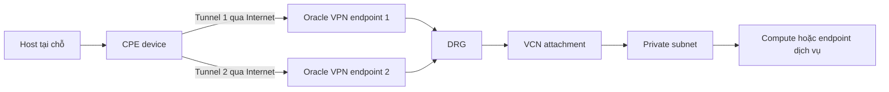

# Site-to-Site VPN, IPSec tunnels và định tuyến BGP

Trong chương **Kết nối lai và liên vùng** của module Oracle Cloud Infrastructure (OCI), bài học này trình bày cách kết nối một mạng tại chỗ với VCN bằng Site-to-Site VPN. Mục tiêu là xây dựng đường truyền cho địa chỉ nội bộ, hiểu mã hóa IPSec, trao đổi tuyến bằng BGP và kiểm chứng khả năng chuyển tuyến khi một tunnel gặp lỗi.

Một ứng dụng tại trung tâm dữ liệu có thể cần truy cập Oracle Database trong private subnet trên OCI. Có tunnel mã hóa mới giải quyết một phần bài toán: cả hai phía còn cần đúng tuyến, quyền truy cập mạng và dịch vụ sẵn sàng. Tenancy, compartment và IAM xác định phạm vi quản trị; DRG, VCN và Compute tạo đường đi; Monitoring và Logging cung cấp bằng chứng vận hành. Thiết kế cũng cần tính chi phí thiết bị, đường truyền, tài nguyên cloud và yêu cầu sẵn sàng của ứng dụng.

## 1. Kết quả cần đạt và kiến thức nền

Sau bài học, người học có thể:

- Giải thích vai trò của CPE, DRG, IPSec connection và từng tunnel.
- Phân biệt public endpoint của VPN, địa chỉ BGP bên trong tunnel và địa chỉ máy ứng dụng.
- Chuẩn bị tham số IKE/IPSec, BGP ASN, địa chỉ peering và prefix được quảng bá.
- Theo dấu gói tin qua route table của subnet, DRG, CPE và mạng tại chỗ theo cả hai chiều.
- Kiểm tra độc lập trạng thái IPSec, BGP, route và kết nối dịch vụ.
- Đo failover, xác định phạm vi dự phòng và điều kiện vận hành.

Cần biết CIDR, longest prefix match, private/public IP, NSG, security list, TCP và định tuyến cơ bản. Phần thực hành giả định có quyền cấu hình CPE lab và tài nguyên mạng OCI; các lệnh minh họa chỉ dùng trong môi trường lab tương ứng.

## 2. Những thành phần tạo nên kết nối

**Site-to-Site VPN** nối một mạng tại chỗ với VCN thông qua IPSec. Với mô hình qua Internet trong bài này, CPE có đường tới public VPN endpoint của Oracle; máy ứng dụng ở hai đầu giao tiếp bằng private IP. OCI sử dụng IPSec tunnel mode và tạo hai tunnel dự phòng cho một kết nối mới. Kiểu định tuyến được chọn riêng cho từng tunnel. [Site-to-Site VPN Overview](https://docs.oracle.com/en-us/iaas/Content/Network/Tasks/overviewIPsec.htm).

| Thành phần | Vai trò trong thiết kế |
| --- | --- |
| CPE device | Router hoặc firewall thực tế tại mạng khách hàng, thực hiện IPSec và định tuyến |
| CPE object | Tài nguyên OCI mô tả thiết bị, gồm public IP và thông tin thiết bị |
| Dynamic Routing Gateway, DRG | Router ảo kết nối VCN với VPN và các attachment khác |
| VCN attachment | Liên kết VCN với DRG |
| IPSec connection | Tài nguyên cha liên kết CPE object với DRG |
| IPSec tunnel | Đường mã hóa có endpoint, khóa chia sẻ và cấu hình riêng |
| BGP session | Phiên trao đổi thông tin tuyến bên trong một tunnel |

Tạo CPE object không tự cài cấu hình lên router thực tế. Kỹ sư mạng vẫn phải cấu hình CPE khớp với tham số phía OCI. [Quy trình quản lý IPSec connection](https://docs.oracle.com/en-us/iaas/Content/Network/Tasks/ipsec-manage.htm).



Sơ đồ cho thấy hai đường mã hóa cùng đi qua một CPE. Nếu CPE hoặc đường Internet duy nhất của nó hỏng, cả hai tunnel có thể mất kết nối. Muốn bảo vệ trước loại lỗi đó cần thiết kế CPE, đường truyền và nguồn điện dự phòng phù hợp.

## 3. Ba nhóm địa chỉ không được nhầm lẫn

Ví dụ tự thiết kế dùng các thông số sau:

| Nhóm | Giá trị minh họa |
| --- | --- |
| Mạng tại chỗ được phép kết nối | `10.40.10.0/24` |
| Host kiểm tra tại chỗ | `10.40.10.10` |
| VCN | `10.60.0.0/16` |
| Subnet OCI tham gia lab | `10.60.1.0/24` |
| Compute OCI để kiểm tra | `10.60.1.20` |
| Public IP CPE | `198.51.100.10`, địa chỉ dành cho tài liệu, phải thay khi triển khai |
| Public IP Oracle tunnel 1 và 2 | `ORACLE_VPN_PUBLIC_IP_T1`, `ORACLE_VPN_PUBLIC_IP_T2`, lấy từ OCI |
| BGP trong tunnel 1 | CPE `169.254.20.1/30`, Oracle `169.254.20.2/30` |
| BGP trong tunnel 2 | CPE `169.254.21.1/30`, Oracle `169.254.21.2/30` |
| ASN tại chỗ | `65010`, ASN riêng dùng cho ví dụ |
| ASN Oracle | `ORACLE_BGP_ASN`, lấy đúng theo tunnel, region và realm |

**Public endpoint** phục vụ IKE và lưu lượng IPSec trên mạng truyền dẫn. **Inside tunnel IP** là địa chỉ hai BGP speaker, mỗi tunnel dùng một cặp riêng. **Private IP của workload** là nguồn/đích của lưu lượng nghiệp vụ đi qua VPN.

OCI chấp nhận inside IPv4 theo `/30` hoặc `/31`; hai đầu cần được cấu hình nhất quán. Có các dải link-local không được dùng cho inside tunnel interface, nên không chọn tùy ý mọi địa chỉ `169.254.x.x`. Khi thay địa chỉ ví dụ, đối chiếu [Creating an IPSec Connection](https://docs.oracle.com/en-us/iaas/Content/Network/Tasks/ip-sec-con-create.htm) và [các dải inside tunnel bị loại trừ](https://docs.oracle.com/en-us/iaas/Content/Network/Tasks/settingupIPsec.htm).

CIDR workload cần không chồng lấn. Nếu hai phía cùng dùng `10.60.1.0/24`, thêm BGP không giúp router tự phân biệt hai mạng cùng địa chỉ. Cần quy hoạch lại hoặc thiết kế NAT có kiểm soát, điều chỉnh route và policy theo địa chỉ thực sự nhìn thấy.

Không dùng inside tunnel IP làm endpoint database cho ứng dụng. BGP thiết lập tới `169.254.20.2` chưa chứng minh host tại chỗ có tuyến sử dụng được tới `10.60.1.20`.

## 4. IPSec bảo vệ lưu lượng như thế nào?

### 4.1. Mạng truyền dẫn, IKE và dữ liệu mã hóa

```text
Gói bên trong:
10.40.10.10:ephemeral -> 10.60.1.20:22, TCP

CPE chọn tuyến đi qua tunnel và đóng gói/mã hóa:
CPE_PUBLIC_IP -> ORACLE_VPN_PUBLIC_IP_T1

Phía Oracle giải mã, chuyển gói bên trong qua DRG tới VCN.
```

Gói tin phải được CPE đưa vào đúng tunnel; sau khi giải mã, DRG vẫn phải chọn attachment tiếp theo. IPSec không cấp quyền tự động cho mọi cổng trong private subnet.

**IKE** đàm phán và xác thực peer, thiết lập các Security Association, thường viết là SA. Với IKEv2, cần hiểu IKE SA và CHILD SA bảo vệ dữ liệu. Trang cấu hình thiết bị có thể vẫn dùng cách gọi phase 1/phase 2. Khi đọc log, phân biệt lỗi thương lượng IKE với lỗi ở SA dữ liệu.

### 4.2. Những tham số phải thống nhất

| Nhóm | Giá trị cần đối chiếu giữa hai phía |
| --- | --- |
| Peer | Public endpoint, IKE identifier |
| Xác thực | Pre-shared key, gọi tắt PSK |
| IKE | Phiên bản, mã hóa, integrity/PRF khi áp dụng, nhóm DH, lifetime |
| IPSec | ESP, mã hóa và xác thực tương ứng, PFS, lifetime |
| Phạm vi bảo vệ | Traffic selectors hoặc encryption domain theo loại cấu hình |
| Vận hành | NAT-T, phát hiện peer không còn hoạt động, rekey |

Ưu tiên IKEv2 khi thiết bị hỗ trợ và cấu hình hai đầu khớp nhau. Chọn thuật toán được tổ chức cho phép và cả CPE lẫn OCI hỗ trợ. GCM có xác thực tích hợp nên không ghép tùy ý thêm HMAC như khi dùng CBC. Đối chiếu [Supported IPSec Parameters](https://docs.oracle.com/en-us/iaas/Content/Network/Reference/supportedIPsecparams.htm) thay vì sao chép bộ tham số của thiết bị hoặc realm khác.

PSK là bí mật của từng tunnel. Hồ sơ vận hành nên tham chiếu nơi lưu khóa theo quy định; tránh chép khóa thật vào tài liệu học hoặc đầu ra chia sẻ rộng. Thay khóa từng tunnel, điều phối hai đầu và kiểm chứng đường còn lại.

### 4.3. NAT-T và firewall ở biên

| Lưu lượng trên đường truyền dẫn | Mục đích |
| --- | --- |
| UDP 500 | IKE |
| UDP 4500 | NAT traversal khi dùng UDP encapsulation |
| IP protocol 50, ESP | ESP khi không bọc bằng UDP NAT-T |

ESP có **số giao thức IP 50**, không phải TCP hay UDP port 50. TCP 179 của BGP chạy giữa hai inside tunnel IP trong đường mã hóa; không cần mở TCP 179 từ mọi địa chỉ Internet tới interface ngoài của CPE.

OCI hỗ trợ NAT-T. Nếu CPE sau NAT, kiểm tra public address và IKE identifier phía Oracle dùng để xác thực peer. NAT ở interface ngoài phục vụ VPN khác với NAT/PAT của địa chỉ workload bên trong. [CPE Configuration](https://docs.oracle.com/en-us/iaas/Content/Network/Tasks/configuringCPE.htm).

Quan sát tunnel cả trong lúc rekey. Kết nối lặp lại mất sau một chu kỳ có thể liên quan lifetime, PFS, proposal hoặc đường truyền; khởi động lại router chỉ làm mất dấu nguyên nhân.

## 5. BGP giải quyết phần nào của kết nối?

BGP trao đổi thông tin định tuyến. CPE và router Oracle lập một phiên eBGP trên mỗi tunnel. CPE quảng bá prefix tại chỗ; Oracle quảng bá route được xuất qua attachment tương ứng. Khi một đường không còn hợp lệ, thông tin tuyến có thể được rút và hệ thống chọn đường còn lại.

Ứng dụng chỉ dùng được prefix khi route thực sự được quảng bá, chấp nhận, chọn làm đường thích hợp và đưa vào bảng chuyển tiếp.

| Mốc kiểm chứng | Bằng chứng cần tìm |
| --- | --- |
| Peer đã kết nối | BGP Established ở CPE, trạng thái Up tương ứng trên OCI |
| Đã nhận prefix | Received routes có prefix mong đợi |
| Đã chọn đường | Bảng route chọn đúng next hop/attachment |
| Đã chuyển tiếp | Lưu lượng test đi qua, bộ đếm gói thay đổi |
| Dịch vụ hoạt động | Client nhận phản hồi đúng ở tầng ứng dụng |

BGP không tự thêm route vào route table của subnet OCI, mở NSG/security list hoặc cấu hình DNS lai. Những phần đó cần được thiết kế riêng.

### 5.1. Điều kiện của từng phiên

Tunnel 1: local address tại CPE là `169.254.20.1`, neighbor `169.254.20.2`. Tunnel 2 dùng `169.254.21.1` và `169.254.21.2`. Local ASN là `65010`; remote ASN lấy từ thông tin Oracle thực tế. Không điền public VPN IP vào trường BGP neighbor của mô hình này.

Phải chọn BGP cho cả hai tunnel nếu đó là thiết kế mục tiêu. Static routes gắn với IPSec connection không được dùng cho tunnel đã cấu hình BGP. [Kiểu định tuyến và dữ liệu cần cung cấp](https://docs.oracle.com/en-us/iaas/Content/Network/Tasks/overviewIPsec.htm).

Nếu BGP Down dù IPSec Up, kiểm tra địa chỉ peering, ASN và TCP 179 bên trong tunnel. Site-to-Site VPN không hỗ trợ BGP MD5 authentication; không bật tùy chọn này chỉ vì mẫu BGP cho dịch vụ khác có sử dụng. [BGP Session Troubleshooting](https://docs.oracle.com/en-us/iaas/Content/Network/Troubleshoot/ipsectroubleshoot.htm).

### 5.2. Chính sách quảng bá cho ví dụ

```text
CPE tới OCI, trên cả hai tunnel:
  Chỉ quảng bá 10.40.10.0/24.

OCI tới CPE:
  CPE chấp nhận prefix lab 10.60.1.0/24.
  Kiểm tra danh sách advertised thực tế ở OCI trước khi áp dụng bộ lọc.

Không quảng bá default route hoặc toàn bộ bảng route nội bộ trong lab này.
```

Đây là mô tả chính sách, không phải cú pháp CLI của một hãng thiết bị. Prefix list, route map, import/export policy và address family phụ thuộc CPE. Một số thiết bị chỉ originate prefix khi có route tương ứng trong bảng định tuyến; cần kiểm tra điều kiện đó nếu peer không nhận quảng bá.

Nếu OCI quảng bá aggregate `10.60.0.0/16` mà CPE chỉ cho phép chính xác `/24`, session có thể Established nhưng không giữ route cần dùng. Chọn phạm vi theo thiết kế và cấu hình thực tế; không nới filter sang mọi prefix chỉ để bài kiểm tra chạy được.

## 6. Ba lớp định tuyến phải kiểm tra riêng

### 6.1. Route table của subnet VCN

Để Compute `10.60.1.20` trả lời host `10.40.10.10`, route table gắn với subnet cần rule:

| Destination CIDR | Target |
| --- | --- |
| `10.40.10.0/24` | DRG gắn với VCN |

Route học ở DRG không tự xuất hiện thành route rule của subnet. Không cần cho toàn bộ `0.0.0.0/0` đi DRG nếu chỉ cần kết nối prefix lab. [Routing a Subnet's Traffic to a DRG](https://docs.oracle.com/en-us/iaas/Content/Network/Tasks/managingDRGs.htm).

### 6.2. Route table của DRG

Gói vào DRG được tra bằng DRG route table gắn với **attachment mà gói đi vào**. Với DRG hiện hành, xác định hai hướng:

| Gói vào từ attachment | Đích cần tra | Đường ra mong đợi |
| --- | --- | --- |
| VCN attachment | `10.40.10.0/24` | IPSec tunnel attachment còn hợp lệ |
| IPSec tunnel attachment | `10.60.1.0/24` | VCN attachment |

Import route distribution ảnh hưởng route động xuất hiện trong DRG route table. Cấu hình xuất route qua attachment ảnh hưởng route peer nhận được. Kiểm tra bảng đang gắn thực tế, thay vì chỉ tìm một bảng có tên quen thuộc. [DRG route tables và route distributions](https://docs.oracle.com/en-us/iaas/Content/Network/Tasks/managingDRGs.htm).

Các bảng tạo sẵn có thể đáp ứng topology đơn giản. Khi thay distribution, tách môi trường hoặc thêm transit, kiểm tra lại đường đi. Lab không giả định có network appliance hoặc ingress routing tùy chỉnh trong VCN.

### 6.3. Bảng route tại chỗ

Host `10.40.10.10` cần gửi đích `10.60.1.20` qua gateway nội bộ có đường tới CPE. CPE cần chọn route OCI học qua BGP; router trung gian cũng cần đường phù hợp. CPE phải chuyển gói đã giải mã về LAN được quảng bá.

Hỏi tại từng điểm: “Với gói có nguồn và đích này, router tiếp theo là gì?” Áp dụng lần lượt ở host, router LAN, CPE, DRG và VCN để xác định chỗ thiếu.

### 6.4. Theo dấu hai chiều

```text
Chiều đi:
Host tại chỗ -> LAN gateway -> CPE
-> route tới 10.60.1.0/24 -> IPSec tunnel
-> DRG route table của tunnel attachment
-> VCN attachment -> VNIC 10.60.1.20 -> dịch vụ

Chiều về:
10.60.1.20 -> subnet route 10.40.10.0/24 tới DRG
-> DRG route table của VCN attachment
-> tunnel được chọn -> CPE -> LAN -> 10.40.10.10
```

Luôn kiểm tra đường về, kể cả khi thấy gói yêu cầu ở máy đích. Mở thêm ingress tại OCI không sửa được route trả lời đang thiếu ở subnet.

## 7. Hai tunnel, ưu tiên đường và tính sẵn sàng

### 7.1. Dự phòng phải cấu hình ở hai đầu

Cấu hình đầy đủ hai tunnel và hai phiên BGP giúp có đường thay thế khi một tunnel lỗi. Chúng vẫn chia sẻ rủi ro nếu cùng dùng một CPE/uplink. Với workload quan trọng, cân nhắc hai CPE và đường truyền độc lập, mỗi CPE có IPSec connection riêng. [Khuyến nghị dự phòng CPE và tunnel](https://docs.oracle.com/en-us/iaas/Content/Network/Tasks/configuringCPE.htm).

Hai tunnel Up chưa chứng minh failover hoạt động: đường thứ hai có thể quảng bá thiếu prefix, hoặc firewall chỉ cho traffic nghiệp vụ qua interface của đường thứ nhất.

### 7.2. Điều khiển hai chiều độc lập

CPE có thể dùng local preference để chọn đường từ tại chỗ tới OCI. Để ảnh hưởng chiều về, có thể dùng AS-path prepending trên quảng bá qua đường dự phòng khi các route cùng prefix và đáp ứng điều kiện chọn đường khác. Longest prefix match ưu tiên route cụ thể hơn. [Route advertisements và path preferences](https://docs.oracle.com/en-us/iaas/Content/Network/Concepts/routingonprem.htm).

Ví dụ cùng quảng bá `10.40.10.0/24` qua hai tunnel, nhưng prepend thêm ASN tại chỗ trên T2 để AS_PATH dài hơn. Cần quan sát route Oracle nhận và DRG chọn, thay vì chỉ dựa vào cấu hình mong muốn ở CPE.

Nếu T2 quảng bá `/25` cụ thể hơn nằm trong `/24` của T1, prepend T2 không làm `/24` trở thành đường ưu tiên cho đích thuộc `/25`. Trước khi so AS_PATH, so prefix và kiểm tra static route có thể chi phối.

### 7.3. Asymmetric routing và ECMP

Chiều đi và về có thể qua hai tunnel khác nhau. CPE/firewall có trạng thái cần xử lý được trường hợp đó, hoặc có chính sách tuyến thích hợp. Số thứ tự “Tunnel 1” không cam kết traffic luôn đi qua nó.

DRG hỗ trợ ECMP theo flow trên đường đủ điều kiện; ECMP mặc định tắt theo DRG route table. Tạo hai tunnel không tự bật cân bằng tải. Nhiều flow có thể được phân phối, nhưng một phiên TCP đơn lẻ không bảo đảm cộng được băng thông hai tunnel. [ECMP trong DRG](https://docs.oracle.com/en-us/iaas/Content/Network/Tasks/managingDRGs.htm).

Lab cơ bản giữ việc chọn đường dễ quan sát. Chỉ thử active-active khi đã kiểm chứng route và khả năng xử lý bất đối xứng của firewall ở cả hai đầu.

## 8. Trình tự triển khai có thể kiểm chứng

### Bước 1: Chốt thông tin và phạm vi quyền

Lập bảng địa chỉ như ví dụ, xác nhận region, compartment, ASN và prefix được phép. Người triển khai cần quyền mạng tương ứng trong OCI và quyền cấu hình CPE. Người giám sát cần quyền đọc tài nguyên, metric và log; không cần quản trị toàn tenancy chỉ để xem trạng thái.

Chốt luồng đầu tiên, chẳng hạn `10.40.10.10 -> 10.60.1.20:22/TCP`. Chuẩn bị đường quản trị CPE không phụ thuộc tunnel sẽ thử ngắt. Với Oracle Database thật, lập luồng riêng theo listener và endpoint thực tế.

### Bước 2: Chuẩn bị VCN và DRG

Tạo hoặc chọn VCN, private subnet, DRG và VCN attachment. Thêm route subnet về prefix tại chỗ; kiểm tra DRG route table của các attachment và import distribution. Đặt NSG/security list theo luồng cần kiểm tra, chuẩn bị firewall hệ điều hành.

### Bước 3: Tạo CPE object và IPSec connection

Khai báo public IP thực của CPE và loại thiết bị phù hợp. Tạo IPSec connection nối CPE object tới DRG. Cấu hình từng tunnel dùng BGP, điền cặp inside IP, customer ASN, IKE version và các lựa chọn tương thích. Ghi nhận hai tunnel OCID và public endpoint Oracle.

Thông tin chuẩn bị và trình tự tài nguyên được mô tả trong [Setting Up Site-to-Site VPN](https://docs.oracle.com/en-us/iaas/Content/Network/Tasks/settingupIPsec.htm).

### Bước 4: Cấu hình CPE

Dùng **CPE Configuration Helper** để lấy thông tin và mẫu phù hợp với vendor/platform. Oracle khuyến nghị route-based khi có thể. Mẫu tập hợp endpoint, PSK, tham số IPSec và BGP, nhưng kỹ sư mạng vẫn phải hoàn thiện phần mạng tại chỗ. [Using the CPE Configuration Helper](https://docs.oracle.com/en-us/iaas/Content/Network/Tasks/CPEconfigurationhelper.htm).

Kiểm tra tunnel interface, peer, policy, forwarding, NAT exemption nếu cần và route tới các public endpoint qua đường Internet thích hợp. Tránh để route học qua VPN làm đường tới chính VPN endpoint bị vòng ngược vào tunnel.

### Bước 5: Xác minh theo từng mốc

1. IPSec Up trên hai tunnel và SA dữ liệu ổn định.
2. BGP Up/Established trên hai peer.
3. Prefix tại chỗ có trong received routes ở OCI; prefix cloud có ở CPE.
4. Route được chọn đúng ở DRG và CPE; subnet có rule về tại chỗ.
5. Kết nối TCP thử thành công bằng private IP.
6. Dịch vụ thật trả lời đúng nếu tiếp tục kiểm tra tầng ứng dụng.
7. Thử mất một tunnel, đo gián đoạn và khôi phục đầy đủ.

Không bỏ qua bước route chỉ vì hai trạng thái đầu đều xanh.

## 9. Đọc trạng thái bằng Console và CLI

Trong OCI Console, mở **Networking → Customer connectivity → Site-to-Site VPN**, chọn connection rồi xem từng tunnel. Ghi riêng IPSec status, BGP status, inside IP và thời điểm quan sát. BGP status hiển thị dấu gạch ngang có thể là tunnel dùng static routing, cần đối chiếu routing type. [Listing IPSec Tunnels](https://docs.oracle.com/en-us/iaas/Content/Network/Tasks/ip-sec-tunnel_list.htm).

Có thể dùng OCI CLI đã cấu hình đúng profile và region để đọc thông tin:

```bash
oci network ip-sec-tunnel list \
  --ipsc-id 'IPSEC_CONNECTION_OCID' \
  --all

oci network ip-sec-tunnel get \
  --ipsc-id 'IPSEC_CONNECTION_OCID' \
  --tunnel-id 'TUNNEL_1_OCID'
```

Thay placeholder bằng OCID thật. Lặp thao tác đọc cho tunnel 2. Lệnh `get` này không trả PSK. [CLI list](https://docs.oracle.com/en-us/iaas/tools/oci-cli/latest/oci_cli_docs/cmdref/network/ip-sec-tunnel/list.html), [CLI get](https://docs.oracle.com/en-us/iaas/tools/oci-cli/latest/oci_cli_docs/cmdref/network/ip-sec-tunnel/get.html).

Ở trang tunnel có thể xem **BGP Routes Received** và **BGP Routes Advertised**, gồm AS_PATH. “Received” được hiểu từ phía Oracle: route CPE gửi tới Oracle. Cần đọc đúng góc nhìn khi so với bảng route tại chỗ. [Getting an IPSec Tunnel's Details](https://docs.oracle.com/en-us/iaas/Content/Network/Tasks/ip-sec-tunnel_get.htm).

Bản chụp trạng thái tại một thời điểm chỉ mô tả thời điểm đó. Khi điều tra mất kết nối ngắn, ghép với log, metric và lịch sử test có timestamp.

## 10. Lab: kết nối private IP và đo failover

### 10.1. Điều kiện ban đầu

Dùng topology và địa chỉ ở mục 3. CPE hỗ trợ route-based IPSec với BGP; có host Linux tại chỗ và Compute Linux trong OCI. SSH server trên Compute đã lắng nghe ở TCP 22; có `ncat` trên host tại chỗ. Không cần public IP cho Compute để phục vụ luồng qua VPN.

Chỉ cho phép luồng lab từ `10.40.10.10/32` tới `10.60.1.20:22/TCP` trong policy tương ứng. Stateful rule theo dõi lưu lượng phản hồi, nhưng vẫn cần route hai chiều và policy tương thích trên CPE. Giữ kênh quản trị đang dùng khi thử nghiệm.

### 10.2. Kiểm tra baseline

Thực hiện mục 8. Xác nhận hai tunnel và hai peer hoạt động, rồi điền:

| Hạng mục | Giá trị cần ghi từ môi trường thật |
| --- | --- |
| Tunnel 1 | OCID, endpoint Oracle, IPSec status, BGP status |
| Tunnel 2 | OCID, endpoint Oracle, IPSec status, BGP status |
| OCI nhận từ CPE | Prefix và AS_PATH của `10.40.10.0/24` |
| CPE nhận từ OCI | Prefix sử dụng được để tới `10.60.1.20` |
| Đường được chọn | Route tại CPE và DRG cho hai chiều |
| Phạm vi subnet | Route `10.40.10.0/24 -> DRG` |

Trên host tại chỗ, ghi thời gian UTC và tạo kết nối mới:

```bash
date -u '+%Y-%m-%dT%H:%M:%SZ'
ip route get 10.60.1.20
ncat -vz -w 3 10.60.1.20 22
```

`ip route get` trên host chỉ cho thấy quyết định của host đó. Xem thêm route CPE để biết tunnel được chọn. `ncat` thành công chứng minh thiết lập TCP tới cổng kiểm tra; đăng nhập SSH còn phụ thuộc tài khoản và khóa.

### 10.3. Lặp phép đo có timestamp

Đoạn shell sau tạo 30 kết nối TCP mới từ host lab:

```bash
for attempt in $(seq 1 30); do
  date -u '+%Y-%m-%dT%H:%M:%SZ'
  if ncat -vz -w 2 10.60.1.20 22; then
    echo "attempt=$attempt result=TCP_OK"
  else
    echo "attempt=$attempt result=TCP_FAIL"
  fi
  sleep 2
done
```

Mỗi lượt có thời gian thực thi riêng nên chu kỳ không chính xác tuyệt đối là hai giây. Dùng timestamp thực để ước lượng khoảng mất kết nối. Phép thử này chưa đo khả năng sống sót của một phiên TCP kéo dài.

### 10.4. Làm mất một tunnel trong lab

Chọn tunnel đang mang lưu lượng hoặc được ưu tiên dựa trên route/bộ đếm. Từ giao diện quản trị CPE, vô hiệu hóa riêng tunnel đó bằng thao tác phù hợp thiết bị; không ngắt interface Internet chung. Ghi thời điểm, trạng thái peer và route trước/sau.

Quan sát route qua tunnel lỗi bị rút hoặc không còn được chọn, tunnel còn lại có prefix hợp lệ và TCP test phục hồi hay không. Thời gian phụ thuộc phát hiện lỗi IPSec/BGP, hội tụ route và hành vi ứng dụng; không mặc định một giá trị cố định như ba giây. Nếu chuỗi 30 lần thử kết thúc trước khi quan sát đủ quá trình, chạy thêm một chuỗi có timestamp.

Bật lại tunnel, chờ IPSec và BGP ổn định, xác nhận route đúng thiết kế. Chỉ sau đó mới thử tunnel còn lại. Nếu cả hai cùng Down, dừng phép thử và khôi phục cấu hình lab trước khi tiếp tục.

### 10.5. Bằng chứng hoàn tất

| Giai đoạn | T1 IPSec/BGP | T2 IPSec/BGP | Route chọn | Kết quả TCP | Thời gian UTC |
| --- | --- | --- | --- | --- | --- |
| Bình thường | Điền thực tế | Điền thực tế | Điền thực tế | Điền thực tế | Điền thực tế |
| Tắt một tunnel | Điền thực tế | Điền thực tế | Điền thực tế | Điền thực tế | Điền thực tế |
| Đã phục hồi | Điền thực tế | Điền thực tế | Điền thực tế | Điền thực tế | Điền thực tế |

Ghi riêng số lần TCP thất bại và khoảng thời gian giữa lần thành công cuối trước lỗi với lần thành công đầu sau lỗi. Đây là phép đo từ góc nhìn client, có độ phân giải phụ thuộc chu kỳ thử; không phải phép đo chính xác riêng thời gian hội tụ BGP.

Nếu thất bại, ghi quan sát và lớp chưa xác minh. Không điền kết quả kỳ vọng thành dữ liệu đã đo. Sau lab, khôi phục hai tunnel, policy và alarm phù hợp; xử lý tài nguyên riêng của lab theo kế hoạch sử dụng.

## 11. Chẩn đoán theo lớp

### 11.1. IPSec Down

Kiểm tra public endpoint, Internet, IKE version, PSK, IKE ID, proposal, DH/PFS và traffic selectors. Xem log hai đầu cùng khoảng thời gian. Lỗi xác thực và lỗi không tìm được proposal chung dẫn tới hướng sửa khác nhau.

`AUTHENTICATION_FAILED`, `NO_PROPOSAL_CHOSEN` hoặc `TS_UNACCEPTABLE` là đầu mối; cần đọc cùng ngữ cảnh SA và bước đàm phán. [Thông điệp chẩn đoán Site-to-Site VPN](https://docs.oracle.com/en-us/iaas/Content/Network/Troubleshoot/ipsectroubleshoot.htm).

### 11.2. IPSec Up nhưng BGP Down

Đối chiếu inside IP, customer ASN, Oracle ASN và rule cho BGP trong tunnel. Đảm bảo không còn cấu hình peer cũ và routing type là BGP. Không sửa NSG của Compute để chữa phiên BGP giữa CPE và router Oracle.

### 11.3. BGP Up nhưng thiếu route

Kiểm tra originate/advertise phía gửi, filter phía nhận, address family và prefix cụ thể. Xem DRG route distribution, bảng gắn với attachment và route conflict. Nhận thông báo route chưa chứng minh route được chọn để chuyển tiếp.

Nếu mất prefix sau khi thêm mạng mới, đối chiếu giới hạn dịch vụ hiện hành và prefix limit của CPE. Không đóng đinh một giới hạn số prefix vào thiết kế dài hạn mà không kiểm tra khi triển khai.

### 11.4. Có route nhưng ứng dụng không kết nối

Dùng tuple cụ thể để kiểm tra subnet route, NSG/security list, firewall CPE, firewall hệ điều hành, listener và đường về. Nếu VCN Flow Logs bật đúng phạm vi, `REJECT` ở VNIC là bằng chứng để kiểm tra security rules tại đó; `ACCEPT` chưa xác nhận ứng dụng trả lời thành công.

Nếu IP chạy nhưng hostname lỗi, kiểm tra DNS và IP được resolve. VPN không tự tạo DNS forwarding giữa hai môi trường. Với Oracle Database, kiểm tra thêm listener, service name và phản hồi client sau khi xác nhận tầng TCP.

### 11.5. Một chiều hoặc chỉ gói nhỏ chạy được

Lỗi một chiều cần xem đường về, NAT, stateful firewall và asymmetric routing. Gói nhỏ chạy nhưng transfer lớn treo có thể liên quan MTU/MSS và Path MTU Discovery vì IPSec thêm overhead. Không đặt một MTU cố định cho mọi topology; xem kiểu encapsulation, thiết bị và thông điệp ICMP liên quan trước khi chỉnh.

`ping` thành công chưa xác nhận dịch vụ TCP hoạt động. Ping thất bại có thể chỉ vì ICMP chưa được cho phép. Bám vào giao thức và cổng ứng dụng sử dụng.

| Trạng thái quan sát | Mốc cần kiểm tra tiếp |
| --- | --- |
| IPSec Down | Kết nối public, IKE và SA |
| IPSec Up, BGP Down | Inside peer, ASN, TCP 179 |
| BGP Up, thiếu prefix | Quảng bá, filter, import/export |
| Có prefix, route không được chọn | Route conflict, specificity, chính sách chọn đường |
| Route đúng, TCP thất bại | Rule, firewall, listener, chiều về |
| TCP thành công, nghiệp vụ lỗi | DNS, TLS, xác thực, cấu hình dịch vụ |

## 12. Theo dõi, tự động hóa và chi phí

OCI cung cấp metric trong namespace `oci_vpn`: `TunnelState`, bộ đếm packet/byte và `PacketsError`. Dimension `parentResourceId` xác định connection, `publicIp` xác định endpoint Oracle của tunnel. Góc nhìn nhận/gửi là phía Oracle. [Site-to-Site VPN Metrics](https://docs.oracle.com/en-us/iaas/Content/Network/Reference/ipsecmetrics.htm).

`BytesReceived` tăng khi OCI nhận lưu lượng từ tại chỗ; nó không phải số byte ứng dụng đã xử lý thành công. `TunnelState` không thay thế kiểm tra BGP và phép đo tới endpoint nghiệp vụ.

Bộ theo dõi thực tế nên bao phủ:

- Một tunnel mất hoạt động: mất mức dự phòng dù ứng dụng có thể còn chạy.
- Toàn bộ đường VPN không dùng được: xử lý theo ảnh hưởng dịch vụ.
- BGP flapping hoặc prefix quan trọng biến mất: điều tra định tuyến.
- Tăng lỗi, mất gói hoặc độ trễ: kiểm tra Internet và thiết bị.
- Endpoint nghiệp vụ thất bại: kiểm tra toàn bộ đường đi và dịch vụ.

Giữ connection/tunnel ID trong dữ liệu theo dõi. Ghi thay đổi cấu hình và bằng chứng trước/sau; lịch sử Audit hỗ trợ đối chiếu thay đổi tài nguyên OCI. Giới hạn quyền đọc log và cấu hình theo nhu cầu công việc.

Có thể quản lý OCI bằng Terraform/Resource Manager, cấu hình CPE bằng công cụ phù hợp vendor. Mô tả rõ phần quản lý ở mỗi đầu, lưu phiên bản cấu hình không chứa bí mật và thay đổi từng tunnel. Tránh cập nhật đồng thời hai đường rồi mới kiểm tra.

Tính chi phí toàn hệ thống: thiết bị/VM CPE, license nếu có, đường Internet, lưu lượng theo biểu giá áp dụng, log và tài nguyên giám sát/lab. VPN qua Internet chịu biến động của mạng truyền dẫn; băng thông thực còn phụ thuộc năng lực mã hóa CPE, kích thước gói và độ trễ. Đo bằng lưu lượng đại diện trước khi dùng cho sao chép cơ sở dữ liệu hoặc batch có thời hạn nghiêm ngặt.

## 13. Liên hệ kết nối liên vùng và FastConnect

VPN trong bài đưa mạng tại chỗ vào DRG của một region. Để tới VCN region khác, cần thiết kế liên vùng như Remote Peering Connection giữa DRG, route propagation, route table và security rules hai chiều. Có VPN tới region A không tự cho phép truy cập mọi region trong tenancy.

DRG có hạn chế transit và quảng bá giữa các loại attachment; không mặc định dùng được để chuyển tiếp tùy ý giữa hai VPN hoặc từ VPN sang FastConnect. Đối chiếu [DRG attachment và route propagation restrictions](https://docs.oracle.com/en-us/iaas/Content/Network/Tasks/managingDRGs.htm) khi mở rộng topology.

VPN và FastConnect có thể cùng tham gia dự phòng. Cần thống nhất prefix, ưu tiên hai chiều và phép thử failover. Route cụ thể hơn qua VPN có thể chi phối aggregate qua FastConnect; tên đường “primary” trong tài liệu không làm router thay đổi cách chọn tuyến.

## 14. Hồ sơ kỹ thuật để bàn giao

Kết nối đã kiểm chứng nên có sơ đồ, CIDR, ASN, tài nguyên/attachment, chính sách route, tham chiếu khóa, rule cho luồng nghiệp vụ và chủ sở hữu hai đầu. Bổ sung trạng thái từng tunnel, bảng route, lần thử private IP và failover đã đo.

Người tiếp quản cần trả lời được: ứng dụng nào đi tới prefix nào, qua đường nào bình thường, điều gì phát hiện khi đường đó lỗi và route nào được chọn tiếp theo. Câu trả lời phải dựa trên cấu hình và kết quả thực tế, thay vì chỉ dựa vào trạng thái tunnel màu xanh.
