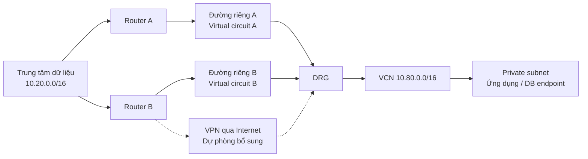

# FastConnect và lựa chọn mô hình kết nối riêng

Khi ứng dụng và cơ sở dữ liệu cùng tồn tại ở trung tâm dữ liệu và Oracle Cloud Infrastructure (OCI), kết nối mạng trở thành một phần của kiến trúc ứng dụng. Đồng bộ dữ liệu, sao lưu và truy cập dịch vụ cần băng thông, độ trễ và phương án phục hồi phù hợp với nghiệp vụ.

Trong module **CLOUD_PROVIDERS_ORACLE**, bài học này đặt FastConnect vào bối cảnh kết nối lai và liên vùng: lựa chọn cách đưa mạng doanh nghiệp tới OCI, nối đường truyền với VCN và DRG, giới hạn truy cập, kiểm chứng khả năng chuyển tuyến và dự toán chi phí vận hành.

Sau bài học, người học có thể:

- Phân biệt mô hình Oracle Partner, third-party provider và colocation.
- Chọn private peering hoặc public peering theo endpoint cần truy cập.
- Giải thích quan hệ giữa đường vật lý, virtual circuit, BGP, DRG và VCN route table.
- Đề xuất phương án mã hóa, dự phòng và kiểm thử đáp ứng nhu cầu dữ liệu thực tế.

## 1. FastConnect cung cấp điều gì?

FastConnect cung cấp kết nối riêng giữa mạng bên ngoài và OCI, tránh phụ thuộc vào đường Internet công cộng cho chặng kết nối này. Đây là lựa chọn cho nhu cầu băng thông lớn hoặc trải nghiệm mạng ổn định hơn so với kết nối qua Internet. Khi triển khai virtual circuit, có thể chọn private peering hoặc public peering. [Tổng quan FastConnect](https://docs.oracle.com/en-us/iaas/Content/Network/Concepts/fastconnectoverview.htm).

Một đường truyền riêng không tự tạo ra mọi đặc tính ứng dụng cần. Cần xác định riêng:

| Đặc tính | Câu hỏi thiết kế |
| --- | --- |
| Kết nối | Endpoint nào phải tới được, từ nguồn nào? |
| Hiệu năng | Băng thông hữu dụng, độ trễ và mức mất gói chấp nhận được là bao nhiêu? |
| Bảo mật | Dữ liệu được mã hóa ở đâu, ai được phép truy cập? |
| Sẵn sàng | Những lỗi nào phải chịu được và mất bao lâu để phục hồi? |
| Vận hành | Đơn vị nào xử lý sự cố trên từng chặng? |

Chẳng hạn, replication đã chuyển sang FastConnect nhưng vẫn chậm có thể liên quan tới ghi đĩa, CPU mã hóa, RTT hoặc cửa sổ TCP. Cần đo toàn bộ luồng xử lý trước khi nâng gói kết nối.

### So sánh với Site-to-Site VPN

VPN qua Internet phù hợp khi cần thiết lập kết nối mã hóa mà chưa có đường riêng, hoặc làm đường dự phòng. FastConnect có quy trình đặt và triển khai đường truyền riêng; có thể chạy IPSec trên FastConnect để kết hợp kết nối riêng với mã hóa. [FastConnect FAQ: khác biệt với IPSec VPN](https://www.oracle.com/cloud/networking/fastconnect/faq/).

Lựa chọn nên bắt đầu từ yêu cầu đo được. Với một lab ít lưu lượng, chưa có nhà mạng và cần triển khai sớm, VPN có thể đáp ứng giai đoạn đầu. Với workload đồng bộ liên tục, đánh giá FastConnect cùng thời gian cung cấp dịch vụ, chi phí và khả năng dự phòng.

## 2. Các thành phần cần phân biệt

| Thành phần | Ý nghĩa trong thiết kế |
| --- | --- |
| FastConnect location | Điểm hiện diện vật lý nơi kết nối tới thiết bị mạng Oracle |
| Cross-connect | Chặng cáp vật lý kết nối tới Oracle tại location, thuộc mô hình direct |
| Cross-connect group | Nhóm liên kết dùng link aggregation, còn gọi là LAG |
| Virtual circuit | Kết nối logic có cấu hình peering và băng thông |
| BGP session | Phiên trao đổi thông tin định tuyến giữa các bên tương ứng |
| DRG | Router ảo của OCI nối các network attachment |
| VCN | Mạng của workload trong OCI |

Các thuật ngữ đường vật lý và virtual circuit mô tả những lớp khác nhau. Một kết nối logic được cấu hình trong Console chưa có nghĩa cáp, VLAN và BGP đã hoạt động. [Các khái niệm của FastConnect](https://docs.oracle.com/en-us/iaas/Content/Network/Concepts/fastconnectoverview.htm).

DRG có thể nhận attachment từ VCN, FastConnect virtual circuit, IPSec tunnel và remote peering connection. Route table gắn với attachment được dùng khi gói tin đi vào DRG qua attachment đó. Route distributions điều khiển việc đưa các route động vào bảng thích hợp. [Dynamic Routing Gateways](https://docs.oracle.com/en-us/iaas/Content/Network/Tasks/managingDRGs.htm).

Để kiểm tra một sơ đồ, hãy lần theo hai chiều. Chiều ứng dụng gửi yêu cầu và chiều nhận phản hồi có thể chịu những quyết định định tuyến khác nhau.

## 3. Ba mô hình cung cấp kết nối riêng

Việc chọn nhà cung cấp đường truyền tách biệt với chọn kiểu peering. Cả hai quyết định đều cần được ghi vào thiết kế.

### 3.1. Kết nối qua Oracle Partner

Doanh nghiệp kết nối tới một FastConnect partner được Oracle hỗ trợ. Partner phối hợp cung cấp phần dịch vụ mạng của họ và kết nối tới Oracle. Có partner cung cấp mô hình L2 với BGP từ phía khách hàng tới Oracle; ở mô hình L3, BGP phía khách hàng kết thúc tại partner, còn partner có phiên riêng tới Oracle. [FastConnect với Oracle Partner](https://docs.oracle.com/en-us/iaas/Content/Network/Concepts/fastconnectprovider.htm).

Mô hình này đáng xem xét khi đơn vị đã sử dụng mạng của partner hoặc muốn đặt dịch vụ tích hợp. Trước khi chọn, yêu cầu bản mô tả:

- BGP kết thúc ở đâu và ai thay đổi route policy.
- Đường từ địa điểm doanh nghiệp tới partner có những điểm lỗi chung nào.
- Băng thông được đặt và giới hạn ở những chặng nào.
- Ai nhận sự cố đầu tiên, ai điều phối với Oracle.

Tên partner nằm trong danh sách hỗ trợ chưa đủ để chứng minh họ cung cấp đúng location, kiểu peering và mức dịch vụ mà dự án cần.

### 3.2. Kết nối qua third-party provider

Đây là nhà mạng được doanh nghiệp lựa chọn ngoài danh sách Oracle Partner. Nhà mạng phải đưa được đường tới FastConnect location và thực hiện cross-connect tới điểm bàn giao Oracle. Khách hàng tạo tài nguyên direct, lấy **Letter of Authorization (LOA)** rồi chuyển cho nhà mạng để làm cross-connect. [FastConnect với third-party provider](https://docs.oracle.com/en-us/iaas/Content/Network/Concepts/fastconnectthirdpartyprovider.htm).

Mô hình này phù hợp để tận dụng hợp đồng WAN hiện có hoặc giải quyết vùng phủ. Cần xác nhận rõ bên chịu trách nhiệm đặt cáp, theo dõi thời hạn LOA, kiểm tra tín hiệu và xử lý lỗi giữa các điểm bàn giao. Địa chỉ tòa nhà đơn thuần không thay thế thông tin panel và port trên LOA.

### 3.3. Colocation với Oracle

Doanh nghiệp có thiết bị tại FastConnect location và tổ chức cross-connect từ thiết bị đó tới Oracle. Quy trình có phần tạo cross-connect hoặc cross-connect group, lấy LOA, yêu cầu đi cáp, kiểm tra kết nối vật lý và kích hoạt. [FastConnect colocation](https://docs.oracle.com/en-us/iaas/Content/Network/Concepts/fastconnectcolocate.htm).

Mô hình này đáng cân nhắc khi đã có hiện diện tại facility và đội mạng vận hành được thiết bị. Dự toán cần bao gồm không gian, nguồn điện, thiết bị, quang, cross-connect và hỗ trợ tại chỗ. Đồng thời vẫn phải giải quyết đường từ các hệ thống nghiệp vụ tới facility.

### 3.4. Bảng lựa chọn thực tế

Bảng dưới là khung đánh giá của bài học, không phải cam kết về mọi nhà cung cấp:

| Tiêu chí cần xác minh | Oracle Partner | Third-party provider | Colocation |
| --- | --- | --- | --- |
| Tài sản sẵn có có thể tận dụng | Kết nối tới partner | Hợp đồng WAN với carrier | Thiết bị và không gian tại location |
| Điểm cần làm rõ sớm | L2/L3, vùng phủ, bàn giao dịch vụ | Khả năng đi tới điểm bàn giao Oracle | Cáp, quang, thiết bị và nhân sự tại chỗ |
| Hồ sơ phối hợp chính | Thông tin circuit và quy trình partner | LOA và đơn đặt cross-connect | LOA và yêu cầu đi cáp facility |
| Rủi ro dễ bỏ sót | Chặng doanh nghiệp tới partner | Trách nhiệm giữa carrier và facility | Nguồn điện, router và đường về doanh nghiệp |

Đừng chọn mô hình chỉ theo giá của cổng Oracle; tổng chi phí và ranh giới vận hành mới phản ánh phương án hoàn chỉnh.

## 4. Private peering và public peering

| Loại peering | Mục tiêu điển hình | Điểm cần chuẩn bị |
| --- | --- | --- |
| Private peering | Truy cập private endpoint hoặc private IP của workload trong VCN | DRG, attachment, các route hai chiều |
| Public peering | Truy cập endpoint công cộng của dịch vụ OCI được hỗ trợ qua FastConnect | Public prefix hợp lệ và cấu hình quảng bá tương ứng |

Private peering cần DRG cho đường vào VCN. Với public peering, Oracle kiểm tra quyền sở hữu public prefix khách hàng khai báo. Thiết bị định tuyến phải hỗ trợ BGP; quyền OCI và thiết lập mạng nền cũng cần có trước. [FastConnect Requirements](https://docs.oracle.com/en-us/iaas/Content/Network/Concepts/fastconnectrequirements.htm).

Từ **public** trong public peering mô tả loại địa chỉ và endpoint, không có nghĩa lưu lượng bắt buộc đi qua Internet. Public peering cũng không tự tạo đường tới private IP của một DB system.

Nếu nguồn on-premises dùng private IP và cần truy cập dịch vụ OSN được hỗ trợ, một phương án khác là:

```text
On-premises -> FastConnect private peering -> DRG
            -> VCN transit -> Service Gateway -> Dịch vụ OSN
```

Phương án này cần route cho cả chiều đi và chiều về tại các attachment/gateway liên quan. Nó khác với public virtual circuit. [Private Access to Oracle Services](https://docs.oracle.com/en-us/iaas/Content/Network/Tasks/transitroutingoracleservices.htm).

Hãy chọn peering sau khi liệt kê endpoint ứng dụng thật sự sử dụng: hostname, địa chỉ, region, cổng và hướng khởi tạo kết nối. Không suy loại peering chỉ từ tên sản phẩm cơ sở dữ liệu.

## 5. Tình huống mẫu: hệ thống Oracle Database vận hành lai

Giả sử doanh nghiệp cần đưa ứng dụng lên OCI nhưng vẫn còn nguồn dữ liệu tại trung tâm dữ liệu. Đây là bộ tham số thiết kế minh họa:

| Thuộc tính | Giá trị |
| --- | --- |
| Mạng trung tâm dữ liệu | `10.20.0.0/16` |
| VCN tại region chính | `10.80.0.0/16` |
| Subnet ứng dụng | `10.80.10.0/24` |
| VM kiểm thử | `10.80.10.10` |
| ASN phía khách hàng | `65010`, chỉ dùng minh họa |
| Dữ liệu đồng bộ liên tục | Trung bình `200 Mbit/s` |
| Tệp cần chuyển thêm | `500 GB` trong `4 giờ` |
| Yêu cầu khi mất một đường | Giữ được đồng bộ và công việc chuyển tệp đã cam kết |



Sơ đồ thể hiện mục tiêu logic. Khi đặt dịch vụ, phải xác nhận hai đường có khác thiết bị, tuyến cáp, nguồn điện và location hay không. Hai nét vẽ không phải bằng chứng về tính độc lập vật lý.

Với bài toán này, private peering là điểm xuất phát vì đích là private IP trong VCN. Oracle Partner có thể là ứng viên nếu vùng phủ và hợp đồng phù hợp; third-party hoặc colocation được đánh giá khi có điều kiện hạ tầng tương ứng.

## 6. Tính băng thông theo tải và trạng thái lỗi

Dùng GB thập phân và tạm bỏ qua overhead để tính tốc độ trung bình tối thiểu cho phần chuyển tệp:

```text
500 GB = 500 × 10^9 byte
Thời gian = 4 × 3600 = 14.400 giây

Tốc độ chuyển tệp = 500 × 10^9 × 8 / 14.400
                  ≈ 277,8 Mbit/s

Cộng đồng bộ liên tục = 277,8 + 200
                     ≈ 477,8 Mbit/s
```

Nếu đặt mục tiêu vận hành phần tải đã biết không vượt `65%` dung lượng hữu dụng của một đường:

```text
Dung lượng cần xét ≈ 477,8 / 0,65
                  ≈ 735 Mbit/s
```

Một lựa chọn danh nghĩa cỡ `1 Gbit/s` có thể là ứng viên để thử nghiệm nếu mô hình và nhà cung cấp hỗ trợ. Con số đó chưa chứng minh đạt mục tiêu: cần đo overhead, đỉnh tải, giới hạn từng chặng, CPU mã hóa và tốc độ đọc/ghi thực tế.

Quan trọng hơn, nếu yêu cầu là chịu mất một đường thì **đường còn lại** phải mang được tải đã cam kết. Hai đường cùng được dùng bình thường không cho phép tính toàn bộ tổng băng thông là dung lượng luôn sẵn có.

Nếu VPN dự phòng chỉ đo được `150 Mbit/s`, nó không đáp ứng luồng đồng bộ liên tục `200 Mbit/s` trong ví dụ. Cần quyết định rõ khi suy giảm: tăng năng lực, giảm tải, tạm dừng công việc chuyển tệp hoặc chấp nhận backlog và đánh giá ảnh hưởng RPO. Không mô tả VPN đó là phương án thay thế tương đương.

## 7. BGP và route hai chiều

FastConnect dùng BGP để trao đổi route. Khi nhiều đường quảng bá cùng prefix, lựa chọn đường còn phụ thuộc thuộc tính route và cấu hình DRG. Với cùng prefix trong một DRG route table, độ dài AS path có thể ảnh hưởng lựa chọn từ OCI; prefix cụ thể hơn phải được xem xét trước khi kết luận về ưu tiên đường. [Routing Details for Connections to the On-premises Network](https://docs.oracle.com/en-us/iaas/Content/Network/Concepts/routingonprem.htm).

Với địa chỉ của ví dụ, ghi rõ mong đợi trước khi cấu hình:

| Nơi ra quyết định | Đích cần tới | Kết quả mong đợi |
| --- | --- | --- |
| Router on-premises | `10.80.0.0/16` | Chọn đường FastConnect đang được ưu tiên |
| DRG, gói đi vào từ circuit | `10.80.0.0/16` | Chuyển tới VCN attachment |
| Route table của subnet OCI | `10.20.0.0/16` | Target là DRG |
| DRG, gói đi vào từ VCN | `10.20.0.0/16` | Chuyển tới circuit hoặc đường dự phòng được chọn |

Phải kiểm tra bảng DRG có hiệu lực cho **attachment đầu vào**, không chỉ thấy route tồn tại ở một bảng bất kỳ. Kiểm tra cả các route được import và quảng bá ra ngoài.

Trên router khách hàng, local preference có thể dùng để ưu tiên đường ra. AS-path prepend có thể tác động lựa chọn chiều từ OCI về, nhưng phải đối chiếu route thực nhận, mô hình partner và quy tắc hiện hành. Đừng giả định mọi request và response tự đi cùng đường.

Ngoài route, cần DNS nội bộ, Security Lists/NSGs, firewall tại trung tâm dữ liệu và listener ứng dụng. Đường tới private IP của Oracle Database chưa cấp quyền đăng nhập database. IAM quản trị tài nguyên mạng và xác thực người dùng database giải quyết những phạm vi khác nhau.

## 8. Kết nối riêng và mã hóa

FastConnect không tự bảo đảm mã hóa dữ liệu trên mọi chặng. OCI hỗ trợ IPSec over FastConnect và MACsec cho những cấu hình tương ứng. IPSec over FastConnect dùng private virtual circuit, cần upgraded DRG; Oracle hỗ trợ cơ chế này với cả ba mô hình kết nối. MACsec bảo vệ ở lớp 2 và đòi hỏi thiết bị, cổng cùng loại kết nối hỗ trợ; không mặc định mọi dịch vụ partner đều dùng được MACsec. [FastConnect Security](https://docs.oracle.com/en-us/iaas/Content/Network/Concepts/fastconnectsecurity.htm).

Trong bản thiết kế, ghi rõ phạm vi bảo vệ:

| Cơ chế | Điều phải làm rõ |
| --- | --- |
| TLS/TCPS ở ứng dụng | Endpoint xác thực, CA, hostname và bảo vệ tới nơi kết thúc phiên |
| IPSec trên FastConnect | Hai đầu tunnel, route cho tải mã hóa và năng lực thiết bị |
| MACsec | Đoạn liên kết được bảo vệ, hỗ trợ của nhà mạng, khóa và chế độ khi mã hóa lỗi |

Một quyết định mã hóa hoàn chỉnh cần thêm cách quản lý khóa, luân chuyển và thử lỗi. Nếu yêu cầu bắt buộc mã hóa, thiết kế phải xác định điều gì xảy ra khi lớp mã hóa hỏng; không để đường dự phòng âm thầm bỏ bảo vệ đã cam kết.

## 9. Thiết kế dự phòng theo miền lỗi

Oracle phân biệt dự phòng thiết bị, location và nhà cung cấp. Với partner L3, một virtual circuit có thể đã được dự phòng ở chặng partner–Oracle, nhưng điều đó không chứng minh chặng khách hàng–partner có dự phòng. Với mô hình direct, khách hàng chịu trách nhiệm tổ chức các kết nối vật lý cần thiết. VPN backup nên dùng route-based VPN với BGP để kiểm soát chuyển tuyến. [FastConnect Redundancy Best Practices](https://docs.oracle.com/en-us/iaas/Content/Network/Concepts/fastconnectresiliency.htm).

Dùng bảng hỏi sau cho từng cặp đường:

| Miền lỗi | Bằng chứng cần có |
| --- | --- |
| Router khách hàng | Hai thiết bị, nguồn và cách nối LAN tương ứng |
| Last mile | Xác nhận tuyến vật lý và các điểm dùng chung |
| Mạng nhà cung cấp | Thiết bị bàn giao và đường backbone đã đặt |
| FastConnect location | Location phục vụ region và khả năng đa dạng hóa |
| Cổng/thiết bị Oracle | Circuit được bố trí theo thiết kế dự phòng |
| Region ứng dụng | Dữ liệu, workload và đường truy cập vùng phục hồi |

LAG có ích cho tổng năng lực và chịu lỗi thành viên, nhưng hai link chung router hoặc location vẫn có miền lỗi chung. Thiết kế cần nói rõ mình chịu được hỏng một link, một router, một nhà mạng hay một location.

Dự phòng kết nối cũng chưa tạo ra phục hồi cơ sở dữ liệu. Nếu region ứng dụng không còn phục vụ được, phải có phương án chuyển endpoint, dữ liệu và workload theo RTO/RPO đã xác định.

## 10. Quy trình triển khai và bàn giao

Đây là khung công việc cho dự án thật; việc tạo tài nguyên OCI cần được phối hợp với đơn đặt dịch vụ mạng.

1. **Chốt yêu cầu:** đích private/public, lưu lượng hai chiều, đỉnh tải, mã hóa và mục tiêu phục hồi.
2. **Chốt mô hình:** vùng phủ, location, đầu cuối BGP, trách nhiệm đi cáp, băng thông và dự phòng.
3. **Chuẩn bị OCI:** compartment, IAM, DRG, VCN attachment, route, DNS và quy tắc bảo mật.
4. **Chuẩn bị bên ngoài:** ASN, địa chỉ peering, VLAN nếu áp dụng, danh sách prefix và route policy.
5. **Phối hợp cung cấp:** với partner dùng định danh circuit/service theo quy trình của họ; với direct dùng LOA và cross-connect.
6. **Xác nhận từng lớp:** vật lý, circuit, BGP, route, TCP/TLS rồi tới thao tác ứng dụng.
7. **Thử lỗi:** từng đường, cơ chế chuyển tuyến, năng lực còn lại và phục hồi về trạng thái bình thường.
8. **Bàn giao:** sơ đồ, OCID, circuit ID phía nhà mạng, route mong đợi, người phụ trách và quy trình sự cố.

Một circuit ở trạng thái được cung cấp và BGP hoạt động là hai dấu hiệu khác nhau. Ở mô hình partner L3, trạng thái BGP trong OCI phản ánh chặng partner–Oracle; cần xác nhận thêm chặng khách hàng–partner. [Quy trình partner và trạng thái kết nối](https://docs.oracle.com/en-us/iaas/Content/Network/Concepts/fastconnectprovider.htm).

Bản cấu hình tham số dùng để rà soát có thể được biểu diễn bằng JSON như sau. Đây là hồ sơ minh họa, không phải payload gọi API OCI:

```json
{
  "purpose": "hybrid-database",
  "region": "ap-singapore-1",
  "connectivityModel": "oracle-partner",
  "peering": "private",
  "onPremisesPrefix": "10.20.0.0/16",
  "vcnPrefix": "10.80.0.0/16",
  "customerAsn": 65010,
  "requiredSurvivingCapacityMbps": 735,
  "pathA": "provider-circuit-id-a",
  "pathB": "provider-circuit-id-b"
}
```

Với Infrastructure as Code, quản lý tài nguyên OCI và tham số cấu hình theo cùng thiết kế; vẫn theo dõi công việc vật lý bằng quy trình của nhà mạng. Một lần apply thành công chưa chứng minh đường truyền bên ngoài đã được cung cấp hoặc nghiệm thu.

## 11. Kiểm chứng bằng CLI và phép thử ứng dụng

### 11.1. Đọc trạng thái virtual circuit

Ví dụ dưới dùng Bash và OCI CLI đã được xác thực bằng danh tính có quyền đọc tài nguyên tương ứng:

```bash
REGION='ap-singapore-1'
VC_OCID='<OCID_CUA_VIRTUAL_CIRCUIT>'

oci network virtual-circuit get \
  --virtual-circuit-id "$VC_OCID" \
  --region "$REGION"
```

Lệnh lấy thông tin circuit; đối chiếu lifecycle state, trạng thái BGP, DRG và cấu hình peering với hồ sơ đã duyệt. Lặp lại cho circuit dự phòng. [OCI CLI: virtual-circuit get](https://docs.oracle.com/en-us/iaas/tools/oci-cli/latest/oci_cli_docs/cmdref/network/virtual-circuit/get.html).

Kết quả API quản trị không chứng minh lưu lượng ứng dụng đã chạy qua đường riêng. Đặc biệt, truy vấn từ Cloud Shell chỉ quan sát control plane; phép thử dữ liệu phải đặt tại nguồn on-premises hoặc workload đại diện.

### 11.2. Kiểm tra từ nguồn on-premises

Giả sử đội ứng dụng đã chuẩn bị endpoint HTTPS kiểm thử `app.hybrid.example:8443`, phân giải về `10.80.10.10`, với chứng chỉ được máy thử tin cậy:

```bash
getent ahostsv4 app.hybrid.example
ip route get 10.80.10.10
nc -vz -w 5 10.80.10.10 8443
curl --noproxy '*' --connect-timeout 5 --max-time 15 \
  'https://app.hybrid.example:8443/health'
```

`ip route get` trên máy client thường chỉ hiện gateway nội bộ, không cho biết đầy đủ đường BGP của router biên. Cần đối chiếu bảng route và bộ đếm trên router/circuit cùng thời điểm thử. Với database, kiểm tra cổng listener thực tế và một thao tác đọc nhỏ bằng tài khoản thử được cấp quyền.

Không tắt kiểm tra chứng chỉ TLS để biến lỗi thành kết quả thành công. Nếu lỗi liên quan DNS hoặc CA, xử lý đúng lớp đó rồi thử lại.

### 11.3. Ma trận thử chuyển tuyến

| Điều kiện thử | Điều cần xác nhận |
| --- | --- |
| Cả hai đường riêng hoạt động | Đường được ưu tiên đúng thiết kế, ứng dụng có kết quả hợp lệ |
| Mất đường A | Route rút hoặc đổi, đường B mang tải yêu cầu |
| Khôi phục A | Chính sách trở về hoặc giữ đường đúng kế hoạch, không flapping kéo dài |
| Mất cả hai đường riêng | VPN backup được chọn nếu thiết kế có hỗ trợ |
| Lỗi lớp mã hóa | Hành vi đáp ứng yêu cầu bảo mật và phục hồi |

Thử trong cửa sổ thay đổi hoặc lab, mỗi lần tác động một yếu tố. Ghi thời điểm phát hiện lỗi, thời điểm route đổi, thời điểm ứng dụng hoạt động lại và thời gian xử lý backlog. Phiên TCP đang tồn tại có thể cần kết nối lại; BGP hội tụ chưa đồng nghĩa ứng dụng đã phục hồi.

## 12. Giám sát và chẩn đoán

Namespace `oci_fastconnect` có các metric như `ConnectionState`, `Ipv4BgpSessionState`, `Ipv6BgpSessionState`, `BitRateReceived`, `BitRateSent`, `PacketsError` và `PacketsDiscarded`. Chiều gửi/nhận được nhìn từ phía Oracle. `ConnectionState` của LAG vẫn có thể là up khi một thành viên hỏng và tổng dung lượng giảm. [FastConnect Metrics](https://docs.oracle.com/en-us/iaas/Content/Network/Reference/fastconnectmetrics.htm).

Từ đó, thiết kế giám sát nên ghép trạng thái với năng lực thực tế: circuit up, BGP up, tốc độ đang dùng, lỗi gói và kết quả nghiệp vụ. Với partner, bổ sung số liệu chặng on-premises–partner vì metric OCI chưa mô tả hết chặng đó.

| Hiện tượng | Hướng điều tra |
| --- | --- |
| Chưa có kết nối vật lý | Đối chiếu điểm bàn giao, cáp, tín hiệu, trạng thái kích hoạt |
| Circuit được cung cấp nhưng BGP down | IP peering, ASN, VLAN, key nếu cấu hình và chặng BGP thực tế |
| BGP up nhưng không có route cần dùng | Prefix quảng bá/nhận, route policy và bảng DRG có hiệu lực |
| Có route nhưng TCP timeout | Chiều về, Security Lists/NSGs, firewall và listener |
| Gói nhỏ chạy, tải lớn treo | MTU, PMTUD, MSS và overhead mã hóa trên toàn đường |
| Tải cao mới chậm | Nút nghẽn từng chặng, drop, CPU và I/O nguồn/đích |
| Chỉ lỗi khi chuyển đường | Ưu tiên route hai chiều, firewall stateful và sức chứa đường dự phòng |

Khi mở sự cố với nhà cung cấp và Oracle, cung cấp thời gian, circuit ID/OCID, trạng thái BGP, prefix bị ảnh hưởng và phép thử tái hiện. Đối chiếu thiết bị khách hàng với thông tin OCI để xác định chặng lỗi. [FastConnect Troubleshooting](https://docs.oracle.com/en-us/iaas/Content/Network/Troubleshoot/fastconnecttroubleshoot.htm).

## 13. Liên vùng và tổng chi phí

Đường FastConnect vào một region chưa tự tạo đường tới VCN ở region khác. Nếu dùng DRG và remote peering để mở rộng, phải thiết kế attachment, route, quyền và địa chỉ không chồng lấn cho từng miền mạng. [VCN peering](https://docs.oracle.com/en-us/iaas/Content/Network/Tasks/VCNpeering.htm).

Khi bổ sung region phục hồi, đánh giá đồng thời đường mạng và khả năng phục hồi dữ liệu. Tránh việc tất cả đường tới hai region vẫn phụ thuộc một router, một facility hoặc một chặng last mile.

Dự toán tổng chi phí nên có:

```text
Chi phí kết nối = dịch vụ FastConnect OCI
                + dịch vụ nhà mạng / partner
                + cross-connect / facility nếu có
                + router, quang, hỗ trợ vận hành
                + mã hóa, giám sát và dự phòng liên quan
```

Tra đúng đơn vị tính và điều khoản hiện hành cho mô hình đã chọn; không suy giá toàn tuyến từ một mục giá cổng. [OCI Price List](https://www.oracle.com/cloud/price-list/).

Mốc bắt đầu tính phí cũng cần được ghi vào kế hoạch. Với mô hình direct, tài nguyên có thể bắt đầu được tính phí theo điều kiện kích hoạt hoặc thời gian sau khi sinh LOA; nhà mạng có điều khoản riêng. Không đợi tới khi ứng dụng chạy thật mới kiểm tra đồng hồ chi phí. [Điều kiện cung cấp và metering của third-party provider](https://docs.oracle.com/en-us/iaas/Content/Network/Concepts/fastconnectthirdpartyprovider.htm).

Gắn owner, thời hạn lab và quy trình hủy dịch vụ. Xóa tài nguyên OCI và chấm dứt hợp đồng carrier/facility là những công việc cần đối chiếu riêng; hoàn tất một việc chưa chứng minh việc còn lại đã kết thúc.

## 14. Bài thực hành lựa chọn phương án

Với bộ tham số ở mục 5, hãy lập một bản quyết định gồm các phần sau:

1. Liệt kê endpoint, kiểu peering và lý do lựa chọn.
2. Chọn một mô hình cung cấp, nêu hạ tầng có sẵn và các xác nhận còn thiếu từ nhà mạng.
3. Vẽ hai đường đi và đánh dấu những miền lỗi dùng chung.
4. Tính dung lượng tối thiểu của đường sống sót, phân biệt với tổng dung lượng bình thường.
5. Chỉ ra route mong đợi ở router on-premises, DRG và subnet OCI cho cả hai chiều.
6. Xác định phạm vi mã hóa và hành vi khi mã hóa hoặc kết nối bị lỗi.
7. Chuẩn bị ma trận nghiệm thu, bằng chứng giám sát và dự toán các bên cung cấp.

Một phương án thuyết phục phải giải thích được vì sao hệ thống đáp ứng tải và phục hồi trong điều kiện đã cam kết. Chỉ có hai virtual circuit hoặc trạng thái BGP up chưa đủ để kết luận ứng dụng sẵn sàng vận hành.