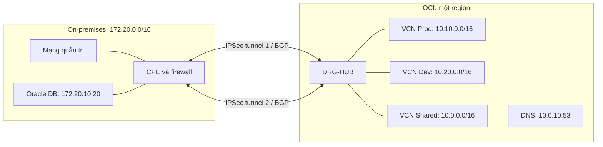

# Thiết kế hub-and-spoke cho nhiều VCN và on-premises

Trong chương **Kết nối lai và liên vùng** của module `CLOUD_PROVIDERS_ORACLE`, bài học này thiết kế mạng OCI cho nhiều nhóm ứng dụng cùng kết nối về trung tâm dữ liệu tại chỗ. Mục tiêu là tổ chức VCN, DRG, IAM, định tuyến và kiểm soát lưu lượng thành một kiến trúc có thể mở rộng, giám sát và vận hành. Ví dụ kết hợp Compute, DNS dùng chung và một cơ sở dữ liệu Oracle ở on-premises; các nguyên tắc cũng áp dụng khi cơ sở dữ liệu được đặt trong một VCN riêng.

## 1. Bài toán và kết quả cần đạt

Giả sử doanh nghiệp có ba mạng trên OCI: production, development và dịch vụ dùng chung. Cả ba cần một số kết nối với on-premises, nhưng development không được truy cập cơ sở dữ liệu production. Nếu tạo liên kết và chính sách riêng cho từng cặp mạng, mỗi lần thêm VCN sẽ kéo theo nhiều thay đổi khó kiểm soát.

Hub-and-spoke tổ chức các mạng quanh một điểm điều phối kết nối. Trong OCI, DRG hiện đại có thể làm hub định tuyến cho nhiều VCN cùng region. Một VCN riêng có thể chứa DNS, thiết bị kiểm tra lưu lượng hoặc các dịch vụ dùng chung khi có nhu cầu. Việc nhiều VCN cùng gắn vào DRG là nền tảng kết nối; quyền truy cập cuối cùng còn phụ thuộc route và các lớp bảo mật. [Oracle: Local VCN Peering Through an Upgraded DRG](https://docs.oracle.com/en-us/iaas/Content/Network/Tasks/scenario_d.htm).

Sau bài học, người học có thể:

- Chọn giữa hub chỉ dùng DRG và hub có VCN chứa thiết bị kiểm tra lưu lượng.
- Lập ma trận kết nối, kế hoạch CIDR và phạm vi quản trị theo compartment.
- Thiết kế DRG route table và import route distribution cho từng nhóm attachment.
- Giải thích đường đi và đường về giữa spoke và on-premises.
- Kiểm tra phân đoạn mạng, DNS, đường dự phòng và chi phí vận hành.

Cần hiểu subnet, CIDR, VCN route table, NSG, security list và kiến thức cơ bản về BGP hoặc VPN. Lab giả định có một tenancy thử nghiệm, một region, DRG hiện đại và thiết bị CPE hỗ trợ Site-to-Site VPN với BGP. Các lệnh trong bài là ví dụ để người học chạy trong môi trường được phép quản trị.

## 2. Hai cách tổ chức hub

| Phương án | Điểm điều phối | Khi phù hợp | Trách nhiệm bổ sung |
|---|---|---|---|
| DRG làm hub | Các VCN và kết nối on-premises gắn vào DRG | Cần định tuyến tập trung và phân đoạn bằng route, NSG, security list | Quản lý bảng route, quyền thay đổi và luồng cho phép |
| DRG kết hợp VCN kiểm tra | DRG chuyển luồng qua firewall hoặc network virtual appliance trong một VCN | Cần kiểm tra hoặc ghi nhận lưu lượng tại điểm tập trung | Định tuyến qua thiết bị, đường về đối xứng, dung lượng và HA của firewall |

Hub là một vai trò trong topology, không phải yêu cầu mọi spoke luôn phải chuyển lưu lượng qua một máy ảo trong hub VCN. Oracle phân biệt hub chỉ có DRG với hub kết hợp DRG và VCN chứa network virtual appliance. [Oracle: Routing traffic through a central network virtual appliance](https://docs.oracle.com/en-us/iaas/Content/Network/Tasks/scenario_g.htm).

Lab trước hết dùng DRG làm hub, có một VCN Shared Services như một mạng đích dùng chung. VCN Shared không tự trở thành điểm trung chuyển giữa Prod và Dev. Phần sau mới bổ sung thiết kế kiểm tra tập trung.

## 3. Lập kế hoạch mạng và quyền quản trị

### 3.1. Địa chỉ và tài nguyên mẫu

Tất cả VCN bên dưới nằm trong cùng một region. Các tên, địa chỉ máy và tên attachment là quy ước của lab; thay bằng giá trị thực tế khi triển khai.

| Mạng | CIDR | Subnet hoặc tài nguyên chính | Compartment | Attachment trên DRG |
|---|---|---|---|---|
| Shared Services | `10.0.0.0/16` | Subnet `10.0.10.0/24`, DNS tại `10.0.10.53` | `NetworkShared` | `A-SHARED` |
| Production | `10.10.0.0/16` | Subnet `10.10.10.0/24`, máy ứng dụng `10.10.10.10` | `Production` | `A-PROD` |
| Development | `10.20.0.0/16` | Subnet `10.20.10.0/24`, máy thử nghiệm `10.20.10.10` | `Development` | `A-DEV` |
| On-premises | `172.20.0.0/16` | DB `172.20.10.20`, mạng quản trị `172.20.99.0/24` | Ngoài OCI | `A-EDGE-1`, `A-EDGE-2` |

`A-EDGE-1` và `A-EDGE-2` đại diện hai IPSec tunnel attachments của một kết nối VPN trong lab. DRG được đặt tên `DRG-HUB` và thuộc compartment mạng do nhóm hạ tầng quản lý.

Kiểm tra CIDR trên toàn bộ miền kết nối: VCN hiện tại, mạng tại chỗ, mạng đối tác và các region dự kiến mở rộng. Dành khoảng địa chỉ cho subnet mới, resolver endpoint, firewall và tăng trưởng workload. Kế hoạch chỉ tránh trùng trong riêng từng VCN vẫn có thể gây xung đột khi ghép các mạng lại.

Ví dụ hai chi nhánh đều dùng `172.20.0.0/16` sẽ khiến một route về dải đó không đủ xác định chi nhánh đích. Lab này yêu cầu các miền địa chỉ không chồng lấn. Nếu hệ thống thật đã trùng địa chỉ, cần một thiết kế chuyển đổi địa chỉ hoặc tái đánh số riêng trước khi áp dụng topology đơn giản này.

### 3.2. Tách quyền quản trị khỏi quyền truy cập mạng

| Nhóm | Phạm vi trách nhiệm gợi ý |
|---|---|
| Network administrators | DRG, import distributions, kết nối VPN/FastConnect và liên kết route table |
| Production operators | Compute, ứng dụng và rule dành cho workload production trong phạm vi được giao |
| Development operators | Tài nguyên development và các yêu cầu kết nối của môi trường này |
| Security operators | Chính sách firewall, kiểm tra luồng và bằng chứng giám sát |
| On-premises network team | CPE, BGP, route nội bộ và firewall tại chỗ |

Đặt VCN trong các compartment khác nhau không tự tạo ra chặn mạng giữa chúng. Ngược lại, nhóm có quyền thay route hoặc attachment quan trọng có thể làm thay đổi khả năng kết nối dù không có quyền đăng nhập máy ứng dụng.

Cấp IAM theo đúng tài nguyên và compartment cần quản lý. Tạo VCN attachment và gán DRG route table liên quan đến quyền trên VCN và DRG; liên kết VCN ingress route table còn cần quyền route table. Khi khác tenancy, cần thỏa thuận IAM xuyên tenancy theo mô hình attachment tương ứng. [Oracle: IAM Policies for Routing Between VCNs](https://docs.oracle.com/en-us/iaas/Content/Network/Tasks/drg-iam.htm).

## 4. Xác định ma trận lưu lượng trước khi tạo route

Ma trận sau mô tả yêu cầu của doanh nghiệp giả định. TCP/1521 là cổng listener được chọn cho ví dụ DB; hệ thống thật có thể dùng cổng hoặc cấu hình TCPS khác.

| Nguồn khởi tạo | Đích | Dịch vụ | Yêu cầu |
|---|---|---|---|
| Prod | DNS Shared `10.0.10.53` | UDP/TCP 53 | Cho phép |
| Dev | DNS Shared `10.0.10.53` | UDP/TCP 53 | Cho phép |
| Prod | DB on-premises `172.20.10.20` | TCP 1521 | Cho phép |
| Dev | DB on-premises `172.20.10.20` | TCP 1521 | Chặn |
| Mạng quản trị on-premises `172.20.99.0/24` | Máy Prod và Dev | TCP 22 | Cho phép theo phạm vi quản trị |
| Prod | Dev | Kết nối trực tiếp giữa workload | Chặn |
| Dev | Prod | Kết nối trực tiếp giữa workload | Chặn |
| Nguồn khác | Dịch vụ chưa được phê duyệt | Bất kỳ | Không cấp quyền mặc định |

Hai khái niệm cần tách rõ:

- **Khả năng định tuyến:** mạng có đường đến một prefix đích hay không.
- **Quyền sử dụng dịch vụ:** nguồn có được khởi tạo giao tiếp tới cổng và ứng dụng đích hay không.

Dev vẫn cần đường về on-premises để trả lời phiên quản trị được phép. Vì vậy, có route đến `172.20.0.0/16` không có nghĩa Dev được truy cập TCP/1521 của DB. Rule ở nguồn, firewall tại chỗ và quyền cơ sở dữ liệu phải khớp với ma trận dịch vụ.

## 5. Topology tham chiếu



Sơ đồ thể hiện các attachment và đường có thể tham gia chuyển tiếp. Quy tắc cho phép hoặc chặn nằm trong ma trận, DRG route tables và các lớp bảo mật; đường nối trên sơ đồ không biểu diễn quyền truy cập mọi dịch vụ.

Có thể thay phần kết nối tại chỗ bằng FastConnect **private peering**. Public peering hướng tới các dịch vụ công cộng của Oracle, nên phải phân biệt hai mô hình khi thiết kế đường vào private subnet. [Oracle: FastConnect Overview](https://docs.oracle.com/en-us/iaas/Content/Network/Concepts/fastconnectoverview.htm).

## 6. Phân biệt các lớp định tuyến

### 6.1. Subnet route table

Bảng này quyết định gói từ workload đi đâu khi ra khỏi subnet theo cấu hình VCN. Ví dụ máy Prod muốn đến `172.20.10.20` cần route phù hợp có target là DRG địa phương.

### 6.2. DRG route table gắn với attachment đầu vào

Khi gói tin đi vào DRG, DRG dùng bảng gắn với **attachment nhận gói**, rồi chọn next hop attachment. Bảng gắn với `A-PROD` xử lý gói từ Prod; bảng gắn với `A-EDGE-1` xử lý gói từ tunnel 1 vào OCI. Import route distribution đưa các route học từ những attachment được chọn vào bảng. [Oracle: Dynamic Routing Gateways](https://docs.oracle.com/en-us/iaas/Content/Network/Tasks/managingDRGs.htm).

### 6.3. VCN ingress route table tại attachment

Trong thiết kế có thiết bị trung chuyển, VCN route table có thể được gắn vào VCN attachment để điều khiển gói **đi từ DRG vào VCN**, chẳng hạn chuyển tiếp đến private IP của firewall. Đây là bảng thuộc VCN, khác với DRG route table xử lý gói đi **vào DRG**. [Oracle: Networking Scenarios — VCN Ingress Routing](https://docs.oracle.com/en-us/iaas/Content/Network/Tasks/scenarios.htm).

Lab định tuyến trực tiếp chưa cần bảng ingress riêng để đưa lưu lượng qua thiết bị. Thêm firewall VCN chưa làm mọi luồng tự động đi qua nó.

## 7. Thiết kế route table và import distribution

### 7.1. Bảng của từng nhóm attachment

Tạo bốn DRG route tables với mục tiêu sau:

| DRG route table | Gắn với attachment đầu vào | Import route từ | Không import trong thiết kế này |
|---|---|---|---|
| `RT-PROD` | `A-PROD` | `A-SHARED`, `A-EDGE-1`, `A-EDGE-2` | `A-DEV` |
| `RT-DEV` | `A-DEV` | `A-SHARED`, `A-EDGE-1`, `A-EDGE-2` | `A-PROD` |
| `RT-SHARED` | `A-SHARED` | `A-PROD`, `A-DEV`, `A-EDGE-1`, `A-EDGE-2` | Attachment ngoài phạm vi được phê duyệt |
| `RT-EDGE` | `A-EDGE-1`, `A-EDGE-2` | `A-PROD`, `A-DEV`, `A-SHARED` | Mạng ngoài phạm vi công bố cho on-premises |

Tương ứng có `IMP-PROD`, `IMP-DEV`, `IMP-SHARED` và `IMP-EDGE`. Với mỗi distribution, tạo statement `ACCEPT` khớp **attachment OCID cụ thể** theo cột import, rồi liên kết distribution với DRG route table tương ứng.

Ví dụ `IMP-PROD`:

| Priority ví dụ | Match type | Attachment được khớp | Action |
|---|---|---|---|
| 10 | Attachment | OCID của `A-SHARED` | ACCEPT |
| 20 | Attachment | OCID của `A-EDGE-1` | ACCEPT |
| 30 | Attachment | OCID của `A-EDGE-2` | ACCEPT |

Priority là thứ tự xét statement, không phải trọng số chọn tunnel chính/dự phòng. Match theo attachment type `VCN` sẽ khớp các attachment thuộc loại đó; match theo attachment cụ thể giúp tránh tự nhận route từ spoke mới ngoài kế hoạch. Import distribution không phải bộ lọc TCP/UDP và không biểu diễn chính sách cho từng cổng. [Oracle: DRG Route Distribution Statements](https://docs.oracle.com/en-us/iaas/tools/terraform-provider-oci/latest/docs/d/core_drg_route_distribution_statements.html).

Các attachment vẫn có thể cung cấp thêm prefix sau khi subnet hoặc cấu hình route của mạng nguồn thay đổi. Vì vậy, kiểm soát attachment được import cần đi cùng quản trị những prefix xuất phát từ attachment đó. Nếu chỉ muốn công bố một phần mạng, thiết kế và kiểm tra tập route hiệu lực; một statement `ACCEPT` cho attachment không phải bộ lọc tùy ý theo CIDR.

### 7.2. Route hiệu lực dự kiến

Giả định lab quảng bá các subnet VCN thay vì gộp thành toàn bộ VCN CIDR; CPE quảng bá `172.20.0.0/16` qua hai tunnel.

| Bảng | Prefix cần có | Next hop |
|---|---|---|
| `RT-PROD` | `10.0.10.0/24` | `A-SHARED` |
| `RT-PROD` | `172.20.0.0/16` | Tunnel được chọn theo route selection |
| `RT-DEV` | `10.0.10.0/24` | `A-SHARED` |
| `RT-DEV` | `172.20.0.0/16` | Tunnel được chọn theo route selection |
| `RT-SHARED` | `10.10.10.0/24`, `10.20.10.0/24` | Attachment của từng spoke tương ứng |
| `RT-SHARED` | `172.20.0.0/16` | Tunnel được chọn theo route selection |
| `RT-EDGE` | `10.10.10.0/24`, `10.20.10.0/24`, `10.0.10.0/24` | Attachment của từng VCN tương ứng |

`RT-PROD` không có route trực tiếp đến Dev; `RT-DEV` không có route trực tiếp đến Prod. Không có static route hoặc default route khác trong hai bảng làm mất mục tiêu phân đoạn đó. Shared Services không được cấu hình thành router hay proxy tùy ý nối hai môi trường.

Kiểm tra **bảng route sau import**, không chỉ danh sách statement. Tập route thực tế còn phụ thuộc prefix được nguồn quảng bá và trạng thái kết nối.

### 7.3. Route ở subnet và tại CPE

| Bảng subnet | Destination | Target |
|---|---|---|
| Subnet Prod | `10.0.10.0/24` | DRG-HUB |
| Subnet Prod | `172.20.0.0/16` | DRG-HUB |
| Subnet Dev | `10.0.10.0/24` | DRG-HUB |
| Subnet Dev | `172.20.0.0/16` | DRG-HUB |
| Subnet Shared | `10.10.10.0/24` | DRG-HUB |
| Subnet Shared | `10.20.10.0/24` | DRG-HUB |
| Subnet Shared | `172.20.0.0/16` | DRG-HUB |

CPE phải học hoặc được cấu hình route về ba subnet OCI qua kết nối phù hợp. Router nội bộ và máy chủ tại chỗ cũng phải có đường đến CPE. Đường OCI đến on-premises đúng vẫn không đủ nếu DB trả lời qua một default gateway không có route về OCI.

## 8. Trình tự triển khai lab

1. **Chuẩn bị đầu vào:** xác nhận region, CIDR, compartment, người quản trị, luồng cho phép và cách truy cập quản trị máy thử nghiệm.
2. **Tạo các mạng:** tạo ba VCN, các subnet mẫu và NSG của từng vai trò. Chưa mở kết nối rộng giữa workload.
3. **Tạo DRG-HUB và bảng tùy chỉnh:** chuẩn bị DRG route tables dùng cho từng nhóm attachment.
4. **Tạo VCN attachments:** nối ba VCN với DRG; gán đúng bảng tùy chỉnh ngay khi có thể. Chưa bật route subnet đến các mạng ngoài trước khi hoàn tất phân đoạn.
5. **Tạo kết nối tại chỗ:** tạo CPE object và IPSec connection, cấu hình BGP cho từng tunnel, cấu hình thiết bị CPE và kiểm tra cả hai tunnel.
6. **Gán bảng cho tunnel attachments:** cả hai dùng `RT-EDGE`, tránh một tunnel vẫn dùng bảng mặc định khác.
7. **Tạo và liên kết import distributions:** dùng OCID thực tế, đọc lại route hiệu lực trong cả bốn bảng.
8. **Kiểm tra route công bố cho CPE:** xác nhận chỉ những prefix OCI dự kiến được học ở on-premises.
9. **Bổ sung route subnet và security rule:** thực hiện theo ma trận dịch vụ, rồi kiểm thử từng luồng.
10. **Lưu bằng chứng:** ghi mapping VCN–attachment–route table, trạng thái tunnel/BGP, kết quả kiểm thử và phương án thu hồi tài nguyên lab.

Site-to-Site VPN cung cấp hai tunnel dự phòng; routing type được cấu hình theo từng tunnel. Lab chọn BGP ở cả hai và cần thông tin ASN cùng địa chỉ BGP bên trong tunnel. Một tunnel UP chưa chứng minh tunnel còn lại và BGP của nó cũng đúng. [Oracle: Site-to-Site VPN Overview](https://docs.oracle.com/en-us/iaas/Content/Network/Tasks/overviewIPsec.htm).

Bàn giao các tham số IKE/IPSec, endpoint và shared secret cho nhóm quản trị CPE qua kênh được phép. Dùng cấu hình tương ứng với thiết bị thực tế và hướng dẫn [Oracle: Setting Up Site-to-Site VPN](https://docs.oracle.com/en-us/iaas/Content/Network/Tasks/settingupIPsec.htm).

## 9. Theo dõi một phiên từ Prod đến DB on-premises

Xét máy `10.10.10.10` khởi tạo TCP đến `172.20.10.20:1521`:

1. Subnet route table của Prod khớp `172.20.0.0/16`, gửi đến DRG-HUB.
2. Gói vào DRG qua `A-PROD`, nên dùng `RT-PROD`.
3. `RT-PROD` có route học từ on-premises; route selection chọn tunnel phù hợp.
4. Gói qua IPSec đến CPE; firewall tại chỗ kiểm tra quyền Prod đến DB rồi chuyển tiếp vào mạng DB.
5. DB phản hồi về `10.10.10.10`; mạng tại chỗ định tuyến gói về CPE.
6. Gói quay vào OCI qua một tunnel attachment dùng `RT-EDGE`.
7. `RT-EDGE` có `10.10.10.0/24 → A-PROD`, đưa gói về VCN và máy ứng dụng.

Nếu thiếu route về trên CPE, bước 5 thất bại. Nếu `RT-EDGE` thiếu prefix Prod, bước 7 thất bại. Nếu firewall DB chưa cho phép TCP/1521, có đầy đủ route vẫn chưa có phiên ứng dụng thành công.

Giờ xét Dev đến cùng DB. `RT-DEV` vẫn có đường tới on-premises, nhưng chính sách dịch vụ không cho phép Dev đến TCP/1521. Để bảo đảm yêu cầu này, không cấp egress phù hợp ở Dev và cấu hình firewall tại chỗ chỉ nhận luồng DB từ nguồn Prod được phê duyệt. DB cũng phải xác thực tài khoản và quyền truy cập theo chính sách ứng dụng.

## 10. Security rule theo vai trò

| Vị trí | Hướng | Nguồn hoặc đích | Dịch vụ cần cho phép |
|---|---|---|---|
| NSG ứng dụng Prod | Egress | Đích `172.20.10.20/32` | TCP đến cổng 1521 |
| NSG máy Prod/Dev | Egress | Đích `10.0.10.53/32` | UDP/TCP đến cổng 53 |
| NSG DNS Shared | Ingress | Subnet client được phê duyệt | UDP/TCP đến cổng 53 |
| NSG máy Prod/Dev | Ingress | Nguồn `172.20.99.0/24` | TCP đến cổng 22 |
| Firewall on-premises phía DB | Theo vai trò thiết bị | Nguồn Prod được phê duyệt | TCP đến DB/1521 |

Với client TCP, source port thường là cổng tạm thời; không cố định source port bằng cổng dịch vụ đích. Chọn stateful hoặc stateless có chủ đích. Stateful rule theo dõi phản hồi của phiên nhưng không tạo route về; stateless rule đòi hỏi cho phép luồng trả lời tương ứng.

Kiểm tra cả security list của subnet và các NSG gắn với VNIC. Rule cho phép có thể cộng dồn; NSG hẹp không thu hồi quyền rộng đã được security list hoặc NSG khác cho phép. Lab nên dùng rule rõ ràng thay vì giữ egress mọi đích rồi giả định NSG bổ sung sẽ hạn chế được Dev. [Oracle: Security Rules](https://docs.oracle.com/en-us/iaas/Content/Network/Concepts/securityrules.htm).

Nếu tenancy dùng Zero Trust Packet Routing, kiểm tra thêm chính sách ZPR áp dụng. Trên máy chủ, kiểm tra firewall hệ điều hành, listener và quyền ứng dụng. Với database, TCP thành công chưa chứng minh service name, chứng thư, tài khoản hoặc quyền truy vấn đúng.

## 11. Bổ sung kiểm tra lưu lượng tại hub

Khi cần mọi luồng Prod–on-premises đi qua firewall trong một VCN Inspection, topology phải chuyển tiếp theo chuỗi:

```text
Prod → DRG → VCN Inspection → firewall → DRG → on-premises
on-premises → DRG → VCN Inspection → firewall → DRG → Prod
```

Bảng thiết kế minh họa cho riêng luồng trên:

| Điểm quyết định | Route cần đạt |
|---|---|
| DRG nhận từ Prod | Prefix DB/on-premises → attachment Inspection |
| VCN ingress tại Inspection | Prefix DB/on-premises → private IP của firewall |
| Subnet firewall sau xử lý | Prefix on-premises → DRG |
| DRG nhận từ Inspection | Prefix on-premises → edge attachment phù hợp |
| DRG nhận từ edge | Prefix Prod → attachment Inspection |
| VCN ingress tại Inspection, chiều về | Prefix Prod → private IP của firewall |
| DRG nhận từ Inspection, chiều về | Prefix Prod → attachment Prod |

Bảng DRG gắn với Inspection chứa các đích thực sau kiểm tra. Bảng dùng cho lưu lượng chưa kiểm tra phải hướng về Inspection. Nếu vẫn import route trực tiếp cụ thể hơn một default route đến firewall, lưu lượng có thể đi thẳng và bỏ qua thiết bị. Nếu gói sau firewall lại bị đưa về firewall, thiết kế tạo vòng lặp.

Với NVA tự quản lý trên Compute, cần cho phép chức năng chuyển tiếp của hệ điều hành và cấu hình source/destination check trên VNIC chuyển tiếp theo yêu cầu sản phẩm. Thiết kế cần đường đi và đường về qua hệ thống firewall phù hợp; chính sách firewall phải duy trì phân đoạn đã đặt ra. Làm theo cấu hình chi tiết của [Oracle: Central Network Virtual Appliance](https://docs.oracle.com/en-us/iaas/Content/Network/Tasks/scenario_g.htm), đồng thời bổ sung HA theo sản phẩm được chọn.

Đây là thay đổi kiến trúc so với lab định tuyến trực tiếp. Triển khai và kiểm tra từng nhóm luồng; một route `0.0.0.0/0` chưa mô tả đầy đủ kiểm tra tập trung. Đánh giá throughput, số phiên, logging và hành vi failover của thiết bị.

## 12. DNS và dịch vụ dùng chung

Trong lab, `10.0.10.53` là địa chỉ dịch vụ DNS đã được cấu hình phục vụ các client được phép. Nếu dùng OCI Private DNS, có thể bố trí resolver listening endpoint cho truy vấn từ mạng khác, forwarding endpoint để truy vấn tới DNS tại chỗ, và forwarding rule theo tên miền. Tạo route và rule UDP/TCP 53 tương ứng với vai trò endpoint. [Oracle: Private DNS](https://docs.oracle.com/en-us/iaas/Content/DNS/Tasks/privatedns.htm).

Ví dụ namespace của doanh nghiệp giả định:

| Namespace | Nơi trả lời có thẩm quyền | Cách truy vấn dự kiến |
|---|---|---|
| `prod.internal.example` | DNS/private zone của Prod | Resolver được cấu hình truy cập dữ liệu DNS của Prod |
| `dev.internal.example` | DNS/private zone của Dev | Resolver được cấu hình truy cập dữ liệu DNS của Dev |
| `corp.internal.example` | DNS on-premises | Forward tới DNS tại chỗ |

Trong cùng region, có thể chia sẻ dữ liệu private view giữa resolver theo thiết kế phù hợp. Với OCI–on-premises, xác định listener, forwarder và rule ở mỗi phía. Không cho hai phía forward cùng zone trở lại nhau một cách đệ quy. [Oracle: Private DNS Between OCI and On-Premises](https://docs.oracle.com/en/solutions/oci-best-practices-networking/private-dns-oci-and-premises-or-third-party-cloud.html).

Một service gateway trong Shared VCN chưa tự cấp quyền truy cập Object Storage cho mọi spoke hoặc on-premises. Service gateway phục vụ các dịch vụ Oracle được hỗ trợ trong cùng region; nếu cần transit tới Oracle Services Network, phải có thiết kế route và quyền truy cập riêng. [Oracle: Access to Oracle Services — Service Gateway](https://docs.oracle.com/en-us/iaas/Content/Network/Tasks/servicegateway.htm).

Dịch vụ dùng chung cần chủ sở hữu, phạm vi client, mục tiêu sẵn sàng và kế hoạch mở rộng. Một DNS server duy nhất có thể trở thành điểm lỗi dù DRG và tunnel đã có dự phòng.

## 13. Dự phòng và lựa chọn đường truyền

### 13.1. Hai tunnel và tính độc lập của hạ tầng

Cấu hình cả hai tunnel, theo dõi BGP và diễn tập mất từng tunnel. Hai tunnel cùng đi qua một CPE và một đường Internet vẫn có thể mất đồng thời khi CPE hoặc đường truyền đó hỏng. Đánh giá thêm CPE dự phòng, ISP, nguồn điện và đường nội bộ của trung tâm dữ liệu.

Với FastConnect, xem xét thiết bị, đường kết nối và vị trí kết nối có độc lập theo mục tiêu sẵn sàng hay không. Hai virtual circuit không mặc nhiên đồng nghĩa hai tuyến vật lý độc lập. [Oracle: FastConnect Redundancy Best Practices](https://docs.oracle.com/en-us/iaas/Content/Network/Concepts/fastconnectresiliency.htm).

### 13.2. Route selection và bất đối xứng

Khi có nhiều đường, route cụ thể hơn và thuộc tính định tuyến ảnh hưởng đường được chọn. Cấu hình BGP ở CPE quyết định lựa chọn phía on-premises; lựa chọn của OCI cũng phải được xem xét. Phiên có thể đi vào qua VPN nhưng quay về qua FastConnect nếu chính sách hai chiều cho phép.

Nếu firewall cần giữ trạng thái theo một đường nhất định, thiết kế BGP và định tuyến để bảo đảm hành vi phù hợp, rồi kiểm tra bằng phiên thực tế. Đừng dựa vào priority của import statement để chọn tunnel chính. [Oracle: Routing Details for Connections to the On-premises Network](https://docs.oracle.com/en-us/iaas/Content/Network/Concepts/routingonprem2.htm).

### 13.3. Mã hóa và miền lỗi

FastConnect là kết nối riêng; yêu cầu mã hóa cần được xác định riêng theo mô hình triển khai. OCI có các phương án IPSec over FastConnect và MACsec với điều kiện hỗ trợ tương ứng. TLS hoặc cơ chế bảo mật database vẫn phục vụ xác thực và bảo vệ phiên ứng dụng. [Oracle: FastConnect Security](https://docs.oracle.com/en-us/iaas/Content/Network/Concepts/fastconnectsecurity.htm).

Một hub vùng duy nhất còn tạo sự phụ thuộc vào region. Nếu cần khôi phục sau thảm họa, lập kế hoạch cả workload, dữ liệu, DNS và kết nối tại vùng dự phòng; chỉ có đường mạng dự phòng chưa đáp ứng RTO/RPO của ứng dụng.

## 14. Kiểm tra cấu hình bằng OCI CLI

Các lệnh Bash sau chỉ đọc cấu hình. Thay OCID và region bằng giá trị thực tế; CLI cần được cấu hình xác thực và có quyền đọc tương ứng.

```bash
OCI_REGION='ap-singapore-1'
DRG_ID='<ocid-DRG-HUB>'
ATTACHMENT_COMPARTMENT_ID='<ocid-compartment-chua-attachment-can-xem>'
DRG_TABLE_ID='<ocid-RT-PROD>'
IMPORT_DISTRIBUTION_ID='<ocid-IMP-PROD>'

# Xem attachment trong compartment đã chọn và DRG tương ứng.
oci --region "$OCI_REGION" network drg-attachment list \
  --compartment-id "$ATTACHMENT_COMPARTMENT_ID" \
  --drg-id "$DRG_ID" \
  --all

# Xem route tĩnh và động thực tế trong một DRG route table.
oci --region "$OCI_REGION" network drg-route-rule list \
  --drg-route-table-id "$DRG_TABLE_ID" \
  --all

# Xem các statement của import distribution liên quan.
oci --region "$OCI_REGION" network drg-route-distribution-statement list \
  --route-distribution-id "$IMPORT_DISTRIBUTION_ID" \
  --all
```

Lặp lại truy vấn attachment theo các compartment chứa tài nguyên liên quan; kết quả giới hạn ở một compartment không đại diện toàn bộ hub. Đối chiếu OCID và route table association thay vì chỉ nhìn display name. Cú pháp và phạm vi lệnh: [Listing DRG Attachments](https://docs.oracle.com/en-us/iaas/Content/Network/Tasks/drg-list-attachment.htm), [Listing DRG Route Rules](https://docs.oracle.com/en-us/iaas/Content/Network/Tasks/drg-rtrule-list.htm) và [Listing Route Distribution Statements](https://docs.oracle.com/en-us/iaas/Content/Network/Tasks/drg-rds-list.htm).

Bằng chứng cần tìm là route hiệu lực phù hợp với ma trận: Prod có Shared và on-premises, không có đường trực tiếp sang Dev; các edge attachment đều dùng bảng có đường về subnet OCI được phép công bố.

## 15. Kiểm thử luồng, phân đoạn và failover

Trước khi thử mạng, xác nhận listener DB và DNS đang phục vụ trên địa chỉ đã chọn. Với SSH, máy đích phải có dịch vụ lắng nghe và firewall hệ điều hành đúng. Một cổng vốn không có listener chưa phải bằng chứng đủ mạnh cho việc chính sách mạng đang chặn.

```bash
# Trên máy Prod: dự kiến thành công nếu listener DB sẵn sàng.
ncat -v -z -w 5 172.20.10.20 1521

# Trên máy Prod hoặc Dev: kiểm tra DNS theo UDP và TCP.
dig @10.0.10.53 db.corp.internal.example A
dig +tcp @10.0.10.53 db.corp.internal.example A

# Trên máy Dev: dự kiến không truy cập được listener DB production.
ncat -v -z -w 5 172.20.10.20 1521

# Trên máy quản trị thuộc 172.20.99.0/24: kiểm tra đường đến Prod.
ncat -v -z -w 5 10.10.10.10 22
```

Thêm phép kết nối database bằng tài khoản thử nghiệm, service name và cấu hình bảo mật phù hợp để xác nhận luồng ứng dụng. Không đặt mật khẩu trực tiếp vào lệnh có thể lưu trong shell history.

| Nhóm kiểm thử | Kết quả cần đạt | Bằng chứng |
|---|---|---|
| Prod → DB | Luồng được phép hoạt động | TCP và kiểm tra giao thức DB phù hợp |
| Prod/Dev → DNS Shared | Trả lời đúng record | Kết quả UDP/TCP, log DNS khi cần |
| Dev → DB | Luồng bị chặn | Kết quả thử cùng log rule tại nguồn hoặc firewall |
| Prod ↔ Dev | Không có kết nối trực tiếp ngoài chính sách | Route hiệu lực và kiểm tra trên dịch vụ thử nghiệm đã sẵn sàng |
| On-premises admin → workload | Chỉ nguồn quản trị được phép | Kiểm tra từ nguồn được phép và nguồn ngoài phạm vi |
| Mất tunnel 1 | Đường còn lại tiếp nhận theo thiết kế | Route/BGP trước và sau, thời gian gián đoạn đo được |
| Khôi phục tunnel 1 | Mạng hội tụ như chính sách mong muốn | Route selection, phiên mới và phiên đang tồn tại |

Diễn tập failover trong môi trường thử nghiệm hoặc cửa sổ thay đổi được phê duyệt. Kiểm tra cả phiên mới và phiên lâu dài: route có thể hồi phục trước khi ứng dụng khôi phục phiên database đã bị mất.

## 16. Giám sát và xử lý sự cố theo đường gói tin

Bật flow log ở phạm vi VNIC/subnet cần quan sát, chọn capture filter và thời gian lưu phù hợp. Đối chiếu nguồn, đích, cổng, giao thức, thời điểm và quyết định `ACCEPT`/`REJECT`. Một bản ghi được chấp nhận tại một điểm chưa chứng minh toàn bộ đường đi hoặc giao dịch ứng dụng thành công. [Oracle: Details for VCN Flow Logs](https://docs.oracle.com/en-us/iaas/Content/Logging/Reference/details_for_vcn_flow_logs.htm).

Network Path Analyzer giúp phân tích route và chính sách được hỗ trợ. Với đường qua network virtual appliance, có thể cần tách phân tích thành đoạn trước và sau thiết bị; công cụ không thay thế kiểm tra listener, log firewall và phiên ứng dụng thực tế. [Oracle: Network Path Analyzer](https://docs.oracle.com/en-us/iaas/Content/Network/Concepts/path_analyzer.htm).

| Triệu chứng | Kiểm tra ưu tiên |
|---|---|
| Tunnel UP nhưng không có route on-premises | BGP session, prefix CPE quảng bá, import distribution và bảng được liên kết |
| Một số spoke hoạt động, spoke mới không hoạt động | Attachment mới được import vào đúng bảng và có đường về chưa |
| Có route trong DRG nhưng máy không đến đích | Subnet có dùng đúng route table, rule nguồn/đích và firewall host không |
| Prod và Dev bất ngờ thông nhau | Bảng mặc định, Match All, route tổng hợp/default hoặc đường qua proxy |
| Chỉ mất kết nối khi chuyển tunnel | Association của tunnel còn lại, route selection và trạng thái firewall |
| DNS lỗi nhưng truy cập IP được | Resolver, forwarding rule, zone, UDP/TCP 53 và route endpoint |
| Firewall hub không ghi log luồng cần kiểm tra | Route trực tiếp cụ thể hơn bỏ qua thiết bị hoặc luồng đi đường khác |
| Gói quay lại firewall nhiều lần | Bảng sau kiểm tra tiếp tục trỏ về attachment Inspection |
| Chậm khi tải tăng | Băng thông tunnel/đường truyền, năng lực firewall, RTT và giới hạn workload |

Mỗi sự cố cần ghi luồng cụ thể, ví dụ `10.10.10.10 → 172.20.10.20:1521/TCP`, kèm thời điểm và chiều khởi tạo. Nhóm cloud và nhóm on-premises cần đối chiếu cùng phiên, không chỉ trao đổi trạng thái chung như “VPN vẫn xanh”.

## 17. Mở rộng, tự động hóa và kiểm soát chi phí

### Thêm một spoke

Yêu cầu thêm VCN cần nêu CIDR, môi trường, owner, đích được truy cập và dịch vụ cần mở. Sau khi tạo attachment, cập nhật đúng import distributions, route subnet, đường về, DNS và rule bảo mật. Kiểm thử cả luồng mới và phân đoạn hiện có.

Match theo attachment cụ thể giúp spoke mới không tự được nhập route vào mọi bảng. Người quản trị vẫn cần quản lý thay đổi tập trung để tránh quên đường về hoặc công bố quá rộng prefix mới.

### Mở rộng nhiều region

Tại mỗi region, dùng DRG và VCN attachment của region đó; kết nối hai DRG bằng cặp RPC khi cần đường liên vùng. Không gắn trực tiếp VCN ở region khác như VCN attachment địa phương. Thiết kế lại tập prefix trao đổi và chính sách phân đoạn ở cả hai hub. [Oracle: Remote VCN Peering through an Upgraded DRG](https://docs.oracle.com/en-us/iaas/Content/Network/Tasks/scenario_e.htm).

DRG không cung cấp chuyển tiếp tùy ý giữa mọi cặp kết nối tại chỗ: lưu lượng vào từ IPSec tunnel hoặc virtual circuit không được đi ra IPSec tunnel hoặc virtual circuit khác theo các hạn chế DRG. Đối chiếu loại attachment trước khi coi hub là mạng WAN nối chi nhánh. [Oracle: DRG Route Propagation Restrictions](https://docs.oracle.com/en-us/iaas/Content/Network/Tasks/managingDRGs.htm).

### Quản lý bằng mã và quy trình thay đổi

Biểu diễn VCN, attachment, bảng route, distribution và rule dịch vụ thành các thành phần có owner rõ ràng. Truyền region, compartment và OCID đúng môi trường; tránh dùng display name làm định danh duy nhất. Với IaC, xem kế hoạch thay đổi và kiểm tra thao tác có thay toàn bộ danh sách rule hoặc tái tạo kết nối đang dùng không.

Trước khi chuyển attachment sang bảng mới, chuẩn bị bảng đích đầy đủ, đọc route hiệu lực và lưu association cũ để khôi phục. Sau thay đổi, kiểm tra luồng được phép, luồng bị chặn và đường dự phòng. Một lần apply thành công chưa chứng minh ma trận lưu lượng đã được thực thi.

### Chi phí và dung lượng

Lập dự toán theo thành phần thực tế: FastConnect và nhà cung cấp đường truyền nếu có, firewall/NVA, Compute, volume, DNS, lưu trữ log và truyền dữ liệu liên vùng khi mở rộng. Đối chiếu [Oracle Cloud Price List](https://www.oracle.com/cloud/price-list/) cùng hợp đồng nhà cung cấp thay vì gán mức giá cố định cho mọi topology.

Ví dụ, tập trung firewall giảm số nơi quản trị chính sách nhưng đồng thời tập trung nhu cầu xử lý. Dự toán theo throughput, số phiên đồng thời, thời gian lưu log và dư địa khi thiết bị dự phòng phải tiếp nhận toàn bộ tải. Cấu hình hub phù hợp lúc tải thấp có thể không đáp ứng khi failover.

Kết thúc lab, thu hồi rule và route riêng, dọn Compute/volume, resolver endpoint và kết nối chỉ phục vụ thử nghiệm sau khi kiểm tra phụ thuộc. Với hệ thống dùng chung, chỉ thu hồi đúng tài nguyên lab và phối hợp thay đổi phía CPE.

## 18. Câu hỏi tự kiểm tra và bằng chứng bàn giao

1. Khi nào DRG tự nó đủ làm hub? Khi nào cần VCN Inspection?
2. Gói từ Prod vào DRG dùng `RT-PROD` hay `RT-EDGE`? Gói trả lời qua VPN dùng bảng nào?
3. Vì sao Dev có route đến on-premises nhưng vẫn phải bị chặn khi gọi DB production?
4. Match theo loại attachment khác match theo OCID cụ thể như thế nào khi thêm spoke?
5. Tại sao priority của import statement không quyết định tunnel chính/dự phòng?
6. Cần kiểm tra gì nếu có default route đến firewall nhưng firewall không thấy lưu lượng?
7. Vì sao hai tunnel cùng một CPE chưa giải quyết được sự cố CPE?
8. Khi mở thêm region, những route và chính sách nào phải kiểm tra lại ở cả hai hub?

Bộ bàn giao có thể vận hành cần có sơ đồ CIDR, ma trận dịch vụ, mapping attachment–route table–distribution, route hiệu lực, đường về tại chỗ, quyền quản trị, bằng chứng kiểm thử và kết quả failover đo được. Những thông tin này giúp người vận hành xác định rõ thay đổi ảnh hưởng mạng nào, luồng nào và cách khôi phục nếu kết quả khác dự kiến.
