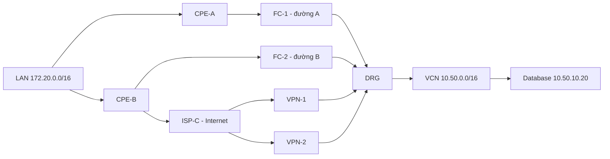

# Kết nối dự phòng và kiểm thử failover đường truyền

Một hệ thống Oracle Cloud Infrastructure có thể vẫn hoạt động trong VCN nhưng người dùng tại trung tâm dữ liệu mất quyền truy cập vì đường truyền bị gián đoạn. Việc có thêm tunnel hoặc virtual circuit chỉ là bước chuẩn bị; cần chứng minh đường thay thế độc lập với lỗi đang xét, có route đúng và đủ năng lực phục vụ ứng dụng.

Trong chương **Kết nối lai và liên vùng** của module **CLOUD_PROVIDERS_ORACLE**, bài học này trình bày cách thiết kế kết nối dự phòng và kiểm thử chuyển đường truyền. Trọng tâm là kết nối mạng tại chỗ với workload OCI Compute và cơ sở dữ liệu Oracle, kết hợp phân quyền, giám sát, tự động hóa và kiểm soát chi phí.

## 1. Kết quả cần đạt

Sau bài học, người học có thể:

- Chỉ ra lỗi nào được mỗi đường dự phòng xử lý và thành phần nào vẫn dùng chung.
- Thiết kế ưu tiên đường đi ở cả phía khách hàng lẫn OCI.
- Chuẩn bị phép thử failover, failback có giới hạn, tiêu chí đạt và cách khôi phục.
- Đo thời gian phục hồi mạng và phục hồi ứng dụng bằng các bằng chứng khác nhau.
- Nhận biết trường hợp BGP hoặc tunnel vẫn hoạt động nhưng kết nối nghiệp vụ đã lỗi.

Bài học giả định người đọc đã biết VCN, subnet, DRG, attachment, BGP và Site-to-Site VPN. Các địa chỉ, chính sách ưu tiên và thời gian mục tiêu bên dưới là ví dụ phục vụ học tập.

## 2. Các khái niệm cần phân biệt

| Khái niệm | Ý nghĩa trong bài |
| --- | --- |
| Redundancy | Có thành phần hoặc đường thay thế cho một loại lỗi |
| Failover | Chuyển lưu lượng sang đường khác sau khi đường đang dùng không còn đáp ứng |
| Failback | Đưa lưu lượng về đường ưu tiên sau khi đường đó phục hồi |
| Control plane | Trạng thái và thông tin phục vụ chọn đường, như BGP và route |
| Data plane | Khả năng chuyển gói dữ liệu thực tế |
| Failure domain | Nhóm thành phần có thể cùng bị ảnh hưởng bởi một lỗi |

Hai tunnel cùng dùng một CPE xử lý được một số lỗi tunnel, nhưng khi CPE đó ngừng hoạt động, cả hai tunnel có thể cùng mất. Tương tự, hai đường truyền đi chung một tuyến cáp có thể cùng hỏng khi tuyến cáp bị đứt.

Để đánh giá dự phòng, hãy viết câu cụ thể: “Khi thành phần X hỏng, lưu lượng Y chuyển sang đường Z và đáp ứng điều kiện W”. Câu “đã có hai đường” chưa nêu đủ yêu cầu.

### 2.1. Phục hồi mạng khác với phục hồi ứng dụng

Một tuyến dự phòng có thể sẵn sàng nhưng connection pool vẫn giữ các kết nối hỏng. Kết nối TCP mới có thể thành công trong khi phiên Oracle Database cũ bị ngắt. Một dịch vụ cũng có thể kết nối lại được nhưng chậm đến mức không đáp ứng nghiệp vụ.

Vì vậy, phép thử cần quan sát ít nhất:

1. Đường cũ được phát hiện lỗi và route được cập nhật.
2. Gói tin đi được qua đường thay thế theo cả hai chiều.
3. Kết nối mới được thiết lập.
4. Ứng dụng hoàn thành thao tác hợp lệ trong giới hạn đã đặt.

Kiểm thử đường truyền không tự xác nhận RPO của cơ sở dữ liệu hoặc khả năng khôi phục dữ liệu ở vùng dự phòng. Những yêu cầu đó cần phép thử dữ liệu và kiến trúc ứng dụng riêng.

## 3. Chọn mô hình dự phòng theo loại lỗi

### 3.1. Các phương án thường gặp

| Phương án | Lỗi có thể xử lý khi cấu hình đúng | Điểm cần xem thêm |
| --- | --- | --- |
| Hai tunnel của một IPSec connection | Một tunnel hoặc đầu cuối VPN phía OCI không sử dụng được | CPE và ISP phía khách hàng còn có thể dùng chung |
| Hai kết nối VPN qua các CPE, ISP độc lập | Mất một CPE hoặc một đường Internet | Mạng LAN, điện và đường quản trị |
| Hai FastConnect có đường và thiết bị phù hợp | Mất một circuit, thiết bị hoặc vị trí kết nối theo thiết kế | Đường từ khách hàng tới nhà cung cấp |
| FastConnect và VPN qua Internet | Mất đường FastConnect khi Internet dự phòng còn hoạt động | Băng thông, độ trễ và chính sách route trên VPN |
| Kết nối tới vùng OCI thứ hai | Hỗ trợ phương án truy cập vùng thay thế | Workload, dữ liệu và phụ thuộc dịch vụ ở vùng đó |

Mỗi phương án cần được đánh giá theo sơ đồ thực tế. Các dòng trong bảng là cách phân tích tình huống, không phải cam kết mọi triển khai tương ứng đều tự động có đầy đủ mức dự phòng.

### 3.2. Dự phòng FastConnect có nhiều lớp

Oracle phân biệt dự phòng thiết bị, dự phòng vị trí và trường hợp chỉ có một FastConnect. Hai virtual circuit trên các thiết bị khác nhau ở cùng vị trí xử lý phạm vi lỗi khác với hai circuit qua hai vị trí. [Nguồn: Redundancy improvements for FastConnect](https://docs.oracle.com/en-us/iaas/releasenotes/network/redundancy_improvements_for_fastconnect.htm).

Mô hình nhà cung cấp cũng quan trọng. Với đối tác L3, một virtual circuit có thể có dự phòng giữa đối tác và Oracle, nhưng phần từ khách hàng tới đối tác vẫn cần được đánh giá riêng. Với kết nối trực tiếp hoặc mô hình L2, cần kiểm tra các kết nối vật lý và router thực sự được sử dụng. Oracle khuyến nghị VPN dự phòng cho FastConnect dùng route-based VPN với BGP. [Nguồn: FastConnect Redundancy Best Practices](https://docs.oracle.com/en-us/iaas/Content/Network/Concepts/fastconnectresiliency.htm).

Hồ sơ thiết kế nên trả lời được:

- Hai circuit đi qua những router nào?
- Có chung nhà cung cấp, tuyến cáp, tủ nguồn hoặc CPE không?
- Khi hỏng một thành phần, đường còn lại kết thúc ở đâu?
- Người vận hành có thể truy cập quản trị khi đường chính mất không?

OCI có cơ chế cảnh báo một số vấn đề dự phòng khi các kết nối kết thúc trên cùng router biên Oracle hoặc thiếu kết nối thay thế. [Nguồn: Redundancy Remedies](https://docs.oracle.com/en-us/iaas/Content/Network/Troubleshoot/drgredundancy.htm).

### 3.3. VPN dự phòng cần có đường vận chuyển độc lập

Trong ví dụ của bài, VPN đi qua Internet độc lập với FastConnect. Đây là điều kiện để thử tình huống mất toàn bộ FastConnect nhưng VPN còn phục vụ được.

Nếu VPN được triển khai theo IPSec over FastConnect, lớp IPSec vẫn phụ thuộc đường vận chuyển FastConnect bên dưới. Mô hình đó phục vụ mã hóa trên kết nối riêng; không nên tính nó như một đường Internet thay thế cho chính kết nối đang chở nó. [Nguồn: FastConnect Security](https://docs.oracle.com/en-us/iaas/Content/Network/Concepts/fastconnectsecurity.htm).

## 4. Mô hình thực hành

### 4.1. Tài nguyên và giả định

Sử dụng các thành phần minh họa sau:

| Thành phần | Vai trò |
| --- | --- |
| Mạng tại chỗ `172.20.0.0/16` | Chứa máy kiểm tra `172.20.10.10` |
| OCI VCN `10.50.0.0/16` | Chứa subnet ứng dụng và cơ sở dữ liệu |
| Database subnet `10.50.10.0/24` | Có máy thử nghiệm `10.50.10.20` |
| DRG | Nối VCN với các đường hybrid |
| CPE-A, FC-1 | Đường FastConnect ưu tiên |
| CPE-B, FC-2 | Đường FastConnect thứ hai |
| CPE-B, ISP-C, VPN-1 và VPN-2 | Hai tunnel VPN qua Internet |

Giả định FC-1 và FC-2 dùng BGP từ thiết bị khách hàng tới Oracle, hoặc môi trường đối tác cung cấp khả năng điều khiển chính sách tương đương đã được xác nhận. Nếu BGP kết thúc ở đối tác L3, cần phối hợp chính sách với đối tác.



Mô hình dùng hai CPE để dễ phân tích. CPE-B là điểm chung của FC-2 và VPN; khi nó hỏng, hai phương án này cùng bị ảnh hưởng. FC-1 phải còn hoạt động để bảo vệ cho trường hợp đó. Nếu cần VPN độc lập cả với CPE-B, phải bổ sung thiết bị và đánh giá lại failure domain.

### 4.2. Luồng kiểm tra

Giả định máy cơ sở dữ liệu đã có listener TCP 1521, được cấu hình cho môi trường thử nghiệm.

| Luồng | Cách kiểm tra |
| --- | --- |
| Tại chỗ tới Database | TCP 1521 và truy vấn đọc bằng client Database |
| OCI tới dịch vụ tại chỗ | Kết nối mới tới dịch vụ kiểm tra đã chuẩn bị |
| Phiên đang tồn tại | Quan sát hành vi phiên trong thời gian chuyển tuyến |
| Kết nối mới liên tục | Tạo mẫu đo định kỳ để xác định khoảng gián đoạn |

Các bài kiểm tra dùng tài khoản và dữ liệu thử nghiệm. Địa chỉ đích, cổng, quyền mạng và listener phải được xác nhận trước khi gây lỗi.

### 4.3. Điều kiện định tuyến ban đầu

Mô hình cần:

- Route từ workload OCI tới mạng `172.20.0.0/16` qua DRG.
- Route từ mạng tại chỗ tới subnet `10.50.10.0/24`.
- Bảng DRG áp dụng cho gói vào từ VCN nhìn thấy các đường FC-1, FC-2 và VPN tới mạng tại chỗ.
- Bảng DRG áp dụng cho gói vào từ từng đường hybrid có đường tới Database subnet.
- Chính sách quảng bá và nhận route cho phép các prefix cần dùng trên cả đường chính và đường dự phòng.

Bảng route được chọn theo attachment đầu vào. Để kiểm tra OCI tới mạng tại chỗ, cần nhìn bảng của VCN attachment; để kiểm tra chiều ngược lại, cần nhìn bảng của attachment FastConnect hoặc VPN mà gói đi vào. [Nguồn: OCI CLI — DRG route table](https://docs.oracle.com/en-us/iaas/tools/oci-cli/latest/oci_cli_docs/cmdref/network/drg-route-table.html).

Nếu đường dự phòng chưa có prefix cần thiết, việc mất đường chính không thể tự tạo ra prefix đó.

## 5. Điều khiển ưu tiên ở hai chiều

### 5.1. Đặt mục tiêu trước khi chọn thuộc tính BGP

Trong mô hình minh họa:

```text
Bình thường:              ưu tiên FC-1
FC-1 không sử dụng được:   dùng FC-2
Cả hai FC không dùng được: dùng VPN
Đường ưu tiên phục hồi:    failback theo kế hoạch
```

Để có kết quả này, phải kiểm soát cả tuyến rời mạng tại chỗ và tuyến rời OCI.

| Chiều | Cách thiết kế ưu tiên |
| --- | --- |
| Tại chỗ tới OCI | Chính sách chọn route trong mạng khách hàng, thường dùng BGP local preference |
| OCI tới tại chỗ | Thuộc tính của route quảng bá về OCI, thường điều chỉnh AS_PATH |
| Sau khi mất một route | Các route dự phòng cần còn hợp lệ, đủ prefix và được nhập vào đúng bảng |

OCI có thể định tuyến bất đối xứng. Gói yêu cầu đi qua một kết nối không buộc gói trả lời phải đi cùng kết nối đó. Oracle mô tả việc sử dụng AS_PATH để tác động lựa chọn hướng từ OCI về khách hàng. [Nguồn: Routing Details for Connections to the On-premises Network](https://docs.oracle.com/en-us/iaas/Content/Network/Concepts/routingonprem.htm).

### 5.2. Ví dụ chính sách ưu tiên

Với cùng prefix đích OCI, một chính sách nội bộ có thể đặt:

| Route nhận qua | Local preference minh họa |
| --- | --- |
| FC-1 | 200 |
| FC-2 | 150 |
| VPN | 100 |

Các số trên là lựa chọn của ví dụ, không phải giá trị OCI bắt buộc. Mạng nội bộ phải truyền và sử dụng chính sách nhất quán giữa các router; chỉ sửa một CPE có thể chưa điều khiển được toàn bộ lưu lượng từ LAN.

Đối với prefix `172.20.0.0/16` quảng bá tới OCI, thiết kế AS_PATH để FC-1 hấp dẫn hơn FC-2, và VPN ít ưu tiên nhất. Hãy xác nhận AS_PATH thực nhận thay vì chỉ đọc số lần prepend trong cấu hình.

Oracle cung cấp hướng dẫn dùng local preference ở phía khách hàng và AS path prepending cho hướng từ OCI về khách hàng khi triển khai FastConnect với VPN dự phòng. [Nguồn: Connectivity Redundancy Guide](https://docs.oracle.com/en-us/iaas/Content/Resources/Assets/whitepapers/connectivity-redundancy-guide.pdf).

### 5.3. Kiểm tra độ cụ thể của prefix

Trước khi so thuộc tính đường đi, phải biết route có cùng prefix hay không. Ví dụ, nếu VPN cung cấp `172.20.10.0/24` còn FastConnect chỉ cung cấp `172.20.0.0/16`, lưu lượng tới `172.20.10.10` có thể chọn VPN do prefix cụ thể hơn.

Vì vậy, nên giữ bộ prefix có chủ đích và đối chiếu những prefix thực nhận trên từng đường. Không dùng một khẩu quyết như “FastConnect luôn thắng VPN” để thay cho việc kiểm tra route. [Nguồn: Site-to-Site VPN Troubleshooting](https://docs.oracle.com/en-us/iaas/Content/Network/Troubleshoot/ipsectroubleshoot.htm).

### 5.4. Active-active và ECMP

ECMP trên DRG hỗ trợ phân phối theo luồng qua các FastConnect virtual circuit hoặc các IPSec tunnel dùng BGP, với điều kiện route đủ tiêu chuẩn. Cơ chế này không trộn FastConnect với VPN thành cùng một nhóm ECMP; mặc định ECMP tắt và được bật theo bảng route. [Nguồn: Dynamic Routing Gateways — ECMP](https://docs.oracle.com/en-us/iaas/Content/Network/Tasks/managingDRGs.htm).

Bài thực hành sử dụng ưu tiên đường đi để dễ quan sát. Với active-active, cần thử nhiều luồng và kiểm tra năng lực khi mất một nhánh. Một phiên TCP đơn lẻ không đại diện cho khả năng phân phối tải của toàn hệ thống.

## 6. Chuẩn bị phép thử và tiêu chí đạt

### 6.1. Chọn phạm vi lỗi có thể khôi phục

Trước một lần thử, ghi rõ:

| Nội dung | Ví dụ |
| --- | --- |
| Đối tượng bị tác động | Phiên BGP của FC-1 cho prefix thực hành |
| Luồng cần quan sát | `172.20.10.10 -> 10.50.10.20:1521` |
| Kết quả mong đợi | FC-2 được dùng, kết nối ứng dụng phục hồi |
| Người gây lỗi | Kỹ sư mạng phụ trách CPE-A |
| Người theo dõi | Người quan sát route OCI và người chạy client |
| Cách hoàn tác | Khôi phục đúng phiên BGP, đối chiếu baseline |
| Điều kiện dừng | Mất đường quản trị hoặc ảnh hưởng ngoài phạm vi |

Tách đường quản trị khỏi đường đang thử khi có thể. Phải biết cách khôi phục CPE trước khi làm gián đoạn kết nối dùng để quản trị chính thiết bị đó.

Trong môi trường học tập, chỉ tác động tài nguyên thử nghiệm đã chuẩn bị. Các thao tác gây lỗi phải có giới hạn và khả năng đảo ngược; không cần xóa DRG, attachment hay virtual circuit để kiểm tra chuyển tuyến.

### 6.2. Baseline trước khi gây lỗi

Xác nhận và ghi nhận:

1. Tất cả đường dự định sử dụng đã hoạt động.
2. Route tới cùng tập prefix đã có ở OCI và mạng tại chỗ.
3. FC-1 là đường đang dùng theo đúng thiết kế.
4. TCP và thao tác đọc của ứng dụng đang thành công.
5. Độ trễ, lưu lượng và mức sử dụng đường truyền ở trạng thái bình thường.
6. Các bên dùng mốc thời gian UTC thống nhất.
7. Có thể truy cập công cụ theo dõi và đường quản trị dự phòng.

Oracle khuyến nghị thử cả failover lẫn failback, xác nhận đường chính và đo thời gian gián đoạn. Traceroute chỉ cung cấp thông tin khi thiết bị và quy tắc mạng cho phép trả lời. [Nguồn: Site-to-Site VPN Best Practices — Redundancy Testing](https://docs.oracle.com/en-us/iaas/Content/Resources/Assets/whitepapers/ipsec-vpn-best-practices.pdf).

### 6.3. Tiêu chí ví dụ cho môi trường thử nghiệm

Các ngưỡng sau do bài học đặt để minh họa cách nghiệm thu, không phải SLA của Oracle:

| Chỉ tiêu | Mục tiêu minh họa |
| --- | --- |
| Phục hồi kết nối TCP mới | Trong 60 giây từ lúc gây lỗi |
| Truy vấn đọc thành công ổn định | Trong 90 giây từ lúc gây lỗi |
| Xác nhận ổn định | Ít nhất ba mẫu ứng dụng thành công liên tiếp |
| Phạm vi định tuyến | Không làm mất prefix ngoài luồng thực hành |
| Đường sau chuyển tuyến | Khớp phương án đã xác định |
| Failback | Không có chuyển tuyến lặp ngoài dự kiến |

Nếu không đạt, cần ghi kết quả thực tế và nguyên nhân. Không sửa ngưỡng sau phép thử chỉ để biến kết quả thành đạt.


## 7. Chuẩn bị bằng chứng quan sát

### 7.1. Trạng thái route và mức dự phòng

OCI cung cấp lệnh đọc trạng thái dự phòng của DRG:

```powershell
$drgOcid = 'ocid1.drg.oc1...'
oci network drg-redundancy-status get --drg-id $drgOcid
```

Thay placeholder bằng OCID thật và chọn đúng region. Kết quả này là một nguồn kiểm tra cấu hình phía OCI; cần kết hợp với sơ đồ khách hàng và kết quả chạy ứng dụng. [Nguồn: Getting the DRG Redundancy Status](https://docs.oracle.com/en-us/iaas/Content/Network/Tasks/drg-get-redundancy-status.htm).

Để quan sát route đang áp dụng cho một chiều, dùng bảng gắn với attachment đầu vào tương ứng:

```powershell
$routeTableOcid = 'ocid1.drgroutetable.oc1...'
oci network drg-route-rule list --drg-route-table-id $routeTableOcid --all
```

Lưu kết quả trước, trong và sau chuyển tuyến, chú ý destination, next-hop attachment và route được chọn. Lệnh liệt kê route không chứng minh gói tin đã tới ứng dụng. [Nguồn: OCI CLI — List DRG Route Rules](https://docs.oracle.com/en-us/iaas/tools/oci-cli/latest/oci_cli_docs/cmdref/network/drg-route-rule/list.html).

Cùng lúc, người phụ trách CPE kiểm tra neighbor BGP, prefix nhận được và forwarding table phía khách hàng. Cú pháp cụ thể phụ thuộc thiết bị, nên runbook cần ghi lệnh đã được xác nhận cho môi trường đó.

### 7.2. Metric FastConnect

Trong namespace `oci_fastconnect`, các metric hữu ích gồm:

| Metric | Bằng chứng cung cấp |
| --- | --- |
| `ConnectionState` | Trạng thái kết nối ở mức tài nguyên tương ứng |
| `Ipv4BgpSessionState` | Trạng thái phiên BGP IPv4 của virtual circuit |
| `Ipv6BgpSessionState` | Trạng thái BGP IPv6 nếu sử dụng |
| `BitRateReceived`, `BitRateSent` | Tốc độ lưu lượng tại đầu Oracle |
| `PacketsError`, `PacketsDiscarded` | Gói lỗi hoặc bị loại bỏ |

Chọn đúng `resourceId` và `component`. Với LAG, `ConnectionState` vẫn có thể là up khi một thành viên còn hoạt động, dù tổng năng lực đã giảm. Phạm vi metric cũng phụ thuộc mô hình kết nối. [Nguồn: FastConnect Metrics](https://docs.oracle.com/en-us/iaas/Content/Network/Reference/fastconnectmetrics.htm).

### 7.3. Metric VPN

Namespace `oci_vpn` có `TunnelState`, `BytesReceived`, `BytesSent`, `PacketsReceived`, `PacketsSent` và `PacketsError`. Chiều nhận, gửi được tính ở đầu Oracle. Dùng `parentResourceId` cùng `publicIp` của đầu tunnel Oracle để phân biệt từng tunnel. [Nguồn: Site-to-Site VPN Metrics](https://docs.oracle.com/en-us/iaas/Content/Network/Reference/ipsecmetrics.htm).

Một tunnel up nhưng không có lưu lượng chưa phải lỗi nếu đang chờ dự phòng. Ngược lại, tunnel up nhưng luồng đang được chuyển vào đó không hoàn thành là dấu hiệu cần kiểm tra route, chính sách mạng và ứng dụng.

### 7.4. Cảnh báo theo tác động

Đề xuất ba nhóm cảnh báo cho mô hình:

- **Mất dự phòng:** một đường đã hỏng nhưng nghiệp vụ vẫn hoạt động trên đường khác.
- **Giảm năng lực:** lưu lượng chuyển sang đường có băng thông thấp hơn hoặc xuất hiện lỗi, độ trễ cao.
- **Mất dịch vụ:** phép kiểm tra nghiệp vụ không hoàn thành trong giới hạn.

Không cộng trạng thái các đường thành một giá trị “tất cả đều ổn” rồi bỏ mất thông tin từng nhánh. Sau failover thành công, hệ thống có thể vẫn cần xử lý khẩn cấp vì chỉ còn một đường sử dụng được.

## 8. Tạo mẫu đo kết nối mới

Đoạn PowerShell sau tạo một kết nối TCP mới ở mỗi mẫu và in một dòng JSON ra màn hình. Chạy trên máy thử nghiệm có đường tới private IP đích. Script không thử đăng nhập Database và không xác nhận truy vấn SQL.

```powershell
$probeTargetAddress = '10.50.10.20'
$probePort = 1521
$connectTimeoutMs = 1500
$sampleGapMs = 1000
$runTimer = [System.Diagnostics.Stopwatch]::StartNew()

for ($sampleIndex = 1; $sampleIndex -le 120; $sampleIndex++) {
    $startedAt = [DateTimeOffset]::UtcNow
    $sampleTimer = [System.Diagnostics.Stopwatch]::StartNew()
    $tcpClient = [System.Net.Sockets.TcpClient]::new()
    $result = 'FAIL_TIMEOUT'

    try {
        $connectTask = $tcpClient.ConnectAsync(
            $probeTargetAddress,
            $probePort
        )
        if ($connectTask.Wait($connectTimeoutMs) -and $tcpClient.Connected) {
            $result = 'OK'
        }
    }
    catch {
        $result = 'FAIL_CONNECT'
    }
    finally {
        $tcpClient.Dispose()
        $sampleTimer.Stop()
    }

    [pscustomobject]@{
        sample = $sampleIndex
        started_utc = $startedAt.ToString('o')
        finished_utc = [DateTimeOffset]::UtcNow.ToString('o')
        run_elapsed_ms = $runTimer.ElapsedMilliseconds
        connect_elapsed_ms = $sampleTimer.ElapsedMilliseconds
        target = $probeTargetAddress
        port = $probePort
        result = $result
    } | ConvertTo-Json -Compress

    Start-Sleep -Milliseconds $sampleGapMs
}
```

Các điểm cần hiểu khi dùng mẫu này:

- Một mẫu mất thời gian kết nối cộng thời gian nghỉ; chu kỳ không cố định chính xác một giây.
- `FAIL_TIMEOUT` nghĩa là không hoàn tất trong ngưỡng đo, không xác định nguyên nhân.
- `FAIL_CONNECT` có thể do kết nối bị từ chối hoặc lỗi mạng; cần bằng chứng khác để khoanh vùng.
- Tần suất lấy mẫu và timeout ảnh hưởng độ chính xác của thời điểm phục hồi quan sát được.
- Stopwatch giúp đo thời lượng trong cùng tiến trình; UTC giúp đối chiếu sự kiện giữa các máy.

Chạy thêm phép đo theo chiều OCI tới mạng tại chỗ với dịch vụ đích đã chuẩn bị. Kiểm tra hai chiều không nên phụ thuộc vào một phiên TCP duy nhất.

Với Database, người phụ trách ứng dụng nên duy trì một phép thử đọc bằng client đã xác thực, ví dụ:

```sql
SELECT 'CONNECTIVITY_OK' AS result FROM dual;
```

Ghi riêng kết quả của phiên đang tồn tại và phiên mới. Nếu thao tác có ghi dữ liệu, phải có cơ chế xác định kết quả giao dịch trước khi thử lại để tránh xử lý trùng khi phản hồi bị mất.

## 9. Các kịch bản failover

### 9.1. Ma trận thử nghiệm

Thực hiện từng kịch bản riêng và khôi phục baseline trước khi chuyển sang kịch bản tiếp theo.

| Mã | Lỗi được tạo trong môi trường thử nghiệm | Kết quả cần kiểm tra |
| --- | --- | --- |
| F1 | Dừng một VPN tunnel ở phía CPE | Tunnel còn lại phục vụ được khi VPN là đường đang dùng |
| F2 | Rút route hoặc dừng BGP trên FC-1 | Lưu lượng chuyển sang FC-2 |
| F3 | Làm cả FC-1 và FC-2 không dùng được | VPN qua Internet nhận lưu lượng |
| F4 | Dừng CPE-A | FC-2 còn phục vụ được |
| F5 | Dừng CPE-B khi FC-1 khỏe | FC-1 phục vụ được, đồng thời mất FC-2 và VPN được nhận diện |
| F6 | Gây lỗi dữ liệu có giới hạn nhưng giữ BGP | Phát hiện khoảng trống giữa control plane và data plane |
| F7 | Phục hồi đường ưu tiên | Failback ổn định, đúng chính sách |

Kịch bản F1 chỉ chứng minh chuyển tunnel nếu VPN đang thực sự chở luồng thử. Khi FastConnect còn được ưu tiên, tắt một tunnel không ảnh hưởng luồng ứng dụng sẽ chưa chứng minh tunnel còn lại có thể tiếp quản.

### 9.2. F2: mất đường FastConnect ưu tiên

Trình tự đề xuất:

1. Đối chiếu baseline và bắt đầu đo TCP, ứng dụng.
2. Ghi thời điểm `t_fault`.
3. Người phụ trách CPE-A rút đúng route thử nghiệm hoặc dừng đúng phiên BGP theo runbook.
4. Quan sát route FC-1 không còn đủ điều kiện sử dụng.
5. Xác nhận FC-2 được chọn ở cả hai hướng theo thiết kế.
6. Đợi các mẫu ứng dụng đáp ứng tiêu chí ổn định.
7. Ghi thời gian, mẫu lỗi và trạng thái phiên cũ.
8. Chuyển sang quy trình failback.

Rút route hoặc dừng BGP kiểm tra phản ứng định tuyến. Kết quả này không thay cho việc kiểm thử hỏng nguồn CPE, mất đường vật lý hoặc sự cố mạng nhà cung cấp.

### 9.3. F3: chuyển toàn bộ sang VPN

Phép thử này phải giữ CPE-B và ISP-C hoạt động trong khi hai đường FastConnect không còn dùng được.

Ngoài kết nối cơ bản, cần đo:

- Prefix nào đã được nhận và chọn qua VPN.
- Lưu lượng ở tunnel tương ứng có tăng như dự kiến không.
- Độ trễ và thời gian hoàn thành thao tác Database.
- Băng thông dự phòng có bị tải nền chiếm dụng không.
- Phiên ứng dụng cũ có tự phục hồi hay cần tạo lại.
- Khi một tunnel VPN tiếp tục hỏng, tunnel còn lại có đáp ứng được không.

Nếu chỉ thử một lượng dữ liệu rất nhỏ, chưa đủ kết luận VPN đáp ứng tải cao điểm. Để kiểm tra năng lực, cần một bài tải có giới hạn phù hợp với môi trường và tiêu chí rõ ràng.

### 9.4. F6: BGP vẫn up nhưng dữ liệu bị lỗi

Trong phòng lab, có thể tạo lỗi chuyển tiếp chỉ với luồng kiểm tra, giữ các phiên điều khiển hoạt động và có cách hoàn tác độc lập. Phạm vi phải được xác định trước; không áp dụng một bộ lọc rộng gây mất cả đường quản trị.

Tình huống này có thể cho kết quả:

```text
BGP: established
Route ưu tiên: vẫn tồn tại
Metric trạng thái kết nối: up
TCP hoặc truy vấn: thất bại
```

Nếu route không bị rút, hệ thống có thể tiếp tục chọn đường đó. Khi ấy, kết quả là đã phát hiện giới hạn của cơ chế dự phòng hiện tại; không được ghi “failover đạt” chỉ vì VPN vẫn up.

Bước thiết kế tiếp theo là xác định cơ chế phát hiện lỗi dữ liệu và hành động đổi đường phù hợp với khả năng thiết bị, giới hạn tác động và chính sách vận hành. Những cơ chế đó cần được kiểm thử riêng; không mặc định cứ có BGP là mọi lỗi truyền dữ liệu đều được xử lý tự động.


## 10. Đo thời gian phục hồi

### 10.1. Các mốc cần ghi

Dùng các mốc sau cho mỗi lần thử:

| Mốc | Ý nghĩa |
| --- | --- |
| `t_fault` | Thời điểm thực hiện thao tác gây lỗi |
| `t_detect` | Thời điểm thành phần quan sát phát hiện lỗi |
| `t_route` | Thời điểm route thay thế được xác nhận sử dụng |
| `t_tcp` | Thời điểm hoàn tất kết nối TCP mới thành công sau lỗi |
| `t_app` | Thời điểm đạt điều kiện ứng dụng ổn định đã định nghĩa |

Hai phép tính phục vụ bài học:

```text
Thời gian phục hồi TCP quan sát được = t_tcp - t_fault
Thời gian phục hồi ứng dụng          = t_app - t_fault
```

Nếu chọn ba mẫu ứng dụng thành công liên tiếp làm điều kiện ổn định, cần ghi rõ `t_app` là thời điểm xác nhận mẫu thứ ba. Đồng thời giữ thời điểm mẫu thành công đầu tiên để người đọc hiểu cách tính.

Không cộng máy móc thời gian BGP, thời gian route và thời gian ứng dụng: các hoạt động có thể chồng lấn. Dùng timeline để xác định phần nào thực sự chi phối kết quả.

### 10.2. Ví dụ kết quả giả định

Bảng dưới đây được dựng để minh họa cách đọc số liệu, không phải kết quả đo từ OCI:

| Mốc tương đối | Sự kiện giả định |
| --- | --- |
| `t+0s` | Dừng BGP của FC-1 |
| `t+3s` | Quan sát được phiên BGP down |
| `t+6s` | Xác nhận FC-2 đang được dùng |
| `t+8s` | Kết nối TCP mới thành công |
| `t+10s` | Truy vấn đọc mới thành công lần đầu |
| `t+12s` | Truy vấn đọc thành công lần thứ hai |
| `t+14s` | Truy vấn đọc thành công lần thứ ba |

Theo định nghĩa ở trên, thời gian phục hồi TCP quan sát được là 8 giây và thời gian xác nhận ứng dụng ổn định là 14 giây. Không thể dùng số liệu này để kết luận mọi môi trường OCI đều chuyển tuyến trong khoảng đó.

Kết quả có thể thay đổi theo cách phát hiện lỗi, timer, chính sách route, thiết bị, tải và hành vi client. Khi so sánh các lần thử, cần giữ cách lấy mẫu và loại lỗi tương đương.

### 10.3. Đọc hành vi ứng dụng

Với kết nối Oracle Database, hãy ghi riêng:

- Phiên có sẵn trước lỗi còn dùng được hay bị ngắt.
- Client tạo phiên mới mất bao lâu.
- Connection pool loại bỏ kết nối hỏng bằng cách nào.
- Giới hạn timeout và retry có làm thời gian người dùng chờ kéo dài không.
- Một thao tác đã gửi nhưng chưa nhận phản hồi được kiểm tra kết quả ra sao.

Không bắt buộc mọi phiên cũ phải tồn tại để kết luận mạng chuyển tuyến thành công. Tuy nhiên, nếu ứng dụng không phục hồi theo tiêu chí của nó thì kết quả nghiệm thu ứng dụng vẫn chưa đạt.

## 11. Kiểm thử failback

### 11.1. Khôi phục có kiểm soát

Đường chính hoạt động trở lại có thể khiến route ưu tiên được chọn ngay. Nếu đường đó còn chập chờn, lưu lượng có thể đổi qua lại nhiều lần.

Quy trình failback đề xuất:

1. Xác nhận nguyên nhân lỗi đã được xử lý.
2. Khôi phục thành phần theo runbook và dự kiến rõ thời điểm route được quảng bá lại.
3. Quan sát phiên BGP, trạng thái kết nối và dữ liệu thực tế.
4. Đưa đường đó về mức ưu tiên mong muốn theo kế hoạch.
5. Xác nhận lưu lượng hai chiều đi đúng đường.
6. Theo dõi ứng dụng và kiểm tra đường dự phòng vẫn sẵn sàng.
7. Kết thúc khi không còn biến động ngoài dự kiến trong khoảng quan sát đã đặt.

Nếu thiết bị hỗ trợ giữ route chưa quảng bá hoặc khôi phục chính sách theo giai đoạn, có thể dùng để tách “đường đã hoạt động” khỏi “đường đã tiếp quản lưu lượng”. Cách thực hiện phải phù hợp thiết bị và được ghi rõ trong runbook.

### 11.2. Kiểm tra phiên cũ và phiên mới lần nữa

Failback cũng có thể gây gián đoạn cho thiết bị có trạng thái và phiên đang mở. Không chỉ ghi việc BGP đã up trở lại.

Cần đối chiếu:

| Nội dung | Sau failover | Sau failback |
| --- | --- | --- |
| Đường đang được chọn | Đường thay thế dự kiến | Đường ưu tiên dự kiến |
| Kết nối TCP mới | Thành công | Thành công |
| Truy vấn đọc | Đạt tiêu chí | Đạt tiêu chí |
| Lỗi ứng dụng | Được ghi và giải thích | Không phát sinh ngoài dự kiến |
| Mức dự phòng | Có thể đã giảm | Được phục hồi theo baseline |

Trong mô hình FC-1, FC-2 và VPN, việc đưa FC-1 trở lại nhưng để VPN hỏng không hoàn thành việc khôi phục baseline.

## 12. Năng lực dự phòng, bảo mật và chi phí

### 12.1. Còn kết nối chưa chắc còn đủ năng lực

Giả sử tải cần bảo vệ đạt 300 Mbps, còn đường dự phòng chỉ đáp ứng khoảng 100 Mbps trong điều kiện thử. Route có thể chuyển đúng, nhưng hàng đợi, timeout và thời gian thao tác sẽ tăng.

Có thể đánh giá sơ bộ:

```text
Nhu cầu cần bảo vệ
  = tải nghiệp vụ quan trọng
  + tải vận hành bắt buộc
  + phần dự phòng phù hợp

Điều kiện năng lực
  = đường còn lại đáp ứng nhu cầu đó trong phép thử
```

Đây là cách lập kế hoạch, không phải công thức bảo đảm hiệu năng. Phải đo cả hai chiều, khả năng xử lý mã hóa của CPE và tải ứng dụng.

Nếu dùng hai đường active-active, cần thử tình huống toàn bộ tải cần bảo vệ dồn về một đường. Không lấy tổng băng thông khi cả hai đều khỏe để đại diện cho năng lực sau lỗi.

### 12.2. Giữ chính sách bảo mật qua đường thay thế

Trong ví dụ không thay đổi địa chỉ nguồn, nên xác nhận NSG, security list và firewall cho phép cùng luồng đã phê duyệt khi đổi đường. Nếu CPE hoặc thiết bị bảo mật thực hiện NAT khác nhau theo đường, phải kiểm tra địa chỉ thực tế sau chuyển tuyến.

Định tuyến bất đối xứng có thể tác động tới thiết bị theo dõi trạng thái. Người thiết kế cần biết các nhánh có đi qua firewall nào, có đồng bộ trạng thái hay không và hành vi nào được hỗ trợ.

Quyền sửa mạng và quyền đọc metric cũng cần chuẩn bị trước buổi thử. Không xử lý vấn đề kết nối bằng cách cấp quyền quản trị rộng hoặc mở toàn bộ cổng khi chưa xác định điểm lỗi.

### 12.3. Phân biệt dự phòng kết nối với dự phòng vùng

Hai đường vào cùng một vùng chủ yếu bảo vệ các lỗi trên phạm vi kết nối đã thiết kế. Để xử lý gián đoạn cả vùng, cần xem thêm đường vào vùng khác, vị trí workload, dữ liệu và các phụ thuộc của ứng dụng.

Nếu mọi đường từ tại chỗ đều kết thúc ở vùng A rồi mới đi qua RPC tới vùng B, phải đánh giá khả năng truy cập B khi chính A gặp sự cố. Có thêm RPC không tự bảo đảm đường vào vùng B độc lập. Oracle khuyến nghị cân nhắc phương án kết nối vùng thay thế cho workload nhiều vùng. [Nguồn: Define Your Network and Connectivity Architecture](https://docs.oracle.com/en/solutions/oci-best-practices/define-your-network-and-connectivity-architecture1.html).

### 12.4. Cân đối chi phí theo yêu cầu cần bảo vệ

Bảng dự toán nên tách đường truyền, dịch vụ nhà cung cấp, CPE, ISP dự phòng, workload thử nghiệm và dữ liệu quan sát. Không mặc định thêm mọi thành phần là phương án tốt nhất cho mọi hệ thống.

Một hệ thống ít tải có thể chấp nhận VPN dự phòng với mức dịch vụ giảm trong thời gian ngắn. Một hệ thống cần giữ tải cao điểm khi mất circuit có thể cần thêm năng lực FastConnect. Lựa chọn phải gắn với tiêu chí nghiệp vụ và kết quả đo.

Sau buổi thử, ghi tài nguyên nào giữ để duy trì dự phòng và tài nguyên nào chỉ phục vụ thực hành. Không thu hồi một đường đang là phần bắt buộc của thiết kế dự phòng đã nghiệm thu.

## 13. Hồ sơ kết quả và sử dụng trong vận hành

### 13.1. Mẫu ghi kết quả một phép thử

Dùng một bản ghi đủ để người khác tái hiện:

```text
Mã thử:
Môi trường, region, compartment:
Luồng nguồn / đích / giao thức / cổng:
Đường ưu tiên trước thử:
Loại lỗi và đối tượng bị tác động:
Thời điểm gây lỗi, phát hiện, đổi route:
Thời điểm TCP và ứng dụng phục hồi:
Đường được dùng sau chuyển tuyến:
Tình trạng phiên cũ, kết nối mới:
Kết quả failback:
Trạng thái các đường sau hoàn tác:
Tiêu chí đạt / chưa đạt và bằng chứng:
Hạn chế của phép thử:
Việc cần xử lý tiếp:
```

Hồ sơ nên có kết quả route từ cả OCI và CPE, metric đúng tài nguyên, mẫu đo client và timeline thao tác. Không đưa secret VPN, khóa API hoặc mật khẩu Database vào bằng chứng.

### 13.2. Chuẩn bị cho bảo trì

Oracle thực hiện bảo trì router FastConnect và khuyến nghị có kết nối thay thế; nếu dùng IPSec làm đường thứ hai, tunnel cần cấu hình BGP. [Nguồn: Maintaining Virtual Circuits](https://docs.oracle.com/en-us/iaas/Content/Network/Concepts/vc-maintenance.htm).

Có thể dùng kết quả thử gần nhất để chuẩn bị cho một đợt bảo trì:

1. Xác nhận sơ đồ và chính sách hiện tại còn khớp với lần thử.
2. Kiểm tra đường thay thế đang khỏe và còn đủ năng lực.
3. Xác nhận người theo dõi, cảnh báo và kênh quản trị.
4. Theo dõi route cùng kết quả ứng dụng trong thời gian thay đổi.
5. Kiểm tra lại mức dự phòng sau khi bảo trì kết thúc.

Nên thử lại sau thay đổi topology, chính sách BGP, CPE, firewall, prefix quan trọng hoặc hành vi client. Tự động hóa có thể hỗ trợ thu thập trạng thái và chạy probe, nhưng thao tác gây lỗi cần giữ phạm vi, điều kiện dừng và hoàn tác rõ ràng.

## 14. Bằng chứng của một thiết kế dự phòng có thể sử dụng

Một thiết kế đã được chứng minh cần nối được bốn điều:

- **Lỗi cụ thể:** mất circuit, tunnel, CPE hoặc lỗi dữ liệu nào đang được xử lý.
- **Đường thay thế:** độc lập đủ mức, có prefix đúng và được chọn ở cả hai hướng.
- **Kết quả nghiệp vụ:** ứng dụng phục hồi trong tiêu chí đã thống nhất với năng lực phù hợp.
- **Khôi phục trạng thái:** failback ổn định và các đường dự phòng trở lại baseline.

Giá trị của phép thử nằm ở bằng chứng về hành vi thật. Khi một kịch bản chưa đạt, timeline và dữ liệu thu được phải chỉ ra phần còn thiếu của thiết kế để đội vận hành có thể xử lý.
