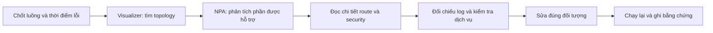
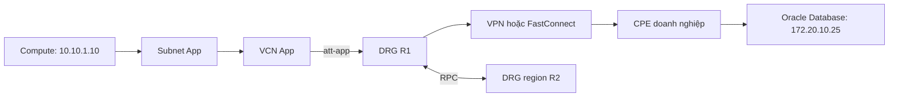

# Chẩn đoán kết nối bằng Network Path Analyzer và Network Visualizer

## 1. Mục tiêu và tình huống sử dụng

Trong chương **Kết nối lai và liên vùng** của module **CLOUD_PROVIDERS_ORACLE**, bài học này xây dựng một quy trình chẩn đoán kết nối trên Oracle Cloud Infrastructure (OCI). Quy trình kết hợp sơ đồ tài nguyên, phân tích route và security rules, quan sát lưu lượng thực và kiểm tra dịch vụ. Người học dùng các bằng chứng đó để khoanh vùng lỗi trước khi thay đổi hạ tầng.

Giả sử một ứng dụng Java trên OCI Compute không kết nối được Oracle Database tại trung tâm dữ liệu. Nhóm ứng dụng báo timeout; nhóm mạng cho biết VPN đang up; sơ đồ cho thấy VCN đã gắn với DRG. Cả ba thông tin đều hữu ích nhưng chưa chỉ ra gói TCP đi đâu, bị chặn ở đâu và có đường phản hồi hay chưa.

Hai công cụ trong OCI Network Command Center giải quyết hai câu hỏi khác nhau:

- **Network Visualizer:** tài nguyên mạng được tổ chức và liên kết như thế nào trong phạm vi đang xem?
- **Network Path Analyzer (NPA):** với nguồn, đích, giao thức và cổng đã chọn, cấu hình được hỗ trợ cho phép đường đi nào?

Kết quả phân tích cần được đối chiếu với quan sát thực tế. Oracle mô tả NPA là công cụ phân tích cấu hình, không phát lưu lượng thử nghiệm; xem [Network Path Analyzer](https://docs.oracle.com/en-us/iaas/Content/Network/Concepts/path_analyzer.htm). Một đường được mô hình hóa là reachable chưa chứng minh listener cơ sở dữ liệu đang chạy, chứng chỉ hợp lệ hoặc ứng dụng đăng nhập thành công.

Sau bài học, bạn có thể:

- Chọn đúng region, compartment và cấp topology để tìm tài nguyên liên quan.
- Mô tả một luồng bằng endpoint, giao thức, cổng và chiều kết nối rõ ràng.
- Tạo, chạy và đọc phân tích NPA đến từng hop trong phạm vi công cụ hỗ trợ.
- Phân biệt lỗi định tuyến, lỗi security rules, thiếu dữ liệu phân tích và lỗi dịch vụ thực tế.
- Xử lý đường lai, RPC liên vùng và thiết bị trung gian mà không suy quá mức từ sơ đồ.
- Lưu bằng chứng trước/sau và kiểm tra lại sau một thay đổi có phạm vi nhỏ.

Ví dụ sử dụng IPv4, upgraded DRG và địa chỉ minh họa. Người học nên biết VCN, subnet, VNIC, NSG, security list, DRG, VPN và FastConnect ở mức cơ bản.

## 2. Mỗi loại bằng chứng trả lời điều gì?

| Công cụ hoặc nguồn dữ liệu | Câu hỏi chính | Phần cần bổ sung khi kết luận |
| --- | --- | --- |
| Network Visualizer | VCN, subnet, gateway, attachment và security resources liên quan ra sao? | Phạm vi hiển thị, chi tiết route, endpoint và cổng cụ thể |
| NPA | Cấu hình được hỗ trợ xử lý một luồng giả định như thế nào? | Giới hạn mô hình, quyền quan sát và kiểm tra lưu lượng thật |
| VCN Flow Logs | Luồng tại VNIC được ghi nhận với thông tin accept/reject nào? | Bộ lọc, sampling, thời gian và chiều quan sát |
| Trạng thái VPN/FastConnect/BGP | Kết nối và việc trao đổi route có trạng thái gì? | Prefix thực nhận, bảng dùng prefix và đường về |
| Kiểm tra TCP hoặc truy cập dịch vụ | Từ máy thử, endpoint/cổng đang phản hồi ra sao? | DNS, firewall máy chủ, TLS, listener và quyền ứng dụng |
| Audit và lịch sử triển khai | Cấu hình nào thay đổi vào thời điểm nào? | Quan hệ giữa thay đổi và sự cố cần kiểm chứng |

VCN Flow Logs cung cấp thông tin lưu lượng được chấp nhận hoặc bị từ chối theo security lists và NSGs tại VNIC; capture filter và sampling ảnh hưởng tập bản ghi thu được. Tham khảo [Flow Logs](https://docs.oracle.com/en-us/iaas/Content/Network/Concepts/vcn-flow-logs.htm). Vì NPA chỉ phân tích cấu hình, hãy chủ động tạo một kết nối thực khi cần tìm bản ghi flow log tương ứng.

Một cách làm hiệu quả là đi theo chuỗi:



Mỗi bước loại bớt một nhóm giả thuyết. Chẳng hạn, nếu NPA chỉ ra route bị thiếu ở subnet nguồn, cần kiểm tra đúng bảng subnet đó; sửa một NSG ở cơ sở dữ liệu sẽ không giải quyết việc gói chưa đến được DRG.

## 3. Chuẩn bị đầu vào và quyền quan sát

### 3.1. Mô tả luồng trước khi mở công cụ

Dùng một phiếu chẩn đoán ngắn thay cho mô tả “không vào được database”:

```text
Ứng dụng:            Java app trên Compute
Nguồn:               10.10.1.10, VNIC ứng dụng trong region R1
Đích:                172.20.10.25, Oracle Database ở on-premises
Giao thức:           TCP
Cổng nguồn mô hình:  51000
Cổng đích:           1521
Chiều cần xem:       Yêu cầu và phản hồi của cùng kết nối
Thời điểm lỗi:       Ghi rõ thời gian và múi giờ
Đường dự kiến:       VNIC → subnet route → DRG → VPN/FastConnect → CPE → DB
```

`1521` là cổng ví dụ; dùng đúng cổng listener hoặc TCPS của môi trường. Cổng nguồn `51000` là một giá trị minh họa cho cổng tạm thời của client. Khi lỗi phụ thuộc cổng hoặc NAT, nên thu tuple thực từ log hoặc packet capture để cấu hình phân tích phù hợp.

Nếu người dùng cung cấp hostname, ghi thêm IP mà máy nguồn phân giải được tại thời điểm lỗi. Một bài phân tích đến private IP A không giải thích kết nối thực đang đi đến public IP B hoặc IPv6 C. Với máy có nhiều VNIC, chọn đúng VNIC tham gia luồng thay vì mặc định VNIC đầu tiên.

### 3.2. Phân biệt ba phạm vi quyền

Có ba việc cần kiểm tra riêng:

1. Người vận hành có quyền sử dụng và quản lý các NPA test theo trách nhiệm được giao.
2. Dịch vụ NPA có quyền đọc các cấu hình cần thiết để dựng mô hình.
3. Người vận hành có quyền xem các tài nguyên và chi tiết trên đường phân tích.

Tài liệu NPA cung cấp chính sách mẫu cho nhóm người dùng và service principal `vnpa-service`, đồng thời khuyến nghị phạm vi tenancy cho độ chính xác của phân tích. Dùng chính sách hiện hành trong [Required Permissions của NPA](https://docs.oracle.com/en-us/iaas/Content/Network/Concepts/path_analyzer.htm) làm căn cứ triển khai. Đối chiếu quyền thao tác API tại [Details for the Network Monitoring Service](https://docs.oracle.com/en-us/iaas/Content/Identity/Reference/VnMonitoringpolicyreference.htm).

Đối với Network Visualizer, Oracle nêu policy đọc tài nguyên ở phạm vi tenancy trong [hướng dẫn quyền Network Visualizer](https://docs.oracle.com/en-us/iaas/Content/Network/Concepts/network_visualizer.htm). Quyền `read virtual-network-family` đơn lẻ không đại diện đầy đủ cho quyền dùng Visualizer. Quản trị viên cần đánh giá phạm vi thông tin được mở cho nhóm hỗ trợ; quyền chẩn đoán và quyền sửa hạ tầng nên được phân công rõ.

Một node bị ẩn hoặc trạng thái indeterminate do thiếu quyền là giới hạn của bằng chứng đang có. Cần xác định quyền hoặc phạm vi quan sát còn thiếu trước khi sửa route hoặc mở thêm cổng. Đừng suy tài nguyên đã bị xóa chỉ vì nó không xuất hiện trong tài khoản hỗ trợ.

### 3.3. Ghi nhận region và compartment

Một tenancy có thể tách VCN ứng dụng, DRG, logging và cơ sở dữ liệu vào nhiều compartment. Khi bắt đầu:

- Chọn đúng region chứa endpoint OCI cần điều tra.
- Chọn compartment phù hợp và kiểm tra tùy chọn bao gồm compartment con.
- Ghi OCID bên cạnh tên hiển thị của VCN, subnet, VNIC, DRG và attachment quan trọng.
- Kiểm tra bộ lọc đang áp dụng và thời điểm refresh.

Tên hiển thị giúp tìm kiếm; OCID giúp tránh nhầm tài nguyên tên giống nhau giữa production, staging hoặc region dự phòng. Một map có ít đối tượng hơn dự kiến trước hết cần được kiểm tra phạm vi và quyền.

## 4. Dùng Network Visualizer từ tổng thể đến endpoint

### 4.1. Regional topology: xác định đường kết nối

Trong OCI Console, mở **Networking → Network Command Center → Network Visualizer**. Kiểm tra region, compartment và các bộ lọc trước khi đọc sơ đồ. Ở cấp regional, tìm VCN nguồn, DRG, attachment, VPN hoặc FastConnect và CPE liên quan. Nếu có kết nối sang region khác, ghi nhận RPC và chuyển sang region đó để xem phần hạ tầng tương ứng.

Với upgraded DRG, có thể chọn biểu tượng liên kết attachment để xem thuộc tính và các route liên quan đến attachment được chọn. Đây là điểm tốt để xác định **bảng DRG gán cho attachment đi vào**, thay vì chỉ thấy đường nối VCN–DRG rồi giả định mọi luồng đều qua được. Thao tác được mô tả trong [Viewing a Regional Network Topology Map](https://docs.oracle.com/en-us/iaas/Content/Network/Tasks/view-network-topology-map.htm).

Ví dụ đường dự kiến của bài:



Sơ đồ này là mô hình mục tiêu do người học lập. Khi kiểm tra triển khai, hãy bổ sung tên/OCID thật và đánh dấu phần nào đã có bằng chứng, phần nào còn cần nhóm khác xác nhận. Trạng thái của CPE hoặc tuyến nội bộ doanh nghiệp cần nguồn dữ liệu từ phía doanh nghiệp.

### 4.2. VCN topology: xem route và security ở cấp subnet

Chọn VCN rồi mở **View VCN routing map** hoặc **View VCN security map**. Hai chế độ phục vụ việc đọc quan hệ định tuyến và các đối tượng bảo mật. Tìm subnet của VNIC nguồn, bảng route đang gắn với subnet và gateway mà prefix đích sử dụng. Xem [Viewing a VCN Topology Map](https://docs.oracle.com/en-us/iaas/Content/Network/Tasks/view-vcn-topology-map.htm).

Với nguồn `10.10.1.10` và đích doanh nghiệp `172.20.10.25`, các câu hỏi thực tế là:

- Subnet nguồn đang dùng bảng route nào?
- Bảng đó có prefix bao phủ `172.20.10.25` với target DRG không?
- Có route cụ thể hơn làm gói đi sang next hop khác không?
- Nếu có thiết bị trung gian, bảng ingress/egress nào đưa gói vào rồi ra khỏi thiết bị?

Nếu subnet có nhiều đường tổng hợp, hãy đối chiếu địa chỉ đích cụ thể. Việc thấy một rule `0.0.0.0/0` chưa đủ để kết luận đường của một prefix `/24` đang được học riêng.

### 4.3. Subnet topology: tìm đúng VNIC và security resources

Từ subnet, mở **View subnet inventory map** hoặc **View subnet security map**. Tìm Compute instance, load balancer hoặc VNIC liên quan; kiểm tra NSG của VNIC và security lists của subnet. Cấp subnet giúp phân biệt hai máy cùng mạng nhưng có NSG hoặc VNIC khác nhau. Tham khảo [Viewing a Subnet Topology Map](https://docs.oracle.com/en-us/iaas/Content/Network/Tasks/view-subnet-topology-map.htm).

Ghi lại đối tượng bảo mật thực sự áp dụng cho endpoint. Một rule có tên “allow-db” trong NSG khác không có hiệu lực chỉ vì NSG đó cùng compartment. Đồng thời kiểm tra các allow rule ở security lists/NSGs liên quan trước khi kết luận một cổng bị chặn.

### 4.4. Giữ đúng ý nghĩa của bản đồ

Visualizer có giới hạn số tài nguyên hiển thị; khi vượt giới hạn, map có thể chỉ thể hiện một phần topology. Các bộ lọc và quyền truy cập cũng ảnh hưởng nội dung thấy được. Chức năng **Export Map Data** lưu bản đồ và dữ liệu của phạm vi đang hiển thị; bản xuất không phải bản kiểm kê đầy đủ mặc định của toàn tenancy. Xem [Network Visualizer](https://docs.oracle.com/en-us/iaas/Content/Network/Concepts/network_visualizer.htm).

Sau thay đổi, refresh map và kiểm tra lại chi tiết tài nguyên. Khi lưu bằng chứng, kèm region, compartment, bộ lọc và thời điểm. Những thông tin này giúp người nhận hiểu vì sao một tài nguyên có thể có trong hệ thống nhưng vắng trong ảnh chụp.

## 5. Tạo một phép phân tích NPA có thể diễn giải được

### 5.1. Chọn đúng endpoint và giao thức

Mở **Networking → Network Command Center → Network Path Analyzer**. Danh sách test được lưu phụ thuộc compartment đang chọn; xem [Listing Path Analysis Tests](https://docs.oracle.com/en-us/iaas/Content/Network/Tasks/path_analyzer-list.htm).

Chọn **Create path analysis** và điền tên thể hiện mục đích, ví dụ `app-r1-to-onprem-db-tcp1521`. Chọn compartment lưu test, giao thức TCP và các endpoint tương ứng. Khi nhập IP doanh nghiệp, đánh dấu **This IP address is an on-premises endpoint** ở endpoint đó. Nếu có CIDR chồng lấn hoặc nhiều tài nguyên cùng IP trong các mạng độc lập, ưu tiên chọn tài nguyên cụ thể để tránh mô hình hóa nhầm đích. Các lựa chọn được mô tả trong [Creating a Path Analysis Test](https://docs.oracle.com/en-us/iaas/Content/Network/Tasks/path_analyzer-creating_test.htm).

Đầu vào của ví dụ hybrid:

| Thuộc tính | Giá trị minh họa | Điều cần đối chiếu |
| --- | --- | --- |
| Source | VNIC của máy app, private IP `10.10.1.10` | Đúng VNIC và đúng region |
| Destination | IPv4 `172.20.10.25` | Đánh dấu endpoint on-premises |
| Protocol | TCP | Khớp giao thức của ứng dụng |
| Source port | `51000` | Giá trị mô hình hoặc giá trị thực đã thu được |
| Destination port | `1521` | Khớp listener đang dùng |
| Direction | Bi-directional | Xem yêu cầu và phản hồi |

Chọn một địa chỉ thuộc subnet có thể phục vụ mô hình hóa cấu hình ngay cả khi địa chỉ đó chưa có máy đang hoạt động. Đặc tính này hữu ích để kiểm tra thiết kế trước triển khai, đồng thời cho thấy vì sao kết quả reachable không đồng nghĩa có tiến trình đích đang nghe. Khi điều tra máy đã tồn tại, lựa chọn VNIC/tài nguyên giúp giữ ngữ cảnh rõ hơn một IP đơn lẻ.

### 5.2. Hiểu đúng chiều phản hồi

Với một kết nối TCP không có NAT, hai chiều có thể được biểu diễn như sau:

```text
Yêu cầu:   10.10.1.10:51000  → 172.20.10.25:1521
Phản hồi:  172.20.10.25:1521 → 10.10.1.10:51000
```

Kiểm tra hai chiều của kết nối này khác với tạo một kết nối độc lập từ máy DB đến cổng `1521` trên máy app. Phép kiểm tra độc lập đó có tuple và yêu cầu dịch vụ khác. Nếu có SNAT, DNAT hoặc proxy, ghi thêm tuple trước/sau thiết bị khi đối chiếu kết quả.

Phân biệt thêm security rule stateful và stateless: rule stateful cho phép lưu lượng phản hồi của kết nối được theo dõi theo cơ chế của OCI; stateless cần các rule phù hợp cho những chiều liên quan. Dù security cho phép phản hồi, mạng vẫn cần đường định tuyến trở lại nguồn.

### 5.3. Chạy và lưu test

Chọn **Run analysis**, đợi phân tích hoàn tất rồi xem các đường được phát hiện. Nếu cần sử dụng lại, chọn **Save analysis** để lưu định nghĩa test. Sau khi sửa cấu hình mạng, chạy lại test đã lưu để có kết quả mới, giữ nguyên tuple khi so sánh trước/sau.

Ghi nhận ít nhất tên/OCID test, thời điểm chạy, nguồn/đích và cổng. Một ảnh chụp kết quả thiếu các tham số này rất dễ dẫn đến việc so sánh hai phép thử khác nhau. Không đưa thông tin xác thực database, wallet hoặc khóa riêng vào tên test hay hồ sơ chẩn đoán.

## 6. Đọc kết quả theo từng hop và từng chiều

### 6.1. Kết luận đường đi và chi tiết thành phần

Trong **Discovered paths**, xem từng tab đường và cả forward/return path nếu đã bật hai chiều. Chọn **View diagram information** hoặc mở chi tiết hop để đọc route và security; giữ OCID của đối tượng mà kết quả dẫn tới. Quy trình giao diện nằm trong [Running a Path Analysis Test](https://docs.oracle.com/en-us/iaas/Content/Network/Tasks/path_analyzer-running_test.htm).

Các trạng thái cần hiểu:

| Trạng thái được thấy | Cách đọc thực tế |
| --- | --- |
| `Reachable` | Mô hình phân tích tìm được đường phù hợp với đầu vào và phạm vi được hỗ trợ |
| `Unreachable` | Phân tích cho thấy đoạn đường không qua được; mở hop để tìm nguyên nhân |
| Routing `Forwarded` | Có quyết định chuyển tiếp theo cấu hình được phân tích |
| Routing `No route` | Kiểm tra route và phần security của hop; cần đối chiếu ngữ cảnh và giới hạn mô hình |
| Security `Allowed` / `Blocked` | Đọc rule hoặc đối tượng bảo mật liên quan đến luồng đã nhập |
| `Indeterminate` | Chưa đủ cơ sở để kết luận thành công hay thất bại tại phần đó |

Trạng thái indeterminate có thể liên quan quyền quan sát hoặc thông tin không phân tích được. Nếu thấy một hop đỏ, xem destination prefix, next hop, rule direction và cổng đã chọn trước khi đưa ra thay đổi. Kết quả màu sắc tổng quan cần được gắn với chi tiết cấu hình cụ thể.

### 6.2. Tách câu hỏi route và security

Ví dụ đường app → database có thể thất bại ở các vị trí khác nhau:

| Điểm nghi vấn | Câu hỏi cần trả lời | Đối tượng cần mở |
| --- | --- | --- |
| Subnet app | Prefix doanh nghiệp có được gửi đến DRG không? | Route table đang gắn với subnet |
| DRG | Gói vào qua attachment nào, bảng nào chọn đường đến doanh nghiệp? | Attachment assignment, DRG route table và route hiệu lực |
| Nguồn | Egress cho tuple này được phép bởi rule nào? | Security lists của subnet, NSG của VNIC, chính sách bổ sung liên quan |
| Đích OCI nếu có | Ingress cho đúng nguồn và cổng được phép ở đâu? | Security resources áp dụng cho endpoint đích |
| Chiều về | Mạng đích gửi phản hồi đến đúng nguồn theo đường nào? | Route table phía đích, bảng DRG chiều về hoặc route CPE |

Ở DRG, bảng dùng cho một gói được quyết định bởi **attachment mà gói đi vào**. Chiều phản hồi có thể dùng bảng khác. Đối chiếu [Dynamic Routing Gateways](https://docs.oracle.com/en-us/iaas/Content/Network/Tasks/managingDRGs.htm) khi kiểm tra việc gán bảng và import route.

Nếu route hiện diện trong `rt-from-onprem` nhưng luồng đang đi vào qua `att-app` dùng `rt-from-app`, việc nhìn thấy prefix ở bảng thứ nhất chưa chứng minh luồng đi qua được. Tương tự, một allow rule thuộc NSG không gắn với VNIC đích không giải thích security status của endpoint đó.

### 6.3. Dùng kết quả để hình thành một thay đổi nhỏ

Một đề xuất sửa tốt phải nêu đủ: đối tượng, luồng bị ảnh hưởng, cấu hình hiện tại, cấu hình mong muốn và kiểm tra sau sửa. Ví dụ:

```text
Quan sát: Bảng subnet-app thiếu route đến 10.30.1.0/24.
Ý định:   Chỉ gửi subnet shared services này qua DRG.
Đề xuất:  Bổ sung destination 10.30.1.0/24, target DRG đã xác định.
Kiểm tra: Chạy lại cùng NPA test và thử TCP 443 từ máy app.
Hoàn tác: Gỡ rule vừa thêm nếu kết quả hoặc phạm vi ảnh hưởng sai dự kiến.
```

Một đề xuất “mở all traffic” làm mất liên hệ giữa bằng chứng và cách sửa, đồng thời có thể ảnh hưởng các dịch vụ khác. Giữ nguyên các đường đã hoạt động và chỉ thay đổi phần đã xác định là nguyên nhân.

## 7. Bài thực hành: phân biệt thiếu route và thiếu allow rule

### 7.1. Topology lab có phạm vi rõ ràng

Dùng hai VCN trong cùng region R1, nối qua một upgraded DRG, không có NVA trên đường lab:

| Thành phần | Địa chỉ hoặc vai trò |
| --- | --- |
| VCN App | `10.10.0.0/16` |
| Subnet App | `10.10.1.0/24`, máy thử `10.10.1.10` |
| VCN Shared | `10.30.0.0/16` |
| Subnet Shared | `10.30.1.0/24`, dịch vụ thử `10.30.1.20:443` |
| DRG | Hai VCN attachment, có route hai chiều đến các subnet |
| Security | Chỉ cho phép các luồng lab và đường quản trị cần thiết |

Chuẩn bị trước một dịch vụ HTTPS hoặc TCP thực sự lắng nghe ở cổng `443`. Chọn hai VCN giúp tránh dùng một kịch bản cùng subnet làm bài chứng minh tổng quát về NPA. Ví dụ này là hướng dẫn để người học thực hiện trong lab riêng; các trạng thái dự kiến dưới đây chưa phải kết quả đo của một triển khai cụ thể.

### 7.2. Tạo baseline có cả cấu hình và kết nối thật

1. Trong Visualizer, tìm hai VCN, các attachment và bảng route subnet/DRG liên quan.
2. Xác nhận subnet app có route `10.30.1.0/24 → DRG`; subnet shared có route `10.10.1.0/24 → DRG`.
3. Xác nhận bảng DRG gán cho attachment app học đường đến shared và bảng chiều ngược lại học đường đến app.
4. Đọc mọi security list/NSG áp dụng để xác định allow rule cho TCP `443` từ nguồn app; xem thêm chính sách ZPR nếu endpoint có áp dụng.
5. Tạo NPA test từ VNIC app đến VNIC/private IP shared, TCP destination port `443`, có chiều về.
6. Chạy test, ghi kết quả từng chiều và thử TCP thực từ máy app đến `10.30.1.20:443`.

Baseline hợp lệ cần giải thích được cả mô hình lẫn kết nối thực. Nếu NPA thành công nhưng TCP thất bại, hoàn thành điều tra listener, firewall máy chủ và tuple trước khi tiếp tục tạo lỗi có chủ đích.

### 7.3. Tình huống A: loại bỏ route đến shared

Trong lab cô lập, ghi cấu hình cũ rồi tạm gỡ rule `10.30.1.0/24 → DRG` khỏi đúng bảng route subnet app. Đảm bảo không có route tổng hợp hoặc default route khác vẫn đưa cùng đích đến DRG.

Refresh topology, chạy lại cùng NPA test và xem vị trí đường bị đứt. Dự kiến phần phân tích định tuyến sẽ phản ánh thiếu đường phù hợp đến shared. Kiểm tra TCP cũng cần được chạy để đối chiếu triệu chứng. Nếu kết quả vẫn reachable, xác minh rule thực sự bị gỡ khỏi bảng đang được subnet sử dụng và kiểm tra route thay thế.

Khôi phục rule, chạy lại phép thử và ghi nhận việc hồi phục. Thay đổi duy nhất này giúp giải thích quan hệ giữa thiếu route và lỗi kết nối mà không trộn thêm một sửa đổi security khác.

### 7.4. Tình huống B: loại bỏ allow rule ở đích

Sau khi baseline đã phục hồi, ghi cấu hình cũ rồi tạm gỡ allow rule ingress TCP `443` từ nguồn app ở đối tượng bảo mật đích của lab. Kiểm tra trước rằng không có security list hoặc NSG khác vẫn cho phép cùng luồng. OCI security lists và NSGs có thể có các allow rule bổ sung cho nhau; gỡ một rule đơn lẻ chưa chắc làm luồng bị chặn.

Chạy lại NPA với tuple cũ. Dự kiến phần security chỉ ra luồng không được phép tại phần liên quan, trong khi các route vẫn còn. Đối chiếu flow logs và phép thử TCP thực nếu đã bật logging phù hợp. Khôi phục allow rule chính xác, chạy lại và xác nhận baseline.

Nếu có ZPR, cần xét chính sách của endpoint cùng các security rules khác; không suy rằng một allow rule NSG đủ để giải quyết mọi trường hợp. Dùng chi tiết thông báo của phép phân tích để xác định lớp nào thực sự đã được đánh giá.

### 7.5. Kết quả người học cần lưu

| Lần chạy | Cấu hình được thay đổi | Bằng chứng cấu hình | Bằng chứng thực tế |
| --- | --- | --- | --- |
| Baseline | Không thay đổi | Route và security phù hợp | TCP đến dịch vụ thành công |
| Thiếu route | Rule subnet app | Hop và bảng bị ảnh hưởng | Kết quả TCP, log nếu có |
| Khôi phục route | Trả rule cũ | Phân tích lại đúng tuple | Dịch vụ hoạt động trở lại |
| Thiếu allow | Rule security đích | Chi tiết security và rule liên quan | TCP/log của cùng luồng |
| Khôi phục allow | Trả rule cũ | Phân tích lại đúng tuple | Dịch vụ hoạt động trở lại |

Mục đích của lab là giải thích được **vì sao** kết quả thay đổi. Lưu cả trường hợp quan sát khác dự kiến, kèm quyền và giới hạn công cụ, thay vì chỉ chọn ảnh màu xanh để chứng minh hoàn thành.

## 8. Áp dụng cho kết nối lai, liên vùng và thiết bị trung gian

### 8.1. Kết nối hybrid: phân chia trách nhiệm kiểm tra

Với luồng `10.10.1.10 → 172.20.10.25:1521`, bắt đầu từ phần OCI: đúng VNIC nguồn, route subnet đến DRG, bảng gán cho attachment đi vào, route đến mạng doanh nghiệp và kết nối VPN/FastConnect liên quan. Đối chiếu chiều về bằng bảng dùng cho attachment từ doanh nghiệp đi vào DRG và route về subnet app.

Phần doanh nghiệp cần bằng chứng bổ sung từ đội vận hành CPE và database:

| Phạm vi | Bằng chứng cần lấy |
| --- | --- |
| VPN/FastConnect | Trạng thái tunnel/circuit, thống kê lưu lượng và sự kiện lỗi |
| BGP hoặc static routing ở CPE | Prefix thực nhận/phát, route được chọn đến `10.10.1.0/24` và `172.20.10.25` |
| Firewall doanh nghiệp | Rule và log cho tuple trước/sau NAT nếu có |
| Mạng nội bộ DB | Gateway, route phản hồi và ACL trung gian |
| Máy chủ DB | Listener, firewall hệ điều hành, địa chỉ bind và log kết nối |

Chọn endpoint on-premises trong NPA giúp công cụ hiểu đúng ý định của bài phân tích. Việc đó không cung cấp cấu hình bên trong router, firewall và hệ điều hành của doanh nghiệp. Khi bàn giao, nêu rõ phần OCI đã kiểm tra và phần bên ngoài còn thiếu bằng chứng.

Một kết nối có yêu cầu đi qua VPN và phản hồi qua FastConnect có thể gặp yêu cầu về đối xứng ở firewall. Ghi lại đường mỗi chiều và thuộc tính route, thay vì dùng trạng thái “hai đường đều up” để loại trừ lỗi định tuyến. Giữ nguyên khả năng quan sát trước khi thay đổi BGP hoặc chính sách dự phòng.

### 8.2. RPC liên vùng: tách phân tích và kiểm chứng đường nối

Tài liệu NPA liệt kê RPC qua region/tenancy trong các trường hợp có thể trả `Indeterminate`, với hướng tiếp cận chia phân tích theo region. Xem [Known caveats và Special use cases](https://docs.oracle.com/en-us/iaas/Content/Network/Concepts/path_analyzer.htm).

Với VCN App tại R1 và VCN DR tại R2, quy trình điều tra gồm:

1. Mở Visualizer ở R1, xác định VCN nguồn, DRG và RPC phía R1.
2. Chuyển sang R2, xác định RPC, DRG, VCN và endpoint đích tương ứng.
3. Kiểm tra trạng thái peering, assignment bảng của attachment và route hiệu lực đến prefix đối diện trên cả hai DRG.
4. Chạy các phân tích cục bộ phù hợp với tài nguyên và endpoint được hỗ trợ trong mỗi region.
5. Kiểm chứng kết nối thực xuyên region, đối chiếu log và route phản hồi.

RPC là đối tượng kết nối, không phải một VNIC có địa chỉ tùy ý để nhập làm endpoint. Khi chia test, chọn endpoint thực được hỗ trợ cho từng đoạn. Hai phép phân tích cục bộ reachable chưa tự chứng minh đoạn RPC hoặc toàn luồng liên vùng hoạt động; đoạn nối vẫn cần kiểm tra trạng thái, route và lưu lượng thực.

Nếu mục tiêu là nhân bản Oracle Database, kiểm tra tiếp phiên replication và hành vi ứng dụng khi chuyển vai trò. Sự cố timeout của phiên replication có thể liên quan băng thông, độ trễ hoặc dịch vụ, dù các cấu hình route đã đúng.

### 8.3. Firewall, NVA và load balancer: giữ ngữ cảnh từng đoạn

Khi đường đi qua thiết bị trung gian, chia điều tra thành đoạn trước thiết bị, hoạt động bên trong thiết bị và đoạn sau thiết bị. Một phép thử đến IP quản trị của firewall chỉ chứng minh phần truy cập địa chỉ đó; hãy phân biệt với việc thiết bị chuyển tiếp luồng gốc đến đích.

Với NAT hoặc proxy, ghi tuple nhận vào và tuple phát ra. Security rule ở backend có thể cần source IP sau SNAT thay vì IP client ban đầu. Với load balancer, theo dõi riêng kết nối client → listener và kết nối load balancer → backend, cùng health check và cổng backend thực tế.

Khi NPA không mô hình hóa đầy đủ phần trung gian, kết hợp kiểm tra từng đoạn với log thiết bị, packet counters và phép thử dịch vụ. Trong mô hình hub có inspection, xác minh gói thật sự đi qua firewall ở cả chiều cần thiết, đồng thời kiểm tra route cụ thể hơn có làm bỏ qua hub hay không.

### 8.4. Những giới hạn phải kiểm tra trước khi sửa cấu hình

| Trường hợp được Oracle lưu ý | Hướng xử lý |
| --- | --- |
| IPv6 | Chẩn đoán bằng công cụ phù hợp; NPA hỗ trợ IPv4 |
| Hai private IP khác nhau trong cùng subnet; intra-VCN/IGW routing | Đối chiếu giới hạn mô hình và kiểm tra thực |
| Next hop private IP hoặc thiết bị trung gian | Có thể gặp `No route`/`Indeterminate`; kiểm tra từng đoạn |
| Vòng lặp định tuyến | Tự theo dõi chuỗi next hop; NPA không phát hiện vòng lặp |

Các lưu ý này dựa trên [giới hạn NPA hiện hành](https://docs.oracle.com/en-us/iaas/Content/Network/Concepts/path_analyzer.htm). Với một tình huống thuộc giới hạn, một nhãn `No route` cần được kiểm chứng bằng route thực thay vì lập tức thêm default route. Tra tài liệu hiện hành khi gặp loại endpoint, topology hoặc quy mô tenancy ngoài bài lab.

## 9. Đối chiếu với DNS, TCP và trạng thái dịch vụ

### 9.1. Thử từ đúng máy nguồn

Các lệnh sau là ví dụ chạy trong môi trường Linux được phép kiểm tra, với công cụ tương ứng đã có sẵn:

```bash
# Kiểm tra IP mà máy ứng dụng phân giải được.
getent ahostsv4 db.internal.example

# Kiểm tra TCP đến listener minh họa tại trung tâm dữ liệu.
nc -vz -w 5 172.20.10.25 1521

# Kiểm tra dịch vụ lab shared services.
nc -vz -w 5 10.30.1.20 443
```

Giá trị `db.internal.example` chỉ là hostname mẫu. Dùng hostname, địa chỉ và cổng của lab; thực hiện từ máy app hoặc từ một máy có cùng đường mạng và chính sách đã xác nhận. Kết quả từ laptop quản trị đi qua VPN cá nhân có thể phản ánh đường khác.

Nếu cần kiểm tra chính xác cổng nguồn đã nhập trong NPA, dùng công cụ hỗ trợ đặt source port hoặc thu lại tuple của kết nối thực. Lệnh `nc` đơn giản phía trên thường dùng cổng nguồn tạm thời do hệ điều hành chọn.

Trên máy đích do bạn quản lý, có thể xem listener:

```bash
ss -lntp
```

Đối chiếu địa chỉ bind: một tiến trình chỉ nghe trên `127.0.0.1` không cung cấp cùng khả năng truy cập như tiến trình nghe trên private IP phù hợp. Với dịch vụ database được quản lý, dùng thông tin endpoint và công cụ chẩn đoán do dịch vụ cung cấp thay cho giả định có quyền truy cập hệ điều hành.

### 9.2. Diễn giải phép thử ở đúng tầng

| Quan sát | Điều có thể kết luận | Bước tiếp theo |
| --- | --- | --- |
| Hostname trả IP khác NPA | Phép thử và ứng dụng đang nhắm endpoint khác | Chốt DNS/private endpoint rồi chạy lại |
| TCP timeout | Chưa nhận được phản hồi hoàn thành kết nối trong thời gian thử | Route hai chiều, firewall, log, endpoint và tình trạng dịch vụ |
| TCP connection refused | Có phản hồi từ endpoint hoặc thiết bị trên đường | Kiểm tra listener, cổng và chính sách reject |
| TCP thành công nhưng JDBC lỗi | Kết nối TCP đã thiết lập được trong phép thử đó | TLS, wallet, service name, tài khoản và log database |
| NPA reachable nhưng TCP thất bại | Mô hình cấu hình và quan sát thực chưa thống nhất | Tuple, thời điểm, giới hạn NPA, guest firewall và thiết bị ngoài mô hình |
| NPA indeterminate nhưng TCP thành công | Luồng thực đi được trong lần thử, mô hình còn phần chưa kết luận | Ghi rõ giới hạn; vẫn xác minh chính sách đường đi nếu cần |

Với HTTPS hoặc TCPS, dùng kiểm tra dịch vụ phù hợp và giữ xác minh chứng chỉ theo yêu cầu môi trường. TCP thành công chưa kiểm tra được chứng chỉ, xác thực hoặc nghiệp vụ.

### 9.3. Ghép log với cùng tuple và cùng thời điểm

Khi đọc Flow Logs, ghi rõ VNIC, chiều, source/destination IP, cổng và khoảng thời gian. Nếu không có bản ghi, kiểm tra logging đã bật ở đâu, capture filter, sampling và khoảng thời gian tìm kiếm trước khi kết luận gói không tồn tại.

Một bản ghi accept tại VNIC nguồn chưa chứng minh máy đích nhận được gói. Một bản ghi reject ở VNIC đích giúp thu hẹp lỗi security tại phạm vi đó. Khi có NAT, đối chiếu địa chỉ sau chuyển đổi để tránh tìm nhầm tuple trong log phía sau thiết bị.

## 10. Chạy lại test đã lưu bằng OCI CLI

### 10.1. Đọc định nghĩa rồi khởi chạy phân tích

Phần này dành cho người học đã có OCI CLI được cấu hình và một NPA test được lưu từ Console. Các lệnh là ví dụ để chạy trong Bash; chúng không sửa route, security list hay NSG.

```bash
REGION='ap-singapore-1'
TEST_ID='ocid1.vnp...REPLACE_WITH_SAVED_TEST_OCID'

oci vn-monitoring path-analyzer-test get \
  --region "$REGION" \
  --path-analyzer-test-id "$TEST_ID"

oci vn-monitoring path-analysis get-path-analysis-persisted \
  --region "$REGION" \
  --path-analyzer-test-id "$TEST_ID"
```

`TEST_ID` là chỗ giữ giá trị, cần thay bằng toàn bộ OCID test thật. Đọc định nghĩa giúp xác nhận endpoint, giao thức và chiều trước khi chạy; xem [CLI: path-analyzer-test get](https://docs.oracle.com/en-us/iaas/tools/oci-cli/latest/oci_cli_docs/cmdref/vn-monitoring/path-analyzer-test/get.html).

Lệnh `get-path-analysis-persisted` khởi chạy phân tích bất đồng bộ và trả `opc-work-request-id`. Lưu ID đó để theo dõi công việc; xem [CLI: get-path-analysis-persisted](https://docs.oracle.com/en-us/iaas/tools/oci-cli/latest/oci_cli_docs/cmdref/vn-monitoring/path-analysis/get-path-analysis-persisted.html). Lưu định nghĩa test cho phép tái sử dụng đầu vào; mỗi lần phân tích vẫn cần kết quả và thời điểm riêng.

### 10.2. Theo dõi work request và lấy kết quả đúng loại

```bash
WORK_REQUEST_ID='REPLACE_WITH_RETURNED_WORK_REQUEST_OCID'

oci vn-monitoring work-request get \
  --region "$REGION" \
  --work-request-id "$WORK_REQUEST_ID"
```

Dùng trạng thái từ [CLI: work-request get](https://docs.oracle.com/en-us/iaas/tools/oci-cli/latest/oci_cli_docs/cmdref/vn-monitoring/work-request/get.html) để biết công việc còn chạy, thành công hay thất bại. Khi đã thành công, lấy toàn bộ trang kết quả:

```bash
oci vn-monitoring work-request-result list \
  --region "$REGION" \
  --work-request-id "$WORK_REQUEST_ID" \
  --all
```

Tham số `--all` giúp không bỏ sót trang khi lấy kết quả; xem [CLI: work-request-result list](https://docs.oracle.com/en-us/iaas/tools/oci-cli/latest/oci_cli_docs/cmdref/vn-monitoring/work-request-result/list.html).

Nếu công việc thất bại, lấy thông tin lỗi thay vì coi đó là một kết quả đường mạng unreachable:

```bash
oci vn-monitoring work-request-error list \
  --region "$REGION" \
  --work-request-id "$WORK_REQUEST_ID" \
  --all
```

Cú pháp lấy lỗi được mô tả trong [CLI: work-request-error list](https://docs.oracle.com/en-us/iaas/tools/oci-cli/latest/oci_cli_docs/cmdref/vn-monitoring/work-request-error/list.html). Lỗi thực thi cần được chẩn đoán theo thông báo của dịch vụ và quyền liên quan.

Có ba lớp trạng thái khác nhau:

```text
Work request SUCCEEDED
    → Phân tích đã thực thi thành công.

Kết quả đường Reachable / Unreachable / Indeterminate
    → Kết luận của mô hình cho từng đường được phân tích.

Phép thử TCP/JDBC/HTTPS thực tế
    → Quan sát của lần truy cập dịch vụ đã thực hiện.
```

Một work request `SUCCEEDED` hoàn toàn có thể chứa kết quả đường `Unreachable`. Khi tự động hóa báo cáo, đọc phần kết quả phân tích thay vì chỉ dựa vào exit code của lệnh hoặc trạng thái work request.

## 11. Hồ sơ chẩn đoán và kiểm soát thay đổi

Một hồ sơ đủ dùng để người khác tiếp tục điều tra nên có:

| Nhóm thông tin | Nội dung cần ghi |
| --- | --- |
| Phạm vi | Tenancy/region/compartment liên quan, người hoặc nhóm phụ trách từng đoạn |
| Luồng | Endpoint, VNIC, IPv4, protocol, source/destination port, chiều và NAT nếu có |
| Topology | Map đã chọn phạm vi, OCID gateway/attachment và bảng route liên quan |
| Phân tích | Test ID, work request ID, thời điểm, trạng thái từng đường và hop đáng chú ý |
| Quan sát thực | TCP hoặc truy cập dịch vụ, log đúng tuple, trạng thái CPE/listener khi cần |
| Thay đổi | Đối tượng được sửa, cấu hình cũ/mới, lý do và cách hoàn tác |
| Sau sửa | Chạy lại cùng đầu vào, kiểm tra dịch vụ và luồng cần tiếp tục bị hạn chế |
| Phần chưa kết luận | Giới hạn công cụ, thiếu quyền hoặc đoạn mạng chưa có bằng chứng |

Khi nghi sự cố xuất hiện sau triển khai, đối chiếu Audit và lịch sử IaC để tìm thay đổi về route table assignment, import distribution, subnet route hoặc security rules. Dùng thời điểm thay đổi để hình thành giả thuyết, rồi kiểm tra bằng đường và tuple cụ thể; sự trùng thời gian chưa tự chứng minh nguyên nhân. Oracle trình bày vai trò của các công cụ quan sát và Audit trong [hướng dẫn network monitoring và observability](https://docs.oracle.com/en/solutions/oci-network-deployment/learn-network-monitoring-observability-and-management1.html).

Đối với chi phí, chọn phạm vi logging, sampling và retention phù hợp với thời gian điều tra. Dọn tài nguyên lab không còn cần, đồng thời giữ bằng chứng đã xuất theo chính sách của môi trường. Khi cần số liệu độ trễ, mất gói hoặc throughput, bổ sung phép đo thực phù hợp; phân tích cấu hình không cung cấp những phép đo đó.

Bài thực hành hoàn thành khi người học chỉ ra được đúng nguồn và đích, đọc được topology trong phạm vi đã chọn, diễn giải được kết quả NPA cùng giới hạn của nó, và chứng minh thay đổi bằng kiểm tra trước/sau. Với hệ thống OCI phục vụ ứng dụng và Oracle Database, cách làm này giúp chuyển báo cáo “timeout” thành một kết luận có vị trí lỗi, bằng chứng và bước xử lý cụ thể.
