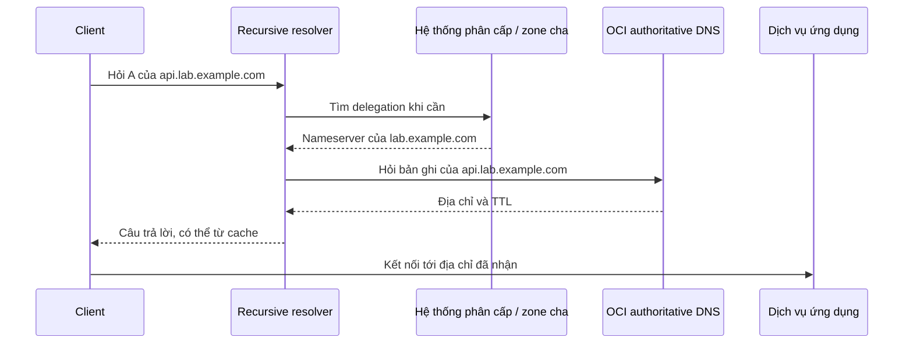

# Public DNS zones và quản lý bản ghi DNS

## 1. Mục tiêu và phạm vi

Trong chương **DNS và điều phối truy cập** của module Oracle Cloud Infrastructure (OCI), public DNS cung cấp các câu trả lời có thẩm quyền cho tên miền công khai. Ứng dụng có thể thay đổi Compute instance, load balancer hoặc vị trí triển khai trong khi người dùng tiếp tục truy cập bằng một tên ổn định.

Sau bài học, bạn có thể:

- Phân biệt domain, zone, authoritative nameserver và recursive resolver.
- Tạo primary public zone, xác định nameserver được OCI cấp và thiết lập delegation đúng nơi.
- Chọn loại bản ghi, quản lý RRset và lập kế hoạch TTL.
- Thêm, sửa, xóa bản ghi bằng Console hoặc OCI CLI mà không làm mất dữ liệu ngoài ý định.
- Kiểm chứng câu trả lời authoritative, delegation, cache và kết nối ứng dụng.
- Tổ chức phân quyền, tự động hóa, giám sát và quay lui khi thay đổi DNS.

Bài tập trung vào primary public DNS zone và các bản ghi tĩnh. Traffic steering theo sức khỏe, trọng số hay vị trí địa lý là lớp điều phối riêng; một tập bản ghi A có nhiều địa chỉ không tự cung cấp những chức năng đó.

Mọi tên `example.com`, `lab.example.com` và địa chỉ `203.0.113.x`, `2001:db8:...` trong bài là dữ liệu minh họa. Khi thực hành, dùng tên miền thuộc quyền quản lý và địa chỉ endpoint thật; không công bố các địa chỉ tài liệu như đích dịch vụ thật.

## 2. Các thành phần trong một lần phân giải DNS

### 2.1. Domain không đồng nghĩa với zone

Domain là một nhánh trong không gian tên DNS. Zone là phần không gian tên do một bộ nameserver quản lý có thẩm quyền.

Ví dụ:

```text
example.com
├── www.example.com
├── api.example.com
└── lab.example.com
    ├── api.lab.example.com
    └── www.lab.example.com
```

`lab.example.com` có thể chỉ là một tên nằm trong zone `example.com`. Nó trở thành ranh giới một child zone khi được quản lý trong zone riêng và có delegation tương ứng từ zone cha.

Apex là tên ở gốc của một zone. Với zone `lab.example.com`, apex là chính `lab.example.com`, còn `api.lab.example.com` là tên bên dưới apex.

Zone cha giữ NS để chuyển trách nhiệm trả lời cho zone con. Tạo child zone trong OCI chưa tự thay đổi dữ liệu của zone cha tại nhà cung cấp khác. [Oracle: Overview of DNS](https://docs.oracle.com/en-us/iaas/Content/DNS/Concepts/dnszonemanagement.htm)

### 2.2. Authoritative và recursive có vai trò khác nhau

| Thành phần | Vai trò |
| --- | --- |
| Registrar | Quản lý đăng ký tên miền và các thao tác delegation liên quan tại cấp đăng ký |
| Authoritative nameserver | Trả lời theo dữ liệu của zone mà nó quản lý |
| Recursive resolver | Tìm câu trả lời giúp client và lưu cache theo quy tắc DNS |
| Client | Hỏi resolver, nhận kết quả rồi kết nối tới dịch vụ |

Khi chưa có câu trả lời trong cache, resolver lần theo hệ thống phân cấp để tìm nameserver có thẩm quyền.



Đường DNS và đường truy cập ứng dụng là hai bước khác nhau. Public DNS trả đúng địa chỉ không chứng minh HTTPS hoạt động, chứng thư đúng hoặc firewall đã cho phép.

Ngược lại, kết nối được tới một IP không chứng minh delegation của hostname đã đúng.

### 2.3. Public DNS không mở cổng mạng

Public zone lưu các bản ghi authoritative trên nameserver OCI phục vụ truy vấn công khai. Nó không tạo Internet Gateway, không gắn public IP vào Compute và không thay đổi NSG của VCN. [Oracle: Public DNS](https://docs.oracle.com/en-us/iaas/Content/DNS/Concepts/gettingstarted.htm)

Có thể nhập một địa chỉ private vào bản ghi A, nhưng hành động đó không làm địa chỉ ấy truy cập được từ Internet. Đồng thời, dữ liệu đã được đưa vào không gian tên công khai có thể bị người ngoài truy vấn. Tên và endpoint chỉ phục vụ nội bộ nên được thiết kế bằng private DNS phù hợp.

IAM kiểm soát ai được quản lý zone trong OCI; IAM không biến câu trả lời của public DNS thành dữ liệu chỉ người có tài khoản mới đọc được.

## 3. Cấu trúc bản ghi và RRset

Một bản ghi có thể được biểu diễn theo dạng zone file:

```text
api.lab.example.com.  300  IN  A  203.0.113.10
```

| Thành phần | Giá trị ví dụ | Ý nghĩa |
| --- | --- | --- |
| Owner name | `api.lab.example.com.` | Tên mà bản ghi mô tả |
| TTL | `300` | Thời gian cache tính bằng giây |
| Class | `IN` | Lớp Internet |
| Type | `A` | Loại bản ghi |
| RDATA | `203.0.113.10` | Dữ liệu phụ thuộc loại bản ghi |

Dấu chấm cuối tên đầy đủ biểu diễn DNS root. Trong zone file, thiếu dấu chấm có thể khiến một tên bị hiểu là tương đối với origin. Khi dùng Console hoặc API, nhập theo yêu cầu của trường dữ liệu và kiểm tra tên đầy đủ sau lưu, tránh tạo nhầm `api.lab.example.com.lab.example.com`.

Một **RRset** là tập bản ghi cùng owner name, class và type. Các bản ghi trong tập phải dùng TTL nhất quán.

```text
api.lab.example.com.  300  IN  A  203.0.113.10
api.lab.example.com.  300  IN  A  203.0.113.20
```

Đây là hai giá trị trong một A RRset, không phải hai dịch vụ DNS độc lập. Câu trả lời có thể chứa nhiều địa chỉ; không giả định địa chỉ đầu tiên luôn là máy chủ chính hoặc thứ tự luôn cố định.

OCI Console hiển thị nhóm bản ghi cùng tên, type và TTL thành RRset. OCI cũng chuẩn hóa RDATA nên hình thức trả về có thể khác chuỗi nhập, chẳng hạn thêm dấu chấm cuối hostname. [Oracle: Adding a Record to a DNS Zone](https://docs.oracle.com/en-us/iaas/Content/DNS/Tasks/record-add.htm)

## 4. Chọn loại bản ghi phù hợp

| Type | Dùng khi nào | Ví dụ minh họa |
| --- | --- | --- |
| A | Tên trỏ tới IPv4 | `api.lab.example.com. A 203.0.113.10` |
| AAAA | Tên trỏ tới IPv6 | `api.lab.example.com. AAAA 2001:db8:42::10` |
| CNAME | Một tên là bí danh của hostname khác | `www.lab.example.com. CNAME api.lab.example.com.` |
| MX | Xác định máy chủ nhận thư, kèm độ ưu tiên | `lab.example.com. MX 10 mail.lab.example.com.` |
| TXT | Dữ liệu dạng văn bản phục vụ xác minh hoặc chính sách | `_verify.lab.example.com. TXT "training-demo"` |
| NS | Xác định nameserver hoặc delegation xuống zone con | NS ở apex zone hoặc tại ranh giới delegation |
| SOA | Thông tin quản lý và các tham số của zone | Bản ghi OCI tạo khi tạo zone |
| CAA | Công bố CA được phép cấp chứng thư theo chính sách | Giá trị theo CA và chính sách tổ chức chọn |

Đây là cách đọc dữ liệu DNS, không phải danh sách cần tạo đầy đủ cho mọi zone.

### 4.1. A, AAAA và endpoint ứng dụng

A nhận địa chỉ IPv4, AAAA nhận địa chỉ IPv6. Không nhập URL có `https://`, đường dẫn `/api` hoặc cổng `:443` vào RDATA của A/AAAA.

Trước khi thêm AAAA, cần xác nhận đường IPv6 của endpoint, listener và bảo mật đã hoạt động. Có A và AAAA không buộc client dùng IPv6 và không đảm bảo hai đường cùng khỏe.

Với endpoint được một dịch vụ quản lý cấp dưới dạng hostname, không tùy tiện lấy IP đang phân giải được rồi cố định vào A. Nhà cung cấp có thể thay đổi IP; hãy dùng cơ chế custom domain và kiểu bản ghi được dịch vụ đó hướng dẫn.

### 4.2. CNAME, apex và ALIAS

CNAME trỏ tới một tên khác, không trỏ tới IP hay URL. Theo mô hình DNS, tên có CNAME không đồng thời chứa các dữ liệu thông thường như A, AAAA, MX hoặc TXT. Apex phải có SOA và NS nên không dùng CNAME chuẩn tại đó. [RFC 1034: Domain Names — Concepts and Facilities](https://www.rfc-editor.org/rfc/rfc1034.txt)

OCI có **ALIAS**, một loại bản ghi không tiêu chuẩn để đáp ứng nhu cầu tương tự CNAME ở apex. Không coi ALIAS là tính năng giống hệt nhau giữa mọi nhà cung cấp; OCI cũng có ràng buộc với steering policy attachment trên cùng tên. [Oracle: Managing Resource Records](https://docs.oracle.com/en-us/iaas/Content/DNS/Reference/supporteddnsresource.htm)

Nếu không cần hostname ở apex, cách tổ chức đơn giản cho lab là dùng A/AAAA tại `api.lab.example.com` và CNAME tại `www.lab.example.com`.

CNAME không chuyển hướng trình duyệt từ tên này sang tên khác. Muốn HTTP 301/302, thay đổi URL hoặc chuyển đường dẫn, cần cấu hình ở lớp HTTP.

### 4.3. TXT, MX và dữ liệu quản lý

TXT là dữ liệu công khai, không phải nơi cất API key, mật khẩu hay thông tin kết nối database. Chỉ công bố giá trị xác minh hoặc chính sách cần thiết.

MX trỏ tới hostname máy chủ thư, không trỏ trực tiếp tới địa chỉ IP hoặc CNAME. SOA và NS cần được giữ đúng vai trò quản lý; các trường được OCI bảo vệ không nên bị coi như dữ liệu ứng dụng để sửa tùy ý. [Oracle: Managing Resource Records](https://docs.oracle.com/en-us/iaas/Content/DNS/Reference/supporteddnsresource.htm)

Khi chuyển nhà cung cấp DNS, phải kiểm kê cả MX, TXT, CAA và các tên xác minh dịch vụ. Chỉ sao chép A của website có thể làm website chạy nhưng email hoặc quá trình cấp chứng thư bị lỗi.

## 5. TTL, cache và thời điểm thay đổi có hiệu lực

TTL điều khiển thời gian một câu trả lời được cache; nó không là bộ đếm đảm bảo toàn Internet đổi trạng thái đồng thời.

Ví dụ resolver nhận A lúc 09:00 với TTL 3600 giây. Nếu bản ghi authoritative đổi lúc 09:10, resolver đó vẫn có thể dùng dữ liệu cũ cho phần thời gian còn lại. Việc đổi TTL ở 09:10 xuống 300 không sửa ngược thời hạn dữ liệu đã được cache.

Quy trình đổi địa chỉ có kế hoạch:

1. Hạ TTL trước thời điểm chuyển.
2. Chờ đủ cửa sổ TTL cũ theo kế hoạch vận hành.
3. Chuẩn bị endpoint mới và kiểm thử độc lập DNS.
4. Đổi RRset, công bố và kiểm tra authoritative.
5. Theo dõi resolver, lưu lượng và lỗi ứng dụng.
6. Giữ endpoint cũ trong giai đoạn chuyển tiếp.
7. Nâng TTL trở lại khi hệ thống ổn định nếu phù hợp.

TTL thấp tăng khả năng resolver phải hỏi lại, từ đó có thể tăng lưu lượng truy vấn và chi phí. TTL cao giảm số lần hỏi nhưng kéo dài thời gian giữ kết quả cũ. Các giá trị như 300 hay 3600 chỉ là ví dụ; lựa chọn cần dựa vào yêu cầu thay đổi và vận hành.

### Cache âm cũng có thời hạn

Kết quả không tồn tại có thể được cache. Nếu client hỏi tên trước khi bạn tạo bản ghi, nó có thể tiếp tục nhận kết quả cũ một thời gian sau khi authoritative đã trả dữ liệu mới.

Cần phân biệt:

| Kết quả | Ý nghĩa điển hình |
| --- | --- |
| `NXDOMAIN` | Tên được hỏi không tồn tại |
| `NOERROR` nhưng không có dữ liệu của type được hỏi | Có thể là NODATA; cần đọc đầy đủ câu trả lời |
| `SERVFAIL` | Phân giải thất bại, cần điều tra nguyên nhân |
| Timeout | Không nhận được câu trả lời trong thời gian chờ |

Thời gian cache âm liên quan thông tin SOA và quy tắc negative caching, không đơn giản lấy TTL của bản ghi bạn vừa tạo. [RFC 2308: Negative Caching of DNS Queries](https://www.rfc-editor.org/rfc/rfc2308.txt)

Không gán mọi lỗi thành “chờ DNS propagation”. Trước tiên hãy xác định dữ liệu đã được publish chưa, authoritative trả gì và resolver đang sử dụng đường nào.

## 6. Chuẩn bị phân quyền và kế hoạch zone

Chọn compartment quản lý DNS của lab, xác nhận đúng tenancy, region hiển thị và loại zone. Public zone và private zone có thể có tên giống nhau nhưng phục vụ những luồng phân giải khác nhau.

Phân vai đề xuất:

| Vai trò | Nhu cầu |
| --- | --- |
| Quản trị DNS | Tạo, xóa, di chuyển zone và quản lý cấu hình liên quan |
| Người quản lý bản ghi | Đọc zone và sửa các bản ghi thuộc phạm vi được giao |
| Người kiểm tra | Đọc cấu hình, so sánh và kiểm thử DNS |
| Chủ tên miền | Có quyền thay delegation ở registrar hoặc zone cha |

Quyền tạo zone trong OCI không cung cấp quyền tại registrar. Đó có thể là hai nhóm khác nhau trong tổ chức.

Ví dụ chính sách giới hạn trong compartment lab:

```text
Allow group DnsRecordEditors to read dns-zones in compartment NetworkingLab
Allow group DnsRecordEditors to use dns-records in compartment NetworkingLab
```

Đây là ví dụ; thay tên nhóm và compartment, dùng định danh nhóm phù hợp với identity domain của tenancy. Quyền `use dns-records` bao gồm các thao tác thay đổi RRset, kể cả xóa RRset; không hiểu đó chỉ là quyền thêm dữ liệu.

OCI hỗ trợ điều kiện theo zone, tên miền và type bản ghi để giới hạn sâu hơn. Phải đối chiếu permission của API sẽ dùng thay vì cấp rộng `manage dns in tenancy` cho mọi công việc. [Oracle: Details for the DNS Service](https://docs.oracle.com/en-us/iaas/Content/Identity/Reference/dnspolicyreference.htm)

## 7. Thực hành tạo primary public zone

### 7.1. Chọn lab bằng child zone

Giả sử tổ chức quản lý `example.com` tại một nhà cung cấp hiện hữu. Ta chỉ đưa child zone `lab.example.com` sang OCI; website và email của domain cha tiếp tục dùng cấu hình hiện tại.

Chuẩn bị:

- Quyền tạo public zone trong compartment lab của OCI.
- Quyền thêm NS delegation tại zone cha `example.com`.
- Công cụ `dig` để kiểm tra.
- Một endpoint thử nghiệm nếu muốn kiểm tra HTTP/HTTPS sau DNS.
- Danh sách các tên và RRset dự định tạo.

Ví dụ dùng địa chỉ tài liệu chỉ minh họa cấu trúc. Nếu muốn kiểm thử kết nối ứng dụng, thay chúng bằng IP public hoặc hostname dịch vụ đúng thực tế.

### 7.2. Tạo zone trên Console

Trong khu vực DNS Management, mở danh sách Public zones và tạo zone:

| Thuộc tính | Lựa chọn của bài lab |
| --- | --- |
| Zone type | Primary |
| Zone name | `lab.example.com` |
| Compartment | Compartment lab đã được cấp quyền |
| Cách tạo | Manual |

Sau khi tạo, đợi trạng thái hoạt động và ghi nhận OCID. OCI tạo các bản ghi SOA, NS cần thiết cho zone. Không tự dựng một danh sách nameserver dựa trên tên zone. [Oracle: Creating a Public DNS Zone](https://docs.oracle.com/en-us/iaas/Content/DNS/Concepts/gettingstarted_topic-Creating_a_Zone.htm)

Secondary zone nhận dữ liệu từ primary bên ngoài qua cơ chế riêng; nó không phải lựa chọn thay thế chỉ vì muốn có thêm bản sao thủ công của zone.

Có thể tạo primary public zone bằng OCI CLI trong môi trường Bash đã cấu hình xác thực:

```bash
DNS_COMPARTMENT_OCID='REPLACE_WITH_COMPARTMENT_OCID'
DNS_ZONE='lab.example.com'

oci dns zone create \
  --compartment-id "$DNS_COMPARTMENT_OCID" \
  --name "$DNS_ZONE" \
  --zone-type PRIMARY \
  --scope GLOBAL
```

Với các lệnh DNS này, `GLOBAL` là giá trị scope dùng cho public zone, phân biệt với `PRIVATE`. Dùng Console hoặc CLI để tạo một lần; không chạy lại ví dụ như cách tạo thêm zone dự phòng.

### 7.3. Thiết lập delegation đúng nơi

Lấy **toàn bộ danh sách NS mà OCI cấp cho chính zone vừa tạo**, rồi dùng danh sách đó cho delegation.

| Tình huống | Nơi cập nhật delegation |
| --- | --- |
| Chuyển DNS của domain đăng ký `example.com` | Cấu hình nameserver tại registrar theo quy trình của registrar |
| Giao child zone `lab.example.com` cho OCI | NS cho `lab.example.com` trong authoritative zone cha `example.com` |

Trong lab này, thực hiện trường hợp thứ hai. Thêm một NS RRset tại tên `lab.example.com` trong zone cha, với các target là nameserver OCI đã cấp.

Thêm NS chỉ ở apex của zone con chưa đủ nếu zone cha vẫn không trỏ về OCI. Đồng thời, không thay nameserver của toàn bộ `example.com` chỉ để thử child zone.

OCI là dịch vụ DNS hosting, không phải registrar của tên miền. Delegation có thể chịu thời gian cache của NS, nên việc tạo zone thành công chưa đồng nghĩa client qua recursive resolver đã đến đúng nameserver. [Oracle: Delegating a Public DNS Zone](https://docs.oracle.com/en-us/iaas/Content/DNS/Concepts/gettingstarted_topic-Delegating_Your_Zone.htm)

## 8. Thêm và công bố các bản ghi

Tạo một tập dữ liệu lab tối thiểu:

| Owner name | Type | TTL | RDATA |
| --- | --- | --- | --- |
| `api.lab.example.com.` | A | 300 | `203.0.113.10` |
| `www.lab.example.com.` | CNAME | 300 | `api.lab.example.com.` |
| `_verify.lab.example.com.` | TXT | 300 | `"training-demo"` |

Chỉ thêm AAAA cho API khi endpoint thật có đường IPv6 đã được kiểm chứng.

Trên Console:

1. Mở zone đúng OCID, chọn khu vực Records.
2. Chọn Manage records rồi Add record.
3. Nhập owner name, type, TTL và RDATA.
4. Kiểm tra tên đầy đủ, dấu chấm cuối hostname đích và toàn bộ giá trị trong RRset.
5. Lưu các thay đổi vào phần đang chuẩn bị.
6. Chọn Publish Changes, đối chiếu với phiên bản đã công bố và xác nhận publish.
7. Kiểm tra lại bằng truy vấn authoritative.

Trong luồng Console này, thao tác lưu bản ghi chưa thay thế bước publish. Không dùng ảnh chụp biểu mẫu vừa lưu làm bằng chứng rằng DNS đã phục vụ dữ liệu mới. [Oracle: Changing DNS Zone Records](https://docs.oracle.com/en-us/iaas/Content/DNS/Tasks/record-edit.htm)

Không có yêu cầu mọi A phải có AAAA hay mọi hostname phải có CNAME. Chỉ tạo bản ghi phục vụ nhu cầu thực tế.

## 9. Sửa RRset bằng CLI và kiểm soát ghi đè

### 9.1. Đọc đầy đủ trước khi thay đổi

Các lệnh dưới đây minh họa Bash. Cần thay OCID và tên bằng giá trị của lab, cấu hình xác thực OCI CLI và chọn đúng môi trường.

```bash
DNS_ZONE_OCID='REPLACE_WITH_PUBLIC_ZONE_OCID'

oci dns record rrset get \
  --zone-name-or-id "$DNS_ZONE_OCID" \
  --domain 'api.lab.example.com' \
  --rtype A \
  --scope GLOBAL \
  --all
```

Dùng `--all` để lấy đủ các trang kết quả, tránh lập kế hoạch thay thế từ dữ liệu chỉ mới đọc một phần. Kiểm tra type, TTL và mọi RDATA hiện hữu. [Oracle CLI: Get RRset](https://docs.oracle.com/en-us/iaas/tools/oci-cli/latest/oci_cli_docs/cmdref/dns/record/rrset/get.html)

### 9.2. Update là thay thế tập dữ liệu

Giả sử A RRset đang có:

```text
203.0.113.10
203.0.113.20
```

Bạn muốn thay `.10` bằng `.30` nhưng vẫn giữ `.20`. Request mới phải mô tả đầy đủ hai địa chỉ đích:

```bash
oci dns record rrset update \
  --zone-name-or-id "$DNS_ZONE_OCID" \
  --domain 'api.lab.example.com' \
  --rtype A \
  --scope GLOBAL \
  --items '[
    {"domain":"api.lab.example.com","rtype":"A","ttl":300,"rdata":"203.0.113.20"},
    {"domain":"api.lab.example.com","rtype":"A","ttl":300,"rdata":"203.0.113.30"}
  ]'
```

`rrset update` thay thế các bản ghi trong RRset được chỉ định. Nếu chỉ gửi `.30`, giá trị `.20` cũng sẽ bị loại khỏi tập mới. Đây không phải thao tác thêm riêng một dòng. [Oracle CLI: Update RRset](https://docs.oracle.com/en-us/iaas/tools/oci-cli/latest/oci_cli_docs/cmdref/dns/record/rrset/update.html)

Ví dụ chỉ tác động A RRset tại đúng tên đã chọn. Không chuyển sang thao tác thay thế toàn zone cho một thay đổi nhỏ, vì phạm vi tác động và yêu cầu giữ dữ liệu rộng hơn.

Sau khi CLI/API cập nhật thành công, đọc lại RRset và truy vấn DNS. Luồng CLI/API không cần đi vào Console để bấm publish cho một request cập nhật đã hoàn tất.

### 9.3. Tránh mất cập nhật khi có nhiều người cùng sửa

Nếu hai người cùng đọc một RRset rồi lần lượt ghi lại, người ghi sau có thể vô tình xóa thay đổi của người trước.

Quy trình tự động hóa nên:

1. Đọc trạng thái hiện hành đầy đủ và lưu thông tin phiên bản/ETag của phản hồi phù hợp.
2. Tính tập RDATA mong muốn, chuẩn hóa và so sánh không phụ thuộc thứ tự.
3. Dùng điều kiện `If-Match` khi API hỗ trợ để chỉ cập nhật phiên bản đã đọc.
4. Khi điều kiện không còn đúng, đọc lại và xử lý xung đột thay vì ghi đè mù.
5. Đọc lại và kiểm tra authoritative sau thay đổi.

CLI `rrset update` hỗ trợ `--if-match`. Khi dùng, truyền ETag hợp lệ đã lấy từ phản hồi tương ứng; không tự chế giá trị hoặc dùng ETag cũ từ một lần thay đổi khác. [Oracle CLI: Update RRset](https://docs.oracle.com/en-us/iaas/tools/oci-cli/latest/oci_cli_docs/cmdref/dns/record/rrset/update.html)

### 9.4. Xóa một giá trị và xóa toàn bộ RRset

Muốn bỏ `203.0.113.20` nhưng giữ `203.0.113.30`, cập nhật A RRset bằng tập chỉ còn `.30`.

Muốn xóa toàn bộ A tại tên đó mới dùng thao tác xóa RRset. Xóa A không tự xóa AAAA hoặc CNAME ở tên khác, và không xóa ngay các kết quả đang được cache.

Trước khi xóa CNAME, hãy xác nhận target dịch vụ còn thuộc quyền quản lý. Đặc biệt khi ngừng dùng dịch vụ bên ngoài, đừng để một tên công khai trỏ tới tài nguyên đã bị thu hồi nhưng có thể được người khác đăng ký lại.

## 10. Kiểm chứng từ authoritative tới ứng dụng

### 10.1. Hỏi trực tiếp nameserver OCI

Gán một nameserver thực lấy từ zone, không dùng tên tự suy đoán:

```bash
DNS_AUTH_NS='REPLACE_WITH_ASSIGNED_OCI_NAMESERVER'

dig @"$DNS_AUTH_NS" lab.example.com. SOA +norecurse
dig @"$DNS_AUTH_NS" lab.example.com. NS +norecurse
dig @"$DNS_AUTH_NS" api.lab.example.com. A +norecurse
dig @"$DNS_AUTH_NS" www.lab.example.com. CNAME +norecurse
dig @"$DNS_AUTH_NS" _verify.lab.example.com. TXT +norecurse
```

Đọc status, Answer section, TTL và cờ `aa` để đánh giá câu trả lời authoritative. Kiểm tra trên từng nameserver được cấp khi cần xác nhận nhất quán, thay vì chỉ nhìn một kết quả ngắn.

Truy vấn trực tiếp kiểm tra dữ liệu tại nameserver. Nó chưa chứng minh đường delegation từ Internet dẫn tới nameserver đó.

### 10.2. Kiểm tra delegation và resolver

```bash
dig +trace lab.example.com. NS
dig api.lab.example.com. A
dig www.lab.example.com. A
```

`+trace` giúp quan sát chuỗi delegation; truy vấn thông thường dùng resolver được cấu hình cho máy. Khi hỏi A của tên CNAME, câu trả lời có thể gồm chuỗi CNAME và địa chỉ của target.

Nếu cần so sánh qua một recursive resolver cụ thể:

```bash
DNS_RECURSOR='REPLACE_WITH_RECURSIVE_RESOLVER_IP'
dig @"$DNS_RECURSOR" api.lab.example.com. A
```

Chọn resolver phù hợp với phép thử và chính sách mạng. Nếu mạng doanh nghiệp chặn truy vấn DNS trực tiếp ra ngoài, kết quả timeout của `+trace` chưa đủ để kết luận zone hỏng.

`dig +short` hữu ích để xem nhanh; khi điều tra lỗi, giữ phản hồi đầy đủ để không mất status, authority và thông tin TTL. [Oracle: Testing DNS Using dig](https://docs.oracle.com/en-us/iaas/Content/DNS/Tasks/testingdnsusingdig.htm)

### 10.3. Kiểm tra HTTPS riêng

Khi lab trỏ tới endpoint thật đã có chứng thư cho hostname:

```bash
curl --noproxy '*' --connect-timeout 5 --max-time 15 \
  https://api.lab.example.com/health
```

Trước khi đổi DNS, có thể thử endpoint mới nhưng giữ HTTP Host và TLS SNI:

```bash
curl --noproxy '*' \
  --resolve 'api.lab.example.com:443:203.0.113.30' \
  --connect-timeout 5 --max-time 15 \
  https://api.lab.example.com/health
```

Thay địa chỉ tài liệu bằng IP thật trước khi chạy. Không dùng `-k` để coi phép thử TLS là đạt. Nếu môi trường bắt buộc đi qua proxy, kiểm tra thêm đường proxy theo thiết kế; ví dụ trên nhằm thử kết nối trực tiếp.

Một câu trả lời DNS chính xác nhưng HTTPS timeout thường cần điều tra route, firewall, listener hoặc sức khỏe backend. DNS không chứa đường dẫn `/health` và không quyết định endpoint nghiệp vụ phải trả mã nào.

## 11. Kịch bản chuyển địa chỉ và quay lui

Giả sử API đang ở IP cũ, cần chuyển sang endpoint mới.

| Giai đoạn | Việc thực hiện | Bằng chứng cần có |
| --- | --- | --- |
| Chuẩn bị | Kiểm kê RRset, TTL, A/AAAA/CNAME liên quan | Dữ liệu hiện tại và phạm vi thay đổi |
| Hạ TTL | Công bố TTL thấp trước thời điểm chuyển | Authoritative trả TTL mới |
| Chờ cửa sổ cũ | Duy trì cả endpoint cũ và mới | Đã tính thời gian cache cũ |
| Kiểm thử đích mới | Thử HTTP/TLS bằng hostname và địa chỉ ép sẵn | Endpoint mới trả đúng kết quả |
| Chuyển | Cập nhật đầy đủ RRset mong muốn | API/Console và authoritative khớp |
| Theo dõi | Quan sát resolver và ứng dụng từ nhiều nơi phù hợp | Lỗi và độ trễ trong giới hạn |
| Kết thúc | Thu hồi endpoint cũ sau giai đoạn chuyển tiếp | Không còn phụ thuộc cần giữ |

Nếu endpoint mới có vấn đề, quay RRset về trạng thái đã ghi nhận và kiểm tra lại authoritative. Rollback không làm biến mất ngay kết quả mới đã được cache, nên endpoint mới vẫn cần được xử lý trong thời gian chuyển tiếp.

Nếu đang chuyển cả nhà cung cấp DNS, ngoài bản ghi ứng dụng còn phải lập kế hoạch NS delegation và DNSSEC nếu đang sử dụng. Không trộn việc đổi nhà cung cấp, đổi IP và sửa toàn bộ mail policy trong một thay đổi nếu không có nhu cầu rõ ràng.

Với zone có DNSSEC, thay đổi nameserver và khóa phải phối hợp dữ liệu DS ở zone cha theo quy trình DNSSEC. Không tự xóa DS để thử sửa một lỗi bất kỳ; xác định trước trạng thái ký và chuỗi tin cậy đang áp dụng. [Oracle: DNSSEC](https://docs.oracle.com/en-us/iaas/Content/DNS/Concepts/dnssec.htm)

## 12. Các lỗi thường gặp

| Hiện tượng | Nguyên nhân cần kiểm tra | Cách tiếp cận |
| --- | --- | --- |
| OCI có zone nhưng Internet chưa tìm thấy tên | Chưa delegation hoặc delegation sai | So sánh NS tại cha với NS được OCI cấp |
| Hỏi trực tiếp OCI đúng, resolver vẫn trả cũ | Cache, delegation cũ hoặc resolver dùng view khác | Đọc TTL, trace và kiểm tra resolver thực tế |
| Console có dữ liệu mới nhưng authoritative chưa có | Thay đổi còn staged, chưa publish | Kiểm tra phiên bản đã công bố |
| Tên bị lặp hậu tố zone | Nhầm tên tương đối với FQDN | Kiểm tra owner name đầy đủ sau lưu |
| Thêm CNAME thất bại | Tên đã có dữ liệu xung đột hoặc đang ở apex | Chọn đúng mô hình CNAME, A/AAAA hoặc ALIAS phù hợp |
| MX không hoạt động | RDATA sai cấu trúc, target không hợp lệ | Kiểm tra priority và hostname mail server |
| Sau update mất một IP | Request chỉ gửi một phần RRset | Đối chiếu dữ liệu trước và tập mong muốn |
| Tên mới vẫn NXDOMAIN ở một số client | Negative cache | So sánh authoritative với phản hồi resolver |
| SERVFAIL | Có thể do delegation, DNSSEC hoặc nameserver không đáp ứng | Điều tra từng lớp; không chỉ tăng TTL |
| DNS trả IP nhưng HTTPS lỗi | Endpoint, mạng hoặc TLS có vấn đề | Kiểm thử dịch vụ độc lập với DNS |
| Trong công ty trả IP khác bên ngoài | Split DNS, private view hoặc cache khác nhau | Xác định resolver và namespace đang được hỏi |

Không lấy việc flush cache trên một máy làm bằng chứng mọi resolver đã cập nhật. Cũng không sửa zone khác chỉ vì nó có cùng tên; phải đối chiếu OCID, scope và nơi thực sự nhận truy vấn.

## 13. Tự động hóa, giám sát và kiểm soát chi phí

### 13.1. Nguồn cấu hình và phạm vi thay đổi

Trong hạ tầng dưới dạng mã, mỗi RRset cần có chủ sở hữu cấu hình rõ ràng. Tránh để một pipeline quản lý cả zone trong khi pipeline khác sửa lẻ các RRset mà không có quy ước phối hợp.

Quy trình thay đổi nên bao gồm:

- Trạng thái mong muốn được review theo owner name, type, TTL và RDATA.
- Đọc dữ liệu hiện tại đầy đủ, xử lý phân trang.
- So sánh theo tập giá trị đã chuẩn hóa.
- Bảo vệ khỏi ghi đè đồng thời khi phù hợp.
- Kiểm thử authoritative, delegation và endpoint sau thay đổi.
- Lưu trạng thái phục vụ quay lui.

Tài nguyên được dùng làm target cũng cần ổn định theo nhu cầu DNS. Với Compute, cân nhắc quản lý địa chỉ public phù hợp thay vì trỏ lâu dài tới một IP có thể mất khi thu hồi tài nguyên. Với load balancer hoặc dịch vụ được quản lý, làm theo hướng dẫn custom domain của chính dịch vụ.

Không dùng public DNS như cách công bố endpoint database nội bộ. Việc kết nối Oracle Database, Object Storage hoặc dịch vụ khác cần được đánh giá theo cơ chế endpoint, xác thực và mạng của sản phẩm đó.

### 13.2. Giám sát đúng lớp

Theo dõi riêng ba nhóm:

| Nhóm | Câu hỏi cần trả lời |
| --- | --- |
| Quản lý thay đổi | Ai sửa zone hoặc RRset, sửa lúc nào, có đúng kế hoạch không? |
| Phân giải DNS | Authoritative và resolver có trả đúng dữ liệu, mã phản hồi và độ trễ không? |
| Ứng dụng | Hostname dẫn tới endpoint có TLS hợp lệ và xử lý yêu cầu được không? |

Dùng Audit để điều tra hoạt động quản lý qua OCI, kết hợp phép thử DNS và probe HTTP/TLS. Audit về thao tác sửa cấu hình không phải nhật ký của mọi truy vấn DNS từ người dùng.

Khi cần nhiều địa chỉ đích, xác định rõ yêu cầu dự phòng. RRset nhiều A không tự loại một backend hỏng và không đảm bảo mọi client phân phối lưu lượng giống nhau. Để điều phối theo trạng thái sức khỏe, cần thiết kế load balancer hoặc Traffic Management tương ứng.

### 13.3. Chi phí và dọn lab

Khi dự trù chi phí, đối chiếu biểu giá đang áp dụng cho public DNS, truy vấn, các tính năng bổ sung và endpoint ứng dụng. Không kết luận bài lab miễn phí chỉ vì số bản ghi ít.

TTL thấp có thể tăng số truy vấn authoritative tùy cache và lưu lượng client. Probe quá dày cũng tạo thêm truy vấn; chọn tần suất đủ phát hiện lỗi theo yêu cầu.

Sau lab, gỡ các bản ghi và delegation không còn dùng theo kế hoạch. Nếu dừng cả child zone, thu hồi delegation tại zone cha trước, dành thời gian chuyển tiếp cho cache rồi mới xóa các tài nguyên liên quan. Không để zone cha tiếp tục trỏ đến một zone đã bị xóa.

## 14. Tiêu chí hoàn thành bài thực hành

Một public zone được quản lý đúng cần có bằng chứng cụ thể:

- Zone đúng tên, scope và compartment, với OCID đã được xác định.
- NS delegation ở cấp cha phù hợp với nameserver OCI cấp cho zone.
- SOA và NS cần thiết được giữ đúng vai trò.
- Các RRset A, CNAME và TXT của lab đã công bố, tên và RDATA không bị sai.
- Truy vấn trực tiếp authoritative và truy vấn qua recursive resolver cho kết quả đã giải thích được.
- Một thay đổi RRset giữ nguyên các giá trị cần giữ và có trạng thái quay lui.
- TTL, cache dương và cache âm được tính vào thời gian chuyển đổi.
- Nếu thử ứng dụng, HTTPS được xác minh riêng với DNS và chứng thư hợp lệ.
- Quyền quản lý nằm trong phạm vi được giao; dữ liệu bí mật không được đưa vào public DNS.

Điểm cốt lõi là quản lý được cả dữ liệu của zone lẫn đường delegation dẫn truy vấn tới dữ liệu đó. Khi hai phần này được kiểm chứng cùng với endpoint ứng dụng, thay đổi DNS sẽ có phạm vi, thời gian chuyển tiếp và kết quả quan sát rõ ràng.

