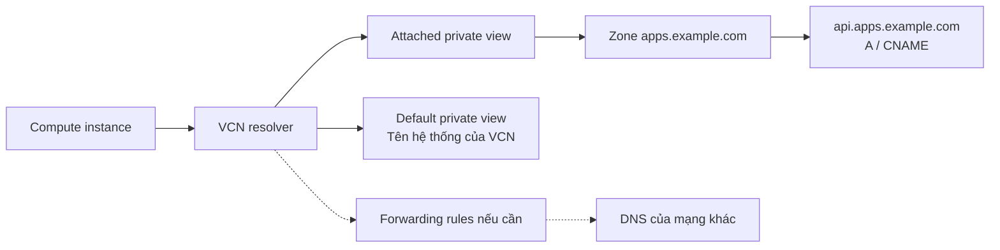

# Private DNS, private views và phân giải tên trong VCN

Một ứng dụng trên Oracle Cloud Infrastructure (OCI) thường gọi cơ sở dữ liệu và dịch vụ nội bộ bằng tên như `db.apps.example.com`, thay vì giữ địa chỉ IP trong cấu hình. Để tên đó hoạt động, cần xác định nơi lưu bản ghi, resolver nào nhìn thấy bản ghi và máy ứng dụng thực sự gửi truy vấn tới đâu.

Trong module **CLOUD_PROVIDERS_ORACLE**, bài học này kết nối kiến thức VCN với Compute, IAM và các dịch vụ cơ sở dữ liệu Oracle. Người học thiết kế không gian tên nội bộ, chia sẻ dữ liệu DNS giữa VCN, kết nối DNS với on-premises và kiểm tra riêng đường phân giải tên với đường truy cập ứng dụng.

Sau bài học, người học có thể:

- Phân biệt private zone, private view, VCN resolver và resolver endpoint.
- Tạo bản ghi nội bộ, gắn view vào resolver và kiểm tra từ Compute instance.
- Giải thích thứ tự tra cứu, phản hồi âm và ảnh hưởng của cache.
- Chọn chia sẻ view hoặc conditional forwarding theo phạm vi mạng.

## 1. Quan hệ zone–view–resolver

Một mô hình cần bốn thành phần:

| Thành phần | Trách nhiệm |
| --- | --- |
| Private zone | Chứa dữ liệu DNS cho một miền, ví dụ `apps.example.com` |
| Resource record | Ánh xạ một tên theo loại truy vấn, ví dụ A hoặc CNAME |
| Private view | Nhóm các private zone để resolver tham chiếu |
| Private resolver | Nhận truy vấn và tìm câu trả lời theo cấu hình của VCN |

Một private zone thuộc đúng một view. Trong một view, tên zone phải duy nhất; các view khác nhau có thể chứa zone cùng tên. View là tài nguyên của Private DNS, không áp dụng cho public zone. VCN có default view được bảo vệ; có thể bổ sung custom view thay vì đặt mọi zone ứng dụng vào view mặc định. [Private Views](https://docs.oracle.com/en-us/iaas/Content/DNS/Concepts/views.htm).



Hai quan hệ cần kiểm tra độc lập là **zone thuộc view nào** và **resolver đã gắn view đó chưa**. Tạo zone trong đúng compartment chưa tự làm cho các VCN trong compartment nhìn thấy nó.

Private DNS cũng không phải cơ chế cấp quyền truy cập ứng dụng. Một client biết private IP vẫn phải có route, quy tắc mạng và quyền ứng dụng phù hợp. Ngược lại, gắn view giúp client tra được tên nhưng không tạo đường tới địa chỉ vừa nhận.

## 2. DNS mặc định trong VCN

### 2.1. Tên do OCI quản lý

Khi bật DNS hostnames và đặt DNS label phù hợp cho VCN, subnet và hostname của private IP, cấu trúc tên điển hình là:

```text
<hostname>.<subnet_dns_label>.<vcn_dns_label>.oraclevcn.com
```

Ví dụ với hostname `vm01`, subnet label `appnet` và VCN label `dnslab`:

```text
vm01.appnet.dnslab.oraclevcn.com
```

Tên này trỏ tới private IP tương ứng. Display name của VM, DNS hostname và hostname mà hệ điều hành đang sử dụng là những giá trị cần phân biệt; sửa hostname trong OS không tự cập nhật bản ghi OCI. [DNS in a Virtual Cloud Network](https://docs.oracle.com/en-us/iaas/Content/Network/Concepts/dns.htm).

Các protected zone do dịch vụ OCI quản lý không nên được coi là zone ứng dụng tự quản. Trong default protected view, không tạo private zone tại hoặc bên dưới `oraclevcn.com`; dùng một miền ứng dụng riêng để tránh xung đột. [Tạo private zone trong view](https://docs.oracle.com/en-us/iaas/Content/DNS/Tasks/view-add-zone.htm).

### 2.2. DHCP quyết định client dùng DNS nào

Mỗi subnet gắn với một bộ DHCP options. Lựa chọn **Internet and VCN Resolver** cung cấp resolver OCI; địa chỉ IPv4 mặc định là `169.254.169.254`. Với **Custom Resolver**, client nhận các DNS server đã chỉ định. Thay đổi DHCP options cần được client nhận lại qua chu kỳ cập nhật hoặc thao tác DHCP/reboot phù hợp. [DHCP Options](https://docs.oracle.com/en-us/iaas/Content/Network/Tasks/managingDHCP.htm).

Do đó, câu hỏi đầu tiên khi có lỗi là: **máy ứng dụng đang hỏi DNS server nào?** Một VM được cấu hình hỏi resolver công cộng sẽ không tự có dữ liệu private zone của OCI.

Trên Linux, địa chỉ như `127.0.0.53` có thể là local stub. Khi đó cần kiểm tra upstream bằng công cụ quản lý DNS của OS, chẳng hạn:

```bash
resolvectl status
```

Bài thực hành dùng FQDN đầy đủ để giảm phụ thuộc search domain. DNS search suffix giúp hoàn thiện tên ngắn; nó không tạo bản ghi và không gắn view vào resolver.

## 3. Thứ tự phân giải và phản hồi âm

Resolver lần lượt xét attached views theo thứ tự cấu hình. Default view được xét sau các attached view, trừ khi đã được đặt trực tiếp trong danh sách đó. Sau các view mới tới forwarding rules và cuối cùng là phân giải Internet. Với zone ở chế độ Static, một câu trả lời âm từ zone phù hợp cũng kết thúc lượt tra cứu; không tự ghép dữ liệu của nhiều view. [Common Private DNS Issues](https://docs.oracle.com/en-us/iaas/Content/DNS/Tasks/troubleshooting_general.htm).

Ví dụ resolver có thứ tự:

```text
1. view-app-primary: zone apps.example.com
2. view-app-secondary: zone apps.example.com
3. Default view
4. Forwarding rules
5. Internet
```

Nếu zone Static ở view thứ nhất không có `billing.apps.example.com`, việc view thứ hai có bản ghi đó chưa bảo đảm client nhận được nó. Câu trả lời âm của view đầu tiên đã thể hiện dữ liệu có hiệu lực cho tên đang hỏi.

Điều tương tự xảy ra khi một zone cha quá rộng đứng trước rule forwarding. Nếu tạo zone Static `example.com`, truy vấn `host.corp.example.com` có thể được xử lý ở zone đó trước khi tới rule dành cho `corp.example.com`.

### Phân biệt ba kết quả thường gặp

| Kết quả | Ý nghĩa cần xem xét |
| --- | --- |
| Có answer | Có dữ liệu cho tên/loại truy vấn hoặc chuỗi alias được xử lý |
| NXDOMAIN | Tên được hỏi không tồn tại trong ngữ cảnh phân giải đó |
| NODATA | Tên tồn tại nhưng không có dữ liệu cho loại bản ghi được hỏi |

NODATA thường xuất hiện trong `dig` dưới dạng `status: NOERROR` nhưng không có answer của loại yêu cầu. Nó khác với timeout vì không nhận được phản hồi và khác với `SERVFAIL` khi resolver không hoàn thành phân giải. [RFC 2308 về phản hồi âm DNS](https://www.rfc-editor.org/rfc/rfc2308).

## 4. Static, Transparent và RTypeTransparent

OCI có các chế độ phân giải giúp kiểm soát việc tiếp tục tra cứu khi private zone thiếu dữ liệu. Trong bài lab, chọn **Static** để kết quả về quyền quản lý namespace rõ ràng. Khi nhiều nguồn cùng giữ một namespace, cần cân nhắc transparency. [OCI Private DNS Resolution Modes](https://blogs.oracle.com/cloud-infrastructure/oci-private-dns-resolution-modes).

| Chế độ | Khi tên không tồn tại trong zone | Khi tên tồn tại nhưng thiếu loại bản ghi |
| --- | --- | --- |
| Static | Trả NXDOMAIN | Trả NODATA |
| Transparent | Tiếp tục đánh giá nguồn kế tiếp | Chỉ tiếp tục với trường hợp thiếu loại ở zone apex; tên thông thường vẫn NODATA |
| RTypeTransparent | Tiếp tục đánh giá nguồn kế tiếp | Tiếp tục đánh giá nguồn kế tiếp |

Zone apex là chính tên miền của zone, chẳng hạn `apps.example.com`. Tiếp tục đánh giá có thể đi tới view tiếp theo rồi rules và Internet theo thứ tự resolver; không có nghĩa luôn nhảy thẳng tới DNS công cộng. Oracle cũng đặt giới hạn cho số lần tiếp tục do transparency. [Private DNS Zone Transparency](https://docs.oracle.com/en-us/iaas/Content/DNS/Tasks/privatedns.htm).

Ví dụ một zone giữ A của `api.apps.example.com`, còn nguồn khác giữ TXT cùng tên. Static trả NODATA cho truy vấn TXT nếu nguồn đầu không có loại đó; RTypeTransparent cho phép tiếp tục tìm. Dù dùng chế độ nào, một bản ghi đã trả lời phù hợp trong nguồn trước vẫn có ảnh hưởng ưu tiên.

Trước khi bật transparency, xác định các nguồn tiếp theo và dữ liệu mà chúng có thể trả lời. Với tên nội bộ nhạy cảm, cần đánh giá cả trường hợp tên vắng mặt bị gửi tiếp ra nguồn ngoài dự kiến. Không bật chế độ này chỉ để che một lỗi gắn nhầm view.

## 5. Thiết kế namespace và bản ghi ứng dụng

Một cấu trúc thực tế có thể dành các miền con riêng:

| Namespace | Owner dự kiến | Mục đích |
| --- | --- | --- |
| `apps.example.com` | Nhóm nền tảng ứng dụng | Tên ứng dụng nội bộ |
| `db.example.com` | Nhóm cơ sở dữ liệu | Alias tới endpoint DB đã quản lý |
| `corp.example.com` | Nhóm DNS doanh nghiệp | Tên do on-premises DNS trả lời |

`example.com` trong bài là miền minh họa. Môi trường thật nên dùng miền tổ chức quản lý và tránh tên gây nhầm lẫn với cơ chế phân giải khác, chẳng hạn hậu tố `.local` thường dùng cho mDNS.

Các record cần được kiểm kê theo tên, loại, RDATA, TTL và owner. Ví dụ:

```dns
api01.apps.example.com.  60 IN A     10.90.10.20
api.apps.example.com.    60 IN CNAME api01.apps.example.com.
db01.apps.example.com.   60 IN A     10.90.10.30
db.apps.example.com.     60 IN CNAME db01.apps.example.com.
```

Đây là dữ liệu minh họa cho zone, không phải một zone file đầy đủ. Trong Console, kiểm tra preview FQDN và RDATA để tránh thêm hậu tố hai lần. Các record cùng tên, loại và TTL được quản lý dưới dạng RRset. Thay đổi cần được publish theo quy trình của giao diện. [Adding a Record to a DNS Zone](https://docs.oracle.com/en-us/iaas/Content/DNS/Tasks/record-add.htm).

Đặt alias như `db.apps.example.com` giúp tách tên mà ứng dụng sử dụng khỏi tên đích hạ tầng. Tuy nhiên, thay DNS chưa thay Oracle Database service name, wallet, chứng chỉ TLS, kết nối đang mở hoặc chính sách client.

CNAME tới tên của một VCN khác còn đòi hỏi resolver phân giải được chính tên đích đó. Có alias trong view hiện tại không đồng nghĩa zone của đích tự được đưa vào phạm vi nhìn thấy.

## 6. Lab: tạo private zone và gắn vào VCN

### 6.1. Bộ tham số minh họa

| Tài nguyên | Giá trị |
| --- | --- |
| Region | `ap-singapore-1` |
| Compartment lab | `OciDnsLab` |
| VCN | `vcn-dns-lab`, CIDR `10.90.0.0/16` |
| Subnet client | `10.90.10.0/24` |
| VM client | `10.90.10.10` |
| Backend thử nghiệm | `10.90.10.20` |
| Private view | `view-app-lab` |
| Private zone | `apps.example.com` |
| Resolution mode | Static |
| TTL bản ghi lab | `60` giây |

Chuẩn bị VM có `dig` và quyền truy cập quản trị phù hợp. Backend chỉ cần tồn tại khi thử TCP/HTTPS; việc thử DNS có thể dùng các địa chỉ minh họa mà không tạo dịch vụ tương ứng.

Người triển khai cần quyền quản lý private zone, record, view và cấu hình resolver ở compartment tương ứng. Quyền cập nhật resolver với danh sách view còn liên quan quyền inspect các view đó. Nếu tạo endpoint, chuẩn bị thêm quyền và tài nguyên mạng cần thiết. Client gửi truy vấn DNS không cần được cấp quyền quản trị DNS qua IAM. [DNS Policy Reference](https://docs.oracle.com/en-us/iaas/Content/Identity/Reference/dnspolicyreference.htm).

### 6.2. Tạo view và zone

Trong phần DNS của Console, mở **Private views**, tạo `view-app-lab` ở `OciDnsLab`. View là tài nguyên theo region; xác minh region hiện tại trước khi tìm hoặc tạo tài nguyên. [Creating a Private View](https://docs.oracle.com/en-us/iaas/Content/DNS/Tasks/view-create.htm).

Trong view đó, tạo private zone `apps.example.com`, giữ mode Static cho bài lab. Sau khi zone sẵn sàng, thêm các record ở mục 5 và publish. Không sửa protected zone hoặc xóa SOA/NS chỉ để làm danh sách record ngắn hơn.

### 6.3. Gắn view vào resolver

Mở VCN lab, chọn **DNS Resolver**, vào **Associated private views** rồi **Manage Private Views**. Thêm `view-app-lab`, giữ các view đang cần và kiểm tra thứ tự trước khi lưu. Đây là thao tác làm cho resolver tham chiếu dữ liệu trong view. [Adding a Private View to a Resolver](https://docs.oracle.com/en-us/iaas/Content/Network/Tasks/resolver-add-view.htm).

Kiểm tra subnet của VM đang dùng đúng DHCP options và client đã nhận cấu hình. Với client dùng resolver VCN mặc định, chưa cần tạo listening endpoint riêng để bắt đầu truy vấn từ VM trong VCN.

Nếu cùng tên zone đã xuất hiện trong view có ưu tiên cao hơn, hãy giải quyết xung đột trước khi nghiệm thu. Việc zone mới tồn tại và đang active chưa chứng minh nó sẽ được chọn.

## 7. Kiểm thử đúng ngữ cảnh bằng dig và OCI CLI

### 7.1. Truy vấn từ VM trong VCN

Các lệnh sau là ví dụ Bash trên VM lab, tập trung vào địa chỉ resolver IPv4:

```bash
dig @169.254.169.254 api01.apps.example.com. A \
  +time=2 +tries=1 +noall +comments +answer +authority +stats

dig @169.254.169.254 api.apps.example.com. A \
  +time=2 +tries=1 +noall +comments +answer +authority +stats

dig @169.254.169.254 missing.apps.example.com. A \
  +time=2 +tries=1 +noall +comments +answer +authority +stats

dig @169.254.169.254 api01.apps.example.com. TXT \
  +time=2 +tries=1 +noall +comments +answer +authority +stats
```

Kết quả mong đợi với dữ liệu và mode Static của bài:

| Truy vấn | Kết quả cần quan sát |
| --- | --- |
| `api01... A` | `10.90.10.20` |
| `api... A` | Chuỗi CNAME tới `api01...` và địa chỉ tương ứng |
| `missing... A` | NXDOMAIN vì tên không có trong zone lab |
| `api01... TXT` | NOERROR nhưng không có TXT answer, tức NODATA |

Không chỉ nhìn `+short`: header và authority giúp phân biệt phản hồi âm, lỗi server và thiếu kết nối. Dấu chấm cuối FQDN giúp bài thử không phụ thuộc search suffix.

Sau đó thử resolver mặc định của OS:

```bash
dig api.apps.example.com. A
getent ahostsv4 api.apps.example.com
```

Nếu truy vấn chỉ định `@169.254.169.254` đúng nhưng OS hoặc ứng dụng trả lời khác, hãy kiểm tra upstream, cache, local hosts và đường phân giải trong container. `dig` và lời gọi phân giải của ứng dụng không nhất thiết dùng hoàn toàn cùng chuỗi xử lý.

### 7.2. Quan sát control plane

OCI CLI được xác thực bằng danh tính có quyền đọc tài nguyên tương ứng:

```bash
REGION='ap-singapore-1'
RESOLVER_OCID='<OCID_CUA_RESOLVER>'
ZONE_OCID='<OCID_CUA_PRIVATE_ZONE>'

oci dns resolver get \
  --resolver-id "$RESOLVER_OCID" \
  --scope PRIVATE \
  --region "$REGION"

oci dns record rrset get \
  --zone-name-or-id "$ZONE_OCID" \
  --domain 'api01.apps.example.com' \
  --rtype A \
  --scope PRIVATE \
  --region "$REGION"
```

Dùng output đầu để đối chiếu default view, attached views và rules; output sau kiểm tra RRset đã lưu. Khi truy cập private zone bằng tên thay vì OCID, cần chỉ rõ view tương ứng để tránh nhập nhằng zone trùng tên. [CLI resolver get](https://docs.oracle.com/en-us/iaas/tools/oci-cli/latest/oci_cli_docs/cmdref/dns/resolver/get.html), [CLI RRset get](https://docs.oracle.com/en-us/iaas/tools/oci-cli/latest/oci_cli_docs/cmdref/dns/record/rrset/get.html).

CLI đọc đúng record chỉ chứng minh dữ liệu quản trị tồn tại. Phép thử từ client mới kiểm tra resolver được dùng, thứ tự view và đường DNS thực tế. Cloud Shell không đại diện mặc nhiên cho ngữ cảnh DNS của VM trong VCN.

### 7.3. Tách DNS khỏi kết nối ứng dụng

Nếu có backend HTTPS thử nghiệm tại `api.apps.example.com:8443` với chứng chỉ được client tin cậy:

```bash
nc -vz -w 5 10.90.10.20 8443
curl --noproxy '*' --connect-timeout 5 --max-time 15 \
  'https://api.apps.example.com:8443/health'
```

DNS đúng nhưng TCP thất bại thì điều tra route, Security Lists/NSGs, firewall và listener. TCP thành công nhưng TLS lỗi thì kiểm tra hostname và chứng chỉ. Đọc được dữ liệu nghiệp vụ còn phụ thuộc danh tính ứng dụng hoặc quyền database.

## 8. Chia sẻ DNS giữa các VCN

### 8.1. Cùng region: tái sử dụng view

Các resolver trong cùng region có thể tham chiếu private view dùng chung. Chẳng hạn gắn `view-app-lab` vào resolver của VCN B giúp B sử dụng cùng dữ liệu zone thay vì tạo bản sao record. Có thể chia sẻ cả default view phù hợp để phân giải các tên hệ thống của VCN khác. [Shared Private DNS Zones Within a Region](https://docs.oracle.com/en-us/iaas/Content/DNS/Tasks/privatedns.htm).

Đây là chia sẻ dữ liệu DNS ở resolver, không phải gửi truy vấn tới DNS server trong subnet của VCN A. Gắn view không tự tạo peering hoặc route cho workload; muốn B kết nối tới IP thuộc A vẫn phải thiết kế đường dữ liệu riêng.

Ví dụ phép thử có giá trị là: từ VM ở B tra được `api.apps.example.com` nhưng chưa kết nối được backend vì chưa có đường mạng. Kết quả này giúp tách hai lớp cấu hình thay vì sửa record khi lỗi thực tế nằm ở routing.

### 8.2. Khác region hoặc muốn giữ nguồn DNS độc lập

Dùng forwarding endpoint ở mạng nguồn, listening endpoint ở resolver đích và rule cho đúng miền. Cần có kết nối mạng giữa endpoint, route hai chiều và rule bảo mật tương ứng. Không coi view trong region khác là view cục bộ có thể gắn tùy ý.

Khi lựa chọn giữa view dùng chung và forwarding, hãy cân nhắc owner dữ liệu, phạm vi region, điểm lỗi phụ thuộc và khả năng theo dõi sự cố. Tránh nhân bản thủ công toàn bộ zone ở nhiều VCN nếu mục tiêu là một bộ dữ liệu chung.

## 9. Listening endpoint và forwarding endpoint

| Endpoint | Hướng truy vấn |
| --- | --- |
| Listening | Nhận câu hỏi từ resolver/client của mạng khác vào resolver VCN |
| Forwarding | Cung cấp đường gửi câu hỏi từ resolver VCN tới DNS server được rule chọn |

Một endpoint chỉ có một vai trò listening hoặc forwarding. Compute instance hỏi trực tiếp `169.254.169.254` trong VCN không cần listening endpoint riêng. Listening/forwarding endpoint hiện không hỗ trợ IPv6; đừng nhầm điều đó với khả năng lưu bản ghi AAAA. [Resolver Endpoints](https://docs.oracle.com/en-us/iaas/Content/Network/Concepts/dns-topic-resolver_endpoints.htm).

Ví dụ lab mở rộng với DNS on-premises:

```text
VCN: 10.90.0.0/16
Subnet endpoint IPv4: 10.90.20.0/24
Listening IP minh họa: 10.90.20.10
Forwarding IP minh họa: 10.90.20.11
DNS on-premises: 172.20.1.53
Zone on-premises quản lý: corp.example.com
```

Các địa chỉ trên chỉ là mẫu; dùng IP được cấp thực tế và bảo đảm subnet đủ dung lượng. Tạo endpoint qua trang resolver, chọn subnet và vai trò phù hợp. Endpoint có tài nguyên mạng liên quan trong subnet, nên cần quản lý vòng đời cùng hạ tầng mạng. [Creating a Resolver Endpoint](https://docs.oracle.com/en-us/iaas/Content/Network/Tasks/resolver-endpoint-create.htm).

### Luồng OCI hỏi tên on-premises

```text
VM -> VCN resolver
   -> Không được trả lời từ private views
   -> Rule cho corp.example.com
   -> Forwarding endpoint
   -> DNS 172.20.1.53
```

Tạo FORWARD rule theo miền cần gửi, chọn endpoint nguồn và địa chỉ DNS đích. Đường kết nối có thể qua FastConnect hoặc Site-to-Site VPN theo thiết kế. Không dùng một forward rule tổng quát để chuyển mọi tên sang on-premises khi chưa đánh giá tính sẵn sàng và phạm vi truy vấn.

### Luồng on-premises hỏi tên OCI

```text
Client on-premises -> DNS doanh nghiệp
                  -> Conditional forward cho apps.example.com
                  -> Listening endpoint 10.90.20.10
                  -> Resolver VCN -> Private view -> Record
```

DNS doanh nghiệp gửi tới **listening IP trong subnet**, không gửi tới địa chỉ link-local `169.254.169.254` của một VCN từ xa. Trên resolver OCI không forward ngược `apps.example.com` về DNS doanh nghiệp nếu chính resolver đó phải trả lời zone này; cấu hình hai chiều sai có thể tạo vòng lặp.

Một FORWARD rule đã khớp sẽ được áp dụng; việc đích không trả lời không có nghĩa resolver tự bỏ qua để thử rule kế tiếp. Thiết kế dự phòng cần được thử với cấu hình đích thực tế. [Quy tắc xử lý forwarding](https://docs.oracle.com/en-us/iaas/Content/DNS/Tasks/troubleshooting_general.htm).

## 10. Mạng và bảo mật cho DNS forwarding

Phải cho phép UDP và TCP port `53` theo đường cần thiết. TCP có vai trò khi câu trả lời hoặc cơ chế truy vấn cần nó; chỉ kiểm tra UDP chưa nghiệm thu đầy đủ.

Với thiết kế stateless, bảng kiểm tra hướng gói tin là:

| Vị trí | Yêu cầu | Phản hồi |
| --- | --- | --- |
| Listening endpoint | Ingress tới destination port 53 | Egress từ source port 53 |
| Forwarding endpoint | Egress tới destination port 53 | Ingress từ source port 53 |

Áp dụng cho cả UDP và TCP, giới hạn CIDR/IP của phía DNS đối tác và chú ý cổng tạm thời ở phía client. Oracle đề cập stateless rules cho lưu lượng DNS để tránh phụ thuộc connection tracking khi tải lớn; dùng stateful thì phải hiểu hành vi theo dõi kết nối của môi trường. [Network Connectivity Issues With Private DNS](https://docs.oracle.com/en-us/iaas/Content/DNS/Tasks/troubleshooting_network-connectivity.htm).

Kiểm tra đồng thời subnet route table, DRG/LPG/RPC nếu có, NSG/Security List của endpoint và firewall phía DNS đối tác. Có thể kiểm tra đường listening từ máy được phép trong mạng ngoài bằng:

```bash
dig @10.90.20.10 api.apps.example.com. A +time=2 +tries=1
dig @10.90.20.10 api.apps.example.com. A +tcp +time=2 +tries=1
```

IAM bảo vệ thao tác quản trị zone/view/resolver; quy tắc mạng bảo vệ đường hỏi DNS. Việc một record không công bố trên Internet không thay thế phân quyền dữ liệu. Không đưa mật khẩu, token hoặc thông tin nhạy cảm vào TXT record để dùng DNS như nơi lưu bí mật.

## 11. Cache, TTL và thay đổi endpoint

TTL biểu thị thời gian lưu kết quả trong cache theo cơ chế DNS, không phải cam kết mọi tiến trình chuyển sang địa chỉ mới ngay sau số giây đó. Hệ điều hành, local stub, resolver, runtime và connection pool có thể làm việc quan sát thay đổi phức tạp hơn.

Phản hồi âm cũng có thể được cache. Vì vậy truy vấn một tên trước khi tạo record rồi thêm record sau đó có thể vẫn thấy NXDOMAIN trong thời gian cache còn hiệu lực; TTL của record mới không tự xóa cache âm cũ. [Negative Caching of DNS Queries](https://www.rfc-editor.org/rfc/rfc2308).

Khi chuẩn bị đổi endpoint:

1. Ghi lại RRset, TTL, view và thứ tự resolver đang dùng.
2. Nếu cần giảm TTL, thực hiện đủ sớm để các cache với TTL cũ được xử lý.
3. Chuẩn bị endpoint mới, routing, TLS và quyền ứng dụng trước khi đổi DNS.
4. Publish record, kiểm tra từ từng nhóm client thực tế.
5. Giữ endpoint cũ theo thời gian chuyển đổi đã xác định và có phương án rollback.

Không xem bản ghi nhiều A hoặc đổi CNAME là cơ chế health check tự động. Private DNS cũng không đồng nghĩa OCI Traffic Management cho public DNS đã được áp dụng vào zone nội bộ. Với cơ sở dữ liệu Oracle, phối hợp thay đổi tên với cơ chế chuyển vai trò và kết nối client phù hợp.

## 12. Chẩn đoán theo dấu hiệu

| Dấu hiệu | Điều cần kiểm tra |
| --- | --- |
| CLI thấy record, VM trả NXDOMAIN | View của zone, resolver VM dùng, thứ tự view và cache âm |
| `dig @169.254.169.254` đúng nhưng ứng dụng sai | DHCP, OS stub, runtime/container cache và local hosts |
| Tên hệ thống VCN đúng, custom zone sai | Custom view chưa gắn hoặc record chưa publish đúng |
| Chỉ một VCN trả lời khác | Resolver/view khác nhau hoặc thứ tự ưu tiên khác |
| On-premises hỏi OCI bị timeout | Listening IP, route hai chiều, UDP/TCP 53 và firewall |
| OCI hỏi on-premises bị SERVFAIL/timeout | Rule, forwarding endpoint, DNS đích và vòng lặp |
| Tên ngắn sai, FQDN đúng | Search domain và cách ứng dụng hoàn thiện tên |
| A đúng nhưng TXT/AAAA không có | Loại record thực có, NODATA và resolution mode |
| DNS đúng nhưng kết nối backend lỗi | Routing, bảo mật mạng, listener, TLS hoặc quyền ứng dụng |

Với mỗi sự cố, ghi tên đầy đủ, QTYPE, DNS server được hỏi, VCN nguồn, thời gian, mã phản hồi và answer/authority. Một ảnh chụp danh sách record chưa đủ để xác định câu trả lời mà client đã nhận.

Thử lần lượt: record có đúng không, zone thuộc view nào, view có được resolver dùng không, client có hỏi đúng resolver không, rồi mới kiểm tra forwarding và đường mạng nếu cần. Giữ phép thử cố định và đổi từng yếu tố để kết quả có thể giải thích được.

## 13. Vận hành và nghiệm thu lab

Một private view dùng chung giúp giảm trùng lặp nhưng tăng phạm vi ảnh hưởng của thay đổi. Ghi rõ owner cho từng zone, resolver sử dụng view và quy trình kiểm tra trước khi publish. Khi tự động hóa, bảo toàn toàn bộ danh sách attached views và thứ tự mong muốn; không vô tình thay danh sách bằng một phần tử mới.

Đối với ngân sách lab, kiểm kê VM, endpoint, kết nối lai và công cụ quan sát đã tạo; đối chiếu bảng giá áp dụng trước khi mở rộng quy mô. Chỉ tạo endpoint forwarding/listening khi use case cần đường DNS giữa các mạng.

Ma trận nghiệm thu nên có:

| Phép thử | Tiêu chí |
| --- | --- |
| VM lab hỏi A và CNAME | Trả đúng địa chỉ và alias của zone |
| Hỏi tên vắng mặt ở Static zone | NXDOMAIN đúng ngữ cảnh |
| Hỏi TXT chưa tồn tại tại tên có A | NODATA, phân biệt được với timeout |
| Client VCN B dùng view đã chia sẻ | Kết quả phù hợp resolver và thứ tự cấu hình |
| B truy cập backend tại A | Đánh giá riêng đường ứng dụng, không suy từ DNS |
| Hybrid DNS hai chiều | Đúng conditional forward, UDP/TCP hoạt động, không có vòng lặp |
| Thay một bản ghi thử | Theo dõi được cache và phục hồi theo kế hoạch |

Sau lab, gỡ các rule/view association chỉ dùng để thử trước khi xóa tài nguyên do mình tạo. Giữ nguyên protected resources do OCI quản lý và các tài nguyên còn phục vụ workload khác. Kiểm tra endpoint và tài nguyên mạng liên quan khi dọn môi trường.

Một cấu hình hoàn chỉnh phải giải thích được cả **dữ liệu DNS có hiệu lực** lẫn **ngữ cảnh truy vấn của client**. Đây là cơ sở để ứng dụng và cơ sở dữ liệu Oracle sử dụng tên nội bộ ổn định qua nhiều subnet, VCN và mạng doanh nghiệp.