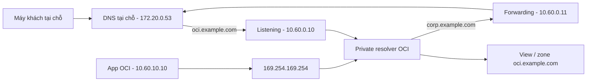

# DNS resolver endpoints và phân giải tên với on-premises

Một ứng dụng chạy trên OCI Compute có thể cần gọi dịch vụ ERP tại trung tâm dữ liệu bằng tên miền nội bộ. Theo chiều ngược lại, người vận hành tại chỗ có thể cần kết nối tới cơ sở dữ liệu Oracle trong OCI bằng tên riêng. Để làm được điều đó, kết nối FastConnect hoặc Site-to-Site VPN phải đi cùng cấu hình phân giải tên phù hợp.

Trong chương **DNS và điều phối truy cập** của module **CLOUD_PROVIDERS_ORACLE**, bài học này tập trung vào private DNS resolver, listening endpoint, forwarding endpoint và conditional forwarding. Thiết kế được đặt trong bối cảnh phân quyền, định tuyến, bảo mật, giám sát và khả năng vận hành của Oracle Cloud Infrastructure.

## 1. Mục tiêu và phạm vi

Sau bài học, người học có thể:

- Chọn listening endpoint hay forwarding endpoint theo chiều truy vấn DNS.
- Lần theo truy vấn từ máy khách tới DNS tại chỗ hoặc private zone trong OCI.
- Xác định đúng IP nguồn, IP đích, route và cổng cần cho từng chặng.
- Cấu hình phân giải hai chiều cho hai namespace riêng.
- Phân biệt timeout, NXDOMAIN, lỗi rule và lỗi kết nối ứng dụng sau khi đã có địa chỉ.
- Kiểm tra cache và đường dự phòng mà không nhầm kết quả DNS cũ với khả năng truy cập DNS hiện tại.

Bài học giả định đã có VCN, subnet và kết nối riêng với mạng tại chỗ. Các tên thuộc `example.com` và toàn bộ địa chỉ trong ví dụ là dữ liệu minh họa. Không cần public DNS hoặc cơ chế điều phối truy cập công khai để triển khai mô hình này.

## 2. Các thành phần và trách nhiệm

| Thành phần | Vai trò |
| --- | --- |
| Private zone | Chứa dữ liệu DNS riêng, như bản ghi A của máy chủ |
| Private view | Nhóm các private zone được resolver sử dụng |
| Private DNS resolver của VCN | Xử lý truy vấn dựa trên view và rule |
| Listening endpoint | Nhận truy vấn gửi vào resolver từ mạng có thể kết nối tới endpoint |
| Forwarding endpoint | Gửi truy vấn từ resolver tới một DNS server khác |
| Resolver rule | Chọn truy vấn cần chuyển tiếp và DNS đích |
| DNS server tại chỗ | Phục vụ tên miền nội bộ và chuyển tiếp namespace OCI khi được cấu hình |

Resolver có thể sử dụng private views, private zones và conditional forwarding rules. Khi tạo VCN với tùy chọn DNS hostnames phù hợp, OCI tạo resolver riêng cùng default private view và các zone do hệ thống quản lý. [Nguồn: Private DNS Resolvers](https://docs.oracle.com/en-us/iaas/Content/Network/Concepts/dns-topic-Private-resolver.htm).

Để thiết kế rõ ràng, nên xác định nơi sở hữu dữ liệu trước khi cấu hình rule. Ví dụ, đội OCI quản lý tên của workload trong cloud, còn đội DNS doanh nghiệp quản lý tên của dịch vụ tại chỗ. Forwarding chuyển câu hỏi tới đúng nơi; nó không tự đồng bộ các bản ghi giữa hai hệ thống.

### 2.1. Listening và forwarding được nhìn từ phía OCI

| Nhu cầu | Thành phần OCI cần dùng |
| --- | --- |
| DNS tại chỗ hỏi tên do OCI phục vụ | Listening endpoint |
| Workload OCI hỏi tên do DNS tại chỗ phục vụ | Forwarding endpoint và resolver rule |
| Compute trong VCN hỏi resolver mặc định | Không cần thêm listening endpoint chỉ cho việc này |

Một endpoint chỉ được cấu hình để nghe hoặc để chuyển tiếp. Địa chỉ mặc định `169.254.169.254` phục vụ truy vấn từ Compute trong VCN; listening endpoint bổ sung điểm nhận truy vấn từ các mạng có kết nối. Endpoint gắn với subnet và có VNIC tương ứng. [Nguồn: Resolver Endpoints](https://docs.oracle.com/en-us/iaas/Content/Network/Concepts/dns-topic-resolver_endpoints.htm).

Không lấy địa chỉ forwarding endpoint làm DNS server cho máy khách. Đó là địa chỉ resolver dùng để gửi truy vấn đi. Cũng không dùng `169.254.169.254` làm đích conditional forwarder từ mạng tại chỗ.

### 2.2. Namespace độc lập giúp dễ giải thích

Bài thực hành chia quyền sở hữu:

```text
oci.example.com    -> dữ liệu trong OCI private zone
corp.example.com   -> dữ liệu trên DNS tại chỗ
```

Ví dụ:

```text
db01.oci.example.com     A  10.60.20.20
app01.oci.example.com    A  10.60.10.10
erp.corp.example.com     A  172.20.50.20
```

Hai namespace khác nhau giúp biết nơi trả lời cuối cùng của mỗi câu hỏi. Nếu cùng một namespace có dữ liệu ở nhiều nơi, cần thiết kế thêm cơ chế phù hợp; không nên tự tạo hai zone trùng tên rồi kỳ vọng bản ghi thiếu ở bên này luôn được tìm tiếp ở bên kia.

## 3. Mô hình kết nối hai chiều

### 3.1. Địa chỉ và tài nguyên

| Tài nguyên | Địa chỉ minh họa |
| --- | --- |
| OCI VCN | `10.60.0.0/16` |
| Subnet đặt resolver endpoints | `10.60.0.0/24` |
| Listening endpoint `dns_in` | `10.60.0.10` |
| Forwarding endpoint `dns_out` | `10.60.0.11`, là forwarding address |
| Máy ứng dụng OCI | `10.60.10.10` |
| Máy cơ sở dữ liệu OCI | `10.60.20.20` |
| Mạng tại chỗ | `172.20.0.0/16` |
| DNS tại chỗ | `172.20.0.53` |
| Máy ERP tại chỗ | `172.20.50.20` |

Endpoint dùng subnet IPv4-only. Dự trù một IP cho listening, hai IP cho forwarding; lấy forwarding address thực tế từ dịch vụ khi cấu hình mạng. [Nguồn: Private DNS](https://docs.oracle.com/en-us/iaas/Content/DNS/Tasks/privatedns.htm), [Common Private DNS Issues](https://docs.oracle.com/en-us/iaas/Content/DNS/Tasks/troubleshooting_general.htm).



Sơ đồ chỉ biểu diễn luồng truy vấn. Các chặng giữa OCI và mạng tại chỗ đi qua kết nối riêng đã được cấu hình, với route và chính sách bảo mật ở cả hai phía.

### 3.2. Tại chỗ hỏi tên trong OCI

Giả sử máy khách tại chỗ cần `db01.oci.example.com`:

1. Máy khách hỏi DNS doanh nghiệp `172.20.0.53`.
2. DNS doanh nghiệp khớp conditional forwarder của `oci.example.com`.
3. DNS đó gửi truy vấn tới listening endpoint `10.60.0.10`.
4. Resolver OCI tìm dữ liệu trong view chứa zone `oci.example.com`.
5. Câu trả lời `10.60.20.20` được trả về qua DNS doanh nghiệp tới máy khách.

Nhìn trên đường truyền hybrid:

```text
Truy vấn:
172.20.0.53:<cổng nguồn> -> 10.60.0.10:53

Phản hồi:
10.60.0.10:53 -> 172.20.0.53:<cổng nguồn>
```

Trong mô hình này, IP nguồn tới endpoint là DNS doanh nghiệp, không phải toàn bộ máy khách phía sau nó. Nếu một máy kiểm tra khác hỏi thẳng listening endpoint, máy đó phải có route và quyền riêng cho luồng trực tiếp.

### 3.3. OCI hỏi tên tại chỗ

Giả sử App OCI cần `erp.corp.example.com`:

1. App hỏi resolver được cấu hình cho máy, ở đây là `169.254.169.254`.
2. Không có private zone trong thiết kế này trả lời namespace `corp.example.com`.
3. Resolver khớp rule chuyển tiếp của `corp.example.com`.
4. Resolver gửi truy vấn qua `dns_out` tới `172.20.0.53`.
5. DNS tại chỗ trả lời `172.20.50.20`.
6. Resolver OCI trả kết quả về App.

Trên chặng OCI tới DNS tại chỗ:

```text
Truy vấn:
10.60.0.11:<cổng nguồn> -> 172.20.0.53:53

Phản hồi:
172.20.0.53:53 -> 10.60.0.11:<cổng nguồn>
```

Đây là một truy vấn được resolver chuyển tiếp. Firewall phía tại chỗ cần xét forwarding address `10.60.0.11`. Chỉ cấp quyền cho IP App `10.60.10.10` chưa cho phép chặng này.

Tài liệu thực hành của Oracle mô tả hai chiều riêng: tại chỗ gửi tới listening address, còn resolver OCI gửi ra bằng forwarding address; các địa chỉ đó phải được định tuyến và cho phép qua VPN hoặc FastConnect. [Nguồn: Configure two way domain name resolution](https://docs.oracle.com/en/learn/resolve-onprem-dns-from-oci/).

### 3.4. Phân giải thành công chưa tạo ra đường tới dịch vụ

Sau khi nhận `db01.oci.example.com = 10.60.20.20`, máy khách bắt đầu kết nối ứng dụng tới `10.60.20.20`. Luồng này có đích khác endpoint DNS, có cổng khác và có thể đi qua chính sách mạng khác.

Nên tách bằng chứng:

| Lớp kiểm tra | Câu hỏi cần trả lời |
| --- | --- |
| DNS | Tên có trả về đúng dữ liệu không? |
| Mạng tới workload | Private IP vừa nhận có thể truy cập từ nguồn không? |
| Dịch vụ | Listener hoặc ứng dụng có hoạt động không? |
| Quyền sử dụng | Người dùng hoặc ứng dụng có được xác thực, cấp quyền không? |

Không sửa DNS để xử lý một lỗi listener khi bản ghi đã đúng; cũng không kết luận DNS khỏe chỉ vì có thể kết nối thẳng bằng IP.

## 4. Resolver chọn câu trả lời như thế nào?

### 4.1. View, rule và phân giải Internet

Trình tự chính của private resolver là:

```text
Private views theo thứ tự cấu hình
  -> default view nếu chưa nằm trong danh sách trên
  -> resolver rules theo thứ tự
  -> phân giải Internet nếu chưa có câu trả lời phù hợp
```

QNAME cover condition có thể khớp tên miền đã chỉ định và các tên bên dưới nó. Bài thực hành sử dụng một điều kiện cho `corp.example.com`. [Nguồn: Private DNS — Configuration and Resolution](https://docs.oracle.com/en-us/iaas/Content/DNS/Tasks/privatedns.htm).

Trình tự này giải thích vì sao có rule đúng nhưng không thấy truy vấn ra endpoint: một private zone có thể đã cung cấp câu trả lời trước đó.

### 4.2. Zone rộng có thể che forwarding rule

Ví dụ sai trong phạm vi mô hình:

```text
Private zone OCI: example.com
Forwarding rule:  corp.example.com -> 172.20.0.53
Tên cần hỏi:      erp.corp.example.com
```

Nếu zone `example.com` dùng chế độ Static và không có tên được hỏi, nó có thể trả NXDOMAIN trước khi tới rule. Rule chuyển tiếp không tự vượt qua câu trả lời âm đó.

OCI hỗ trợ các chế độ transparency. Ví dụ này dùng Static; zone bật transparency có thể tiếp tục xử lý khác với tình huống trên. [Nguồn: Private DNS — Private DNS Zone Transparency](https://docs.oracle.com/en-us/iaas/Content/DNS/Tasks/privatedns.htm).

### 4.3. Rule đầu tiên khớp được áp dụng

Resolver rules được kiểm tra theo thứ tự. Khi một rule đã khớp, các rule sau không trở thành phương án thay thế cho kết quả của rule đó. Vì vậy:

- Đặt điều kiện cụ thể trước điều kiện rộng bao phủ nó.
- Kiểm tra tác động trước khi thêm rule khớp mọi tên.
- Không tạo hai rule cùng điều kiện để kỳ vọng rule thứ hai cứu rule thứ nhất khi DNS đích hỏng.

Forwarding endpoint phải tồn tại trước khi rule sử dụng nó được tạo. [Nguồn: Resolver Rules](https://docs.oracle.com/en-us/iaas/Content/Network/Concepts/dns-topic-resolver_rules.htm).

Trong mô hình cơ bản, chỉ cần một rule OCI cho namespace `corp.example.com`; các truy vấn khác tiếp tục theo cấu hình resolver hiện có.


## 5. Route và bảo mật cho từng chặng

### 5.1. Route phải bao gồm subnet endpoint

Với mô hình trên, các chặng DNS qua kết nối hybrid đều liên quan tới `10.60.0.0/24` và DNS tại chỗ `172.20.0.53`.

| Vị trí kiểm tra | Route hoặc khả năng chuyển tiếp cần có |
| --- | --- |
| Phía tại chỗ | Có đường tới subnet endpoint OCI |
| DRG khi nhận gói từ tại chỗ | Chuyển được tới VCN chứa endpoint |
| Bảng route áp dụng cho endpoint subnet | Có đường tới DNS tại chỗ qua DRG |
| DRG khi nhận gói từ VCN | Có đường tới mạng DNS tại chỗ qua kết nối hybrid |
| Phía DNS tại chỗ | Trả lời được về listening hoặc forwarding address |

Chỉ kiểm tra App subnet tới mạng tại chỗ là chưa đủ. Forwarding endpoint dùng VNIC trong endpoint subnet, nên phải kiểm tra đường đi có hiệu lực cho endpoint.

Để giới hạn mô hình, route từ endpoint subnet có thể hướng tới `172.20.0.53/32` thay vì toàn bộ mạng tại chỗ, nếu thiết kế DRG và mạng khách hàng hỗ trợ tương ứng. Khi thêm DNS đích khác, cần cập nhật cả route và chính sách mạng.

### 5.2. Cho phép UDP và TCP 53

DNS sử dụng cả UDP và TCP. TCP không chỉ phục vụ zone transfer; nó còn được dùng cho truy vấn thông thường và khi cần xử lý phản hồi không phù hợp với UDP. Chỉ mở UDP 53 có thể làm một số tên hoạt động còn những truy vấn khác thất bại. [Nguồn: RFC 7766 — DNS Transport over TCP](https://www.rfc-editor.org/rfc/rfc7766).

Các luồng yêu cầu của bài thực hành:

| Nguồn | Đích | Giao thức, cổng đích | Mục đích |
| --- | --- | --- | --- |
| `172.20.0.53` | `10.60.0.10` | UDP 53 và TCP 53 | DNS tại chỗ hỏi OCI |
| `10.60.0.11` | `172.20.0.53` | UDP 53 và TCP 53 | OCI chuyển tiếp tới tại chỗ |

Phản hồi đi theo chiều ngược lại, với cổng nguồn DNS là 53 và cổng đích là cổng nguồn của truy vấn. Không đặt cổng nguồn của mọi truy vấn thành 53.

Một bảng kiểm riêng cho UDP:

| Endpoint OCI | Chiều | Điều kiện cổng của luồng |
| --- | --- | --- |
| Listening | Ingress từ DNS tại chỗ | Destination port 53 |
| Listening | Egress trả về DNS tại chỗ | Source port 53 |
| Forwarding | Egress tới DNS tại chỗ | Destination port 53 |
| Forwarding | Ingress phản hồi từ DNS tại chỗ | Source port 53 |

Đây là ma trận luồng cần được cho phép, không phải yêu cầu tạo trùng mọi rule. Khi dùng stateful rules, phản hồi hợp lệ được xử lý theo connection tracking; khi dùng stateless rules, phải cấp rõ chiều phản hồi tương ứng. Cần đối chiếu cả NSG endpoint, security list subnet và firewall tại chỗ.

Khi chuyển ma trận luồng thành security rules, giữ đúng cổng nguồn, cổng đích và cách xử lý phản hồi của từng giao thức. [Nguồn: OCI Security Rules](https://docs.oracle.com/en-us/iaas/Content/Network/Concepts/securityrules.htm), [RFC 1035 — DNS transport](https://www.rfc-editor.org/rfc/rfc1035).

### 5.3. Giới hạn theo đúng DNS server

Đề xuất cho bài thực hành:

- Listening endpoint chỉ nhận từ `172.20.0.53/32`.
- Forwarding endpoint chỉ gửi tới `172.20.0.53/32`.
- Firewall tại chỗ cho phép forwarding address `10.60.0.11` hỏi DNS.
- Client tại chỗ tiếp tục sử dụng DNS doanh nghiệp.
- Máy chẩn đoán hỏi thẳng listening endpoint chỉ được thêm khi cần và có phạm vi rõ ràng.

Nếu mạng có NAT, firewall phải xét địa chỉ thực tế ở vị trí nó quan sát, thay vì áp dụng nguyên xi các IP nguồn trong sơ đồ không có NAT này.

Quyền đọc bản ghi DNS không thay thế quyền kết nối workload. Một người biết private IP của Database vẫn phải qua route, quy tắc mạng, listener và cơ chế xác thực Database.

## 6. Trình tự triển khai hai chiều

### 6.1. Chuẩn bị namespace và quyền quản lý

Trước khi tạo endpoint, ghi rõ:

| Namespace | Nơi quản lý | Cách phía còn lại tìm câu trả lời |
| --- | --- | --- |
| `oci.example.com` | Private zone OCI | DNS tại chỗ forward tới listening endpoint |
| `corp.example.com` | DNS tại chỗ | Resolver OCI forward qua forwarding endpoint |

Phân công người quản lý zone/record, người quản lý resolver/rule và người quản lý mạng. OCI có các resource type như `dns-zones`, `dns-records`, `dns-views`, `dns-resolvers` để thiết kế IAM theo trách nhiệm. Các thao tác liên quan subnet, VNIC và NSG cần quyền mạng phù hợp. [Nguồn: Details for the DNS Service](https://docs.oracle.com/en-us/iaas/Content/Identity/Reference/dnspolicyreference.htm).

Nên giới hạn quyền vào compartment và tài nguyên phục vụ bài thực hành. Việc không nhìn thấy view hoặc subnet trong Console có thể do phạm vi compartment hoặc IAM, không nhất thiết là tài nguyên chưa tồn tại.

### 6.2. Tạo dữ liệu private DNS phía OCI

Trên resolver của VCN cần phục vụ namespace OCI:

1. Chọn một private view dành cho bài thực hành.
2. Tạo private zone `oci.example.com` trong view đó.
3. Thêm bản ghi A `db01.oci.example.com` trỏ tới `10.60.20.20`.
4. Thêm bản ghi A `app01.oci.example.com` trỏ tới `10.60.10.10`.
5. Gắn view vào resolver của VCN, kiểm tra thứ tự các view đang có.
6. Thử tên này từ Compute trong VCN trước khi kiểm tra phía tại chỗ.

Có thể đặt TTL 60 giây cho bản ghi thực hành để dễ quan sát cache. Đây là giá trị minh họa; TTL sử dụng thực tế cần cân đối tần suất thay đổi và lưu lượng truy vấn.

Không tạo thêm private zone `corp.example.com` trong mô hình này, vì dữ liệu của namespace đó được giao cho DNS tại chỗ.

### 6.3. Tạo listening endpoint

Từ thông tin VCN, mở DNS resolver và mục Resolver endpoints:

1. Chọn tạo endpoint.
2. Đặt tên `dns_in`.
3. Chọn đúng compartment và subnet `10.60.0.0/24`.
4. Chọn kiểu Listening.
5. Chọn IP khả dụng `10.60.0.10` hoặc để dịch vụ cấp rồi ghi nhận IP thực tế.
6. Gắn NSG theo chính sách của bài.
7. Đợi endpoint ở trạng thái hoạt động và đối chiếu listening address.

Tên endpoint hỗ trợ chữ, số và dấu gạch dưới. Địa chỉ chỉ định phải thuộc subnet phù hợp. Nếu môi trường dùng ZPR security attributes, cần kiểm tra thêm chính sách tương ứng. [Nguồn: Creating a Resolver Endpoint](https://docs.oracle.com/en-us/iaas/Content/Network/Tasks/resolver-endpoint-create.htm).

Bản thân listening endpoint sử dụng cấu hình resolver đang có. Không cần tạo rule OCI chuyển tiếp vào chính private zone để endpoint có thể trả lời dữ liệu của zone đó.

### 6.4. Cấu hình conditional forwarder tại chỗ

Trên DNS doanh nghiệp, tạo conditional forwarder:

```text
Tên miền cần chuyển tiếp: oci.example.com
DNS đích:                 10.60.0.10
```

Với Windows DNS Server có module DnsServer và quyền quản trị phù hợp, ví dụ lệnh tạo cấu hình trên máy DNS đang thao tác:

```powershell
Add-DnsServerConditionalForwarderZone -Name 'oci.example.com' -MasterServers 10.60.0.10
```

Lệnh trên thay đổi cấu hình DNS của môi trường chạy nó; cần kiểm tra forwarder hiện có trước khi áp dụng. Phạm vi lưu trong Active Directory và cơ chế nhân bản, nếu sử dụng, phải được chọn theo thiết kế DNS doanh nghiệp. [Nguồn: Microsoft — Add-DnsServerConditionalForwarderZone](https://learn.microsoft.com/en-us/powershell/module/dnsserver/add-dnsserverconditionalforwarderzone).

Nên chuyển đúng namespace cần dùng. Nếu cần thêm tên do OCI tự quản lý, hãy xác định chính xác suffix và resolver có dữ liệu trước khi mở rộng điều kiện.

### 6.5. Tạo forwarding endpoint và rule OCI

Tạo endpoint thứ hai:

```text
Name:                dns_out
Type:                Forwarding
Subnet:              10.60.0.0/24
Forwarding address:  10.60.0.11
```

Sau khi endpoint sẵn sàng, tạo rule:

| Trường | Giá trị minh họa |
| --- | --- |
| Điều kiện | Domain / QNAME cover |
| Domain | `corp.example.com` |
| Action | FORWARD |
| Source endpoint | `dns_out` |
| Destination IP | `172.20.0.53` |

Rule sử dụng endpoint làm nguồn chuyển tiếp và địa chỉ DNS tại chỗ làm đích. Khi lưu, đối chiếu thứ tự với các rule hiện có; một rule rộng đặt trước có thể che rule vừa thêm. [Nguồn: Creating a Resolver Rule](https://docs.oracle.com/en-us/iaas/Content/Network/Tasks/resolver-rule-create.htm).

Thử từ Compute trong VCN bằng resolver mặc định. Không thử bằng cách gửi truy vấn tới `10.60.0.11`, vì đây là forwarding address.

### 6.6. Xác nhận resolver mà máy khách thực sự sử dụng

Mô hình giả định workload dùng Internet and VCN Resolver qua DHCP options. Thay đổi resolver của VCN không giúp một máy đang gửi mọi truy vấn tới một DNS server khác nếu đường đi đó bỏ qua resolver vừa cấu hình.

OCI lựa chọn DNS cho subnet qua DHCP options; khi thay đổi, máy cần nhận lại cấu hình DHCP tương ứng. Trạng thái trong Console và nameserver đang dùng trên hệ điều hành có thể chưa đồng nhất ngay. [Nguồn: DNS in a Virtual Cloud Network](https://docs.oracle.com/en-us/iaas/Content/Network/Concepts/dns.htm).

Với custom DHCP settings, Oracle lưu ý cần có `169.254.169.254` trong nameserver list nếu muốn dùng địa chỉ này để xử lý private views và rules; không chỉ giả định một truy vấn trực tiếp tới địa chỉ đó luôn áp dụng mọi cấu hình private DNS. [Nguồn: Common Private DNS Issues](https://docs.oracle.com/en-us/iaas/Content/DNS/Tasks/troubleshooting_general.htm).


## 7. Kiểm tra từ từng phía

### 7.1. Đọc cấu hình OCI bằng CLI

Giả định OCI CLI đã có xác thực, quyền đọc và region phù hợp. Các lệnh sau chỉ đọc tài nguyên:

```powershell
$resolverOcid = 'ocid1.dnsresolver.oc1...'

oci dns resolver get --resolver-id $resolverOcid --scope PRIVATE
oci dns resolver-endpoint list --resolver-id $resolverOcid --scope PRIVATE --all
```

Đối chiếu resolver, danh sách view, thứ tự rule, endpoint được dùng và DNS đích. Lệnh `get` lấy cấu hình resolver; lệnh `list` lấy endpoint của resolver đó. [Nguồn: OCI CLI — Get Resolver](https://docs.oracle.com/en-us/iaas/tools/oci-cli/latest/oci_cli_docs/cmdref/dns/resolver/get.html), [OCI CLI — List Resolver Endpoints](https://docs.oracle.com/en-us/iaas/tools/oci-cli/latest/oci_cli_docs/cmdref/dns/resolver-endpoint/list.html).

Trạng thái endpoint hoạt động chưa chứng minh private zone chứa đúng bản ghi hoặc đường hybrid cho phép truy vấn.

### 7.2. Thử từ Compute trong OCI

Trên máy có công cụ `dig`:

```bash
dig @169.254.169.254 db01.oci.example.com. A +time=2 +tries=1
dig @169.254.169.254 erp.corp.example.com. A +time=2 +tries=1
dig @169.254.169.254 erp.corp.example.com. A +tcp +time=2 +tries=1
```

Kỳ vọng của mô hình:

| Tên | Câu trả lời A kỳ vọng |
| --- | --- |
| `db01.oci.example.com` | `10.60.20.20` |
| `erp.corp.example.com` | `172.20.50.20` |

Dấu chấm cuối tên giúp sử dụng FQDN rõ ràng. `@server` chỉ định DNS cần hỏi; `+tcp` sử dụng TCP trên chặng truy vấn tới server đã chỉ định. Không suy ra rằng mọi chặng chuyển tiếp phía sau cũng buộc dùng TCP. [Nguồn: ISC BIND — dig](https://bind9.readthedocs.io/en/latest/manpages.html#dig-dns-lookup-utility).

Khi đọc kết quả, giữ cả status, answer và thông tin server. Chỉ lấy một IP từ output có thể bỏ qua CNAME, nhiều địa chỉ hoặc phản hồi không như mong đợi.

Ví dụ câu trả lời minh họa, không phải kết quả đo thực tế:

```text
status: NOERROR

ANSWER SECTION:
erp.corp.example.com.  60  IN  A  172.20.50.20

SERVER: 169.254.169.254#53
```

Dòng SERVER cho biết resolver mà công cụ đã hỏi. Nó không có nghĩa máy ERP hoặc DNS authoritative tại chỗ mang địa chỉ `169.254.169.254`.

### 7.3. Thử từ phía tại chỗ

Trên chính DNS server `172.20.0.53`, hoặc máy chẩn đoán đã được cho phép hỏi trực tiếp listening endpoint:

```bash
dig @10.60.0.10 db01.oci.example.com. A +time=2 +tries=1
dig @10.60.0.10 db01.oci.example.com. A +tcp +time=2 +tries=1
```

Hai phép thử này xác nhận đường tới listening endpoint bằng UDP và TCP tương ứng. Nếu chạy từ máy khách chưa được cấp quyền trực tiếp, timeout có thể phù hợp chính sách chứ chưa chứng minh endpoint bị lỗi.

Sau đó, trên máy khách tại chỗ, hỏi qua DNS doanh nghiệp:

```bash
dig @172.20.0.53 db01.oci.example.com. A +time=2 +tries=1
dig @172.20.0.53 erp.corp.example.com. A +time=2 +tries=1
```

Nếu hỏi thẳng listening endpoint được nhưng hỏi qua DNS doanh nghiệp không được, tập trung vào conditional forwarder, cache và resolver thực tế của máy khách.

Không thay máy khách sang forwarding address `10.60.0.11` để khắc phục tình huống này.

### 7.4. Kiểm tra trên Windows

Có thể chỉ định server và loại truy vấn:

```powershell
Resolve-DnsName -Name 'db01.oci.example.com.' -Type A -Server 172.20.0.53 -DnsOnly -NoHostsFile
Resolve-DnsName -Name 'db01.oci.example.com.' -Type A -Server 172.20.0.53 -DnsOnly -NoHostsFile -TcpOnly
```

Các lựa chọn trên hỗ trợ kiểm tra DNS thay vì dựa vào file hosts. Server trung gian vẫn có thể trả lời từ cache; đây không phải cơ chế xóa mọi tầng cache. [Nguồn: Microsoft — Resolve-DnsName](https://learn.microsoft.com/en-us/powershell/module/dnsclient/resolve-dnsname).

Sau khi DNS đã đúng, có thể kiểm tra TCP tới listener Database đã được chuẩn bị trong lab:

```powershell
Test-NetConnection -ComputerName 'db01.oci.example.com' -Port 1521
```

Kết quả này kiểm tra kết nối TCP, chưa xác nhận tài khoản Database hoặc một thao tác SQL hợp lệ.

### 7.5. Ma trận nghiệm thu

| Phép thử | Kết quả mong muốn | Điều được chứng minh |
| --- | --- | --- |
| OCI hỏi tên trong OCI | Đúng bản ghi | View và zone phục vụ được |
| OCI hỏi tên tại chỗ | Đúng bản ghi | Đường resolver/rule/forwarding hoạt động cho truy vấn đó |
| DNS tại chỗ hỏi trực tiếp listening | Đúng bản ghi | Endpoint nhận truy vấn từ nguồn được phép |
| Client tại chỗ hỏi DNS doanh nghiệp về OCI | Đúng bản ghi | Conditional forwarder tham gia đúng |
| Truy vấn TCP trực tiếp tới listening | Có phản hồi hợp lệ | TCP 53 của chặng hybrid đó hoạt động |
| Kết nối ứng dụng bằng FQDN | Thành công theo tiêu chí dịch vụ | DNS và các lớp kết nối tiếp theo đáp ứng |

Với đường forwarding từ OCI, nên kết hợp log hoặc số đếm phía DNS tại chỗ để xác nhận giao thức và nguồn truy vấn thực nhận. Một phép `dig +tcp` tới resolver mặc định chưa đủ kiểm tra mọi chiều TCP của toàn chuỗi.

## 8. Reverse lookup và các tên phụ thuộc

### 8.1. PTR cần cấu hình riêng

A record phục vụ tên sang IPv4. Reverse lookup sử dụng PTR trong cây `in-addr.arpa`; việc đã có A record không tự bảo đảm PTR tương ứng tồn tại trong thiết kế private DNS. [Nguồn: RFC 1035 — PTR và tên miền reverse](https://www.rfc-editor.org/rfc/rfc1035).

Nếu có yêu cầu reverse lookup, mở rộng kế hoạch sở hữu:

| Dải minh họa | Reverse zone /24 | Nơi dự kiến quản lý |
| --- | --- | --- |
| `10.60.20.0/24` | `20.60.10.in-addr.arpa` | OCI |
| `172.20.50.0/24` | `50.20.172.in-addr.arpa` | DNS tại chỗ |

Ví dụ, truy vấn PTR cho `10.60.20.20` hỏi tên `20.20.60.10.in-addr.arpa`. Muốn phía tại chỗ tìm được, cần có dữ liệu PTR và conditional forwarding phù hợp cho reverse namespace do OCI phục vụ.

Tương tự, OCI cần rule tới reverse namespace tại chỗ nếu ứng dụng có nhu cầu đó. Không thêm toàn bộ các cây reverse lớn chỉ vì đang cần một subnet nhỏ.

### 8.2. Kiểm tra đích của alias

Nếu `db.oci.example.com` là CNAME tới tên khác, cần kiểm tra cả tên ban đầu và tên đích. Một namespace có thể phân giải được nhưng đích CNAME thuộc namespace chưa có đường phân giải.

Trong biên bản kiểm tra, ghi chuỗi tên và loại bản ghi, không chỉ IP cuối. Với dịch vụ Oracle được quản lý, sử dụng đúng tên và yêu cầu DNS của dịch vụ; không tùy ý thay các tên hệ thống bằng bản ghi tự tạo.

## 9. Khoanh vùng lỗi

### 9.1. Phân biệt câu trả lời âm và không nhận được trả lời

| Kết quả | Cách hiểu và hướng kiểm tra |
| --- | --- |
| Timeout | Không nhận phản hồi trong giới hạn; kiểm tra endpoint đích, route, firewall và dịch vụ DNS |
| NXDOMAIN | Resolver trả lời tên không tồn tại theo dữ liệu và đường xử lý của nó |
| NOERROR nhưng thiếu loại dữ liệu cần hỏi | Có thể là NODATA; kiểm tra loại record và zone |
| SERVFAIL | Quá trình phân giải thất bại; xem upstream, vòng lặp hoặc DNSSEC tùy trường hợp |
| REFUSED | DNS server từ chối truy vấn; kiểm tra chính sách cho phép nguồn hoặc recursion |
| Có IP đúng nhưng ứng dụng lỗi | Chuyển sang kiểm tra đường tới workload, listener, TLS và quyền ứng dụng |

NXDOMAIN khác với timeout: câu trả lời âm vẫn là một phản hồi DNS và có thể được cache. NODATA phân biệt trường hợp không có dữ liệu của loại được hỏi với trường hợp tên không tồn tại. [Nguồn: RFC 2308 — Negative Caching](https://www.rfc-editor.org/rfc/rfc2308).

Không mở rộng firewall chỉ vì gặp NXDOMAIN. Trước tiên cần xác định resolver nào trả lời và zone nào đã xử lý tên đó.

### 9.2. Các lỗi thường gặp trong mô hình

| Hiện tượng | Giả thuyết ưu tiên kiểm tra |
| --- | --- |
| OCI trả lời tên nội bộ tại chỗ bằng NXDOMAIN | Có private zone rộng che rule, hoặc DNS tại chỗ thiếu bản ghi |
| Rule đúng nhưng tại chỗ không thấy truy vấn | Cache đã trả lời, view trả lời trước, endpoint sai hoặc route bị chặn |
| Firewall tại chỗ cho phép App nhưng vẫn lỗi | Thiếu forwarding address trong chính sách nguồn |
| Tại chỗ hỏi endpoint trực tiếp được, qua DNS doanh nghiệp lỗi | Sai namespace, DNS đích hoặc cấu hình forwarder |
| UDP hoạt động, TCP trực tiếp tới listener lỗi | Thiếu TCP 53 hoặc có kiểm soát mạng khác trên chặng đó |
| Chỉ một số máy OCI lỗi | Khác DHCP options, resolver hệ điều hành, cache hoặc đường truy vấn |
| Forwarding endpoint không tạo được | Subnet không phù hợp, thiếu IP, quyền hoặc tài nguyên mạng |
| Tên đúng nhưng IP trả về khác kỳ vọng | Sai view, record cũ, split horizon hoặc cache |
| Sau đổi rule nhiều tên khác cùng lỗi | Rule rộng hoặc thứ tự mới đã đổi đường xử lý |

Với một tên cụ thể, nên ghi:

```text
Nguồn truy vấn
 -> resolver mà client thực sự dùng
 -> view / zone có thể khớp
 -> rule đầu tiên có thể khớp
 -> forwarding endpoint và DNS đích
 -> mã phản hồi, dữ liệu và thời gian
```

Lần theo chuỗi này dễ giải thích hơn việc thay đồng thời record, route và firewall.

### 9.3. Tránh vòng lặp chuyển tiếp

Hai chiều phân giải không đồng nghĩa với việc hai DNS chuyển mọi tên cho nhau. Một cấu hình nguy hiểm là cả OCI và DNS tại chỗ đều có catch-all hướng sang bên kia, trong khi không bên nào kết thúc được truy vấn đang xét.

```text
Tên chưa được bên nào phục vụ
 -> OCI forward sang tại chỗ
 -> tại chỗ forward về OCI
 -> tiếp tục lặp hoặc kết thúc bằng lỗi
```

Mỗi namespace cần có nơi trả lời cuối cùng rõ ràng. Trong ví dụ, `oci.example.com` kết thúc tại OCI private zone, còn `corp.example.com` kết thúc tại DNS tại chỗ.

Không tạo zone hoặc forwarder rộng hơn phạm vi quản lý chỉ để một phép thử đơn lẻ thành công.

## 10. Cache, dự phòng và vận hành

### 10.1. Cache thay đổi cách quan sát

Kết quả DNS có thể được giữ ở ứng dụng, hệ điều hành và resolver trung gian. Câu trả lời âm cũng có cơ chế cache riêng; TTL 60 giây trên một A record không điều khiển toàn bộ thời gian tồn tại của NXDOMAIN đã được giữ trước đó. [Nguồn: RFC 2308 — Negative Caching](https://www.rfc-editor.org/rfc/rfc2308).

OCI private DNS còn có thể trả dữ liệu stale khi không làm mới được dữ liệu đã phân giải trước. Vì vậy, một tên quen thuộc vẫn trả lời thành công chưa chứng minh đường forwarding hiện tại hoạt động. [Nguồn: Common Private DNS Issues — Serving Stale Data](https://docs.oracle.com/en-us/iaas/Content/DNS/Tasks/troubleshooting_general.htm).

Khi kiểm tra thay đổi hoặc lỗi upstream:

- Ghi tên, loại truy vấn, TTL quan sát và thời điểm.
- Dùng bản ghi thử riêng có giá trị mong đợi đã biết.
- Phân biệt mẫu có khả năng được trả từ cache với mẫu cần đi tới DNS đích.
- Đối chiếu log phía DNS tại chỗ hoặc bằng chứng lưu lượng.
- Chỉ xóa cache ở tầng thuộc phạm vi phép thử khi cần, không mặc định có thể xóa mọi tầng của dịch vụ quản lý.

### 10.2. Không dùng rule trùng làm dự phòng

Resolver endpoint được OCI thiết kế có tính sẵn sàng cao. Tuy nhiên, chuỗi phân giải vẫn phụ thuộc route hybrid, firewall và DNS đích phía tại chỗ. [Nguồn: Resolver Endpoints](https://docs.oracle.com/en-us/iaas/Content/Network/Concepts/dns-topic-resolver_endpoints.htm).

Nếu cần DNS tại chỗ dự phòng, sử dụng một địa chỉ dịch vụ có phương án HA phù hợp. Oracle nêu phương án NLB với backend dự phòng thay vì tạo nhiều rule cùng điều kiện. Phải kiểm tra cả UDP, TCP, health check và nguồn truy vấn thực tế của phương án được chọn. [Nguồn: Resolver Rules — Forwarding Redundancy](https://docs.oracle.com/en-us/iaas/Content/Network/Concepts/dns-topic-resolver_rules.htm).

Một phép thử dự phòng có thể thực hiện theo trình tự:

1. Xác nhận các tên thực hành đang trả lời đúng.
2. Ghi baseline của đường mạng và DNS backend.
3. Tạo một lỗi có giới hạn trên đường hoặc backend đã chọn trong lab.
4. Quan sát cả tên đã được cache và truy vấn cần tới backend.
5. Kiểm tra câu trả lời, thời gian xử lý và khả năng kết nối ứng dụng.
6. Khôi phục và đối chiếu baseline.

Nếu chỉ tên cũ còn trả lời còn truy vấn mới thất bại, chưa đủ bằng chứng để kết luận DNS dự phòng đạt.

### 10.3. Theo dõi thay đổi và chi phí

Nên quản lý khai báo zone, view, danh sách rule có thứ tự và endpoint bằng công cụ hạ tầng của đội. Trước khi cập nhật, xem toàn bộ cấu hình sẽ được áp dụng để tránh vô tình bỏ view hoặc rule đang phục vụ namespace khác.

Bản ghi vận hành cần có owner, compartment, resolver, endpoint address, namespace được forward và DNS đích. Theo dõi lỗi truy vấn từ client ở cả hai phía, thời gian phản hồi và thay đổi địa chỉ trả về của các tên quan trọng.

Khi dự toán, tách tài nguyên thử nghiệm, hạ tầng DNS tự quản lý hoặc NLB nếu có, đường kết nối hybrid và dữ liệu phục vụ quan sát. Dùng đơn giá hiện hành của mô hình thực tế; không suy chi phí từ việc có một hay hai endpoint.

## 11. Bằng chứng hoàn thành mô hình

Một cấu hình hai chiều có thể được giải thích đầy đủ khi người triển khai chỉ ra:

- Namespace nào do OCI trả lời và namespace nào do DNS tại chỗ trả lời.
- Listening address nào nhận truy vấn từ tại chỗ.
- Forwarding address nào là nguồn truy vấn đi tới DNS tại chỗ.
- View, rule, route và chính sách mạng áp dụng trên từng chặng.
- Kết quả UDP, TCP và truy vấn qua DNS mà client thực sự sử dụng.
- Hành vi của tên đã cache và truy vấn cần tới backend khi có lỗi.
- Kết nối ứng dụng sau phân giải có đáp ứng yêu cầu hay không.

Với `erp.corp.example.com`, chuỗi cần chứng minh là App, resolver VCN, rule của namespace, `dns_out`, DNS tại chỗ và câu trả lời về App. Với `db01.oci.example.com`, chuỗi đi từ DNS doanh nghiệp qua `dns_in` tới private zone OCI. Hiểu rõ hai chuỗi này giúp vận hành DNS hybrid mà không nhầm lẫn vai trò endpoint với route hoặc quyền truy cập dịch vụ.
