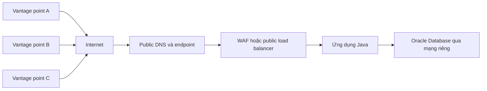
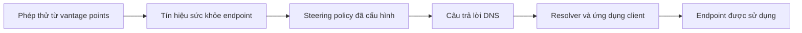

# OCI Health Checks và kiểm tra endpoint bên ngoài

## 1. Mục tiêu và bối cảnh

Trong chương **DNS và điều phối truy cập** của module **CLOUD_PROVIDERS_ORACLE**, bài học này trình bày cách kiểm tra một dịch vụ từ bên ngoài bằng OCI Health Checks. Người học sẽ chọn endpoint và vantage point, cấu hình monitor, đọc kết quả theo lớp DNS–kết nối–HTTP, rồi dùng các tín hiệu đó cho giám sát và điều phối truy cập.

Một ứng dụng Java có thể chạy trên OCI Compute, truy cập Oracle Database qua mạng riêng và công bố API qua public load balancer. CPU của máy ứng dụng vẫn bình thường nhưng người dùng có thể gặp lỗi vì DNS sai, chứng chỉ TLS có vấn đề, listener không nhận kết nối hoặc API trả lỗi. Kiểm tra từ bên ngoài bổ sung góc nhìn về đường truy cập mà khách hàng sử dụng.

OCI Health Checks phục vụ các endpoint **public-facing**, gồm website, API và public load balancer, kể cả tài nguyên nằm ngoài OCI. Dịch vụ cung cấp monitor định kỳ và on-demand probe cho kiểm tra một lần. Xem [Overview of the Health Checks Service](https://docs.oracle.com/en-us/iaas/Content/HealthChecks/Concepts/healthchecks.htm).

Sau bài học, bạn có thể:

- Phân biệt HTTP/HTTPS monitor với ICMP/TCP monitor.
- Thiết kế một health endpoint phản ánh đúng điều kiện phục vụ của ứng dụng.
- Chọn vantage point để phân biệt lỗi endpoint với vấn đề theo khu vực hoặc nhà cung cấp mạng.
- Tạo và kiểm tra monitor bằng Console hoặc OCI CLI.
- Đọc status code, timeout, timing và lỗi để khoanh vùng sự cố.
- Phân biệt tín hiệu sức khỏe với hành động cảnh báo hoặc thay đổi câu trả lời DNS.
- Ước lượng số lần kiểm tra và chuẩn bị một bài thử lỗi có kiểm soát.

Các tên miền trong bài là tên mẫu. Khi thực hành, thay bằng public endpoint thuộc quyền quản lý hoặc phạm vi được phép kiểm tra của bạn. Các đoạn lệnh là hướng dẫn cho môi trường lab, chưa phải kết quả của một monitor đã được triển khai.

## 2. Monitor, probe và vantage point

### 2.1. Monitor định kỳ và on-demand probe

**Monitor** lưu cấu hình và lặp lại kiểm tra theo interval. Nó phù hợp với quan sát liên tục và xây dựng chuỗi thời gian. **On-demand probe** thực hiện một lần kiểm tra theo yêu cầu, phù hợp khi cần một mẫu bổ sung trong lúc điều tra; phải xét quyền và giới hạn sử dụng của API tương ứng.

Một lần kiểm tra thành công chỉ mô tả quan sát tại thời điểm và địa điểm đã chọn. Nó không thay thế lịch sử theo dõi nhiều khoảng thời gian. Ngược lại, khi sửa cấu hình monitor, cần chờ các kết quả mới xuất hiện thay vì đánh giá từ dữ liệu trước thay đổi.

### 2.2. Vantage point là nơi phát sinh phép thử

Vantage point là vị trí địa lý chạy monitor/probe. OCI Health Checks có các điểm kiểm tra trên hạ tầng của nhiều nhà cung cấp. Oracle khuyến nghị chọn ít nhất ba điểm trên ba nhà cung cấp khác nhau; danh sách điểm có thể thay đổi. Khi triển khai, lấy danh sách hiện hành theo [Listing Vantage Points](https://docs.oracle.com/en-us/iaas/Content/HealthChecks/Tasks/list-vantage-point.htm).



Một monitor được quản lý ở region R1 vẫn có thể sử dụng vantage point ở các vị trí khác. **Region quản lý monitor**, **vị trí vantage point** và **region của endpoint** là ba thông tin cần ghi riêng.

Nếu chỉ một vantage point gặp lỗi, hãy kiểm tra tuyến mạng, WAF, rate limit hoặc sự cố theo khu vực. Nếu nhiều điểm độc lập cùng lỗi với cùng triệu chứng, giả thuyết lỗi endpoint mạnh hơn. Đây là cách suy luận từ bằng chứng, không phải quy tắc tự động mặc định của mọi monitor.

### 2.3. Endpoint phải tiếp cận được từ public internet

Quyền IAM cho phép quản lý monitor và kết quả; đường mạng đến endpoint vẫn cần cấu hình phù hợp. Oracle nêu rõ tài nguyên được Health Checks giám sát phải truy cập được từ public internet trong [Securing Health Checks](https://docs.oracle.com/en-us/iaas/Content/Security/Reference/healthchecks_security.htm).

Vì vậy, một private IP trong VCN hoặc một listener Oracle Database chỉ có đường qua VPN không phải target phù hợp cho kiểu monitor public này. Với ứng dụng có database riêng, theo dõi API public từ bên ngoài và dùng kiểm tra bên trong mạng cho đường ứng dụng → database. Giữ nguyên phạm vi riêng của database khi bổ sung giám sát public.

## 3. Chọn đúng giao thức và điều kiện thành công

### 3.1. Các loại kiểm tra

| Loại monitor | Giao thức | Phép thử chính | Phần cần kiểm chứng thêm |
| --- | --- | --- | --- |
| HTTP monitor | HTTP | Request GET hoặc HEAD | TLS nếu dịch vụ thực dùng HTTPS; nghiệp vụ ứng dụng |
| HTTP monitor | HTTPS | Request GET hoặc HEAD qua kết nối bảo mật | Chức năng sâu hơn của API và luồng người dùng |
| Ping monitor | ICMP | ICMP echo và thời gian khứ hồi | Cổng dịch vụ và HTTP response |
| Ping monitor | TCP | TCP handshake đến cổng chỉ định | TLS, HTTP và trạng thái ứng dụng |

Tên “ping monitor” bao gồm cả chế độ TCP. Một TCP monitor đến cổng `443` có thể thành công trong khi HTTPS monitor thất bại vì vấn đề TLS hoặc HTTP. Các giao thức được mô tả trong [Managing Health Checks](https://docs.oracle.com/en-us/iaas/Content/HealthChecks/Tasks/managinghealthchecks.htm).

ICMP bị chặn ở một endpoint không chứng minh website ngừng hoạt động. Chọn HTTPS nếu câu hỏi vận hành là “khách hàng có truy cập được API HTTPS không?”, rồi thêm TCP hoặc ICMP khi cần bằng chứng chẩn đoán ở lớp thấp hơn.

### 3.2. HTTP health và mã phản hồi

Theo mô hình kết quả HTTP của OCI, phép thử được coi là healthy khi HTTP status code từ `200` đến dưới `300`. Kết quả còn có `isTimedOut`, `errorCategory`, `errorMessage` và các thời điểm liên quan. Tham khảo [HttpProbeResultSummary](https://docs.oracle.com/en-us/iaas/tools/java/latest/com/oracle/bmc/healthchecks/model/HttpProbeResultSummary.html).

Ví dụ endpoint kiểm tra trực tiếp:

```http
HTTP/1.1 200 OK
Content-Type: application/json
Cache-Control: no-store

{"status":"ready"}
```

Khi ứng dụng không đáp ứng điều kiện phục vụ mà nhóm đã định nghĩa:

```http
HTTP/1.1 503 Service Unavailable
Content-Type: application/json
Cache-Control: no-store

{"status":"not-ready"}
```

Một trang lỗi trả `200 OK` có thể tạo tín hiệu khỏe sai với phép kiểm tra theo status. Nhóm ứng dụng phải bảo đảm status code của health endpoint khớp điều kiện phục vụ. Nếu cần xác minh nội dung JSON, đăng nhập nhiều bước hoặc giao dịch nghiệp vụ, bổ sung phép kiểm thử ứng dụng phù hợp.

Khi thấy kết quả cuối cùng là `301`, `302`, `401`, `403`, `404` hoặc `5xx`, đọc response và cấu hình target/path trước khi quy lỗi cho hạ tầng Compute. Với health endpoint, nên dùng URL đích trả trực tiếp trạng thái mong đợi, tránh phụ thuộc vào trang đăng nhập hoặc chuỗi chuyển hướng của website.

### 3.3. GET, HEAD, FQDN và IP

- **GET** phù hợp khi endpoint health được triển khai với GET và trả status thể hiện readiness.
- **HEAD** chỉ phù hợp nếu ứng dụng, proxy và WAF xử lý HEAD đúng như thiết kế. Một API hỗ trợ GET chưa chắc có hành vi HEAD tương đương.
- **FQDN** giúp phép thử bao gồm phân giải tên và sử dụng đúng tên dịch vụ khi truy cập HTTPS.
- **IP** giúp nhắm một địa chỉ cụ thể, nhưng cần xét virtual hosting, Host header và danh tính TLS của endpoint đó.

Chuyển từ FQDN sang IP làm thay đổi ý nghĩa phép thử. Thành công ở IP không tự chứng minh DNS của tên dịch vụ hoạt động; lỗi khi truy cập IP bằng HTTPS có thể liên quan tên chứng chỉ hoặc SNI. Ghi rõ mục tiêu kiểm tra trước khi đổi target để so sánh.

## 4. Thiết kế health endpoint và cấu hình monitor

### 4.1. Điều kiện ready cần phản ánh ý định điều phối

Với ứng dụng dùng Oracle Database, hãy tách hai câu hỏi:

| Câu hỏi | Ví dụ điều kiện |
| --- | --- |
| Tiến trình còn hoạt động? | Runtime có thể phản hồi request tối thiểu |
| Instance hoặc region sẵn sàng nhận người dùng? | Có khả năng phục vụ API cần thiết và truy cập các phụ thuộc bắt buộc |

Một endpoint chỉ trả chuỗi cố định thích hợp cho kiểm tra sự sống rất đơn giản, nhưng có thể vẫn xanh khi ứng dụng không phục vụ được request thật. Ngược lại, một readiness endpoint kiểm tra quá nhiều hệ thống không thiết yếu có thể báo lỗi và gây điều phối không cần thiết.

Thiết kế một kiểm tra nhẹ, có thời gian thực thi giới hạn, không ghi dữ liệu nghiệp vụ và chỉ trả thông tin tổng quát. Khi cần kiểm tra database, cân nhắc kết quả kiểm tra nội bộ được cập nhật trong thời gian hợp lý thay vì tạo truy vấn nặng cho mỗi lần probe từ mỗi vantage point. Với ứng dụng đang dùng cơ chế health endpoint của framework, giới hạn phần thông tin công bố ra public.

Nếu hệ thống nhiều region dùng chung một database đang lỗi, đổi người dùng sang region khác có thể vẫn gặp cùng lỗi. Phạm vi phụ thuộc của health endpoint phải được xem cùng kiến trúc dữ liệu và phương án chuyển đổi cơ sở dữ liệu.

### 4.2. Các tham số cần chốt

| Thuộc tính | Ví dụ lab | Ý nghĩa |
| --- | --- | --- |
| Target | `api-r1.lab.example.com` | Hostname, tách khỏi path |
| Protocol / port | HTTPS / `443` | Giao thức và cổng thực tế |
| Method / path | GET / `/health/ready` | Điều kiện ứng dụng muốn kiểm tra |
| Interval | `30` giây | Chu kỳ phát phép thử |
| Timeout | `10` giây | Thời gian tối đa chờ hoàn thành |
| Vantage points | Ba điểm đã xác minh còn khả dụng | Các góc quan sát độc lập |
| Compartment | Compartment giám sát của lab | Phạm vi quản lý và phân quyền |
| Region quản lý | Region đã chọn khi tạo | Nơi thực hiện cập nhật và lấy kết quả theo API |

CLI hiện hành cho phép interval `10`, `30`, `60` giây; timeout `10`, `20`, `30`, `60` giây và timeout phải không lớn hơn interval. Monitor có interval `10` giây được phân loại Premium, còn interval lớn hơn `10` giây thuộc Basic. Đối chiếu [CLI: HTTP monitor create](https://docs.oracle.com/en-us/iaas/tools/oci-cli/latest/oci_cli_docs/cmdref/health-checks/http-monitor/create.html) và [phân loại monitor](https://docs.oracle.com/en-us/iaas/Content/HealthChecks/Concepts/healthchecks.htm) khi triển khai.

Timeout dài hơn có thể chấp nhận một dịch vụ phản hồi quá chậm so với yêu cầu người dùng. Vì vậy, tách tiêu chí “có phản hồi trong timeout” khỏi ngưỡng hiệu năng mà nhóm muốn cảnh báo.

## 5. Tạo monitor có phân quyền và phạm vi rõ ràng

### 5.1. Chuẩn bị IAM và đường truy cập

Đặt monitor trong compartment phù hợp với nhóm vận hành. Tách quyền xem kết quả khỏi quyền sửa hoặc xóa monitor. Một chính sách minh họa cho nhóm quản lý lab có thể là:

```text
Allow group HealthCheckOperators to manage health-check-family in compartment NetworkObservability
Allow group HealthCheckOperators to read vantage-points in tenancy
```

Thay tên nhóm, domain của nhóm khi cần và compartment theo môi trường. Quyền quản lý monitor, đọc kết quả và dùng on-demand probe là những quyền cần đối chiếu riêng theo trách nhiệm. Xem [Details for Health Checks](https://docs.oracle.com/en-us/iaas/Content/Identity/Reference/healthcheckpolicyreference.htm) và [Securing Health Checks](https://docs.oracle.com/en-us/iaas/Content/Security/Reference/healthchecks_security.htm).

Kiểm tra đường public đến đúng cổng qua WAF, load balancer, NSG/security list và firewall hệ điều hành nếu có. Một monitor bị WAF chặn phản ánh sự khác biệt của phép thử từ bên ngoài; cần đọc log trước khi quyết định sửa quy tắc. Nếu sử dụng danh sách cho phép nguồn probe, quản lý danh sách nguồn theo dữ liệu vantage point hiện hành và chính sách an ninh của hệ thống.

Các monitor/probe không hỗ trợ HTTP header `Authorization`. Đừng thiết kế bài lab phụ thuộc việc gửi bearer token qua trường này; cũng không đưa bí mật vào tên monitor hoặc query string của URL. Giới hạn header được ghi trong [CLI: HTTP monitor create](https://docs.oracle.com/en-us/iaas/tools/oci-cli/latest/oci_cli_docs/cmdref/health-checks/http-monitor/create.html). Health endpoint public nên công bố trạng thái tối thiểu phù hợp với mục đích vận hành.

### 5.2. Tạo bằng Console

Trong OCI Console:

1. Chọn region quản lý và compartment dự kiến.
2. Mở **Observability & Management → Monitoring → Health Checks**.
3. Chọn **Create health check**, nhập tên và target host/FQDN của lab.
4. Chọn các vantage point đã kiểm tra; ưu tiên góc quan sát từ nhiều nhà cung cấp.
5. Chọn request type **HTTP**, protocol **HTTPS**, timeout và interval phù hợp.
6. Kiểm tra cấu hình method, path, port và các tùy chọn hiển thị trong giao diện; nếu cần trường không được giao diện cung cấp, dùng CLI/API tương ứng.
7. Tạo monitor, mở trang chi tiết rồi đợi các kết quả mới xuất hiện.

Hướng dẫn giao diện nằm trong [Creating an HTTP Monitor](https://docs.oracle.com/en-us/iaas/Content/HealthChecks/Tasks/create-http-monitor.htm). Kiểm tra lại định nghĩa sau khi tạo, đặc biệt target và path: target `api-r1.lab.example.com` cùng path `/health/ready` có ý nghĩa khác việc kiểm tra mặc định trang `/`.

### 5.3. Lấy vantage point hiện hành bằng CLI

Các lệnh dưới đây dành cho Bash có OCI CLI đã cấu hình quyền phù hợp. Chúng minh họa việc người học tạo tài nguyên trong lab riêng.

```bash
set -euo pipefail

REGION='ap-singapore-1'
COMPARTMENT_ID='REPLACE_WITH_LAB_COMPARTMENT_OCID'

oci health-checks vantage-point list \
  --region "$REGION" \
  --all
```

Từ đầu ra, chọn đúng thuộc tính tên của ba vantage point còn khả dụng và thay các chỗ giữ giá trị bên dưới. Không lấy tên điểm kiểm tra từ trí nhớ hoặc một danh sách cũ. Xem [CLI: vantage-point list](https://docs.oracle.com/en-us/iaas/tools/oci-cli/latest/oci_cli_docs/cmdref/health-checks/vantage-point/list.html).

### 5.4. Tạo HTTPS monitor cho endpoint lab

```bash
TARGETS='["api-r1.lab.example.com"]'
VANTAGE_POINTS='["REPLACE_VP_1","REPLACE_VP_2","REPLACE_VP_3"]'

HTTP_MONITOR_ID=$(oci health-checks http-monitor create \
  --region "$REGION" \
  --compartment-id "$COMPARTMENT_ID" \
  --display-name 'lab-api-r1-readiness-https' \
  --targets "$TARGETS" \
  --vantage-point-names "$VANTAGE_POINTS" \
  --protocol HTTPS \
  --port 443 \
  --method GET \
  --path '/health/ready' \
  --interval-in-seconds 30 \
  --timeout-in-seconds 10 \
  --is-enabled true \
  --query 'data.id' \
  --raw-output)

printf '%s\n' "$HTTP_MONITOR_ID"

oci health-checks http-monitor get \
  --region "$REGION" \
  --monitor-id "$HTTP_MONITOR_ID"
```

Trước khi chạy, thay toàn bộ target và các giá trị `REPLACE_...`. HTTPS endpoint phải có cấu hình tên/chứng chỉ phù hợp. Lệnh trên gửi host trong `--targets`, path trong `--path`, và giữ OCID để dùng về sau. Cú pháp tham số nằm trong [CLI: HTTP monitor create](https://docs.oracle.com/en-us/iaas/tools/oci-cli/latest/oci_cli_docs/cmdref/health-checks/http-monitor/create.html); cách đọc định nghĩa được mô tả ở [Getting an HTTP Monitor's Details](https://docs.oracle.com/en-us/iaas/Content/HealthChecks/Tasks/get-http-monitor.htm).

Chạy lại lệnh `create` có thể tạo monitor khác cùng tên. Khi vận hành bằng script hoặc IaC, lưu định danh/trạng thái tài nguyên và cập nhật có chủ đích, thay vì dùng tên hiển thị làm bằng chứng duy nhất rằng monitor đã tồn tại.

### 5.5. Thêm TCP monitor khi cần phân biệt các lớp

Có thể tạo một monitor TCP đến cùng endpoint/cổng để bổ sung chẩn đoán:

```bash
TCP_MONITOR_ID=$(oci health-checks ping-monitor create \
  --region "$REGION" \
  --compartment-id "$COMPARTMENT_ID" \
  --display-name 'lab-api-r1-tcp443' \
  --targets "$TARGETS" \
  --vantage-point-names "$VANTAGE_POINTS" \
  --protocol TCP \
  --port 443 \
  --interval-in-seconds 30 \
  --timeout-in-seconds 10 \
  --is-enabled true \
  --query 'data.id' \
  --raw-output)
```

Tham số `--protocol TCP` thuộc nhóm `ping-monitor`, theo [CLI: ping-monitor create](https://docs.oracle.com/en-us/iaas/tools/oci-cli/latest/oci_cli_docs/cmdref/health-checks/ping-monitor/create.html). Monitor bổ sung tạo thêm phép thử và chi phí vận hành; chỉ giữ khi nó phục vụ mục đích đã xác định.

Nếu TCP thành công nhưng HTTPS lỗi, ưu tiên xem TLS, method/path, WAF và HTTP response. Nếu cả hai cùng timeout, xem đường truy cập, firewall, listener và trạng thái endpoint. Hai kết quả có thể được thu ở thời điểm hơi khác nhau, vì vậy đối chiếu timestamp và vantage point trước khi suy nguyên nhân.

## 6. Đọc kết quả theo target, thời điểm và vị trí

### 6.1. Lấy một tập kết quả gần nhất

Sau khi monitor đã chạy đủ thời gian để có dữ liệu:

```bash
oci health-checks http-probe-result list \
  --region "$REGION" \
  --probe-configuration-id "$HTTP_MONITOR_ID" \
  --sort-order DESC \
  --limit 20
```

`--probe-configuration-id` nhận OCID monitor hoặc on-demand probe. Lệnh trên chỉ lấy một mẫu tối đa 20 kết quả; khi điều tra một khoảng thời gian, dùng bộ lọc thời gian/target và phân trang theo [CLI: http-probe-result list](https://docs.oracle.com/en-us/iaas/tools/oci-cli/latest/oci_cli_docs/cmdref/health-checks/http-probe-result/list.html).

Giữ region phù hợp khi lấy kết quả và cập nhật monitor. Các tài nguyên Health Checks được tạo bằng CLI/API có region gắn với cấu hình; quy tắc này được mô tả trong [Managing Health Checks](https://docs.oracle.com/en-us/iaas/Content/HealthChecks/Tasks/managinghealthchecks.htm).

### 6.2. Các trường cần xem cùng nhau

| Thông tin | Câu hỏi cần trả lời |
| --- | --- |
| Target | Đúng hostname/IP muốn quan sát chưa? |
| Vantage point | Lỗi xảy ra ở một vị trí hay nhiều vị trí? |
| Thời điểm phép thử | Có trùng cửa sổ sự cố, triển khai hoặc đổi DNS không? |
| `isHealthy` | Phép thử đạt điều kiện sức khỏe của loại probe chưa? |
| `isTimedOut` | Có hết thời gian chờ cấu hình không? |
| HTTP status code | Dịch vụ/WAF/proxy trả phản hồi nào? |
| Error category/message | Giai đoạn hoặc nguyên nhân lỗi được báo là gì? |
| DNS/connection/request/response timing | Thời gian tăng ở phần nào của phép thử? |

Các timing và trường kết quả được định nghĩa trong [HttpProbeResultSummary](https://docs.oracle.com/en-us/iaas/tools/java/latest/com/oracle/bmc/healthchecks/model/HttpProbeResultSummary.html). Phân biệt timestamp với duration; chỉ tính chênh lệch giữa hai mốc khi chúng hiện diện và có cùng đơn vị. Một phép thử dừng sớm có thể không có dữ liệu cho các giai đoạn phía sau.

### 6.3. Khoanh vùng bằng triệu chứng

| Quan sát | Giả thuyết nên kiểm tra | Bằng chứng bổ sung |
| --- | --- | --- |
| Lỗi phân giải tên | Public DNS, record/delegation hoặc câu trả lời theo vị trí | Kết quả DNS từ bên ngoài và lịch sử đổi record |
| TCP connection timeout | Firewall, tuyến mạng, listener hoặc endpoint không phản hồi | Log WAF/LB, flow log phù hợp và trạng thái cổng |
| Lỗi transport/TLS | Chứng chỉ, tên dịch vụ, handshake hoặc cấu hình TLS | Kiểm tra chứng chỉ và log TLS của endpoint |
| HTTP `401`/`403` | Endpoint yêu cầu xác thực hoặc WAF/chính sách truy cập chặn probe | Rule liên quan, method/path và log truy cập |
| HTTP `404` | Path hoặc virtual host khác dự kiến | Route ứng dụng, Host và cấu hình monitor |
| HTTP `5xx` | Ứng dụng, upstream hoặc dependency không phục vụ được | Log ứng dụng, backend và database |
| Chỉ một vantage point lỗi | Sự cố khu vực/nhà cung cấp, geo rule hoặc chặn nguồn | So sánh các điểm độc lập và log theo nguồn |
| Tất cả điểm thành công nhưng người dùng lỗi | Khác endpoint, DNS, giao thức, mạng hoặc điều kiện nghiệp vụ | Request người dùng và phép thử đúng đường đó |

Timeout là một triệu chứng, chưa xác định nguyên nhân gốc. Giữ cả lỗi gốc và timestamp khi bàn giao cho đội mạng/ứng dụng. Tài liệu [Troubleshooting Health Checks](https://docs.oracle.com/en-us/iaas/Content/HealthChecks/troubleshooting.htm) cũng nêu việc kiểm tra quyền giám sát host và cấu hình cổng khi phép thử liên tục không khỏe.

## 7. Metric và cảnh báo: giữ đúng phạm vi tổng hợp

Health Checks phát metric trong namespace **`oci_healthchecks`**. Một số metric hữu ích gồm:

| Metric | Mục đích quan sát |
| --- | --- |
| `HTTP.isHealthy` | Thành công/thất bại của phép thử HTTP/HTTPS |
| `HTTP.StatusCode` | Mã phản hồi HTTP/HTTPS |
| `HTTP.DNSLookupTime` | Thời gian phân giải tên |
| `HTTP.TotalDuration` | Tổng thời gian phép thử |
| `PING.isHealthy` | Thành công/thất bại của phép thử ICMP/TCP |
| `PING.Latency` | Độ trễ của phép thử ping |

Các dimension như `resourceId`, `target`, `vantagePoint`, `protocol` giúp chọn đúng chuỗi dữ liệu. Mẫu sức khỏe có giá trị `0` hoặc `1`; màn hình có thể trình bày tỷ lệ thành công dạng phần trăm. Xem [Health Checks Metrics Reference](https://docs.oracle.com/en-us/iaas/Content/HealthChecks/Reference/metricsalarms-reference.htm) để đối chiếu tên metric, đơn vị và dimension.

### 7.1. Tỷ lệ chung có thể che một lỗi khu vực

Giả sử một target có ba vantage point, mỗi điểm có hai mẫu trong cửa sổ đang xét:

| Vantage point | Mẫu 1 | Mẫu 2 | Cách đọc |
| --- | --- | --- | --- |
| A | Thành công | Thành công | Chưa thấy lỗi ở A trong hai lần này |
| B | Thành công | Thành công | Chưa thấy lỗi ở B trong hai lần này |
| C | Thất bại | Thất bại | Lỗi lặp lại từ C cần được điều tra |

Tỷ lệ gộp là `4/6 ≈ 66,7%`, nhưng thông tin đáng chú ý là hai lỗi đều nằm ở C. Nếu gộp thêm nhiều target khác đang khỏe, lỗi của target này còn dễ bị che khuất hơn. Bắt đầu từ từng target và vantage point, sau đó mới tổng hợp theo nhu cầu vận hành.

### 7.2. Thiết kế cảnh báo theo ý định

Khi tạo alarm trong OCI Monitoring, chọn đúng namespace, metric, compartment, dimension và cửa sổ đánh giá. Định nghĩa trước các tình huống muốn nhận thông báo, chẳng hạn:

- Một target thất bại lặp lại từ nhiều vantage point độc lập.
- Một khu vực liên tục không truy cập được dù các khu vực khác vẫn thành công.
- Độ trễ vượt ngưỡng phục vụ đã thống nhất, dù chưa chạm timeout.
- Monitor thiếu dữ liệu mới ngoài khoảng chờ hợp lý.

Một quy tắc “ít nhất hai trong ba vị trí cùng thất bại trong nhiều lần quan sát” có thể là **chính sách vận hành do nhóm thiết kế**. Cần xây dựng và kiểm chứng cách tổng hợp/thông báo tương ứng; không mặc định monitor đã triển khai sẵn quy tắc biểu quyết đó.

Thiếu mẫu có thể do monitor bị disable, sai region, sai phạm vi truy vấn hoặc dữ liệu chưa xuất hiện. Định nghĩa riêng cách xử lý thiếu dữ liệu thay vì tự quy mọi khoảng trống thành endpoint khỏe hoặc chết. Kiểm tra đường nhận thông báo và người phụ trách cùng với alarm, theo [hướng dẫn Health Checks Metrics](https://docs.oracle.com/en-us/iaas/Content/HealthChecks/Reference/metricsalarms.htm).

## 8. Liên hệ với DNS Traffic Management

Health Checks cung cấp tín hiệu sức khỏe. Traffic Management steering policy sử dụng các quy tắc và health checks liên quan để quyết định câu trả lời DNS cho endpoint. Tạo một monitor đơn lẻ chưa thiết lập hành động failover DNS; cần cấu hình policy và attachment phù hợp. Cơ chế được mô tả trong [Overview of Traffic Management](https://docs.oracle.com/en-us/iaas/Content/TrafficManagement/Concepts/overview.htm).

Ví dụ kiến trúc hai region:

```text
Tên người dùng truy cập:       api.lab.example.com
Endpoint ổn định của region 1: api-r1.lab.example.com
Endpoint ổn định của region 2: api-r2.lab.example.com
```

Theo dõi endpoint riêng của từng region giúp phân biệt region nào đủ điều kiện phục vụ. Nếu chỉ giám sát tên đã được steering sang region đang khỏe, phép thử có thể phản ánh endpoint được chọn ở thời điểm đó và không còn đo riêng endpoint lỗi ban đầu. Khi gắn health check vào policy, đối chiếu target được kiểm tra với answer mà policy đánh giá.



### 8.1. Phát hiện lỗi và chuyển người dùng là hai giai đoạn

Thời gian quan sát lỗi phụ thuộc interval, timeout, chu kỳ đánh giá và số mẫu mà chính sách cần. Sau đó còn có thời gian xử lý steering, cache DNS, cách client phân giải lại và tuổi thọ kết nối ứng dụng. Interval `30` giây không phải cam kết mọi người dùng được chuyển region trong `30` giây.

DNS steering ảnh hưởng việc phân giải tên; nó không di chuyển một kết nối TCP/JDBC đang tồn tại sang backend khác. Ứng dụng cần cơ chế kết nối lại và xử lý lỗi phù hợp. Phương án dự phòng Oracle Database còn phải bảo đảm dữ liệu và vai trò database đã sẵn sàng trước khi endpoint ứng dụng báo ready.

### 8.2. Endpoint dự phòng phải có khả năng phục vụ thật

Một readiness endpoint có thể trả `200` vì web process hoạt động trong khi region dự phòng chưa có quyền ghi dữ liệu hoặc chưa được chuyển vai trò. Nếu tín hiệu đó được dùng để điều phối, người dùng có thể được đưa đến nơi chưa phục vụ được nghiệp vụ.

Do đó, xác định điều kiện ready cùng nhóm ứng dụng và dữ liệu. Kiểm tra khả năng tiếp nhận tải dự phòng, chứng chỉ/tên dịch vụ, phụ thuộc bắt buộc và chính sách truy cập trước khi dùng trạng thái sức khỏe để kích hoạt điều phối tự động.

## 9. Bài thực hành: quan sát lỗi ứng dụng từ bên ngoài

### 9.1. Chuẩn bị baseline

Dùng một API lab public do bạn quản lý, có `/health/ready` trả trực tiếp `200` khi sẵn sàng. Chuẩn bị log ứng dụng, log WAF/LB liên quan và cơ chế đổi trạng thái readiness trong lab mà không ảnh hưởng người dùng thật.

Thực hiện:

1. Xác nhận public DNS trả endpoint mong muốn.
2. Tạo HTTPS monitor theo phần trước, interval `30`, timeout `10`, ba vantage point đã chọn.
3. Nếu cần so sánh lớp kết nối, tạo thêm TCP monitor đến cổng `443`.
4. Ghi OCID, region quản lý, target, method, path, thời điểm và kết quả mới từ từng vantage point.
5. Xác nhận endpoint thực sự đang trả `200`, đồng thời đọc định nghĩa monitor để chắc chắn đang kiểm tra đúng path.

Có thể dùng lệnh sau từ một máy được phép kiểm tra để đối chiếu một quan sát độc lập:

```bash
curl --connect-timeout 5 --max-time 15 \
  --output /dev/null --silent --show-error \
  --write-out 'code=%{http_code} dns=%{time_namelookup}s connect=%{time_connect}s tls=%{time_appconnect}s first_byte=%{time_starttransfer}s total=%{time_total}s\n' \
  'https://api-r1.lab.example.com/health/ready'
```

Đây là lệnh Bash với `curl`. Các biến timing của curl có ý nghĩa và đơn vị riêng, một số là mốc thời gian cộng dồn; không coi chúng là những giai đoạn độc lập để cộng tất cả lại. Kết quả từ máy này cũng không đại diện cho mọi vantage point của Health Checks.

### 9.2. Gây lỗi readiness có kiểm soát

Trong lab, đổi `/health/ready` sang trả `503`, đồng thời giữ listener HTTPS hoạt động. Ghi thời điểm đổi và đợi các mẫu sau thay đổi xuất hiện từ các vantage point.

Kết quả dự kiến về mặt thiết kế:

| Quan sát | Dự kiến khi chỉ readiness trả `503` |
| --- | --- |
| TCP monitor | Có thể tiếp tục thành công vì listener vẫn nhận handshake |
| HTTPS monitor | `isHealthy` thất bại với status `503` nếu nhận được phản hồi đó |
| Log ứng dụng/WAF/LB | Có request đến đúng path và status tương ứng |
| Alarm nếu đã cấu hình | Chuyển trạng thái theo cửa sổ và điều kiện đã thiết kế |
| DNS nếu chưa cấu hình steering | Giữ hành vi theo cấu hình DNS hiện có |

Các dòng trên là giả thuyết để xác minh trong lab, không phải số liệu đã đo. Nếu HTTPS vẫn healthy, xem timestamp, target, path, cache/proxy và các backend đang nhận request. Có thể probe đang đến một instance khác hoặc một lớp trung gian đang trả `200` riêng.

Khôi phục endpoint về `200`, tiếp tục quan sát mẫu mới và trạng thái hồi phục của alarm. Ghi lại thời gian nhận biết lỗi và thời gian nhận biết hồi phục theo phép thử thực tế.

### 9.3. Tạo lỗi path để nhận diện sai cấu hình monitor

Sau khi baseline đã phục hồi, có thể đổi tạm path của monitor lab sang một đường không tồn tại đã biết trả `404`. Mục tiêu là chứng minh một monitor đỏ cũng có thể do cấu hình phép thử sai với ý định ban đầu.

Xác nhận ứng dụng vẫn phục vụ path đúng, đọc status `404` ở path sai, sau đó trả monitor về `/health/ready`. Chỉ sửa một tham số mỗi lần và giữ cấu hình cũ để hoàn tác. Không dùng kết quả của path sai để kết luận toàn bộ region hoặc Oracle Database đã lỗi.

### 9.4. Dừng các monitor lab khi kết thúc

Khi đã thu đủ bằng chứng, disable các monitor không còn cần. Ví dụ với HTTP monitor:

```bash
oci health-checks http-monitor update \
  --region "$REGION" \
  --monitor-id "$HTTP_MONITOR_ID" \
  --is-enabled false
```

Thao tác disable ngừng các lần kiểm tra tiếp theo theo cấu hình dịch vụ; xem [CLI: HTTP monitor update](https://docs.oracle.com/en-us/iaas/tools/oci-cli/latest/oci_cli_docs/cmdref/health-checks/http-monitor/update.html). Nếu tạo TCP monitor, cũng dừng hoặc dọn tài nguyên đó trong quy trình kết thúc lab. Giữ bằng chứng cần thiết và kiểm tra lại alarm/steering policy liên quan trước khi ngừng một monitor đang được sử dụng chung.

## 10. Chi phí, tải phát sinh và tiêu chí hoàn thành

### 10.1. Ước lượng số lần thử

Với monitor định kỳ, có thể ước lượng số lần kiểm tra lý tưởng trong một ngày theo:

```text
Số lần thử/ngày ≈ số target × số vantage point × 86400 / interval_giây
```

Ví dụ một target, ba vantage point và interval `30` giây tạo khoảng `8.640` lần thử/ngày. Hai target với cùng cấu hình tạo khoảng `17.280` lần thử/ngày. Đổi interval từ `30` sang `10` giây làm số lần thử lý tưởng tăng ba lần.

Đây là ước lượng tải kiểm tra để lập kế hoạch. Đối chiếu loại Basic/Premium, đơn vị tính phí, hạn mức và bảng giá hiện hành khi tính ngân sách. Tính thêm chi phí request, log và dependency mà health endpoint thực sự sử dụng. Một endpoint truy vấn database nặng có thể tạo tải đáng kể dù mỗi probe chỉ là một GET nhỏ.

Chọn interval theo mục tiêu phát hiện lỗi, thời gian đáp ứng và mức chi phí chấp nhận được. Gắn tag cho môi trường/đội phụ trách và tránh tạo nhiều monitor trùng target/path mà không có lý do quan sát riêng.

### 10.2. Bằng chứng người học cần cung cấp

| Tiêu chí | Bằng chứng mong đợi |
| --- | --- |
| Target phù hợp | Public endpoint thuộc phạm vi được phép kiểm tra |
| Cấu hình có ý nghĩa | FQDN/IP, protocol, port, method, path, interval và timeout rõ ràng |
| Góc nhìn quan sát | Danh sách vantage point hiện hành và lý do lựa chọn |
| Baseline | Kết quả mới từ từng vị trí cùng log hoặc kiểm tra độc lập |
| Nhận diện lỗi ứng dụng | Phân biệt TCP thành công với HTTPS trả `503` |
| Khoanh vùng lỗi | Status/error/timing được gắn với target và thời điểm cụ thể |
| Cảnh báo và DNS | Nêu rõ cấu hình nào chỉ quan sát, cấu hình nào thực hiện hành động |
| Phục hồi và kết thúc lab | Endpoint đã khôi phục, có mẫu hồi phục và đã dừng tài nguyên không còn cần |

Giá trị của OCI Health Checks nằm ở phép thử bên ngoài được thiết kế đúng với điều kiện phục vụ. Khi kết hợp kết quả theo vantage point, log ứng dụng và chính sách DNS rõ ràng, đội vận hành có thể phát hiện lỗi truy cập, phân biệt các lớp gây lỗi và chuẩn bị điều phối sang endpoint thực sự sẵn sàng.
