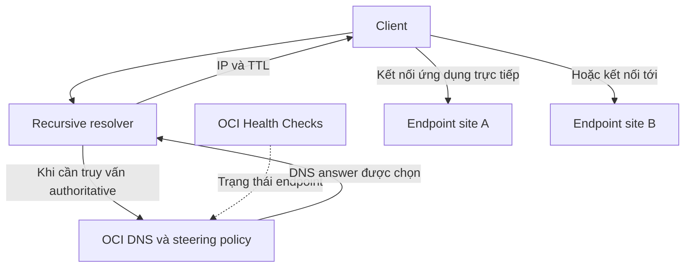

# Traffic Management với failover và weighted routing

Trong chương **DNS và điều phối truy cập** của module Oracle Cloud Infrastructure (OCI), bài học này trình bày cách dùng Traffic Management steering policies để chọn endpoint khi trả lời DNS. Hai nhu cầu chính là chuyển sang endpoint dự phòng khi endpoint ưu tiên gặp lỗi và phân phối câu trả lời theo trọng số khi chạy nhiều site hoặc chuyển đổi dần sang hạ tầng mới.

Ví dụ xuyên suốt dùng hai endpoint ứng dụng công khai ở hai site. Mỗi endpoint có thể là public load balancer phía trước Compute trong VCN; cơ sở dữ liệu Oracle và backend vẫn nằm trong mạng riêng theo thiết kế. Tenancy, compartment và IAM giới hạn quyền thay đổi DNS, policy và health check. Người học sẽ nối cấu hình điều phối với bằng chứng giám sát, khả năng tiếp nhận tải của site dự phòng và chi phí vận hành.

## 1. Kết quả cần đạt

Sau bài học, người học có thể:

- Phân biệt điều phối bằng DNS với phân phối kết nối tại load balancer.
- Cấu hình failover bằng thứ tự ưu tiên và trạng thái sức khỏe endpoint.
- Dùng weighted routing để tăng dần phần DNS answers trỏ tới site mới.
- Giải thích ảnh hưởng của TTL, recursive resolver, cache ứng dụng và kết nối đang mở.
- Kiểm chứng health check, attachment, câu trả lời authoritative và trải nghiệm client riêng biệt.
- Đo failover và phân phối theo trọng số mà không nhầm số truy vấn DNS với số HTTP request.

Cần hiểu public DNS zone, delegation, A/AAAA/CNAME, TTL, authoritative nameserver, recursive resolver và HTTPS. Lab giả định có public zone do người học quản lý và hai endpoint lab đã được triển khai.

## 2. Traffic Management can thiệp vào bước nào?

OCI Traffic Management chọn câu trả lời DNS theo logic policy. Nó hỗ trợ **public DNS**, không hỗ trợ private DNS. Các endpoint có thể ở OCI, trung tâm dữ liệu hoặc nhà cung cấp khác nếu đáp ứng điều kiện truy cập và giám sát của thiết kế. [Overview of Traffic Management](https://docs.oracle.com/en-us/iaas/Content/TrafficManagement/Concepts/overview.htm).



Sau khi nhận IP, client gửi lưu lượng ứng dụng tới endpoint đó. HTTP request không đi qua steering policy như qua reverse proxy. Vì vậy, policy không đọc URL để chia từng request, không di chuyển phiên TCP và không đồng bộ dữ liệu giữa hai site.

| Câu hỏi | Lớp phù hợp để giải quyết |
| --- | --- |
| Truy vấn DNS mới nên nhận endpoint ở site nào? | Traffic Management |
| Kết nối tới một public IP nên đến backend nào trong site? | Load balancer của site |
| User đang đăng nhập có giữ phiên khi chuyển site không? | Session store và thiết kế ứng dụng |
| Site dự phòng có dữ liệu và quyền ghi đúng chưa? | Cơ chế sao chép, vai trò database và quy trình phục hồi |

Có thể đặt Traffic Management ở phía trên hai public load balancer. Mỗi load balancer tiếp tục kiểm tra và phân phối tới backend riêng. Tên policy **Load balancer** trong Traffic Management nói về điều phối DNS; nó là tài nguyên khác với OCI Load Balancer phục vụ kết nối ứng dụng. [Mô hình phối hợp DNS steering và load balancing](https://docs.oracle.com/en-us/iaas/Content/Balance/Tasks/managingloadbalancer_topic-Creating_Load_Balancers.htm).

## 3. Các thành phần của một steering policy

| Thành phần | Vai trò |
| --- | --- |
| Policy | Chứa danh sách answers và chuỗi rule chọn câu trả lời |
| Answer | Tên nội bộ, record type, `rdata` và metadata như pool hoặc trạng thái disabled |
| Pool | Nhóm answers, hữu ích khi ưu tiên các site trong failover |
| Rule | Lọc, xét sức khỏe, sắp ưu tiên hoặc áp dụng trọng số |
| Template | Bộ khung rule cho mục đích cụ thể, chẳng hạn `FAILOVER` hoặc `LOAD_BALANCE` |
| Domain attachment | Gắn policy vào một hostname trong DNS zone |
| Health check monitor | Cung cấp dữ liệu sức khỏe cho các endpoint tương ứng |

Policy tồn tại nhưng chưa có attachment thì chưa trả lời DNS thay cho hostname mục tiêu. Attachment làm policy cung cấp câu trả lời cho record type được bao phủ tại hostname đó, che các record tương ứng đã có trong zone. Không coi một A record cũ tại cùng tên là đường dự phòng tự động. [Traffic Management Steering Policies API Guide](https://docs.oracle.com/en-us/iaas/Content/TrafficManagement/Concepts/trafficmanagementapi.htm).

Dùng hostname lab riêng, ghi nhận record cũ trước khi attach và kiểm tra lại khi detach. Một policy có thể được dùng cho nhiều tên; thay đổi policy dùng chung có thể ảnh hưởng tất cả attachment đó.

Trong bài, các tên `failover.tm-lab.example.com` và `weighted.tm-lab.example.com` là ví dụ. Khi triển khai, thay bằng hostname thuộc public zone thực sự do người học quản lý. Hai địa chỉ minh họa `192.0.2.10` và `198.51.100.20` thuộc dải dành cho tài liệu, không phải endpoint có thể dùng để chạy health check thật.

## 4. Thiết kế health check trước khi bật tự động chuyển hướng

### 4.1. Đo đúng khả năng phục vụ

OCI Health Checks quan sát endpoint công khai từ các vantage point bên ngoài. Có monitor HTTP/HTTPS và loại ping; vị trí giám sát giúp đánh giá khả năng truy cập từ nhiều nơi. [Overview of the Health Checks Service](https://docs.oracle.com/en-us/iaas/Content/HealthChecks/Concepts/healthchecks.htm).

Một kiểm tra ICMP thành công chỉ chứng minh một mức reachability. Để điều phối web/API, nên kiểm tra đường như `/ready` bằng giao thức, port, method và hostname phù hợp. Endpoint readiness phải phản ánh khả năng phục vụ của site:

- Listener và ứng dụng hoạt động.
- Dependency bắt buộc đã sẵn sàng theo hợp đồng của ứng dụng.
- Site đã có đúng vai trò nghiệp vụ để tiếp nhận yêu cầu.
- Phản hồi không chỉ là trang mặc định của web server còn sống.

Độ sâu kiểm tra cần có giới hạn để tránh probe trở thành tải lớn lên database. Có thể trả kết quả readiness đã được ứng dụng tính định kỳ, thay vì thực hiện một giao dịch tốn kém ở mỗi probe.

### 4.2. `rdata` phải khớp target được theo dõi

Policy sử dụng monitor được tham chiếu bởi `healthCheckMonitorId`. Answer có `rdata` khớp monitored endpoint sẽ dùng dữ liệu sức khỏe của endpoint đó; answer không khớp target nào được coi là healthy theo mô hình tài nguyên của OCI. [Thuộc tính health check của steering policy](https://docs.oracle.com/en-us/iaas/tools/terraform-provider-oci/latest/docs/r/dns_steering_policy.html).

Ví dụ answer A có `rdata` là public IPv4 của site A, nhưng monitor chỉ theo dõi hostname chung đang được steering, có thể làm người vận hành đánh giá nhầm mức bao phủ. Trong lab dùng A answers, cấu hình targets là hai public IPv4 thực của hai site và kiểm tra kết quả từng target.

Không kiểm tra vòng qua chính hostname điều phối rồi kết luận cả hai site đều healthy. Monitor có thể chỉ đến site đang được DNS chọn, bỏ sót site còn lại.

### 4.3. HTTPS, Host header và đường mạng probe

Với HTTPS monitor nhắm tới địa chỉ IP, Oracle yêu cầu Host header mang tên miền phù hợp với TLS certificate của endpoint. Chọn đúng path và method mà ứng dụng hỗ trợ; HEAD vào một endpoint chỉ hỗ trợ GET có thể cho kết quả sai với mục đích kiểm tra. [Creating an HTTP Monitor](https://docs.oracle.com/en-us/iaas/Content/HealthChecks/Tasks/create-http-monitor.htm).

Đảm bảo NSG/security list, firewall và WAF cho phép các vantage point đã chọn tới cổng kiểm tra. Nếu public load balancer được probe, không cần công khai database hoặc backend chỉ để monitor tới được.

Trong lab, hai site phải chấp nhận cả hai hostname lab và có chứng chỉ hợp lệ tương ứng. Dùng monitor riêng cho mỗi hostname/policy khi Host header khác nhau. Chỉ dùng chung monitor khi target, hostname và hợp đồng readiness thật sự giống nhau.

### 4.4. Sức khỏe có góc nhìn và độ trễ

Kết quả probe có target, vantage point, timestamp, trạng thái và thông tin lỗi. Xem kết quả từng nơi trước khi kết luận endpoint ngừng hoạt động toàn cầu. [Listing Results for an HTTP Monitor](https://docs.oracle.com/en-us/iaas/Content/HealthChecks/Tasks/list-http-monitor-result.htm).

Khoảng kiểm tra và timeout ảnh hưởng thời gian phát hiện. Không lấy thời điểm một probe lỗi làm thời điểm mọi client đã chuyển site. Bài lab ghi riêng thời điểm endpoint lỗi, health check phản ánh lỗi, authoritative answer đổi và client phục hồi.

## 5. Failover: ưu tiên một site và dùng site còn lại khi cần

### 5.1. Cấu hình cơ bản

Dùng template `FAILOVER`, hai pool có thứ tự ưu tiên và maximum answer count bằng 1:

| Pool | Answer | `rdata` minh họa | Priority |
| --- | --- | --- | --- |
| `primary` | `site-a` | `192.0.2.10` | 1 |
| `secondary` | `site-b` | `198.51.100.20` | 2 |

Giá trị priority thấp hơn đứng trước. Khi A đủ điều kiện và healthy, policy ưu tiên A; khi A được health check xác định unhealthy, B healthy trở thành lựa chọn tiếp theo. Điều kiện là monitor được gắn đúng và answer B cũng được kiểm tra. [Creating a Failover Policy](https://docs.oracle.com/en-us/iaas/Content/TrafficManagement/Tasks/create-tm-policy-failover.htm).

Đặt maximum answer count bằng 1 làm ý định primary/secondary rõ ràng. Nếu cho trả nhiều answers, client có thể nhận cả endpoint ở vị trí thấp hơn trong danh sách; phải xét hành vi thực tế thay vì mặc định chỉ site chính được sử dụng.

### 5.2. Hiểu thứ tự xử lý

Khung xử lý của template failover có thể đọc như sau:

```text
Tất cả answers
  -> FILTER: giữ answer không bị disable
  -> HEALTH: loại answer bị xác định down khi có monitor tương ứng
  -> PRIORITY: sắp xếp pool theo ưu tiên
  -> LIMIT: giữ tối đa số answers được cấu hình
```

API template quy định thứ tự rule; priority tham chiếu pool. Không chèn tùy ý weighted rule vào template chuẩn rồi giả định API vẫn chấp nhận. Khi cần kết hợp nâng cao, phải thiết kế custom policy và kiểm chứng riêng. [Quy tắc template và chuỗi rule](https://docs.oracle.com/en-us/iaas/Content/TrafficManagement/Concepts/trafficmanagementapi.htm).

### 5.3. Failback và trường hợp toàn bộ site lỗi

Khi A phục hồi và đủ điều kiện, thứ tự ưu tiên có thể đưa câu trả lời mới trở về A. Đây là failback tự động theo logic policy, cần được tính vào quy trình vận hành. Nếu ứng dụng cần giữ ở B sau một đợt phục hồi dữ liệu, hãy điều phối trạng thái eligibility hoặc ưu tiên theo quy trình đã chọn.

Khi cả hai site lỗi, không có endpoint khỏe để bảo đảm dịch vụ hoạt động. Cần thử riêng và ghi DNS answer/RCODE thực tế của policy cùng kết quả client. Không đặt giả định “luôn trả B”, “luôn NXDOMAIN” hoặc “tự có trang bảo trì” vào runbook khi chưa xác minh. Record cũ bị attachment che không phải fallback đã được thiết kế.

DNS failover không tự promote standby database. Với Oracle Database có phân vai primary/standby, readiness và quy trình chuyển vai phải ngăn ứng dụng nhận traffic ghi khi site chưa sẵn sàng. Hai site cùng nhận HTTP thành công chưa chứng minh dữ liệu đã nhất quán.

## 6. Weighted routing: phân phối câu trả lời theo tỷ lệ tương đối

### 6.1. Trọng số có ý nghĩa gì?

Dùng policy type **Load balancer**, template API `LOAD_BALANCE`. Trong ví dụ có một answer mỗi site, maximum answer count bằng 1, cả hai eligible và healthy:

| Answer | Weight | Tỷ lệ tương đối mong muốn |
| --- | --- | --- |
| `site-a` | 80 | 80% |
| `site-b` | 20 | 20% |

OCI cho phép weight từ 0 đến 255; trọng số lớn hơn làm answer có khả năng được trả về thường xuyên hơn. [Creating a Load Balancer Policy](https://docs.oracle.com/en-us/iaas/Content/TrafficManagement/Tasks/create-tm-policy-lb.htm).

Với hai weight dương, xác suất lựa chọn lý tưởng được hiểu theo tỷ lệ:

```text
P(A) = 80 / (80 + 20) = 0,8
P(B) = 20 / (80 + 20) = 0,2
```

Tổng không bắt buộc bằng 100: 8:2 cũng biểu diễn tỷ lệ 4:1. Đó là tỷ lệ cho các lần chọn DNS answer đủ điều kiện, không phải cam kết chia chính xác từng nhóm 100 request.

### 6.2. Khi một endpoint mất sức khỏe

Nếu A bị loại vì unhealthy và B vẫn healthy, B có thể nhận toàn bộ phần lựa chọn còn lại, dù weight ban đầu chỉ là 20. Site B phải có khả năng gánh tải đó hoặc hệ thống phải có phương án giảm tải.

Khung xử lý:

```text
FILTER -> HEALTH -> WEIGHTED -> LIMIT
```

Trong template `LOAD_BALANCE`, weighted answer data tham chiếu tên answer. Pool priority của failover và answer weight giải quyết hai ý định khác nhau. Một cấu hình 80:20 khi cả hai site khỏe là active-active theo DNS, không phải primary chỉ dùng site B khi A lỗi.

Nếu muốn 80:20 giữa hai site và còn một site dự phòng riêng, không ghép hai attachment bao phủ cùng hostname/record type để “xếp chồng” hai policy. Cần policy kết hợp phù hợp hoặc thiết kế các tầng điều phối có mục tiêu rõ ràng.

### 6.3. Tăng dần phần lựa chọn cho site mới

Một lộ trình tự thiết kế có thể là 95:5, 80:20, 50:50 rồi chuyển toàn bộ sang site mới khi đạt tiêu chí. Sau mỗi bước, chờ đủ cửa sổ quan sát, kiểm tra lỗi, độ trễ, số phiên, tải backend và dependency.

Rollback cần tính cả cache và kết nối còn mở. Đổi weight trên Console không lập tức thu hồi mọi answer client đã nhận. Nếu cần ngừng chọn answer cho truy vấn mới, dùng eligibility/disable phù hợp và kiểm tra policy thực tế; đừng chỉ nhìn một giá trị weight mà coi site đã được drain hoàn toàn.

## 7. TTL, cache và thời gian chuyển hướng thực tế

TTL cho biết thời gian một câu trả lời DNS có thể được cache. Resolver còn answer hợp lệ có thể trả lại answer đó mà không hỏi authoritative nameserver. Khi policy đổi lựa chọn, cache đã phát hành không tự bị thu hồi. [TTL trong bản ghi DNS](https://docs.oracle.com/en-us/iaas/Content/DNS/Reference/formattingzonefile.htm).

Có nhiều điểm cần quan sát: recursive resolver, cache hệ điều hành/ứng dụng và connection pool. Một kết nối HTTP keep-alive đang mở có thể tiếp tục dùng endpoint cũ mà không tra DNS lần nữa. Thay answer cũng không chuyển trạng thái phiên từ site A sang B.

Một mô hình lập kế hoạch là:

```text
Thời gian người dùng phục hồi chịu ảnh hưởng của:
  thời gian phát hiện endpoint lỗi
  + thời gian cập nhật quyết định authoritative
  + cache còn hiệu lực trên đường client
  + chu kỳ resolve, timeout và retry của client
```

Các khoảng có thể chồng lấn; đây không phải công thức SLA hoặc giới hạn cứng. Oracle cũng mô tả health check và TTL là hai yếu tố riêng ảnh hưởng chuyển hướng khi site lỗi. [Failover reaction time](https://docs.oracle.com/en/solutions/fmw-stretched-clusters/set-fmw-stretched-clusters1.html).

Ví dụ thời gian tự tạo để giải thích, không phải số đo OCI:

| Thời điểm tương đối | Sự kiện |
| --- | --- |
| 0 giây | Site A bắt đầu không phục vụ |
| 29 giây | Một resolver vẫn nhận answer A với TTL 30 giây |
| 30 giây | Dữ liệu health check phản ánh A unhealthy |
| 35 giây | Truy vấn authoritative quan sát được answer B |
| 59 giây | Answer A mà resolver nhận ở giây 29 hết TTL |
| 65 giây | Một client retry và quan sát phục hồi qua B |

TTL ngắn hơn làm tăng tần suất truy vấn và có thể giảm thời gian giữ answer cũ ở client tuân thủ TTL. Khi hạ TTL từ 600 xuống 30 trước đợt chuyển đổi, phải tính đến các answer TTL 600 đã được cache từ trước; TTL mới không sửa thời hạn của chúng.

Nếu có cả A và AAAA, cần kiểm tra cả hai đường IPv4/IPv6. Chỉ điều phối A trong khi AAAA vẫn trỏ về site lỗi có thể khiến một nhóm client tiếp tục thất bại. Với CNAME chain, quan sát từng record và TTL liên quan, tránh chỉ đọc một IP cuối rồi coi mọi cache giống nhau.

## 8. Chuẩn bị và cấu hình hai policy lab

### 8.1. Tài nguyên và quyền cần có

| Hạng mục | Điều kiện |
| --- | --- |
| Public zone | Thuộc phạm vi được phép, đã delegation tới OCI DNS |
| Hai hostname | `failover.tm-lab.example.com`, `weighted.tm-lab.example.com` hoặc tên thật tương đương |
| Hai endpoint | Public IPv4 ổn định, chấp nhận hostname lab, TLS hợp lệ |
| Readiness | Cùng hợp đồng kiểm tra ở hai site |
| Nhận dạng site | `/whoami` trả chuỗi `site-a` hoặc `site-b` để đối chiếu |
| IAM | Quyền DNS policy/attachment và Health Checks phù hợp compartment |
| Công cụ client | Bash, `dig`, `curl`; OCI CLI nếu muốn đọc cấu hình |

Nếu tạo zone nhưng chưa delegation đúng, public resolver có thể tiếp tục hỏi nhà cung cấp DNS cũ. Kiểm tra NS và chuỗi delegation trước khi quy lỗi cho policy. [Delegating a Public DNS Zone](https://docs.oracle.com/en-us/iaas/Content/DNS/Concepts/gettingstarted_topic-Delegating_Your_Zone.htm).

Public endpoints trong lab là cửa vào ứng dụng. Database Oracle không cần có public listener để thực hiện bài này. Việc tạo hoặc sửa tài nguyên cần nằm trong compartment và phạm vi lab được giao; người chỉ xem kết quả nên có quyền đọc phù hợp.

### 8.2. Tạo và kiểm tra monitor

1. Tạo HTTP monitor cho từng policy, chọn HTTPS, port 443, path `/ready` và method ứng dụng hỗ trợ.
2. Đặt targets là hai public IPv4 thật; điền Host header theo hostname lab tương ứng.
3. Chọn vantage points phù hợp, khoảng kiểm tra và timeout được dịch vụ hỗ trợ.
4. Kiểm tra dữ liệu từng target từ các vantage point trước khi gắn monitor vào policy.
5. Xác nhận tắt dịch vụ ở một site làm đúng target đó phản ánh unhealthy, còn site kia vẫn healthy; sau đó khôi phục.

Không dùng monitor đã có tên giống ứng dụng để thay cho việc kiểm tra target và Host header. Khi chuyển public IP của endpoint, cập nhật cả answer và monitor có liên quan.

### 8.3. Tạo failover policy

Trong khu vực **DNS và Traffic Management** của Console, mở danh sách steering policies và tạo policy:

- Policy type: Failover; tên dễ nhận diện, ví dụ `lab-failover-a-b`.
- TTL lab: 30 giây; đây là lựa chọn cho bài thử, không phải RTO được bảo đảm.
- Maximum answer count: 1.
- Pool primary gồm `site-a`; secondary gồm `site-b`; dùng public IPv4 thật cho A answers.
- Đặt ưu tiên primary trước secondary, giữ answers eligible.
- Gắn đúng monitor và attach hostname failover lab.
- Review/publish những thay đổi đang chờ theo giao diện Console.

Attachment là bước cấp policy quyền trả lời cho hostname trong zone. Sau khi attach, kiểm tra đúng zone, tên và record type. [Attaching a Domain to a Policy](https://docs.oracle.com/en-us/iaas/Content/TrafficManagement/Tasks/tm-attach-create.htm).

### 8.4. Tạo weighted policy

Tạo policy riêng `lab-weighted-a-b`, loại Load balancer, TTL 30 giây, maximum answer count 1. Khai báo cùng hai site với weight 80 và 20, gắn monitor cho hostname weighted, rồi attach hostname weighted lab.

Hai hostname riêng giúp thử hai ý định mà không ghi đè attachment đang dùng. Một hostname không có hai attachment bao phủ cùng record type. Nếu chuyển policy của tên đang phục vụ, phải có kế hoạch thay đổi và rollback tương ứng.

Có thể đọc lại cấu hình bằng OCI CLI đã thiết lập profile phù hợp:

```bash
oci dns steering-policy get \
  --steering-policy-id 'STEERING_POLICY_OCID'
```

Đối chiếu `template`, `ttl`, answers, rules và monitor ID. Thay placeholder bằng OCID thật; lệnh này chỉ đọc cấu hình, chưa chứng minh DNS trả lời đúng. [CLI get steering policy](https://docs.oracle.com/en-us/iaas/tools/oci-cli/latest/oci_cli_docs/cmdref/dns/steering-policy/get.html).

## 9. Lab failover: đo đủ ba lớp

### 9.1. Khai báo thông số kiểm tra

Đoạn Bash sau là khung chạy trên máy lab có `dig` và `curl`. Thay zone, nameserver và hai IP minh họa bằng dữ liệu thật:

```bash
DNS_ZONE='tm-lab.example.com'
DNS_FAILOVER_NAME='failover.tm-lab.example.com'
DNS_WEIGHTED_NAME='weighted.tm-lab.example.com'
DNS_AUTH_NS='AUTHORITATIVE_NAMESERVER_FROM_OCI'
PRIMARY_PUBLIC_IPV4='192.0.2.10'
SECONDARY_PUBLIC_IPV4='198.51.100.20'
```

Lấy nameserver của zone thật từ OCI và đối chiếu với public DNS:

```bash
dig NS "$DNS_ZONE" +short

dig @"$DNS_AUTH_NS" "$DNS_FAILOVER_NAME" A \
  +norecurse +noall +comments +answer
```

Cần thấy response có cờ authoritative `aa`, record type mong đợi và TTL. Nếu không có answer, giữ cả RCODE và phần authority để điều tra; `+short` một mình không đủ phân biệt các nguyên nhân.

### 9.2. Kiểm tra từng endpoint trước

Dùng `curl --resolve` để cố định đích tới từng site trong khi giữ hostname và xác minh TLS:

```bash
curl --fail --connect-timeout 3 --max-time 8 \
  --resolve "${DNS_FAILOVER_NAME}:443:${PRIMARY_PUBLIC_IPV4}" \
  "https://${DNS_FAILOVER_NAME}/whoami"

curl --fail --connect-timeout 3 --max-time 8 \
  --resolve "${DNS_FAILOVER_NAME}:443:${SECONDARY_PUBLIC_IPV4}" \
  "https://${DNS_FAILOVER_NAME}/whoami"
```

Hai lệnh này kiểm tra endpoint độc lập với quyết định DNS; không dùng chúng để đo steering hoặc thời gian cache hết hạn. Không thêm tùy chọn bỏ kiểm tra certificate để làm phép thử HTTPS trông có vẻ thành công.

Baseline cần có cả hai endpoint phục vụ được, monitor healthy và authoritative answer ưu tiên A. Lưu timestamp UTC cho mỗi bằng chứng.

### 9.3. Tạo lỗi và theo dõi authoritative answer

Trong môi trường lab, làm dịch vụ site A không sẵn sàng theo hợp đồng monitor hoặc tạm dừng listener ứng dụng của riêng site A. Giữ site B hoạt động. Không tắt dịch vụ DNS hay sửa attachment để mô phỏng lỗi ứng dụng.

Dùng chuỗi truy vấn có timestamp:

```bash
for sample in $(seq 1 40); do
  date -u '+%Y-%m-%dT%H:%M:%SZ'
  dig @"$DNS_AUTH_NS" "$DNS_FAILOVER_NAME" A \
    +norecurse +noall +comments +answer +time=2 +tries=1
  sleep 3
done
```

Đồng thời xem health check history của A và B. Ghi thời điểm monitor phản ánh lỗi và thời điểm authoritative answer chuyển sang B. Nếu chuỗi kết thúc trước khi quan sát đủ, chạy thêm chuỗi có timestamp; không suy ra thất bại chỉ từ việc bài đo kết thúc sớm.

### 9.4. Theo dõi từ phía client dùng DNS bình thường

Chạy phép thử không có `--resolve`:

```bash
for sample in $(seq 1 40); do
  date -u '+%Y-%m-%dT%H:%M:%SZ'
  curl --fail --silent --show-error \
    --connect-timeout 3 --max-time 8 \
    "https://${DNS_FAILOVER_NAME}/whoami"
  printf '\n'
  sleep 3
done
```

Mỗi lần chạy là một tiến trình `curl` mới, nhưng resolver và hệ điều hành vẫn có thể cache. Đây chưa đại diện cho Java connection pool, browser hoặc mọi client khác. Với ứng dụng thật, cần thêm phép thử bằng đúng runtime và kiểu kết nối mà nó sử dụng.

Không flush cache rồi dùng kết quả đó để báo thời gian phục hồi tự nhiên của người dùng. Nếu có phép thử cache sạch, ghi rõ đó là phép thử riêng.

### 9.5. Khôi phục và đo failback

Khôi phục A, xác minh `/ready` và dữ liệu monitor. Theo dõi khi authoritative answer ưu tiên A trở lại và khi client quan sát thay đổi. Nếu ứng dụng cần chuyển vai database hoặc đồng bộ dữ liệu trước khi quay về, hoàn tất các bước đó trước khi đưa A trở lại đủ điều kiện.

| Mốc | Dữ liệu phải ghi thực tế |
| --- | --- |
| Bắt đầu lỗi A | Thời gian UTC và thao tác lab |
| Health check nhận biết | Target, vantage point, timestamp, lỗi |
| Authoritative đổi answer | Nameserver, answer, TTL, RCODE |
| Client phục hồi | Resolver sử dụng, thời gian, site nhận được |
| A quay lại | Readiness, health check và failback quan sát được |

Các ô trên cần điền từ lần chạy, không dùng số trong ví dụ thời gian ở mục 7 làm kết quả đo.

## 10. Lab weighted routing: đo DNS answers và lưu lượng riêng

### 10.1. Trạng thái trước khi lấy mẫu

Cả A và B phải healthy, eligible, weight 80:20, maximum answer count 1. Truy vấn authoritative trực tiếp để lấy nhiều quyết định mới; hỏi cùng một recursive resolver liên tục trong TTL thường chỉ đọc lại cache.

Đoạn sau đếm 300 kết quả. Nó giữ nhóm lỗi hoặc answer không đúng hai IP thay vì âm thầm bỏ qua:

```bash
for sample in $(seq 1 300); do
  if answer=$(dig @"$DNS_AUTH_NS" "$DNS_WEIGHTED_NAME" A \
      +norecurse +short +time=2 +tries=1); then
    if [ "$answer" = "$PRIMARY_PUBLIC_IPV4" ]; then
      echo 'SITE_A'
    elif [ "$answer" = "$SECONDARY_PUBLIC_IPV4" ]; then
      echo 'SITE_B'
    else
      echo 'EMPTY_OR_UNEXPECTED_ANSWER'
    fi
  else
    echo 'DNS_QUERY_ERROR'
  fi
done | sort | uniq -c
```

Khung đếm giả định một A answer, không có CNAME chain. Nhóm `EMPTY_OR_UNEXPECTED_ANSWER` cần được điều tra bằng truy vấn đầy đủ để biết RCODE, record type hoặc số answers; không tính nhóm đó là site B.

### 10.2. Đánh giá kết quả có giới hạn

Với N answers hợp lệ:

```text
Tỷ lệ quan sát A = số SITE_A / N
Tỷ lệ quan sát B = số SITE_B / N
```

Không yêu cầu 300 câu phải đúng 240 A và 60 B. Phân phối hữu hạn có dao động; ghi rõ cỡ mẫu, nameserver, cấu hình và trạng thái health trong cửa sổ đo. Có thể lấy thêm mẫu ở nameserver authoritative khác để kiểm tra hành vi, nhưng không coi các phép đo này là mô phỏng đầy đủ mọi resolver trên Internet.

Nếu toàn bộ answers là A, kiểm tra health của B, eligibility, weight, attachment và tên thực sự được query trước khi kết luận thuật toán lỗi. Nếu có nhiều answers mỗi response, phép đếm một IP ở trên không còn phù hợp.

### 10.3. So với request thực tế

Dùng access log hoặc metric có gắn site để đo lượng HTTP request thực tới A/B trong cửa sổ đủ dài. Hai tỷ lệ DNS và HTTP có thể khác nhau vì resolver phục vụ số user khác nhau, cache, kết nối giữ lâu và lưu lượng mỗi user khác nhau.

Ví dụ một resolver có nhiều user nhận A một lần rồi phục vụ hàng nghìn request, trong khi một resolver ít user nhận B. DNS 80:20 không bảo đảm HTTP cũng 80:20. Nếu sản phẩm cần chia chính xác theo request hoặc giữ cohort người dùng, lựa chọn điều phối ở tầng ứng dụng/L7 phù hợp hơn.

Thử làm A unhealthy trong phạm vi lab, xác minh B được dùng cho answers mới còn lại và quan sát khả năng chịu tải. Sau đó khôi phục A, đợi health ổn định và đo lại tỷ lệ. Không tăng weight của site mới khi nó chưa đủ năng lực hoặc chưa đạt tiêu chí lỗi/độ trễ.

## 11. Chẩn đoán nhanh theo bằng chứng

| Hiện tượng | Kiểm tra tiếp |
| --- | --- |
| Policy Active nhưng DNS trả record cũ | Delegation, attachment, record type, publish và cache |
| A đã lỗi mà vẫn được chọn | Monitor ID, target khớp `rdata`, health thực tế, cache |
| Mọi request lab tới cùng site | Đo authoritative riêng; kiểm tra cache, weight và eligibility |
| Health check lỗi nhưng client chạy | Host header, TLS, method/path, vantage point, WAF |
| Authoritative trả B nhưng client lỗi | Endpoint B, cert, route/firewall và runtime client |
| Health tốt nhưng nghiệp vụ sai | Readiness quá nông, session hoặc dữ liệu/vai trò database |
| IPv4 đã chuyển nhưng một số client vẫn lỗi | AAAA, IPv6 path và cache tương ứng |
| Gỡ attachment rồi xuất hiện IP bất ngờ | Record tĩnh trước đó bị che và cache đang có |

Đừng sửa nhiều lớp cùng lúc. Một thay đổi nhỏ như sửa monitor target hoặc attachment phải được xác minh bằng cấu hình, health check và DNS readback trước khi thử thay đổi tiếp.

## 12. Vận hành, tự động hóa và chi phí

Theo dõi riêng sức khỏe từng endpoint, DNS trả lời được hay không, khả năng phục vụ nghiệp vụ và trạng thái thay đổi policy. Cảnh báo site dự phòng lỗi ngay cả khi site chính vẫn hoạt động: hệ thống có thể đang mất mức dự phòng mà người dùng chưa thấy lỗi.

Runbook cần ghi owner, hostname/record type, zone và policy OCID, attachment, monitor, priority/weight, TTL, giới hạn năng lực mỗi site, điều kiện failback và cách khôi phục. Thay đổi policy dùng chung phải xét tất cả domain đang attach. Có thể đối chiếu lịch sử Audit khi cần xác định thay đổi cấu hình OCI.

Quản lý policy, attachment và monitor bằng Terraform/Resource Manager giúp lưu được ý định cấu hình và review thay đổi. Vẫn cần phép thử authoritative DNS và dịch vụ sau triển khai. Không coi trạng thái apply thành công là bằng chứng failover đạt RTO.

Chi phí cần đánh giá gồm truy vấn DNS/Traffic Management theo biểu giá áp dụng, số target/vantage point và tần suất Health Checks, public load balancer/Compute ở hai site, lưu lượng liên vùng và dữ liệu giám sát. TTL thấp có thể tăng truy vấn authoritative; probe dày tăng tải kiểm tra. Site dự phòng đủ sức nhận toàn bộ traffic vẫn cần tài nguyên hoặc cơ chế scale đã được kiểm chứng.

Khi kết thúc lab, khôi phục dịch vụ và monitor, đưa priority/weight về cấu hình mong muốn và xử lý hostname lab theo kế hoạch. Trước khi detach, xem lại các record sẽ có hiệu lực khi policy không còn che chúng. [Deleting a Domain Attachment](https://docs.oracle.com/en-us/iaas/Content/TrafficManagement/Tasks/tm-attach-delete.htm).

Bằng chứng hoàn tất nên gồm cấu hình hai policy, health check từng target, truy vấn authoritative, kết quả client có timestamp, tỷ lệ DNS answers và giới hạn của phép đo. Những dữ liệu đó cho biết hệ thống chọn endpoint nào, khi nào và với điều kiện gì; khả năng phục vụ cuối cùng vẫn cần được xác nhận ở ứng dụng và dữ liệu.
