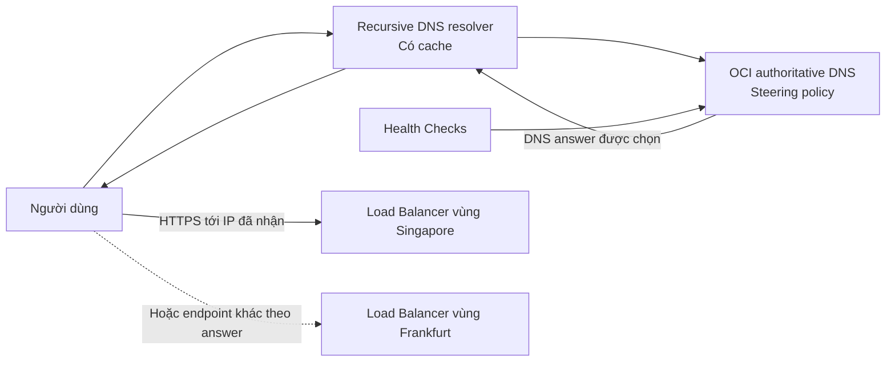

# Điều phối lưu lượng theo vị trí và độ trễ

Một ứng dụng triển khai ở nhiều Oracle Cloud Infrastructure (OCI) region cần chọn nơi phục vụ phù hợp cho từng nhóm người dùng. Gửi mọi truy cập tới một region có thể làm tăng thời gian phản hồi; chọn nơi gần nhất trên bản đồ cũng chưa bảo đảm nhanh nhất khi đường mạng, tải ứng dụng hoặc dữ liệu thay đổi.

Trong module **CLOUD_PROVIDERS_ORACLE**, bài học này dùng DNS Traffic Management để nối tên dịch vụ với endpoint tại nhiều vùng. Người học kết hợp vị trí, sức khỏe endpoint và số đo độ trễ để xây dựng chính sách có thể kiểm chứng, đồng thời xem xét khả năng phục vụ của ứng dụng và cơ sở dữ liệu Oracle ở vùng được chọn.

Sau bài học, người học có thể:

- Giải thích cách Geolocation Steering chọn DNS answer cho từng nhóm truy vấn.
- Phân biệt vị trí địa lý, độ trễ mạng và thời gian phản hồi ứng dụng.
- Tạo thiết kế pool, health check, catch-all và thứ tự dự phòng.
- Đo hiệu quả theo vị trí người dùng và xây dựng quy trình cập nhật có kiểm soát.

## 1. Phạm vi triển khai trên OCI

OCI Traffic Management tạo các câu trả lời DNS khác nhau theo điều kiện như vị trí truy vấn và sức khỏe endpoint. Dịch vụ áp dụng cho **public DNS**; không áp dụng trực tiếp steering policy này vào private DNS zone. [Overview of Traffic Management](https://docs.oracle.com/en-us/iaas/Content/TrafficManagement/Concepts/overview.htm).

Các template được OCI công bố gồm `FAILOVER`, `LOAD_BALANCE`, `ROUTE_BY_GEO`, `ROUTE_BY_ASN`, `ROUTE_BY_IP` và `CUSTOM`. Danh sách này không có template `LATENCY`. Trong bài, `ROUTE_BY_GEO` là cơ chế triển khai chính; số đo độ trễ giúp đánh giá và điều chỉnh ánh xạ địa lý tới pool. [Các template của steering policy](https://docs.oracle.com/en-us/iaas/tools/oci-cli/latest/oci_cli_docs/cmdref/dns/steering-policy/create.html).

Có hai mức thực hiện:

| Mức | Cách quyết định nơi phục vụ |
| --- | --- |
| Geolocation cấu hình trước | Nhóm địa lý có danh sách pool ưu tiên đã xác định |
| Chính sách được cập nhật theo số đo | Quy trình vận hành hoặc bộ điều khiển bên ngoài dùng số đo để cập nhật ánh xạ qua API/IaC |

Mức thứ hai là một phần kiến trúc do đội triển khai xây dựng. Việc gắn Health Checks vào policy chưa tạo ra thuật toán tự chọn endpoint có RTT nhỏ nhất cho từng client.

## 2. DNS steering diễn ra ở đâu?

Luồng điển hình là:



DNS trả về địa chỉ hoặc tên đích. Sau đó client tự kết nối tới endpoint được chọn. Lưu lượng HTTP của người dùng không đi xuyên qua steering policy như qua một reverse proxy.

Điều này dẫn tới ba giới hạn cần đưa vào thiết kế:

1. Một lần tra DNS có thể được nhiều request sử dụng lại qua cache.
2. Thay policy ảnh hưởng các lần phân giải phù hợp về sau; kết nối đang mở không tự di chuyển.
3. DNS không quản lý cookie, phiên đăng nhập hay giao dịch database của ứng dụng.

Cần phân biệt ba tầng điều phối:

| Tầng | Ví dụ trách nhiệm |
| --- | --- |
| DNS toàn cục | Chọn endpoint vùng cho tên dịch vụ |
| Load Balancer trong vùng | Phân phối request tới backend và kiểm tra backend |
| Ứng dụng/dữ liệu | Xác thực, phiên, quyền ghi và tính nhất quán |

Một region nhận DNS answer phải thực sự xử lý được nghiệp vụ, không chỉ có load balancer đang mở cổng.

## 3. Vị trí mà policy quan sát

Trong DNS thông thường, authoritative server nhận câu hỏi từ recursive resolver. Vì vậy vị trí nhìn thấy có thể phản ánh resolver thay vì vị trí vật lý của thiết bị người dùng. EDNS Client Subnet là một cơ chế chuyển thông tin subnet nguồn qua DNS, nhưng hiệu lực phụ thuộc hỗ trợ và hành vi các bên; không mặc định mọi đường phân giải đều cung cấp được thông tin đó. [RFC 7871: Client Subnet in DNS Queries](https://www.rfc-editor.org/rfc/rfc7871).

Ví dụ người dùng ở Việt Nam dùng VPN và DNS của doanh nghiệp tại châu Âu có thể nhận kết quả khác người dùng cùng thành phố dùng DNS của nhà mạng địa phương. Resolver anycast cũng làm việc suy luận vị trí từ địa chỉ server trở nên khó hơn.

Khi đánh giá kết quả geolocation, ghi đủ:

- Vị trí và mạng của máy thử.
- Recursive resolver thực tế được dùng.
- Tên đầy đủ, QTYPE và DNS answer nhận được.
- TTL còn lại và thời điểm thử.
- Endpoint mà kết nối ứng dụng thực sự tới.

Không dùng một lần tra từ máy quản trị để kết luận mọi khách hàng trên thế giới được đưa tới đúng vùng.

## 4. Xây dựng policy từ answers, pools và rules

Một **answer** chứa dữ liệu bản ghi, chẳng hạn A với public IP của load balancer. **Pool** nhóm các answer cùng vai trò. **Attachment** gắn policy với tên trong zone. Khi attachment có hiệu lực, policy cung cấp câu trả lời cho loại record mà nó bao phủ thay cho record thông thường cùng tên/loại. Một domain chỉ có tối đa một attachment bao phủ một loại record cụ thể. [Các thành phần Traffic Management](https://docs.oracle.com/en-us/iaas/Content/TrafficManagement/Concepts/overview.htm).

Ví dụ lab sử dụng hai pool:

| Pool | Region | Answer minh họa |
| --- | --- | --- |
| `pool-sg` | Singapore | A → `203.0.113.10` |
| `pool-eu` | Frankfurt | A → `198.51.100.20` |

Hai địa chỉ thuộc dải dành cho tài liệu, không dùng làm endpoint thật. Khi triển khai, thay bằng địa chỉ endpoint mà bạn quản lý và đã kiểm thử.

Với `ROUTE_BY_GEO`, chuỗi rule theo template là:

```text
FILTER -> HEALTH nếu có monitor -> PRIORITY theo địa lý -> LIMIT
```

`FILTER` xử lý điều kiện như answer bị disable; `HEALTH` dùng trạng thái endpoint; `PRIORITY` sắp xếp pool theo case địa lý; `LIMIT` giới hạn số answer trả về. Trong rule priority, giá trị nhỏ hơn biểu thị ưu tiên cao hơn. [Traffic Management Steering Policies API Guide](https://docs.oracle.com/en-us/iaas/Content/TrafficManagement/Concepts/trafficmanagementapi.htm).

Với bài lab, đặt maximum answer count bằng `1` để việc quan sát vùng được chọn dễ hơn. Hai A record đồng thời không có nghĩa client sẽ tự chọn vùng nhanh nhất; client có hành vi lựa chọn và kết nối riêng.

## 5. Tình huống hai vùng phục vụ

Giả sử dịch vụ `api.example.com` được triển khai tại Singapore và Frankfurt. Cả hai endpoint đều có chứng chỉ TLS phù hợp cho tên này. Ứng dụng trả về marker vùng trong một endpoint chẩn đoán không chứa dữ liệu nhạy cảm.

Bộ tham số minh họa:

| Thuộc tính | Giá trị |
| --- | --- |
| Compartment | `OciGeoLab` |
| Policy | `geo-api-lab` |
| Template | `ROUTE_BY_GEO` |
| Public hostname lab | Một tên riêng thuộc domain bạn quản lý |
| TTL lab | `60` giây |
| Maximum answer count | `1` |
| Pool Singapore | Endpoint Singapore sẵn sàng phục vụ |
| Pool Frankfurt | Endpoint Frankfurt sẵn sàng phục vụ |

Bảng ánh xạ ban đầu:

| Nhóm địa lý | Ưu tiên 1 | Ưu tiên 2 |
| --- | --- | --- |
| Việt Nam, Thái Lan, Singapore | `pool-sg` | `pool-eu` |
| Đức, Pháp, Hà Lan | `pool-eu` | `pool-sg` |
| Global catch-all | `pool-sg` | `pool-eu` |

Global catch-all cung cấp lựa chọn cho truy vấn không khớp các nhóm đã khai báo. Nó có ý nghĩa khác với pool dự phòng: catch-all xác định **truy vấn thuộc case nào**, còn thứ tự pool xác định **endpoint nào được ưu tiên trong case đó**. OCI cho phép khai báo nhóm địa lý và danh sách pool ưu tiên trong Geolocation Steering. [Creating a Geolocation Steering Policy](https://docs.oracle.com/en-us/iaas/Content/TrafficManagement/Tasks/create-tm-policy-geo.htm).

Khi trường hợp địa lý chồng lấn, đọc lại thứ tự case được tạo và thử truy vấn đại diện. Đừng tự suy rằng mọi case quốc gia luôn thắng case châu lục nếu chưa kiểm tra cấu hình có hiệu lực.

## 6. Độ trễ nào cần tối ưu?

Khoảng cách địa lý là tín hiệu ban đầu. Trải nghiệm thật còn phụ thuộc peering của ISP, đường truyền quốc tế, TCP/TLS, mức tải và vị trí dữ liệu.

| Số đo | Điều nó cho biết | Giới hạn |
| --- | --- | --- |
| DNS lookup time | Thời gian tra tên tại máy thử | Có thể bị ảnh hưởng lớn bởi cache |
| RTT mạng | Thời gian khứ hồi của phép thử mạng | Chưa phản ánh xử lý nghiệp vụ |
| TCP/TLS setup | Chi phí thiết lập kết nối | Khác giữa kết nối mới và kết nối tái sử dụng |
| TTFB | Thời gian tới byte đầu tiên | Gồm nhiều thành phần, không chỉ network RTT |
| Tổng thời gian request | Thời gian hoàn tất thao tác thử | Phụ thuộc kích thước và nội dung response |
| Độ trễ giao dịch nghiệp vụ | Hiệu quả người dùng thực sự nhận | Cần request đại diện và dữ liệu phù hợp |

OCI Health Checks có probe HTTP/HTTPS, ICMP và TCP; kết quả có các thông tin thời gian phù hợp từng giao thức. Phép ping không thay cho đo API thực tế. [Managing Health Checks](https://docs.oracle.com/en-us/iaas/Content/HealthChecks/Tasks/managinghealthchecks.htm).

Để so sánh vùng, giữ cùng URL nghiệp vụ, payload, điều kiện xác thực và chế độ cache. Tách nhóm client theo khu vực/mạng; xem median, p95, lỗi và số lượng mẫu thay vì chỉ so một request thành công.

Bảng sau là **số liệu giả lập để giải thích quyết định**, không phải benchmark OCI:

| Nhóm máy thử | p95 Singapore | p95 Frankfurt | Nhận xét |
| --- | --- | --- | --- |
| Việt Nam | 85 ms | 245 ms | Singapore là ứng viên phù hợp |
| Đức | 210 ms | 42 ms | Frankfurt là ứng viên phù hợp |
| Miền Đông Hoa Kỳ | 260 ms | 125 ms | Catch-all Singapore cần được xem lại cho nhóm này |

Nếu nhiều mẫu ổn định xác nhận nhóm Hoa Kỳ nhanh hơn qua Frankfurt, có thể bổ sung case phù hợp. Việc điều chỉnh phải xét khả năng phục vụ, dung lượng và dữ liệu, không chỉ một cột latency.

## 7. Health check và readiness

Health Checks đánh giá endpoint có phục vụ được không; số đo hiệu năng giúp so sánh nơi phục vụ tốt hơn. Endpoint trả lời nhanh một trang tĩnh chưa chắc thực hiện được thao tác nghiệp vụ cần thiết.

Thiết kế health endpoint có thể kiểm tra những điều kiện tối thiểu để vùng nhận request:

- Tiến trình ứng dụng và listener đang sẵn sàng.
- Kết nối tới dependency bắt buộc hoạt động ở mức phù hợp.
- Trạng thái dữ liệu hoặc vai trò phục vụ cho phép xử lý loại request đó.
- Endpoint không ở trạng thái bảo trì hoặc đang drain theo quy trình triển khai.

Health Checks là dịch vụ theo dõi từ bên ngoài cho endpoint public-facing. Có thể chọn nhiều vantage point để tránh lệ thuộc một góc quan sát. [Overview of Health Checks](https://docs.oracle.com/en-us/iaas/Content/HealthChecks/Concepts/healthchecks.htm).

Khi tạo monitor, chọn targets và giao thức/cổng/path thực tế. Oracle khuyến nghị ít nhất ba vantage point thuộc ba provider khác nhau. Cấu hình timeout theo mục tiêu và kiểm tra kết quả từ từng vị trí trước khi gắn vào policy. [Creating an HTTP Monitor](https://docs.oracle.com/en-us/iaas/Content/HealthChecks/Tasks/create-http-monitor.htm).

Các điểm dễ sai trong lab:

1. Monitor chỉ hỏi hostname global đang được steering, nên không kiểm tra độc lập mọi endpoint vùng.
2. Target của monitor không khớp answer mà policy cần đánh giá.
3. Probe bị WAF hoặc firewall chặn nhưng lưu lượng người dùng vẫn chạy.
4. Health endpoint trả 200 dù vùng không có quyền ghi dữ liệu.
5. HTTPS probe dùng sai Host/SNI so với listener thực tế.

Nghiệm thu quan hệ giữa answer RDATA, target monitor và kết quả policy bằng phép thử làm hỏng từng endpoint. Trạng thái monitor healthy chưa đủ nếu policy gắn nhầm monitor hoặc attachment.

Nếu mọi pool đều lỗi, phải quan sát và ghi nhận hành vi thật của policy cũng như cache client. Không thiết kế nghiệp vụ dựa trên giả định rằng DNS chắc chắn sẽ chặn toàn bộ truy cập hoặc chắc chắn chỉ trả endpoint phục vụ được khi không còn endpoint hợp lệ.

## 8. Thực hành tạo Geolocation Steering

### 8.1. Chuẩn bị trước khi gắn hostname

Chuẩn bị public zone thuộc domain bạn quản lý và xác minh delegation tới DNS authoritative OCI. Dùng hostname lab riêng để thử, không thay ngay tên đang phục vụ người dùng thật.

Chuẩn bị hai endpoint vùng:

- Mỗi endpoint trả đúng nội dung và marker vùng có thể quan sát.
- Cùng hỗ trợ hostname công bố và TLS tương ứng.
- Firewall/WAF cho phép các luồng probe dự kiến.
- Dữ liệu, phiên và quyền của ứng dụng đáp ứng mô hình phục vụ đã chọn.

Người cấu hình cần IAM cho policy, attachment và zone liên quan, cùng quyền Health Checks nếu quản lý monitor. Danh tính chạy tự động hóa cần phạm vi phù hợp thay vì sử dụng credential quản trị chung.

### 8.2. Tạo policy và các pool

Trong **Traffic management steering policies**, tạo policy kiểu **Geolocation steering**. Điền tên, compartment, policy TTL và maximum answer count. Tạo answers cho hai pool bằng endpoint thật của lab.

Chọn các quốc gia/nhóm địa lý trong giao diện theo bảng ở mục 5, thiết lập pool priority và thêm global catch-all. Gắn monitor đã được kiểm tra trước. Lưu policy rồi đọc lại answers, trạng thái eligible/disabled, case địa lý và các pool dự phòng.

Tên pool là định danh nội bộ của policy; không mặc định tên pool phải trùng hostname hoặc tên region. Đặt tên rõ ràng để người vận hành phân biệt vai trò và đích hạ tầng.

### 8.3. Tạo attachment

Gắn policy vào hostname lab trong public zone phù hợp, xem thay đổi rồi publish theo giao diện. Policy phải có domain attachment để trả lời cho domain đó. [Attaching a Domain to a Policy](https://docs.oracle.com/en-us/iaas/Content/TrafficManagement/Tasks/tm-attach-create.htm).

Ghi lại policy OCID, attachment, zone OCID, record type và cấu hình trước thay đổi. Nếu cùng hostname có A và AAAA, xác định chính sách cho cả hai đường; chỉ đổi A chưa kiểm chứng client ưu tiên IPv6.

## 9. Kiểm thử câu trả lời DNS và đường truy cập

### 9.1. Đọc cấu hình qua OCI CLI

Ví dụ Bash dưới chỉ đọc policy, dùng CLI đã được xác thực bằng danh tính có quyền:

```bash
POLICY_OCID='<OCID_CUA_STEERING_POLICY>'

oci dns steering-policy get \
  --steering-policy-id "$POLICY_OCID"
```

Đối chiếu template, TTL, answers, rules và health check monitor với thiết kế. Lệnh đọc control plane không chứng minh người dùng ở một quốc gia cụ thể nhận answer nào. [OCI CLI: steering-policy get](https://docs.oracle.com/en-us/iaas/tools/oci-cli/latest/oci_cli_docs/cmdref/dns/steering-policy/get.html).

### 9.2. Tra từ các vị trí đại diện

Trên mỗi máy thử, đặt hostname lab thật:

```bash
LAB_HOST='api.example.com'

dig "$LAB_HOST" A +noall +comments +answer +authority +stats
dig "$LAB_HOST" AAAA +noall +comments +answer +authority +stats
```

Đọc TTL và answer cùng cấu hình resolver của máy thử. Để tách việc cập nhật authoritative với cache recursive, có thể hỏi trực tiếp nameserver thực tế của zone:

```bash
AUTH_NS='<NAMESERVER_AUTHORITATIVE_THUC_TE_CUA_ZONE>'
dig @"$AUTH_NS" "$LAB_HOST" A +norecurse \
  +noall +comments +answer +authority +stats
```

Truy vấn trực tiếp authoritative có nguồn khác đường recursive của người dùng, nên chỉ là bằng chứng về cấu hình và ngữ cảnh thử đó. Nó không thay cho kiểm tra từ resolver người dùng thực sự sử dụng.

### 9.3. Đo riêng từng endpoint bằng curl

Thay địa chỉ tài liệu bên dưới bằng IP endpoint thật trước khi chạy. `--resolve` giữ hostname URL cho Host/SNI và chọn IP kết nối, giúp đo từng vùng mà không phụ thuộc kết quả steering hiện tại:

```bash
LAB_HOST='api.example.com'
SG_IP='203.0.113.10'
EU_IP='198.51.100.20'

curl --noproxy '*' --resolve "${LAB_HOST}:443:${SG_IP}" \
  --connect-timeout 5 --max-time 15 --silent --show-error \
  --output /dev/null \
  --write-out 'region=sg code=%{http_code} dns=%{time_namelookup} connect=%{time_connect} tls=%{time_appconnect} ttfb=%{time_starttransfer} total=%{time_total}\n' \
  "https://${LAB_HOST}/health/ready"

curl --noproxy '*' --resolve "${LAB_HOST}:443:${EU_IP}" \
  --connect-timeout 5 --max-time 15 --silent --show-error \
  --output /dev/null \
  --write-out 'region=eu code=%{http_code} dns=%{time_namelookup} connect=%{time_connect} tls=%{time_appconnect} ttfb=%{time_starttransfer} total=%{time_total}\n' \
  "https://${LAB_HOST}/health/ready"
```

Các giá trị thời gian của curl ở đây tính bằng giây và nhiều mốc là thời gian cộng dồn từ đầu request. `time_starttransfer` chưa phải RTT thuần. Vì đã dùng `--resolve`, phép thử không đo đường DNS steering thông thường. [Tài liệu curl về resolve và write-out](https://curl.se/docs/manpage.html).

Không dùng một endpoint health rất nhẹ để kết luận toàn bộ giao dịch đều nhanh. Bổ sung URL nghiệp vụ chỉ đọc, payload đại diện và mẫu từ nhiều thời điểm. Sau khi so từng endpoint, đo lại hostname bình thường để xác nhận policy thực sự đưa người dùng tới vùng dự kiến.

## 10. Cập nhật chính sách theo độ trễ đo được

Nếu muốn cập nhật tự động, xây một luồng riêng:

```text
Thu thập số đo theo nhóm client và endpoint
  -> Kiểm tra chất lượng mẫu, lỗi và độ mới
  -> Loại vùng không đủ điều kiện phục vụ
  -> So phương án với cấu hình hiện tại
  -> Áp dụng ngưỡng và thời gian giữ ổn định
  -> Cập nhật policy qua API/IaC
  -> Đọc lại cấu hình và kiểm tra dữ liệu thực
```

Chỉ tối ưu trong tập vùng hợp lệ. Với giao dịch ghi, một region có p95 thấp nhưng database chưa ở vai trò cho phép ghi không phải ứng viên. Vùng đang thiếu năng lực hoặc chưa triển khai phiên bản ứng dụng cần thiết cũng phải được xử lý trước quyết định DNS.

Ví dụ quy tắc vận hành do đội triển khai tự thiết kế:

```text
Chỉ đề xuất đổi ưu tiên khi:
- Mỗi nhóm có đủ ít nhất 100 mẫu hợp lệ trong cửa sổ đánh giá.
- Kết quả mới tốt hơn ít nhất 15% và giảm ít nhất 20 ms.
- Điều kiện này giữ qua 3 cửa sổ liên tiếp.
- Đã qua thời gian giữ cấu hình tối thiểu 15 phút.
- Endpoint mới đạt yêu cầu lỗi, dữ liệu và dung lượng.
```

Đây là tham số minh họa của bộ điều khiển, không phải các trường có sẵn của `ROUTE_BY_GEO`. Hãy điều chỉnh bằng số đo và mục tiêu thực tế. Phản ứng health failover và tối ưu hiệu năng cũng cần phối hợp để hai luồng không thay đổi policy ngược nhau.

Khi dữ liệu đo thiếu, quá cũ hoặc mâu thuẫn, giữ cấu hình đã được xác minh và phát tín hiệu vận hành thay vì liên tục thay ưu tiên. Không dùng một probe ở một nơi để đại diện cho mọi ISP trong một quốc gia.

### Kiểm soát thay đổi tự động

Lưu cấu hình mong muốn, so sánh trước/sau và có bản cấu hình có thể phục hồi. Với policy dùng chung nhiều hostname, xác định toàn bộ phạm vi ảnh hưởng trước khi cập nhật. Giới hạn tần suất thay đổi và tránh để người vận hành cùng bộ điều khiển ghi đè lẫn nhau.

Sau mỗi lần cập nhật, kiểm tra cả API readback lẫn truy vấn DNS và request từ các nhóm client. Một lần gọi API thành công mới chứng minh thay đổi đã được chấp nhận ở control plane.

## 11. TTL, failover và phiên ứng dụng

Thời gian khôi phục phụ thuộc nhiều giai đoạn:

```text
Phát hiện endpoint lỗi
  + Cập nhật trạng thái được policy sử dụng
  + Cache DNS của client/resolver hết hiệu lực phù hợp
  + Client thử kết nối hoặc tra lại
  + Ứng dụng khôi phục phiên/thao tác
```

Đây là khung phân tích, không phải công thức cộng có cận trên cứng cho mọi client. Health check interval và timeout ảnh hưởng phát hiện; TTL ảnh hưởng cache; ứng dụng có thể giữ connection pool hoặc retry theo cách riêng. Oracle cũng lưu ý giới hạn phản ứng failover và session persistence khi dùng DNS steering cho hệ thống nhiều site. [Kiến trúc FMW với Traffic Management](https://docs.oracle.com/en/solutions/fmw-stretched-clusters/set-fmw-stretched-clusters1.html).

TTL `60` giây trong lab không có nghĩa mọi request sẽ chuyển vùng đúng sau 60 giây. TTL thấp còn làm tăng số lần resolver cần hỏi lại và yêu cầu quan sát cẩn thận hơn khi thay policy.

Ứng dụng nên có thiết kế phù hợp cho phiên, dữ liệu dùng chung và retry. Với thao tác ghi, việc client không nhận response chưa chứng minh thao tác ở vùng cũ chưa hoàn tất; cần cơ chế nghiệp vụ xử lý thử lại và tránh lặp giao dịch.

Khi quay về vùng đã phục hồi, cân nhắc lượng truy cập tăng trở lại, độ ấm cache và tốc độ bắt kịp dữ liệu. Đừng biến cải thiện vài mili giây thành nhiều lần chuyển vùng trong thời gian ngắn.

## 12. Ma trận thử lỗi và nghiệm thu

Thực hiện trong lab hoặc cửa sổ thay đổi, mỗi lần tác động một yếu tố và ghi dấu thời gian:

| Tình huống | Bằng chứng cần có |
| --- | --- |
| Hai pool đều phục vụ tốt | Mỗi nhóm nhận đúng answer theo policy và request thành công |
| Pool Singapore lỗi | Trạng thái monitor đổi, truy vấn phù hợp và client chuyển theo thứ tự dự phòng |
| Pool Frankfurt lỗi | Kiểm tra tương tự cho các nhóm ưu tiên Frankfurt |
| Singapore chậm nhưng vẫn healthy | Ghi p95; xác minh policy geo giữ cấu hình cho tới khi quy trình điều chỉnh thực hiện |
| Probe bị chặn riêng | Phát hiện sai lệch giữa vantage point và kết nối người dùng |
| Cả hai pool lỗi | Ghi nhận DNS answer thực tế, lỗi ứng dụng và quy trình ứng phó |
| Vùng cũ phục hồi | Quan sát sự ổn định, dung lượng và hành vi trở lại |
| Client còn cache | So authoritative answer, recursive answer và IP request đã dùng |
| Client dùng AAAA | Kiểm chứng vùng IPv6 tương ứng thay vì chỉ kiểm tra A |

Dùng log ứng dụng hoặc marker vùng để xác nhận request tới đâu. Marker chỉ trả thông tin cần thiết, không công bố tên máy nội bộ hoặc dữ liệu cấu hình nhạy cảm.

Chốt tiêu chí bằng thời gian phục hồi nghiệp vụ, tỷ lệ lỗi và p95 theo nhóm. Không chỉ nghiệm thu bằng hình chụp policy hoặc một truy vấn từ Console.

## 13. Giám sát, chi phí và vòng đời

Theo dõi song song ba nhóm tín hiệu:

| Nhóm | Ví dụ |
| --- | --- |
| DNS và cấu hình | Answer theo nhóm thử, TTL, policy/attachment và thay đổi cấu hình |
| Sức khỏe và hiệu năng | Trạng thái probe, timeout, độ trễ theo target/vantage point |
| Nghiệp vụ | Tỷ lệ lỗi, p95 giao dịch, số request mỗi vùng và trạng thái dữ liệu |

Health Checks có metric như `HTTP.isHealthy`, `HTTP.TotalDuration`, `HTTP.StatusCode` và `PING.Latency`. Tách theo target và vantage point khi phân tích; không gộp mọi nơi đo thành một trung bình khiến mất dấu một khu vực đang lỗi. [Health Checks Metrics Reference](https://docs.oracle.com/en-us/iaas/Content/HealthChecks/Reference/metricsalarms-reference.htm).

Trong dự toán, kiểm kê DNS/steering, health checks, load balancer, compute, dữ liệu nhân bản và lưu lượng liên vùng theo bảng giá áp dụng. Tăng số vùng luôn cần xem lại tổng năng lực và chi phí vận hành, không chỉ phần policy.

Có thể ước lượng số lần probe từ thiết kế để kiểm tra quy mô. Với 2 target, 3 vantage point và interval 30 giây:

```text
Số probe dự kiến mỗi ngày
  = 2 × 3 × 86.400 / 30
  = 17.280
```

Đây là số lần kiểm tra theo giả định mỗi vantage point thử mỗi target ở mỗi chu kỳ; không phải giá tiền hay cam kết hóa đơn. Đối chiếu tần suất, tài nguyên và điều khoản dịch vụ thực tế trước khi suy chi phí.

Gắn owner và thời hạn cho hostname lab, monitor, endpoint và policy. Khi dọn lab, rà soát attachment cùng record gốc: gỡ attachment có thể làm record thông thường trước đó được dùng trở lại. Kiểm tra câu trả lời sau khi dọn để tránh để hostname trỏ tới endpoint đã bị xóa.

## 14. Bài thực hành hoàn chỉnh

Với mô hình hai vùng, hãy tạo một bản thiết kế có thể bàn giao:

1. Liệt kê nhóm người dùng, resolver đại diện và vùng được phép phục vụ từng nghiệp vụ.
2. Tạo bảng pool priority gồm cả global catch-all và đường dự phòng.
3. Chọn health endpoint và chứng minh nó phản ánh readiness cần thiết.
4. Thu số đo từ ít nhất hai nhóm vị trí, phân biệt đo từng endpoint với đo qua hostname steering.
5. Giải thích vì sao ánh xạ hiện tại phù hợp hoặc cần thay đổi dựa trên số đo.
6. Thử mất một vùng, ghi thời gian monitor đổi, DNS đổi và request thành công trở lại.
7. Chuẩn bị quy trình cập nhật, đọc lại, rollback và kiểm kê chi phí.

Kết quả cần cho thấy **vị trí là điều kiện chọn ban đầu**, **sức khỏe quyết định khả năng sử dụng endpoint** và **độ trễ đo được giúp kiểm chứng chất lượng lựa chọn**. Tính sẵn sàng cuối cùng vẫn phải được đánh giá trên ứng dụng và dữ liệu Oracle tại vùng nhận lưu lượng.