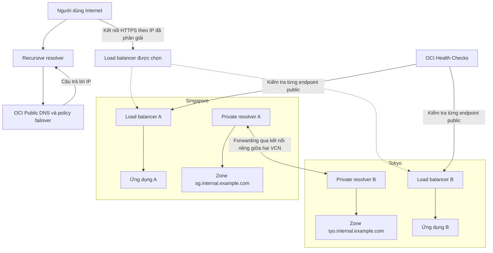

# Thiết kế DNS cho hệ thống nhiều region

Trong chương **DNS và điều phối truy cập** của module `CLOUD_PROVIDERS_ORACLE`, bài học này thiết kế lớp tên miền cho ứng dụng triển khai ở nhiều region trên Oracle Cloud Infrastructure (OCI). Ta kết hợp public DNS, Traffic Management, Private DNS, mạng VCN và quy trình vận hành để người dùng tìm được endpoint phù hợp, đồng thời giữ rõ trách nhiệm của ứng dụng và cơ sở dữ liệu khi chuyển vùng.

Ví dụ xuyên suốt dùng hai region: Singapore và Tokyo. Một dịch vụ đọc danh mục sản phẩm có thể phục vụ ở cả hai vùng, nhưng bình thường ưu tiên Singapore. Các workload riêng cần phân giải tên nội bộ giữa hai VCN; luồng ghi vào Oracle Database có quy trình chuyển vai trò riêng.

## 1. Mục tiêu và điều kiện đầu vào

Sau bài học, người học có thể:

- Phân biệt DNS authoritative, recursive resolver, policy điều phối và endpoint ứng dụng theo region.
- Chọn cách đặt tên cho dịch vụ công khai, dịch vụ riêng và endpoint cố định theo vùng.
- Thiết kế failover public DNS dựa trên readiness và health check.
- Thiết kế phân giải DNS riêng xuyên region bằng resolver endpoint và forwarding rule.
- Đánh giá TTL, cache của client, thời gian kết nối lại và các điều kiện dữ liệu trước khi chuyển vùng.
- Lập quy trình kiểm thử, failback, phân quyền và kiểm soát chi phí.

Cần hiểu record A/AAAA/CNAME, zone, NS, TTL, subnet, DRG và security rule. Lab giả định có hai môi trường ứng dụng thử nghiệm, quyền quản trị DNS phù hợp, một tên miền do người học kiểm soát nếu thử public DNS, và đường mạng riêng giữa hai VCN nếu thử Private DNS. Các tên dưới `example.com` trong bài chỉ để minh họa; phải thay bằng tên miền được phép sử dụng khi triển khai.

## 2. DNS quyết định điều gì trong kiến trúc nhiều region?

Luồng cơ bản của truy cập công khai là:

```text
Client → recursive resolver → authoritative DNS
Client ← câu trả lời DNS có TTL
Client → IP được trả về → load balancer theo region → ứng dụng
```

DNS trả lời câu hỏi về tên miền. DNS không chuyển tiếp từng HTTP request, không di chuyển phiên TCP đang mở và không tự biến một database standby thành primary. Một câu trả lời DNS hợp lệ vẫn có thể dẫn tới một endpoint không truy cập được nếu route, firewall, TLS hoặc ứng dụng chưa sẵn sàng.

OCI DNS cho phép quản lý zone và record, còn mạng edge của dịch vụ xử lý truy vấn authoritative cho domain được cấu hình. Với public DNS, phải có delegation đúng; với private DNS, phải có resolver nhìn thấy dữ liệu tên miền và đường truy vấn phù hợp. [Oracle: Overview of DNS](https://docs.oracle.com/en-us/iaas/Content/DNS/Concepts/dnszonemanagement.htm).

Tách bốn lớp khi lập thiết kế:

| Lớp | Câu hỏi cần trả lời | Ví dụ |
|---|---|---|
| Tên miền và authority | Ai quản lý tên này, truy vấn đến đúng zone chưa? | Public zone `example.com` |
| Quyết định DNS | Nên trả về endpoint nào cho truy vấn hiện tại? | Chọn pool Singapore hoặc Tokyo |
| Kết nối và phiên | Client có đến được endpoint và tạo phiên mới không? | HTTPS, TLS, route và NSG |
| Dữ liệu và vai trò | Endpoint có được phép phục vụ nghiệp vụ đó không? | Database writer đã được xác nhận |

Nhờ cách tách này, nhóm vận hành có thể xác định một sự cố nằm ở DNS, đường mạng, ứng dụng hay dữ liệu thay vì gọi chung là “lỗi chuyển region”.

## 3. Chọn mô hình phục vụ và cơ chế điều phối

| Mô hình | Đặc điểm | Điều kiện quan trọng |
|---|---|---|
| Active-passive | Ưu tiên một vùng, vùng khác nhận tải khi có sự cố | Vùng dự phòng đủ khả năng phục vụ trước khi được chọn |
| Active-active | Nhiều vùng cùng nhận lưu lượng | Session, dữ liệu và phụ thuộc phải hỗ trợ phân bố tải |
| Ưu tiên theo địa lý | Câu trả lời phụ thuộc vị trí nguồn truy vấn | Có phương án khi vùng ưu tiên không sẵn sàng |
| Chuyển tải theo trọng số | Tăng dần tỷ lệ câu trả lời hướng đến vùng mới | Theo dõi lỗi, tải và cache trong quá trình chuyển |

OCI Traffic Management có các policy như failover, load balancing theo trọng số, geolocation, ASN và IP prefix. Dịch vụ này áp dụng cho **public DNS**, không hỗ trợ trực tiếp private DNS. Policy điều khiển câu trả lời DNS; trọng số của câu trả lời không phải cam kết chính xác về tỷ lệ HTTP request hoặc số người dùng. [Oracle: Overview of Traffic Management](https://docs.oracle.com/en-us/iaas/Content/TrafficManagement/Concepts/overview.htm).

Bài thực hành chọn failover public DNS để thấy rõ chuỗi phát hiện lỗi, đổi câu trả lời và client kết nối lại. Phần Private DNS dùng thiết kế resolver và bản ghi riêng; không áp cùng một steering policy công khai cho cả hai lớp.

## 4. Thiết kế namespace và chủ sở hữu

Nên tách tên dịch vụ ổn định khỏi tên cho biết vị trí triển khai. Tên theo region hữu ích khi kiểm tra từng vùng mà không phụ thuộc quyết định của tên dịch vụ chung.

| Tên minh họa | Phạm vi | Ý nghĩa |
|---|---|---|
| `catalog.example.com` | Public | Tên ổn định cho dịch vụ đọc danh mục |
| `catalog-sg.example.com` | Public | Endpoint cố định của dịch vụ tại Singapore |
| `catalog-tyo.example.com` | Public | Endpoint cố định của dịch vụ tại Tokyo |
| `orders.sg.internal.example.com` | Private | Dịch vụ riêng tại Singapore |
| `orders.tyo.internal.example.com` | Private | Dịch vụ riêng tại Tokyo |
| `db.sg.internal.example.com` | Private | Endpoint DB được quản lý tại Singapore |
| `db.tyo.internal.example.com` | Private | Endpoint DB được quản lý tại Tokyo |
| `writer.service.internal.example.com` | Private | Tên dịch vụ ghi, cập nhật theo quy trình chuyển vai trò DB |

Tên theo region giữ nguyên ý nghĩa vị trí. Không đổi `db.sg...` sang địa chỉ Tokyo để giả vờ đó vẫn là Singapore. Khi cần chuyển nơi phục vụ, thay lớp tên dịch vụ ổn định hoặc cơ chế kết nối được thiết kế cho ứng dụng.

Chỉ định owner cho từng zone và RRset: nhóm nền tảng quản lý delegation và resolver, nhóm ứng dụng quản lý readiness và endpoint, nhóm database xác nhận vai trò ghi. Bản ghi mà nhiều nhóm cùng tự cập nhật dễ tạo xung đột trong sự cố.

## 5. Kiến trúc tham chiếu



Public DNS không nằm trên đường truyền dữ liệu HTTPS sau khi client đã biết IP. Đường liên vùng giữa các resolver là đường truy vấn DNS riêng; đường tới dịch vụ đích vẫn phải được thiết kế và kiểm tra độc lập.

Hai ứng dụng đọc trong ví dụ đã có dữ liệu và phụ thuộc cần thiết để phục vụ truy vấn. Nếu Tokyo chưa có dữ liệu phù hợp, việc DNS trả về Tokyo không hoàn thành mục tiêu khôi phục dịch vụ.

## 6. Tạo failover cho dịch vụ công khai

### 6.1. Chuẩn bị endpoint trước khi gắn policy

Tại mỗi region, chuẩn bị load balancer và backend phục vụ cùng hợp đồng API. Cả hai cần chứng thư phù hợp với `catalog.example.com`, listener đúng, cấu hình Host và một endpoint readiness như `/readyz`.

Ghi lại các giá trị sau:

| Thành phần | Singapore | Tokyo |
|---|---|---|
| Địa chỉ dùng trong câu trả lời A | `<PUBLIC_IP_A>` | `<PUBLIC_IP_B>` |
| Pool | `primary-sg` | `secondary-tyo` |
| Thứ tự ưu tiên trong lab | 1 | 2 |
| Readiness | Sẵn sàng phục vụ dịch vụ đọc | Sẵn sàng phục vụ dịch vụ đọc |
| Dung lượng | Tải bình thường | Đủ tiếp nhận tải sau failover |

Các IP là placeholder; thay bằng địa chỉ public thực tế của frontend được chọn. Không công bố IP của một backend tạm thời rồi giả định nó có vòng đời giống endpoint dịch vụ ổn định.

### 6.2. Xác nhận public zone và delegation

Tạo hoặc dùng public zone thuộc quyền quản lý, xác nhận các NS được cấp cho đúng zone và delegation ở registrar hoặc parent zone. Việc tạo zone trong Console không tự làm Internet sử dụng zone đó. Delegation cho tên miền gốc và delegation cho subdomain phải được xử lý tại đúng nơi quản lý. [Oracle: Delegating a Public DNS Zone](https://docs.oracle.com/en-us/iaas/Content/DNS/Concepts/gettingstarted_topic-Delegating_Your_Zone.htm).

Không dùng thao tác đổi NS tại registrar làm cách chuyển endpoint ứng dụng giữa hai region trong lab. Ta giữ authority ổn định và thay quyết định trả lời cho tên dịch vụ; cache của delegation có vòng đời riêng với TTL của record ứng dụng.

### 6.3. Cấu hình policy

Tạo Traffic Management steering policy loại **Failover**, khai báo hai answer pool chứa các địa chỉ A tương ứng, ưu tiên Singapore trước Tokyo và gắn health check của hai endpoint. Đặt maximum answer count bằng 1 cho ví dụ; chọn TTL ban đầu 60 giây để thực hành. Đây là giá trị lab, không phải khuyến nghị chung cho mọi ứng dụng.

Gắn policy vào domain `catalog.example.com` trong đúng public zone. Kiểm tra answer có đủ điều kiện được chọn, pool priority đúng và health check đã được liên kết. Nếu không gắn health check, chỉ khai báo thứ tự ưu tiên chưa cung cấp tín hiệu phát hiện lỗi endpoint. [Oracle: Creating a Failover Policy](https://docs.oracle.com/en-us/iaas/Content/TrafficManagement/Tasks/create-tm-policy-failover.htm).

Ở lớp API, template failover xử lý các nhóm rule lọc điều kiện, sức khỏe, ưu tiên và giới hạn câu trả lời theo thứ tự quy định. Nếu tự động hóa bằng API/IaC, phải giữ đúng cấu trúc template thay vì gửi một danh sách answer rồi cho rằng đã có đầy đủ logic failover. [Oracle: Traffic Management Steering Policies API Guide](https://docs.oracle.com/en-us/iaas/Content/TrafficManagement/Concepts/trafficmanagementapi.htm).

Nếu có IPv6, lập thiết kế và kiểm thử AAAA riêng tương ứng. Chuyển A sang Tokyo nhưng giữ AAAA trỏ Singapore có thể làm các client sử dụng hai đường khác nhau.

## 7. Health check phải đo đúng khả năng phục vụ

### 7.1. Đo riêng từng vùng

OCI Health Checks dùng các vantage point bên ngoài để kiểm tra endpoint công khai. Không giả định monitor công khai có đường vào địa chỉ RFC 1918 của private load balancer hoặc database. Với dịch vụ riêng, cần phép kiểm tra chạy từ mạng có quyền truy cập tương ứng. [Oracle: Overview of the Health Checks Service](https://docs.oracle.com/en-us/iaas/Content/HealthChecks/Concepts/healthchecks.htm).

Monitor phải đánh giá từng endpoint vùng độc lập. Nếu chỉ probe `catalog.example.com`, chính policy DNS có thể chọn một vùng đang tốt và che khuất lỗi của vùng còn lại.

Khi dùng HTTPS monitor với target là IP, cấu hình Host header bằng hostname gắn với chứng thư và listener tương ứng. Chọn protocol, port, path, timeout, interval và vantage point phù hợp; xác nhận kết quả thực tế cho cả hai IP. [Oracle: Creating an HTTP Monitor](https://docs.oracle.com/en-us/iaas/Content/HealthChecks/Tasks/create-http-monitor.htm).

### 7.2. Ràng buộc health data với answer

Kiểm tra `rdata` của answer có khớp endpoint được monitor theo cấu hình OCI hay không. Oracle ghi rõ answer có `rdata` không khớp endpoint nào được monitor sẽ được xem là healthy. Vì vậy, một health check đã tồn tại chưa chứng minh mọi answer của policy đang được giám sát. [Oracle: Steering Policy — health_check_monitor_id](https://docs.oracle.com/en-us/iaas/tools/terraform-provider-oci/latest/docs/r/dns_steering_policy.html).

Lưu bảng đối chiếu answer, IP/hostname, monitor OCID và kết quả health. Sau khi thay địa chỉ frontend, cập nhật và kiểm tra cả policy lẫn monitor.

### 7.3. Readiness khác tiến trình còn chạy

`/readyz` của ví dụ cần phản ánh khả năng phục vụ dịch vụ đọc: backend hoạt động, dữ liệu đọc phù hợp và các phụ thuộc bắt buộc sẵn sàng. Một trang tĩnh trả HTTP 200 trong khi backend không truy vấn được dữ liệu là tín hiệu failover không có ích.

Không đưa tác vụ nặng, truy vấn làm thay đổi dữ liệu hoặc bí mật vào health endpoint. Nếu dùng WAF hoặc hạn chế IP nguồn, bảo đảm probe được phép theo thiết kế; đồng thời vẫn kiểm tra đường truy cập của người dùng thực tế.

Chọn tín hiệu đủ ổn định để tránh chuyển qua lại liên tục khi phụ thuộc chập chờn. Khi cả hai vùng lỗi, kiểm thử câu trả lời thực tế của policy đã triển khai và hành vi client; đừng giả định DNS sẽ tự ngăn mọi kết nối. Client có cache hoặc kết nối cũ vẫn có thể đến endpoint đã bị bỏ khỏi lựa chọn mới.

## 8. TTL, cache và thời gian người dùng thực sự phục hồi

### 8.1. Một ngân sách thời gian minh họa

Không đồng nhất TTL 60 giây với RTO 60 giây. Một ngân sách ước lượng có thể tách thành:

```text
Thời gian người dùng phục hồi ≈
  phát hiện endpoint không sẵn sàng
  + cập nhật quyết định trả lời
  + cache cũ còn hiệu lực
  + timeout và kết nối lại của client
```

Giả sử phép đo lab cho 45 giây phát hiện lỗi, 5 giây để quan sát authoritative trả về B, dành 60 giây cho cache cũ và 10 giây cho kết nối lại. Ngân sách cộng đơn giản là 120 giây. Các pha có thể chồng lấn và hành vi client có thể kéo dài hơn; đây là mô hình để phân tích, không phải SLA của OCI.

Một resolver nhận A ngay trước khi authoritative đổi sang B vẫn có thể giữ câu trả lời A đến khi cache đó hết hiệu lực. Thay TTL từ 300 xuống 60 vào lúc có sự cố không rút ngắn TTL 300 đã được cache trước đó. Với diễn tập có kế hoạch, giảm TTL đủ sớm và chờ cache cũ hết trước khi đo.

### 8.2. Nhiều tầng cache

| Tầng | Hành vi cần kiểm tra |
|---|---|
| Recursive resolver | Cache câu trả lời dương, câu trả lời âm và chính sách refresh |
| Hệ điều hành hoặc thư viện client | Có dùng cache riêng hoặc resolver khác không |
| Runtime ứng dụng | Có giữ địa chỉ lâu hơn dự kiến không |
| Connection pool | Có tiếp tục dùng phiên cũ mà không lookup lại không |
| Proxy hoặc thiết bị biên | Có cache DNS hoặc duy trì upstream connection riêng không |

NXDOMAIN và NODATA có thể được cache dựa trên thông tin SOA; vừa tạo record bị thiếu chưa làm tất cả resolver quên câu trả lời âm trước đó. [IETF RFC 2308: Negative Caching](https://datatracker.ietf.org/doc/html/rfc2308).

Một số resolver có cơ chế serve-stale để tiếp tục dùng dữ liệu cũ khi không refresh được. Do đó, TTL không phải giới hạn thời gian tuyệt đối cho mọi client trong mọi tình huống. [IETF RFC 8767: Serving Stale Data](https://www.rfc-editor.org/rfc/rfc8767.html).

Với ứng dụng Java, kiểm tra chính sách cache của `InetAddress`, gồm các security property như `networkaddress.cache.ttl`, `networkaddress.cache.negative.ttl` và hành vi stale được JDK hỗ trợ. Không mặc định mọi JVM sử dụng cache giống TTL authoritative; thử trên đúng JDK, thư viện và connection pool của workload. [Oracle: Java InetAddress — Address Caching](https://docs.oracle.com/en/java/javase/25/docs/api/java.base/java/net/InetAddress.html).

## 9. Private DNS giữa hai region

### 9.1. Chia namespace theo vùng

Thiết kế mẫu dùng:

| Region | Private zone địa phương | Ví dụ record |
|---|---|---|
| Singapore | `sg.internal.example.com` | `orders` và `db` của Singapore |
| Tokyo | `tyo.internal.example.com` | `orders` và `db` của Tokyo |

Private zone thuộc view; resolver nhìn thấy dữ liệu qua các view được liên kết. Việc chia sẻ private view giữa resolver được hỗ trợ trong cùng region. Với hai region, dùng resolver endpoints và forwarding phù hợp thay vì coi view là một tài nguyên tự đồng bộ toàn cầu. [Oracle: Private DNS](https://docs.oracle.com/en-us/iaas/Content/DNS/Tasks/privatedns.htm).

Tách zone theo region giúp mỗi bên có authority rõ ràng. Không tạo hai bản zone cùng tên nhưng chứa các tập record khác nhau rồi trông chờ mọi truy vấn tự đi tìm phần record còn thiếu ở phía kia.

### 9.2. Listening và forwarding endpoint

Tạo listening endpoint để resolver nhận truy vấn từ mạng khác và forwarding endpoint để gửi truy vấn theo rule. Một endpoint có vai trò listening hoặc forwarding; client Compute dùng resolver VCN địa phương tại `169.254.169.254` không cần tự đi qua listening endpoint chỉ để phân giải tên trong VCN. Địa chỉ link-local này không phải đích dùng để gọi resolver ở region khác. [Oracle: Resolver Endpoints](https://docs.oracle.com/en-us/iaas/Content/Network/Concepts/dns-topic-resolver_endpoints.htm).

Ví dụ mapping rule:

| Resolver nguồn | Namespace cần phân giải từ xa | Đích forward |
|---|---|---|
| Singapore | `tyo.internal.example.com` | IP listening endpoint tại Tokyo |
| Tokyo | `sg.internal.example.com` | IP listening endpoint tại Singapore |

Đường đi của truy vấn từ máy ở Singapore:

```text
Client → resolver VCN Singapore
       → rule cho tyo.internal.example.com
       → forwarding endpoint Singapore
       → mạng riêng liên vùng
       → listening endpoint Tokyo
       → private zone Tokyo
```

Chuẩn bị kết nối riêng như DRG/RPC phù hợp, route hai chiều cho các subnet endpoint và security rule DNS tương ứng. Cho phép UDP/TCP 53 theo vai trò endpoint và luồng phản hồi; kiểm thử cả TCP thay vì chỉ một truy vấn UDP nhỏ. Đọc các yêu cầu networking trong [Oracle: Private DNS — VCN Configuration](https://docs.oracle.com/en-us/iaas/Content/DNS/Tasks/privatedns.htm).

DNS thành công chỉ chứng minh đường truy vấn tới resolver. Máy nguồn còn cần đường riêng tới IP ứng dụng mà record trả về, cùng rule ứng dụng tương ứng.

### 9.3. Tránh che khuất zone và vòng lặp

Ở chế độ phân giải mặc định Static, một private zone đã khớp nhưng thiếu tên có thể trả NXDOMAIN thay vì tiếp tục tìm ở rule forwarding. Nếu Singapore có zone cha bao phủ tên của Tokyo nhưng thiếu record Tokyo, cần kiểm tra thiết kế authority và thứ tự xử lý trước khi sửa route. OCI có các resolution mode khác; phải cấu hình có chủ đích và xác minh đúng loại record, không coi chúng là cơ chế nhân bản dữ liệu giữa vùng. [Oracle: OCI Private DNS Resolution Modes](https://blogs.oracle.com/cloud-infrastructure/oci-private-dns-resolution-modes).

Không forward cùng namespace từ Singapore sang Tokyo rồi từ Tokyo trở lại Singapore khi cả hai đều không có authority cuối cùng. Mỗi suffix cần có nơi trả lời rõ ràng; rule cụ thể phải được tổ chức để không bị một rule rộng hơn che khuất.

## 10. Tên dịch vụ ổn định và vai trò Oracle Database

Để ứng dụng không nhúng tên vùng vào cấu hình kết nối nghiệp vụ, có thể dùng tên ổn định như `writer.service.internal.example.com`. Ví dụ tên này là CNAME trỏ tới endpoint DB đã được xác định tại vùng đang giữ vai trò ghi.

Nếu cần tên đó tồn tại độc lập ở cả hai region, một phương án là quản lý hai private zone `service.internal.example.com` với cùng dữ liệu mong muốn trong hai view địa phương. Đây là hai bộ tài nguyên phải được cập nhật và đối chiếu; OCI không tự biến chúng thành một zone ghi toàn cầu.

| Trạng thái nghiệp vụ | CNAME mong muốn ở các vùng phục vụ client |
|---|---|
| Singapore là writer hợp lệ | `writer.service... → db.sg.internal.example.com` |
| Đã hoàn tất chuyển vai trò sang Tokyo | `writer.service... → db.tyo.internal.example.com` |

Quy trình database phải xác nhận điều kiện sao chép, chuyển vai trò, khả năng phục vụ và ngăn writer cũ tiếp tục ghi trước khi công bố writer mới. DNS chỉ cập nhật điểm khám phá dịch vụ; không cung cấp cơ chế fencing hoặc bảo đảm không có hai writer.

Sau khi đổi alias, còn phải kiểm tra JDBC/connection pool, service name của database, chứng thư nếu có TLS và cách ứng dụng xử lý giao dịch đang dở. Tên miền ổn định không sửa được một cấu hình kết nối vẫn nhúng IP cũ hoặc service name không tồn tại ở vùng mới.

Nếu một region không còn cập nhật được, ghi rõ zone nào đã đổi, client nào còn có thể dùng dữ liệu cũ và hàng rào nào ngăn ghi sai. Hai cập nhật DNS ở hai region không phải một giao dịch nguyên tử. Kế hoạch khôi phục phải xét cả phân vùng mạng, không chỉ trường hợp region biến mất hoàn toàn.

## 11. Kết nối DNS với on-premises và split-horizon

Nếu có DNS tại chỗ, tạo conditional forwarding theo suffix về listening endpoint thích hợp và cấu hình đường từ mỗi region đến DNS tại chỗ khi cần. Region Tokyo không nên phụ thuộc duy nhất vào một forwarder hoặc đường truyền tại Singapore nếu mục tiêu là tiếp tục hoạt động khi Singapore mất.

Với split-horizon, cùng một FQDN có thể trả IP công khai cho người dùng Internet và IP riêng cho client nội bộ. Hai cách trả lời cần được quản lý như hai hợp đồng truy cập: mỗi IP phải phù hợp chứng thư, route và readiness của nhóm client tương ứng. Public steering policy không tự cập nhật dữ liệu private của cùng tên.

Ví dụ public `catalog.example.com` đã chuyển sang Tokyo nhưng private zone vẫn trả frontend Singapore. Người dùng Internet có thể phục hồi trong khi batch job nội bộ tiếp tục lỗi. Vì vậy, kế hoạch kiểm thử phải chỉ rõ client dùng resolver nào và nhìn thấy view nào.

## 12. Kiểm thử authority, cache và endpoint

### 12.1. Public DNS

Các lệnh dưới đây dùng Bash cùng `dig` và `curl`. Thay tên miền, IP và nameserver bằng giá trị lab thực tế; không thực hiện thay đổi trên domain không được phép quản lý.

```bash
SERVICE_FQDN='catalog.example.com'
ZONE_FQDN='example.com'
AUTH_NS='<nameserver-authoritative-cua-dung-zone>'
PUBLIC_IP_A='<public-ip-load-balancer-Singapore>'
PUBLIC_IP_B='<public-ip-load-balancer-Tokyo>'

# Xem delegation và đường phân giải public.
dig "$ZONE_FQDN" NS
dig "$SERVICE_FQDN" A +trace

# Hỏi authoritative trực tiếp: kiểm tra answer và TTL đang công bố.
dig @"$AUTH_NS" "$SERVICE_FQDN" A +norecurse +noall +answer

# Hỏi resolver mà máy hiện dùng: có thể đang nhận câu trả lời cache.
dig "$SERVICE_FQDN" A +noall +answer

# Kiểm tra riêng từng vùng, giữ đúng hostname cho HTTPS/TLS.
curl --connect-timeout 5 --max-time 15 \
  --resolve "$SERVICE_FQDN:443:$PUBLIC_IP_A" \
  "https://$SERVICE_FQDN/readyz"
curl --connect-timeout 5 --max-time 15 \
  --resolve "$SERVICE_FQDN:443:$PUBLIC_IP_B" \
  "https://$SERVICE_FQDN/readyz"
```

`--resolve` giúp kiểm tra từng frontend mà không chờ DNS chọn vùng đó. Không dùng `-k` để bỏ kiểm tra chứng thư trong tiêu chí thành công. Nếu hai frontend trả cùng nội dung, bổ sung dấu hiệu region trong phản hồi kiểm thử hoặc đối chiếu request log để biết nơi thực sự phục vụ.

Authoritative trả B nhưng recursive resolver vẫn trả A có thể là hành vi cache hợp lệ. Chỉ hỏi authoritative chưa kiểm tra được trải nghiệm của client thật. Xem thêm [Oracle: Testing DNS Using dig](https://docs.oracle.com/en-us/iaas/Content/DNS/Tasks/testingdnsusingdig.htm).

### 12.2. Private DNS

Chạy từ một máy trong VCN Singapore với cấu hình resolver phù hợp:

```bash
# Kiểm tra tên thuộc region Tokyo qua resolver VCN địa phương.
dig @169.254.169.254 orders.tyo.internal.example.com A

dig +tcp @169.254.169.254 orders.tyo.internal.example.com A

# Xem cả alias ổn định và dữ liệu liên quan.
dig @169.254.169.254 writer.service.internal.example.com CNAME

dig @169.254.169.254 writer.service.internal.example.com A
```

Lặp lại từ Tokyo và từ mạng tại chỗ nếu thuộc phạm vi thiết kế. Khi cần tách lỗi, hỏi trực tiếp IP listening endpoint từ một nguồn có route và quyền được phép. `+trace` hữu ích cho delegation công khai; nó không thay thế việc kiểm tra private view và conditional forwarding trong mạng nội bộ.

Sau khi nhận IP đúng, thử giao thức ứng dụng tại IP/tên dịch vụ tương ứng. Phân giải đúng tên và kết nối được dịch vụ là hai tiêu chí khác nhau.

## 13. Runbook failover và failback

### Failover public của lab

1. Xác nhận cả hai frontend phục vụ được dịch vụ đọc, monitor quan sát đúng từng endpoint và Tokyo đủ dung lượng.
2. Ghi baseline: answer authoritative, answer qua resolver client, TTL, health và region phục vụ request.
3. Trong lab được kiểm soát, làm readiness Singapore thất bại để tạo tín hiệu lỗi đã định nghĩa.
4. Ghi thời điểm lỗi, lúc monitor đổi health, lúc authoritative trả Tokyo và lúc client thật hoàn tất request tại Tokyo.
5. Kiểm tra các client còn cache cũ, kết nối lâu dài và luồng IPv6 nếu có.
6. Khôi phục Singapore, kiểm tra dữ liệu/phụ thuộc và thực hiện failback theo chính sách đã chọn.

Đừng chỉ dùng nút vô hiệu hóa answer để đo toàn bộ failover tự động: thao tác đó kiểm tra nhánh cấu hình và cache, nhưng bỏ qua giai đoạn health check phát hiện lỗi. Có thể dùng nó như một bài kiểm tra riêng và ghi rõ phạm vi.

### Failback có kiểm soát

Một policy ưu tiên Singapore có thể chọn lại Singapore khi answer vùng này đủ điều kiện và healthy trở lại. Nếu chưa muốn nhận tải ngay, quản lý eligibility hoặc quy trình readiness theo thiết kế thay vì để một HTTP 200 xuất hiện quá sớm quyết định phục hồi nghiệp vụ.

Với database writer, failback là chuyển vai trò dữ liệu cần điều phối, không chỉ đảo CNAME. Kiểm tra đồng bộ, giao dịch, fencing và connection pool trước khi công bố lại. Giữ bằng chứng thời gian phục hồi và độ mất dữ liệu thực tế để đối chiếu RTO/RPO.

## 14. Ma trận sự cố phải diễn tập

| Tình huống | Điều cần xác nhận |
|---|---|
| Chỉ ứng dụng Singapore lỗi | Monitor phát hiện lỗi dịch vụ, policy chọn vùng còn đủ điều kiện |
| Singapore mất hoàn toàn | Tokyo có DNS, dữ liệu, secrets, năng lực và đường truy cập độc lập |
| Tokyo lỗi khi đang dự phòng | Cảnh báo mất khả năng dự phòng, không chỉ theo dõi vùng chính |
| Đứt liên kết riêng giữa hai region | Tên địa phương vẫn phân giải; tác động tới tên từ xa được xác định |
| Cả hai endpoint không sẵn sàng | Câu trả lời DNS và hành vi ứng dụng được đo, có phương án xử lý sự cố |
| Client giữ DNS hoặc kết nối cũ | Có timeout, retry có giới hạn và kiểm soát ghi tại endpoint cũ |
| NXDOMAIN đã bị cache | Đo thời gian hết negative cache sau khi sửa record |
| Health target lệch với answer | Phát hiện endpoint thực tế chưa được giám sát |
| A đã chuyển nhưng AAAA chưa chuyển | Kiểm tra cả hai họ địa chỉ và nhóm client tương ứng |
| Mất quyền hoặc API cập nhật ở một vùng | Quy trình khẩn cấp không phụ thuộc duy nhất vào môi trường đã hỏng |

Một health check thành công từ một nguồn không đại diện cho mọi mạng người dùng. Kết hợp quan sát DNS, phép kiểm tra HTTP từ các nơi cần phục vụ và log ứng dụng để xác định phạm vi sự cố.

## 15. Quản trị thay đổi, bảo mật và chi phí

### Phân quyền và nguồn dữ liệu cấu hình

Tách quyền thay zone/record, policy, monitor và resolver theo trách nhiệm. Runtime phục vụ người dùng thường không cần quyền sửa toàn bộ DNS. Nếu dùng automation để chuyển endpoint, cấp đúng phạm vi cần thiết và có cơ chế tránh hai tiến trình cùng thay quyết định.

Quản lý cấu hình mong muốn bằng mã hoặc hệ thống cấu hình có phiên bản. Theo dõi domain, zone OCID, scope public/private, region quản trị, policy attachment, monitor OCID và owner. Health Checks có các thao tác quản lý và đọc kết quả gắn với region cấu hình; automation phải chọn đúng nơi thực hiện. [Oracle: Managing Health Checks](https://docs.oracle.com/en-us/iaas/Content/HealthChecks/Tasks/managinghealthchecks.htm).

Đọc kế hoạch IaC trước khi áp dụng để phát hiện thao tác xóa/tạo lại policy, mất attachment hoặc thay cả RRset. Với private zone ở hai region, so sánh dữ liệu thực tế với cùng phiên bản mong muốn và phát hiện sai lệch thay vì mặc định hai bản đã đồng bộ.

### Bảo vệ chuỗi tên miền

Với public DNS, DNSSEC giúp xác thực tính toàn vẹn và nguồn gốc câu trả lời khi có resolver kiểm tra và chuỗi tin cậy đúng; DNSSEC không mã hóa truy vấn hoặc thay thế TLS. Phối hợp DNSKEY/DS và quá trình đổi khóa với registrar hoặc parent zone; sai chuỗi tin cậy có thể làm resolver validating trả lỗi dù một truy vấn trực tiếp vẫn thấy record. [Oracle: DNSSEC](https://docs.oracle.com/en-us/iaas/Content/DNS/Concepts/dnssec.htm).

Với private DNS, tránh ghi địa chỉ riêng hoặc thông tin vận hành nhạy cảm vào public zone. Duy trì quyền truy cập endpoint DNS, rule mạng và log thay đổi phù hợp với phạm vi client đã định nghĩa.

### Chi phí và dọn lab

Dự toán theo thành phần thực tế: zone/query DNS, Traffic Management, tần suất và số target health check, resolver endpoint nếu có phí áp dụng, frontend hai vùng, logging và truyền dữ liệu liên vùng. Đối chiếu [Oracle Cloud Price List](https://www.oracle.com/cloud/price-list/) cùng mức sử dụng thực tế; không giả định giảm TTL hoặc tăng tần suất probe là không phát sinh chi phí.

TTL thấp hơn làm tăng nhu cầu hỏi lại trong nhiều tình huống nhưng không bảo đảm mọi client chuyển nhanh hơn. Chọn TTL từ mục tiêu phục hồi đã đo, khả năng chịu tải DNS và hành vi client, thay vì đặt thấp nhất có thể.

Khi kết thúc lab, thu hồi monitor, policy attachment và các tài nguyên thử nghiệm theo phụ thuộc. Nếu xóa public zone, xử lý delegation tại registrar/parent zone để không để NS trỏ đến zone không còn tồn tại; sau đó kiểm tra phân giải và chi phí còn phát sinh. [Oracle: Dangling DNS Delegation](https://docs.oracle.com/en-us/iaas/Content/DNS/Concepts/dangling-dns-delegation.htm).

## 16. Câu hỏi tự kiểm tra và tiêu chí bàn giao

1. Vì sao authoritative trả Tokyo nhưng một số client vẫn gọi Singapore?
2. Health check cần kiểm tra tên dịch vụ chung hay từng endpoint vùng? Vì sao?
3. Điều gì xảy ra nếu answer của policy không khớp target được monitor?
4. Private view được chia sẻ trong cùng region khác forwarding xuyên region như thế nào?
5. Vì sao tạo zone cha nhưng thiếu record có thể ngăn truy vấn tới zone từ xa?
6. Public steering đã chuyển thành công có chứng minh private client cũng chuyển không?
7. Trước khi đổi tên writer sang DB Tokyo, những điều kiện dữ liệu và quyền ghi nào phải được bảo đảm?
8. Vì sao TTL 60 giây chưa đủ làm cam kết RTO 60 giây?

Bộ bàn giao cần có namespace và owner, delegation, mapping record/pool/endpoint/monitor, topology resolver, TTL và hành vi cache đã kiểm tra, quy trình chuyển vai trò dữ liệu, kết quả failover/failback từ client thật và chi phí dự kiến. Thiết kế DNS nhiều region đạt yêu cầu khi giải thích được không chỉ tên miền đang trả về đâu, mà còn client nào nhìn thấy câu trả lời đó và endpoint có thực sự được phép phục vụ nghiệp vụ hay không.
