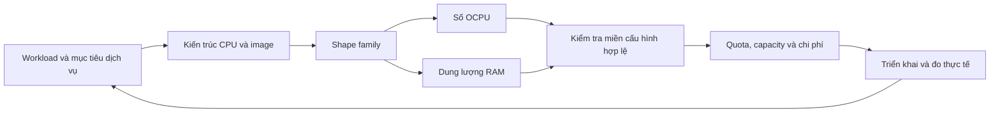

# Flexible shapes, OCPU và phân bổ bộ nhớ

Trong chương **Compute và máy chủ ảo** của module Oracle Cloud Infrastructure (OCI), bài học này hướng dẫn chọn CPU và RAM cho VM bằng flexible shapes. Mục tiêu là tạo cấu hình phù hợp với workload, đọc đúng đơn vị OCPU, kiểm tra giới hạn bộ nhớ và điều chỉnh tài nguyên dựa trên bằng chứng hiệu năng.

Ví dụ xuyên suốt là một dịch vụ Java chạy trên Compute trong VCN, truy cập cơ sở dữ liệu Oracle qua mạng riêng. Compartment và IAM giới hạn quyền quản trị; image và kiến trúc CPU quyết định tính tương thích; Monitoring cung cấp dữ liệu để chọn cấu hình. Việc resize còn liên quan đến thời gian gián đoạn, khả năng sẵn sàng và chi phí của toàn bộ ứng dụng.

## 1. Kết quả cần đạt

Sau bài học, người học có thể:

- Phân biệt shape family, cấu hình OCPU/RAM và số logical CPU hệ điều hành nhìn thấy.
- Quy đổi OCPU theo đúng dòng x86 hoặc Arm đang dùng.
- Kiểm tra cặp OCPU và RAM có hợp lệ theo giới hạn của shape, image và tenancy.
- Lập ngân sách bộ nhớ cho Java heap, native memory, hệ điều hành và khoảng dự phòng.
- Chọn tăng CPU, tăng RAM hoặc kiểm tra I/O dựa trên số đo workload.
- Thực hiện một đợt resize có kế hoạch, đọc lại cấu hình và đo kết quả sau thay đổi.

Bài tập trung vào VM Linux Standard Flex thông thường. Dense I/O, extended memory, burstable và dịch vụ database được nhắc tới để phân biệt phạm vi; chúng có điều kiện riêng, không nên áp dụng máy móc cấu hình của VM Standard.

## 2. Flexible shape cho phép chọn những gì?

Shape xác định loại CPU, tài nguyên và các đặc tính của instance. Với flexible shape, người dùng chọn số OCPU và lượng RAM trong miền cấu hình được hỗ trợ khi tạo hoặc resize VM. Ví dụ `VM.Standard.E5.Flex` là một family; `2 OCPU, 16 GB` là một cấu hình cụ thể của family đó. [Overview of the Compute Service](https://docs.oracle.com/en-us/iaas/Content/Compute/Concepts/computeoverview.htm).



Flexibility giúp tránh phải mua thêm CPU chỉ vì một workload cần RAM nhiều hơn cấu hình cố định. Tuy nhiên, CPU và RAM không hoàn toàn tùy ý: có giới hạn tổng, tỷ lệ RAM/OCPU và các điều kiện của family.

Các tài nguyên khác cũng cần đọc khi chọn shape. Băng thông mạng và số VNIC có thể thay đổi theo OCPU và giới hạn của dòng máy. Tăng RAM không mặc nhiên tăng IOPS của Block Volume; tăng OCPU không bảo đảm storage hoặc database phía sau nhanh hơn.

Chọn một Flex shape cũng không tự tạo chính sách autoscaling cho ứng dụng. Cấu hình CPU/RAM, cơ chế quản lý tài nguyên của VM và autoscaling instance pool là những quyết định cần xem riêng. Lab dùng cấu hình thông thường; nếu Console cung cấp lựa chọn Static/Dynamic Configuration, ghi rõ chế độ đang dùng để các lần đo có thể so sánh.

## 3. OCPU, core và vCPU

### 3.1. Đọc quy đổi theo dòng CPU

OCPU là đơn vị tài nguyên CPU do OCI công bố. vCPU biểu diễn một hardware execution thread. Không dùng một công thức duy nhất cho mọi Arm shape.

Theo tài liệu Compute Shapes hiện hành:

| Nền tảng | Quy đổi 1 OCPU | Ý nghĩa khi quan sát |
| --- | --- | --- |
| x86 AMD/Intel thông thường | 2 vCPU | Hai execution thread trên một physical core |
| Ampere A1 | 1 core, 1 vCPU | Một execution thread trên core |
| Ampere A2 và A4 | 2 core, 2 vCPU | Hai core, mỗi core một execution thread |

Nguồn quy đổi và danh sách family: [Compute Shapes — OCPUs and vCPUs](https://docs.oracle.com/en-us/iaas/Content/Compute/References/computeshapes.htm).

Ví dụ cấu hình 2 OCPU trên x86 thông thường cung cấp 4 vCPU; 2 OCPU trên A1 tương ứng 2 vCPU; 2 OCPU trên A2/A4 tương ứng 4 vCPU. Số logical CPU bằng nhau không có nghĩa topology, hiệu năng một luồng hoặc throughput giống nhau.

Không kết luận VM x86 4 vCPU có bốn physical core độc lập. Cũng không áp dụng quy đổi A1 cho A2 chỉ vì cả hai là Arm. Khi đổi family, kiểm tra lại bảng tài nguyên và đo workload đại diện.

### 3.2. Kiểm tra bên trong guest

Trên VM Linux được phép kiểm tra:

```bash
uname -m
lscpu
nproc
```

`uname -m` giúp nhận diện kiến trúc như `x86_64` hoặc `aarch64`. `lscpu` mô tả topology mà guest nhìn thấy. `nproc` cho biết số processing unit khả dụng đối với tiến trình theo môi trường của nó.

Kết quả có thể chịu ảnh hưởng của CPU affinity, container/cgroup hoặc cấu hình nền tảng. Đối chiếu cùng shape configuration ở OCI, không suy ra OCPU tính phí chỉ từ một lệnh trong container. Nếu số CPU khả dụng thấp hơn dự kiến, kiểm tra giới hạn runtime trước khi mua thêm OCPU.

### 3.3. OCPU không phải thước đo hiệu năng tuyệt đối

Hai VM cùng 2 OCPU có thể dùng thế hệ CPU, tần số, cache và memory bandwidth khác nhau. Workload còn phụ thuộc vector instructions, số luồng thực sự chạy song song và thời gian chờ database/I/O.

Một tiến trình chỉ bận trên một logical CPU có thể khiến CPU trung bình của VM còn thấp. Ví dụ một trong bốn logical CPU bận hoàn toàn trong khi ba CPU còn lại nhàn rỗi cho mức trung bình gần 25%; thêm OCPU không tự chia nhỏ đoạn xử lý đơn luồng đó.

Với Java thuần, bytecode có tính di động, nhưng JDK, container image, JNI/native library và binary đi kèm vẫn phải hỗ trợ kiến trúc đích. Việc đổi x86 sang Arm thường cần image và môi trường chạy phù hợp; không coi đây là thao tác resize tại chỗ luôn khả dụng. [Arm-Based Compute](https://docs.oracle.com/en-us/iaas/Content/Compute/References/arm.htm).

## 4. Bộ nhớ được chọn trong miền giới hạn nào?

### 4.1. Đọc shape options thay vì đoán

Các nhóm thông tin cần kiểm tra:

| Nhóm thông tin | Câu hỏi cần trả lời |
| --- | --- |
| `isFlexible` | Shape có hỗ trợ cấu hình linh hoạt không? |
| `ocpuOptions` | OCPU tối thiểu/tối đa là bao nhiêu? |
| `memoryOptions` | RAM tối thiểu/tối đa và tỷ lệ trên mỗi OCPU là gì? |
| `networkingBandwidthOptions` | Băng thông theo OCPU và trần tổng ra sao? |
| `maxVnicAttachmentOptions` | Số VNIC được phép theo cấu hình? |
| Image compatibility | Image có chạy được trên shape này không? |

Trong CLI, tên trường đầu ra thường dùng dấu gạch nối, ví dụ `memory-options`; API/JSON request có thể dùng camelCase. Đọc giá trị thực thay vì dùng một ảnh chụp bảng giới hạn từ môi trường khác. [Shape resource options](https://docs.oracle.com/en-us/iaas/tools/terraform-provider-oci/latest/docs/d/core_shapes.html).

Các giới hạn có thể khác giữa Standard, Optimized, Dense I/O, burstable và extended memory. Không suy ra “có chữ Flex thì RAM và CPU đều chọn tự do” hoặc “mọi Flex đều resize tại chỗ được”.

### 4.2. Mô hình kiểm tra một cặp CPU/RAM

Với một shape thông thường có giới hạn tổng và tỷ lệ, đặt:

- `C`: số OCPU muốn chọn.
- `M`: RAM theo đơn vị GB của cấu hình OCI.
- `Cmin`, `Cmax`: giới hạn số OCPU.
- `Mmin`, `Mmax`: giới hạn RAM tổng.
- `Rmin`, `Rmax`: giới hạn GB trên mỗi OCPU.

Kiểm tra sơ bộ:

```text
Cmin <= C <= Cmax

RAM thấp nhất cho C = max(Mmin, C * Rmin)
RAM cao nhất cho C  = min(Mmax, C * Rmax)

RAM thấp nhất cho C <= M <= RAM cao nhất cho C
```

Công thức mô tả các ràng buộc cơ bản, chưa thay thế validation của OCI. Nếu shape có bước cấu hình riêng, ràng buộc NUMA hoặc bộ cấu hình định sẵn, phải kiểm tra thêm điều kiện đó.

Ví dụ **giả lập để học cách tính**, không phải thông số của một family cụ thể:

```text
Cmin = 1, Cmax = 8
Mmin = 1 GB, Mmax = 64 GB
Rmin = 1 GB/OCPU, Rmax = 8 GB/OCPU

Với C = 2:
  M thấp nhất = max(1, 2*1) = 2 GB
  M cao nhất  = min(64, 2*8) = 16 GB

2 OCPU + 12 GB: nằm trong miền này.
2 OCPU + 24 GB: vượt giới hạn theo tỷ lệ.
```

Một cấu hình có RAM thấp hơn trần tổng vẫn có thể không hợp lệ vì tỷ lệ theo OCPU. Ngược lại, thỏa tỷ lệ cũng chưa đủ nếu RAM tổng vượt trần của instance.

### 4.3. RAM cấu hình, RAM guest và bộ nhớ ứng dụng

Trường `memoryInGBs` mô tả RAM instance theo đơn vị của OCI. Hệ điều hành có thể hiển thị MiB/GiB và một phần bộ nhớ được dùng cho kernel, agent hoặc các thành phần nền. Khi lập ngân sách, thống nhất đơn vị và đối chiếu lượng bộ nhớ guest thực sự có.

RAM không phải boot volume hoặc Block Volume. Tăng từ 16 lên 24 GB RAM không làm ổ đĩa lớn thêm. Swap sử dụng storage để hỗ trợ quản lý bộ nhớ nhưng không có độ trễ như RAM và không nên được coi là phần RAM tương đương.

## 5. Lập ngân sách bộ nhớ cho dịch vụ Java

### 5.1. Heap chỉ là một phần

Một mô hình tự lập ngân sách:

```text
Bộ nhớ cần cho VM
  = Java heap
  + metaspace và code cache
  + direct buffers, thread stacks và native memory
  + tiến trình phụ, monitoring agent
  + kernel và phần cache hệ điều hành cần thiết
  + khoảng dự phòng cho đỉnh tải
```

Đây là mô hình phân tích, không phải công thức mà mọi thành phần có giá trị cố định. Các vùng có cách reserve/commit khác nhau; cần đối chiếu memory đang sử dụng thực tế thay vì cộng mọi virtual address reservation thành RAM vật lý.

`-Xmx` giới hạn Java heap, không giới hạn tổng RSS của tiến trình. Khi dùng `MaxRAMPercentage`, JVM tính mục tiêu heap theo bộ nhớ mà nó nhận diện trong môi trường chạy; vẫn phải dành chỗ cho phần ngoài heap. [The java Command — tùy chọn bộ nhớ JVM](https://docs.oracle.com/en/java/javase/21/docs/specs/man/java.html).

Với một VM khoảng 16 GB theo cấu hình, một **ngân sách khởi đầu minh họa** có thể dành khoảng 8 GiB cho heap, phần còn lại cho native memory, hệ điều hành và dự phòng. Không coi tỷ lệ 50% là quy tắc bắt buộc; kiểm chứng bằng workload, số thread và các thư viện thực tế.

Ví dụ một cấu hình JVM có heap tối đa cố định:

```bash
java -Xms2g -Xmx8g -jar application.jar
```

Lệnh giả định ứng dụng đã được đóng gói và JDK tương thích. Sau khi tăng RAM VM, giá trị `-Xmx8g` vẫn giữ giới hạn heap đó. Nếu heap là nút thắt, cần đánh giá thay đổi JVM riêng; không kết luận resize RAM vô tác dụng chỉ vì heap chưa được điều chỉnh.

### 5.2. Phân biệt các loại lỗi bộ nhớ

| Bằng chứng | Hướng điều tra |
| --- | --- |
| Heap tiến sát giới hạn, GC nhiều | Live set, allocation rate, cache ứng dụng, heap sizing |
| RSS tăng trong khi heap ổn định | Direct buffer, thread stack, JNI/native allocation |
| Host thiếu available memory, reclaim/swap tăng | Ngân sách tổng của VM và tiến trình khác |
| Container bị OOM dù host còn RAM | Memory limit/cgroup của container |
| Bộ nhớ tăng liên tục không ổn định | Khả năng leak; thêm RAM chỉ kéo dài thời gian xuất hiện lỗi |

Nếu JVM báo `OutOfMemoryError`, đọc loại lỗi và log. Nếu kernel/container kill tiến trình, đối chiếu dữ liệu tại lớp đó; không mặc định hai hiện tượng có cùng nguyên nhân.

### 5.3. Dành RAM có mục đích

RAM nhiều có thể hỗ trợ cache và giảm I/O, nhưng cache phải được giới hạn và có chính sách phù hợp. Không tăng cache đến mức lấn hết chỗ cho native memory. Với dịch vụ gọi database Oracle, tăng RAM ứng dụng không tự tăng SGA/PGA hoặc năng lực dịch vụ database riêng.

Khi có nhiều JVM trên một VM, lập ngân sách cho tổng các tiến trình, không dùng quy tắc phần trăm độc lập khiến mỗi JVM cùng kỳ vọng phần lớn RAM của host.

## 6. Chọn cấu hình từ số đo workload

### 6.1. Thu thập dữ liệu cùng mục tiêu dịch vụ

Ghi throughput mục tiêu, số request đồng thời, p95/p99 latency, tỷ lệ lỗi, thời gian batch và cỡ dữ liệu. Sau đó quan sát CPU, RAM, GC, I/O và dependency ở cùng cửa sổ tải.

| Dấu hiệu | Quyết định cần đánh giá |
| --- | --- |
| Nhiều CPU bận, runnable queue tăng, workload song song | Thêm OCPU hoặc tối ưu CPU |
| Một luồng bận, CPU tổng còn thấp | Tối ưu phần tuần tự hoặc hiệu năng mỗi luồng |
| RAM available thấp, áp lực bộ nhớ kéo dài | Tăng RAM, giảm footprint hoặc sửa cấu hình |
| CPU thấp, thời gian chờ disk cao | Kiểm tra volume và đường I/O |
| CPU/RAM thấp, request chờ database | Query, pool kết nối và dependency |
| Backend đầy tải sau khi tăng CPU app | Giới hạn concurrency và khả năng xử lý toàn hệ thống |

Không mua thêm CPU chỉ vì load average cao. Load có thể gồm tiến trình chờ I/O; cần đọc cùng CPU và trạng thái tiến trình.

### 6.2. Ước lượng OCPU để chọn điểm thử

Trong cùng family, với workload CPU-bound có thể song song và tải tương đương, một ước lượng ban đầu là:

```text
C mới xấp xỉ C hiện tại * CPU utilization hiện tại / utilization mục tiêu
```

Ví dụ giả lập: 2 OCPU đang dùng khoảng 80%, muốn thử mức 60%:

```text
2 * 0,80 / 0,60 = 2,67 OCPU
```

Nếu miền cấu hình yêu cầu OCPU nguyên, có thể thử 3 OCPU sau khi kiểm tra giới hạn. Đây là điểm bắt đầu để đo, không dự báo chính xác latency hay cam kết mức cải thiện. Công thức không phù hợp khi đổi kiến trúc, bị giới hạn một luồng hoặc chủ yếu chờ I/O.

### 6.3. Chừa năng lực cho lỗi và đỉnh tải

Mức sử dụng trung bình ban ngày chưa bao phủ đỉnh tải, startup, GC hoặc batch. Với hai VM sau load balancer, cần đánh giá một VM còn lại chịu được tải khi VM kia bảo trì hay không.

Một VM lớn hơn chỉ tăng tài nguyên cho một điểm lỗi. Có thể cần nhiều instance phân bố phù hợp và triển khai theo từng node để đáp ứng tính sẵn sàng; flexible sizing không tự tạo ra kiến trúc đó.

