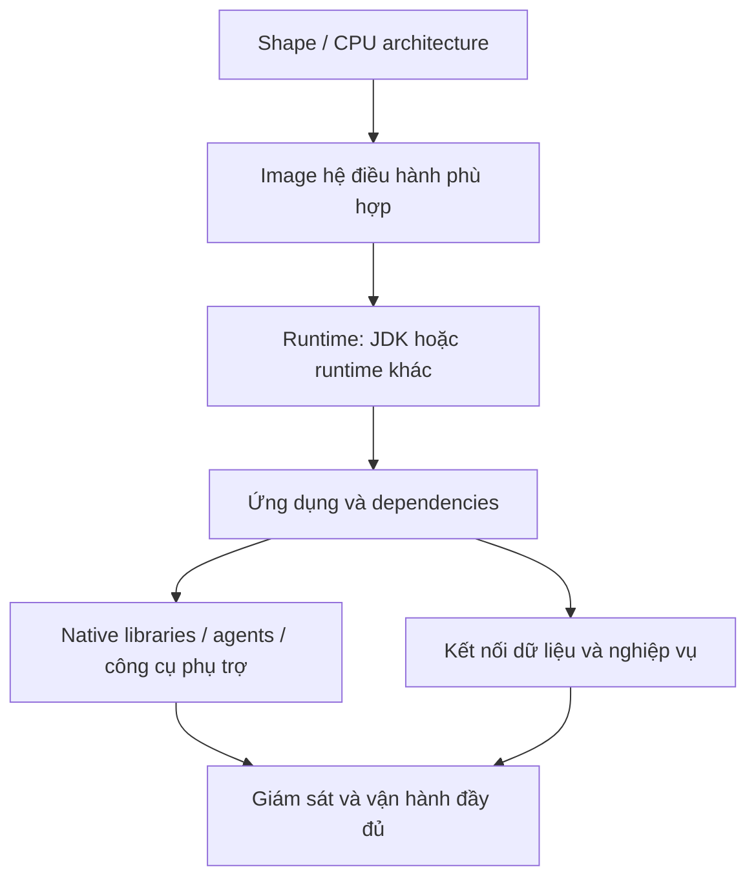

# Kiến trúc x86, Arm và khả năng tương thích ứng dụng

Khi chọn máy ảo trên Oracle Cloud Infrastructure (OCI), OCPU và RAM chưa đủ để quyết định một ứng dụng có chạy được hay không. Image hệ điều hành, JDK, thư viện native, container và công cụ vận hành đều cần phù hợp với kiến trúc CPU của shape.

Trong module **CLOUD_PROVIDERS_ORACLE**, bài học này giúp người học lựa chọn x86 hoặc Arm cho Compute dựa trên bằng chứng: kiểm kê phụ thuộc, dựng môi trường thử, xác minh kết nối cơ sở dữ liệu Oracle và đo hiệu năng–chi phí trước khi chuyển lưu lượng. Lựa chọn kiến trúc cũng được đặt trong kế hoạch phân quyền, giám sát và tính sẵn sàng của hệ thống.

Sau bài học, người học có thể:

- Nhận diện các tên `x86_64`, `amd64`, `aarch64` và `arm64` trong công cụ khác nhau.
- Giải thích phần nào của ứng dụng Java có thể dùng chung và phần nào phải có bản theo nền tảng.
- Kiểm tra image, binary và container trước khi triển khai lên shape đích.
- Lập phương án thử nghiệm, chuyển đổi và rollback theo mục tiêu nghiệp vụ.

## 1. x86 và Arm là những kiến trúc nào?

Kiến trúc tập lệnh, thường gọi là ISA, xác định các lệnh máy mà CPU thực thi cùng nhiều quy tắc liên quan. Trong phạm vi Compute của bài, hai nhóm cần quan tâm là x86-64 và Arm 64-bit.

| Cách gọi | Ý nghĩa thường gặp |
| --- | --- |
| `x86_64`, `x64`, `amd64` | Các cách gọi phổ biến của nền tảng x86 64-bit |
| `aarch64`, `arm64` | Các cách gọi phổ biến của nền tảng Arm 64-bit |
| `x86`, `i386`, `i686` | Có thể chỉ x86 32-bit; phải đọc đúng ngữ cảnh |
| `arm`, `armv7` | Có thể chỉ Arm 32-bit; không mặc định là Arm64 |

`amd64` là tên kiến trúc, không có nghĩa binary chỉ chạy trên CPU mang nhãn AMD. Tương tự, hai máy đều 64-bit chưa bảo đảm thực thi được cùng mã máy.

Một chương trình native x86-64 chứa lệnh máy x86-64. Để chạy trực tiếp trên Arm64, cần bản được xây cho Arm64 hoặc một cơ chế tương thích được tổ chức chấp nhận và kiểm thử. Đổi tên tệp hoặc đổi biến môi trường không chuyển được tập lệnh bên trong binary.

### Kiến trúc không phải toàn bộ đặc tính CPU

Ngay trong x86-64, phần mềm có thể phụ thuộc tập lệnh mở rộng của một thế hệ CPU. Cờ biên dịch như `-march=native` có thể tạo mã tận dụng đặc tính máy build và làm binary không phù hợp với máy khác cùng họ kiến trúc. [GCC: x86 Options](https://gcc.gnu.org/onlinedocs/gcc/x86-Options.html).

Vì vậy thông tin triển khai cần có cả kiến trúc nền, mức tính năng CPU cần thiết và những ràng buộc OS/ABI của phần mềm.

## 2. Kiến trúc xuất hiện ở đâu trong OCI?

OCI có các shape dùng Intel hoặc AMD thuộc nhóm x86 và các shape Arm của họ Ampere. Ví dụ VM Standard x86 và các họ `VM.Standard.A1.Flex`, `VM.Standard.A2.Flex`, `VM.Standard.A4.Flex` cung cấp những lựa chọn khác nhau. Danh sách shape và khả năng cung cấp phải được kiểm tra theo region, image và tenancy đang dùng. [Compute Shapes](https://docs.oracle.com/en-us/iaas/Content/Compute/References/computeshapes.htm).

Đừng chọn image chỉ theo tên hệ điều hành. Một image Linux x86-64 và image Linux AArch64 có thể cùng phiên bản phân phối nhưng chứa kernel, chương trình khởi động và package khác kiến trúc.

Chuỗi cần phù hợp là:



Oracle cung cấp hệ sinh thái phát triển trên Arm, gồm Linux, Java, GraalVM và các công cụ liên quan. Điều đó là điểm khởi đầu cho thử nghiệm; vẫn cần kiểm tra phiên bản và gói cụ thể của workload. [Arm-Based Compute](https://docs.oracle.com/en-us/iaas/Content/Compute/References/arm.htm).

### OCPU không quy đổi giống nhau cho mọi họ Arm

Theo bảng đơn vị cấp phát OCI hiện hành:

| Nhóm Compute | Quy đổi được công bố cho 1 OCPU |
| --- | --- |
| x86 Intel/AMD | 2 vCPU |
| Arm A1 | 1 core, tương ứng 1 vCPU |
| Arm A2 và A4 | 2 core, tương ứng 2 vCPU |

Cần đọc theo đúng họ shape; không dùng quy tắc “mọi Arm OCPU đều bằng một vCPU”. Các đơn vị này cũng chưa chứng minh hiệu năng tương đương giữa các CPU. [Đơn vị OCPU và vCPU của Compute](https://docs.oracle.com/en-us/iaas/Content/Compute/References/computeshapes.htm).

Khi so sánh, ghi lại shape đầy đủ, OCPU, số CPU logic OS nhìn thấy, RAM và giới hạn container nếu có. Benchmark phải dựa trên cùng mục tiêu tải hoặc cùng ngân sách, không chỉ cùng con số OCPU.

## 3. Kiểm tra tương thích theo nhiều lớp

| Lớp | Câu hỏi cần trả lời | Bằng chứng |
| --- | --- | --- |
| Hạ tầng OCI | Shape có sẵn, đủ limit và tương thích image không? | Lựa chọn Console/API và hồ sơ môi trường |
| Hệ điều hành | Image và package đúng CPU architecture chưa? | Thông tin image, `uname`, package metadata |
| Runtime | JDK đúng OS/architecture/version không? | Vendor, phiên bản và thông tin runtime |
| Ứng dụng | Bytecode và API có phù hợp runtime không? | Artifact, cấu hình build và kết quả chạy |
| Native dependencies | `.so`, executable, agent có bản phù hợp không? | Danh sách phụ thuộc và ELF metadata |
| Container | Có image variant cho nền tảng đích không? | Manifest/index và image digest |
| Vận hành | Monitoring, backup, bảo mật và triển khai có hoạt động không? | Kiểm thử toàn bộ vòng đời |
| Sản phẩm | Vendor có hỗ trợ tổ hợp triển khai không? | Ma trận hỗ trợ theo phiên bản |

Tương thích kỹ thuật và trạng thái được nhà cung cấp hỗ trợ là hai bằng chứng cần thu thập riêng. Một binary chạy được trong lab chưa tự xác nhận điều kiện hỗ trợ của phần mềm thương mại hoặc Marketplace image.

Với hệ điều hành, chỉ dùng image được OCI công bố tương thích với shape đích. Việc một OS tồn tại trên Arm ở nền tảng khác chưa chứng minh image tương ứng được hỗ trợ trên OCI.

## 4. Java portable tới mức nào?

Java thường được biên dịch thành class file chứa bytecode của JVM. JVM thực thi bytecode bằng cơ chế phù hợp nền tảng và có thể biên dịch tiếp sang mã máy. Đây là nền tảng cho khả năng dùng chung mã Java trên nhiều hệ điều hành và kiến trúc. Class file cũng có phiên bản và ràng buộc với bản Java mà runtime hỗ trợ. [Java Virtual Machine Specification](https://docs.oracle.com/javase/specs/jvms/se25/html/jvms-1.html).

Mô hình với ứng dụng thuần Java:

```text
Cùng source / bytecode của ứng dụng
              |
       service.jar đã kiểm tra
              |
       +------+------+
       |             |
JVM Linux x86-64  JVM Linux AArch64
       |             |
CPU x86-64        CPU Arm64
```

Có thể sử dụng cùng JAR khi bytecode, API, cấu hình và mọi phụ thuộc đều phù hợp runtime đích. Phần JDK/JRE cài trên hai máy vẫn phải đúng kiến trúc.

Một số điều cần xác minh:

- Class file không yêu cầu phiên bản Java cao hơn runtime.
- API, module, provider bảo mật và JVM options có trong bản JDK được chọn.
- Các dependency không âm thầm nạp native library không phù hợp.
- Đường dẫn, permission, timezone và cấu hình hệ điều hành được chuẩn bị đúng.
- Chức năng ít dùng và tác vụ nền vẫn hoạt động sau startup.

Ví dụ JDK 25 có ma trận chứng nhận OS và CPU riêng; dùng ma trận của đúng vendor và đúng bản JDK mà dự án lựa chọn. Không suy hỗ trợ chỉ từ việc hai gói đều ghi “Java”. [Oracle JDK 25 Certified System Configurations](https://www.oracle.com/java/technologies/javase/products-doc-jdk25certconfig.html).

### Một lỗi Java chưa chắc là lỗi kiến trúc

`UnsupportedClassVersionError` thường hướng tới bytecode/runtime không phù hợp. Nó khác với lỗi nạp thư viện native, lỗi package bị thiếu hoặc ứng dụng không kết nối được database. Ghi lại lỗi gốc trước khi thay shape hay JDK.

Tương tự, `os.arch` dùng để nhận diện runtime hiện tại, không phải một bảo đảm rằng toàn bộ dependency của ứng dụng đã tương thích.

## 5. JNI, thư viện native và ABI

JNI cho phép Java gọi mã native. Phần native được biên dịch và liên kết theo nền tảng; một JAR có lớp Java portable vẫn có thể mang hoặc nạp thư viện gắn với CPU và OS. [JNI: Compiling, Loading and Linking Native Methods](https://docs.oracle.com/en/java/javase/25/docs/specs/jni/design.html).

Những nhóm cần kiểm kê thường gồm:

| Nhóm phụ thuộc | Điều cần tìm |
| --- | --- |
| Driver hoặc SDK native | Client library, shared library và phiên bản hỗ trợ |
| Nén, lưu trữ, xử lý dữ liệu | JNI bên trong dependency hoặc artifact classifier |
| TLS/crypto | Native provider hoặc thư viện tối ưu riêng |
| Xử lý ảnh, video, tài liệu | Executable ngoài JVM và thư viện hệ thống |
| APM/profiler | Native agent được JVM nạp khi khởi động |
| Backup, bảo mật, vận hành | Binary cài ở OS hoặc sidecar |

ABI là tập quy ước giao tiếp nhị phân, liên quan cách gọi hàm, kiểu dữ liệu và liên kết. Đúng Arm64 chưa đủ nếu thư viện yêu cầu libc, C++ runtime hoặc symbol version khác môi trường đang chạy.

Ví dụ một thư viện Linux dùng glibc không mặc nhiên phù hợp với container dùng musl. Tên tệp `.so` không cho biết đầy đủ phiên bản dependency bên trong. Khi lỗi, cần xem cả kiến trúc và các thư viện liên quan.

### Kiểm tra ELF metadata

Các lệnh dưới là ví dụ trên Linux có công cụ tương ứng, với tệp do bạn quản lý:

```bash
file ./service-native
file ./libfeature.so

readelf -h ./libfeature.so
readelf -d ./libfeature.so
readelf --version-info ./libfeature.so
```

`readelf -h` cho biết ELF header, trong đó có machine type; `-d` giúp xem thông tin liên kết động; `--version-info` hiển thị thông tin phiên bản symbol. Các kết quả này hỗ trợ khoanh vùng, chưa thay cho chạy chức năng thực tế. [GNU Binutils: readelf](https://sourceware.org/binutils/docs/binutils/readelf.html).

Nếu package chứa nhiều biến thể, kiểm tra logic chọn biến thể. Tên classifier như `linux-x86_64` hoặc `linux-aarch64` do nhà cung cấp định nghĩa; không mặc định chúng dùng cùng tên với Docker platform.

## 6. Kết nối cơ sở dữ liệu Oracle

Ứng dụng chạy trên Arm có thể là client mạng của một database chạy trên kiến trúc khác. Hai bên giao tiếp qua giao thức, không trao đổi trực tiếp lệnh máy của nhau.

Với Java, cần phân biệt:

| Driver | Ảnh hưởng khi đổi kiến trúc client |
| --- | --- |
| JDBC Thin | Thuần Java; kiểm tra phiên bản JDK, driver, database và cấu hình kết nối |
| JDBC OCI | Dùng native Oracle client libraries; phải có bộ thư viện phù hợp nền tảng |

Oracle mô tả Thin là driver Type IV không cần Oracle client native bổ sung ở phía client, còn OCI driver Type II cần thư viện theo nền tảng. Chữ OCI trong tên driver ở đây là **Oracle Call Interface**. [Introducing JDBC](https://docs.oracle.com/en/database/oracle/oracle-database/26/jjdbc/introducing-JDBC.html).

Khi thử workload trên VM Arm, xác minh các thao tác đại diện: tạo connection pool, truy vấn, ghi có rollback, xử lý dữ liệu đặc thù, TLS/wallet nếu dùng và tái kết nối sau gián đoạn.

Việc chuyển máy ứng dụng sang Arm không tự chuyển database server sang Arm. Nếu dự án muốn đổi cả nền tảng database, phải đánh giá riêng phiên bản, edition, dịch vụ triển khai, image, ma trận hỗ trợ và phương pháp di chuyển dữ liệu. Không suy từ khả năng chạy của JDBC Thin rằng mọi bộ cài database đều có thể dùng trên mọi shape.

## 7. Container không xóa yêu cầu về CPU architecture

Container đóng gói user space và ứng dụng, nhưng binary bên trong vẫn có kiến trúc. Một image chạy native trên x86-64 có thể không có biến thể tương ứng cho Arm64.

Một multi-platform image thường có index trỏ tới các image theo nền tảng. Mỗi biến thể chứa base image, runtime và binary thích hợp; cùng một tag có thể tham chiếu các nội dung khác nhau theo platform. [Docker: Multi-platform builds](https://docs.docker.com/build/building/multi-platform/).

| Nơi hiển thị | x86-64 | Arm64 |
| --- | --- | --- |
| `uname -m` thường gặp | `x86_64` | `aarch64` |
| Docker platform | `linux/amd64` | `linux/arm64` |
| Java `os.arch` thường gặp | `amd64` | `aarch64` |
| Một số package native | `x86_64` | `aarch64` |

Một Dockerfile có thể dùng chung khi các lớp đầu vào hỗ trợ cả hai nền tảng. Ví dụ cho JAR đã được kiểm kê phụ thuộc:

```dockerfile
ARG JAVA_RUNTIME_IMAGE
FROM ${JAVA_RUNTIME_IMAGE}
WORKDIR /opt/app
COPY service.jar /opt/app/service.jar
ENTRYPOINT ["java", "-jar", "/opt/app/service.jar"]
```

Người build phải truyền base image runtime đã xác minh hỗ trợ các platform đích và đúng phiên bản Java. Nếu `service.jar` đóng gói native dependency, cùng một lệnh COPY chưa chứng minh JAR phù hợp cả hai biến thể.

Để xem platform mà một image công bố:

```bash
APP_IMAGE='<IMAGE_REFERENCE_THUC_TE>'
docker buildx imagetools inspect "$APP_IMAGE"
```

Sau đó chạy và thử trên máy native tương ứng. Một index ghi `linux/arm64` nhưng chứa binary bị copy nhầm từ x86 vẫn có thể thất bại khi chức năng đó được gọi.

OCI Kubernetes Engine cũng yêu cầu image ứng dụng phù hợp khi dùng Arm-based nodes; một cây source có thể được dùng để tạo image cho cả hai kiến trúc. [Running Applications on Arm-based Nodes](https://docs.oracle.com/en-us/iaas/Content/ContEng/Tasks/contengrunningarmnodes.htm).

### Emulation và build khác kiến trúc

Các hướng build gồm emulation, builder có nhiều node native và cross-compilation nếu toolchain hỗ trợ. QEMU có thể hữu ích để bắt đầu, nhưng có thể chậm đáng kể với công việc nặng CPU. Kết quả benchmark qua emulation không đại diện hiệu năng chạy native. [Các chiến lược multi-platform build](https://docs.docker.com/build/building/multi-platform/).

Đặt `--platform linux/amd64` trên host Arm không tự biên dịch binary x86 thành Arm. Nếu chạy được qua lớp mô phỏng, vẫn phải ghi rõ điều kiện đó khi báo cáo kết quả.

## 8. GraalVM Native Image và chương trình biên dịch sẵn

Native Image nhận đầu vào Java và tạo native executable cho hệ điều hành, kiến trúc đích. Artifact này có ràng buộc nền tảng khác với JAR chạy trên JVM. [GraalVM Native Image](https://www.graalvm.org/dev/reference-manual/native-image/).

Hồ sơ phát hành có thể tách thành:

```text
service.jar
service-linux-amd64
service-linux-arm64
```

Đây là quy ước tên minh họa. Nội dung, compiler, thư viện và baseline CPU vẫn cần được ghi lại; tên tệp không tự xác nhận đúng platform.

Với native executable, chuẩn bị toolchain và dependencies phù hợp cho từng đích, kiểm tra metadata cần thiết của framework và chạy integration test trên đúng nền tảng. Đừng giả định mọi tùy chọn build hay hỗ trợ cross-compilation đều giống nhau giữa phiên bản công cụ.

Những thành phần ngoài Java cũng cần cách tiếp cận tương tự: executable Go/C/C++/Rust, extension native của runtime khác hoặc công cụ bên ngoài ứng dụng. Một shell script có thể portable nhưng chương trình nó gọi vẫn chỉ có bản x86.

## 9. Lab: đánh giá một dịch vụ Java trên x86 và Arm

### 9.1. Chuẩn bị hai môi trường có thể so sánh

Giả sử có dịch vụ `service.jar`, endpoint readiness và thao tác đọc dữ liệu Oracle đại diện. Chọn hai VM trong điều kiện mạng gần nhau, chẳng hạn cùng region và cách truy cập database giống nhau.

| Hạng mục | Yêu cầu kiểm soát |
| --- | --- |
| Source/artifact | Cùng bản phát hành, ghi checksum |
| Runtime | Cùng vendor/version/patch phù hợp từng architecture |
| OS | Image được hỗ trợ, cấu hình được ghi nhận |
| RAM/heap | Ghi rõ RAM và giới hạn heap/container |
| CPU | Shape, OCPU, CPU logic và giới hạn chạy thực tế |
| Storage/network | Cùng loại cấu hình hoặc giải thích khác biệt |
| Tải | Cùng workload, dữ liệu và phương pháp đo |
| Quan sát | Agent, log và metric cần hoạt động trên cả hai VM |

Chuẩn bị phần mềm từ nguồn được tổ chức sử dụng. Kiểm tra capacity và quyền tạo tài nguyên trước khi dựa vào một họ shape cho kế hoạch chuyển đổi.

### 9.2. Kiểm tra kiến trúc OS và JVM

Ví dụ Bash trên từng VM:

```bash
uname -m
lscpu
java -version
java -XshowSettings:properties -version
```

Ghi nhận `os.arch`, `os.name`, `java.version`, vendor và thông tin CPU. JVM thường xuất phần cài đặt ra stderr; lưu bằng chứng theo cách không bỏ sót luồng đó.

Cần kiểm tra đúng môi trường chạy thật. Nếu ứng dụng ở container, thông tin Java trên host chưa chứng minh runtime trong container đúng phiên bản hoặc platform.

### 9.3. Kiểm kê JAR và dependency

Có thể bắt đầu bằng danh sách thành phần đóng gói:

```bash
jar tf service.jar
```

Tìm native library, executable, classifier theo platform và agent ở cả artifact ứng dụng lẫn gói cài đặt. Với fat JAR có dependency lồng bên trong, danh sách lớp ngoài không chứng minh các JAR lồng là thuần Java; cần xem danh sách phụ thuộc và nội dung liên quan trong quy trình build.

Lập bảng kiểm kê thay vì kết luận từ đuôi `.jar`:

| Thành phần | Loại | Bản x86 | Bản Arm | Bằng chứng cần đạt |
| --- | --- | --- | --- | --- |
| Mã ứng dụng | Bytecode | Runtime phù hợp | Runtime phù hợp | Cùng nghiệp vụ và dữ liệu đúng |
| JDBC driver | Thin hoặc native | Đã xác minh | Đã xác minh | Kết nối và thao tác đại diện |
| Thư viện native nếu có | Shared library | Đúng OS/ABI | Đúng OS/ABI | Load và chức năng thực tế |
| APM/profiler | Java/native agent | Hoạt động | Hoạt động | Thu đủ dữ liệu quan sát |
| Backup/công cụ phụ trợ | Script/binary | Hoạt động | Hoạt động | Thử công việc định kỳ |

Một công cụ chỉ chạy mỗi đêm vẫn là phụ thuộc vận hành. Đừng nghiệm thu sau startup rồi bỏ qua job nền, nén log hoặc xuất báo cáo.

### 9.4. Tránh hard-code kiến trúc trong script

Ví dụ ánh xạ tên OS sang một quy ước artifact nội bộ:

```bash
case "$(uname -m)" in
  x86_64)
    APP_ARCH='amd64'
    ;;
  aarch64|arm64)
    APP_ARCH='arm64'
    ;;
  *)
    printf '%s\n' 'Kiến trúc chưa được quy trình này hỗ trợ' >&2
    exit 1
    ;;
esac

printf 'Artifact architecture: %s\n' "$APP_ARCH"
```

Ánh xạ này chỉ là ví dụ cho kho artifact của dự án. Nếu vendor dùng tên khác, script phải dựa trên quy ước được công bố. Tránh âm thầm lấy bản x86 khi không nhận diện được host.

### 9.5. Chạy và kiểm tra nghiệp vụ

Ví dụ khi JAR đã được chuẩn bị và cấu hình ứng dụng đã cấp đúng:

```bash
java -Xms512m -Xmx1g -jar service.jar
```

Ở phiên kiểm tra riêng, dùng endpoint của lab:

```bash
curl --fail --silent --show-error \
  --connect-timeout 5 --max-time 15 \
  'http://127.0.0.1:8080/health/ready'
```

Heap ở đây là tham số minh họa, không phải khuyến nghị cho mọi VM. Tổng bộ nhớ tiến trình còn gồm phần ngoài heap, thread stack và thư viện native.

Thử tiếp chức năng thật: đọc/ghi dữ liệu thử có kiểm soát, nén/giải nén nếu dùng, gọi SDK, xử lý background job và khởi động lại. Các phép thử phải đi qua đường code có dùng dependency native hoặc agent cần đánh giá.

## 10. So sánh hiệu năng và chi phí bằng workload

Hai CPU có cùng xung nhịp không tự tạo cùng throughput. Bộ nhớ, cache, số luồng, compiler, JIT, hệ thống lưu trữ và dependency mạng đều ảnh hưởng kết quả.

Với dịch vụ Java trên JVM, tách giai đoạn khởi động và warm-up khỏi giai đoạn tải ổn định. Ghi thời lượng, số mẫu, lỗi và giới hạn tải; một lần gọi API không đủ để đánh giá kiến trúc.

| Số đo | Mục đích |
| --- | --- |
| Throughput đạt SLO | Năng lực hữu dụng khi vẫn giữ độ trễ và lỗi trong ngưỡng |
| p50/p95/p99 | Độ trễ điển hình và phần đuôi |
| CPU, RAM, GC | Nút nghẽn và khác biệt tài nguyên |
| I/O và network | Phân biệt giới hạn CPU với dependency khác |
| Startup/restart | Khả năng mở rộng và phục hồi |
| Chi phí trên đơn vị công việc | So hiệu quả với cùng mục tiêu nghiệp vụ |

Compute Instance Monitoring phát metric trong namespace `oci_computeagent`, gồm các thông tin như `CpuUtilization`, `MemoryUtilization`, hoạt động đĩa và mạng. Kiểm tra plugin/agent hoạt động để có dữ liệu; bổ sung metric JVM và ứng dụng khi cần. [Compute Instance Metrics](https://docs.oracle.com/en-us/iaas/Content/Compute/References/computemetrics.htm).

### Ví dụ tính chi phí trên lượng request

Bảng dưới là **số liệu giả lập**, không phải bảng giá hay benchmark OCI:

| Phương án | Tổng chi phí giả định mỗi giờ | Request/s đạt SLO |
| --- | --- | --- |
| VM x86 | 0,12 đơn vị tiền | 1.000 |
| VM Arm | 0,10 đơn vị tiền | 1.200 |

Nếu duy trì được tải đó, chi phí cho một triệu request được tính:

```text
Chi phí / 1 triệu request
  = Chi phí mỗi giờ × 1.000.000 / (request mỗi giây × 3.600)

x86: 0,12 × 1.000.000 / (1.000 × 3.600) ≈ 0,0333
Arm: 0,10 × 1.000.000 / (1.200 × 3.600) ≈ 0,0231
```

Kết luận chỉ áp dụng cho giả định này. Nếu phương án Arm cần thêm RAM, nhiều instance hơn, agent khác hoặc chi phí chuyển đổi lớn, phải đưa các phần đó vào tổng chi phí. Ngược lại, một workload bị giới hạn bởi database có thể ít thay đổi throughput dù đổi CPU.

Đừng dùng giá VM mỗi giờ làm bằng chứng duy nhất. Chọn phương án đạt yêu cầu tương thích, SLO, vận hành và tổng chi phí thực tế của hệ thống.

## 11. Chuyển đổi x86 sang Arm theo cách có thể phục hồi

Thay OCPU/RAM trong cùng môi trường tương thích và chuyển sang ISA khác là hai loại thay đổi cần đánh giá riêng. OCI yêu cầu image hiện tại tương thích với shape mới; có thể kiểm tra danh sách shape tương thích qua image trong Console hoặc API. [Changing the Shape of an Instance](https://docs.oracle.com/en-us/iaas/Content/Compute/Tasks/resizinginstances.htm).

Với chuyển đổi x86 sang Arm, phương án dễ kiểm chứng là dựng VM Arm mới từ image Arm phù hợp rồi triển khai lại ứng dụng. Không dùng bản clone boot volume x86 như một bằng chứng rằng OS có thể khởi động trên Arm.

Quy trình đề xuất:

1. **Kiểm kê:** source, runtime, native dependency, agent, job nền, dữ liệu và điều kiện hỗ trợ.
2. **Chuẩn bị artifact:** dùng JAR đã xác minh portable hoặc xây artifact native/image đúng platform.
3. **Dựng môi trường đích:** OS image, network, IAM, secret, monitoring và cấu hình ứng dụng.
4. **Thử chức năng:** bao gồm đường ít dùng, dữ liệu, backup và restart.
5. **Đo tải:** so theo SLO và chi phí, xác nhận dependency không bị quá tải.
6. **Chuyển một phần lưu lượng:** dùng cơ chế ứng dụng/load balancer phù hợp, quan sát lỗi và độ trễ.
7. **Mở rộng dần:** chỉ tăng khi có bằng chứng đáp ứng mục tiêu.
8. **Rollback hoặc hoàn tất:** giữ đường trở về đủ thời gian và dọn tài nguyên sau khi nghiệm thu.

Với tài nguyên mới, instance OCID thay đổi có thể ảnh hưởng dynamic group và quyền instance principal nếu rule nhận diện theo instance ID. Rà soát cách cấp quyền trong cùng kế hoạch với network và secret; không cấp rộng hơn chỉ để phép thử thành công.

Đối với dữ liệu, chuyển ứng dụng không có nghĩa có thể sao chép tùy ý các file đang được ghi. Chọn phương pháp theo loại dữ liệu, filesystem và công cụ hỗ trợ. Rollback cần tương thích cả schema và giao thức, không chỉ giữ lại VM x86 cũ.

## 12. Những lỗi thường gặp và cách khoanh vùng

| Dấu hiệu | Hướng kiểm tra |
| --- | --- |
| `Exec format error` | Kiến trúc/định dạng executable, interpreter của script và môi trường thực thi |
| `no matching manifest` | Image index thiếu platform mà runtime yêu cầu |
| `UnsatisfiedLinkError` | Sai kiến trúc, đường tìm thư viện hoặc dependency native chưa đáp ứng |
| `GLIBC... not found` / thiếu symbol | libc, ABI và phiên bản thư viện ở môi trường đích |
| `Illegal instruction` | Binary dùng tính năng CPU không có trên đích hoặc lỗi native cần điều tra |
| `UnsupportedClassVersionError` | Phiên bản class file và Java runtime |
| Chỉ lỗi ở một chức năng | Dependency native được nạp muộn hoặc công cụ ngoài JVM |
| Ứng dụng chạy nhưng mất metric | Agent/plugin chưa có bản phù hợp hoặc chưa được cấu hình |
| Throughput thấp dù CPU chưa đầy | Database, network, I/O, lock hoặc giới hạn khác |
| Chỉ lỗi khi chuyển lưu lượng | DNS/route, TLS, session, IAM hoặc khác biệt cấu hình |

Đây là hướng điều tra, không phải ánh xạ nguyên nhân duy nhất. Đọc chuỗi lỗi đầy đủ, xác định tiến trình và artifact thực sự đang chạy rồi đối chiếu platform.

Một trình tự hữu ích là kiểm tra host, OS, runtime, binary/image, dependency được gọi và cuối cùng là đường nghiệp vụ. Tránh thay nhiều lớp cùng lúc khiến không biết thay đổi nào giải quyết sự cố.

## 13. Tự động hóa và vận hành hai kiến trúc

Nếu hệ thống duy trì cả x86 và Arm, hồ sơ phát hành cần biểu diễn platform rõ ràng. Một bản ghi triển khai nên có:

```text
Application version
Target OS / architecture
JDK vendor / version / patch
Native dependency versions
Container index digest và image variant nếu dùng
OCI shape / image OCID / cấu hình tài nguyên
Kết quả chức năng / tải / vận hành
```

Tự động hóa nên chọn đúng image theo region và architecture, xác minh đầu vào trước khi tạo VM và dừng khi thiếu artifact. Cùng tên hiển thị image hoặc cùng tag container không phải bằng chứng về nội dung cố định.

Trong CI, kiểm tra mỗi kiến trúc cần hỗ trợ bằng runner/builder thích hợp và chạy thử trên môi trường native. Một nhánh kiểm tra x86 thành công chưa bao phủ native agent hoặc thư viện của nhánh Arm.

Về tính sẵn sàng, một fleet nhiều kiến trúc cần đủ artifact, dung lượng và công cụ vận hành ở mỗi nhóm. Giữ khả năng triển khai x86 không tự tạo dự phòng nếu không còn capacity hoặc dependency không tương thích ngược.

Đối với ngân sách lab, kiểm kê VM, boot/block volume, load balancer, registry artifact và logging theo dịch vụ đã dùng. Đối chiếu bảng giá và điều kiện của tài nguyên thực tế; không mặc định mọi shape Arm đều có cùng ưu đãi hay cùng giới hạn miễn phí.

## 14. Bài thực hành hoàn chỉnh

Chọn một dịch vụ Java có tương tác cơ sở dữ liệu và lập hồ sơ quyết định kiến trúc:

1. Ghi shape, OS image và runtime x86 hiện tại.
2. Liệt kê mọi native dependency, agent và công cụ ngoài JVM.
3. Chọn shape/image Arm phù hợp, giải thích cách quy đổi OCPU cho đúng họ.
4. Dựng VM thử và kiểm chứng artifact, dữ liệu, tác vụ nền, monitoring cùng quyền truy cập.
5. Chạy workload đại diện, báo cáo throughput đạt SLO, p95, lỗi và mức sử dụng tài nguyên.
6. Tính chi phí trên đơn vị công việc theo giả định được nêu rõ.
7. Chuẩn bị cách chuyển lưu lượng và điều kiện rollback.

Một kết quả đạt yêu cầu phải chứng minh ứng dụng hoạt động đầy đủ trong môi trường đích. Việc chạy được `java -version`, có tag `arm64` hoặc thấy VM ở trạng thái RUNNING mới là những kiểm tra thành phần của quá trình đó.